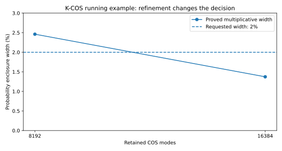

# K-COS: From Matrix to Certified Tail

**Numerical certification audit · 4 November 2026 · Komorebi P.**

This companion tests the executable certification path, rather than the HTML conversion. The audited publication revision is `332d8c86b712fbbabf799c0476a9991848c91c2e`. Its manuscript and numerical engine are retained unchanged. A resource-cap repair is supplied as a separate, tested candidate.

[Read the monograph](https://komorebip.github.io/Operation-KOMOREBI/read/monographs-cos-method/index.html) · [Audit programs](https://github.com/KomorebiP/Operation-KOMOREBI/tree/main/verification/kcos-certification-audit) · [Reproduction workflow and run artifacts](https://github.com/KomorebiP/Operation-KOMOREBI/actions/workflows/kcos-certification-audit.yml)

## Findings

The existing executable regression suite passed **60 tests and 13 subtests**. The new audit made **12 tail evaluations**. Eleven returned finite logarithmic enclosures, and every one contained the entire independently computed reference interval. Ten met the requested multiplicative width. One finite enclosure was too wide, and one difficult spectrum remained unresolved under the declared limits. These are recorded rejections, not successful accuracy claims.

The reference uses exact rational partial fractions and outward Decimal arithmetic. It does not use the K-COS transform or mpmath interval functions. “Independent” here describes the calculation and arithmetic implementation, not an external review of the project.

Three controller resource-limit violations were reproduced. A separate repair candidate passed **25 new regression tests**, including containment checks at three deep-tail thresholds. This companion does not silently replace the publication master with that candidate.

## One complete calculation

Let \(Z\sim N(0,I_4)\), and define \(Q=Z^T HZ\), with \(H=AA^T\) and

\[
A=\frac12\begin{pmatrix}
1&1&1&1&1&1\\
1&-1&1&-1&1&-1\\
1&1&-1&-1&-1&-1\\
1&-1&-1&1&-1&1
\end{pmatrix}.
\]

There is **no additional factor of one half** in the statistic. Exact symbolic multiplication gives

\[
H=\frac12\begin{pmatrix}
3&0&-1&0\\
0&3&0&-1\\
-1&0&3&0\\
0&-1&0&3
\end{pmatrix},\qquad
U=\frac12\begin{pmatrix}
1&1&1&1\\
1&-1&1&-1\\
1&1&-1&-1\\
1&-1&-1&1
\end{pmatrix}.
\]

The audit checks \(U^TU=I\) and \(H=U\operatorname{diag}(1,1,2,2)U^T\). It also checks that the three two-column storage blocks reconstruct the same Gram matrix and the same action on \(v=(1,2,-1,0)^T\). That action is \((2,3,-2,-1)^T\).

Consequently the exact law is

\[
Q\overset d=Z_1^2+Z_2^2+2Z_3^2+2Z_4^2,
\qquad P(Q\ge q)=2e^{-q/4}-e^{-q/2},\quad q\ge0.
\]

At the exact threshold \(q=40\), the probability is approximately

\[
0.00009079779837134726451335506518.
\]

The interval engine receives the exact decimal spectrum `(1, 1, 2, 2)`, support endpoint `512`, auxiliary tilt `0.245`, and a serialized admissible approximation to \((14-\sqrt{26})/40\). The reference evaluates the closed law using a different arithmetic backend.

| Retained modes | Observed multiplicative width, approximately | Requested width | Decision |
|---|---:|---:|---|
| 8,192 | 2.4613004% | 2% | Not accepted |
| 16,384 | 1.3729142% | 2% | Accepted |



Both finite enclosures contain the independent reference. Neither establishes a 0.1% request. The distinction between a valid enclosure and an enclosure narrow enough for the request is essential. The figure is generated in Python from the retained endpoint records. It is not a timing benchmark.

The saved matrix record contains the exact factor, covariance convention, diagonalizer, storage blocks, action, and six symbolic identity checks. A separate regression embeds the factor in five dimensions with an exact zero row and verifies the spectrum `(0, 1, 1, 2, 2)`. The zero mode is removed algebraically, not through an undocumented numerical cutoff.

## Independent reference arithmetic

When every distinct positive coefficient \(\lambda_j\) has even multiplicity \(2m_j\), its contribution has Laplace transform

\[
\left(\frac{r_j}{s+r_j}\right)^{m_j},\qquad r_j=(2\lambda_j)^{-1}.
\]

The product is a rational function. The audit constructs its partial fractions using exact `Fraction` coefficients. A term \(C/(s+r)^k\) contributes

\[
\frac{C}{r^k}e^{-rq}\sum_{a=0}^{k-1}\frac{(rq)^a}{a!}
\]

to the survival probability. Rational-function identities are also checked symbolically for five spectral families, including repeated and clustered poles.

The final exponentials and logarithms are evaluated with Python Decimal at 180 or 220 digits. Basic operations use directed rounding. Each correctly rounded `exp` or `log10` evaluation is enlarged by a representable neighbor in each direction. Correctness remains conditional on the Decimal implementation and the stated analytic identity. This is not a Lean proof of Decimal or of the reference program.

The reference family is deliberately bounded. It does not provide a new exact-law oracle for arbitrary distinct single-degree coefficients, signed forms, or noncentral forms.

## Spectral stress cases

The six controller cases request relative multiplicative width `1e-4`. Their caps are 1,024 modes, support scale 14, and 60 interval digits. Each listed coefficient in the mixed, clustered, and wide cases occurs twice.

| Case | Spectrum and threshold | Outcome |
|---|---|---|
| Repeated spectrum | Eight unit coefficients, `q=40` | Accepted at 512 modes |
| Clustered spectrum | `0.999999, 1, 1.000001, 1.000002`, `q=32` | Accepted at 512 modes |
| Mixed spectrum | `0.25, 0.5, 1, 2, 3, 4`, `q=70` | Accepted at 1,024 modes |
| Wide spectrum | `0.000001, 0.01, 1, 100`, `q=1000` | No finite informative enclosure within the caps |
| Small common scale | Clustered case scaled by `1e-12`, including its threshold | Accepted at 512 modes |
| Large common scale | Clustered case scaled by `1e12`, including its threshold | Accepted at 512 modes |

The wide-spectrum case has a positive exact-law reference near `0.00680669`. Its failure is a limitation of the tested certificate and resource budget, not evidence that the probability is undefined. No midpoint from that run is promoted to a certified answer.

## Deep tails

For the specific control family \(Q=0.02\chi^2_{80}\), the independent reference reduces to a finite Erlang survival formula. The thresholds are stored as exact decimal strings, so the audit concerns those actual inputs rather than idealized quantiles.

| Target tail scale | Modes | Interval digits | Upper bound on probability ratio minus one, rounded upward |
|---|---:|---:|---:|
| \(10^{-100}\) | 128 | 90 | \(2.06\times10^{-12}\) |
| \(10^{-1000}\) | 128 | 90 | \(1.62\times10^{-11}\) |
| \(10^{-5000}\) | 128 | 90 | \(7.70\times10^{-11}\) |

All three contain the complete independent Decimal reference interval. An additional adaptive run at the stored \(10^{-5000}\) threshold met a `1e-18` request, with an upper ratio bound below **\(9.202\times10^{-20}\)**.

This is a result for the displayed structured family. It is not a claim of that accuracy for every spectrum at the same tail depth.

## Davies and Imhof comparisons

Davies was run through the unmodified `qfc.cpp` numerical core from the pinned CRAN CompQuadForm mirror revision `f1e110ac54aa0e64dda8cf6254823e801878e036`. Its Git blob identity is checked before compilation. Minimal compatibility headers supply standard C++ math and allocation declarations. This is **not an execution of the installed R package**.

Seven moderate-tail cases were compared at requested absolute error `1e-10` and an integration limit of 200,000. Six returned `ifault=0`, with observed absolute differences from their exact-binary64-input reference below `1e-10`. The wide-spectrum case returned `ifault=1`. Its raw sentinel is retained in the record and is not interpreted as a probability.

Two independent implementations of the Imhof inversion formula were evaluated with SciPy quadrature. Direct integration exhausted its subdivision limit on the running and wide-spectrum cases. A second implementation separates oscillatory sine and cosine integrals and subtracts an analytically integrable term at the origin. It completed all seven comparisons without warnings, with observed absolute errors below `1e-10` against the exact-law controls.

Neither quadrature error estimates nor Davies success flags are relabeled as directed K-COS certificates. Their absolute-error requests also differ from the K-COS relative-width request. The recorded times are therefore **not an equal-accuracy speed benchmark**. These absolute-error comparisons are not used to judge relative accuracy at \(10^{-5000}\).

## Resource-cap defects and tested repair

The original controller can exceed a declared cap in three reproduced configurations:

| Configuration | Original result | Separate repair candidate |
|---|---|---|
| `initial_K=128, max_K=32` | Evaluates with 128 modes | Rejects the inconsistent request |
| `initial_interval_dps=60, max_interval_dps=30` | Uses 60 interval digits | Rejects the inconsistent request |
| `initial_L=8, max_L=9` | Refines to support scale 10 | Clamps the final refinement to 9 |

These are resource-contract defects. None of these three probes falsely met its stringent numerical accuracy request. The accuracy inequality and the resource contract are distinct obligations.

The candidate validates finite positive integer resource settings, rejects initial values above their caps, and clamps support refinement. It is generated from the hash-checked original and emitted as `controller_caps.patch`. The original engine remains unchanged. The 25-test audit suite checks the repair, the independent reference, exact rank deficiency, and three deep-tail containment cases. The patch still requires integration into a separately maintained runtime or an explicitly revised publication package.

## Claim-to-implementation map

| Claim | Manuscript and executable location | Evidence and boundary |
|---|---|---|
| Exact storage-block reconstruction | Streaming development and `streaming_skat.py` | Existing regression replay plus exact symbolic running example. Appendix B records finite-algebra Lean coverage, not floating-point residualization correctness. |
| Candidate spectrum enclosure | Chapter 5, `claim:final-6-1`; `verified_spectrum.py` | Four existing verifier tests replayed, including a 64-dimensional exact binary factor and a matrix-to-tail contract. The new running example instead has an exact symbolic diagonalization. |
| Support, alias, and omitted-mode enlargement | Chapter 9; `interval_positive_logsf` | Formula-to-code inspection and 11 finite intervals containing separate reference intervals. Positive central spectrum, rank greater than two, and valid tilt parameters required. |
| Multiplicative acceptance | Chapter 10, `claim:final-5-1`; `directed_relative_accuracy` | Both acceptance and rejection paths exercised. The authoritative endpoints remain outward decimal strings. |
| Packet truncation bound | Packet development | Six point checks at increasing orders. This is not directed packet certification. |
| Formal coverage | Appendix B | Recorded finite-algebra and enclosure-consequence proofs. No new Lean compilation and no claim that the analytic or transcendental implementation is formally proved. |

The automatic parameter designer additionally requires a threshold above the supplied spectrum's mean. This is narrower than the fixed-parameter interval backend's nonnegative-threshold domain.

## Reproduce

Use a checkout containing this companion and the audited source bytes. Run the following commands from the repository root:

```bash
python -m pip install -r verification/kcos-certification-audit/requirements.txt
python verification/kcos-certification-audit/run_audit.py all
python verification/kcos-certification-audit/compare_davies.py --prepare
python -m pytest -q verification/kcos-certification-audit/test_audit.py
python verification/kcos-certification-audit/check_results.py
python verification/kcos-certification-audit/plot_results.py
```

The Davies comparison requires a C++ compiler and downloads only the pinned upstream source. Its bytes are checked before compilation. The main numerical audit itself does not require that download. Calls using the interval backend run sequentially because interval precision is shared state.

`results/` contains full endpoint strings, exact inputs, configuration, reference values, rejected cases, and comparison diagnostics. `candidate/` contains the separate repair. The [dedicated workflow](https://github.com/KomorebiP/Operation-KOMOREBI/actions/workflows/kcos-certification-audit.yml) replays the checks and retains these outputs and both Python-generated figures as a run artifact, with a requested retention of 90 days. Artifacts are not permanent archival deposits. The committed scripts and pinned inputs allow regeneration after an artifact expires.

GPU performance, large GWAS workloads, and a new Lean build are outside this audit.

## Sources

The monograph's [interval chapter](https://github.com/KomorebiP/Operation-KOMOREBI/blob/332d8c86b712fbbabf799c0476a9991848c91c2e/monographs/cos-method/book/chapters/09_intervals.tex), [accuracy chapter](https://github.com/KomorebiP/Operation-KOMOREBI/blob/332d8c86b712fbbabf799c0476a9991848c91c2e/monographs/cos-method/book/chapters/10_accuracy.tex), and [formal correspondence](https://github.com/KomorebiP/Operation-KOMOREBI/blob/332d8c86b712fbbabf799c0476a9991848c91c2e/monographs/cos-method/book/chapters/B_lean.tex) define the audited claims and their boundaries. Arithmetic semantics follow the official [Python Decimal documentation](https://docs.python.org/3.13/library/decimal.html) and [mpmath context documentation](https://mpmath.org/doc/current/contexts.html). Comparison conventions follow the [CompQuadForm Davies documentation](https://search.r-project.org/CRAN/refmans/CompQuadForm/html/davies.html), [Imhof documentation](https://search.r-project.org/CRAN/refmans/CompQuadForm/html/imhof.html), and the pinned [Davies core](https://github.com/cran/CompQuadForm/blob/f1e110ac54aa0e64dda8cf6254823e801878e036/src/qfc.cpp).
