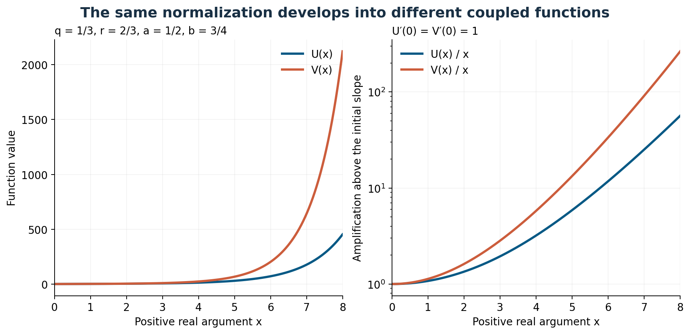

# Special Functions

**Komorebi P.**

Explore five families built from contraction, arithmetic, prime-sieve measures and rotation orbits. Start with a worked calculation, open the current books in the site reader, or follow a result into its written proof and formal companion.

[Run the coupled-function lab](https://KomorebiP.github.io/Operation-KOMOREBI/playground.html#special-functions-coupled) · [Work and evidence](works/monographs-special-functions.md) · [Read by topic](#five-families) · [Choose a book](#reading-volumes)

## A pair of functions with a shared beginning

For real contractions $0<q,r,a,b<1$, the coupled family satisfies

```math
U'(z)=1+U(qz)V(rz),\qquad
V'(z)=1+U(az)V(bz),\qquad U(0)=V(0)=0.
```

Both functions start with slope one. Their later coefficients distinguish the four scale addresses. The [coupled chapter](../monographs/special-functions/monograph/sections_v11/coupled_visual.tex) develops existence, growth and parameter recovery; its extended arguments are collected in the monograph's proof appendices.

<figure>

<figcaption>Original coupled-family plate for q = 1/3, r = 2/3, a = 1/2 and b = 3/4. These source curves use a numerical Taylor truncation over the larger displayed interval. The browser lab below uses the unit disk and an explicit local tail envelope.</figcaption>
</figure>

<a id="coupled-lab"></a>

## Run the coupled-function lab

[Open the interactive lab](https://KomorebiP.github.io/Operation-KOMOREBI/playground.html#special-functions-coupled). It computes twelve exact rational coefficients for each component, plots the Taylor polynomials through degree 23 on $[-1,1]$, and exports both coefficient lists as CSV. Change the four rational contractions or the coefficient count in the editor and run again.

Writing $U(z)=\sum_{n\ge0}u_nz^{2n+1}$ and $V(z)=\sum_{n\ge0}v_nz^{2n+1}$, the first coefficients in this example are $u_0=v_0=1$, $u_1=2/27$ and $v_1=1/8$.

The [formal companion](../monographs/special-functions/formalization/Block01/REPORT.md) records the majorant $0<u_n,v_n\le2^{-n}$ when the four positive scales are at most one. If $N$ coefficients are retained and $0<R<\sqrt2$, put $\rho=R^2/2$. For either component, the omitted series on $|z|\le R$ is bounded by

```math
\left|\sum_{n\ge N}c_nz^{2n+1}\right|
\le \frac{R\rho^N}{1-\rho}.
```

For the supplied $R=1$, $N=12$, the envelope is exactly $1/2048$. It bounds truncation of the series; plotted decimal evaluation also has floating-point roundoff. The formal companion states precisely what is checked for the recurrence and local series and which analytic identifications remain open.

For a shorter first calculation, work through [the scalar contracted-feedback recurrence](examples/24_CONTRACTED_FEEDBACK.md), which computes coefficients by hand before introducing the coupled pair.

<a id="reading-volumes"></a>

## Choose a reading volume

| Volume | What it offers | Read here |
|---|---|---|
| Special Functions | The current 134-page monograph: five families, seven chapters and ten proof appendices | [Open monograph](../monographs/special-functions/books/Special_Functions.pdf) |
| Expanded Visual Guide | The current 180-page visual volume, with 171 worked lessons and associated plates across the eight-paper series | [Open visual guide](../monographs/special-functions/books/Expanded_Visual_Guide.pdf) |
| Resolution and Coupled Atlas | Nineteen pages and fourteen computed plates on coupled functions, growth, recovery and finite resolution | [Open coupled atlas](../monographs/special-functions/books/Resolution_and_Coupled_Atlas.pdf) |
| Packet Realization Core | The preserved 38-page consolidated core and correction register for the original series | [Open core and corrections](../monographs/special-functions/series/Komorebi_Special_Functions_Consolidated_Manuscript_v0.1.pdf) |
| Original Series Collected Reader | The core followed by all eight original papers, assembled into 469 pages | [Open collected reader](../monographs/special-functions/series/Komorebi_Special_Functions_Complete_Reader_v0.1.pdf) |

The last two entries are reference editions. The collected reader already includes the 38-page core. Read the original papers together with that correction register; the first three volumes provide the current reading route.

<a id="five-families"></a>

## Follow one of the five families

| Family | Central question | Begin with |
|---|---|---|
| Contracted nonlinear feedback | How do two contracted arguments determine coefficients and entire growth? | [Defining equation and recurrence](examples/24_CONTRACTED_FEEDBACK.md), then monograph Chapter 1 |
| Arithmetic at complex depth | How do arithmetic weights produce an entire depth parameter, shift formulas and positive kernels? | Monograph Chapter 2, [arithmetic and spectral source](../monographs/special-functions/monograph/main.tex) |
| Prime sieves and signed measures | When do arithmetic moments give positive orthogonal-polynomial systems, and when does positivity fail at finer resolution? | Monograph Chapter 3, with its positivity and transport arguments |
| Spectral functions of zero orbits | How does a rotation-invariant zero address lead to spectral zeta values and exact coefficients? | Monograph Chapters 4–5 and the [sequence plotting guide](demonstrations/SEQUENCE_SHAPES.md) |
| Coupled contraction functions | What do interacting scales preserve about growth, local series and recovery of parameters? | [Coupled atlas](../monographs/special-functions/books/Resolution_and_Coupled_Atlas.pdf), then the [browser lab](#coupled-lab) |

The related [reciprocal sequence plots](https://KomorebiP.github.io/Operation-KOMOREBI/playground.html#sequence-growth) compare exact coefficients with factorial normalization. Their guide explains the relation to Paper IV and the sequence chapter; they are distinct from the coupled-function experiment.

## Follow a result into its evidence

Use the [written proof map](../monographs/special-functions/monograph/sections/proof_map.tex) to locate the relevant argument and appendices. The [current Lean status](../monographs/special-functions/LEAN_STATUS.md) separates the finite projector core from the coupled recurrence, local convergence, tail estimates and generic recovery development.

For the coupled block, start with its [mathematical report](../monographs/special-functions/formalization/Block01/REPORT.md), [claim map](../monographs/special-functions/formalization/Block01/CLAIM_MAP.json) and [Lean source](../monographs/special-functions/lean/CoupledFormal.lean). The analytic-solution bridge, whole-plane continuation and global growth law are among the remaining formalization obligations. The full analytic monograph has not been formalized.

The [edition guide](../monographs/special-functions/README.md) supplies build and replay commands. The [exact coupled-function checker](../monographs/special-functions/tools/check_coupled_exact.py) is a separate computational entry point. The [work page](works/monographs-special-functions.md#evidence) keeps these routes beside the recorded completion and confidence labels.

## Download and continue

[Download the reading selection](DOWNLOADS.md#monographs-special-functions), or use [Build your own ZIP](https://KomorebiP.github.io/Operation-KOMOREBI/downloads.html#build-a-zip) to choose individual books and supporting files. The source edition's [rights and reuse notice](../monographs/special-functions/RIGHTS_AND_REUSE.md) states the available terms.

[Physics collection](PHYSICS_COLLECTION.md#special-functions) · [All reading routes](READING_ROUTES.md) · [Browse the books](browse/MONOGRAPHS.md) · [Glossary](GLOSSARY.md)
