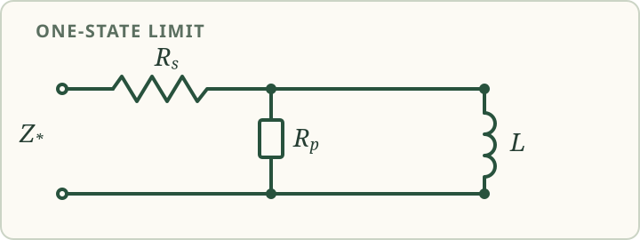

# One-inductor limit: an explicit passive circuit

[Complete Smith chart research reading](https://komorebip.github.io/Operation-KOMOREBI/read/smith-chart/research.html#arbitrary-order-separation) · [Interactive Smith chart](https://komorebip.github.io/Operation-KOMOREBI/smith-chart.html)

**Author:** Komorebi P.

**Status:** A source-bound supplement to the 11 November 2026 research draft.
The algebra and positivity statements below have a [Lean companion](../../research/smith-chart/formal/README.md).
This note does not resolve the transformer-free six-reactive-element question.

The draft's exact-versus-approximate construction has a degree-one limiting
reflection function. The draft states that its corresponding impedance has a
positive one-inductor realization. Here are the component values for the
whole stated parameter range, together with the elementary calculation.

## The affine reflection function

Let \(a\) and \(b\) be real, with

\[
0<b<1-|a|.
\]

This condition implies \(|a|<1\). With \(t(s)=(s-1)/(s+1)\), take
\(G_*(t)=a+bt\) and apply the impedance Cayley transform:

\[
z_*(s)=\frac{1+G_*(t(s))}{1-G_*(t(s))}
=\frac{(1+a+b)s+(1+a-b)}{(1-a-b)s+(1-a+b)}.
\]

All quantities are normalized. The rational identity is understood where
the displayed denominators are nonzero.

## Component values

Put \(c=1-a-b\) and \(d=1-a+b\). A series resistor \(R_s\), followed by
the parallel combination of \(R_p\) and \(L\), realizes \(z_*\) with

\[
R_s=\frac{1+a-b}{d},\qquad
R_p=\frac{4b}{cd},\qquad
L=\frac{4b}{d^2}.
\]

Each value is strictly positive: \(c,d>0\) and \(1+a-b>0\) follow from
\(b<1-|a|\). The parallel branch has impedance

\[
\frac{R_p\,sL}{R_p+sL}
=\frac{4b}{cd}\frac{cs}{cs+d}.
\]

Indeed, \((1+a+b)d-(1+a-b)c=4b\). Adding the series resistor therefore
gives the preceding rational expression for \(z_*\). At \(s=0\) the
inductor is a short and the impedance is \(R_s\); in the infinite-frequency
limit the branch approaches \(R_p\), so the impedance approaches
\(R_s+R_p\).

For the draft's parameters, \(b=(1-a^2)\rho\), where \(|a|<1\) and
\(0<\rho<1/2\). Since

\[
1-a^2=(1-|a|)(1+|a|),\qquad \rho(1+|a|)<1,
\]

these parameters satisfy \(0<b<1-|a|\). Thus the same positive circuit
formula applies throughout the stated range, including negative \(a\).

## The numerical example

For \(a=1/3\) and \(\rho=1/4\), \(b=2/9\), and the formulas give

\[
R_s=\frac54,\qquad R_p=\frac94,\qquad L=\frac98,\qquad
z_*(s)=\frac{7s+5}{2s+4}.
\]

These are the component values in the archived example. They describe its
one-reactive *approximation*, not an exact realization of the degree-six
target discussed elsewhere in the reading.

## What is checked

The Lean file proves the displayed circuit identity over an arbitrary field
under explicit nonzero-denominator hypotheses, the strict positivity of all
three real component values, the parameter-range implication, and the
identity throughout the closed right half-plane \(\operatorname{Re}s\ge0\).
It also checks the normalized example.
The [replay record](../../research/smith-chart/formal/README.md) identifies
the compiler, source archive, imported caches, and negative controls.

This is a selected algebraic and positivity result. It does not formalize the
full arbitrary-order approximation theorem, certify the browser, establish
historical novelty, or settle the six-versus-seven synthesis problem. The
source-to-formal mapping and this review are self-reviewed.
