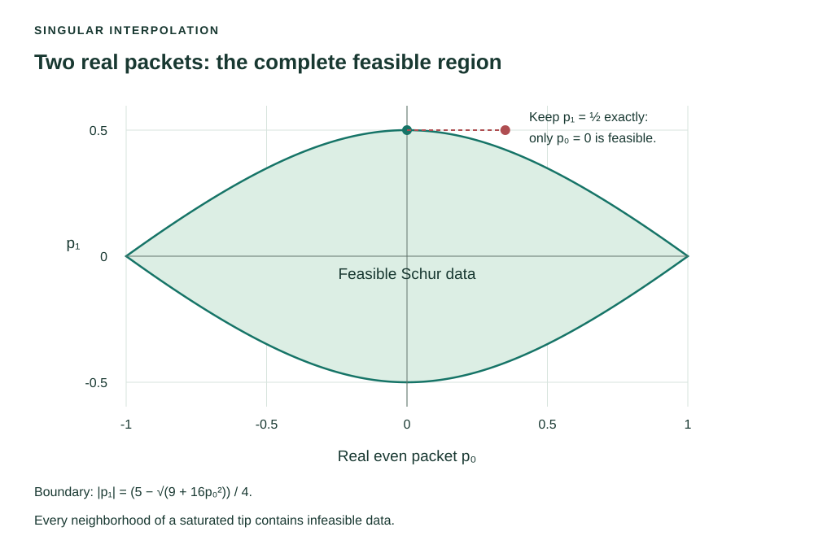

# Singular Pick data: prediction and an exact feasibility boundary

[Smith chart research reading](https://komorebip.github.io/Operation-KOMOREBI/read/smith-chart/research.html#when-uniqueness-fails-quantify-the-possible-answers) · [Interactive laboratory](https://komorebip.github.io/Operation-KOMOREBI/smith-chart.html)

**Author:** Komorebi P.  
**Status:** A mathematical supplement to the 11 November 2026 draft. The proofs
below complete two specific singular-data cases left outside its strict
eigenvalue-margin argument. The review and source mapping are self-review.

A singular Pick matrix has no positive smallest-eigenvalue margin. It can
nevertheless determine an unmeasured value exactly. The missing condition is
that the new column must lie in the range of the original matrix.

## The range condition at a singular matrix

Let \(P\) be a finite Hermitian positive semidefinite matrix, \(b\) a column,
and \(d\) real. Write \(P^\dagger\) for the inverse of \(P\) on its range,
extended by zero on its kernel. Then

\[
\boxed{
\begin{pmatrix}P&b\\b^*&d\end{pmatrix}\succeq0
\quad\Longleftrightarrow\quad
b\perp\ker P\quad\text{and}\quad d\ge b^*P^\dagger b.
}
\]

**Proof.** If \(n\in\ker P\), evaluate the block quadratic form on
\((tn,1)\), with \(t\) complex. Its value is
\(2\operatorname{Re}(\overline t\,n^*b)+d\). Positivity for every \(t\)
forces \(n^*b=0\). Since a finite Hermitian matrix has
\(\operatorname{ran}P=(\ker P)^\perp\), put \(z=P^\dagger b\), so
\(Pz=b\). For arbitrary \(u\) and scalar \(v\), completing the square gives

\[
\begin{pmatrix}u\\v\end{pmatrix}^{\!*}
\begin{pmatrix}P&b\\b^*&d\end{pmatrix}
\begin{pmatrix}u\\v\end{pmatrix}
=(u+zv)^*P(u+zv)+(d-b^*P^\dagger b)|v|^2.
\]

Taking \(u=-z\), \(v=1\) proves necessity of the remaining inequality;
the same identity proves sufficiency. This also covers \(P=0\).

For scalar interpolation data \((t_k,v_k)\), the new node \(\zeta\) and
value \(w\) give

\[
P_{k\ell}=\frac{1-v_k\overline{v_\ell}}{1-t_k\overline{t_\ell}},\qquad
b_k(w)=\frac{1-v_k\overline w}{1-t_k\overline\zeta},\qquad
d(w)=\frac{1-|w|^2}{1-|\zeta|^2}.
\]

Thus every null vector of \(P\) supplies a linear constraint on
\(\overline w\). After these constraints are imposed, the scalar inequality
above completes the test. Interpreting the augmented matrix as an interpolation
criterion uses the same classical Nevanlinna–Pick theorem as the reading;
see John E. McCarthy, [*Pick's Theorem—What's the Big Deal?*](https://www.math.wustl.edu/~mccarthy/public_papers/MonthlyWtbd.pdf),
Theorem 1, page 36 (2003). The nodes are distinct and lie strictly inside the
disk. The constant boundary cases below are supplied explicitly.
When some original packets are unknown, they remain variables in the original
affine block matrix; one cannot treat their unknown \(P^\dagger\) as fixed.

## A missing value forced by singular data

Take \(t_+=1/2\), \(t_-=-1/2\), and measured values
\(v_+=1/2\), \(v_-=-1/2\). Their Pick matrix is

\[
P=\begin{pmatrix}1&1\\1&1\end{pmatrix},\qquad
\ker P=\operatorname{span}\{(1,-1)^{\mathsf T}\}.
\]

At the unmeasured point \(\zeta=i/3\), a candidate value \(w\) must satisfy

\[
(1,-1)b(w)=-\frac{36}{37}\left(\overline w+\frac i3\right)=0.
\]

It follows that **\(w=i/3\) is the only possible value**. It is feasible:
\(F(t)=t\) realizes all three observations, and the augmented Pick matrix
is the three-by-three all-ones matrix.

An incorrect prediction can be rejected with exact arithmetic. If \(w=0\),
the vector \(q=(1,-1,-i/4)^{\mathsf T}\) gives

\[
q^*P_{\mathrm{aug}}(0)q=-\frac{435}{4736}<0.
\]

No floating-point eigenvalue tolerance is needed for this rejection.

## The full boundary for two real packets

At the same two-node orbit, prescribe real packets \(p_0=x\), \(p_1=y\).
The node values are \(v_+=x+y\), \(v_-=x-y\). Their Pick matrix is

\[
P(x,y)=\begin{pmatrix}
\frac43[1-(x+y)^2]&\frac45(1-x^2+y^2)\\
\frac45(1-x^2+y^2)&\frac43[1-(x-y)^2]
\end{pmatrix}.
\]

The exact feasible region is

\[
\boxed{|x|\le1,\qquad
|y|\le\frac{5-\sqrt{9+16x^2}}4.}
\]

**Proof.** Changing the sign of either packet only exchanges the diagonal
entries. Put
\(a=|x|\), \(b=|y|\). Nonnegative diagonal entries imply \(a+b\le1\).
The determinant factors as

\[
\det P(x,y)=\frac{64}{225}
(2a^2-2b^2-5b-2)(2a^2-2b^2+5b-2).
\]

For \(b>0\), the first factor is strictly negative. The determinant is
therefore nonnegative exactly when
\(2a^2-2b^2+5b-2\le0\). Solving this quadratic in \(b\), and using
\(b\le1\), gives the displayed lower-root bound. If \(b=0\), the
constant response \(F=x\) supplies every case \(|x|\le1\).

Conversely, the lower-root bound implies \(a+b\le1\): for
\(0\le a\le1\),
\(\sqrt{9+16a^2}\ge1+4a\), since their squared difference is
\(8(1-a)\ge0\). Hence both diagonal entries and the determinant are
nonnegative. The two-by-two Hermitian matrix is positive semidefinite,
which completes the criterion.

This boundary also solves a simple partial-observation problem. If only a real
\(p_0=x\) is measured, the displayed interval gives every feasible real
choice of the missing \(p_1\). In particular, if \(p_1=1/2\) is retained
exactly, feasibility forces \(p_0=0\). No positive error radius guarantees
feasibility in every direction at that singular tip. For example,
\((p_0,p_1)=(1/10,1/2)\) is infeasible, while
\((1/10,49/100)\) is feasible.

## Verification and scope

The [exact check](../../research/smith-chart/computations/check_completion_boundary.py)
recomputes the determinant factorization, the forced complex value, the
negative witness, and rational examples on both sides of the boundary.
The [verification record](../../research/smith-chart/computations/verification/completion-boundary-003/checks.json)
records its source hash and symbolic environment.

A [selected Lean companion](../../research/smith-chart/completion-formal/README.md)
checks the real zero-corner argument, the determinant factorization, the
saturated-packet conclusion, and the two rational feasible/infeasible
examples. The general Hermitian range lemma, square-root description, and
complex missing-value calculation are written proofs with symbolic checks.

The range lemma applies to any finite positive semidefinite block. The curved
packet boundary uses scalar, real packets at the two nodes \(\pm1/2\).
General noisy partial matrix data, reciprocal frequency-wide realization,
and the transformer-free six-reactive-element question remain separate
problems. These are classical matrix and interpolation methods applied here
with explicit calculations; historical novelty is not asserted.
