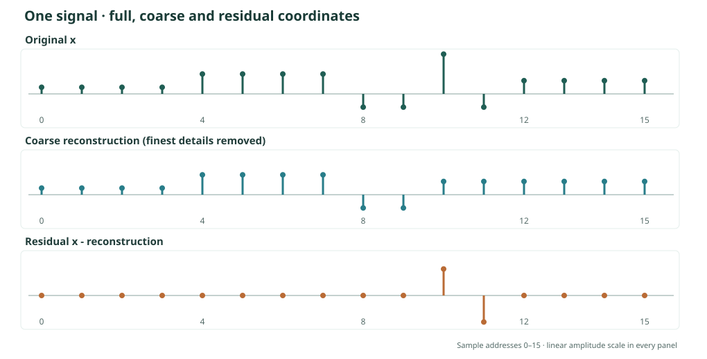
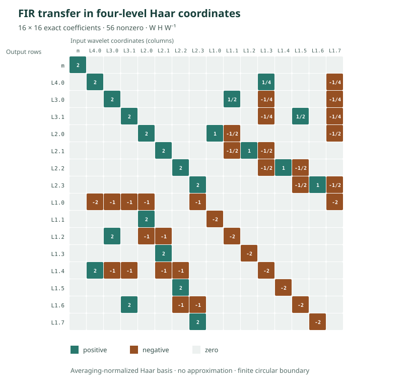

# Wavelets and polyphase transfer: one signal through the whole calculus

**An extended hand-worked example · Komorebi P.**

Begin with sixteen specified sample values. Separate their even and odd addresses, analyze them through four Haar levels, remove a detail packet, reconstruct the resulting signal, and calculate the missing residual exactly. Then apply a three-tap FIR filter and transport the **operation itself** through the polyphase and Haar coordinates.

Nothing in the calculation requires interpolation or a continuous input. The filters and wavelets act on a finite vector, while the same linear-algebraic operations explain why the coordinate transfers work.

[Try the interactive four-level Haar lab](https://KomorebiP.github.io/Operation-KOMOREBI/interactive.html#haar) · [Read the exact program](https://KomorebiP.github.io/Operation-KOMOREBI/read/wavelet-polyphase.html) · [Download the input and exact output](https://KomorebiP.github.io/Operation-KOMOREBI/downloads/wavelet-polyphase/phase-transfer.csv)

## The two destinations

The fixed input is the *Steps and a spike* signal from the existing Haar laboratory:

\[
x=(2,2,2,2,6,6,6,6,-4,-4,12,-4,4,4,4,4)
\in\mathbb Q^{16}.
\]

Its sample addresses are \(0,1,\ldots,15\). We will prove two exact checkpoints:

\[
\boxed{\|x\|_2^2=416=288+128
      =\|\widehat x\|_2^2+\|x-\widehat x\|_2^2}
\]

for the reconstruction without the finest Haar details, and

\[
\boxed{\Phi_2 H\Phi_2^{-1}
=\begin{pmatrix}I-Z&2Z\\2I&I-Z\end{pmatrix}}
\]

for the periodic FIR filter \(H=I+2T-T^2\), where \(\Phi_2\) separates even and odd samples and \(Z\) shifts the half-rate coordinates by one address. Transporting \(H\) into Haar coordinates produces a second, equivalent matrix.

These are finite identities over the rational numbers. The filter is **circular on this sixteen-sample window**. Haar decomposition itself requires no circular boundary rule.

## A map of the calculation

| Description | Coordinates | Operation or invariant |
|---|---|---|
| Original samples | \(x_0,\ldots,x_{15}\) | Fixed addresses and exact arithmetic |
| Two polyphase packets | \(E_k=x_{2k},\ O_k=x_{2k+1}\) | Interleaving reconstructs \(x\) |
| Four address packets | \(x_{4k+r}\) | Each coarse phase is the sum of two finer address selectors |
| Haar analysis | \(a_k=(E_k+O_k)/2,\ d_k=(E_k-O_k)/2\) | Pairwise exact inverse |
| Four-level wavelet tree | Mean and details \(d_{j,k}\) | Weighted energy identity |
| Coarsening | Retain mean and details at levels \(2,3,4\) | Explicit residual and repair |
| Circular FIR | \(H=I+2T-T^2\) | Three-tap discrete filter |
| Operator transfer | \(\Phi_2H\Phi_2^{-1}\), then Haar conjugation | Exact cross-phase and delayed terms |
| All-level transfer | \(M=WHW^{-1}\) in sixteen Haar coordinates | A rational 16×16 matrix that tracks scale coupling |
| Operation order | \(PH-HP\) for the first-level coarse projector | Noncommutation and exact residual accounting |
| Failure controls | Lost detail, lost transfer blocks, wrong boundary | Check precisely what cannot be inferred |

The word *packet* here describes a declared coordinate representation. Simply grouping addresses is not yet a wavelet transform. The Haar transform additionally forms sums and differences of neighboring samples.

## 1. Split the discrete signal into even and odd phases

Define the phase analysis map

\[
\Phi_2x=(E,O),\qquad
E_k=x_{2k},\quad O_k=x_{2k+1}
\qquad(0\leq k<8).
\]

For our input,

\[
\begin{aligned}
E&=(2,2,6,6,-4,12,4,4),\\
O&=(2,2,6,6,-4,-4,4,4).
\end{aligned}
\]

Both phases still contain the original values. The synthesis \(\Phi_2^{-1}(E,O)\) simply interleaves them:

\[
\bigl(\Phi_2^{-1}(E,O)\bigr)_{2k}=E_k,
\qquad
\bigl(\Phi_2^{-1}(E,O)\bigr)_{2k+1}=O_k.
\]

Equivalently, let \(P_0,P_1\) be selectors on the original sixteen addresses. Then \(P_0+P_1=I\), \(P_0P_1=0\), and \(x=P_0x+P_1x\). Each one is a projection onto its original addresses. Their *compact phase rows* are eight-dimensional and should not be confused with their sixteen-dimensional zero-filled versions.

We can refine the address splitting into four rows:

| Remainder mod 4 | Original addresses | Compact phase |
|---:|---|---|
| 0 | 0, 4, 8, 12 | \((2,6,-4,4)\) |
| 1 | 1, 5, 9, 13 | \((2,6,-4,4)\) |
| 2 | 2, 6, 10, 14 | \((2,6,12,4)\) |
| 3 | 3, 7, 11, 15 | \((2,6,-4,4)\) |

In original-address projector notation, \(P_0=F_0+F_2\) and \(P_1=F_1+F_3\). No value is averaged or discarded by this refinement.

## 2. Turn phases into Haar averages and details

For one neighboring pair \((u,v)\), choose the **averaging normalization**

\[
\begin{pmatrix}a\\d\end{pmatrix}
=\underbrace{\frac12
\begin{pmatrix}1&1\\1&-1\end{pmatrix}}_{B}
\begin{pmatrix}u\\v\end{pmatrix},
\qquad
\begin{pmatrix}u\\v\end{pmatrix}
=\underbrace{\begin{pmatrix}1&1\\1&-1\end{pmatrix}}_{B^{-1}}
\begin{pmatrix}a\\d\end{pmatrix}.
\]

Indeed \(B^{-1}B=I\). This local inverse holds for every rational pair, not only for the displayed values. Applying it independently at each pair gives:

| Pair \(k\) | Even \(E_k\) | Odd \(O_k\) | Average \(a_k\) | Detail \(d_k\) |
|---:|---:|---:|---:|---:|
| 0 | 2 | 2 | 2 | 0 |
| 1 | 2 | 2 | 2 | 0 |
| 2 | 6 | 6 | 6 | 0 |
| 3 | 6 | 6 | 6 | 0 |
| 4 | −4 | −4 | −4 | 0 |
| 5 | 12 | −4 | 4 | 8 |
| 6 | 4 | 4 | 4 | 0 |
| 7 | 4 | 4 | 4 | 0 |

The only nonzero finest-level detail is \(d_{1,5}=8\). Its pair is recovered by \(4+8=12\) and \(4-8=-4\). Keeping the average alone gives \((4,4)\) and loses the spike.

### Predict–update lifting: the same pair in another factorization

Paper V also records an exact *lifting* construction. First predict the odd coordinate from the even coordinate, then update the even coordinate using the residual:

\[
\ell=O-E,\qquad s=E+\tfrac12\ell.
\]

The inverse is \(E=s-\ell/2\), followed by \(O=E+\ell\). In matrix form,

\[
\begin{aligned}
\underbrace{\frac12\begin{pmatrix}1&1\\1&-1\end{pmatrix}}_{B}
&=
\underbrace{\begin{pmatrix}1&0\\0&-1/2\end{pmatrix}}_{\text{scale}}
\underbrace{\begin{pmatrix}1&1/2\\0&1\end{pmatrix}}_{\text{update}}
\underbrace{\begin{pmatrix}1&0\\-1&1\end{pmatrix}}_{\text{predict}}.
\end{aligned}
\]

The two triangular matrices have determinant one. The final diagonal factor converts the lifting difference into our Haar detail \(d=-\ell/2\), so \(s=a\). At the nontrivial pair \((12,-4)\),

\[
\ell=-4-12=-16,\qquad
s=12-8=4,\qquad d=8.
\]

Reversing the update and prediction returns \((12,-4)\) exactly. This is an alternative **factorization of the same perfect-reconstruction transform**, not an additional approximation. It is the finite rational specialization of Paper V's predict–update lifting result.

## 3. Continue through all four wavelet levels

Repeat the same averaging and differencing rule on the averages of the preceding level. The complete calculation is:

| Level \(j\) | Averages passed to the next level | Details retained at this level |
|---:|---|---|
| 1 | \((2,2,6,6,-4,4,4,4)\) | \((0,0,0,0,0,8,0,0)\) |
| 2 | \((2,6,0,4)\) | \((0,0,-4,0)\) |
| 3 | \((4,2)\) | \((-2,-2)\) |
| 4 | \((3)\) | \((1)\) |

The final mean is \(m=3\). The stored description consists of that one mean and \(8+4+2+1=15\) detail coefficients. There are sixteen coordinates in total. This is the usual **lowpass-branch Haar decomposition**. A full wavelet-packet tree, as studied separately in Paper V, also splits detail branches; we do not perform that further refinement here.

Synthesis begins at the mean. For each level, restore the children using \((u,v)=(a+d,a-d)\) until all sixteen samples are recovered. The exact inverse is simply the composition of these pair inverses in reverse level order.

### The energy is weighted

The averaging matrix \(B\) is **not orthonormal**: \(B^{\mathsf T}B=I/2\). The correct pair identity is

\[
u^2+v^2=2(a^2+d^2).
\]

After four levels, the synthesis vectors are mutually orthogonal but have different squared lengths. Thus

\[
\boxed{
\|x\|_2^2
=16m^2+\sum_{j=1}^{4}2^j\sum_k d_{j,k}^2.
}
\]

For our input, each contribution is visible:

| Coordinates | Squared-energy contribution |
|---|---:|
| Mean \(m=3\) | \(16\cdot3^2=144\) |
| Level 4: \(1\) | \(16\cdot1^2=16\) |
| Level 3: \(-2,-2\) | \(8(4+4)=64\) |
| Level 2: \(-4\) | \(4\cdot16=64\) |
| Level 1: \(8\) | \(2\cdot64=128\) |
| **Total** | **416** |

Using unweighted squares would be an error. Multiplying the local matrix by \(\sqrt2\) would define a different, orthonormal normalization and require corresponding changes to its inverse and all stored coefficients.

## 4. Drop a detail packet, then reconstruct the exact residual

Suppose we keep the mean and the details at levels \(2,3,4\), but replace every level-1 detail by zero. The reconstruction is

\[
\widehat x=(2,2,2,2,6,6,6,6,-4,-4,4,4,4,4,4,4).
\]

Subtract it from the original:

\[
r=x-\widehat x
=(0,0,0,0,0,0,0,0,0,0,8,-8,0,0,0,0).
\]

The missing detail has the exact synthesis form

\[
\boxed{r=8(e_{10}-e_{11}),\qquad
\|r\|_2^2=8^2+(-8)^2=128.}
\]

Consequently

\[
\|x\|_2^2=\|\widehat x\|_2^2+\|r\|_2^2
=288+128=416.
\]

Restoring the single recorded coefficient \(d_{1,5}=8\) adds \(r\) back and recovers every sample exactly. This is **exact residual repair with retained side information**, not inference of a deleted sample from nothing.

### Why the average alone is insufficient

The original pair \((12,-4)\) and the coarse pair \((4,4)\) have the same average \(4\) but different details. More generally, the first-level averaging map \(A:\mathbb Q^{16}\to\mathbb Q^8\) has kernel

\[
\ker A=\{(u_0,-u_0,\ldots,u_7,-u_7):u\in\mathbb Q^8\}.
\]

Thus \(A\) loses eight independent directions. Two distinct signals can have identical lowpass coordinates, proving that no reconstruction rule using only those coordinates can uniquely recover every input.

There are only six nonzero Haar coefficients for this particular signal: the mean and five details. That fact is an exact sparsity property of **this input**, not a claim about universal compression rates or arbitrary signals.

### Choosing an optimal finite detail budget

Suppose the mean is always retained and exactly \(k\) nonzero detail coefficients may also be kept. Because the Haar synthesis vectors are orthogonal, the exact squared error after selecting a detail set \(K\) is

\[
\boxed{\|x-\widehat x_K\|_2^2
 =\sum_{(j,r)\notin K}2^j d_{j,r}^2.}
\]

Therefore, for this **fixed** Haar basis and uniform cost per retained detail, the optimal choice is to keep the \(k\) largest **weighted energies** \(2^j d_{j,r}^2\). Their positive values here are \(128,64,32,32,16\). The two 32-energy details may be selected in either order.

| Retained nonzero details \(k\) | Retained detail energy | Minimum squared error |
|---:|---:|---:|
| 0 | 0 | 272 |
| 1 | 128 | 144 |
| 2 | 192 | 80 |
| 3 | 224 | 48 |
| 4 | 256 | 16 |
| 5 | 272 | 0 |

One should not substitute raw coefficient magnitude for weighted energy in this normalization. Consider the separate signal

\[
z=(2,2,2,2,2,2,2,2,-2,-2,1,-5,-2,-2,-2,-2).
\]

It has zero mean and only two nonzero details: \(d_{4,0}=2\) with energy \(16(2^2)=64\), and \(d_{1,5}=3\) with energy \(2(3^2)=18\). Its total energy is \(82\). With room for one detail, selecting the largest *magnitude* (3) leaves error \(64\), while selecting the largest *weighted energy* (the smaller amplitude 2) leaves error \(18\).

This finite fixed-basis minimization illustrates the cost accounting behind Paper V's adaptive-selector discussion. It is **not** a proof of the book's more general best-packet-tree dynamic-programming theorem, whose admissible prunings and cost hypotheses differ.

## 5. Apply a discrete filter, not merely an address rearrangement

Now define a circular shift on the same sixteen samples:

\[
(Tx)_i=x_{(i-1)\bmod16}.
\]

Choose a three-tap, finite impulse response filter

\[
H=I+2T-T^2,\qquad
(Hx)_i=x_i+2x_{i-1}-x_{i-2},
\]

where every subscript in the last expression is reduced modulo sixteen. This filter genuinely combines neighboring samples. It is not a relabelling of them.

Direct evaluation gives

\[
\boxed{
Hx=(6,2,4,4,8,16,12,12,2,-18,8,24,-16,16,8,8).
}
\]

For example, the samples at addresses 10 and 11 give

\[
\begin{aligned}
(Hx)_{10}&=12+2(-4)-(-4)=8,\\
(Hx)_{11}&=-4+2(12)-(-4)=24.
\end{aligned}
\]

The filtered signal has squared energy \(2288\). This filter is not energy-preserving. The weighted Haar energy formula applies to its transformed samples too, but does not assert that filtering preserves the original energy.

## 6. Transport the FIR through the polyphase coordinates

Let the half-rate circular shift act on an eight-element phase row by

\[
(Zu)_k=u_{(k-1)\bmod8}.
\]

One full-rate shift exchanges the two address classes and delays only one of them:

\[
(Tx)_{2k}=O_{k-1}=(ZO)_k,\qquad
(Tx)_{2k+1}=E_k.
\]

Therefore the operator, **not just its numerical output**, has the polyphase representation

\[
\Phi_2T\Phi_2^{-1}
=\begin{pmatrix}0&Z\\I&0\end{pmatrix},
\quad
\Phi_2T^2\Phi_2^{-1}
=\begin{pmatrix}Z&0\\0&Z\end{pmatrix}.
\]

By linearity,

\[
\boxed{
\Phi_2H\Phi_2^{-1}
=\begin{pmatrix}I-Z&2Z\\2I&I-Z\end{pmatrix}.
}
\]

Apply this to the displayed even and odd rows:

\[
\begin{aligned}
E'&=(I-Z)E+2ZO=(6,4,8,12,2,8,-16,8),\\
O'&=2E+(I-Z)O=(2,4,16,12,-18,24,16,8).
\end{aligned}
\]

Interleaving \((E',O')\) gives **exactly** the direct sixteen-sample result \(Hx\). This establishes the transfer for every input because the block formula was derived from the shift identities, not fitted to the example.

The half-rate delay \(Z\) is essential. Multiplication by \(T\) crosses the parity boundary, while multiplication by \(T^2\) stays within a phase and shifts it.

## 7. Transport the same filter into Haar coordinates

Write the first-level Haar coordinates as \(a=(E+O)/2,\ d=(E-O)/2\). In block form,

\[
B=\tfrac12\begin{pmatrix}I&I\\I&-I\end{pmatrix},
\qquad
B^{-1}=\begin{pmatrix}I&I\\I&-I\end{pmatrix}.
\]

Conjugating the polyphase filter gives

\[
\boxed{
B\begin{pmatrix}I-Z&2Z\\2I&I-Z\end{pmatrix}B^{-1}
=\begin{pmatrix}2I&I-Z\\Z-I&-2Z\end{pmatrix}.
}
\]

Thus the filtered Haar coordinates satisfy

\[
\boxed{
\begin{aligned}
a'&=2a+(I-Z)d,\\
d'&=(Z-I)a-2Zd.
\end{aligned}}
\]

The two **off-diagonal blocks** mean that averages influence filtered details and details influence filtered averages. This is what a nontrivial operator transfer looks like.

At address pair \(k=5\), our coefficients are

\[
a_5=4,\quad d_5=8,\qquad a_4=-4,\quad d_4=0.
\]

The transferred values are

\[
a'_5=2(4)+(8-0)=16,\qquad
d'_5=(-4-4)-2(0)=-8.
\]

Synthesis then gives \(E'_5=a'_5+d'_5=8\) and \(O'_5=a'_5-d'_5=24\), matching the direct filter at addresses 10 and 11.

| Pair \(k\) | Filtered even \(E'_k\) | Filtered odd \(O'_k\) | Filtered average \(a'_k\) | Filtered detail \(d'_k\) |
|---:|---:|---:|---:|---:|
| 0 | 6 | 2 | 4 | 2 |
| 1 | 4 | 4 | 4 | 0 |
| 2 | 8 | 16 | 12 | −4 |
| 3 | 12 | 12 | 12 | 0 |
| 4 | 2 | −18 | −8 | 10 |
| 5 | 8 | 24 | 16 | −8 |
| 6 | −16 | 16 | 0 | −16 |
| 7 | 8 | 8 | 8 | 0 |

In the accompanying code, the direct filter, polyphase transfer, and Haar-conjugated transfer are checked independently for all sixteen standard basis vectors of \(\mathbb Q^{16}\). Since these maps are linear, agreement on that basis certifies the **finite-dimensional operator identity**.

### A sharp finite filter-stability certificate

Paper V discusses stability alongside exact reconstruction. For the particular three-tap operator here, we can calculate the precise norm range with no numerical eigensolver.

The cyclic shift is orthogonal: \(T^*=T^{-1}\). Define \(A=T^{-1}-T\), so \(A^*=-A\). Since

\[
H=I+2T-T^2=T(2I+A),
\]

orthogonality and cancellation of the cross term give, for every \(v\in\mathbb R^{16}\),

\[
\begin{aligned}
\|Hv\|_2^2
&=\|(2I+A)v\|_2^2\\
&=4\|v\|_2^2+\|Av\|_2^2.
\end{aligned}
\]

Also \(\|Av\|_2\leq\|T^{-1}v\|_2+\|Tv\|_2=2\|v\|_2\). Hence

\[
\boxed{
4\|v\|_2^2\ \leq\ \|Hv\|_2^2\ \leq\ 8\|v\|_2^2.
}
\]

Both constants are sharp on the sixteen-cycle. A constant vector attains the lower bound; the repeated four-period vector \((1,0,-1,0,\ldots)\) attains the upper bound. In particular, \(H\) is invertible in this finite-dimensional circular setting and \(\|H^{-1}\|_{2\to2}\leq1/2\).

For our fixed signal,

\[
\underbrace{\|Hx\|_2^2}_{2288}
=4\underbrace{\|x\|_2^2}_{416}
+\underbrace{\|(T^{-1}-T)x\|_2^2}_{624}
=1664+624.
\]

This is a stability statement for the *declared periodic filter*, not a universal stability bound for an arbitrary FIR filter or nonperiodic extension.

### Why the missing-transfer error is exactly the energy surplus

There is a second identity behind the number \(624\). If the off-diagonal Haar transfer blocks are deleted, then the omitted coefficient contributions are

\[
\delta a=(I-Z)d,\qquad \delta d=(Z-I)a.
\]

Under the averaging normalization, synthesis of the pair \((\delta a,\delta d)\) has squared norm \(2(\|\delta a\|_2^2+\|\delta d\|_2^2)\). Rewriting in the original even and odd phases shows

\[
\begin{aligned}
\|Hv-y_{\mathrm{wrong}}(v)\|_2^2
&=2\|(I-Z)d\|_2^2+2\|(I-Z)a\|_2^2\\
&=\|(I-Z)E\|_2^2+\|(I-Z)O\|_2^2\\
&=\|(I-T^2)v\|_2^2\\
&=\|(T^{-1}-T)v\|_2^2.
\end{aligned}
\]

The last equality uses the norm-preserving cyclic shift \(T^{-1}\). Therefore, **for every input in this finite model**, the missing-transfer error equals the FIR's energy surplus over \(4\|v\|_2^2\). Both happen to equal \(624\) for our chosen input because they arise from the *same* operator expression.

## 8. Transport the filter through all four Haar levels

So far, \(B\) has changed only the **first** pair level. We can transport the FIR through the entire four-level analysis instead.

Let \(W:\mathbb Q^{16}\to\mathbb Q^{16}\) store the final mean, followed by details from coarse to fine:

\[
Wx=(m,d_{4,0},d_{3,0},d_{3,1},
d_{2,0},\ldots,d_{2,3},
d_{1,0},\ldots,d_{1,7})^{\mathsf T}.
\]

The inverse \(W^{-1}\) performs the pair synthesis from Section 3. Because every local Haar step is invertible, \(W\) is invertible. The exact operator in these coordinates is

\[
\boxed{M=WHW^{-1},\qquad W(Hv)=M(Wv)\quad(v\in\mathbb Q^{16}).}
\]

This is a **change of coordinates of the filter**, not an alternative filter or an approximation. With our averaging normalization, \(W\) is invertible but not orthonormal.

### Calculate every matrix entry from one coordinate impulse

Let \(u_j\) be the \(j\)-th standard basis vector in **wavelet-coordinate space**. Then the \(j\)-th column of \(M\) is

\[
\boxed{M_{\cdot j}=W\bigl(H(W^{-1}u_j)\bigr).}
\]

The process is explicit: synthesize one wavelet basis coordinate, apply the three-tap filter at the original sample addresses, and analyze the result through all four levels. Doing this for all sixteen coordinate impulses determines the complete matrix. Its entries lie in \(\mathbb Q\).

For this filter and this coordinate ordering, precisely **56 of the 256 entries are nonzero**. The first row is \((2,0,\ldots,0)\), since the sum of the FIR taps is \(1+2-1=2\): the filtered global mean is twice the original mean. The other rows describe transfers among different detail scales.

The [full sparse matrix (CSV)](https://KomorebiP.github.io/Operation-KOMOREBI/downloads/wavelet-polyphase/full-wavelet-transfer.csv) provides every nonzero entry with its row and column labels. Unlisted cells are exactly zero. Matrix sparsity is **basis dependent** and does not, by itself, establish a speedup over direct three-tap filtering.

### Check that the filter changes the distribution of energy

The original and filtered wavelet vectors, in the same declared order, are

\[
\begin{aligned}
Wx={}&(3,1,-2,-2,\;0,0,-4,0,\;0,0,0,0,0,8,0,0)^{\mathsf T},\\
W(Hx)={}&(6,2,-4,0,\;0,0,-12,-4,\;2,0,-4,0,10,-8,-16,0)^{\mathsf T}.
\end{aligned}
\]

The matrix multiplication \(M(Wx)=W(Hx)\) holds coefficient by coefficient. The appropriate comparison is **weighted** by the squared norms of the Haar synthesis vectors:

| Coordinates | Energy before FIR | Energy after FIR | Nonzero before → after |
|---|---:|---:|---:|
| Global mean | 144 | 576 | 1 → 1 |
| Level 4 details | 16 | 64 | 1 → 1 |
| Level 3 details | 64 | 128 | 2 → 1 |
| Level 2 details | 64 | 640 | 1 → 2 |
| Level 1 details | 128 | 880 | 1 → 5 |
| **Total** | **416** | **2,288** | **6 → 10** |

Thus a sparse input in this particular Haar coordinate system need not remain equally sparse after filtering. The energy change is consistent with the sharp FIR identity in Section 7. This table does not imply that the filter creates information or that wavelet transforms reduce the cost of the direct convolution.

## 9. Filtering and coarsening do not generally commute

The residual example in Section 4 defines an exact coarse operator \(P\): replace every finest-level Haar detail by zero and retain the corresponding pair averages. It is a projector, \(P^2=P\), and \(Px=\widehat x\).

There are two possible workflows:

\[
x\xrightarrow{P}Px\xrightarrow{H}HPx,
\qquad
x\xrightarrow{H}Hx\xrightarrow{P}PHx.
\]

For our fixed sixteen samples, these produce

\[
\begin{aligned}
HPx={}&(6,2,4,4,8,16,12,12,\;2,-18,0,16,8,8,8,8),\\
PHx={}&(4,4,4,4,12,12,12,12,\;-8,-8,16,16,0,0,8,8).
\end{aligned}
\]

Their difference is the **commutator witness**

\[
\begin{aligned}
(PH-HP)x
={}&(-2,2,0,0,4,-4,0,0,\\
&\qquad-10,10,16,0,-8,-8,0,0).
\end{aligned}
\]

Its squared norm is

\[
\boxed{\|(PH-HP)x\|_2^2=624.}
\]

This is not a roundoff artifact: all sixteen entries are exact integers.

### Prove the commutator identity, not just the one example

In first-level Haar coordinates \((a,d)\), coarsening is the diagonal projector
\(D=\operatorname{diag}(I,0)\). Recall from Section 7 that

\[
\mathcal H
=\begin{pmatrix}2I&I-Z\\Z-I&-2Z\end{pmatrix}.
\]

Direct block multiplication gives

\[
\boxed{
D\mathcal H-\mathcal H D
=\begin{pmatrix}0&I-Z\\I-Z&0\end{pmatrix}.
}
\]

This proves that the filter and first-level coarsening commute only on inputs annihilated by the displayed cross-channel expression. In particular, the commutator is **not** the zero operator.

The averaging-normalized synthesis map satisfies
\(\|B^{-1}(u,v)\|_2^2=2(\|u\|_2^2+\|v\|_2^2)\). With \(E=a+d\) and \(O=a-d\),

\[
\begin{aligned}
\|(PH-HP)v\|_2^2
&=2\|(I-Z)d\|_2^2+2\|(I-Z)a\|_2^2\\
&=\|(I-Z)E\|_2^2+\|(I-Z)O\|_2^2\\
&=\|(I-T^2)v\|_2^2\\
&=\|(T^{-1}-T)v\|_2^2.
\end{aligned}
\]

Consequently, for **every input in the declared even-length circular model**,

\[
\boxed{
\|(PH-HP)v\|_2^2
=\|Hv-y_{\mathrm{wrong}}(v)\|_2^2
=\|Hv\|_2^2-4\|v\|_2^2.
}
\]

The three quantities have equal squared norms for algebraic reasons. The commutator residual and the omitted-transfer residual need not be the same vector: their first-level detail contributions have different signs. This distinction matters when reconstructing the actual missing signal rather than just measuring its energy.

### Compare both approximations with the complete filtered signal

Neither order recovers \(Hx\) when the discarded coefficients interact with \(H\).

| Calculation | Squared error relative to \(Hx\) |
|---|---:|
| Coarsen, then filter: \(\|Hx-HPx\|_2^2\) | 768 |
| Filter, then coarsen: \(\|Hx-PHx\|_2^2\) | 880 |
| Compare the two outputs: \(\|PHx-HPx\|_2^2\) | 624 |

Both approximation errors can also be checked without constructing any large matrix. The first difference is

\[
Hx-HPx=H(x-Px)=H\bigl(8(e_{10}-e_{11})\bigr)
=8e_{10}+8e_{11}-24e_{12}+8e_{13}.
\]

Its squared norm is \(64+64+576+64=768\). For the other order, the omitted finest details of the *filtered* signal are \((2,0,-4,0,10,-8,-16,0)\). The averaging normalization therefore gives

\[
\|Hx-PHx\|_2^2
=2(2^2+(-4)^2+10^2+(-8)^2+(-16)^2)
=\boxed{880}.
\]

The three values are distinct questions. In particular, the commutator energy **cannot** be obtained by simply subtracting the two approximation errors.

The [operation-order ledger (CSV)](https://KomorebiP.github.io/Operation-KOMOREBI/downloads/wavelet-polyphase/operation-order.csv) records the complete sixteen-component vectors and both residuals. The [scale-energy ledger (CSV)](https://KomorebiP.github.io/Operation-KOMOREBI/downloads/wavelet-polyphase/multiscale-energy.csv) records each original and filtered Haar band.

The lesson is exact and bounded: packet selection can commute with some operations and not others. A valid transfer grammar must retain the cross-packet interactions or explicitly account for their residual. Nothing here establishes a general result for arbitrary infinite filters, noncircular boundaries or data-driven packet recovery.

## 10. Three controls that expose the limits

**Delete a detail coefficient.** Keeping only lowpass coordinates does not identify the original signal. The displayed \(x\) and \(\widehat x\) have the same first-level averages but differ by the nonzero residual \(8(e_{10}-e_{11})\). Recovery succeeds only when that missing detail is supplied.

**Ignore the cross-phase blocks.** If we incorrectly replace the full Haar transfer matrix by its diagonal blocks \(2I\) and \(-2Z\), synthesis produces

\[
y_{\mathrm{wrong}}=(4,4,4,4,12,12,12,12,-8,-8,8,8,-8,24,8,8).
\]

Compared with \(Hx\), its squared error is

\[
\boxed{\|Hx-y_{\mathrm{wrong}}\|_2^2=624.}
\]

This is not a small rounding effect. It is the algebraic cost of deleting genuine transfer terms.

**Change the boundary without changing the formulas.** Our calculation uses a circular shift. At address zero,

\[
(Hx)_0=x_0+2x_{15}-x_{14}=2+8-4=6.
\]

A zero-extended, causal convolution would instead give \(2\) at address zero. At address one, it would give \(x_1+2x_0=6\) rather than the circular value \(2\). All other addresses agree for this three-tap filter. Thus the difference is the explicit two-address boundary packet

\[
\boxed{
H_{\mathrm{circ}}x-H_{\mathrm{zero}}x
=(4,-4,0,\ldots,0),\qquad
\|H_{\mathrm{circ}}x-H_{\mathrm{zero}}x\|_2^2=32.
}
\]

More generally, for a window of length \(n\geq2\) with the same taps,

\[
H_{\mathrm{circ}}v-H_{\mathrm{zero}}v
=(2v_{n-1}-v_{n-2})e_0-v_{n-1}e_1.
\]

The residual is supported on the first two output addresses. Once the last two input samples and the boundary convention are specified, this finite correction can be added or removed exactly. Both boundary conventions are legitimate, but their operators and polyphase matrices differ. The **circular** transfer matrix cannot be applied to the zero-extended filter without that correction. This finite boundary calculation does not resolve Paper V's broader singular-edge recovery questions.

## 11. What is proved and what is checked

The Haar pair inverse, predict–update lifting, weighted energy identity, projector refinement, and finite circular FIR transfer are exact algebraic statements. The multilevel inverse and energy formula follow inductively from the pair identities. The first-level and full-four-level transfer matrices follow by conjugating the declared linear operators. The stability identity follows from the skew-adjoint shift difference, while the optimal fixed-basis selector follows from orthogonality. The noncommutation and equal-energy identities follow from the stated block matrices and circular shift identities.

The independent Python checker uses exact rational and integer arithmetic. It verifies the complete hand calculation, the first-level and full-four-level transfers on sixteen coordinate impulses, all \(5^4=625\) four-sample signals with entries in \(\{-2,-1,0,1,2\}\), and fixed-seed inputs of lengths \(8,16,32\). It also checks the lifting inverse, the sharp filter identity, the omitted-block energy identity, the commutator, the scale ledger and the boundary correction. The program now records **6,909 exact assertions**. These finite regressions test the implementation in addition to the algebraic arguments on this page.

The demonstration does **not** prove stability for an arbitrary infinite filter bank, unrestricted singular-edge recovery, universal compression, or empirical benefits for genetic association tests. Paper V treats broader wavelet and polyphase results with specific hypotheses; its inherited formal evidence is separate from this example. No fresh Lean theorem correspondence is asserted here.

## 12. Reproduce the exact tables and figures

The standalone program needs Python 3.10 or later and only the standard library. Run from the collection checkout:

~~~text
python -B examples/wavelet_polyphase.py
python -B examples/wavelet_polyphase.py --output wavelet-results
~~~

The first command runs exact assertions. The second generates **nine reproducible files**: six CSV tables (sample transfer, Haar coefficients, optimal detail budgets, full rational wavelet matrix, scale energies and operation order), two Python-generated SVG figures, and the finite-check JSON record. The website publishes committed output snapshots, checks their identities, and reproduces their exact bytes in its build workflow.

[Read the complete Python program on this site](https://KomorebiP.github.io/Operation-KOMOREBI/read/wavelet-polyphase.html) · [Download the standalone program](https://KomorebiP.github.io/Operation-KOMOREBI/downloads/wavelet-polyphase/wavelet_polyphase.py)

[Transfer and boundary table (CSV)](https://KomorebiP.github.io/Operation-KOMOREBI/downloads/wavelet-polyphase/phase-transfer.csv) · [Haar coefficients (CSV)](https://KomorebiP.github.io/Operation-KOMOREBI/downloads/wavelet-polyphase/haar-coefficients.csv) · [Optimal detail budgets (CSV)](https://KomorebiP.github.io/Operation-KOMOREBI/downloads/wavelet-polyphase/weighted-budget.csv) · [Full four-level matrix (CSV)](https://KomorebiP.github.io/Operation-KOMOREBI/downloads/wavelet-polyphase/full-wavelet-transfer.csv) · [Scale energies (CSV)](https://KomorebiP.github.io/Operation-KOMOREBI/downloads/wavelet-polyphase/multiscale-energy.csv) · [Operation order (CSV)](https://KomorebiP.github.io/Operation-KOMOREBI/downloads/wavelet-polyphase/operation-order.csv) · [Exact certificate (JSON)](https://KomorebiP.github.io/Operation-KOMOREBI/downloads/wavelet-polyphase/results.json) · [Signal figure (SVG)](https://KomorebiP.github.io/Operation-KOMOREBI/downloads/wavelet-polyphase/signal-comparison.svg) · [Matrix heatmap (SVG)](https://KomorebiP.github.io/Operation-KOMOREBI/downloads/wavelet-polyphase/full-wavelet-transfer.svg) · [Complete source-and-results archive (ZIP)](https://KomorebiP.github.io/Operation-KOMOREBI/downloads/wavelet-polyphase/source-and-results.zip)

### Follow the original literature

This reader example is built from the established [four-level Haar laboratory](HAAR_LAB.md), the [Haar pair hand calculation](../examples/14_HAAR_PAIRS.md), and the [finite residue refinement example](REFINEMENT.md). The FIR transfer, lifting construction and finite selector discussion specialize the operator, filter-bank and adaptive-tree machinery in [Paper V: Multiresolution Signal Calculus](../works/paper-v.md), especially its **Exact FIR polyphase transfer law**, **Exact lifting reconstruction** and **Finite globally optimal stable selector**. Consult the [traditional manuscript](../../papers/paper-v/current/editable/traditional/Paper_V_Traditional_Final.tex), [recorded verification scope](../../papers/paper-v/current/README.md), and [Information Realization](../works/information-realization.md). The additional FIR stability, full-four-level matrix and commutator identities above are derived directly for this specified finite operator. Their statements do not inherit the wider hypotheses or formal verification status of Paper V. The longer manuscript's wavelet-packet tree theorems and separated-jump conditions remain separate from this fixed lowpass-branch example.

For a different application, see [Streaming Polyphase Factor Decomposition / SKAT](../works/streaming-skat.md). This example demonstrates legitimate signal-processing operations on finite discrete data; it does not assert improved SKAT power or runtime.

[Back to all demonstrations](../DEMONSTRATIONS.md) · [All hand-worked examples](../HAND_WORKED_EXAMPLES.md) · [Evidence and verification guide](../RECORDS.md)
