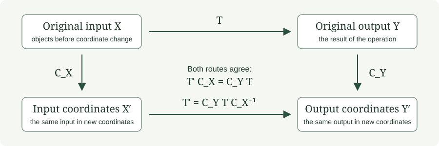

# Transfer and compression

[Operator guide](../OPERATOR_AUDIT.md) · [Packets and projectors](PACKETS.md) · [Recovery and repair](RECOVERY.md)

Transfer describes an operation through parts or another representation.
Compression also asks whether the retained description supports the requested
operation. The distinction is visible in exact, small matrix calculations.

## 1. Source-to-target blocks

Let $T:X\to Y$ be linear. Let $P_i$ select input packets in $X$ and
$Q_j$ select output packets in $Y$. A block is

```math
T_{ji}=Q_jTP_i.
```

The column index names the source and the row index names the target.
The source and target families need not belong to the same space.
For the matrix $T=\begin{pmatrix}1&2\\3&4\end{pmatrix}$ in ordinary
coordinate packets, the upper-right block is
$\begin{pmatrix}0&2\\0&0\end{pmatrix}$. It carries second-coordinate
input to first-coordinate output.

[The complete four-block calculation](../demonstrations/PACKETS.md).

## 2. Reconstruction from all blocks

For finite complete families with $\sum_iP_i=I_X$ and
$\sum_jQ_j=I_Y$, linearity gives

```math
T=\left(\sum_jQ_j\right)T\left(\sum_iP_i\right)
=\sum_{j,i}Q_jTP_i.
```

This is an identity of linear maps, so it applies to every input. A partial
block sum defines another operator. Record which blocks were retained and
subtract that sum from $T$ to obtain the exact residual operator.

For the matrix above, retaining only the two diagonal blocks gives
$\widetilde T=\operatorname{diag}(1,4)$ and
$T-\widetilde T=\begin{pmatrix}0&2\\3&0\end{pmatrix}$.
The [landing-page example](../OPERATOR_AUDIT.md#delete-interactions-and-identify-the-residual)
evaluates both operators on the same vector.

## 3. Compose blocks through intermediate packets

Let $T:X\to Y$ and $U:Y\to Z$, with complete packet projectors
$P_i$, $Q_j$, and $R_k$ on the three spaces. Then

```math
R_kUTP_i=\sum_j(R_kUQ_j)(Q_jTP_i).
```

The proof inserts $I_Y=\sum_jQ_j$ between $U$ and $T$; the product on
the right uses $Q_j^2=Q_j$. This is block matrix multiplication: sum over
the intermediate packet index.

Discarding an intermediate packet removes every path through it. Checking
the original input/output packets alone cannot justify that deletion.
The [transfer example](../examples/04_TRANSFER.md) develops reconstruction
and composition with explicit matrices.

## 4. Transport between different coordinate spaces

For coordinate isomorphisms $C_X:X\to X'$ and $C_Y:Y\to Y'$, the
matrix of $T:X\to Y$ in the new descriptions is

```math
T'=C_YTC_X^{-1},\qquad T'C_X=C_YT.
```



For $T=[1\ \ 1]$, $C_X=\begin{pmatrix}1&1\\0&1\end{pmatrix}$,
and $C_Y=[2]$, direct multiplication gives $T'=[2\ \ 0]$.
The original input $(2,3)^{\mathsf T}$ becomes $(5,3)^{\mathsf T}$;
the new output is $10$ by either route.

Conjugation $CTC^{-1}$ is the special case using one coordinate change
for an endomorphism. Rectangular operators require the separate input and
output maps. [Change coordinates by hand](../examples/03_COORDINATES.md).

## 5. Compression and exact reduced dynamics

For a linear summary $R:X\to S$ and an endomorphism $T:X\to X$, an
exact linear rule on the attainable summaries satisfies
$\overline T R=RT$. Such a rule exists exactly when

```math
T(\ker R)\subseteq\ker R.
```

Indeed, inputs differing by a kernel vector must still have the same next
summary. Under this condition, defining
$\overline T(Rx)=R(Tx)$ is unambiguous and linear on $R(X)$.

For $R=[1\ \ 1]$, a coordinate swap preserves the sum, giving
$\overline T=1$. For $T=\operatorname{diag}(2,3)$, however,
$RT=[2\ \ 3]$ is not a scalar multiple of $R$. The kernel vector
$(1,-1)^{\mathsf T}$ is sent to $(2,-3)^{\mathsf T}$, whose sum is
$-1$.

Choosing a representative $S(s)=(s,0)$ gives the compressed candidate
$RTS=2$. It is exact on those chosen representatives, but not on every
input with the same summary. For $(0,1)^{\mathsf T}$ it predicts $2$
while the next summary is $3$.

## 6. Leakage from a retained packet

For a projector $P$, the map $(I-P)TP$ measures output leaving the retained
range after an input begins there. For $x=Px$,

```math
Tx-PTPx=(I-P)TPx.
```

Using the first-coordinate projector and
$T=\begin{pmatrix}1&2\\3&4\end{pmatrix}$, input $(2,0)^{\mathsf T}$
gives full output $(2,6)^{\mathsf T}$ and retained output
$(2,0)^{\mathsf T}$. The leakage is $(0,6)^{\mathsf T}$.

For arbitrary inputs, the residual $T-PTP$ also includes transfers from
the discarded input range:

```math
T-PTP=(I-P)TP+PT(I-P)+(I-P)T(I-P).
```

State the admissible input set before simplifying a residual. The
[wavelet study](../demonstrations/WAVELET_POLYPHASE.md) follows omitted
interactions across several scales.

## 7. Nonlinear transfer defects

For a nonlinear map, input packets need not yield an additive output
decomposition. With $f(x_1,x_2)=x_1x_2$ and coordinate packets,
$f(P_1x)+f(P_2x)=0$, whereas $f(2,3)=6$.

More generally, let $R_X:X\to X'$ and $R_Y:Y\to Y'$ be representation
maps, $f:X\to Y$, and $\overline f:X'\to Y'$ a proposed transferred
rule. When $Y'$ is a vector space, define the pointwise defect

```math
\Delta_f(x)=R_Y(f(x))-\overline f(R_X(x)).
```

For the product rule, sum summary $R_X(x)=x_1+x_2$, identity $R_Y$,
and candidate $\overline f(s)=s^2/4$, the defect at $(2,3)$ is
$6-25/4=-1/4$. The candidate is exact on inputs $(t,t)$, but no function
of the sum recovers the product on all of $\mathbb R^2$: inputs $(2,0)$
and $(1,1)$ share sum $2$ and have products $0$ and $1$.

The defect depends on the input and need not be linear. [Paper III](../works/paper-iii.md)
develops nonlinear transfer with its own definitions and hypotheses.

## Try it: which coordinate closes?

Let $T=\begin{pmatrix}1&2\\0&1\end{pmatrix}$. Does the second-coordinate
summary have an exact scalar update? What about the first-coordinate summary
on all inputs?

**Answer.** For $R=[0\ \ 1]$, $RT=R$, so the second coordinate has update
$\overline T=1$. For $R=[1\ \ 0]$, the two inputs $(0,0)$ and $(0,1)$
share summary $0$ but have next summaries $0$ and $2$. No scalar rule on
that summary alone gives both answers.

[Previous: Packets and projectors](PACKETS.md) · [Next: Recovery and repair](RECOVERY.md) · [All chapters](../OPERATOR_AUDIT.md#reference-chapters)
