# Quantum–Arithmetic Bridge

## Visual Guide: Projectors, Fourier Packets, and Unitary Realization

Komorebi P. · Operation Komorebi · Realization Calculus

This editable body accompanies the release PDF, twenty reproducible scientific figures, the traditional paper, and the Lean guide.

## 01. One arithmetic selector, three realizations

*Reading Map*

**Four residues modulo twelve will become an integer signal, an exact rational filter, and a normalized quantum state. Every bridge will be written down.**

The guide follows one object through three coordinate systems. The starting condition is coprimality. The signal realization adds its selected waves. The quantum realization normalizes the amplitude vector and distinguishes coherent transformation from measurement.

$$

 U_{12}=\{1,5,7,11\},\qquad
 c_{12}(n)=\sum_{a\in U_{12}}e^{2\pi ian/12}.

$$

We will build a projector that keeps exactly those modes, apply it to a signal with a complementary component, and account for all retained and discarded energy. Then we will compare two orthogonal states with identical initial measurement probabilities.

| Arithmetic | Signal | Quantum model |
|---|---|---|
| Coprime labels | Fourier support | Frequency-basis amplitudes |
| Rational cyclic projector | Exact convolution filter | Projective measurement |
| Cyclotomic phase sum | Integer samples | Signed coherent amplitudes |

> These are exact finite mathematical constructions. The quantum interpretation uses the usual state-vector and Born-rule model. No hardware experiment, circuit-cost claim, or quantum speedup is implied.

## 02. Coprimality selects primitive roots

*Arithmetic*

**A selected residue is a label for a wave whose phase has exact order twelve.**

Set $\zeta=e^{2\pi i/12}$. The phase $\zeta^a$ first returns to $1$ after $12/\gcd(a,12)$ powers. Thus the coprime labels $1,5,7,11$ select exactly the primitive twelfth roots.

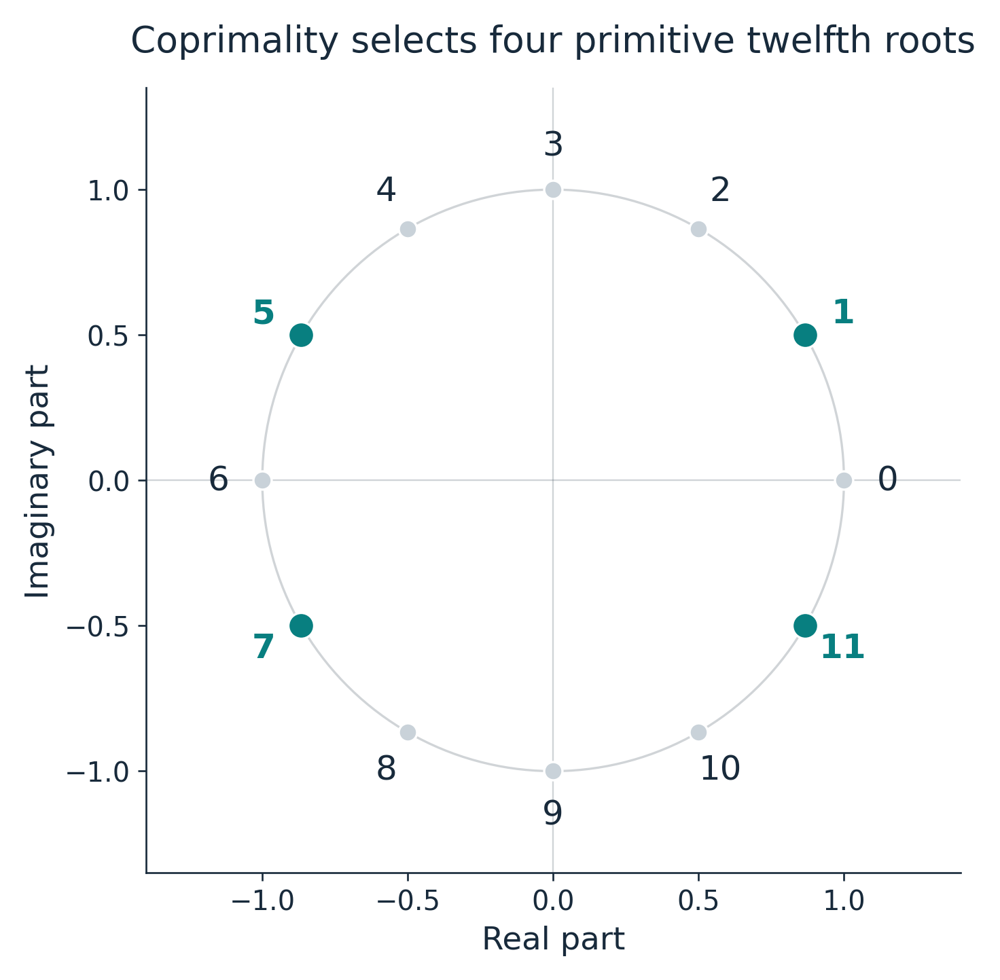

*The circle is the complex unit circle. Teal points are the four primitive roots; pale points are the other eight roots. Labels are residues $a$, not measured outcomes.*

$$

 \gcd(a,12)=1\quad\Longleftrightarrow\quad\operatorname{ord}(\zeta^a)=12.

$$

Arithmetic has supplied a precise selector. Nothing probabilistic has happened at this stage.

## 03. The selected phases add and cancel

*Interference*

**The same four waves can reinforce, cancel, or reinforce with the opposite sign.**

At each sample $n$, add the four numbers $\zeta^{an}$ with $a\in U_{12}$. Each has magnitude one. Their sum need not have magnitude one.

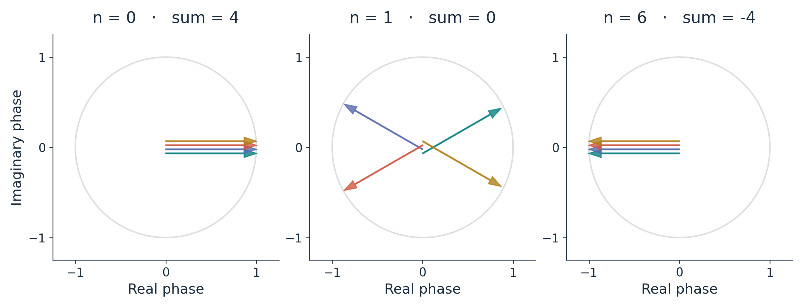

*At $n=0$ the sum is $4$. At $n=1$ the four phases cancel. At $n=6$ the sum is $-4$. Tiny parallel drawing offsets expose coincident arrows at $n=0$ and $n=6$; each arrow's displacement is the actual complex phase.*

$$

 c_{12}(0)=4,\qquad c_{12}(1)=0,\qquad c_{12}(6)=-4.

$$

Negative samples encode relative phase. They are part of the information that subsequent transforms use.

## 04. Interference yields an integer signal

*Exact Samples*

**The samples are exact integers, even though the individual waves have complex amplitudes.**

Pairing conjugates gives

$$

 c_{12}(n)=2\cos(\pi n/6)+2\cos(5\pi n/6).

$$

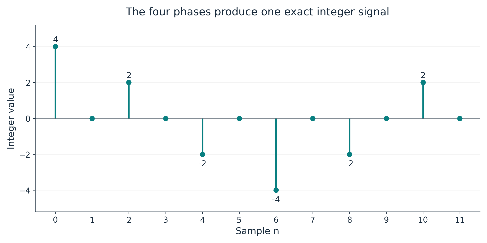

*One complete period of the Ramanujan signal. The dots are discrete samples, not samples from a continuous probability distribution.*

$$

 (c_{12}(0),\ldots,c_{12}(11))=(4,0,2,0,-2,0,-4,0,-2,0,2,0).

$$

The antisymmetry $c_{12}(n+6)=-c_{12}(n)$ will later expose why erasing the signs changes the recovered arithmetic.

## 05. Why the phase sum is an integer

*Proof In View*

**A divisor identity certifies integrality without rounding trigonometric values.**

For $q\geq1$, insert the Möbius coprimality identity into the finite phase sum:

$$

 \mathbf1_{\gcd(a,q)=1}=\sum_{d\mid\gcd(a,q)}\mu(d).

$$

Write $a=db$ after interchanging the finite sums. Character orthogonality evaluates the inner geometric series:

$$

 \begin{aligned}
 c_q(n)&=\sum_{d\mid q}\mu(d)\sum_{b=0}^{q/d-1}e^{2\pi ibn/(q/d)}\\
 &=\sum_{\substack{d\mid q\\q/d\mid n}}\mu(d)\frac qd
 =\sum_{e\mid\gcd(q,n)}e\mu(q/e)\in\mathbb Z.
 \end{aligned}

$$

| Sample | Relevant divisor contribution | Exact result |
|---|---|---|
| $n=0$ | $2\mu(6)+4\mu(3)+6\mu(2)+12\mu(1)$ | $4$ |
| $n=2$ | $\mu(12)+2\mu(6)$ | $2$ |
| $n=4$ | $\mu(12)+2\mu(6)+4\mu(3)$ | $-2$ |
| $n=6$ | $\mu(12)+2\mu(6)+3\mu(4)+6\mu(2)$ | $-4$ |

> The finite verifier also evaluates the twelve phase sums in the exact ring $\mathbb Z[z]/(z^4-z^2+1)$. The plots use floating coordinates for rendering, while the sample identities use exact arithmetic.

## 06. The spectrum recovers the selector

*Fourier Recovery*

**The Fourier transform returns exactly the four labels selected by coprimality.**

Use the negative-sign, unnormalized discrete Fourier transform

$$

 \widehat x(k)=\sum_{n=0}^{11}x(n)e^{-2\pi ikn/12}.

$$

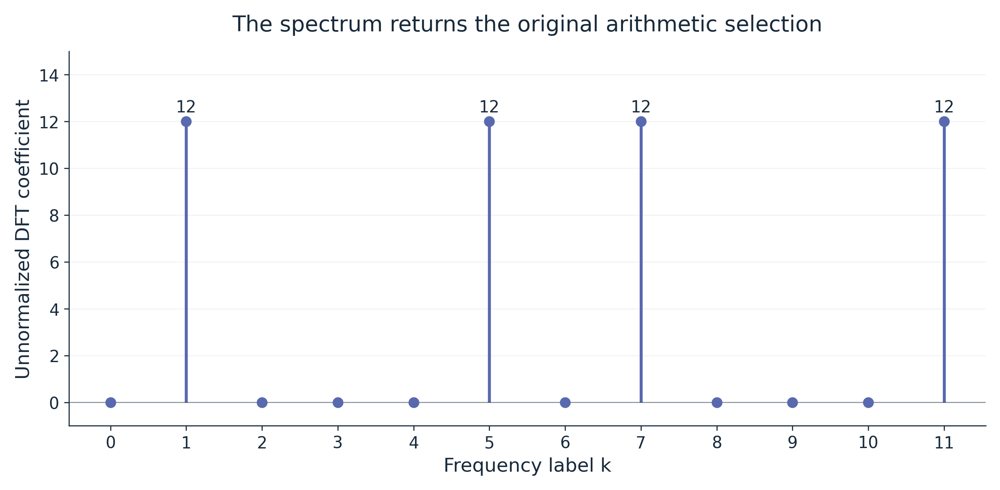

*The coefficient is exactly $12$ at $k=1,5,7,11$ and exactly zero elsewhere. This is an algebraic identity, not a spectral thresholding decision.*

$$

 \widehat{c_{12}}(k)=\sum_{a\in U_{12}}\sum_{n=0}^{11}\zeta^{(a-k)n}
 =12\,\mathbf1_{k\in U_{12}}.

$$

The inner geometric sum is twelve when $a=k$ modulo twelve and zero otherwise. The selector and the Fourier support are now the same exact data.

## 07. A diagonal selector becomes a rational filter

*Transport*

**The filter is diagonal in one basis and a rational convolution in the other.**

Let $F_{na}=\zeta^{na}/\sqrt{12}$ and $D_{aa}=\mathbf1_{a\in U_{12}}$. With the positive-sign unitary matrix $F$, the negative-sign DFT satisfies $F^\dagger x=\widehat x/\sqrt{12}$.

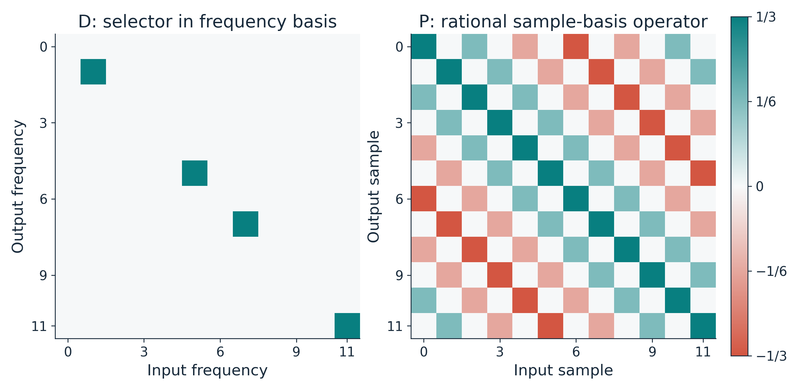

*Left: the frequency selector $D$. Right: its transported sample-basis matrix $P$. The right colorbar displays its five possible rational entries. The two panels use different scales.*

$$

 P=FDF^\dagger,\qquad P_{nm}=\frac{c_{12}(n-m)}{12}.

$$

Because $D^2=D$ and $F^\dagger F=I$, we obtain $P^2=P$. Because $D^\dagger=D$, we also obtain $P^\dagger=P$. This is an orthogonal projector of rank four.

## 08. Give the projector something to remove

*Filtering*

**The input contains an arithmetic component and a deliberately complementary component.**

Take $x(n)=c_{12}(n)+3\cos(\pi n/2)+2$. Its extra cosine uses modes $3,9$ and its constant uses mode $0$. All three are outside $U_{12}$.

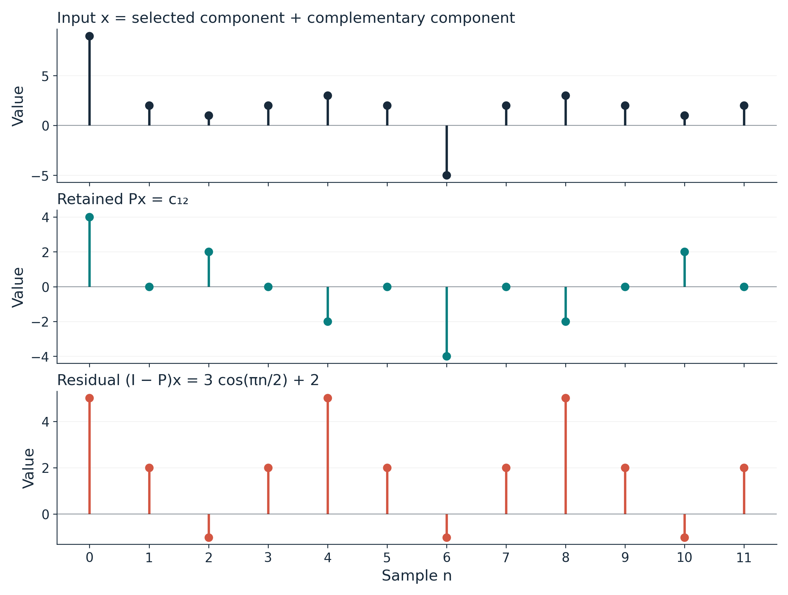

*The projector retains the primitive-order component exactly. The bottom panel shows everything it removes, so the loss remains visible.*

$$

 Px=c_{12},\qquad (I-P)x=3\cos(\pi n/2)+2.

$$

The exact input is $(9,2,1,2,3,2,-5,2,3,2,1,2)$. Calling the complementary component “noise” is a modeling choice. Arbitrary noise need not lie in the kernel of $P$.

## 09. Account for the entire input

*Energy*

**Exact filtering removes energy as well as modes.**

The selected and complementary components are orthogonal. With the unnormalized squared norm $\|x\|^2=\sum_{n=0}^{11}|x(n)|^2$,

$$

 \|x\|^2=150,\qquad\|Px\|^2=48,\qquad\|(I-P)x\|^2=102.

$$

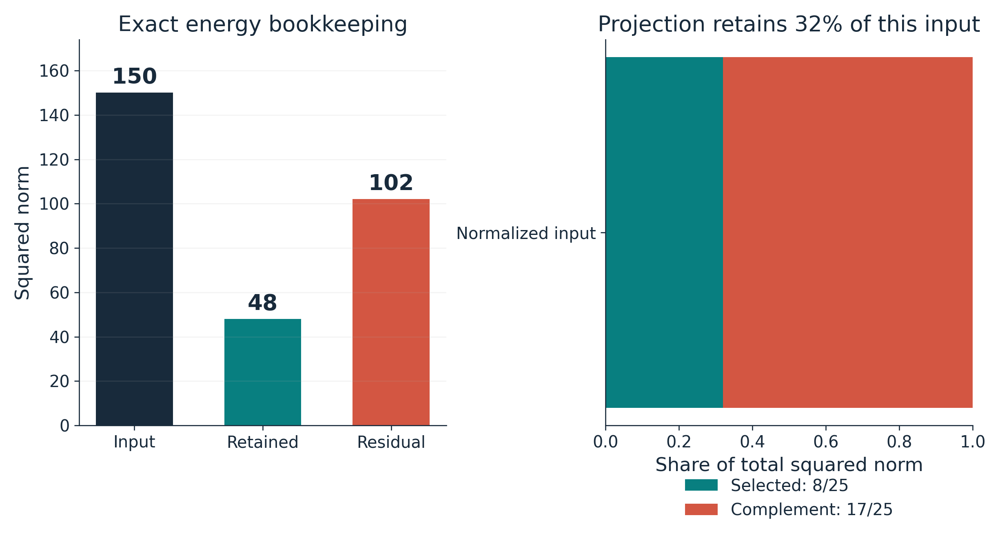

*The energy identity is $150=48+102$. The normalized input has selected squared-norm share $48/150=8/25$ and complementary share $17/25$.*

On the normalized state $x/\sqrt{150}$, the ideal Lüders projective measurement $\{P,I-P\}$ has selected-outcome probability $8/25$. Conditional on that outcome, the resulting normalized state is $c_{12}/\sqrt{48}$.

> This conditional measurement is not deterministic unitary denoising. The transform $F$ is reversible; the projection $P$ discards the complementary subspace.

## 10. Projection and unitary change are different operations

*Geometry*

**A basis change preserves the whole vector. Projection keeps only one orthogonal component.**

Let $e_s=c_{12}/\sqrt{48}$ and $e_r=(I-P)x/\sqrt{102}$. They are orthonormal, so the normalized input has the exact two-dimensional representation

$$

 \frac{x}{\sqrt{150}}=\sqrt{\frac8{25}}e_s+\sqrt{\frac{17}{25}}e_r.

$$

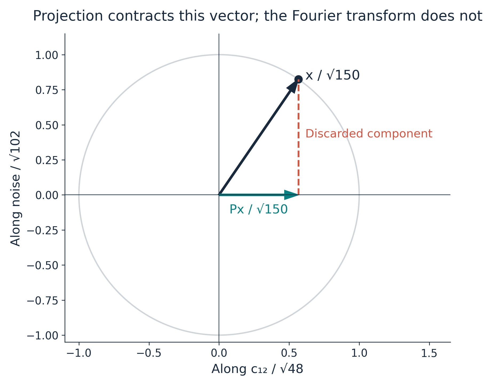

*This plane is the actual span of the selected signal and its complementary component. The dashed segment is the discarded component. Its length is $\sqrt{17/25}$; the retained vector has length $\sqrt{8/25}$.*

The Fourier transform preserves the input norm and permits exact inversion. The projector maps every complementary vector to zero. That distinction controls what may legitimately be called reconstruction, filtering, or measurement.

## 11. All twelve modes belong to six order classes

*Complete Packets*

**The primitive-twelve projector is one packet in a complete orthogonal decomposition.**

A frequency label $k$ has root order $d=12/\gcd(k,12)$. The possible orders are the divisors $1,2,3,4,6,12$.

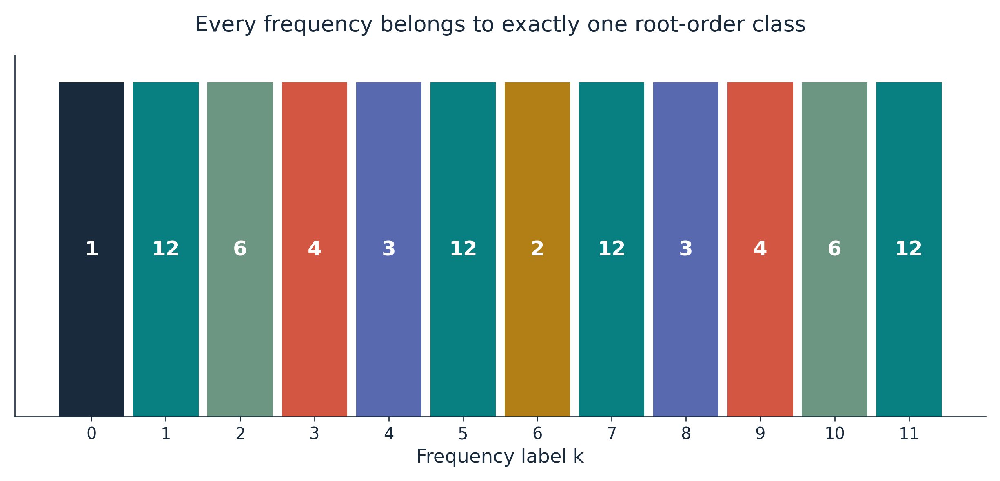

*The number inside each tile is its root order $d$. The horizontal label is frequency $k$. Every label belongs to one class; no labels are dropped.*

$$

 P_d{}_{nm}=\frac{c_d(n-m)}{12},\quad
 P_dP_e=\delta_{de}P_d,\quad
 \sum_{d\mid12}P_d=I.

$$

These are character-order projectors. They select Fourier modes by root order. They are different from coefficient-residue selectors, which select formal-series coefficients by their index modulo an integer.

## 12. Six exact filters in one ambient space

*Rational Kernels*

**Every order class has an integer Ramanujan kernel and a rational projector.**

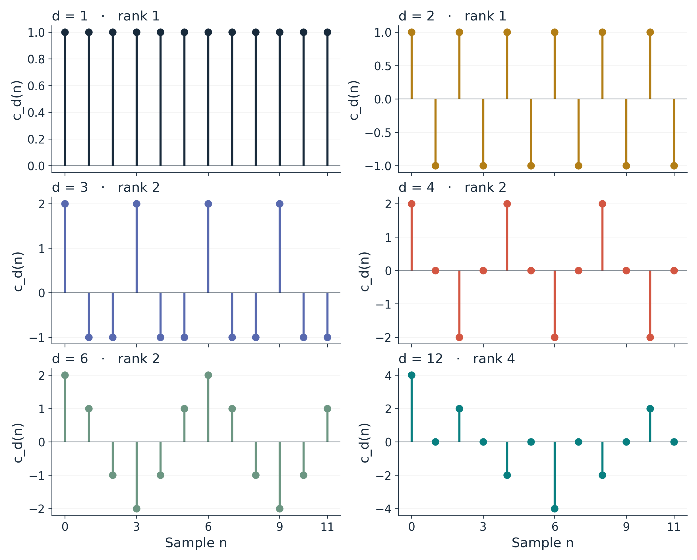

*Each panel displays $c_d(n)$ over the common twelve-sample ambient period. The associated matrix is $P_d{}_{nm}=c_d(n-m)/12$, so every kernel uses the same denominator twelve.*

For $d<12$, the kernel repeats with period dividing $d$. Its projector still acts on all twelve sample coordinates. The ranks are $1,1,2,2,2,4$, respectively.

## 13. A packet's capacity is not its occupied energy

*Dimension And Energy*

**Ranks describe the subspaces. Energies describe a particular input.**

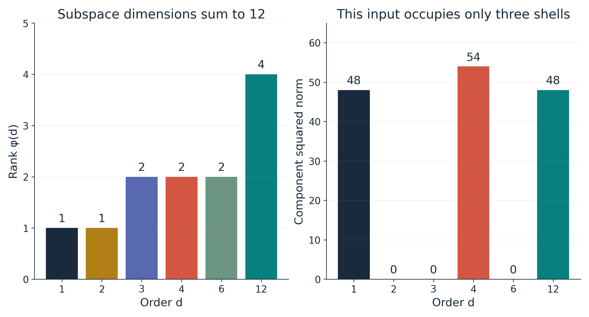

*Left: the six subspace dimensions sum to twelve. Right: the particular input $x$ has energy $48$ in order one, $54$ in order four, and $48$ in order twelve. The other packets exist but have zero component for this input.*

$$

 x=\sum_{d\mid12}P_dx,\qquad\|x\|^2=\sum_{d\mid12}\|P_dx\|^2.

$$

The constant $2$ contributes $12\cdot2^2=48$ to order one. The cosine contributes $54$ to order four. The Ramanujan component contributes $48$ to order twelve. Keeping all six packets gives exact synthesis. Keeping only one packet performs a lossy selection.

## 14. The arithmetic signal is a coherent amplitude vector

*Normalized States*

**Normalization makes the signal a unit vector without changing its relative phases.**

Define $u_k=1/2$ for $k\in U_{12}$ and zero otherwise. Then $\|u\|=1$, and

$$

 \psi=Fu,\qquad\psi_n=\frac{c_{12}(n)}{\sqrt{48}},\qquad F^\dagger\psi=u.

$$

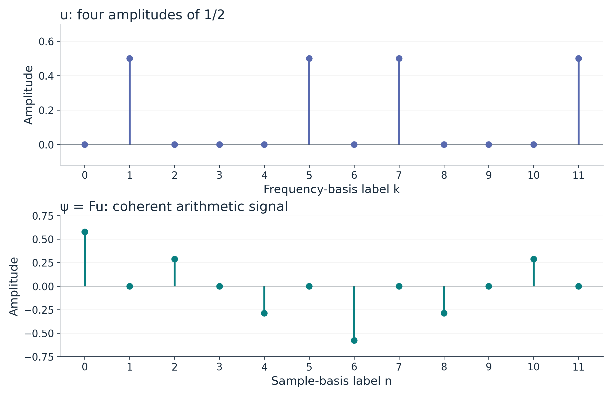

*Separate panels preserve the different basis labels: $k$ for the frequency-basis coordinates and $n$ for the sample-basis coordinates. Heights are amplitudes, including their signs.*

The normalization is exact because $\sum_n c_{12}(n)^2=48$. The matrix $F$ is unitary, so no probability mass is lost during this coherent change of basis.

## 15. Amplitudes and probabilities tell different stories

*Measurement*

**Measurement squares magnitudes; interference depends on coherent amplitude before that step.**

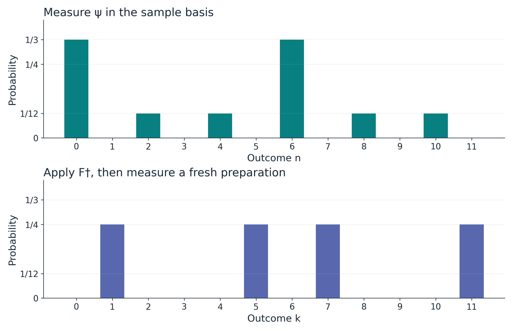

*Two alternative procedures on fresh preparations. The first measures $\psi$ directly. The second applies $F^\dagger$ before measurement. Neither histogram is the amplitude plot from the previous page.*

The first procedure gives probabilities $c_{12}(n)^2/48$. The second gives probability $1/4$ at each of $1,5,7,11$ and zero elsewhere.
One run returns one outcome. Measuring the sample basis first does not leave the original coherent state available for the second procedure. These distributions are alternative experimental choices, rather than successive readouts of one unchanged state.

## 16. Identical histograms can hide orthogonal states

*Relative Phase*

**Erasing the signs leaves sample probabilities unchanged and changes the state.**

Let $\chi_n=|c_{12}(n)|/\sqrt{48}$. Both states are normalized and

$$

 |\psi_n|^2=|\chi_n|^2\quad\text{for every }n,
 \qquad\langle\psi,\chi\rangle=0.

$$

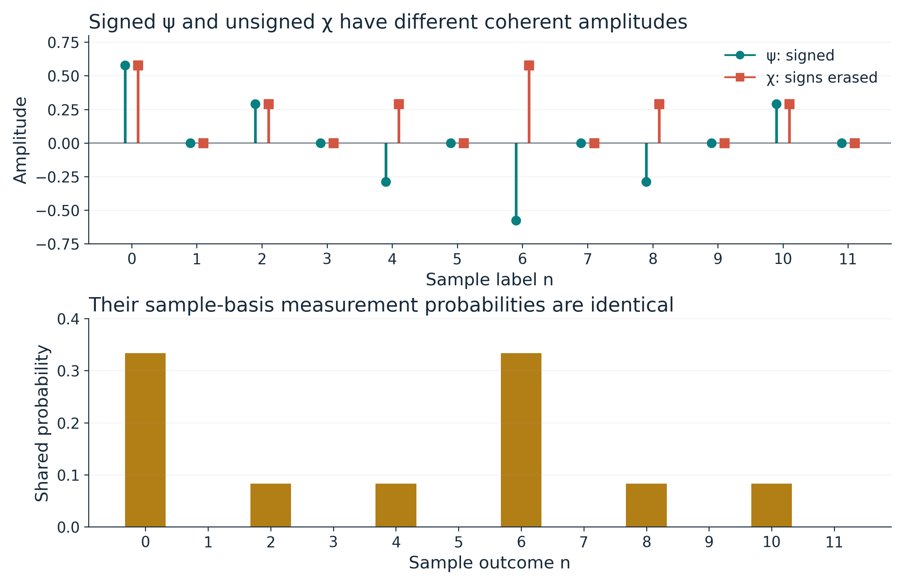

*The top panel shows the phase information carried by negative amplitudes. The bottom panel is shared by the two states because measurement in this basis depends only on squared magnitudes.*

The orthogonality follows from equal positive-support and negative-support energies: each contributes $24$ before division by $48$. A sample-basis probability histogram therefore cannot reconstruct the coherent state.

## 17. A basis change makes the hidden distinction observable

*Phase Revealed*

**The signed state recovers all four coprime labels. The unsigned state recovers none.**

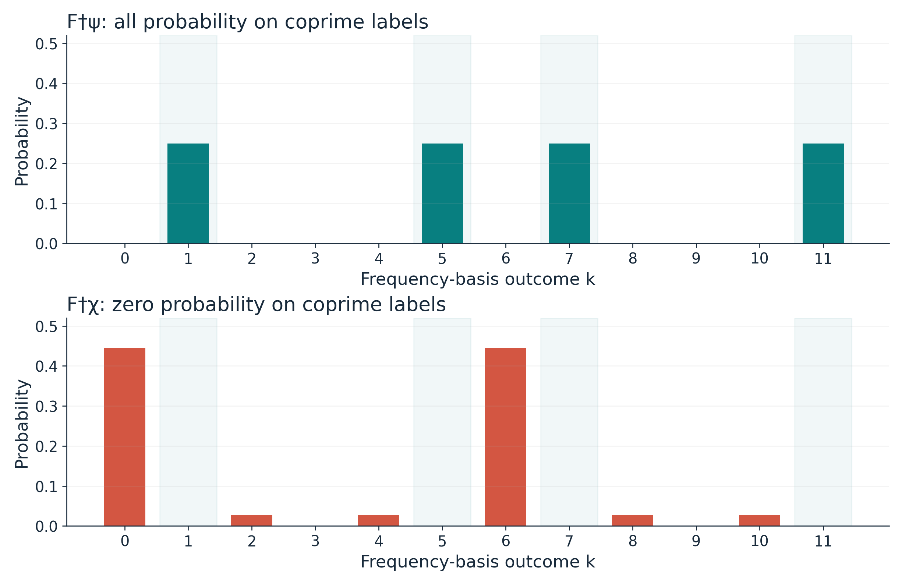

*The pale vertical strips mark the coprime labels. After $F^\dagger$, the signed state assigns them total probability one; the unsigned state assigns them total probability zero.*

The exact unnormalized DFT of the unsigned integer signal is

$$

 (16,0,4,0,4,0,16,0,4,0,4,0).

$$

After state normalization and unitary transformation, its probabilities are $4/9$ at $0,6$, $1/36$ at $2,4,8,10$, and zero elsewhere. Since $|c_{12}(n)|$ has period six, its odd Fourier labels vanish.

## 18. Move continuously between the two states

*Tunable Interference*

**Changing only relative phase moves the selected probability from zero to one.**

Let $v_+$ contain the positive entries of $c_{12}/\sqrt{48}$ and $v_-$ contain the absolute values of its negative entries. Their supports are disjoint and each has squared norm $1/2$. Define

$$

 \chi_\theta=v_++e^{i\theta}v_-,\qquad
 \chi_0=\chi,\quad\chi_\pi=\psi.

$$

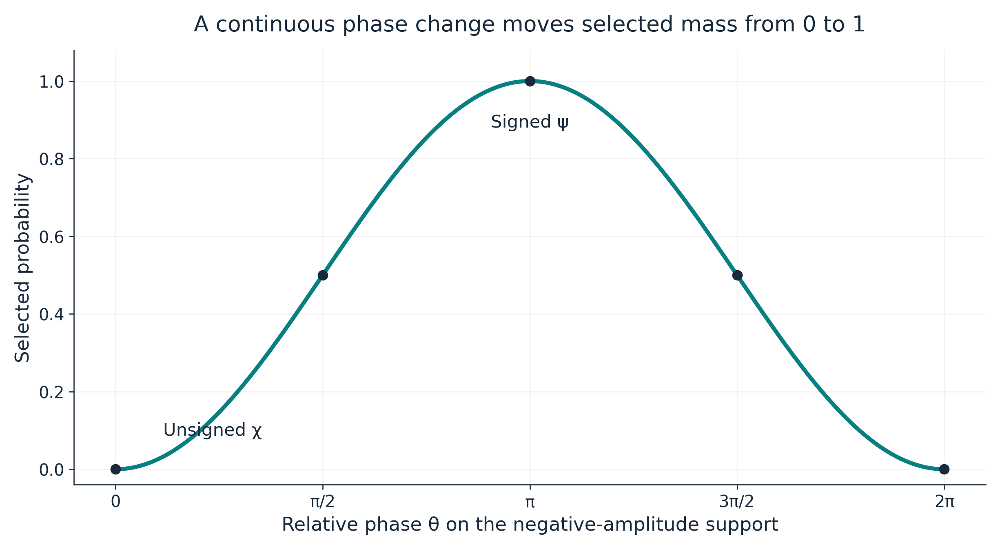

*The selected probability is the exact formula $\sin^2(\theta/2)$. The continuous curve is its floating rendering. Black dots mark exactly checked quarter-turn cases $0,1/2,1,1/2,0$.*

Indeed, $\chi_\theta=\tfrac{1+e^{i\theta}}2\chi+\tfrac{1-e^{i\theta}}2\psi$. Since $P\chi=0$ and $P\psi=\psi$, we get $\|P\chi_\theta\|^2=|1-e^{i\theta}|^2/4=\sin^2(\theta/2)$.

> The endpoint statements are covered by the inherited Lean development. This continuous family is an elementary prose derivation and a checked illustration, not an additional inherited Lean theorem.

## 19. A real three-dimensional view of one amplitude

*Complex Geometry*

**The plot follows an actual complex amplitude as the relative phase advances.**

At sample $n=6$, the phase-family amplitude is

$$

 \chi_\theta(6)=\frac{e^{i\theta}}{\sqrt3}.

$$

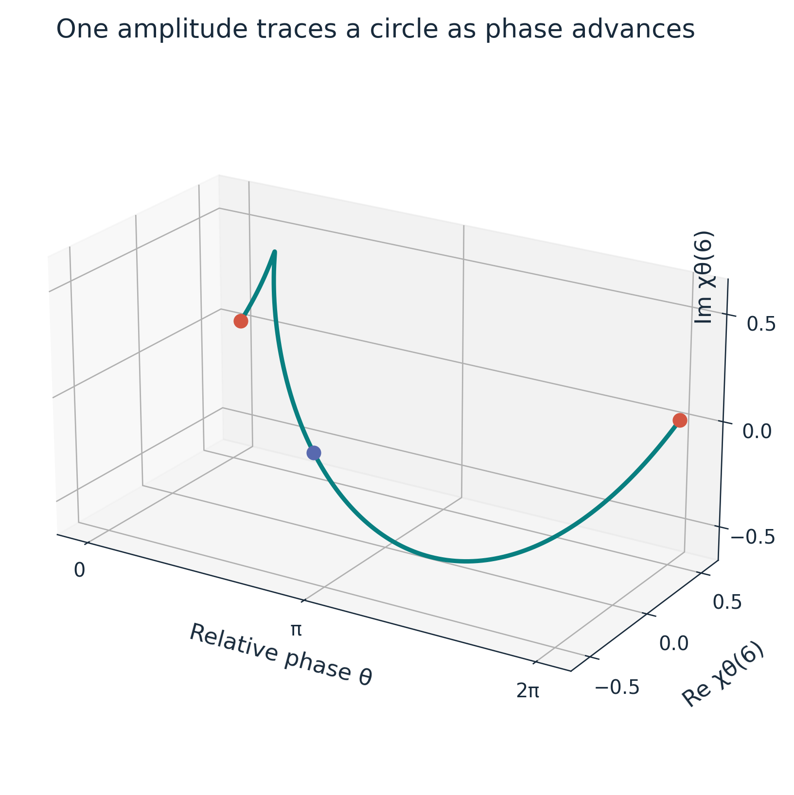

*Coordinates are $(\theta,\operatorname{Re}\chi_\theta(6),\operatorname{Im}\chi_\theta(6))$. In the real-imaginary plane the amplitude traces a radius-$1/\sqrt3$ circle. Advancing the phase coordinate produces the three-dimensional trajectory.*

Its magnitude is constant, so the sample-six probability stays $1/3$ throughout. Nevertheless, interference changes the probability of the selected subspace according to the preceding page. The geometry separates phase change from magnitude change.

## 20. Rearrange twelve samples into three exact lanes

*Polyphase*

**Lane extraction changes addresses while preserving all twelve values.**

For $r=0,1,2$ and $m=0,1,2,3$, define $(E_rx)(m)=x(r+3m)$.

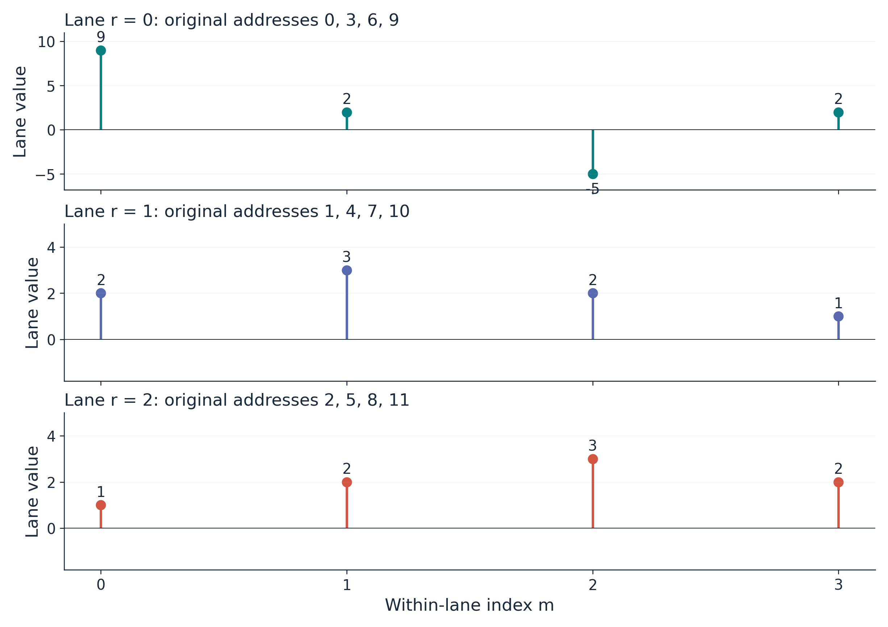

*The lane numbers and original addresses are explicit. Interleaving all three lanes reconstructs the original vector exactly. Keeping fewer lanes would be a different, lossy observation.*

The lanes are $(9,2,-5,2)$, $(2,3,2,1)$, and $(1,2,3,2)$. Twelve values remain twelve values. A shorter address in each lane does not by itself reduce information content or computation cost.

## 21. Phase factors connect the lane spectra

*Alias Assembly*

**Each local Fourier transform contributes to every appropriate global frequency.**

With four-point negative-sign DFTs in the lanes,

$$

 \widehat x(k)=\sum_{r=0}^{2}e^{-2\pi ikr/12}
 \widehat{E_rx}(k\bmod4).

$$

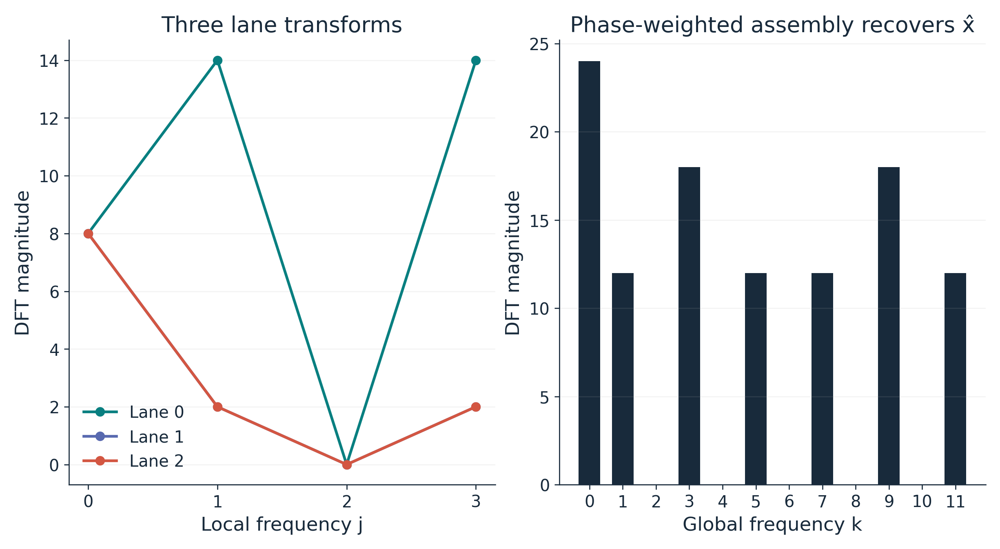

*Left: magnitudes of the three local transforms. Right: the recovered global spectrum. Assembly uses the complex coefficients and phase factors; adding the displayed magnitudes would be incorrect.*

The identity follows by writing $n=r+3m$ in the full DFT sum. Its phase factors retain the distinction between the lanes. The diagnostic replay compares this assembly with an independent direct twelve-point DFT at a declared tolerance of $10^{-12}$.

## 22. The construction extends beyond this picture

*Other Moduli*

**The integer waveform changes with the modulus, while the same arithmetic identity supplies it.**

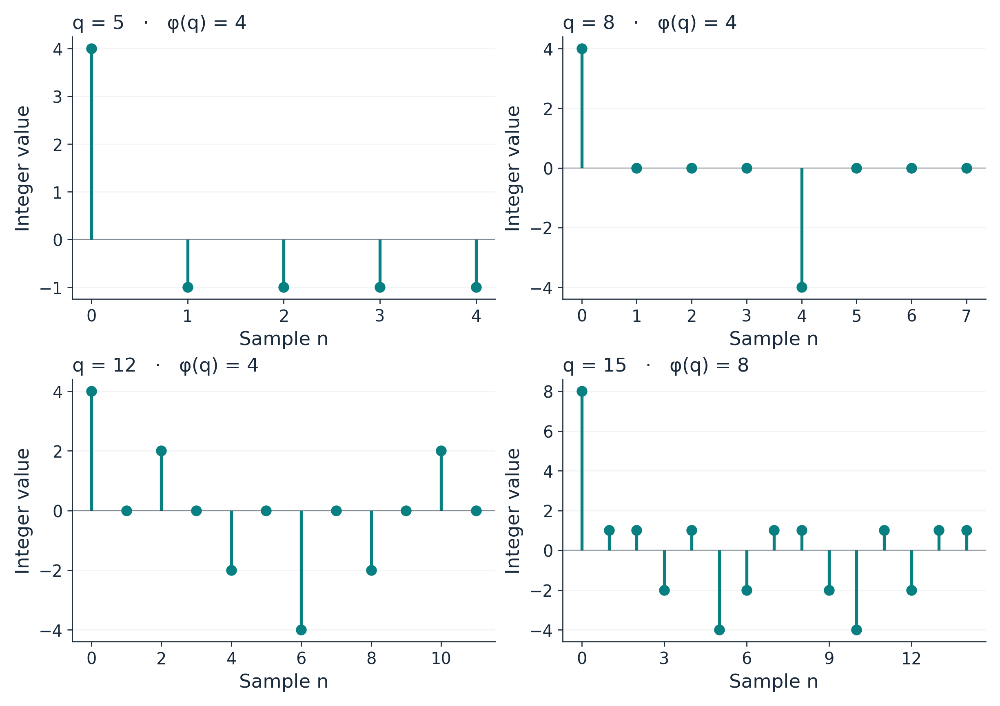

*Four exact Ramanujan signals constructed by the divisor formula. Their periods and amplitudes differ. These examples illustrate the general formulas; their finite verification does not prove those formulas universally.*

For general $q$, character orthogonality gives

$$

 \widehat{c_q}(k)=q\mathbf1_{\gcd(k,q)=1},\qquad
 \sum_{n=0}^{q-1}|c_q(n)|^2=q\varphi(q).

$$

The associated primitive-order projector has rank $\varphi(q)$. The general mathematical conclusions follow from the finite-sum derivations in the main paper. The source verifier separately checks its declared finite range $2\leq q\leq64$.

## 23. State exactly what each passage preserves

*Realization Contracts*

**The value of a bridge is the contract it supplies.**

| Passage | Preserves | Additional requirement or loss |
|---|---|---|
| Selector $D$ to $P=FDF^\dagger$ | Rank, idempotence, orthogonality | A specified unitary Fourier basis |
| Vector $x$ to $F^\dagger x$ | Full vector, inner product, norm | Retain all complex coefficients |
| Vector $x$ to $Px$ | Selected component | Complementary component removed |
| Vector to all polyphase lanes | All sample values | Every lane and its address retained |
| Amplitudes to probabilities | Outcome probabilities in one basis | Relative phase discarded |
| Projective measurement | Born probabilities and conditional state | One outcome per run, conditional branch |

The two states $\psi$ and $\chi$ give a concrete obstruction: the map from coherent amplitudes to a single-basis probability histogram is not injective. Their common histogram cannot determine which arithmetic selection will appear after the Fourier transform.

> The guide uses an actual twelve-dimensional Hilbert space. A four-qubit realization would require a specified embedding and implementation. Neither a gate synthesis nor an efficiency bound is supplied here.

## 24. Exact data, floating rendering, and formal coverage

*Evidence*

**Three kinds of evidence support different parts of the guide.**

**Exact Python data.** The source verifier uses integers, rational fractions, and cyclotomic quotient-ring arithmetic. The release visualization script adds an independent rational-matrix implementation for all six shell products and completeness, component energy bookkeeping, the unsigned Fourier table, and the phase-family quarter-turn cases. The assertion counts and hashes are recorded in the accompanying verification results.

**Floating diagnostics.** Fourier matrix checks, lane assembly, phase curves, and figure coordinates use NumPy and Matplotlib. Their residuals are reported against an explicit $10^{-12}$ tolerance. Passing that tolerance is numerical evidence, not exact arithmetic or an interval certificate.

**Inherited Lean coverage.** The later five-module source contains exact rational and cyclotomic calculations, normalized finite Fourier statements, and semantic transport into ordinary complex matrices and state vectors. The Lean guide maps the checked declarations and records the inherited certificate. This visual release does not claim a fresh Lean compilation.

> The script is `checks/make_visuals.py`. Its final bounded-run manifest and scientific result are in `verification/visual_release_run_v2/`. Every scientific figure is supplied as PDF, SVG, and PNG. No image-generation model was used.

## 25. What the construction establishes

*Closing Example*

**Coprimality, signal filtering, and coherent measurement share a specified exact operator.**

For the twelve-sample model, the guide has constructed every ingredient: the primitive-root selector, integer phase-sum signal, rational projector, complementary residual, complete order packets, normalized states, and alternative measurement probabilities. The retained arithmetic is not inferred from a suggestive resemblance. It follows from explicit finite Fourier identities.

The phase-erasure example is decisive. Two orthogonal normalized states have identical sample-basis probabilities. One inverse Fourier transform places all mass on the coprime labels for the signed state and none there for the unsigned state. Relative phase is therefore an operational part of the realization, not optional decoration.

The construction also states its losses. Projection removes a complementary subspace. Measurement returns one outcome and generally changes the state. Erasing phase destroys information. Keeping all complex Fourier coefficients or all polyphase lanes permits exact inversion.

> Ramanujan sums, Fourier orthogonality, spectral projection, and the quantum state-vector rules are classical. The paper's purpose is their exact integration within Realization Calculus. Efficient preparation, gate synthesis, incomplete-data recovery, hardware robustness, and broad quantum advantage require separate results.

**Read together.** The traditional paper supplies the full derivations and scope. The Lean guide supplies formal declaration contracts and certificate provenance. This guide supplies the exact worked example and its reproducible geometry.

