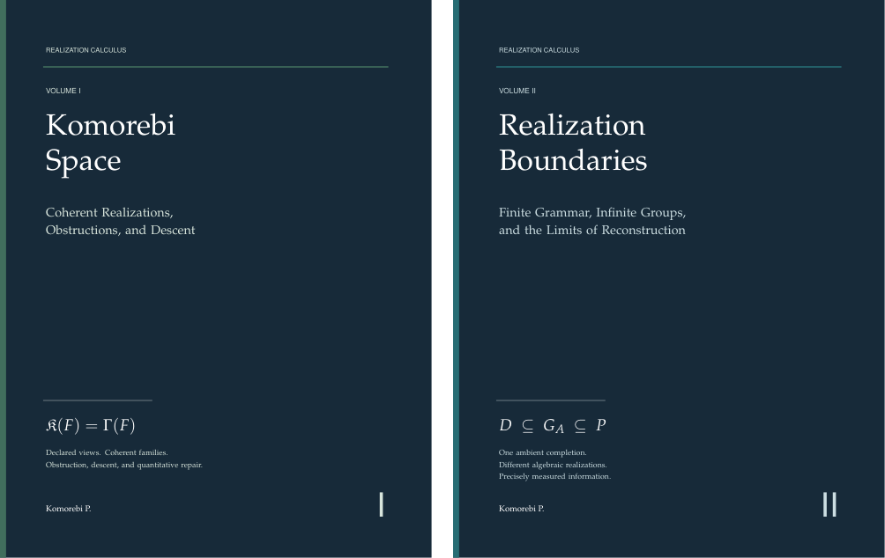

# Realization Calculus

## A twin-volume edition by Komorebi P.

This edition pairs two independently readable monographs around one question: which data and admissible operations determine a mathematical realization?

- **Volume I — Komorebi Space:** *Coherent Realizations, Obstructions, and Descent*. It develops coherent families, extension obstructions, transport, symmetry, descent, and quantitative repair.
- **Volume II — Realization Boundaries:** *Finite Grammar, Infinite Groups, and the Limits of Reconstruction*. It classifies a family of countable abelian groups with one common profinite completion and measures the information retained by their algebraic and effective presentations.

The paired edition is version 1.0.0, dated **24 October 2026**, and retains **Komorebi Space 1.15** and **Realization Boundaries 1.0**. The later [Komorebi Space 1.16 source and reader](../komorebi-space/) are maintained separately. Use this edition for the shared reading route and its matched presentation.

The mathematical numbering of the volumes remains independent. Their pairing does not assert one universal realization space or an object outside every possible system of views. The grammar escape theorem is relative to a fixed countable grammar and its semantics.

## Read the books



- [Volume I: Komorebi Space](books/Realization_Calculus_Volume_I_Komorebi_Space.pdf)
- [Volume II: Realization Boundaries](books/Realization_Calculus_Volume_II_Realization_Boundaries.pdf)
- [Komorebi Space worked-proofs supplement](supplements/komorebi-space-worked-proofs-v4/Komorebi_Space_Worked_Proofs.pdf)

The shared opening pages explain the relation between compatible ambient data and an intended source image. Begin with Volume I for the realization framework, or Volume II for the common-completion group construction.

## Browse the sources

| Source | Contents |
|---|---|
| [Volume I](publication/volume_i/source/) | Editable TeX, chapter sources and figures for this paired edition |
| [Volume II](publication/volume_ii/manuscript/) | Editable TeX and chapter sources for this paired edition |
| [Shared editorial material](publication/shared/) | Series introduction and presentation |
| [Worked proofs](supplements/komorebi-space-worked-proofs-v4/) | Separately retained source and figures for the supplement |
| [Current Komorebi Space](../komorebi-space/) | Canonical version 1.16, formal development and accepted records |
| [Komorebi Space supporting sources](../komorebi-space/supporting-sources/) | Distinct historical source ancestry |
| [Realization Boundaries](../realization-boundaries/) | Canonical version 1.0, formal development and accepted records |
| [Verification records](verification/) | Source identities and checks recorded for the paired publication |
| [Publication tools](tools/) | Book build and original archive integrity scripts |

The [companion source map](COMPANION_SOURCE_MAP.json) records the canonical locations of the companion developments.

## Formal scope

The paired Volume I retains the accepted Komorebi Space 1.15 development: 162 production modules, four import entrypoints, and formal counterparts for all sixteen principal theorem groups. This scope does not assign a separate Lean theorem to every illustration or every printed proof route.

Volume II retains the accepted Realization Boundaries 1.0 development: 66 production modules and all forty-five registered contracts complete. Its effective statements use explicit oracle and presentation semantics.

The editorial pairing does not constitute a new joint Lean replay. The accepted proof records remain attached to their respective developments. See [proof and text identities](verification/PROOF_AND_TEXT_IDENTITY.json), the [input source audit](verification/INPUT_SOURCE_AUDIT.json), and [paired publication checks](verification/TWIN_EDITION_QA.json). Each formal appendix states its dependency and trust boundary.

## Rebuild the paired books

Run from this directory:

```sh
python3 tools/build_twin_volumes.py
```

Book production requires Python 3 and a TeX installation providing `latexmk` and the packages declared in the sources. A rebuild can change PDF metadata and checksums. The publication build does not rerun Lean; follow the canonical component's pinned-toolchain instructions for formal reproduction.

The retained `SHA256SUMS` and `tools/verify_integrity.py` describe the original sealed archive, including companion directories now linked at their canonical locations. For this source layout, the [source selection record](SOURCE_SELECTION.json), [publication metadata update](PUBLICATION_METADATA_UPDATE.json) and repository import receipt provide the corresponding identities.

## Reuse and citation

The [current collection license](../../LICENSE.md), effective 27 October 2026, applies to the author's original material: [MIT](../../LICENSE-CODE.txt) for original code and formalizations, and [CC BY 4.0](https://creativecommons.org/licenses/by/4.0/legalcode.en) for original writing and figures, subject to existing applicable open licenses. Realization Boundaries retains its existing MIT grant. Third-party material retains its own terms and notices.

The current grant supersedes older original-author notices that left licensing undecided. The retained `REUSE.md` and the [original reader README](provenance/original-publication-metadata/README.md) record the earlier publication metadata. The [metadata update receipt](PUBLICATION_METADATA_UPDATE.json) identifies the changed README and confirms that the scientific sources, books and evidence retain their original bytes.

Attribute the work to **Komorebi P.** Citation metadata is in [CITATION.cff](CITATION.cff); the [editorial change record](EDITORIAL_CHANGES.md) describes the paired edition's scope and rebuilding history.
