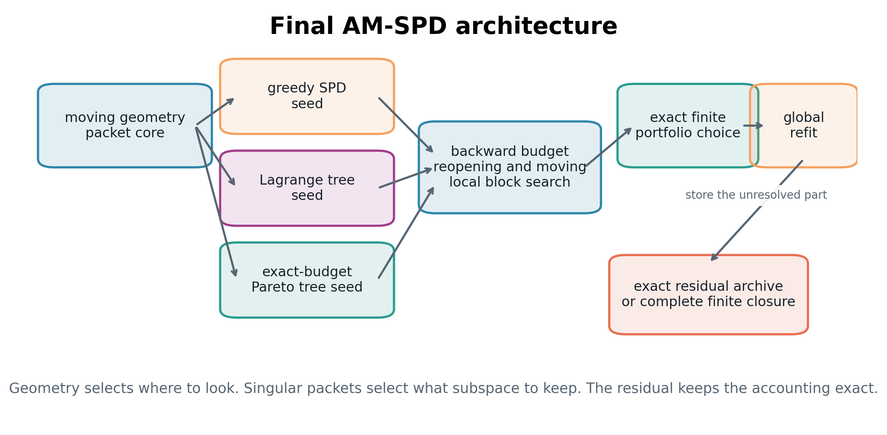

# Komorebi AM-SPD

**Adaptive Multiscale Singular Packet Decomposition for finite image reconstruction**

AM-SPD combines a moving geometry-aware packet atlas, localized singular models, finite tree optimization, backward budget reopening, global least-squares refitting, and exact residual accounting.

Version **1.0.0** is the stable release of the finite reconstruction system. It fixes input normalization, strict budget handling, projection stability, archive validation, and batch restart behavior. Packet searches can be checkpointed and resumed, large images can be processed by overlap-blended tiles, finite budget grids can be selected automatically, and directory trees can be processed with content-aware manifests. The original algorithms, exact paper replay, verification programs, and manuscript remain available.

The focused 78-page manuscript and self-contained LaTeX source are under [`docs/paper/final`](docs/paper/final). The original 147-page manuscript, research scripts, figures, tables, and verification records remain under [`research/original`](research/original).



## Functional scope

| Capability | Public Python route | CLI route |
|---|---|---|
| Moving packet core | `fit_packet_core`, `reconstruct` | `reconstruct --method core` |
| Singular Packet Decomposition | `fit_singular_packets` | `reconstruct --method spd` |
| Lagrange and exact-budget trees | `optimize_trees` | `reconstruct --method tree` |
| Three-seed backward portfolio | `fit_portfolio` | `reconstruct --method portfolio` |
| Resumable single-image checkpoint | `AMSpdModel.resume`, `resume_model` | `resume` |
| Overlap-blended tiled reconstruction | `tiled_reconstruct` | `tiled` |
| Resumable tiled checkpoint | `TiledAMSpdModel.resume`, `resume_tiled_model` | `resume` |
| Portable model archives | `AMSpdModel`, `TiledAMSpdModel` | `decompose`, `decode`, `inspect` |
| Automatic finite-grid selection | `auto_tune`, `tuning_candidates` | `tune` |
| Recursive batch processing | `run_batch` | `batch` |
| Model comparison | `compare_model_archives` | `compare` |
| Exact finite pixel closure | `complete_with_pixels` | `complete` |
| Fourier, DCT, SVD, quadtree, TV baselines | `compare_baselines` | `baselines` |
| Built-in multi-method benchmark | `run_builtin_benchmark` | `benchmark` |
| Exact published benchmark replay | `reproduce_paper_case` | `reproduce-paper` |
| Package integration verification | `run_full_verification` | `verify --full` |

## Installation

From the AM-SPD package directory:

```powershell
py -m venv .venv
.\.venv\Scripts\Activate.ps1
python -m pip install --upgrade pip
python -m pip install -e ".[dev,research]"
```

From the Operation-KOMOREBI repository root:

```powershell
python -m pip install -e ".\packages\komorebi-am-spd[dev,research]"
```

Python 3.10 through 3.13 is supported by the declared CI matrix. The release report records which interpreter and operating system were actually tested locally. For prebuilt wheels and offline installation, see [INSTALL_OFFLINE.md](INSTALL_OFFLINE.md).

## Stable input and output contract

Unsigned integer sources are scaled by their dtype maximum, so a constant `uint8` raster of 128 remains 128/255. Floating sources must already contain finite values in `[0,1]`. Empty, complex, negative integer, or out-of-range floating inputs raise an error rather than changing their contrast. Internal residual proposal fields retain their separate historical normalization convention.

`load_image` preserves alpha and 16-bit grayscale. A normalized `.npy` raster supports arbitrary positive channel counts. Standard image outputs from `save_image` are clipped, quantized 8-bit display previews. `am-spd decode --mode exact` requires `.npy` so a display encoder cannot silently change the decoded values.

For `spd`, `tree`, and `portfolio`, `parameter_budget` caps the added singular/local scalar parameter proxy. It excludes geometry-core coefficients and is not a bit rate. `core` reports its channel-coefficient count separately. A zero downstream budget returns the geometry core without added singular directions.

See [RELEASE_NOTES_v1.0.0.md](RELEASE_NOTES_v1.0.0.md) and [MIGRATION_v1.0.md](MIGRATION_v1.0.md) for the intentional validation changes.

## Reconstruct an image

```python
from am_spd import AMSpdConfig, load_image, reconstruct, save_image

image = load_image("input.png")
result = reconstruct(image, AMSpdConfig.quick(method="portfolio"))

save_image("reconstruction.png", result.bounded_reconstruction())
print(result.summary())
print(result.exact_identity_error)
```

The four high-level stages are:

```python
AMSpdConfig.quick(method="core")
AMSpdConfig.quick(method="spd")
AMSpdConfig.quick(method="tree")
AMSpdConfig.quick(method="portfolio")
```

For larger paper-scale budgets:

```python
AMSpdConfig.paper_scale(method="portfolio")
```

`paper_scale` performs a new search with the published 44-packet and 22-mode scale. It is not the historical benchmark replay. Exact replay is performed by `reproduce-paper`.

## Save and resume a packet search

Schema 2 of the `.amspd` format stores the finite candidate frontier, seed masks, quadtree leaves, selected seed identities, and NumPy generator state needed to continue a packet search.

```python
from am_spd import AMSpdConfig, AMSpdModel, reconstruct, resume_model

partial = reconstruct(image, AMSpdConfig.quick(method="core"))
partial.save_model(
    "checkpoint.amspd",
    include_input=True,
    include_atoms=True,
    residual_storage="sparse",
)

checkpoint = AMSpdModel.load("checkpoint.amspd")
continued = resume_model(checkpoint, target_packet_budget=32)
continued.save_model("continued.amspd", include_input=True)
```

PowerShell:

```powershell
am-spd decompose input.png checkpoint.amspd `
  --method core `
  --packet-budget 16 `
  --include-input

am-spd resume checkpoint.amspd continued.amspd `
  --target-packet-budget 32 `
  --preview continued.png
```

Resume quality is reported explicitly:

| Quality | Meaning |
|---|---|
| `exact` | The stored source and exact search frontier permit uninterrupted floating-point parity when search settings are unchanged |
| `frontier-exact` | The frontier is exact, but the source is reconstructed from residual closure and can differ by one rounding unit |
| `warm` | A deterministic warm start is reconstructed from schema 1 or reduced checkpoint data |
| `unavailable` | Required packet atoms, source closure, or checkpoint state were omitted |

Changing search parameters remains supported, but uninterrupted parity is then not claimed. Chained CLI resumes preserve an already stored source image unless it is deliberately omitted in a newly created model.

## Large images and tiled models

```python
from am_spd import AMSpdConfig, TiledConfig, tiled_reconstruct

result = tiled_reconstruct(
    image,
    AMSpdConfig.quick(method="core"),
    TiledConfig(tile_size=256, overlap=32, blend="cosine", workers=4),
)

result.save_model(
    "large-image.amspdt",
    include_input=True,
    include_tile_models=True,
)
```

PowerShell:

```powershell
am-spd tiled input.png large-image.amspdt `
  --preview approximation.png `
  --tile-size 256 `
  --overlap 32 `
  --blend cosine `
  --workers 4 `
  --include-input
```

The `.amspdt` archive stores the globally blended reconstruction, exact global residual closure, tile geometry, and optionally one resumable `.amspd` checkpoint per tile. The residual identity applies after blending:

\[
F = \widehat F_{\mathrm{blend}} + R_{\mathrm{archive}}.
\]

A tiled model can be resumed with the same `resume` command:

```powershell
am-spd resume large-image.amspdt refined.amspdt `
  --additional-packets 8 `
  --workers 4
```

See [`docs/large-images.md`](docs/large-images.md) for tiling semantics and limitations.

## Automatic finite-grid selection

AM-SPD can evaluate a declared finite set of methods and budgets. This is deterministic finite-grid selection, not a claim of globally optimal hyperparameter tuning.

```powershell
am-spd tune input.png `
  --output-dir tuning `
  --methods core spd tree portfolio `
  --packet-budgets 8 12 16 `
  --objective rate-distortion `
  --rate-weight 0.01 `
  --save-model
```

Python:

```python
from am_spd import auto_tune, tuning_candidates

candidates = tuning_candidates(
    methods=("core", "spd", "portfolio"),
    packet_budgets=(8, 12, 16),
)
tuned = auto_tune(image, candidates, objective="rate-distortion")
print(tuned.best_config)
print(tuned.best_result.metrics)
```

Available objectives are `rate-distortion`, `ssim-rate`, `rmse`, and `target-rmse`.

## Batch processing

```powershell
am-spd batch .\images `
  --output-dir .\batch-output `
  --method portfolio `
  --preset quick `
  --workers 4 `
  --save-models `
  --skip-existing
```

Large inputs can be switched to tiled execution automatically:

```powershell
am-spd batch .\images `
  --output-dir .\batch-output `
  --tiled-above 1024 `
  --tile-size 256 `
  --overlap 32 `
  --tile-workers 2 `
  --workers 4 `
  --save-models `
  --embed-tile-models `
  --skip-existing
```

Each input receives an image, JSON summary, and optional model. The batch manifest includes the input SHA-256 and a run fingerprint derived from the AM-SPD and tiling configuration. `--skip-existing` reuses a result only when both values still match.

## Portable model lifecycle

Single-image models use `.amspd`. Tiled models use `.amspdt`.

```powershell
am-spd inspect image.amspd --packets --trees --trials --search --output inspection.json
am-spd decode image.amspd approximation.png --mode bounded
am-spd decode image.amspd exact.npy --mode exact
am-spd compare first.amspd second.amspd --output comparison.json
```

Use an `.npy` destination when raw floating-point values must be preserved. The archives use checksummed NumPy arrays loaded with `allow_pickle=False`. They are reproducibility formats, not entropy-coded image codecs or authenticated signatures.

Legacy 0.1.x `.npz` results can be migrated without rerunning the reconstruction:

```powershell
am-spd convert-archive reconstruction.npz reconstruction.amspd
```

Older result archives did not store packet atoms, tree selections, or search frontiers, so those components cannot be reconstructed retrospectively.

See [`docs/model-format.md`](docs/model-format.md).

## Public component API

The principal paper stages can be called independently:

```python
from am_spd import (
    AMSpdConfig,
    fit_packet_core,
    fit_singular_packets,
    optimize_trees,
)

config = AMSpdConfig.paper_scale(method="tree")
core = fit_packet_core(image, config)
spd = fit_singular_packets(image, core, config)
trees = optimize_trees(image, core, spd, config)

print(trees.selected_name)
print(trees.candidate_rmse)
print(len(trees.exact.frontier))
```

## Exact finite pixel-coordinate closure

```python
from am_spd import complete_with_pixels

closure = complete_with_pixels(result, threshold=0.0)
exact = closure.decode()

print(closure.pixel_packet_count)
print(closure.scalar_coefficient_count)
print(closure.identity_error(image))
```

PowerShell:

```powershell
am-spd complete input.png completed.amspd --preview exact.png
```

With threshold zero, every nonzero residual pixel-channel coefficient is retained. A positive threshold is intentionally lossy and is not labeled exact.

## Baselines and benchmarks

```powershell
am-spd baselines input.png --output-dir baseline-results

am-spd benchmark `
  --output-dir benchmark `
  --cases synthetic_geometry camera `
  --methods core spd tree portfolio `
  --size 24 `
  --save-models
```

The baseline suite includes centered Fourier low pass, sparse DCT, joint global SVD, adaptive quadtree, and total variation. These methods do not share one universal storage model, so every output retains its declared budget and method notes.

## Exact paper replay

The package bundles checksummed archived images and core packet bases, the recorded packet history, matched comparison table, and authoritative result ledger. Historical replay recomputes the downstream singular, tree, and portfolio stages with a frozen v0.3 numerical backend. This keeps replay independent of later font rasterization and transform sampling changes; new decompositions use the corrected v1.0 backend.

```powershell
am-spd reproduce-paper --list-cases

$env:OPENBLAS_NUM_THREADS = "1"
$env:OMP_NUM_THREADS = "1"
$env:MKL_NUM_THREADS = "1"
am-spd reproduce-paper --output-dir paper-replay --strict-reference
```

The replay distinguishes final published invariants from archived intermediate diagnostics. Known intermediate proxy differences are reported rather than hidden. See [`docs/reproducibility.md`](docs/reproducibility.md).

## Verification

```powershell
am-spd verify
am-spd verify --full
am-spd verify --full --paper-case synthetic_geometry
```

The full package verification exercises all four reconstruction methods, model round trips, checksum validation, exact continuation parity, tiled reconstruction, model comparison, automatic selection, batch manifests, finite pixel closure, and baseline execution.

The historical research verification remains available through:

```powershell
.\scripts\verify_full.ps1
```

## Command reference

```text
am-spd reconstruct       Reconstruct one image and write standard outputs
am-spd decompose         Fit and save a resumable .amspd model
am-spd resume            Continue a single or tiled checkpoint
am-spd tiled             Reconstruct and save an overlap-blended .amspdt model
am-spd tune              Select a method and budget from a declared finite grid
am-spd batch             Process an image file or directory tree
am-spd decode            Decode raw, bounded, or exact model output
am-spd convert-archive   Upgrade a 0.1.x NPZ result archive
am-spd inspect           Export packet, tree, trial, and search metadata
am-spd compare           Compare two or more model archives
am-spd complete          Store finite pixel-coordinate residual closure
am-spd baselines         Run Fourier, DCT, SVD, quadtree, and TV baselines
am-spd benchmark         Run the built-in finite benchmark
am-spd reproduce-paper   Replay the published four-case experiment
am-spd demo              Run a synthetic example
am-spd verify            Run smoke or full integration verification
am-spd info              Report package and model-format information
```

See [`docs/cli.md`](docs/cli.md) for complete command examples.

## Repository map

```text
src/am_spd/             installable algorithms, models, tiling, tuning, batch, and CLI
src/am_spd/resources/   compact paper-replay histories and reference ledgers
examples/               executable API examples
tests/                  package, model, continuation, tiled, tuning, and batch tests
research/original/      immutable recovered research snapshot
docs/paper/             finalized PDF, LaTeX, source package, and audit
docs/assets/            selected GitHub figures
scripts/                setup, verification, paper, and publishing tools
.github/workflows/      standalone repository CI and release workflows
monorepo/               root-workflow templates for Operation-KOMOREBI
```

## Mathematical and empirical boundaries

AM-SPD keeps three claims distinct:

1. A finite packet and singular model gives an interpretable approximation.
2. A retained residual provides exact finite reconstruction accounting.
3. Singleton pixel-channel coordinates provide complete finite-raster closure.

Resuming with an unchanged schema-2 frontier can reproduce the uninterrupted floating-point search. This statement does not apply after search settings are changed. Tiling solves independent local problems and blends them. It is not mathematically identical to one global untiled solve. Automatic selection minimizes only over its declared finite candidate set.

The method does not claim that every image has a short semantic description. It does not claim superiority to global SVD in global SVD's own fixed-rank class. It is not an automatic statistical denoiser without a noise model or calibrated risk criterion. The scalar parameter proxy is not an entropy-coded bit rate.

See [`docs/claim-boundaries.md`](docs/claim-boundaries.md).

## Citation

GitHub reads [`CITATION.cff`](CITATION.cff) directly. The final manuscript is available at [`docs/paper/final/Adaptive_Multiscale_Singular_Packet_Decomposition_Final.pdf`](docs/paper/final/Adaptive_Multiscale_Singular_Packet_Decomposition_Final.pdf).

## License

The current package code and accompanying project documentation are released under the [MIT License](LICENSE), credited to Komorebi P. The preserved historical research snapshot retains its recorded notices and terms. Dependency licenses remain their own.
