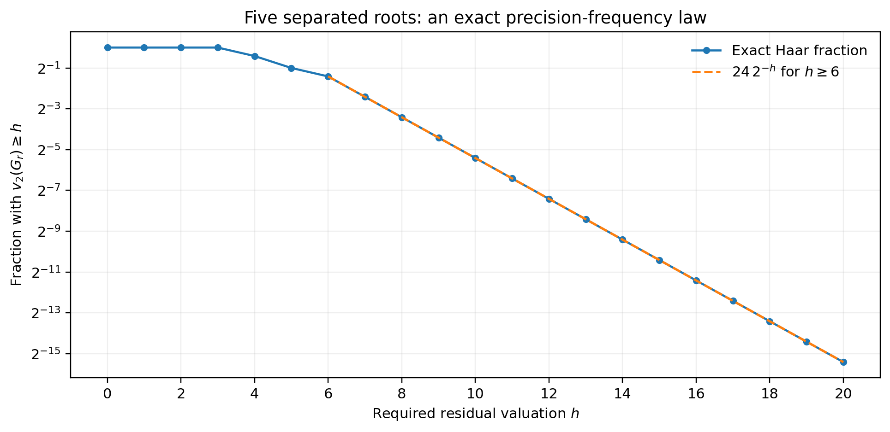
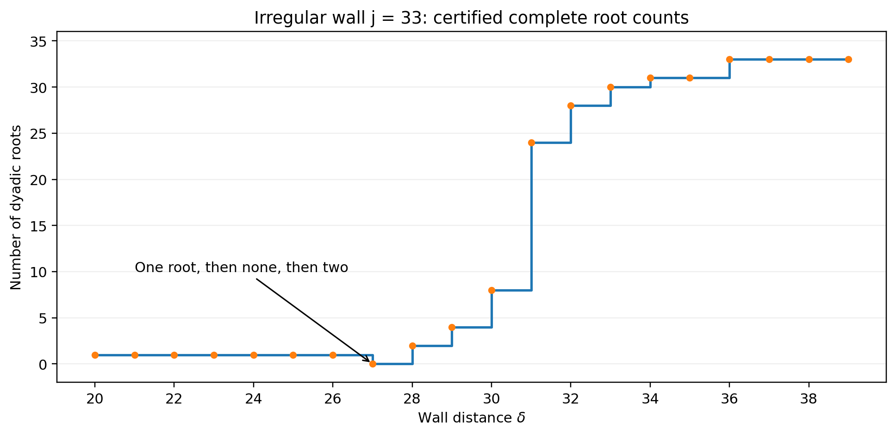
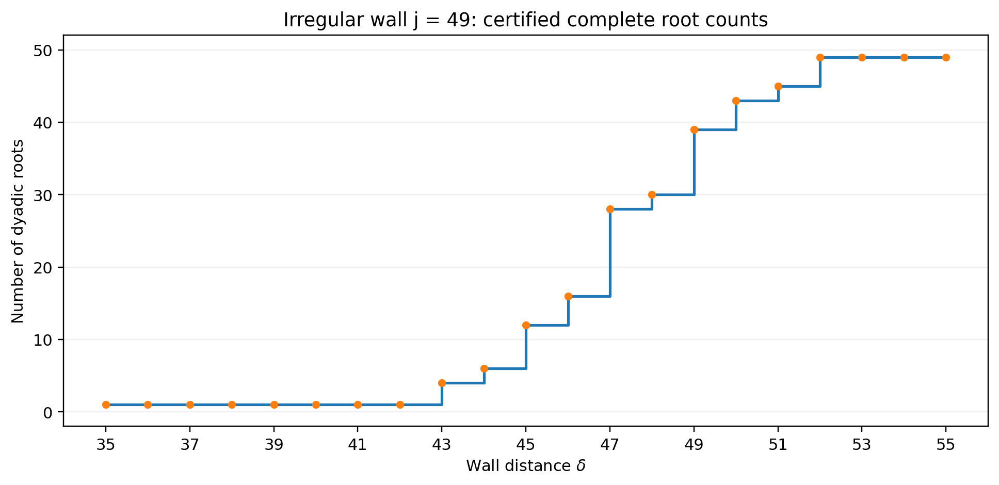

# Continuation V. Certified resolution and precision distributions

**Komorebi P. · 26 September 2026 · Version 5**

## Scope and new conclusions

This continuation retains the exact source, kernel, tail factorization and finite polynomial preparation of v4. It adds three results. First, a nonzero resultant gives an explicit stopping bound for the polynomial root-resolution algorithm. Second, any completed valuation atlas determines an exact rational generating function for the frequency of cancellation, and an exact mean valuation. Third, complete coefficient certificates resolve the next irregular walls, of sizes 33 and 49. Together with the regular-wall theorem and the size-17 certificates, these cover every shifted-wall label through 64 at every valid scale.

There is also a necessary interpretive correction. Root counts need not be monotone as an irregular wall distance increases. At size 33 the count drops from one to zero before rising to two. Moving beyond a wall suppresses a lower packet in the normal form, but does not by itself imply monotone root emergence. The regular-wall theorem remains valid with its stated unit-perturbation hypothesis.

Universal statements below have proofs. The two new irregular-wall prefixes are computer-assisted: complete coefficientwise certificates cover dyadic balls, and the v4 cutoff controls every omitted analytic coefficient. Their numerical root residues are finite approximations, not exact rational roots. No Lean compilation or historical-priority assessment is claimed.

## Conventions retained from v4

The target is the signed Euler number $E_{2N}$. The last retained depth is $M$, and $r=M+1$ is the first omitted depth. Put $x=N-r$ for a nonempty integer tail. Define

\[
A(N)=\frac{3^{2N+2}-1}{4(2N+1)(2N+2)},\qquad
\left(\frac z{\sinh z}\right)^2=\sum_{m\ge0}\beta_mz^{2m},
\]
\[
\kappa_m=2^{2m}(2m)!\beta_m,
\qquad
\mathcal T_M(N)=E_{2N}-\sum_{m=0}^{\min(M,N)}
\kappa_m\binom{2N}{2m}A(N-m).
\]

The source is a dyadic unit, $v_2(\kappa_m)=4m-1$ for $m\ge1$, and

\[
\mathcal T_{r-1}(N)=\kappa_r\binom{2N}{2r}H_r(N-r).
\]

The analytic source, including its removable point, is

\[
\mathscr A(x)=\frac{9^{x+1}-1}{8(x+1)(2x+1)},
\qquad \mathscr A(-1)=-\frac{\log9}{8}.
\]

It belongs to $\mathbb Z_2\langle x\rangle^\times$ and is one modulo two coefficientwise. With

\[
P_q(x)=\prod_{i=0}^{q-1}(x-i)(2x-(2i+1)),
\]
\[
H_r(x)=\sum_{q\ge0}8^q\frac{\beta_{r+q}}{\beta_r}
P_q(x)\mathscr A(x-q),
\]

the carry weights and normalization are

\[
\lambda_r(q)=3q+s_2(r+q)-s_2(r),\qquad
\mu_r=\min_q\lambda_r(q),\qquad
J_r=\{q:\lambda_r(q)=\mu_r\},
\]
\[
G_r=2^{-\mu_r}H_r.
\]

Every minimizer satisfies $q\le\lfloor(s_2(r)-1)/3\rfloor$. The finite polynomial preparation is

\[
G_r(X)=W_r(X)U_r(X),\qquad
U_r\in\mathbb Z_2\langle X\rangle^\times,
\]

where $W_r$ is monic of degree $\max J_r$. Consequently

\[
\boxed{
 v_2\mathcal T_{r-1}(N)
 =4r-1+v_2\binom Nr+\mu_r+v_2W_r(N-r).
} \tag{V.1}
\]

The old optimal uniform bound is $4M+3=4r-1$. None of the results in this continuation increases that worst-case bound. Empty tails remain exactly zero, with valuation infinity.

## A finite stopping certificate for squarefree residual polynomials

Let $W\in\mathbb Z_2[X]$ be monic of positive degree. Write

\[
R=\operatorname{Res}(W,W'),\qquad D=v_2(R).
\]

A zero resultant is not assumed absent. The following theorem is conditional on $R\ne0$.

### Theorem V.1. Resultant-controlled resolution depth

Suppose $D<\infty$. Then every ball modulo $2^{D+1}$ has exactly one of the following descriptions:

1. $v_2W$ is constant on that ball and there is no root there.
2. The ball contains one simple dyadic root $\alpha$, and $v_2W(x)=b+v_2(x-\alpha)$ there for a fixed integer $b$.

Coefficient precision

\[
\boxed{P\ge2D+2}
\]

is sufficient to certify the complete partition. An adaptive constant-or-affine splitter therefore terminates by depth at most $D+1$ at that precision.

**Proof.** The adjugate of the Sylvester matrix supplies $A,B\in\mathbb Z_2[X]$ with

\[
A(X)W(X)+B(X)W'(X)=R.
\]

For every $s\in\mathbb Z_2$, this implies

\[
\min\{v_2W(s),v_2W'(s)\}\le D. \tag{V.2}
\]

Set $k=D+1$ and expand

\[
W(s+2^kY)=W(s)+2^kW'(s)Y+
\sum_{i\ge2}2^{ki}c_iY^i,
\qquad c_i\in\mathbb Z_2.
\]

If $a=v_2W(s)\le D$, all nonconstant coefficients have valuation at least $k>a$. Division by $2^a$ gives constant reduction one, so the valuation is $a$ throughout the ball.

If $a>D$, equation (V.2) gives $b=v_2W'(s)\le D$. The linear coefficient has valuation $c=k+b\le2D+1$, while every higher coefficient has valuation at least $2k>c$. If $a<c$, the constant dominates and again gives a constant-valuation ball. If $a\ge c$, division by $2^c$ gives coefficientwise reduction $Y+\epsilon$. The elementary isometry lemma from v4 gives one root $\eta\in\mathbb Z_2$ and

\[
v_2W(s+2^kY)=c+v_2(Y-\eta).
\]

Putting $\alpha=s+2^k\eta$ yields $c-k=b$ and the asserted distance law. The largest normalization used is $c\le2D+1$, so $P\ge2D+2$ supplies the nonzero residual coefficient in every case. This proves both the mathematical classification and the finite certificate bound. $\square$

The Hensel/isometry step is standard local analysis [S3]. The proof here makes the stopping depth and coefficient budget explicit. It does not claim a polynomial-time algorithm: enumerating all depth-$D+1$ balls can be expensive, and the adaptive splitter is intended to avoid that enumeration when certificates appear earlier.

### Corollary V.2. A checkable certificate from finite coefficients

Compute the resultant of a monic coefficient lift of $W_r$ modulo $2^P$. If the resultant residue is nonzero, its valuation $D<P$ is the exact valuation of the true dyadic resultant. This follows because the resultant is a polynomial with integer coefficients in the input coefficients. It certifies squarefreeness over $\mathbb Q_2$.

Once coefficient precision reaches $2D+2$, Theorem V.1 gives a guaranteed finite resolution. If the resultant is zero modulo $2^P$, the result is inconclusive. It does not establish a repeated root. A repeated root of the exact polynomial, should one occur, still requires a multiplicity-aware analysis.

The new audit certifies 22 nonconstant Euler residual polynomials this way. One additional tested Euler residual is a unit polynomial. The test polynomial $X^2$ deliberately produces an inconclusive resultant and an unresolved branch, confirming that the implementation does not turn a finite zero into a simple-root certificate.

### Example: a degree-seven residual

For $r=2^{40}-7$, the prepared polynomial has degree seven and exact resultant valuation $D=24$. The theorem allows resolution depth 25 and coefficient precision 50. The adaptive certificate actually finishes at depth three. This illustrates a conservative worst-case certificate, not a claim that the upper bound is attained.

## Exact frequency of residual cancellation

Equip $\mathbb Z_2$ with normalized Haar measure $\nu$, so a residue ball $s+2^k\mathbb Z_2$ has measure $2^{-k}$. This is a precise counting convention: events determined modulo $2^h$ have the same measure as their fraction among the $2^h$ residues. No probabilistic model of Euler numbers is assumed.

A completed atlas has constant leaves and simple-root leaves. On a constant leaf of depth $k$,

\[
v_2G(x)=c.
\]

On a simple-root leaf of depth $k$ and normalization content $c$,

\[
G(s+2^kY)=2^cF(Y),\qquad
v_2F(Y)=v_2(Y-\eta).
\]

The last random variable under uniform Haar measure has the exact law

\[
\nu\{v_2(Y-\eta)=n\}=2^{-n-1},\qquad n\ge0. \tag{V.3}
\]

Indeed divisibility by $2^n$ selects one ball of measure $2^{-n}$, and subtracting the next ball gives the displayed shell measure.

### Theorem V.3. Rational valuation generating function

Let

\[
Z_G(T)=\int_{\mathbb Z_2}T^{v_2G(x)}\,d\nu(x).
\]

The finite root set has measure zero. For a completed simple-root atlas,

\[
\boxed{
 Z_G(T)=
 \sum_{\text{constant leaves}}2^{-k}T^c
 +\sum_{\text{simple-root leaves}}
 \frac{2^{-k}T^c}{2-T}.
} \tag{V.4}
\]

This identity is an identity of probability generating series for the nonnegative, finite valuations. It is also valid as a convergent integral for real $0\le T<2$.

**Proof.** A constant leaf contributes its measure times $T^c$. On a simple-root leaf, use the affine parameter $Y$, whose normalized measure is uniform, and sum the geometric series in (V.3):

\[
\sum_{n\ge0}2^{-n-1}T^n=\frac1{2-T}.
\]

Add the finitely many disjoint leaves. $\square$

The exact survival probability is consequently

\[
\boxed{
\nu\{v_2G\ge h\}=
\sum_{\text{constant leaves}}2^{-k}\mathbf1_{c\ge h}
+\sum_{\text{root leaves}}2^{-k-\max(0,h-c)}.
} \tag{V.5}
\]

For all sufficiently large $h$,

\[
\boxed{
\nu\{v_2G\ge h\}=C_G\,2^{-h},
\qquad C_G=\sum_{\text{root leaves}}2^{c-k}.
} \tag{V.6}
\]

An explicit onset is the maximum of the root-leaf contents and one more than each constant-leaf value. A root-free atlas gives $C_G=0$. Beyond that onset, one extra binary digit of residual cancellation halves the fraction of eligible addresses.

This last statement concerns residual cancellation after the kernel and binomial factors have been separated. It must not be read as an independence statement about the binomial carry term in (V.1).

### Repeated roots and the general all-depth form

The v4 preparation theorem and compactness imply a finite valuation description even when multiplicities occur. Near a root $\alpha$ of multiplicity $e$, on a sufficiently small ball, the valuation is $c+e\,v_2(Y-\eta)$. Its generating contribution is

\[
\frac{2^{-k}T^c}{2-T^e}.
\]

Therefore every fixed depth has a rational valuation generating function, with denominators of this form for the dyadic root multiplicities actually present. This is an existence theorem. The present code certifies constant and simple-root leaves; it does not purport to determine an exact repeated root from arbitrarily long runs of finite zero residues.

## The five-root distribution, explicitly

At the regular wall $j=5$, after all five roots have separated ($\delta\ge6$), the separating data are

\[
(k_i)=(3,2,2,2,3),\qquad
(d_i)=(3,1,2,1,3),\qquad
(t_i)=(6,3,4,3,6).
\]

On each root ball, $c=t_i$ and its mass is $2^{-k_i}$. Theorem V.3 gives

\[
\boxed{
 Z_{G_r}(T)=\frac{2T^3+T^4+T^6}{4(2-T)}.
} \tag{V.7}
\]

In particular,

\[
\boxed{
\nu\{v_2G_r\ge h\}=\frac{24}{2^h}
\quad(h\ge6),
\qquad
\int v_2G_r\,d\nu=5.
} \tag{V.8}
\]

Some exact residual precision budgets are:

| Required residual valuation $h$ | Exact address fraction |
|---:|---:|
| 6 | $3/8$ |
| 7 | $3/16$ |
| 8 | $3/32$ |
| 10 | $3/128$ |
| 12 | $3/512$ |
| 16 | $3/8192$ |

The audit compares the generating-function law against complete residue enumeration through 12 bits, not just selected root neighborhoods.

At earlier positive distances the same theorem yields

\[
Z_{G_r}(T)=
\sum_{\delta<t_i}2^{-k_i}T^\delta
+\sum_{\delta\ge t_i}\frac{2^{-k_i}T^{t_i}}{2-T}.
\tag{V.9}
\]

For example the first two stages are $T$ and $T^2$, since the entire normalized residual has constant valuation one or two. Root emergence changes the distribution exactly when a separating ball crosses its threshold.

## Mean precision of the complete Euler remainder

### Lemma V.4. Mean binomial carry valuation

For every fixed positive integer $r$,

\[
\boxed{
\int_{\mathbb Z_2}v_2\binom{x+r}{r}\,d\nu(x)=s_2(r).
} \tag{V.10}
\]

**Proof.** Away from the finitely many roots of the numerator,

\[
v_2\binom{x+r}{r}
=\sum_{i=1}^{r}v_2(x+i)-v_2(r!).
\]

Translation invariance and (V.3) give $\int v_2(x+i)\,d\nu=1$. Integrating the finite sum gives $r-v_2(r!)=s_2(r)$. The finitely many infinite values have measure zero. No independence is used. $\square$

The equality between the two binomial valuations in (V.1) extends to dyadic arguments: their ratio is a product of odd affine factors divided by odd integers and therefore a unit.

### Theorem V.5. Mean remainder valuation at every resolved depth

For the analytic extension of the nonempty-tail formula, under $N=r+x$ with $x$ distributed by Haar measure,

\[
\boxed{
\int v_2\mathcal T_{r-1}(r+x)\,d\nu(x)
=4r-1+\mu_r+s_2(r)+\int v_2G_r(x)\,d\nu(x).
} \tag{V.11}
\]

For a completed simple atlas,

\[
\int v_2G_r\,d\nu
=\sum_{\text{constant leaves}}2^{-k}c
+\sum_{\text{root leaves}}2^{-k}(c+1). \tag{V.12}
\]

**Proof.** Integrate the exact valuation identity (V.1), apply Lemma V.4, and use (V.3) on each root leaf. All terms are integrable. $\square$

### Corollary V.6. Exact mean after complete wall separation

Let $r=2^L-j$, with $L>L_j$, and suppose all $j$ skeleton roots have separated as in the v4 theorem. Then

\[
\boxed{
\int v_2\mathcal T_{r-1}(r+x)\,d\nu(x)
=4(r+j)=4\cdot2^L.
} \tag{V.13}
\]

Equivalently, the mean gain above the optimal uniform exponent $4r-1$ is exactly

\[
\boxed{4j+1.}
\]

**Proof.** Once all roots are separated, $v_2G_r(x)=\sum_{i=0}^{j-1}v_2(x-\alpha_i)$, so its mean is $j$. Binary complementation gives $s_2(r)=L-s_2(j-1)$. From the wall definitions,

\[
\mu_r=E_j-(L-L_j),\qquad
E_j+L_j=3j+1+s_2(j-1),
\]

hence $\mu_r+s_2(r)=3j+1$. Substitute in (V.11). $\square$

For the five-root wall at $\delta=6$, $r=8{,}388{,}603$. Its uniform exponent is $33{,}554{,}411$, and its Haar mean exponent is $33{,}554{,}432$. The gain is 21, exactly $4\cdot5+1$.

This is an average with a declared measure, not a guarantee at each row. It coexists with the sharp worst-case row and with arbitrarily large gains along root-approaching addresses. The counting interpretation is exact for capped valuation events modulo powers of two. No claim is made that untruncated arithmetic averages over successive integer prefixes must converge without an additional uniform-integrability argument.

### Power-of-two skeletons

If $j=2^a$, every separating content is $t_i=j-1$. After all roots emerge,

\[
\boxed{
Z_{G_r}(T)=\frac{T^{j-1}}{2-T}.
} \tag{V.14}
\]

Thus the normalized residual valuation has the law $j-1$ plus a geometric binary valuation, despite there being $j$ distinct root balls. Its mean is $j$. This follows from the equal ball masses and equal derivative/separation costs, not from an identification of the different roots.

## The next irregular wall: a root disappears before the full set emerges

At $j=33$, the lower carry weights have minimum $E_{33}=-1$, uniquely at $q=1$, and

\[
L_{33}=102,\qquad r=2^{102+\delta}-33,\qquad\mu_r=-1-\delta.
\]

The lower perturbation has reduction $X$, not a unit. Therefore the regular-wall necessity and monotonicity conclusions do not apply.

The complete root count is:

| Distance $\delta$ | Exact root count |
|---:|---:|
| 1 through 26 | 1 |
| 27 | 0 |
| 28 | 2 |
| 29 | 4 |
| 30 | 8 |
| 31 | 24 |
| 32 | 28 |
| 33 | 30 |
| 34 and 35 | 31 |
| 36 and above | 33 |

The audit certifies every distance one through 37. The general separation threshold is 37, so the finite result at 36 and the theorem for every distance at least 37 prove the last row of this table. The finite valid pre-wall scales have one simple even root, as does the equality wall.

### A complete no-root certificate at distance 27

At $\delta=27$, the following compressed partition covers $\mathbb Z_2$:

| Dyadic address | Exact value of $v_2G_r$ | Measure |
|---|---:|---:|
| odd $x$ | 27 | $1/2$ |
| $x=0\pmod4$ | 28 | $1/4$ |
| $x=6\pmod8$ | 29 | $1/8$ |
| $x=10\pmod{16}$ | 30 | $1/16$ |
| $x=2\pmod{32}$ | 31 | $1/32$ |
| $x=18\pmod{32}$ | 32 | $1/32$ |

The stored certificate uses a few smaller leaves whose unions are the classes displayed here. Every leaf reduces coefficientwise to one after removal of its stated power of two. The last two classes split the one remaining class modulo sixteen, so the table covers all dyadic arguments, not a sampled subset.

It follows that there is no dyadic root and no residual valuation above 32 in this family at this distance. Its exact generating polynomial is

\[
\boxed{
Z_{G_r}(T)=\frac{16T^{27}+8T^{28}+4T^{29}+2T^{30}+T^{31}+T^{32}}{32}.
} \tag{V.15}
\]

Its mean is $895/32$. This is a bounded residual valuation; the separate binomial carry factor in the complete Euler remainder must still be accounted for.

At distance 26, a simple-root leaf occurs on $x=2\pmod{16}$. At distance 28 it has been replaced by two simple-root leaves, on $x=2$ and $x=18$ modulo 32. Statements about individual roots being continuously tracked as $\delta$ changes would require a separately defined parameterized family. The result here is an exact count for each member of the discrete wall family.

## The size-49 wall and coverage through 64

For $j=49$,

\[
E_{49}=0,\qquad L_{49}=150,\qquad
r=2^{150+\delta}-49.
\]

The lower minimum is shared by $q=0,1$, so the perturbation reduces to $1+X$. Its exact root counts are:

| Distance $\delta$ | Exact root count |
|---:|---:|
| 1 through 42 | 1 |
| 43 | 4 |
| 44 | 6 |
| 45 | 12 |
| 46 | 16 |
| 47 | 28 |
| 48 | 30 |
| 49 | 39 |
| 50 | 43 |
| 51 | 45 |
| 52 and above | 49 |

The general separation threshold is $v_2(48!)+\lceil\log_2 49\rceil=46+6=52$. Every positive distance through 52 has a complete coefficient atlas. The theorem then covers every larger distance. Pre-wall and equality scales each have one odd simple root.

The stored arithmetic uses 64-bit coefficient precision. A root residue can have fewer than 64 certified bits when a positive derivative valuation is removed. Every root record retains its own precision. None of the displayed classification counts depends on treating a finite residue as an exact zero.

### Corollary V.7. Complete shifted-wall coverage through size 64

For $j\le64$, the only irregular labels are $17,33,49$. Indeed, for $q=1$,

\[
e_j(1)=4-v_2(j-1),
\]

so nonpositivity occurs precisely at those three labels in this range. For $q\ge2$, the binary digit-sum bound makes $e_j(q)>0$. The $j=1$ condition is vacuous.

The regular theorem therefore covers every other label. The inherited size-17 certificates and the two new atlases cover the exceptions. Combined with their pre-wall/equality proofs and the general all-large-distance theorem, this gives a complete classification for every shifted-wall family with

\[
\boxed{1\le j\le64,\qquad 2^L>j.}
\]

It does not classify every arbitrary first omitted depth $r$. That broader problem retains the exact finite-polynomial reduction (V.1), and now also the conditional resultant stopping certificate.

## Exact computation, evidence and failures

The incoming v4 archive had SHA-256

`ab5f13419822911dc4bdbcede78399f398d9710674d8352f274c98e2ec9197e5`.

All 42 files covered by its internal integrity ledger matched. Its main scientific checker was rerun without modifying the historical snapshot and reproduced the declared counts, including all 8,256 nonempty rational tails through $N=128$. Those rerun results are separate from the inherited v4 record.

The new, completed scientific runs use standard Python integer and rational arithmetic. The important new counts are:

| Check | Executed scope |
|---|---:|
| Size-33 positive wall distances | 37 |
| Size-49 positive wall distances | 52 |
| New positive-distance whole-ball leaves | 930 |
| New boundary whole-ball leaves | 8 |
| New pre-wall minimum checks | 242 |
| Original unfactored-tail comparisons in the two wall audits | 1,424 |
| Atlas-versus-value comparisons in the two wall audits | 11,392 |
| Squarefree nonconstant Euler residual certificates | 22 |
| Exhaustive residue evaluations for distribution checks | 94,208 |
| Exact survival thresholds compared | 299 |
| Regular-wall mean checks | 153 |
| Saturated mean identities checked directly | 18 |

The 1,424 original-tail comparisons are modulo $2^{32}$. At large wall distances some are zero residues and supply only a precision-limited consistency check. The classification itself rests on complete coefficientwise leaf certificates at greater precision, not on those point values. Separate precision metadata is recorded for each run.

Two larger size-49 executions exceeded the outer 45-second execution limit: the initial unsplit audit, and a later 16-distance block. Neither produced its claimed scientific result file, and neither is counted as a pass. The successful runs partition the same distance interval into $1$–$20$, $21$–$36$, $37$–$40$, $41$–$44$, $45$–$48$, and $49$–$52$, without omissions or overlaps. Their individual manifests record input/output hashes, commands, logs and actual resource caps. These are computational failures, not observed mathematical counterexamples.

A repeated-root safety test intentionally leaves the $X^2$ branch unresolved. That is a successful test of the evidence boundary, not a claim to have resolved the repeated root through the simple-root procedure.

The result files and manifest files distinguish fresh v5 runs, the fresh v4 rerun, and historical v1–v4 evidence. Mathematical proofs and finite certificates are not interchangeable, and neither is described as Lean-checked.

## Continuing ledger

The completed foundation is now an exact chain:

\[
\begin{aligned}
\text{Euler source and inverse}
&\longrightarrow\text{factored tail}\\
&\longrightarrow\text{finite carry minimum}\\
&\longrightarrow\text{finite residual polynomial}\\
&\longrightarrow\text{certified valuation atlas}.
\end{aligned}
\]

The atlas supplies root-distance laws, precision distributions and exact means. A nonzero resultant supplies a finite stopping bound without assuming that an unresolved numerical branch is harmless.

The remaining mathematical question is explicit root geometry outside the classified wall families, especially whether an arbitrary prepared Euler-tail polynomial can have an exact repeated root. No blanket simple-root or unconditional finite-precision repeated-root decision theorem is asserted. The cumulative manuscript preserves that boundary rather than labeling the entire arbitrary-depth problem finished.
