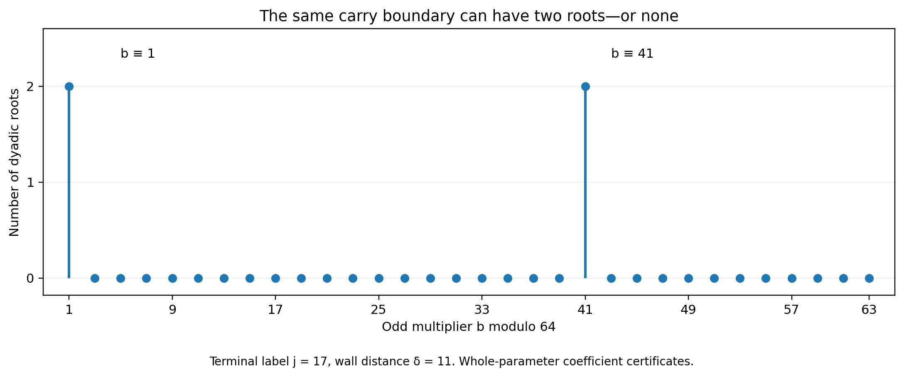
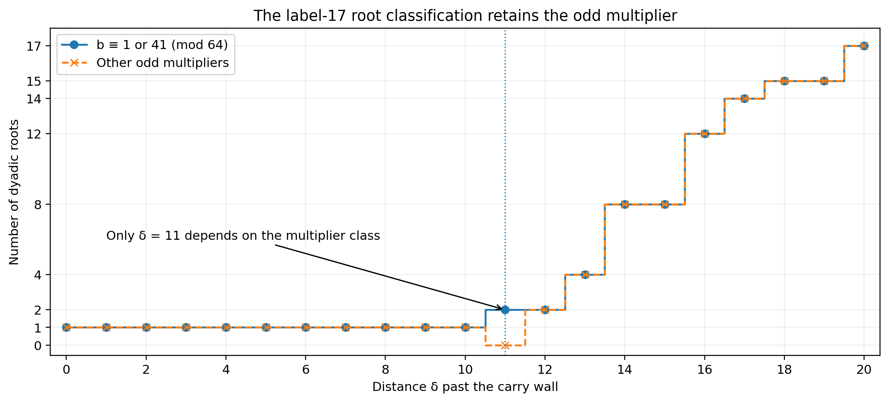

# Continuation VI. Terminal carries and arbitrary-depth root classification

**Komorebi P. · Operation Komorebi · 26 September 2026 · Version 6**

## Result and scope

The previous record classified the shifted families `r=2^L-j` through label 64. It did not classify every arbitrary first omitted depth whose prepared polynomial had degree at most 64. This continuation closes that distinction.

Every nonconstant normalized Euler tail has a canonical terminal carry representation

\[
\boxed{r=b2^L-j,\qquad b\text{ odd},\qquad j=\deg W_r.} \tag{VI.1}
\]

The terminal label is determined by a finite carry minimum. The regular-wall proof extends to every odd multiplier once this terminal label has been established. New paired coefficient certificates handle all multipliers for the irregular terminal labels 17, 33 and 49.

Consequently, every first omitted depth with `deg W_r<=64` has a complete constant-or-simple-root valuation atlas on `Z_2`. This includes every positive `r` with at most **195 binary ones**, an infinite set not bounded by the numerical size of `r`. It includes every `1<=r<2^195` by proof, not by an enumeration of those integers.

Every dyadic root in this region is simple. This is not a universal squarefreeness theorem over an algebraic closure. It does not exclude repeated dyadic roots in the remaining irregular terminal labels above 64.

A crucial qualification is exposed by the first exceptional multiplier phase. At terminal label 17 and `L=64`, two roots exist precisely for

\[
\boxed{b\equiv1\text{ or }41\pmod{64}.} \tag{VI.2}
\]

All other odd multiplier classes have no dyadic root. Thus the unit coefficients can change the root geometry even when the active carry data agree.

The general results below have proofs. The finite exceptional ranges are computer-assisted proofs based on coefficientwise certificates covering parameter balls and argument balls. Sampled comparisons are secondary checks. No Lean compilation or historical-priority assessment was performed.

## 1. Fixed conventions and inherited factorization

The target is the signed Euler number `E_(2N)`. The last retained depth is `M`, the first omitted depth is `r=M+1`, and the row offset is `x=N-r`. Define

\[
A(N)=\frac{3^{2N+2}-1}{4(2N+1)(2N+2)},\qquad
\left(\frac z{\sinh z}\right)^2=\sum_{m\ge0}\beta_mz^{2m},
\]
\[
\kappa_m=2^{2m}(2m)!\beta_m,\qquad
v_2(\kappa_m)=4m-1\quad(m\ge1).
\]

The remainder is

\[
\mathcal T_M(N)=E_{2N}-\sum_{m=0}^{\min(M,N)}
\kappa_m\binom{2N}{2m}A(N-m).
\]

For `N<=M`, it is exactly zero. All statements about nonempty original tails use `N>=r`.

Use the analytic source and integer polynomial

\[
\mathscr A(x)=\frac{9^{x+1}-1}{8(x+1)(2x+1)},\qquad
\mathscr A(-1)=-\frac{\log9}{8},
\]
\[
P_q(x)=\prod_{i=0}^{q-1}(x-i)(2x-(2i+1)).
\]

The source is an integral restricted analytic unit with coefficientwise reduction one. The inherited exact factorization is

\[
\mathcal T_{r-1}(N)=\kappa_r\binom{2N}{2r}H_r(N-r),
\]
\[
H_r(x)=\sum_{q\ge0}8^q\frac{\beta_{r+q}}{\beta_r}P_q(x)\mathscr A(x-q).
\]

Put

\[
\lambda_r(q)=3q+s_2(r+q)-s_2(r),
\quad \mu_r=\min_{q\ge0}\lambda_r(q),
\quad J_r=\{q:\lambda_r(q)=\mu_r\},
\]
\[
G_r=2^{-\mu_r}H_r,\qquad j_r=\max J_r.
\]

Here `s_2` counts the ones in the binary expansion. Every minimizer lies in

\[
0\le q\le\left\lfloor\frac{s_2(r)-1}{3}\right\rfloor.
\]

The prepared polynomial has degree `j_r`, and the exact valuation is

\[
\boxed{
 v_2\mathcal T_{r-1}(N)
 =4r-1+v_2\binom Nr+\mu_r+v_2G_r(N-r).
} \tag{VI.3}
\]

Throughout, `v_2(0)=infinity`. A zero residue at precision `P` certifies only valuation at least `P`.

## 2. The terminal carry theorem

### Lemma VI.1. Successive carry costs

For every `r>=1` and `q>=1`,

\[
\boxed{\lambda_r(q)-\lambda_r(q-1)=4-v_2(r+q).} \tag{VI.4}
\]

**Proof.** The elementary identity `s_2(n)-s_2(n-1)=1-v_2(n)` gives the formula after adding the linear increment three.

In particular, every positive minimizing index satisfies `16 | r+q`. Distinct positive minimizers are congruent modulo sixteen. This is a restriction on the scalar carry minimum, not a claim that the whole-tail valuation is its minimum summand valuation.

### Theorem VI.2. Canonical terminal wall at every nonconstant depth

Let `j=j_r>0` and set

\[
L=v_2(r+j),\qquad b=(r+j)/2^L.
\]

Then

\[
\boxed{j<2^L,\qquad b\text{ is a positive odd integer}.} \tag{VI.5}
\]

For `0<=q<j`, define

\[
e_j(q)=3q+s_2(j-1)-s_2(j-q-1),\qquad
E_j=\min_{q<j}e_j(q),
\]
\[
L_j=3j+1+s_2(j-1)-E_j.
\]

The following identities and inequalities are exact:

\[
\lambda_r(q)=e_j(q)\quad(q<j),
\]
\[
\boxed{\mu_r=3j+1+s_2(j-1)-L,\qquad L\ge L_j.} \tag{VI.6}
\]

If `delta=L-L_j`, then

\[
J_r=
\begin{cases}
\{j\},&\delta>0,\\
\{q<j:e_j(q)=E_j\}\cup\{j\},&\delta=0.
\end{cases} \tag{VI.7}
\]

**Proof.** Suppose first that `j>=2^L`. The earlier index `q=j-2^L` is nonnegative and

\[
r+q=(b-1)2^L.
\]

The case `b=1` would imply `r<=0`, which is excluded. Since `b` is odd,

\[
s_2(b)-s_2(b-1)=1.
\]

It follows that

\[
\lambda_r(j)-\lambda_r(j-2^L)=3\cdot2^L+1>0,
\]

contradicting minimality. Thus `j<2^L`.

Binary complementation now gives

\[
s_2(r)=s_2(b)-1+L-s_2(j-1).
\]

For `q<j`, applying the same identity to `b2^L-(j-q)` gives `lambda_r(q)=e_j(q)`. At `q=j`, the digit sum is `s_2(b)`, giving (VI.6). Minimality implies `mu_r<=E_j`, hence `L>=L_j`. By the choice of the **last** minimizer, every `q>j` has strictly larger weight. The remaining assertions follow. This proves the representation without restricting the size or digit structure of the odd multiplier.

### Why the last minimizer matters

The first apparent wall need not be the controlling one. At

\[
r=2^{64}-17,
\]

one has `v_2(r+1)=4`, so `lambda_r(1)=0`. But

\[
\lambda_r(17)=-11.
\]

The actual terminal label is 17, not one. Replacing the last-minimum test by the first local carry would give the wrong normal form. The executable descriptor retains this as an adversarial test.

### Corollary VI.3. Two all-depth residue tests

At every depth, without a degree bound:

* If `0 in J_r` and `1 not in J_r`, then `v_2G_r(x)=0` for all `x in Z_2`.
* If `1 in J_r`, then `G_r` is an isometric bijection of `Z_2`. It has a unique simple root `alpha`, and `v_2G_r(x)=v_2(x-alpha)`.

**Proof.** The residual polynomial is `sum_(q in J_r) X^underlined(q)`. Every falling factorial of degree at least two vanishes at both elements of `F_2`, proving the first assertion. When one is a minimizer, Lemma VI.1 implies that every other positive minimizer is at least seventeen. Those higher falling products and their derivatives vanish at both residue classes. Thus `G_r` induces a permutation modulo two and has odd derivative at both classes.

For two arguments in the same parity class, the divided difference is odd by reduction to the derivative. For arguments of different parity, both the argument difference and the function difference are odd. This proves the isometry. Hensel lifting gives the unique root in its prescribed parity class. This proof does not assume that the entire residual polynomial has degree one.

## 3. The regular-wall proof now covers arbitrary depths

Collecting all residual terms at and above the last minimum gives

\[
\boxed{G_r(x)=P_j(x)U(x-j)+2^\delta V(x),} \tag{VI.8}
\]

with `U` an integral restricted unit reducing to one and `V` integral restricted. This follows from

\[
P_{j+h}(x)=P_j(x)P_h(x-j)
\]

and from the strict inequality in weight for every `q>j`. The lower normalized costs are `delta+e_j(q)-E_j`. Thus the normal form holds at **every** nonconstant depth, not only when the multiplier `b` is one.

Call the terminal label regular when

\[
e_j(q)>0\qquad(1\le q<j).
\]

Then `E_j=0`, `mu_r=-delta`, and `V` reduces coefficientwise to one.

Retain the separating data

\[
d_i=v_2(i!)+v_2((j-1-i)!),
\]
\[
k_i=1+\lfloor\log_2\max(i,j-1-i)\rfloor,
\qquad t_i=d_i+k_i
\]

for `j>1`, with `d_0=k_0=t_0=0` when `j=1`. The balls

\[
B_i=i+2^{k_i}\mathbb Z_2\qquad(0\le i<j)
\]

partition `Z_2`.

### Theorem VI.4. Exact regular-terminal valuation atlas

At every depth with regular terminal label `j`,

\[
\boxed{v_2G_r(x)=
\begin{cases}
\delta,&x\in B_i,\ \delta<t_i,\\
d_i+v_2(x-\alpha_i),&x\in B_i,\ \delta\ge t_i.
\end{cases}} \tag{VI.9}
\]

In the second case `alpha_i` is the unique root on that ball, is simple, and has

\[
v_2(\alpha_i-i)=\delta-d_i.
\]

The root count is exactly `#{i:t_i<=delta}`. At `delta=0` and `j>=2`, the function is pointwise a unit on `Z_2`, although it need not be a unit of the Tate algebra. At `j=1`, the equality case has one odd simple root.

**Proof.** Substitute `x=i+2^(k_i)y` into (VI.8). The fixed skeleton has the coefficient factorization

\[
P_j(i+2^{k_i}y)=2^{t_i}yQ_i(y),\qquad Q_i\equiv1\pmod2.
\]

If `delta<t_i`, the perturbation is the unique smaller valuation and gives the constant branch. If `delta>=t_i`, division by `2^(t_i)` gives reduction `y+1` at equality and `y` otherwise. Each is an isometry with one simple root. Evaluation at the skeleton point gives the displacement formula. The partition proves completeness. This is the earlier separating-ball proof with the now-proved terminal representation supplying its hypotheses.

The same argument without regularity still guarantees all `j` simple roots once

\[
\boxed{\delta\ge v_2((j-1)!)+\lceil\log_2j\rceil.} \tag{VI.10}
\]

The multiplier can move the roots. It does not change these regular-label thresholds.

## 4. A precision cutoff independent of the size of the index

The original global coefficient cutoff depends on `s_2(r)`. A local cutoff removes that dependence after one parity split.

Write

\[
G_r(x)=\sum_{q\ge0}\gamma_{r,q}P_q(x)\mathscr A(x-q),
\qquad
\gamma_{r,q}=2^{-\mu_r}8^q\frac{\beta_{r+q}}{\beta_r}.
\]

All `gamma_(r,q)` are integral by the definition of the true minimum `mu_r`.

### Lemma VI.5. Uniform parity cutoff

For `e=0,1`,

\[
P_q(e+2Y)\in2^{\lfloor q/2\rfloor}\mathbb Z_2[Y].
\]

Consequently, at coefficient precision `P`,

\[
\boxed{
G_r(e+2Y)\equiv
\sum_{0\le q<2P}\gamma_{r,q}P_q(e+2Y)
\mathscr A(e+2Y-q)\pmod{2^P}.
} \tag{VI.11}
\]

This holds at every depth.

**Proof.** Among the factors `e+2Y-i`, at least `floor(q/2)` have `i` of the same parity as `e`. Each has a factor two coefficientwise. All other factors are integral. The normalized scalars and analytic source are integral. Thus every term with `q>=2P` is zero coefficientwise on each parity ball. Deeper integral affine substitutions preserve that precision.

This is a branchwise coefficient bound. It is **not** a claim that the same truncation holds globally in the Gauss norm before splitting parity.

## 5. Uniform control of the odd multiplier

We now reduce the multiplier dependence to a pair of finite polynomials. The proof is what turns a finite parameter certificate into a statement about arbitrarily large integers.

### Lemma VI.6. Precision-local Bernoulli stability

Let `n,n'` be positive even integers with `n-1,n'-1>=P` and `n congruent n' modulo 2^P`. Then

\[
2B_n\equiv2B_{n'}\pmod{2^P}.
\]

**Proof.** Use the inherited precision-local identity

\[
2B_n\equiv\sum_{k=0}^{P}\binom nk2^kB_k\pmod{2^P}.
\]

The depletion factor is one at this precision because `n-1>=P`. Vandermonde's identity and

\[
i\binom hi=h\binom{h-1}{i-1}
\]

give

\[
v_2\left(\binom nk-\binom{n'}k\right)
\ge v_2(n-n')-\lfloor\log_2k\rfloor
\]

for `k>=1`, with zero terms harmless. Since `v_2(2^kB_k)>=k-1`, and `k-1-floor(log_2 k)>=0`, every difference in the finite expansion has the required valuation. The constant term cancels. The Bernoulli generating identity and denominator bound are the classical inputs [S1, S2].

This is a finite-precision statement about actual positive indices. It does not assert an undepleted analytic interpolation of all Bernoulli values.

### Theorem VI.7. A uniform two-polynomial wall template

Fix `j,L,P`, put `r_0=2^L-j` and `Q=2P`, and assume that `j` is the terminal label of `r_0`. For a positive odd integer `b`, put `r_b=b2^L-j` and assume that its terminal label is also `j`. The terminal theorem gives the same `mu` for both depths.

The following conservative conditions suffice:

\[
2^L>2(j+Q),\qquad 2r_0-1\ge P,
\]
\[
L+1-\left\lceil\log_2\bigl(2(j+Q)+1\bigr)\right\rceil\ge P.
\tag{VI.12}
\]

Form the finite restricted-series approximations, coefficientwise modulo `2^P`,

\[
F_{<}(X)=\sum_{0\le q<\min(j,Q)}
\gamma_{r_0,q}P_q(X)\mathscr A(X-q),
\]
\[
F_{\ge}(X)=\sum_{j\le q<Q}
\gamma_{r_0,q}P_q(X)\mathscr A(X-q).
\]

Then on either parity ball,

\[
\boxed{
bG_{r_b}(e+2Y)
\equiv
\bigl(bF_<+F_{\ge}\bigr)(e+2Y)
\pmod{2^P}.
} \tag{VI.13}
\]

**Proof.** For `q<Q`, the normalized costs agree with those at `r_0` because no second multiple of `2^L` has been crossed. In the stripped coefficient formula, the factorial product has factors

\[
2r_b+t=2^{L+1}b+(t-2j),\qquad 1\le t\le2q.
\]

Every nonzero offset has bounded valuation. Condition (VI.12) makes its odd part independent of `b` modulo `2^P`. There is exactly one zero-offset factor when `q>=j`, namely `2^(L+1)b`. Its odd part contributes one denominator factor `b`. There is none when `q<j`.

The Bernoulli unit ratios agree at the required precision by Lemma VI.6. The other odd scalar factors agree as well. Hence

\[
\gamma_{r_b,q}\equiv\gamma_{r_0,q}\quad(q<j),
\]
\[
b\gamma_{r_b,q}\equiv\gamma_{r_0,q}\quad(j\le q<Q)
\]

modulo `2^P`. Lemma VI.5 handles **every** omitted `q>=Q`, including remote carry events not visible in the low prefix. The true-terminal-label hypothesis is essential here because it guarantees integrality of all normalized scalars. This proves (VI.13).

The equation is deliberately branchwise. We do not infer a global Gauss congruence from a congruence after parity splitting. We also do not infer a joint analytic family in `b` from this finite-precision template.

## 6. What the paired certificates prove

In a parameter class

\[
b=s+2^h z,\qquad s\text{ odd},\qquad z\in\mathbb Z_2,
\]

the template is affine in the formal parameter:

\[
F_0(x)+zF_1(x),
\quad F_0=sF_<+F_{\ge},\quad F_1=2^hF_<.
\]

Each stored leaf describes an argument ball `x=a+2^k y`, with `k>=1`. After removing its content `2^c`, the certificate gives one of

\[
1\pmod2,
\qquad
 y+\epsilon_0+\epsilon_1z\pmod2
\tag{VI.14}
\]

coefficientwise in **both** variables. All higher powers of `y` are even, and its linear coefficient is one independently of the parameter.

A constant leaf proves exact valuation `c` everywhere in its rectangle and excludes roots. A root leaf proves, for every admissible multiplier in the parameter class, a unique simple root `alpha_b` in the argument ball and

\[
\boxed{v_2G_{r_b}(x)=c-k+v_2(x-\alpha_b).} \tag{VI.15}
\]

The error precision in (VI.13) is strictly greater than the content used by each certificate. Thus the same residual equation holds for the exact Euler-tail function at every admissible integer multiplier. The argument uses the elementary coefficientwise isometry proof and restricted-series Hensel lifting [S3].

The parameter balls partition the odd integers, and the argument balls partition `Z_2` for each parameter ball. Their disjointness and exact dyadic masses are checked. This is why a finite certificate proves a family statement rather than merely verifying a few multipliers.

The root `alpha_b` is defined for the actual multiplier under consideration. No continuity or analytic interpolation of the exact undepleted family in `b` is asserted.

## 7. The first irregular label depends on the unit address

For terminal label `j=17`, one has

\[
L_{17}=53,\qquad r=b2^{53+\delta}-17,\qquad\mu_r=-\delta.
\]

The complete classification, conditional only on this being the terminal label, is:

| Distance | Root count for all admissible odd multipliers |
|---:|---|
| 0 through 10 | 1 |
| 11 | 2 for `b=1 or 41 mod 64`, otherwise 0 |
| 12 | 2 |
| 13 | 4 |
| 14 through 15 | 8 |
| 16 | 12 |
| 17 | 14 |
| 18 through 19 | 15 |
| 20 and above | 17 |

Every existing root is simple. The parameter-uniform certificates cover distances zero through twenty. The general separating-ball theorem covers every larger distance.

\Needspace{14\baselineskip}

At the exceptional distance eleven, the eight parameter balls used in the proof are:

| Odd multiplier address | Number of roots |
|---|---:|
| `3 mod 4` | 0 |
| `5 mod 8` | 0 |
| `25 mod 32` | 0 |
| `17 mod 32` | 0 |
| `9 mod 64` | 0 |
| `33 mod 64` | 0 |
| `1 mod 64` | 2 |
| `41 mod 64` | 2 |

These disjoint classes cover all odd multipliers. They must not be conflated with the argument-ball addresses where the roots occur.



### An explicit two-versus-zero comparison

Take

\[
r_1=2^{64}-17,\qquad r_3=3\cdot2^{64}-17.
\]

Both have `j=17`, `L=64`, `delta=11`, `mu=-11` and the same relevant low carry costs. Their residual reduction is `X^9(X+1)^8`. Nevertheless `G_(r_1)` has two dyadic roots and `G_(r_3)` has none.

On the critical ball `x=3+8y`, remove content `2^14` and prepare the remaining series as a monic quadratic times a unit. The exact polynomial residues are

\[
W_1(y)\equiv y^2+410y+25\pmod{512},
\]
\[
W_3(y)\equiv y^2+368y+11\pmod{512}.
\]

\Needspace{7\baselineskip}

Their discriminants satisfy

\[
\Delta_1\equiv64\pmod{512},\qquad
v_2(\Delta_1)=6,\quad \Delta_1/64\equiv1\pmod8,
\]
\[
\Delta_3\equiv212\pmod{512},\qquad
v_2(\Delta_3)=2,\quad \Delta_3/4\equiv5\pmod8.
\]

The first is a nonzero square in `Q_2`, the second is not. The usual dyadic square criterion is that a nonzero number has even valuation and unit part one modulo eight [S3, Theorem 4.5]. Thus the quadratics have respectively two roots and no roots. The complete atlas excludes roots on every other ball. No zero discriminant or repeated root is inferred from either case.

For `b=3`, the whole-domain valuation table compresses to

\[
v_2G_{r_3}(x)=
\begin{cases}
11,&x\equiv0\pmod2,\\
12,&x\equiv1\pmod4,\\
13,&x\equiv7\pmod8,\\
14,&x\equiv3\pmod{16},\\
16,&x\equiv11\pmod{16}.
\end{cases} \tag{VI.16}
\]

The maximum residual valuation here is sixteen. The binomial factor in the complete Euler tail remains separate.

This is an exact limitation of a carry-only description. The carry data control integral depth and residual degree. Unit residues are still required to determine whether an unresolved quadratic branch splits.

## 8. The next two irregular labels are uniform in the multiplier

The same method extends both v5 exceptional families to every admissible odd multiplier. In these two labels the root counts do not acquire an additional multiplier subdivision.

For terminal label 33, `L_33=102`:

| Distance | Exact root count |
|---:|---:|
| 0 through 26 | 1 |
| 27 | 0 |
| 28 | 2 |
| 29 | 4 |
| 30 | 8 |
| 31 | 24 |
| 32 | 28 |
| 33 | 30 |
| 34 through 35 | 31 |
| 36 and above | 33 |

Every distance zero through 37 has a parameter-uniform atlas. The general separation theorem covers every distance at least 37. The separately certified distance 36 gives the sharper onset in the table.

For terminal label 49, `L_49=150`:

| Distance | Exact root count |
|---:|---:|
| 0 through 42 | 1 |
| 43 | 4 |
| 44 | 6 |
| 45 | 12 |
| 46 | 16 |
| 47 | 28 |
| 48 | 30 |
| 49 | 39 |
| 50 | 43 |
| 51 | 45 |
| 52 and above | 49 |

Every distance zero through 52 is certified, and 52 is the general all-larger-distance threshold. All dyadic roots in both tables are simple. Their coordinates may depend on the multiplier even when their counts do not.



## 9. Arbitrary-depth completion through residual degree 64

### Theorem VI.8. Complete dyadic valuation atlas at every depth with `j_r<=64`

Let `r>=1` be arbitrary. If `j_r<=64`, then the exact function `G_r` has a finite covering of `Z_2` by constant-valuation balls and balls with exactly one simple root and an exact root-distance law. The covering is supplied by the following exhaustive procedure.

1. Compute `mu_r,J_r` in the finite carry range. If `j_r=0`, the function is an analytic unit.
2. Otherwise compute the terminal tuple `(j,L,b,delta)` from Theorem VI.2.
3. For a regular label, apply Theorem VI.4 at every separating ball.
4. For label 17, 33 or 49, use the parameter-uniform atlas in its finite exceptional range. Beyond that range use the separating-ball theorem.

There are no other irregular labels at most 64.

**Proof.** For `j>=2`,

\[
e_j(1)=4-v_2(j-1).
\]

It is nonpositive in this range precisely at `j=17,33,49`. For `q>=2` and `j<=64`, the elementary digit-sum bound gives `e_j(q)>0`. The `j=1` condition is vacuous. Thus the four cases above are exhaustive.

The terminal theorem guarantees `delta>=0`, so no unclassified negative-distance case enters this procedure. The finite certificates have the hypotheses of Theorem VI.7 at their recorded precision. Each paired certificate supplies whole-parameter and whole-argument conclusions through (VI.14). The proof bounds cover all larger distances. Therefore no repeated dyadic root or unresolved branch remains in this region.

For a root leaf of argument depth `k` and content `c`, combine (VI.3) with

\[
v_2G_r(x)=c-k+v_2(x-\alpha).
\]

For a constant leaf, substitute its fixed value. These are exact whole-tail valuations, not estimates obtained by taking a minimum of individual summand weights.

### Corollary VI.9. A bound by binary complexity

Every positive integer `r` satisfying

\[
\boxed{s_2(r)\le195} \tag{VI.17}
\]

is covered. Indeed `floor((s_2(r)-1)/3)<=64`. This is an unbounded set of integers because the one-bits can occur at arbitrarily high positions. In particular all positive depths below `2^195` are covered.

The assertion over that enormous finite interval is a deduction from the theorem. The executed audit did not enumerate that interval and is not presented as having done so.

### Remaining repeated-root boundary

The only possible unclassified repeated **dyadic** root must lie outside all the following regions: regular terminal labels, the two all-depth residue tests in Corollary VI.3, and terminal labels at most 64. In particular the remaining terminal label must be irregular and at least 65.

This does not exclude repeated roots of `W_r` in an algebraic extension that do not lie in `Z_2`. Such roots do not obstruct the stated dyadic valuation atlas. The v5 resultant theorem remains useful when global squarefreeness is desired or when a larger terminal label lacks a direct atlas.

No claim is made that the remaining class is impossible. Nor is a finite zero resultant treated as proof that a repeated root exists.

## 10. Exact execution and reproducibility

The incoming v5 archive was extracted into a clean working directory. All 124 hashes in its release ledger matched. The historical mathematical records and prior code were preserved. New code lives in `terminal_carry_v6.py`, `check_terminal_v6.py` and the separately named bounded runner `run_audit_v6.py`.

All scientific assertions use standard-library exact integer, rational or modular arithmetic. Root residues and coefficients retain their declared precision. Plots are visualizations of the exact certificate results.

### New retained audits

| Check | Executed count or range |
|---|---:|
| Consecutive-depth terminal identities | `r=1,...,262144` |
| Large and competing-carry identities | 2,240 |
| Explicit remote-carry override | 1 |
| Parity cutoff coefficient checks | 130 |
| Generalized regular-wall members | 285 |
| Regular whole-ball certificates | 4,539 |
| Irregular distances including equality scales | 112 |
| Covering parameter balls | 119 |
| Uniform parameter-and-argument leaf certificates | 1,163 |
| Independent multiplier atlases | 233 |
| Template versus original-series parity coefficient checks | 466 |
| Original unfactored-tail comparisons, new runs | 285 |
| Local quadratic preparations | 3 |

The exceptional parameter/argument certificates used argument depth at most seven. This is the observed maximum in the finite irregular certificate set, not a universal depth bound for every label.

The parameter residue checks total 3,584. They verify the displayed congruence-class root counts against the stored parameter covering. The universal multiplier conclusion instead comes from the paired polynomial certificates and Theorem VI.7.

The v4 foundation audit was rerun freshly, including its independent Euler reconstruction at `N=0,...,128`, all 8,256 nonempty rational tails in those rows, the small Bernoulli checks and the finite-power-sum checks. The v5 distribution/resultant audit was also rerun freshly, including its repeated-root guard and 94,208 exact residue evaluations. These inherited-theorem reruns are stored separately from the new v6 evidence and not counted as new mathematical results.

All seven retained bounded scientific runs completed with exit status zero. No mathematical assertion failure or timeout occurred in those runs. The synthetic polynomial `X^2` intentionally remains unresolved under the simple-root splitter, which confirms the safety boundary rather than a failure of the audit. Earlier recorded v5 timeouts remain in the historical failure log.

The bounded runner records commands, input hashes before and after execution, output hashes, actual elapsed time, exit status, CPU and address-space limits, and cooperative numerical-library thread settings. Its seven new manifests passed the retained manifest validator. One subsequent figure-export attempt failed because the output directory was not writable from the user-visible plotting process. After correcting the directory permission, both figures were regenerated successfully. This document-build failure did not affect the scientific runs or their results.

### Commands

From the `code` directory, use new result filenames to preserve this record:

```text
python check_terminal_v6.py --mode combinatorial --output ../results/new_carry_check.json
python check_terminal_v6.py --mode regular --output ../results/new_regular_check.json
python check_terminal_v6.py --mode irregular --j 17 --output ../results/new_j17_check.json
python check_terminal_v6.py --mode irregular --j 33 --output ../results/new_j33_check.json
python check_terminal_v6.py --mode irregular --j 49 --output ../results/new_j49_check.json
```

`results/UNIFORM_J17_V6.json`, `UNIFORM_J33_V6.json` and `UNIFORM_J49_V6.json` contain all template coefficients and paired leaf records. In a root leaf the stored reduction gives existence and simplicity uniformly over its parameter ball. Computing further digits of a particular root uses the original exact series at increased precision. A finite prefix of its digits is not an exact integer root.

## 11. Position of this continuation

The optimal uniform truncation exponent remains `4M+3`. The extra cancellation is row-dependent. The new work enlarges the region where that dependence has an exact root or constant description.

The principal progression is now

\[
\begin{aligned}
\text{arbitrary first omitted depth}
&\longrightarrow\text{terminal carry tuple}\\
&\longrightarrow\text{regular or irregular normal form}\\
&\longrightarrow\text{uniform parameter certificate}\\
&\longrightarrow\text{exact dyadic valuation atlas}.
\end{aligned}
\]

The next unresolved cases are larger irregular **terminal** labels, not merely further pure-power shifted walls. The multiplier must be retained as a unit address. The comparison at label 17 demonstrates why discarding it would lose arithmetic information.

The running document retains the complete earlier record and appends this result. No prior proof is silently replaced. Later theorem scopes supersede earlier descriptions of what had not yet been classified.

\clearpage

## Classical inputs checked for this continuation

[S1] NIST, *Digital Library of Mathematical Functions*, Section 24.10(i). The von Staudt-Clausen denominator theorem supplies the dyadic Bernoulli valuation. <https://dlmf.nist.gov/24.10>

[S2] NIST, *Digital Library of Mathematical Functions*, Section 24.4. Bernoulli finite expansions, multiplication identities and power sums. <https://dlmf.nist.gov/24.4>

[S3] Keith Conrad, *Hensel's Lemma*. Theorem 4.5 gives the dyadic unit square criterion. Theorem 8.2 and Remark 8.3 give restricted-series Hensel lifting and the connection to Weierstrass preparation. Printed pages 7, 16 and 17 were inspected in this continuation. <https://kconrad.math.uconn.edu/blurbs/gradnumthy/hensel.pdf>

These sources justify the classical ingredients. They are not cited as sources of the specialized terminal-carry theorem or the new multiplier classifications. No priority claim is made for those deductions.
