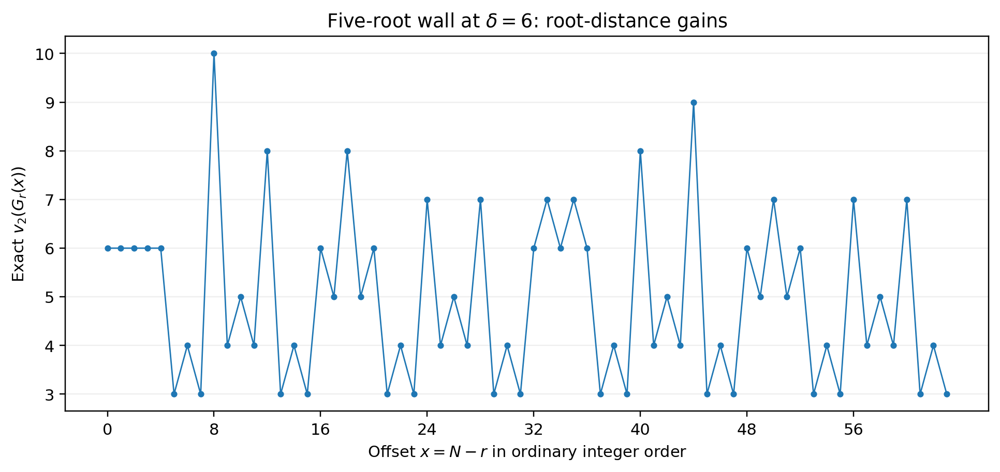

# Version 6 reading map and current boundary

**Operation Komorebi · Komorebi P. · 26 September 2026**

This running manuscript preserves the complete version-5 reading record, including all recovered earlier proof notes, and appends Continuation VI. The earlier reading maps and unresolved-status descriptions remain historical statements at their stated version. The current scope is the map below and the explicitly quantified theorems of Continuation VI.

The new result extends the exact dyadic valuation classification from pure shifted walls to arbitrary first omitted depths with prepared-polynomial degree at most 64. It also identifies an odd-multiplier dependence that the pure-wall examples could not reveal.

## Current result map

| Question | Current result | Location |
|---|---|---|
| Uniform precision after retaining depths $0,\ldots,M$ | Optimal exponent $4M+3$, unchanged | Foundations and Continuation IV |
| Whole tail at any first omitted depth $r$ | Exact finite-polynomial valuation reduction | Continuation IV |
| Canonical carry geometry of arbitrary $r$ | $r=b2^L-j$, where $j$ is the last minimizing carry index and $b$ is odd | Continuation VI, Section 2 |
| Regular terminal labels | Complete exact valuation atlas for every multiplier | Continuation VI, Section 3 |
| Irregular labels $17,33,49$ | Parameter-uniform coefficient certificates in every exceptional phase | Continuation VI, Sections 5–8 |
| Every depth with $\deg W_r\le64$ | Complete constant-or-simple-root dyadic valuation atlas | Continuation VI, Section 9 |
| Every $r$ with at most 195 binary ones | Included by the degree bound, without an upper size limit | Continuation VI, Corollary VI.9 |
| Repeated dyadic roots in this classified region | Excluded by the complete atlases | Continuation VI, Section 9 |
| Repeated roots at larger irregular terminal labels | Not excluded or fully classified | Current research boundary |
| Repeated roots over an algebraic extension | Not excluded by a dyadic-only atlas | Current research boundary |
| Lean checking or historical priority | Neither claimed | All continuation audit sections |

A classification on $\mathbb Z_2$ must not be called global squarefreeness. A prepared polynomial may have roots in an algebraic extension that the dyadic argument domain does not see. The resultant criterion in Continuation V remains a separate certificate of squarefreeness when its nonzero valuation is established.

## Notation added in this continuation

The target remains $E_{2N}$. The last retained depth is $M$, and the first omitted depth is $r=M+1$. A nonempty original tail has offset $x=N-r\ge0$; its analytic residual is also evaluated throughout $\mathbb Z_2$.

The finite carry cost is

\[
\lambda_r(q)=3q+s_2(r+q)-s_2(r),\qquad
\mu_r=\min_q\lambda_r(q),\qquad
j=\max\{q:\lambda_r(q)=\mu_r\}.
\]

For a nonconstant residual, the terminal tuple is

\[
L=v_2(r+j),\qquad b=(r+j)/2^L,\qquad \delta=L-L_j.
\]

The label $j$ is not the Euler row, $L$ is not the truncation depth, and $b$ is not a Bernoulli number. The tuple must be determined from the **last global carry minimum**, not from the first apparent local wall.

## New distinctions preserved in v6

| Tempting inference | Correct statement |
|---|---|
| Pure shifted-wall data cover every arithmetic depth | An arbitrary depth also has an odd multiplier; the terminal-carry theorem and parameter certificates are needed |
| Equal carry weights imply equal root geometry | False: at label 17 and distance 11, only $b\equiv1,41\pmod{64}$ have two roots |
| A parity-ball cutoff proves a global Gauss cutoff | The new uniform cutoff is coefficientwise after splitting parity |
| A finite-precision multiplier template defines an exact analytic family in the multiplier | Not asserted; the proof concerns actual positive integer multipliers with the stated terminal label |
| Classifying all $r<2^{195}$ requires enumerating them | Here it follows from the general degree bound and the degree-64 classification; the audit did not enumerate that interval |

## Evidence in this release

The incoming v5 ledger matched all 124 recorded file hashes. Seven new retained bounded scientific executions completed successfully: five new v6 audits, a fresh v4-foundation rerun, and a fresh v5 distribution/resultant rerun. All seven execution manifests passed the retained validator.

The new audits include 4,539 regular whole-ball certificates and 1,163 parameter-uniform irregular leaf certificates. These are distinct from sampled point checks. The proof of the finite-precision multiplier template extends the latter certificates to all admissible odd multipliers. The exact scope and nonclaims appear alongside the results.

One document-figure export initially failed because the output directory was not writable from the user-visible Python process. The directory permission was corrected and both figures were regenerated. No scientific calculation was lost or changed. Earlier v5 computational timeouts remain recorded in the historical notes.

## How the history is retained

The next part is the complete v5 Markdown reading record, preserved without rewriting its mathematical content. Its references to the then-current frontier are historical. Continuation VI is appended after that record and its reproduction appendix. Historical versions are also retained as separate source files in the bundle.


\clearpage

# Preserved version-5 reading record

> **Version boundary.** The complete prior reading record follows. Its "current" status statements refer to version 5. The current version-6 scope is stated in the preceding map and proved in the appended Continuation VI.

# Reading map and current claim boundary

This is a cumulative record of the dyadic Euler-tail investigation. It includes a short reconstruction of the original matrix and edge mechanisms, the complete recovered proof notes from versions 1 through 4, and the new version-5 continuation. The source bundle retains the associated programs, exact result files, certificate atlases and audit logs. Large machine-readable certificate tables are supplied in the bundle rather than printed as hundreds of redundant rows.

The historical notes are retained to preserve the development, not to erase corrections. Where a historical interpretation conflicts with the correction register or a later theorem, the later statement governs. Each continuation retains its own equation-numbering convention. Version 4 is the consolidated mathematical base. Version 5 adds certified stopping bounds, exact precision distributions and the next irregular-wall classifications.

## Current result map

| Question | Current answer | Main location |
|---|---|---|
| Uniform precision after depth $M$ | $2^{4M+3}$, optimally over all Euler rows | Foundations and Continuation IV |
| Exact weight of one omitted term | $4m-1+v_2\binom Nm$ for target $E_{2N}$ | Foundations |
| Whole remainder at any depth | Exact finite-polynomial reduction | Continuation IV, Section 8 |
| Regular shifted walls | Exact root-emergence and valuation laws | Continuation IV, Sections 4–6 |
| Irregular walls $17,33,49$ | Complete coefficient certificates at the finite exceptional distances | Continuations IV and V |
| Shifted-wall labels through 64 | Classified at every valid scale | Continuation V |
| Frequency of extra cancellation | Exact rational generating function from a completed atlas | Continuation V |
| Mean precision after complete wall separation | $4\cdot2^L$ at $r=2^L-j$ | Continuation V |
| Guaranteed finite root resolution | Explicit bound when the prepared polynomial has nonzero resultant with its derivative | Continuation V |
| Every arbitrary depth explicitly classified | Not established | Continuing ledger |
| Universal simplicity of every residual polynomial | Not established | Continuing ledger |
| Lean checking in these continuations | None performed | Audit boundary |

## Notation that must not be conflated

The original Euler subscript is $2N$. The reconstruction depth is $m$. A truncation retains $m=0,\ldots,M$, and $r=M+1$ is its first omitted depth. The variable $q$ indexes the residual layers after the first omitted summand has been factored out. At a shifted wall, $j$ labels the dominant residual layer and $r=2^L-j$. The distance beyond that wall is $\delta=L-L_j$. Finally $x=N-r$ is a row offset, not a reconstruction depth.

The kernel coefficients are $\beta_m$ and $\kappa_m$. The notation $\beta_m$ here does not denote a value of the Dirichlet beta function. The dyadic source $A(N)$ is also distinct from the wall constant $A_j$ used in the older notes.

Throughout, $v_2(2)=1$ and $v_2(0)=\infty$. A zero residue modulo $2^P$ certifies only a valuation of at least $P$. Root residues identify finite prefixes of dyadic numbers. They are not claims that the roots are rational integers.

## Correction register

| Earlier interpretation | Correct statement |
|---|---|
| A factorial or complex beta-function simplification alone explains the $p$-adic globalization | The operative construction is a filtered triangular inverse, followed by integral normalization and tail control |
| The odd-prime literal sum can simply use $p=2$ | Its even generating function has a double zero. The dyadic construction first removes that obstruction and uses a different source |
| Two powers of two per retained layer is the sharp dyadic rate | It is a coarse floor. Combining the inverse coefficient with the factorial gives the optimal exponent $4M+3$ |
| Carry boundaries are merely near powers of two | Adjacent weights obey the exact increment $4+v_2(N-m)-v_2(m+1)$ |
| Minimum-weight clusters always contain at most two terms | The preserved proof gives a three-minimum counterexample at $N=2^{68}$ |
| A multiple residual root automatically lifts | It may disappear after the next normalization. Root lifting requires an appropriate coefficient certificate |
| $\delta>2d_i$ is an exact emergence threshold | It is sufficient. At a regular wall the exact condition is $\delta\ge d_i+k_i$ |
| Moving beyond a wall forces monotone root counts | False for irregular walls. The size-33 family has one, zero, then two roots at distances 26, 27 and 28 |
| A finite coefficient zero establishes a repeated root or exact zero | It supplies only a precision lower bound. Unresolved branches remain unresolved |
| The odd-edge factor $1-\varepsilon_pp^n$ may always be dropped | It is automatically one modulo $p^k$ only when $k\le n$ |

## Evidence and append-only policy

The incoming v4 archive was restored from mounted bytes. All 42 entries in its integrity ledger matched. Its main audit was rerun successfully, and the rerun output is retained separately. Versions 1 through 3 remain historical evidence unless a new test explicitly covers them. The corrected v4 proof and the new v5 proofs are mathematical arguments, not claims of theorem-prover acceptance.

New future continuations should be appended after Continuation V. They should identify any superseded statement, retain the original note, record a precise proof boundary, and save the executable checks with their actual ranges. The manuscript and its Markdown/LaTeX sources are versioned artifacts, not a promise of background or automatic updates.

\clearpage

# Foundations. From filtered matrices to dyadic carry walls

This chapter reconstructs the mathematical starting point so the later notes can be read without the preceding conversation. The three constructions below are related, but they are not interchangeable.

## The odd-prime matrix and successive cancellation

Use signed Euler numbers

\[
\operatorname{sech}t=\sum_{n\ge0}E_n\frac{t^n}{n!},
\qquad E_0=1,\ E_2=-1,\ E_4=5,\ E_6=-61.
\]

For an odd positive integer $p$, define

\[
S_n(p)=\sum_{a=0}^{p-1}(-1)^a(2a+1)^n.
\]

The finite geometric sum and its even part give

\[
\sum_{N\ge0}S_{2N}(p)\frac{t^{2N}}{(2N)!}
=\cosh^2(pt)\operatorname{sech}t.
\]

Therefore the even sequences satisfy $S=T(p)E$, with the beginning of the infinite matrix

\[
T(p)=
\begin{pmatrix}
1&0&0&0&\cdots\\
2p^2&1&0&0&\cdots\\
8p^4&12p^2&1&0&\cdots\\
32p^6&120p^4&30p^2&1&\cdots\\
\vdots&\vdots&\vdots&\vdots&\ddots
\end{pmatrix}.
\]

Every row is finite. The diagonal is one, so forward substitution constructs the inverse without an analytic convergence assumption. Multiplication by $\operatorname{sech}^2(pt)$ identifies it explicitly. If the positive tangent numbers satisfy

\[
\tan z=\sum_{m\ge0}T_{2m+1}\frac{z^{2m+1}}{(2m+1)!},
\]

then

\[
\boxed{
E_n=\sum_{m=0}^{n/2}(-1)^mT_{2m+1}
\binom n{2m}p^{2m}S_{n-2m}(p)
}\qquad(n\text{ even}).
\]

Each inverse subdiagonal contains $p^{2m}$. When $p$ is an odd prime, retaining through depth $M$ gives a congruence modulo $p^{2M+2}$ uniformly in the row. At any fixed precision, only finitely many inverse diagonals can matter, even though the same operator describes all rows.

### One exact cancellation row

The forward equations are

\[
\begin{aligned}
S_6&=E_6+30p^2E_4+120p^4E_2+32p^6E_0,\\
S_4&=E_4+12p^2E_2+8p^4E_0,\\
S_2&=E_2+2p^2E_0,\qquad S_0=E_0.
\end{aligned}
\]

Subtracting $30p^2S_4$ removes $E_4$, adding $240p^4S_2$ removes the induced $E_2$ term, and subtracting $272p^6S_0$ removes the final constant term. The result is

\[
\boxed{E_6=S_6-30p^2S_4+240p^4S_2-272p^6S_0.}
\]

At $p=3$, the power sums are $S_0=1$, $S_2=17$, $S_4=545$, and $S_6=14897$. Directly,

\[
14897-147150+330480-198288=-61.
\]

The successive cancellation is exact algebra. Its increasing prime divisibility is what makes truncation a controlled $p$-adic approximation.

## The odd-prime edge tower

For an odd prime $p$, put $\varepsilon_p=(-1)^{(p-1)/2}$ and

\[
q_p(a)=\frac{a^{p-1}-1}{p}\qquad(p\nmid a).
\]

At an edge $n=\lambda(p-1)-2r\ge2$, define the unit reciprocal moments

\[
R_{s,\ell}(p)=\sum_{\substack{0\le a<p\\p\nmid(2a+1)}}
\frac{(-1)^a q_p(2a+1)^\ell}{(2a+1)^{2s}}.
\]

For a unit base $b$,

\[
b^{\lambda(p-1)-2s}
=\frac{(1+pq_p(b))^\lambda}{b^{2s}}.
\]

Substitute this exact binomial expansion into the inverse matrix formula. The unique nonunit base $b=p$ contributes a combined term $\varepsilon_pp^nE_n$. Thus

\[
\begin{aligned}
(1-\varepsilon_pp^n)E_n
={}&\sum_{m=0}^{n/2}\sum_{\ell=0}^{\lambda}
(-1)^mT_{2m+1}\binom n{2m}\binom\lambda\ell\\
&\hspace{16mm}\cdot p^{2m+\ell}R_{r+m,\ell}(p).
\end{aligned}
\]

At precision $p^k$, the visible retained region is $2m+\ell<k$. The prefactor on the left can be omitted automatically only when $k\le n$. This is the higher odd-prime edge construction. It is not the dyadic root problem developed in the remainder of this record.

## Where factorial lanes enter

A separate residue-section example clarifies the role of Pochhammer cancellation. Consider

\[
\mathcal S_{10,4}(t)=\sum_{n\ge0}\frac{t^{10n+4}}{(10n+4)!}.
\]

The exact factorial-lane decomposition is

\[
(10n+4)!=4!\prod_{r=5}^{14}(r)_{n;10}
=4!\,10^{10n}\prod_{r=5}^{14}\left(\frac r{10}\right)_n.
\]

The parameter $r/10=1$ supplies $(1)_n=n!$. After removing the forced $t^4/4!$ term and using the divided-power basis $t^{10n}/(10n)!$, the normalized coefficient is

\[
g_n=\frac{4!(10n)!}{(10n+4)!}
=\frac{24}{(10n+1)(10n+2)(10n+3)(10n+4)}.
\]

Every denominator factor is a unit at five. Consequently $v_5(g_n)=0$. The reciprocal divided-power sequence is determined by

\[
C_0=1,\qquad
C_n=-\sum_{q=0}^{n-1}\binom{10n}{10q}g_{n-q}C_q.
\]

The integral lower-triangular recurrence preserves $5$-adic integrality. Here integrality refers to the divided-power coordinates. It must not be confused with integrality of the ordinary Taylor coefficients, whose factorial denominators remain in the basis. Strong finite-difference claims require their own hypotheses and do not follow merely from this cancellation.

## Why the dyadic source is different

At $p=2$, the literal alternating sum is $1-3^n$. Its even generating function is

\[
\cosh t-\cosh3t=-2\sinh(2t)\sinh t.
\]

Its constant coefficient vanishes, and the first nonzero term has degree two. A unit-diagonal inverse cannot be obtained by blindly substituting two into the odd literal-sum transform. Removing the double-zero factor instead leads to

\[
A(N)=\frac{3^{2N+2}-1}{4(2N+1)(2N+2)},
\]
\[
\sum_{N\ge0}A(N)\frac{t^{2N}}{(2N)!}
=\frac{\sinh(2t)\sinh t}{2t^2}.
\]

Its inverse factor is $4t^2/\sinh^2(2t)$ because the product is $\operatorname{sech}t$. This gives the dyadic reconstruction used in all subsequent continuations.

The numerator and denominator of $A(N)$ have the same power of two:

\[
v_2(3^{2N+2}-1)=2+v_2(2N+2)
=v_2\bigl(4(2N+1)(2N+2)\bigr).
\]

Thus $A(N)$ is a dyadic unit. For the inverse,

\[
\kappa_m=\beta_m2^{2m}(2m)!
=-2^{4m}(2m-1)B_{2m}.
\]

The classical Bernoulli denominator theorem gives $v_2(B_{2m})=-1$ [S1], hence the exact positive-depth kernel weight is $4m-1$. This is where the apparent separate digit-sum and factorial losses combine into the sharp four-bit rate.

## The sharp uniform bound and its limitation

For target $E_{2N}$, each omitted term has exact valuation

\[
w_m(N)=4m-1+v_2\binom Nm.
\]

Retaining $m\le M$ therefore yields

\[
\boxed{v_2\mathcal T_M(N)\ge4M+3.}
\]

At $N=M+1$ there is exactly one omitted term. Its binomial coefficient and source value are one, so equality holds. No stronger exponent works uniformly over all rows for that same truncation.

This does not determine a particular whole tail. When several minimum-weight terms occur, their unit residues can cancel. The later research concerns exactly that additional cancellation.

## Exact binary boundaries

For consecutive positive depths,

\[
\boxed{w_{m+1}(N)-w_m(N)
=4+v_2(N-m)-v_2(m+1).}
\]

Put $a=v_2(N+1)$ and $t=v_2(m+1)$. If $t<a$, the increment is four. If $t>a$, it is $4+a-t$. If $t=a$, write $N+1=2^aA$, $m+1=2^aB$ with $A,B$ odd. Then the increment is $4+v_2(A-B)\ge5$.

An adjacent tie therefore occurs exactly when

\[
\boxed{v_2(m+1)=v_2(N+1)+4.}
\]

Larger binary jumps can create nonadjacent ties. At $N=512$, the increments from depths 510 to 511 and then to 512 are $+5,-5$. The two outside weights are equal while the middle one is higher.


The following historical continuations start at this distinction between a minimum term weight and the valuation of their sum.


\clearpage

# Continuation I. Binary-edge root laws

> **Historical record.** Recovered v1 proof note. Its finite execution counts are historical unless explicitly covered by the fresh reruns. Later continuations generalize the root law.


Research continuation, 26 September 2026.

**Status.** The results below have an explicit mathematical proof and an executed exact-arithmetic audit. They have not been compiled in Lean in this run. No historical-priority claim is made. The existing optimal uniform truncation theorem is an input, not a new result of this continuation.

## 1. Definitions and existing identities

Use signed Euler numbers, with E_0=1, E_2=-1, E_4=5, and

\[
\operatorname{sech}t=\sum_{n\ge0}E_n t^n/n!.
\]

Index a row by N, so its target is E_(2N). Set

\[
A(N)=\frac{3^{2N+2}-1}{4(2N+1)(2N+2)},\qquad
\left(\frac z{\sinh z}\right)^2=\sum_{m\ge0}\beta_mz^{2m},
\]

\[
\kappa_m=2^{2m}(2m)!\beta_m,\qquad \kappa_0=1.
\]

The existing reconstruction is

\[
E_{2N}=\sum_{m=0}^N\kappa_m\binom{2N}{2m}A(N-m).
\]

For m>=1,

\[
\beta_m=-\frac{2^{2m}(2m-1)B_{2m}}{(2m)!},\quad
v_2(\beta_m)=s_2(m)-1,\quad v_2(\kappa_m)=4m-1.
\]

Here s_2 is binary digit sum. The Bernoulli valuation follows from von Staudt--Clausen; the factorial identity is Legendre's formula. Every nonnegative integral A(N) is a dyadic unit. Consequently the exact summand weight is

\[
w_m(N)=4m-1+v_2\binom{2N}{2m}=4m-1+v_2\binom Nm.
\]

The equality between these two binomial valuations does not assert equality of the binomial coefficients.

Define the whole tail after depth M by

\[
\mathcal T_M(N)=E_{2N}-\sum_{m=0}^{\min(M,N)}\kappa_m\binom{2N}{2m}A(N-m).
\]

For M>=N this is zero exactly. Use v_2(0)=infinity throughout. The existing optimal uniform lower bound is 4M+3, attained at N=M+1.

## 2. The analytic source, including its removable point

Extend A to the dyadic integers by

\[
\mathscr A(x)=\frac{9^{x+1}-1}{8(x+1)(2x+1)},\qquad
\mathscr A(-1)=-\log(9)/8.
\]

Let l=log(9), so v_2(l)=3. Then

\[
\mathscr A(x)=\frac{l/8}{1+2x}
\sum_{k\ge0}\frac{l^k}{(k+1)!}(x+1)^k.
\]

The coefficient valuations 3k-v_2((k+1)!) tend to infinity. For k>=1 they are positive. Also (1+2x)^(-1)=sum_k(-2x)^k. It follows that A is a restricted power series with integral dyadic coefficients and

\[
\mathscr A\in\mathbb Z_2\langle x\rangle,\qquad
\mathscr A\equiv1\pmod2
\]

**coefficientwise**. This is stronger than just saying its integer values are odd. Integer translations preserve its integral Gauss norm.

## 3. Factor the entire omitted tail

Fix r>=1, put M=r-1, and write x=N-r. For j>=0 let

\[
P_j(x)=x^{\underline j}\prod_{i=0}^{j-1}(2x-2i-1),\qquad P_0=1.
\]

An exact factorial cancellation gives

\[
\mathcal T_{r-1}(N)=\kappa_r\binom{2N}{2r}H_r(N-r),
\]

where

\[
H_r(x)=\sum_{j\ge0}8^j\frac{\beta_{r+j}}{\beta_r}P_j(x)\mathscr A(x-j).
\]

Indeed, the ratio of the (r+j)th coefficient to the factored coefficient is

\[
4^j\frac{\beta_{r+j}}{\beta_r}(2x)^{\underline{2j}}
=8^j\frac{\beta_{r+j}}{\beta_r}P_j(x).
\]

At a nonnegative integer x all terms j>x vanish. Thus the infinite analytic expression agrees with the original finite tail. For fixed r, its polynomial coefficient valuations are bounded below by

\[
3j+s_2(r+j)-s_2(r)\ge3j+1-s_2(r),
\]

which tend to infinity. Hence it defines an element of Q_2<x>.

## 4. Binary-edge root theorem

**Theorem.** Let a>=4, r=2^a-1, and M=2^a-2. There is a unique alpha_a in Z_2 such that, on putting rho_a=r+alpha_a,

\[
\boxed{
 v_2\mathcal T_{2^a-2}(N)
 =4(2^a-1)+3-a+v_2\binom{N}{2^a-1}+v_2(N-\rho_a)
}
\]

for every integer N>=2^a-1. The convention at a zero tail is v_2(0)=infinity. In addition,

\[
v_2(\alpha_a)=a-4.
\]

**Proof.** Since s_2(r)=a, define

\[
G_a(x)=2^{a-4}H_r(x)
 =\sum_{j\ge0}\gamma_{a,j}P_j(x)\mathscr A(x-j),
\quad
\gamma_{a,j}=2^{a-4}8^j\beta_{r+j}/\beta_r.
\]

The first coefficient is gamma_(a,0)=2^(a-4). The second is a unit because r+1=2^a and

\[
v_2(\gamma_{a,1})=(a-4)+3-(a-1)=0.
\]

For every j>=2,

\[
v_2(\gamma_{a,j})=3j+s_2(r+j)-4\ge3j-3\ge3.
\]

Thus G_a belongs to Z_2<x>, and, coefficientwise,

\[
G_a(x)\equiv
\begin{cases}1+x,&a=4,\\x,&a>4\end{cases}\pmod2.
\]

Here P_1=x(2x-1), which reduces to x modulo 2. It follows directly that for distinct x,y in Z_2,

\[
\frac{G_a(x)-G_a(y)}{x-y}\in1+2\mathbb Z_2.
\]

Therefore G_a is an isometry. The coefficientwise congruence also gives one root modulo 2. At each subsequent precision exactly one of its two lifts remains a root, because shifting by 2^k changes G_a by 2^k times a unit modulo 2^(k+1). Completeness constructs a unique root alpha_a, and

\[
v_2G_a(x)=v_2(x-\alpha_a).
\]

Since G_a(0)=2^(a-4), isometry gives v_2(alpha_a)=a-4. Finally, the factorization in Section 3 and the known kappa valuation give

\[
v_2\mathcal T_{r-1}(N)
=4r-1+v_2\binom Nr+4-a+v_2(N-r-\alpha_a),
\]

which is the claimed formula. QED.

**Consequences.** The root controls the *whole* tail, not merely the first two terms. Approaching rho_a through integer residue classes gives arbitrarily large additional cancellation at one fixed truncation depth. This does not improve the uniform bound: at N=r the formula gives 4r-1=4M+3 exactly.

## 5. A second exact family: low binary digit sum

If s_2(r)<=4 and r!=15, then for every N>=r,

\[
\boxed{v_2\mathcal T_{r-1}(N)=4r-1+v_2\binom Nr.}
\]

For j>=2, the coefficient in H_r has valuation at least 3j+1-s_2(r)>=3. For j=1 its exact valuation is 4-v_2(r+1). Under the stated condition v_2(r+1)<=3: four trailing ones with no other one bits would be precisely r=15. Therefore all positive-j terms vanish coefficientwise modulo 2 and H_r is congruent to A, hence to 1. Its value is a unit. In particular this proves the first-omitted-term valuation for all depths M=0,...,13, at every admissible row, not only in a bounded scan.

## 6. Explicit M=14 example and root digits

For a=4, r=15, the root law is

\[
v_2\mathcal T_{14}(N)=59+v_2\binom N{15}+v_2(N-\rho_4).
\]

Certified residues from the implemented lift include

| q | rho_4 modulo 2^q |
|---:|---:|
|5|16|
|6|48|
|7|48|
|8|176|
|10|176|
|12|1200|
|16|9392|
|32|2083857584|
|64|4183939833681749168|

The 128-bit residue is 181803547360506310314536504063203550384, hexadecimal 88c616ef1758fccb3a10571c7c3524b0. These are compatible residues of a dyadic number, not a claim of an ordinary real limit.

At N=16 the two omitted terms are

\[
S_{15}=\kappa_{15}\binom{32}{30}A(1),\qquad S_{16}=\kappa_{16},
\quad A(1)=5/3.
\]

Both have valuation 63. Their normalized residues modulo 64 are respectively 63 and 33. Their sum is 32 modulo 64, so the tail has valuation 63+5=68. Exactly,

\[
\mathcal T_{14}(16)=-2^{68}\frac{1593243617206459}{58905}.
\]

Both the displayed numerator and denominator are odd.

## 7. The suggested two-minimum pattern is not universal

A finite scan showing at most two minimum-weight terms must not be extrapolated. Take

\[
N=2^{68},\qquad M=N-18.
\]

The omitted indices are m=N-d with 0<=d<=17. For 1<=d<=17,

\[
v_2\binom{N}{N-d}=68-v_2(d),
\]

so the weight above 4N-1 is 68-4d-v_2(d). It vanishes at d=16 and d=17 and is positive at d=1,...,15. The endpoint d=0 also has weight 4N-1. Thus there are exactly **three** minimum-weight terms, at N-17, N-16, N. Three units sum to a unit modulo two, so the full tail has exact valuation 4N-1. The audit checks all 18 weights by exact integer arithmetic. It does not compute this enormous Euler number.

## 8. Computational contract and interpretation

Run `python3 check_dyadic_tail.py`. Python's standard library is sufficient. The script uses Fraction and arbitrary-precision integers; no floating approximation enters any mathematical assertion.

Independent checks include inverse-series coefficients against a Bernoulli recurrence, full reconstruction against the Euler recurrence, source valuations, all nonempty tails with 1<=N<=512, and root-law predictions for a=4,...,8. Root values are generated from the analytic remainder, not fitted to the finite tail table. Each digit lift verifies both the chosen branch and rejection of the alternative branch.

The normalized root-series calculation omits only j for which the proved Gauss valuation 3j-3 reaches the requested precision. A second modular method uses the original, unfactored summands and omits only m with 4m-1 at least the modulus exponent. It agrees with rational tails for N=15,...,512 and separately checks three large rows modulo 2^220.

`RESULTS.json` records exact counts and outputs. `MANIFEST.json` records command, environment, duration, conventions and hashes. The manifest follows the available version-1 template; its fields and hashes are checked locally. The separate bundled skill validator was not located in the working filesystem and was not run.

The numerical tests support the implementation. The universal statements depend on the explicit proofs in Sections 4, 5, and 7. General depths not covered by those theorems are not classified here.

## Sources and provenance

The source/kernel reconstruction, exact coefficient weights, optimal 4M+3 bound, and analytic source are retained formulas from the supplied Komorebi materials, including the Local Polyphase edition and Paper IX consolidated edition. The consolidated edition's arithmetic-refinements section explicitly separates exact individual weights from the not-yet-classified whole-tail valuation. This continuation studies that distinction.

For the classical Bernoulli denominator input, see NIST DLMF 24.10.1, https://dlmf.nist.gov/24.10.E1. The hyperbolic series conventions agree with NIST DLMF 4.33, https://dlmf.nist.gov/4.33. No claim that the root-law formulation is absent from the external literature has been established.


\clearpage

# Continuation II. Carry-Newton reduction at arbitrary depth

> **Historical record.** Recovered v2 note. Its taxonomy is a taxonomy of residual roots. Multiple residual roots require further analysis before a dyadic-root claim.


Research continuation, 26 September 2026.

## Status

This note continues `PROOF.md`. The exact tail factorization from that note is retained. The new result is a finite carry-based reduction for **every** first omitted depth `r`, together with a residual-polynomial criterion for no-root, one-root, two-root, and multiple-root branches.

The mathematical reductions below are proofs. `check_carry_newton.py` supplies exact finite evidence and independent modular checks. No Lean compilation or historical-priority claim is made here.

## 1. Exact carry valuation of the factored coefficients

From the existing factorization

\[
\mathcal T_{r-1}(N)=\kappa_r\binom{2N}{2r}H_r(N-r),
\]

with

\[
H_r(x)=\sum_{j\ge0}8^j\frac{\beta_{r+j}}{\beta_r}P_j(x)\mathscr A(x-j),
\qquad
P_j(x)=x^{\underline j}\prod_{i=0}^{j-1}(2x-2i-1),
\]

define

\[
\lambda_r(j)=v_2\!\left(8^j\frac{\beta_{r+j}}{\beta_r}\right).
\]

Since \(v_2(\beta_m)=s_2(m)-1\),

\[
\boxed{\lambda_r(j)=3j+s_2(r+j)-s_2(r).}
\]

Kummer gives

\[
v_2\binom{r+j}{j}=s_2(r)+s_2(j)-s_2(r+j),
\]

hence equivalently

\[
\boxed{
\lambda_r(j)=3j+s_2(j)-v_2\binom{r+j}{j}.
}
\]

Thus every anomalously low analytic coefficient is exactly a binary-carry event.

## 2. The infinite minimization is actually finite

Let

\[
\mu_r=\min_{j\ge0}\lambda_r(j),
\qquad
J_r=\{j:\lambda_r(j)=\mu_r\}.
\]

Since \(\lambda_r(0)=0\), one always has \(\mu_r\le0\). For \(j\ge1\),

\[
\lambda_r(j)
=3j+s_2(r+j)-s_2(r)
\ge 3j+1-s_2(r).
\]

Therefore any minimizer must satisfy

\[
\boxed{
0\le j\le \left\lfloor\frac{s_2(r)-1}{3}\right\rfloor.
}
\]

So an infinite tail has a finite carry Newton polygon whose size is controlled by the **binary digit sum of the omitted depth**, not by the magnitude of the depth.

## 3. Residual cancellation polynomial

Normalize

\[
G_r(x)=2^{-\mu_r}H_r(x).
\]

Because the coefficient valuations tend to infinity, \(G_r\in\mathbb Z_2\langle x\rangle\). The analytic source satisfies \(\mathscr A\equiv1\pmod2\) coefficientwise, and every normalized minimum coefficient is a dyadic unit. Therefore

\[
\boxed{
\overline G_r(X)
=\sum_{j\in J_r}X^{\underline j}
\in\mathbb F_2[X].
}
\]

Since

\[
X^{\underline j}
\equiv
X^{\lceil j/2\rceil}(X+1)^{\lfloor j/2\rfloor}
\pmod2,
\]

the first cancellation layer is completely explicit.

The whole-tail valuation becomes

\[
\boxed{
 v_2\mathcal T_{r-1}(N)
 =4r-1+v_2\binom Nr+\mu_r+v_2G_r(N-r).
}
\]

This is an exact identity, not a lower bound.

## 4. Root taxonomy at the first residual level

Write `1_S` for an indicator modulo two. Then

\[
\overline G_r(0)=1_{0\in J_r},
\qquad
\overline G_r(1)=1_{0\in J_r}+1_{1\in J_r}.
\]

Also

\[
\overline G_r'(0)=1_{1\in J_r}+1_{2\in J_r},
\]

\[
\overline G_r'(1)=1_{1\in J_r}+1_{2\in J_r}+1_{3\in J_r}.
\]

Hence:

- if \(0\in J_r\) and \(1\notin J_r\), there is no residual root and \(G_r(x)\) is a unit for every integer/dyadic `x`;
- if \(0,1\in J_r\), the only residual root is `1`;
- if \(0\notin J_r\) and \(1\in J_r\), the only residual root is `0`;
- if neither `0` nor `1` is in \(J_r\), both residue classes are roots.

A residual root `e` is simple exactly when the displayed derivative at `e` is one.

For a simple root, if `x,y` lie in the same residue class `e mod 2`, the divided difference

\[
\frac{G_r(x)-G_r(y)}{x-y}
\]

is a dyadic unit because its reduction is \(\overline G_r'(e)=1\). Therefore the branch is an isometry. It has a unique root \(\alpha_{r,e}\in e+2\mathbb Z_2\), and

\[
\boxed{
 v_2G_r(x)=v_2(x-\alpha_{r,e})
 \quad(x\equiv e\pmod2).
}
\]

On a nonroot residue class, \(v_2G_r(x)=0\).

If a residual root is multiple, substitute `x=e+2y`, remove the common dyadic content, and repeat the same construction. This gives a recursive dyadic cancellation tree.

## 5. First two-root example: r = 510

For

\[
r=510=2^9-2,
\]

the finite carry polygon has

\[
\lambda_{510}(0)=0,
\quad
\lambda_{510}(1)=4,
\quad
\lambda_{510}(2)=-1.
\]

Thus

\[
\mu_{510}=-1,
\qquad J_{510}=\{2\},
\]

and

\[
\overline G_{510}(X)=X(X+1).
\]

Both residual roots are simple. Hence there are unique roots

\[
\alpha_0\in2\mathbb Z_2,
\qquad
\alpha_1\in1+2\mathbb Z_2,
\]

and, with `x=N-510`,

\[
\boxed{
 v_2\mathcal T_{509}(N)
 =2038+v_2\binom N{510}
 +v_2(x-\alpha_{x\bmod2}).
}
\]

The audit lifts the roots to 64 bits:

\[
\alpha_0\equiv
1840775104690357186
\pmod{2^{64}},
\]

\[
\alpha_1\equiv
14399460289900872487
\pmod{2^{64}}.
\]

This formula was checked independently against the original unfactored tail modulo \(2^{2100}\) at fifteen rows from `N=510` through `N=605`.

## 6. Exact shifted-power-of-two wall crossing

The appearance of powers of two has an exact formulation.

Fix `j>=1`. Define for `0<=k<j`

\[
e_j(k)
=3k+s_2(j-1)-s_2(j-k-1),
\]

\[
E_j=\min_{0\le k<j}e_j(k),
\qquad
K_j=\{k<j:e_j(k)=E_j\},
\]

and

\[
A_j=3j+1+s_2(j-1),
\qquad
L_j=A_j-E_j.
\]

For `L` large enough that `2^L>j`, put

\[
r_L=2^L-j.
\]

Then for `k<j`,

\[
\lambda_{r_L}(k)=e_j(k),
\]

while

\[
\lambda_{r_L}(j)=A_j-L.
\]

For `k>j` in the only range capable of minimizing,

\[
\lambda_{r_L}(k)
=\lambda_{r_L}(j)+3(k-j)+s_2(k-j)
>\lambda_{r_L}(j).
\]

Consequently:

\[
\boxed{
L<L_j\Rightarrow j\notin J_{r_L},
}
\]

\[
\boxed{
L=L_j\Rightarrow J_{r_L}=K_j\cup\{j\},
}
\]

\[
\boxed{
L>L_j\Rightarrow J_{r_L}=\{j\}.
}
\]

Thus every correction layer `j` has an exact **shifted power-of-two wall**

\[
\boxed{r=2^{L_j}-j.}
\]

Crossing that wall makes the `j`th analytic tail layer the unique dominant residual term.

The first walls are

\[
15,\ 254,\ 2045,\ 32764,\ 131067,\ldots
\]

for `j=1,2,3,4,5,...`.

The first three post-wall residual geometries are:

- `j=1`: one simple root;
- `j=2`: two simple roots;
- `j=3`: an even double root and an odd simple root.

For singleton `J={j}` in general,

\[
\overline G_r(X)
=X^{\lceil j/2\rceil}(X+1)^{\lfloor j/2\rfloor},
\]

so higher `j` produce increasingly ramified cancellation trees.

## 7. Computational audit

`check_carry_newton.py` uses exact rationals and arbitrary-precision integers only.

The retained run reports:

- 805,004 exact checks of the carry formula;
- 499,995 checks immediately beyond the finite minimizer cutoff;
- 600 shifted-wall checks (`j<=200`, before/at/after each wall);
- all 131,328 nonempty exact rational tails with `N<=512` matched the no-root/simple-root prediction;
- 123,325 of those tails were no-root cases;
- 8,003 were simple-root cases;
- no multiple-root case occurs below `r=513`;
- the first two-root case `r=510` was also checked through the original unfactored kernel modulo `2^2100` at fifteen selected rows.

The finite run is evidence for the implementation. The universal statements above follow from the explicit carry identities, the finite-minimizer bound, reduction modulo two, and the divided-difference argument.

## 8. Remaining frontier

The next unsolved layer is no longer “the exact dyadic tail valuation” in undifferentiated form. It is narrower:

1. classify the multiple-root branches generated by the residual polynomials;
2. derive closed carry formulas for their successive rescalings;
3. identify when the recursive dyadic tree admits a finite symbolic description;
4. connect this tree to the already-developed affine Mahler/polyphase refinement operators.

The first genuinely multiple branch appears at the post-wall `j=3` family: the odd branch is already solved by a simple Hensel root, while the even branch requires one more dyadic blow-up.


\clearpage

# Continuation III. Shifted-wall normal form and the first multiple branch

> **Historical record.** Recovered v3 note. The condition delta > 2 d_i is sufficient, not an exact threshold. Continuation IV supplies the sharp regular-wall threshold. Continuation V disproves a general monotone-emergence interpretation.


Research continuation, 26 September 2026.

## Status

This note continues `PROOF.md` and `CONTINUATION_02.md`.  The earlier carry-Newton reduction is retained.  The new results are:

1. an exact shifted-wall normal form;
2. an addressed content formula for every dyadic branch;
3. a Hensel criterion that separates the roots generated by a wall;
4. complete resolution of the first multiple residual branch, `j=3`;
5. exact rational checks at the three successive `j=3` wall distances.

The normal-form and Hensel arguments are proofs.  The scripts are finite audits.  No Lean compilation or historical-priority claim is made here.

---

## 1. Setup retained from the previous block

Write the omitted tail after first omitted depth `r` as

\[
\mathcal T_{r-1}(N)
=\kappa_r\binom{2N}{2r}H_r(N-r),
\]

where

\[
H_r(x)=\sum_{q\ge0}
8^q\frac{\beta_{r+q}}{\beta_r}
P_q(x)\mathscr A(x-q),
\]

\[
P_q(x)=\prod_{i=0}^{q-1}(x-i)(2x-(2i+1)),
\]

and `A` is the integral analytic dyadic source.  Its reduction is `1` modulo two.  The coefficient valuation is

\[
\lambda_r(q)=3q+s_2(r+q)-s_2(r).
\]

Let `mu_r=min_q lambda_r(q)` and normalize

\[
G_r(x)=2^{-\mu_r}H_r(x).
\]

---

## 2. Exact addressed content of the packet polynomial

Fix a binary address

\[
x=s+2^k y,\qquad 0\le s<2^k.
\]

The second product in `P_q` is always odd.  Thus all coefficient content comes from

\[
(s+2^k y)^{\underline q}.
\]

For each factor `s+2^k y-i`, the polynomial content is

\[
2^{\min(k,v_2(s-i))},
\]

with `v_2(0)=infinity`.  Therefore

\[
\boxed{
C_{k,s}(q)
=\sum_{i=0}^{q-1}\min(k,v_2(s-i))
=\sum_{d=1}^{k}\#\{0\le i<q:i\equiv s\pmod{2^d}\}.
}
\]

Let

\[
m_{k,s}(q)
=\#\{0\le i<q:i\equiv s\pmod{2^k}\}.
\]

After dividing by the exact content, the residual polynomial is

\[
\boxed{
2^{-C_{k,s}(q)}P_q(s+2^k y)
\equiv y^{\underline{m_{k,s}(q)}}\pmod2.
}
\]

Hence every dyadic blow-up remains a finite carry problem.  The addressed weight of layer `q` is

\[
\boxed{
W_{r;k,s}(q)=\lambda_r(q)-\mu_r+C_{k,s}(q).
}
\]

The same finite candidate bound from `CONTINUATION_02.md` continues to apply because `C_{k,s}(q)>=0`.

---

## 3. Shifted power-of-two wall normal form

Fix a residual layer `j>=1`.  Retain the definitions

\[
e_j(q)=3q+s_2(j-1)-s_2(j-q-1),\qquad 0\le q<j,
\]

\[
E_j=\min_{q<j}e_j(q),
\]

\[
A_j=3j+1+s_2(j-1),
\qquad
L_j=A_j-E_j.
\]

Take

\[
r=2^L-j,\qquad L>L_j,
\]

and put

\[
\delta=L-L_j.
\]

The wall theorem from the previous block says that `j` is the unique carry-Newton minimum.  Moreover,

\[
\mu_r=\lambda_r(j)=A_j-L.
\]

For `q<j`, exact binary complement identities give

\[
\lambda_r(q)=e_j(q),
\]

so after normalization

\[
\lambda_r(q)-\mu_r
=\delta+e_j(q)-E_j
\ge\delta.
\]

For `q=j+h`, the packet polynomials factor exactly:

\[
\boxed{P_{j+h}(x)=P_j(x)P_h(x-j).}
\]

The normalized `h=0` coefficient is a unit.  Every `h>=1` coefficient has valuation at least four.  Consequently the complete right tail factors by `P_j`, while every lower layer carries `2^delta`.

### Theorem: shifted-wall normal form

There exist integral restricted analytic functions `U_{L,j}` and `V_{L,j}` such that

\[
\boxed{
G_r(x)
=P_j(x)U_{L,j}(x-j)+2^\delta V_{L,j}(x),
}
\]

and

\[
\boxed{U_{L,j}(y)\in\mathbb Z_2\langle y\rangle^\times.}
\]

In fact `U_{L,j}=1 mod 2` coefficientwise after multiplication by a dyadic unit.

This is the exact resolution meaning of moving farther beyond a shifted binary wall: every increment of `L` removes one more binary digit of the lower-layer perturbation, while the root skeleton `P_j` stays fixed.

---

## 4. Hensel separation of the wall roots

The polynomial `P_j` has precisely the integral roots

\[
0,1,\ldots,j-1.
\]

The other `j` linear factors are dyadic units.  At the root `i`,

\[
\boxed{
d_i
:=v_2(P_j'(i))
=v_2(i!)+v_2((j-1-i)!).
}
\]

At `x=i`, the normal form gives

\[
v_2(G_r(i))\ge\delta.
\]

If `delta>d_i`, then

\[
v_2(G_r'(i))=d_i,
\]

because the perturbation derivative is divisible by `2^delta` and the `P_j U` derivative has exact order `d_i`.

Therefore the strong Hensel condition holds whenever

\[
\boxed{\delta>2d_i.}
\]

### Theorem: individual root emergence

If

\[
\delta>2\bigl(v_2(i!)+v_2((j-1-i)!)\bigr),
\]

then there is a unique simple root `alpha_i in Z_2` in the Hensel ball about `i`, with

\[
\boxed{
v_2(\alpha_i-i)\ge\delta-d_i>d_i.}
\]

The roots obtained from distinct integers `i` are distinct.

Using Legendre's formula,

\[
d_i=j-1-s_2(i)-s_2(j-1-i).
\]

Since binary digit sum is subadditive,

\[
\boxed{
\max_{0\le i<j}d_i
=v_2((j-1)!).
}
\]

Hence:

### Corollary: complete wall resolution

If

\[
\boxed{
\delta>2v_2((j-1)!),
}
\]

then all `j` integral skeleton roots lift to `j` distinct simple roots in `Z_2`.

There are no additional `Z_2` roots.  Indeed, modulo two the normal form reduces to `P_j`, whose reduction has degree `j`; the greatest coefficient of Gauss norm one therefore occurs at degree `j`, and Strassmann's theorem bounds the number of zeros in the unit disc by `j`.

Locally around a separated root, division by the linear factor gives the usual root-distance law.  Since the derivative has order `d_i`, sufficiently near `alpha_i`,

\[
\boxed{
v_2(G_r(x))=d_i+v_2(x-\alpha_i).}
\]

---

## 5. First multiple branch: j = 3

For `j=3`,

\[
L_3=11,
\qquad
(d_0,d_1,d_2)=(1,0,1).
\]

Thus the middle root is guaranteed as soon as `delta>=1`, while the two outer roots are guaranteed once `delta>=3`.

This gives the exact staged prediction:

### delta = 1

\[
L=12,
\qquad
r=4093.
\]

The first residual polynomial is

\[
X^2(X+1).
\]

On the even branch `x=2y`, the addressed minimum is the old layer `q=0`, so

\[
\boxed{v_2(G_{4093}(x))=1\quad(x\text{ even}).}
\]

The apparent double residual root therefore does **not** lift.

The odd branch is simple and contains one dyadic root.  Exact rational probes give

\[
\alpha_1\equiv23\pmod{32}.
\]

### delta = 2

\[
L=13,
\qquad
r=8189.
\]

For every even `x`,

\[
\boxed{v_2(G_{8189}(x))=2.}
\]

The odd branch still contains the single middle root, now closer to the integer skeleton point `1`:

\[
\alpha_1\equiv13\pmod{16}.
\]

Rows `x=3 mod 4` are nonroot and have exact residual valuation one.

### delta = 3

\[
L=14,
\qquad
r=16381.
\]

Now all three roots separate, exactly as the Hensel threshold predicts.  The first binary blow-up has

- even branch residual `y(y+1)`, producing roots near `0` and `2`;
- odd branch residual `y`, producing the root near `1`;
- the class `x=3 mod 4` is nonroot.

Exact rational probes yield the finite residues

\[
\boxed{
\alpha_0\equiv36\pmod{64},
\qquad
\alpha_1\equiv9\pmod{16},
\qquad
\alpha_2\equiv70\pmod{128}.
}
\]

For example the exact normalized tail valuations are

\[
\begin{array}{c|ccccccc}
x&0&1&2&3&4&5&6\\ \hline
v_2(G_{16381}(x))&3&3&3&1&6&2&7.
\end{array}
\]

The endpoint roots have derivative order one, so their local law is `1 + distance-to-root`; the middle root has derivative order zero, so its local law is exactly distance-to-root.

---

## 6. Interpretation

The multiple-root frontier is therefore not an uncontrolled failure of the carry polygon.  It is a **singular perturbation problem with a fixed integer root skeleton**:

\[
\boxed{
P_j(x)\times\text{unit}
+2^\delta\times\text{lower packet}.
}
\]

The shifted power-of-two wall creates the skeleton.  Increasing `delta` resolves its ramification.  Roots with smaller derivative valuation separate first.  Eventually every integer skeleton point `0,...,j-1` carries one dyadic root.

For `j=3`, the progression is therefore

\[
\boxed{
1\text{ dyadic root}
\longrightarrow
1\text{ dyadic root}
\longrightarrow
3\text{ dyadic roots}.
}
\]

This is a stronger description than a valuation heatmap: it identifies why the multiple residual root initially fails to lift and exactly when it becomes a collection of genuine dyadic branches.

---

## 7. Computation audit

`check_wall_normal_form.py` verifies the carry/complement formulas, the addressed content formula, the derivative maximum formula, and the `j=3` stage transitions.  The retained optimized run passed **1,044,040** exact integer/combinatorial checks.

`check_exact_small_walls.py` constructs Bernoulli numbers, the original `kappa_m`, and the original rational omitted tail for `r=4093` and `r=8189`; the retained run passed its structural assertions.

`check_exact_r16381.py` performs the heavier exact rational check for `r=16381`, `x=0,...,6`.  The retained run completed in about 33.5 seconds for coefficient construction and reproduced the valuation row displayed above.

### Development failures

Two development runs failed for computational reasons:

1. An all-in-one exact Bernoulli checker for all three large walls timed out at 120 seconds.  The exact cases were split into smaller runs; those completed.
2. The first combinatorial normal-form checker timed out because it rebuilt large factorials inside a quadratic loop.  Replacing that calculation by the mathematically identical digit-sum formula for `d_i` reduced runtime to about 14 seconds and the rerun passed.

Neither timeout produced a contradictory mathematical result.

### Claim boundary

The wall normal form and Hensel threshold are general.  The displayed root residues are finite-precision exact computations.  For wall distances below the sufficient Hensel threshold, special unit cancellations can still require branch-specific analysis.  No claim of historical priority is made here.


\clearpage

# Continuation IV. Exact wall resolution and finite polynomial reduction

> **Historical record.** Recovered consolidated v4 proof note. Its main scientific checker has been rerun in this release. Continuation V appends new results without replacing this record.


**Operation Komorebi · Komorebi P. · Continuation 04 · 26 September 2026**

## Status and scope

This continuation proves a necessary-and-sufficient emergence law on every **regular carry wall**, gives an explicit classification of the five-root family for every wall distance and every dyadic argument, and supplies complete coefficient certificates for the first irregular wall, of size seventeen. It also constructs a finite-degree polynomial carrying the complete tail valuation at every first omitted depth.

The universal statements below have mathematical proofs. The seventeen-root classification at its finitely many exceptional distances is computer-assisted: each residue ball has an exact coefficientwise certificate, and a proved truncation estimate controls all uncomputed coefficients. No Lean run was performed. Historical priority is not assessed.

The earlier v3 condition `delta > 2 d_i` is a valid sufficient Hensel condition. It is **not an exact emergence threshold**. The distinction is corrected here without withdrawing the valid v3 implication.

This is not an explicit root classification for every irregular wall or every arbitrary depth. The all-depth polynomial reduction is exact, but an implicit polynomial is not the same as an explicit classification of all its roots.

## 1. Conventions and the exact tail

Use the signed Euler numbers and ordinary Bernoulli convention

\[
\operatorname{sech}t=\sum_{n\ge0}E_n\frac{t^n}{n!},\qquad
\frac{t}{e^t-1}=\sum_{n\ge0}B_n\frac{t^n}{n!},\qquad B_1=-\frac12.
\]

The target is `E_(2N)`, where `N` is the half-index. Let `M` be the last retained depth and `r=M+1` the first omitted depth. The valuation is normalized by `v_2(2)=1`, with `v_2(0)=infinity`. A residue zero modulo `2^P` means only valuation at least `P`.

Define

\[
A(N)=\frac{3^{2N+2}-1}{4(2N+1)(2N+2)},
\qquad
\left(\frac z{\sinh z}\right)^2=\sum_{m\ge0}\beta_mz^{2m},
\qquad \kappa_m=2^{2m}(2m)!\beta_m.
\]

Here `beta_0=kappa_0=1`. For `m>=1`,

\[
\beta_m=-\frac{2^{2m}(2m-1)B_{2m}}{(2m)!},
\quad v_2(\beta_m)=s_2(m)-1,
\quad \kappa_m=-2^{4m}(2m-1)B_{2m},
\quad v_2(\kappa_m)=4m-1. \tag{1.1}
\]

The coefficient identity follows by differentiating `z coth z`. The valuation uses the classical facts `v_2(B_(2m))=-1` and `v_2((2m)!)=2m-s_2(m)`. The first is the dyadic consequence of von Staudt–Clausen [S1].

The source satisfies

\[
\sum_{N\ge0}A(N)\frac{t^{2N}}{(2N)!}
=\frac{\sinh(2t)\sinh t}{2t^2}.
\]

Multiplication by `4t^2/sinh^2(2t)` gives `sech t`, hence

\[
E_{2N}=\sum_{m=0}^{N}\kappa_m\binom{2N}{2m}A(N-m). \tag{1.2}
\]

The omitted tail is

\[
\mathcal T_M(N)=E_{2N}-\sum_{m=0}^{\min(M,N)}
\kappa_m\binom{2N}{2m}A(N-m).
\]

For `N<=M`, this is exactly zero. In what follows a nonempty tail always has `N>=r=M+1`.

## 2. Analytic factorization and the finite carry minimum

Let `Z_2<X>` denote the restricted power series with integral coefficients tending to zero 2-adically. Such series converge for every `X in Z_2`. Congruences of series in this note are **coefficientwise** unless explicitly stated otherwise.

Extend the source by

\[
\mathscr A(x)=\frac{9^{x+1}-1}{8(x+1)(2x+1)},
\qquad \mathscr A(-1)=-\frac{\log9}{8}.
\]

Put `ell=log 9`. Since `v_2(ell)=3`,

\[
\mathscr A(x)=\frac{\ell/8}{1+2x}
\sum_{h\ge0}\frac{\ell^h}{(h+1)!}(x+1)^h. \tag{2.1}
\]

The coefficient valuations in the displayed sum tend to infinity. For `h>=1` they are positive. Also `(1+2x)^(-1)` is restricted integral. Therefore

\[
\mathscr A\in\mathbb Z_2\langle x\rangle^\times,
\qquad \mathscr A\equiv1\pmod2,
\qquad \mathscr A(N)=A(N).
\]

Define

\[
P_q(x)=\prod_{i=0}^{q-1}(x-i)(2x-(2i+1)),\qquad P_0=1.
\]

Cancelling the factorials in two summands of (1.2), and using

\[
4^q(2x)^{\underline{2q}}=8^qP_q(x),
\]

gives the exact factorization

\[
\mathcal T_{r-1}(N)
=\kappa_r\binom{2N}{2r}H_r(N-r), \tag{2.2}
\]

where

\[
H_r(x)=\sum_{q\ge0}8^q\frac{\beta_{r+q}}{\beta_r}P_q(x)\mathscr A(x-q).
\]

For a nonnegative integer `x`, the factors `P_q(x)` vanish for `q>x`. Thus (2.2) is an identity of finite rational sums at every original Euler row, not an approximation.

The scalar coefficient has exact valuation

\[
\lambda_r(q)=3q+s_2(r+q)-s_2(r). \tag{2.3}
\]

Let

\[
\mu_r=\min_{q\ge0}\lambda_r(q),\qquad
J_r=\{q:\lambda_r(q)=\mu_r\},\qquad G_r=2^{-\mu_r}H_r.
\]

Because `lambda_r(0)=0` and `lambda_r(q)>=3q+1-s_2(r)`, every minimizer lies in the finite range

\[
0\le q\le\left\lfloor\frac{s_2(r)-1}{3}\right\rfloor. \tag{2.4}
\]

In particular `mu_r<=0`. The normalized series is restricted integral and

\[
\overline G_r(X)=\sum_{q\in J_r}X^{\underline q}\quad\text{in }\mathbb F_2[X]. \tag{2.5}
\]

This polynomial is nonzero: its highest-degree term has degree `max J_r` and coefficient one. Thus the scalar normalization is the actual Gauss normalization, not only a lower bound.

For every nonempty tail,

\[
\boxed{v_2\mathcal T_{r-1}(N)
=4r-1+v_2\binom Nr+\mu_r+v_2G_r(N-r).} \tag{2.6}
\]

The equality `v_2 binom(2N,2r)=v_2 binom(N,r)` follows from the factorial digit-sum formula. The binomial coefficients themselves need not be equal.

## 3. Shifted walls and their normal form

For `j>=1` and `0<=q<j`, define

\[
e_j(q)=3q+s_2(j-1)-s_2(j-q-1),\quad
E_j=\min_{q<j}e_j(q),
\]
\[
A_j=3j+1+s_2(j-1),\qquad L_j=A_j-E_j.
\]

Here `A_j` is a wall constant, not the source `A(N)`. Take

\[
L>L_j,\qquad \delta=L-L_j,\qquad r=2^L-j.
\]

For `q<j`, binary complementation gives `lambda_r(q)=e_j(q)`. At `q=j`,

\[
\lambda_r(j)=A_j-L=E_j-\delta.
\]

For `q=j+h>j`,

\[
\lambda_r(j+h)-\lambda_r(j)
=3h+s_2(2^L+h)-1>0.
\]

Therefore

\[
\mu_r=E_j-\delta,\qquad J_r=\{j\}. \tag{3.1}
\]

Use `P_(j+h)(x)=P_j(x)P_h(x-j)` to collect all terms at and above `j`. The lower terms have normalized valuations `delta+e_j(q)-E_j`. This proves

\[
\boxed{G_r(x)=P_j(x)U(x-j)+2^\delta V(x),} \tag{3.2}
\]

where

\[
U\in\mathbb Z_2\langle x\rangle^\times,\quad U\equiv1\pmod2,
\qquad V\in\mathbb Z_2\langle x\rangle.
\]

The higher terms forming `U` tend to zero in Gauss norm. Its leading term is a scalar unit times `mathscr A`, and all subsequent terms are even. No assumption that `V` is a unit has been made.

The reduction degree of `G_r` is exactly `j`. The half-integral roots of `P_j` are outside `Z_2`; its integral root skeleton is `0,...,j-1`.

## 4. Separating the skeleton at the correct local scale

For `0<=i<j`, put

\[
d_i=v_2(i!)+v_2((j-1-i)!).
\]

For `j>1`, define

\[
k_i=1+\max_{h\ne i,\ 0\le h<j}v_2(i-h)
=1+\left\lfloor\log_2\max(i,j-1-i)\right\rfloor.
\]

For `j=1`, define `k_0=d_0=0`. Let

\[
B_i=i+2^{k_i}\mathbb Z_2,\qquad t_i=d_i+k_i. \tag{4.1}
\]

### Lemma 4.1. The balls `B_i` partition `Z_2`

They are disjoint since, for `i!=h`, the valuation of `i-h` is smaller than both `k_i` and `k_h`.

For coverage, let `K=ceil(log_2 j)` and `b=2^(K-1)` when `j>1`. Write `j=b+h`, with `1<=h<=b`. The residue classes modulo `b` from `0` to `h-1` occur twice in the skeleton, as `i` and `i+b`; these points have `k_i=K` and split that class into its two children. The remaining classes from `h` to `b-1` occur once and have `k_i=K-1`. Hence every dyadic integer lies in exactly one `B_i`. The case `j=1` is immediate.

### Lemma 4.2. Exact content on a separating ball

On `x=i+2^(k_i)y`,

\[
P_j(i+2^{k_i}y)=2^{t_i}yQ_i(y),
\qquad Q_i\in\mathbb Z_2\langle y\rangle^\times,
\quad Q_i\equiv1\pmod2. \tag{4.2}
\]

Indeed the factor `x-i` contributes `2^(k_i)y`. Each `x-h`, `h!=i`, has a fixed factor `2^(v_2(i-h))`, and after removing it has constant odd reduction because `k_i>v_2(i-h)`. The remaining factors `2x-(2h+1)` are units. Their total fixed valuation is `d_i`.

### Lemma 4.3. A coefficientwise affine reduction is an isometry

If `F in Z_2<y>` has coefficientwise reduction `y+c`, then

\[
v_2(F(y)-F(z))=v_2(y-z)\qquad(y\ne z).
\]

To see this, divide the difference by `y-z`. The linear coefficient is odd and every contribution of degree at least two is even. The convergent quotient is therefore a unit. The one root modulo two lifts uniquely at every digit, giving a unique root `eta in Z_2`, and

\[
v_2F(y)=v_2(y-\eta).
\]

This is the elementary simple-root Hensel mechanism for restricted series [S3]. Importantly, coefficientwise reduction is stronger than merely checking values at the two residues.

### Theorem 4.4. Improved separation bound for every wall

If `delta>=t_i`, the ball `B_i` contains exactly one simple root `alpha_i` of `G_r`, and

\[
\boxed{v_2G_r(x)=d_i+v_2(x-\alpha_i)\qquad(x\in B_i).} \tag{4.3}
\]

Also `v_2(alpha_i-i)>=delta-d_i`.

**Proof.** Divide (3.2), after the substitution in (4.2), by `2^(t_i)`. Its main term is `y` times a unit. If `k_i>=1`, the reduction of `V(i+2^(k_i)y)` is constant. Therefore the normalized series has reduction `y+c`. Apply Lemma 4.3. The original derivative has exact valuation `t_i-k_i=d_i`. Evaluating the distance law at `x=i`, and using `v_2G_r(i)>=delta`, proves the displacement estimate. For `j=1`, post-wall `delta>=1` makes the entire perturbation even and the same argument applies.

The largest threshold is

\[
\boxed{\max_i t_i=v_2((j-1)!)+\lceil\log_2j\rceil.} \tag{4.4}
\]

The upper bound follows from `binom(j-1,i)` being integral and `k_i<=ceil(log_2j)`; equality occurs at an endpoint. Thus (4.4), with `delta>=1` understood, guarantees exactly `j` simple roots. They exhaust the dyadic roots because the balls partition `Z_2`.

Once all balls contain their root,

\[
\boxed{v_2G_r(x)=\sum_{i=0}^{j-1}v_2(x-\alpha_i).} \tag{4.5}
\]

For a direct proof of (4.5), if `x in B_i`, every other root has distance from `x` equal to the distance between its skeleton point and `i`. Those valuations sum to `d_i`. Equation (4.3) then gives (4.5).

This replaces v3's sufficient `delta>2 max d_i` with a generally smaller sufficient bound. Necessity requires more information about `V`, supplied next.

## 5. Complete exact classification of regular walls

**Definition.** A wall label `j` is regular here if

\[
\boxed{e_j(q)>0\qquad(1\le q<j).} \tag{5.1}
\]

This is a finite binary-digit condition, not an appeal to numerical root data. The terminology refers only to this note's wall condition.

For a regular wall, `e_j(0)=E_j=0`, so `mu_r=-delta`. In (3.2), the `q=0` contribution to `V` is `mathscr A(x)` and every other contribution is even. Hence

\[
V\equiv1\pmod2. \tag{5.2}
\]

### Theorem 5.1. Necessary-and-sufficient root emergence

For a regular wall, for every integer `delta>=1`, each `B_i` has exactly the following behavior:

\[
\boxed{v_2G_r(x)=
\begin{cases}
\delta,&\delta<t_i,\quad x\in B_i,\\
d_i+v_2(x-\alpha_i),&\delta\ge t_i,\quad x\in B_i.
\end{cases}} \tag{5.3}
\]

In the second case there is exactly one simple root in `B_i`. Its displacement is exact:

\[
v_2(\alpha_i-i)=\delta-d_i.
\]

Consequently

\[
\boxed{\#\{x\in\mathbb Z_2:G_r(x)=0\}=\#\{i:t_i\le\delta\}.} \tag{5.4}
\]

**Proof.** If `delta<t_i`, the first term of (3.2) is divisible by `2^(t_i)` on the ball and the second has exact valuation `delta`, by (5.2). This proves the first line and excludes roots. If `delta>=t_i`, Theorem 4.4 applies. The reduction after division by `2^(t_i)` is `y+1` at equality and `y` when the inequality is strict. Since `G_r(i)=2^delta V(i)` has exact valuation `delta`, (4.3) gives the exact displacement. The partition lemma proves that no other dyadic roots are missed.

Combining (2.6) and (5.3) is an exact all-row valuation formula for the original Euler remainder, including the possibility of an exact zero at a dyadic root.

### Corollary 5.2. Power-of-two skeletons

For `j=2^a`,

\[
e_j(q)=3q+s_2(q)>0\quad(1\le q<j).
\]

Every `k_i=a` and every `d_i=j-1-a`. Hence every `t_i=j-1`, and

\[
\boxed{\#\text{ dyadic roots}=
\begin{cases}
0,&\delta<j-1,\\
j,&\delta\ge j-1.
\end{cases}} \tag{5.5}
\]

Here only positive wall distances are considered; at `j=1` the second case always applies. This is an infinite exact family, proved without extrapolating finite tests.

### Corollary 5.3. The boundary and pre-wall range

For a regular wall, the classification also closes the start of the family. If `2^L>j` and `L<L_j`, then `J_r={0}`, `mu_r=0`, and `G_r` is a restricted analytic unit. There are no dyadic roots and the remainder valuation is exactly the first omitted term weight.

At `L=L_j`, there are two minimum layers, `J_r={0,j}`, and `mu_r=0`. The reduction is

\[
\overline G_r(X)=1+X^{\underline j}.
\]

For `j>=2`, the falling product contains `X(X-1)`, so the reduction takes the value one at both residues. Consequently `v_2G_r(x)=0` for every `x in Z_2`, and there are no roots. For `j=1`, the reduction is `1+X`; there is one simple root in the odd class. Thus Theorem 5.1 extends to `delta=0`, with its `j=1` convention, and the negative-distance range is root-free.

The separate checker `check_wall_boundary_v4.py` verifies the minima at every pre-wall scale for regular `j<=32`, and computes complete coefficient certificates at the equality scales. The proof above, rather than extrapolation, covers all regular wall labels.

## 6. The five-root family is completely resolved

For `j=5`,

\[
(e_5(0),\ldots,e_5(4))=(0,2,6,9,13),\qquad L_5=17.
\]

Thus `r=2^(17+delta)-5`, `M=r-1`, `mu_r=-delta`, and the wall is regular.

| Skeleton `i` | `d_i` | `k_i` | Ball `B_i` | Exact emergence distance `t_i` |
|---:|---:|---:|---|---:|
| 0 | 3 | 3 | `0 mod 8` | 6 |
| 1 | 1 | 2 | `1 mod 4` | 3 |
| 2 | 2 | 2 | `2 mod 4` | 4 |
| 3 | 1 | 2 | `3 mod 4` | 3 |
| 4 | 3 | 3 | `4 mod 8` | 6 |

These five balls partition `Z_2`. The exact root counts are therefore

| Wall distance `delta` | 1 | 2 | 3 | 4 | 5 | 6 and above |
|---|---:|---:|---:|---:|---:|---:|
| Number of roots | 0 | 0 | 2 | 3 | 3 | 5 |

The earlier v3 sufficient stages `3,5,7` must not be read as sharp. The sharp stages are **3,4,6**. At the equality wall `delta=0` and throughout the valid pre-wall range there are no roots, by Corollary 5.3.

For `x=N-r`, the original nonempty tail satisfies

\[
\boxed{v_2\mathcal T_{r-1}(N)
=4r-1+v_2\binom Nr-\delta+
\begin{cases}
\delta,&x\in B_i,\ \delta<t_i,\\
d_i+v_2(x-\alpha_i),&x\in B_i,\ \delta\ge t_i.
\end{cases}} \tag{6.1}
\]

This is valid at every admissible row, not only near the first omitted row.

### Executed example at `delta=6`

Here `r=8,388,603`. All five roots are present. The following residues are certified modulo `2^16`; the actual roots are dyadic numbers, not these finite integers.

| Skeleton | Root residue modulo `65536` |
|---:|---:|
| 0 | 47240 |
| 1 | 39521 |
| 2 | 21714 |
| 3 | 60643 |
| 4 | 50028 |

The calculation used 64-bit coefficient precision. Because the derivative has valuation `d_i`, a root generally has `64-d_i` certified bits. Full precision metadata is retained in the JSON, and no 64-bit claim is made for every root.

At `x=0,...,12`, the exact values of `v_2G_r(x)` are

\[
6,6,6,6,6,3,4,3,10,4,5,4,8.
\]

For example `x=8` is in `B_0`; the root residue gives `v_2(8-alpha_0)=7`, hence `v_2G_r(8)=3+7=10`. The original unfactored tail calculation agrees after normalization.

The monic degree-five polynomial carrying the same valuations begins, modulo `256`, as

\[
W_r(X)\equiv X^5+246X^4+35X^3+206X^2+152X+192\pmod{256}.
\]

These eight-bit coefficients are a displayed check, not sufficient by themselves to establish the more precise root residues.

## 7. The first irregular wall: a finite complete certificate

At `j=17`,

\[
L_{17}=53,\qquad e_{17}(0)=e_{17}(1)=0.
\]

Thus `V mod 2=1+X`, rather than the unit reduction required by Theorem 5.1. The regular-wall formula must not be used here.

Nevertheless the general separation theorem guarantees all seventeen simple roots for

\[
\delta\ge v_2(16!)+\lceil\log_2 17\rceil=15+5=20.
\]

Only the finite prefix `delta=1,...,19` remains. For each such distance, and also for distance twenty as an endpoint check, the code produces a disjoint covering by balls `s+2^k Z_2`. Every leaf has a coefficient certificate of one of the two forms

\[
2^{-c}G_r(s+2^kY)\equiv1\pmod2, \tag{7.1}
\]

or

\[
2^{-c}G_r(s+2^kY)\equiv Y+\epsilon\pmod2. \tag{7.2}
\]

Case (7.1) proves that the exact valuation is `c` everywhere on the ball. Case (7.2), by Lemma 4.3, proves a unique simple root `alpha` on the ball and the exact law

\[
v_2G_r(x)=c-k+v_2(x-\alpha).
\]

The recorded polynomials are correct coefficientwise at a precision strictly beyond `c`; the rigorous cutoff in Section 9 controls the infinite analytic remainder. This is why these are whole-ball certificates rather than a collection of sampled values.

The executed root counts are:

| `delta` | 1–10 | 11–12 | 13 | 14–15 | 16 | 17 | 18–19 | 20 and above |
|---|---:|---:|---:|---:|---:|---:|---:|---:|
| Roots | 1 | 2 | 4 | 8 | 12 | 14 | 15 | 17 |

The JSON `first_irregular_wall` records all **163 leaf certificates** for distances one through twenty, with addresses, contents, polynomial reductions, root residues, and precision. There are no unresolved leaves. For larger distances Theorem 4.4 supplies the result. Together these establish the classification at every positive distance in this family.

The pre-wall and equality scales for seventeen also close. For `5<=L<53`, `J_r={0,1}` and `G_r mod 2=1+X`, so there is exactly one odd simple root. At `L=53`, the reduction becomes

\[
1+X+X^{\underline{17}}.
\]

Its only root in the residue field is `X=1`, and its derivative there is one. Hence this equality scale again has exactly one odd simple root. The boundary checker verifies all scales `L=5,...,53` with coefficient certificates and original-tail comparisons.

Every `j` from one through thirty-two other than seventeen satisfies (5.1). This can be seen directly: for `j>=2`, `e_j(1)=4-v_2(j-1)`, and the only nonpositive case in this range is `j=17`; for `q>=2`, the digit-sum bound makes `e_j(q)` positive. The case `j=1` is vacuous.

Consequently Theorem 5.1, Corollary 5.3, and the seventeen-wall certificates cover every shifted-wall family with `1<=j<=32`, at every integer scale satisfying `2^L>j`, including pre-wall and equality scales. This statement concerns those wall families, not every possible first omitted index `r`.

## 8. Every depth has a finite polynomial controlling the exact tail

### Theorem 8.1. Constructive finite-degree preparation

For every `r>=1`, put `d_r=max J_r`. There are unique factors

\[
G_r(X)=W_r(X)U_r(X),
\]

where `W_r in Z_2[X]` is monic of degree `d_r`, and `U_r in Z_2<X>` is a unit with `U_r mod 2=1`. In particular

\[
\boxed{\deg W_r=d_r\le\left\lfloor\frac{s_2(r)-1}{3}\right\rfloor,} \tag{8.1}
\]

and

\[
\boxed{v_2\mathcal T_{r-1}(N)
=4r-1+v_2\binom Nr+\mu_r+v_2W_r(N-r).} \tag{8.2}
\]

This is a specialization of one-variable Weierstrass preparation [S3]. The following proof also gives the implemented coefficient algorithm.

**Constructive proof.** Let `g=G_r mod 2`, which is monic of degree `d_r` by (2.5). Start with its zero-one lift `W_1=g`, `U_1=1`. Suppose monic `W_k` of degree `d_r` and polynomial `U_k` satisfy

\[
G_r-W_kU_k\in2^k\mathbb Z_2\langle X\rangle.
\]

Reduce the divided error modulo two. It is an ordinary polynomial, since the series is restricted. Divide it in `F_2[X]` by `g`:

\[
\overline{(G_r-W_kU_k)/2^k}=gq+s,\qquad\deg s<d_r.
\]

Lift `q,s` with zero-one coefficients and set

\[
W_{k+1}=W_k+2^ks,\qquad U_{k+1}=U_k+2^kq.
\]

The new error is divisible by `2^(k+1)`. The leading coefficient of `W_k` remains one and its degree remains fixed. Both sequences are Cauchy in the Gauss norm. Completeness produces the required finite polynomial `W_r` and restricted series `U_r`. The latter reduces to one and is therefore invertible. Uniqueness follows from uniqueness of quotient and remainder at each binary digit, or by comparing two factorizations modulo successive powers of two. At degree zero take `W_r=1`, `U_r=G_r`.

The bound (8.1) follows from (2.4); (8.2) follows since a restricted integral unit takes unit values at every dyadic argument.

### Corollary 8.2. Finite valuation descriptions exist at every depth

Every fixed `r` has finitely many dyadic roots, at most `d_r` when multiplicities are counted. On a sufficiently small ball around a root `alpha` of multiplicity `e`,

\[
v_2W_r(x)=c+e\,v_2(x-\alpha).
\]

Outside disjoint root neighborhoods, compactness gives a finite partition into balls on which `v_2W_r` is constant. Indeed the root-free quotient is continuous and nonzero near each root, while the complement is compact and root-free.

This proves existence of a finite exact valuation description for every depth. It does **not** say that a fixed-precision computation can decide a repeated root, or that the current simple-root splitter always terminates on every input. The implementation reports unresolved precision/depth leaves instead of promoting them to results. An explicit arithmetic classification of all remaining irregular polynomials is not supplied here.

## 9. Exact computation without constructing enormous Bernoulli numbers

### 9.1 A precision-local Bernoulli identity

The generating-function identity

\[
e^t\frac{2t}{e^{2t}-1}
=\frac{2t}{e^t-1}-\frac{2t}{e^{2t}-1}
\]

implies, for positive even `n`,

\[
(1-2^{n-1})\,2B_n
=\sum_{k=0}^n\binom nk2^kB_k.
\]

Since `v_2(B_k)>=-1`, every term with `k>=P+1` is zero modulo `2^P`. The factor on the left is odd. Thus

\[
\boxed{2B_n\equiv(1-2^{n-1})^{-1}
\sum_{k=0}^{\min(n,P)}\binom nk2^kB_k\pmod{2^P}.} \tag{9.1}
\]

Only `B_0,...,B_P` are needed, even when the index `n` is enormous. Formula (9.1) is derived here from the classical Bernoulli finite-expansion and multiplication identities [S2], and is not asserted to be historically new.

The independent power-sum check uses, for `h=P+1`,

\[
2B_n\equiv2^{1-h}\sum_{a=0}^{2^h-1}a^n\pmod{2^P}.
\]

Faulhaber's expansion proves the error estimate. Since `n` is even, `n+1` is odd; after removing the leading `2B_n`, every term has valuation at least `h-1`. The finite sum is computed modulo `2^(P+h-1)` before exact division by `2^(h-1)`.

### 9.2 Kernel coefficients and a complete tail cutoff

The normalized coefficient in `G_r` can be computed by

\[
2^{-\mu_r}8^q\frac{\beta_{r+q}}{\beta_r}
=2^{5q-\mu_r}\frac{2r+2q-1}{2r-1}
\frac{2B_{2r+2q}}{2B_{2r}}
\frac{(2r)!}{(2r+2q)!}. \tag{9.2}
\]

Strip powers of two from the finite product `(2r+1)...(2r+2q)` before modular inversion. The exact resulting power is `lambda_r(q)-mu_r`, and every remaining denominator is odd.

For coefficient precision `P`, it suffices to retain

\[
0\le q\le Q=\max\left(0,\left\lfloor
\frac{P+s_2(r)+\mu_r-2}{3}\right\rfloor\right). \tag{9.3}
\]

Indeed for `q>=Q+1`,

\[
\lambda_r(q)-\mu_r\ge3q+1-s_2(r)-\mu_r\ge P.
\]

Thus all omitted terms vanish coefficientwise. Affine substitutions by integral addresses preserve coefficientwise precision.

Formula (2.1) computes the source polynomial modulo `2^P`. For `log9/8`, terms have valuation `3h-3-v_2(h)`; for the main source sum, valuation `3k-v_2((k+1)!)`; and the geometric inverse has coefficient valuation equal to its degree. These bounds justify the finite loops in the code.

### 9.3 Independent original-tail evaluation

`original_normalized_tail` uses the original `kappa_m`, the binomial complement `binom(2N,2(x-q))`, and a modular-power source calculation. It does not use the factorial cancellation defining `P_q`. Precision is increased before dividing by the valuation of the prefactor. Both this path and (9.2) use (9.1), whose Bernoulli residues are independently checked against exact small-index rationals and finite power sums at large indices.

## 10. Executed audit and reproduction

Run with standard Python; no third-party numerical library is required:

```text
python check_completion_v4.py
```

The retained run completed in **10.334768 seconds** with exit status zero. All scientific arithmetic is exact rational or modular integer arithmetic. Floating point is used only for elapsed-time metadata; infinity is a sentinel for the valuation of zero.

Selected executed checks:

| Check | Count or range |
|---|---:|
| Full Euler reconstruction, independent inverse and Euler recurrence | `N=0,...,128`, 129 rows |
| Every nonempty rational tail in those rows | 8,256 |
| Bernoulli residues against exact rational coefficients | 640 |
| Large-index Bernoulli residues against finite power sums | 64 |
| Source series against modular powers, including negative arguments | 363 |
| Five-wall original unfactored-tail checks | 483 |
| Seventeen-wall original unfactored-tail checks | 660 |
| Five-wall sampled checks against the certified valuation atlas | 28,672 |
| Five-wall whole-ball certificates | 28 |
| Regular-wall whole-ball certificates | 11,969 |
| First-irregular-wall whole-ball certificates | 163 |
| Arbitrary-depth finite polynomial preparations | 75 |
| Prepared-polynomial versus full-series valuation checks | 4,875 |

The general separating-ball scales were separately checked at 8,255 skeleton points for `2<=j<=128`, and the maximum-scale identity at 127 values of `j`. All counts and all certificate data are in `RESULTS_COMPLETION_04.json`.

A separate boundary-closure run completed in **0.352971 seconds**, with 1,513 pre-wall minimum checks, 111 whole-ball boundary/pre-wall certificates, and 1,280 additional original-tail comparisons. Its results, manifest, and log are retained under the `BOUNDARY_04` names.

A finite coefficient certificate with a proved omitted-term bound proves its corresponding whole-ball statement. The sampled comparisons are implementation checks, not independent universal proofs. Larger untested domains are covered only where an explicit theorem above applies.

## 11. Boundaries, corrections, and preserved history

The five-root family is now completely classified at every valid shifted-wall scale and every argument, including the pre-wall and equality scales. The regular-wall theorem and all power-of-two skeleton corollaries are universal. The first irregular wall is covered by its finite certificates and the all-large-distance theorem. These together cover all shifted-wall labels up to thirty-two.

Every arbitrary depth has an exact finite-polynomial valuation reduction, but its root geometry is not explicitly classified here. In particular, neither simplicity of every root at arbitrary depth nor automatic resolution of every multiple root is asserted.

The optimal uniform exponent `4M+3` is unchanged. Extra root-distance gains are row-specific and do not increase a bound required to hold at the first omitted row.

Historical files from v1–v3 are preserved. Their retained logs are not claimed to have all been rerun in v4. This continuation reruns its own exact construction and the declared checks. No Lean compilation or priority review was performed.

## Sources for classical inputs

[S1] NIST Digital Library of Mathematical Functions, Section 24.10(i), equation 24.10.1, von Staudt–Clausen denominator theorem. https://dlmf.nist.gov/24.10

[S2] NIST Digital Library of Mathematical Functions, Section 24.4, finite Bernoulli expansions, power sums, and multiplication formulas. https://dlmf.nist.gov/24.4

[S3] Keith Conrad, *Hensel's Lemma*, Theorem 8.2 and Remark 8.3, printed pages 16–17: restricted power series Hensel lifting and Weierstrass preparation. https://kconrad.math.uconn.edu/blurbs/gradnumthy/hensel.pdf

The general wall thresholds and specialized Euler-tail formulas proved above should not be attributed to these classical references. They are the deductions of this continuation from the stated inputs.


\clearpage

# Continuation V. Certified resolution and precision distributions

**Komorebi P. · 26 September 2026 · Version 5**

## Scope and new conclusions

This continuation retains the exact source, kernel, tail factorization and finite polynomial preparation of v4. It adds three results. First, a nonzero resultant gives an explicit stopping bound for the polynomial root-resolution algorithm. Second, any completed valuation atlas determines an exact rational generating function for the frequency of cancellation, and an exact mean valuation. Third, complete coefficient certificates resolve the next irregular walls, of sizes 33 and 49. Together with the regular-wall theorem and the size-17 certificates, these cover every shifted-wall label through 64 at every valid scale.

There is also a necessary interpretive correction. Root counts need not be monotone as an irregular wall distance increases. At size 33 the count drops from one to zero before rising to two. Moving beyond a wall suppresses a lower packet in the normal form, but does not by itself imply monotone root emergence. The regular-wall theorem remains valid with its stated unit-perturbation hypothesis.

Universal statements below have proofs. The two new irregular-wall prefixes are computer-assisted: complete coefficientwise certificates cover dyadic balls, and the v4 cutoff controls every omitted analytic coefficient. Their numerical root residues are finite approximations, not exact rational roots. No Lean compilation or historical-priority assessment is claimed.

## Conventions retained from v4

The target is the signed Euler number $E_{2N}$. The last retained depth is $M$, and $r=M+1$ is the first omitted depth. Put $x=N-r$ for a nonempty integer tail. Define

\[
A(N)=\frac{3^{2N+2}-1}{4(2N+1)(2N+2)},\qquad
\left(\frac z{\sinh z}\right)^2=\sum_{m\ge0}\beta_mz^{2m},
\]
\[
\kappa_m=2^{2m}(2m)!\beta_m,
\qquad
\mathcal T_M(N)=E_{2N}-\sum_{m=0}^{\min(M,N)}
\kappa_m\binom{2N}{2m}A(N-m).
\]

The source is a dyadic unit, $v_2(\kappa_m)=4m-1$ for $m\ge1$, and

\[
\mathcal T_{r-1}(N)=\kappa_r\binom{2N}{2r}H_r(N-r).
\]

The analytic source, including its removable point, is

\[
\mathscr A(x)=\frac{9^{x+1}-1}{8(x+1)(2x+1)},
\qquad \mathscr A(-1)=-\frac{\log9}{8}.
\]

It belongs to $\mathbb Z_2\langle x\rangle^\times$ and is one modulo two coefficientwise. With

\[
P_q(x)=\prod_{i=0}^{q-1}(x-i)(2x-(2i+1)),
\]
\[
H_r(x)=\sum_{q\ge0}8^q\frac{\beta_{r+q}}{\beta_r}
P_q(x)\mathscr A(x-q),
\]

the carry weights and normalization are

\[
\lambda_r(q)=3q+s_2(r+q)-s_2(r),\qquad
\mu_r=\min_q\lambda_r(q),\qquad
J_r=\{q:\lambda_r(q)=\mu_r\},
\]
\[
G_r=2^{-\mu_r}H_r.
\]

Every minimizer satisfies $q\le\lfloor(s_2(r)-1)/3\rfloor$. The finite polynomial preparation is

\[
G_r(X)=W_r(X)U_r(X),\qquad
U_r\in\mathbb Z_2\langle X\rangle^\times,
\]

where $W_r$ is monic of degree $\max J_r$. Consequently

\[
\boxed{
 v_2\mathcal T_{r-1}(N)
 =4r-1+v_2\binom Nr+\mu_r+v_2W_r(N-r).
} \tag{V.1}
\]

The old optimal uniform bound is $4M+3=4r-1$. None of the results in this continuation increases that worst-case bound. Empty tails remain exactly zero, with valuation infinity.

## A finite stopping certificate for squarefree residual polynomials

Let $W\in\mathbb Z_2[X]$ be monic of positive degree. Write

\[
R=\operatorname{Res}(W,W'),\qquad D=v_2(R).
\]

A zero resultant is not assumed absent. The following theorem is conditional on $R\ne0$.

### Theorem V.1. Resultant-controlled resolution depth

Suppose $D<\infty$. Then every ball modulo $2^{D+1}$ has exactly one of the following descriptions:

1. $v_2W$ is constant on that ball and there is no root there.
2. The ball contains one simple dyadic root $\alpha$, and $v_2W(x)=b+v_2(x-\alpha)$ there for a fixed integer $b$.

Coefficient precision

\[
\boxed{P\ge2D+2}
\]

is sufficient to certify the complete partition. An adaptive constant-or-affine splitter therefore terminates by depth at most $D+1$ at that precision.

**Proof.** The adjugate of the Sylvester matrix supplies $A,B\in\mathbb Z_2[X]$ with

\[
A(X)W(X)+B(X)W'(X)=R.
\]

For every $s\in\mathbb Z_2$, this implies

\[
\min\{v_2W(s),v_2W'(s)\}\le D. \tag{V.2}
\]

Set $k=D+1$ and expand

\[
W(s+2^kY)=W(s)+2^kW'(s)Y+
\sum_{i\ge2}2^{ki}c_iY^i,
\qquad c_i\in\mathbb Z_2.
\]

If $a=v_2W(s)\le D$, all nonconstant coefficients have valuation at least $k>a$. Division by $2^a$ gives constant reduction one, so the valuation is $a$ throughout the ball.

If $a>D$, equation (V.2) gives $b=v_2W'(s)\le D$. The linear coefficient has valuation $c=k+b\le2D+1$, while every higher coefficient has valuation at least $2k>c$. If $a<c$, the constant dominates and again gives a constant-valuation ball. If $a\ge c$, division by $2^c$ gives coefficientwise reduction $Y+\epsilon$. The elementary isometry lemma from v4 gives one root $\eta\in\mathbb Z_2$ and

\[
v_2W(s+2^kY)=c+v_2(Y-\eta).
\]

Putting $\alpha=s+2^k\eta$ yields $c-k=b$ and the asserted distance law. The largest normalization used is $c\le2D+1$, so $P\ge2D+2$ supplies the nonzero residual coefficient in every case. This proves both the mathematical classification and the finite certificate bound. $\square$

The Hensel/isometry step is standard local analysis [S3]. The proof here makes the stopping depth and coefficient budget explicit. It does not claim a polynomial-time algorithm: enumerating all depth-$D+1$ balls can be expensive, and the adaptive splitter is intended to avoid that enumeration when certificates appear earlier.

### Corollary V.2. A checkable certificate from finite coefficients

Compute the resultant of a monic coefficient lift of $W_r$ modulo $2^P$. If the resultant residue is nonzero, its valuation $D<P$ is the exact valuation of the true dyadic resultant. This follows because the resultant is a polynomial with integer coefficients in the input coefficients. It certifies squarefreeness over $\mathbb Q_2$.

Once coefficient precision reaches $2D+2$, Theorem V.1 gives a guaranteed finite resolution. If the resultant is zero modulo $2^P$, the result is inconclusive. It does not establish a repeated root. A repeated root of the exact polynomial, should one occur, still requires a multiplicity-aware analysis.

The new audit certifies 22 nonconstant Euler residual polynomials this way. One additional tested Euler residual is a unit polynomial. The test polynomial $X^2$ deliberately produces an inconclusive resultant and an unresolved branch, confirming that the implementation does not turn a finite zero into a simple-root certificate.

### Example: a degree-seven residual

For $r=2^{40}-7$, the prepared polynomial has degree seven and exact resultant valuation $D=24$. The theorem allows resolution depth 25 and coefficient precision 50. The adaptive certificate actually finishes at depth three. This illustrates a conservative worst-case certificate, not a claim that the upper bound is attained.

## Exact frequency of residual cancellation

Equip $\mathbb Z_2$ with normalized Haar measure $\nu$, so a residue ball $s+2^k\mathbb Z_2$ has measure $2^{-k}$. This is a precise counting convention: events determined modulo $2^h$ have the same measure as their fraction among the $2^h$ residues. No probabilistic model of Euler numbers is assumed.

A completed atlas has constant leaves and simple-root leaves. On a constant leaf of depth $k$,

\[
v_2G(x)=c.
\]

On a simple-root leaf of depth $k$ and normalization content $c$,

\[
G(s+2^kY)=2^cF(Y),\qquad
v_2F(Y)=v_2(Y-\eta).
\]

The last random variable under uniform Haar measure has the exact law

\[
\nu\{v_2(Y-\eta)=n\}=2^{-n-1},\qquad n\ge0. \tag{V.3}
\]

Indeed divisibility by $2^n$ selects one ball of measure $2^{-n}$, and subtracting the next ball gives the displayed shell measure.

### Theorem V.3. Rational valuation generating function

Let

\[
Z_G(T)=\int_{\mathbb Z_2}T^{v_2G(x)}\,d\nu(x).
\]

The finite root set has measure zero. For a completed simple-root atlas,

\[
\boxed{
 Z_G(T)=
 \sum_{\text{constant leaves}}2^{-k}T^c
 +\sum_{\text{simple-root leaves}}
 \frac{2^{-k}T^c}{2-T}.
} \tag{V.4}
\]

This identity is an identity of probability generating series for the nonnegative, finite valuations. It is also valid as a convergent integral for real $0\le T<2$.

**Proof.** A constant leaf contributes its measure times $T^c$. On a simple-root leaf, use the affine parameter $Y$, whose normalized measure is uniform, and sum the geometric series in (V.3):

\[
\sum_{n\ge0}2^{-n-1}T^n=\frac1{2-T}.
\]

Add the finitely many disjoint leaves. $\square$

The exact survival probability is consequently

\[
\boxed{
\nu\{v_2G\ge h\}=
\sum_{\text{constant leaves}}2^{-k}\mathbf1_{c\ge h}
+\sum_{\text{root leaves}}2^{-k-\max(0,h-c)}.
} \tag{V.5}
\]

For all sufficiently large $h$,

\[
\boxed{
\nu\{v_2G\ge h\}=C_G\,2^{-h},
\qquad C_G=\sum_{\text{root leaves}}2^{c-k}.
} \tag{V.6}
\]

An explicit onset is the maximum of the root-leaf contents and one more than each constant-leaf value. A root-free atlas gives $C_G=0$. Beyond that onset, one extra binary digit of residual cancellation halves the fraction of eligible addresses.

This last statement concerns residual cancellation after the kernel and binomial factors have been separated. It must not be read as an independence statement about the binomial carry term in (V.1).

### Repeated roots and the general all-depth form

The v4 preparation theorem and compactness imply a finite valuation description even when multiplicities occur. Near a root $\alpha$ of multiplicity $e$, on a sufficiently small ball, the valuation is $c+e\,v_2(Y-\eta)$. Its generating contribution is

\[
\frac{2^{-k}T^c}{2-T^e}.
\]

Therefore every fixed depth has a rational valuation generating function, with denominators of this form for the dyadic root multiplicities actually present. This is an existence theorem. The present code certifies constant and simple-root leaves; it does not purport to determine an exact repeated root from arbitrarily long runs of finite zero residues.

## The five-root distribution, explicitly

At the regular wall $j=5$, after all five roots have separated ($\delta\ge6$), the separating data are

\[
(k_i)=(3,2,2,2,3),\qquad
(d_i)=(3,1,2,1,3),\qquad
(t_i)=(6,3,4,3,6).
\]

On each root ball, $c=t_i$ and its mass is $2^{-k_i}$. Theorem V.3 gives

\[
\boxed{
 Z_{G_r}(T)=\frac{2T^3+T^4+T^6}{4(2-T)}.
} \tag{V.7}
\]

In particular,

\[
\boxed{
\nu\{v_2G_r\ge h\}=\frac{24}{2^h}
\quad(h\ge6),
\qquad
\int v_2G_r\,d\nu=5.
} \tag{V.8}
\]

Some exact residual precision budgets are:

| Required residual valuation $h$ | Exact address fraction |
|---:|---:|
| 6 | $3/8$ |
| 7 | $3/16$ |
| 8 | $3/32$ |
| 10 | $3/128$ |
| 12 | $3/512$ |
| 16 | $3/8192$ |

The audit compares the generating-function law against complete residue enumeration through 12 bits, not just selected root neighborhoods.

At earlier positive distances the same theorem yields

\[
Z_{G_r}(T)=
\sum_{\delta<t_i}2^{-k_i}T^\delta
+\sum_{\delta\ge t_i}\frac{2^{-k_i}T^{t_i}}{2-T}.
\tag{V.9}
\]

For example the first two stages are $T$ and $T^2$, since the entire normalized residual has constant valuation one or two. Root emergence changes the distribution exactly when a separating ball crosses its threshold.


## Mean precision of the complete Euler remainder

### Lemma V.4. Mean binomial carry valuation

For every fixed positive integer $r$,

\[
\boxed{
\int_{\mathbb Z_2}v_2\binom{x+r}{r}\,d\nu(x)=s_2(r).
} \tag{V.10}
\]

**Proof.** Away from the finitely many roots of the numerator,

\[
v_2\binom{x+r}{r}
=\sum_{i=1}^{r}v_2(x+i)-v_2(r!).
\]

Translation invariance and (V.3) give $\int v_2(x+i)\,d\nu=1$. Integrating the finite sum gives $r-v_2(r!)=s_2(r)$. The finitely many infinite values have measure zero. No independence is used. $\square$

The equality between the two binomial valuations in (V.1) extends to dyadic arguments: their ratio is a product of odd affine factors divided by odd integers and therefore a unit.

### Theorem V.5. Mean remainder valuation at every resolved depth

For the analytic extension of the nonempty-tail formula, under $N=r+x$ with $x$ distributed by Haar measure,

\[
\boxed{
\int v_2\mathcal T_{r-1}(r+x)\,d\nu(x)
=4r-1+\mu_r+s_2(r)+\int v_2G_r(x)\,d\nu(x).
} \tag{V.11}
\]

For a completed simple atlas,

\[
\int v_2G_r\,d\nu
=\sum_{\text{constant leaves}}2^{-k}c
+\sum_{\text{root leaves}}2^{-k}(c+1). \tag{V.12}
\]

**Proof.** Integrate the exact valuation identity (V.1), apply Lemma V.4, and use (V.3) on each root leaf. All terms are integrable. $\square$

### Corollary V.6. Exact mean after complete wall separation

Let $r=2^L-j$, with $L>L_j$, and suppose all $j$ skeleton roots have separated as in the v4 theorem. Then

\[
\boxed{
\int v_2\mathcal T_{r-1}(r+x)\,d\nu(x)
=4(r+j)=4\cdot2^L.
} \tag{V.13}
\]

Equivalently, the mean gain above the optimal uniform exponent $4r-1$ is exactly

\[
\boxed{4j+1.}
\]

**Proof.** Once all roots are separated, $v_2G_r(x)=\sum_{i=0}^{j-1}v_2(x-\alpha_i)$, so its mean is $j$. Binary complementation gives $s_2(r)=L-s_2(j-1)$. From the wall definitions,

\[
\mu_r=E_j-(L-L_j),\qquad
E_j+L_j=3j+1+s_2(j-1),
\]

hence $\mu_r+s_2(r)=3j+1$. Substitute in (V.11). $\square$

For the five-root wall at $\delta=6$, $r=8{,}388{,}603$. Its uniform exponent is $33{,}554{,}411$, and its Haar mean exponent is $33{,}554{,}432$. The gain is 21, exactly $4\cdot5+1$.

This is an average with a declared measure, not a guarantee at each row. It coexists with the sharp worst-case row and with arbitrarily large gains along root-approaching addresses. The counting interpretation is exact for capped valuation events modulo powers of two. No claim is made that untruncated arithmetic averages over successive integer prefixes must converge without an additional uniform-integrability argument.

### Power-of-two skeletons

If $j=2^a$, every separating content is $t_i=j-1$. After all roots emerge,

\[
\boxed{
Z_{G_r}(T)=\frac{T^{j-1}}{2-T}.
} \tag{V.14}
\]

Thus the normalized residual valuation has the law $j-1$ plus a geometric binary valuation, despite there being $j$ distinct root balls. Its mean is $j$. This follows from the equal ball masses and equal derivative/separation costs, not from an identification of the different roots.

## The next irregular wall: a root disappears before the full set emerges

At $j=33$, the lower carry weights have minimum $E_{33}=-1$, uniquely at $q=1$, and

\[
L_{33}=102,\qquad r=2^{102+\delta}-33,\qquad\mu_r=-1-\delta.
\]

The lower perturbation has reduction $X$, not a unit. Therefore the regular-wall necessity and monotonicity conclusions do not apply.

The complete root count is:

| Distance $\delta$ | Exact root count |
|---:|---:|
| 1 through 26 | 1 |
| 27 | 0 |
| 28 | 2 |
| 29 | 4 |
| 30 | 8 |
| 31 | 24 |
| 32 | 28 |
| 33 | 30 |
| 34 and 35 | 31 |
| 36 and above | 33 |

The audit certifies every distance one through 37. The general separation threshold is 37, so the finite result at 36 and the theorem for every distance at least 37 prove the last row of this table. The finite valid pre-wall scales have one simple even root, as does the equality wall.

### A complete no-root certificate at distance 27

At $\delta=27$, the following compressed partition covers $\mathbb Z_2$:

| Dyadic address | Exact value of $v_2G_r$ | Measure |
|---|---:|---:|
| odd $x$ | 27 | $1/2$ |
| $x=0\pmod4$ | 28 | $1/4$ |
| $x=6\pmod8$ | 29 | $1/8$ |
| $x=10\pmod{16}$ | 30 | $1/16$ |
| $x=2\pmod{32}$ | 31 | $1/32$ |
| $x=18\pmod{32}$ | 32 | $1/32$ |

The stored certificate uses a few smaller leaves whose unions are the classes displayed here. Every leaf reduces coefficientwise to one after removal of its stated power of two. The last two classes split the one remaining class modulo sixteen, so the table covers all dyadic arguments, not a sampled subset.

It follows that there is no dyadic root and no residual valuation above 32 in this family at this distance. Its exact generating polynomial is

\[
\boxed{
Z_{G_r}(T)=\frac{16T^{27}+8T^{28}+4T^{29}+2T^{30}+T^{31}+T^{32}}{32}.
} \tag{V.15}
\]

Its mean is $895/32$. This is a bounded residual valuation; the separate binomial carry factor in the complete Euler remainder must still be accounted for.

At distance 26, a simple-root leaf occurs on $x=2\pmod{16}$. At distance 28 it has been replaced by two simple-root leaves, on $x=2$ and $x=18$ modulo 32. Statements about individual roots being continuously tracked as $\delta$ changes would require a separately defined parameterized family. The result here is an exact count for each member of the discrete wall family.


## The size-49 wall and coverage through 64

For $j=49$,

\[
E_{49}=0,\qquad L_{49}=150,\qquad
r=2^{150+\delta}-49.
\]

The lower minimum is shared by $q=0,1$, so the perturbation reduces to $1+X$. Its exact root counts are:

| Distance $\delta$ | Exact root count |
|---:|---:|
| 1 through 42 | 1 |
| 43 | 4 |
| 44 | 6 |
| 45 | 12 |
| 46 | 16 |
| 47 | 28 |
| 48 | 30 |
| 49 | 39 |
| 50 | 43 |
| 51 | 45 |
| 52 and above | 49 |

The general separation threshold is $v_2(48!)+\lceil\log_2 49\rceil=46+6=52$. Every positive distance through 52 has a complete coefficient atlas. The theorem then covers every larger distance. Pre-wall and equality scales each have one odd simple root.

The stored arithmetic uses 64-bit coefficient precision. A root residue can have fewer than 64 certified bits when a positive derivative valuation is removed. Every root record retains its own precision. None of the displayed classification counts depends on treating a finite residue as an exact zero.


### Corollary V.7. Complete shifted-wall coverage through size 64

For $j\le64$, the only irregular labels are $17,33,49$. Indeed, for $q=1$,

\[
e_j(1)=4-v_2(j-1),
\]

so nonpositivity occurs precisely at those three labels in this range. For $q\ge2$, the binary digit-sum bound makes $e_j(q)>0$. The $j=1$ condition is vacuous.

The regular theorem therefore covers every other label. The inherited size-17 certificates and the two new atlases cover the exceptions. Combined with their pre-wall/equality proofs and the general all-large-distance theorem, this gives a complete classification for every shifted-wall family with

\[
\boxed{1\le j\le64,\qquad 2^L>j.}
\]

It does not classify every arbitrary first omitted depth $r$. That broader problem retains the exact finite-polynomial reduction (V.1), and now also the conditional resultant stopping certificate.

## Exact computation, evidence and failures

The incoming v4 archive had SHA-256

`ab5f13419822911dc4bdbcede78399f398d9710674d8352f274c98e2ec9197e5`.

All 42 files covered by its internal integrity ledger matched. Its main scientific checker was rerun without modifying the historical snapshot and reproduced the declared counts, including all 8,256 nonempty rational tails through $N=128$. Those rerun results are separate from the inherited v4 record.

The new, completed scientific runs use standard Python integer and rational arithmetic. The important new counts are:

| Check | Executed scope |
|---|---:|
| Size-33 positive wall distances | 37 |
| Size-49 positive wall distances | 52 |
| New positive-distance whole-ball leaves | 930 |
| New boundary whole-ball leaves | 8 |
| New pre-wall minimum checks | 242 |
| Original unfactored-tail comparisons in the two wall audits | 1,424 |
| Atlas-versus-value comparisons in the two wall audits | 11,392 |
| Squarefree nonconstant Euler residual certificates | 22 |
| Exhaustive residue evaluations for distribution checks | 94,208 |
| Exact survival thresholds compared | 299 |
| Regular-wall mean checks | 153 |
| Saturated mean identities checked directly | 18 |

The 1,424 original-tail comparisons are modulo $2^{32}$. At large wall distances some are zero residues and supply only a precision-limited consistency check. The classification itself rests on complete coefficientwise leaf certificates at greater precision, not on those point values. Separate precision metadata is recorded for each run.

Two larger size-49 executions exceeded the outer 45-second execution limit: the initial unsplit audit, and a later 16-distance block. Neither produced its claimed scientific result file, and neither is counted as a pass. The successful runs partition the same distance interval into $1$–$20$, $21$–$36$, $37$–$40$, $41$–$44$, $45$–$48$, and $49$–$52$, without omissions or overlaps. Their individual manifests record input/output hashes, commands, logs and actual resource caps. These are computational failures, not observed mathematical counterexamples.

A repeated-root safety test intentionally leaves the $X^2$ branch unresolved. That is a successful test of the evidence boundary, not a claim to have resolved the repeated root through the simple-root procedure.

The result files and manifest files distinguish fresh v5 runs, the fresh v4 rerun, and historical v1–v4 evidence. Mathematical proofs and finite certificates are not interchangeable, and neither is described as Lean-checked.

## Continuing ledger

The completed foundation is now an exact chain:

\[
\begin{aligned}
\text{Euler source and inverse}
&\longrightarrow\text{factored tail}\\
&\longrightarrow\text{finite carry minimum}\\
&\longrightarrow\text{finite residual polynomial}\\
&\longrightarrow\text{certified valuation atlas}.
\end{aligned}
\]

The atlas supplies root-distance laws, precision distributions and exact means. A nonzero resultant supplies a finite stopping bound without assuming that an unresolved numerical branch is harmless.

The remaining mathematical question is explicit root geometry outside the classified wall families, especially whether an arbitrary prepared Euler-tail polynomial can have an exact repeated root. No blanket simple-root or unconditional finite-precision repeated-root decision theorem is asserted. The cumulative manuscript preserves that boundary rather than labeling the entire arbitrary-depth problem finished.





\clearpage

# Sources, files and reproduction

## Classical inputs

[S1] NIST, *Digital Library of Mathematical Functions*, Section 24.10(i), equation 24.10.1. The von Staudt–Clausen denominator theorem supplies the dyadic Bernoulli valuation. <https://dlmf.nist.gov/24.10>

[S2] NIST, *Digital Library of Mathematical Functions*, Section 24.4. Finite Bernoulli expansions, multiplication identities and power sums supply the coefficient identities used in the precision-local Bernoulli evaluator. <https://dlmf.nist.gov/24.4>

[S3] Keith Conrad, *Hensel's Lemma*, Theorem 8.2 and Remark 8.3, printed pages 16–17. These cover restricted-series Hensel lifting and its relation to Weierstrass preparation. <https://kconrad.math.uconn.edu/blurbs/gradnumthy/hensel.pdf>

These references support the classical ingredients, not a priority claim for the specialized Euler-tail deductions. The v5 source review checked the Bernoulli identities and read the relevant Hensel/Weierstrass pages. The specialized proofs and computational certificates are provided in the manuscript and source bundle.

## Bundle layout

| Directory | Contents |
|---|---|
| `manuscript/` | Running Markdown, generated LaTeX, cumulative PDF, and the separate v5 appendix |
| `history/v4/` | Unmodified recovered v4 directory, including all earlier proof notes, code and results |
| `code/` | Reused exact modular engine and new certificate/distribution checkers |
| `results/` | Fresh v4 rerun, new v5 results, whole-ball certificates, logs and manifests |
| `figures/` | Seven plots in PDF and PNG formats with a regeneration script |
| `sources/` | Source-provenance metadata and document-build information |

The top-level release README identifies current proof files and separates mathematical, computational and unresolved claims. No font files are included.

## Scientific reproduction

The core scientific checks use Python's standard library. The plot builder additionally uses Matplotlib. Pandoc and XeLaTeX build the manuscript. All exact scientific assertions use integers, rational numbers or modular residues. Floating point is confined to plotting coordinates and runtime metadata.

From the `code` directory, run the individual checkers with new output filenames. The bounded runner refuses to reuse an existing declared scientific result file, preventing a stale result from masquerading as a completed run.

```text
python rerun_v4_v5.py --output ../results/v4_recheck.json
python check_distribution_v5.py --output ../results/distribution_recheck.json
python check_irregular_v5.py --j 33 --output ../results/j33_recheck.json
```

For size 49, use the retained disjoint intervals so the reproduction does not repeat the recorded oversized runs:

```text
python check_irregular_v5.py --j 49 --delta-start 1 --delta-stop 20 --output ../results/j49_a_recheck.json
python check_irregular_v5.py --j 49 --delta-start 21 --delta-stop 36 --output ../results/j49_b_recheck.json
python check_irregular_v5.py --j 49 --delta-start 37 --delta-stop 40 --output ../results/j49_c1_recheck.json
python check_irregular_v5.py --j 49 --delta-start 41 --delta-stop 44 --output ../results/j49_c2_recheck.json
python check_irregular_v5.py --j 49 --delta-start 45 --delta-stop 48 --output ../results/j49_c3_recheck.json
python check_irregular_v5.py --j 49 --delta-start 49 --delta-stop 52 --output ../results/j49_c4_recheck.json
```

The v2 audit manifests record actual argv, pinned input hashes before and after, hashed scientific outputs, logs, runtime, exit status and resource limits. The document-build report records page counts and rendering checks separately. Scientific output integrity is not proof of a theorem, and a PDF build is not a scientific audit.

## The present stopping point

The mathematical development is cumulative but not closed by declaration. Every first omitted depth has an exact prepared polynomial. Completed atlases give exact root-distance and distribution laws. The regular-wall theorem and finite certificates cover shifted-wall labels through 64. A nonzero resultant gives a finite stopping guarantee.

What remains is an explicit arithmetic classification outside these wall families and a universal answer about possible exact repeated roots of the prepared Euler-tail polynomials. Neither the finite audits nor the new average-precision identities are substitutes for that missing argument.


\clearpage

# Continuation VI. Terminal carries and arbitrary-depth root classification

**Komorebi P. · Operation Komorebi · 26 September 2026 · Version 6**

## Result and scope

The previous record classified the shifted families `r=2^L-j` through label 64. It did not classify every arbitrary first omitted depth whose prepared polynomial had degree at most 64. This continuation closes that distinction.

Every nonconstant normalized Euler tail has a canonical terminal carry representation

\[
\boxed{r=b2^L-j,\qquad b\text{ odd},\qquad j=\deg W_r.} \tag{VI.1}
\]

The terminal label is determined by a finite carry minimum. The regular-wall proof extends to every odd multiplier once this terminal label has been established. New paired coefficient certificates handle all multipliers for the irregular terminal labels 17, 33 and 49.

Consequently, every first omitted depth with `deg W_r<=64` has a complete constant-or-simple-root valuation atlas on `Z_2`. This includes every positive `r` with at most **195 binary ones**, an infinite set not bounded by the numerical size of `r`. It includes every `1<=r<2^195` by proof, not by an enumeration of those integers.

Every dyadic root in this region is simple. This is not a universal squarefreeness theorem over an algebraic closure. It does not exclude repeated dyadic roots in the remaining irregular terminal labels above 64.

A crucial qualification is exposed by the first exceptional multiplier phase. At terminal label 17 and `L=64`, two roots exist precisely for

\[
\boxed{b\equiv1\text{ or }41\pmod{64}.} \tag{VI.2}
\]

All other odd multiplier classes have no dyadic root. Thus the unit coefficients can change the root geometry even when the active carry data agree.

The general results below have proofs. The finite exceptional ranges are computer-assisted proofs based on coefficientwise certificates covering parameter balls and argument balls. Sampled comparisons are secondary checks. No Lean compilation or historical-priority assessment was performed.

## 1. Fixed conventions and inherited factorization

The target is the signed Euler number `E_(2N)`. The last retained depth is `M`, the first omitted depth is `r=M+1`, and the row offset is `x=N-r`. Define

\[
A(N)=\frac{3^{2N+2}-1}{4(2N+1)(2N+2)},\qquad
\left(\frac z{\sinh z}\right)^2=\sum_{m\ge0}\beta_mz^{2m},
\]
\[
\kappa_m=2^{2m}(2m)!\beta_m,\qquad
v_2(\kappa_m)=4m-1\quad(m\ge1).
\]

The remainder is

\[
\mathcal T_M(N)=E_{2N}-\sum_{m=0}^{\min(M,N)}
\kappa_m\binom{2N}{2m}A(N-m).
\]

For `N<=M`, it is exactly zero. All statements about nonempty original tails use `N>=r`.

Use the analytic source and integer polynomial

\[
\mathscr A(x)=\frac{9^{x+1}-1}{8(x+1)(2x+1)},\qquad
\mathscr A(-1)=-\frac{\log9}{8},
\]
\[
P_q(x)=\prod_{i=0}^{q-1}(x-i)(2x-(2i+1)).
\]

The source is an integral restricted analytic unit with coefficientwise reduction one. The inherited exact factorization is

\[
\mathcal T_{r-1}(N)=\kappa_r\binom{2N}{2r}H_r(N-r),
\]
\[
H_r(x)=\sum_{q\ge0}8^q\frac{\beta_{r+q}}{\beta_r}P_q(x)\mathscr A(x-q).
\]

Put

\[
\lambda_r(q)=3q+s_2(r+q)-s_2(r),
\quad \mu_r=\min_{q\ge0}\lambda_r(q),
\quad J_r=\{q:\lambda_r(q)=\mu_r\},
\]
\[
G_r=2^{-\mu_r}H_r,\qquad j_r=\max J_r.
\]

Here `s_2` counts the ones in the binary expansion. Every minimizer lies in

\[
0\le q\le\left\lfloor\frac{s_2(r)-1}{3}\right\rfloor.
\]

The prepared polynomial has degree `j_r`, and the exact valuation is

\[
\boxed{
 v_2\mathcal T_{r-1}(N)
 =4r-1+v_2\binom Nr+\mu_r+v_2G_r(N-r).
} \tag{VI.3}
\]

Throughout, `v_2(0)=infinity`. A zero residue at precision `P` certifies only valuation at least `P`.

## 2. The terminal carry theorem

### Lemma VI.1. Successive carry costs

For every `r>=1` and `q>=1`,

\[
\boxed{\lambda_r(q)-\lambda_r(q-1)=4-v_2(r+q).} \tag{VI.4}
\]

**Proof.** The elementary identity `s_2(n)-s_2(n-1)=1-v_2(n)` gives the formula after adding the linear increment three.

In particular, every positive minimizing index satisfies `16 | r+q`. Distinct positive minimizers are congruent modulo sixteen. This is a restriction on the scalar carry minimum, not a claim that the whole-tail valuation is its minimum summand valuation.

### Theorem VI.2. Canonical terminal wall at every nonconstant depth

Let `j=j_r>0` and set

\[
L=v_2(r+j),\qquad b=(r+j)/2^L.
\]

Then

\[
\boxed{j<2^L,\qquad b\text{ is a positive odd integer}.} \tag{VI.5}
\]

For `0<=q<j`, define

\[
e_j(q)=3q+s_2(j-1)-s_2(j-q-1),\qquad
E_j=\min_{q<j}e_j(q),
\]
\[
L_j=3j+1+s_2(j-1)-E_j.
\]

The following identities and inequalities are exact:

\[
\lambda_r(q)=e_j(q)\quad(q<j),
\]
\[
\boxed{\mu_r=3j+1+s_2(j-1)-L,\qquad L\ge L_j.} \tag{VI.6}
\]

If `delta=L-L_j`, then

\[
J_r=
\begin{cases}
\{j\},&\delta>0,\\
\{q<j:e_j(q)=E_j\}\cup\{j\},&\delta=0.
\end{cases} \tag{VI.7}
\]

**Proof.** Suppose first that `j>=2^L`. The earlier index `q=j-2^L` is nonnegative and

\[
r+q=(b-1)2^L.
\]

The case `b=1` would imply `r<=0`, which is excluded. Since `b` is odd,

\[
s_2(b)-s_2(b-1)=1.
\]

It follows that

\[
\lambda_r(j)-\lambda_r(j-2^L)=3\cdot2^L+1>0,
\]

contradicting minimality. Thus `j<2^L`.

Binary complementation now gives

\[
s_2(r)=s_2(b)-1+L-s_2(j-1).
\]

For `q<j`, applying the same identity to `b2^L-(j-q)` gives `lambda_r(q)=e_j(q)`. At `q=j`, the digit sum is `s_2(b)`, giving (VI.6). Minimality implies `mu_r<=E_j`, hence `L>=L_j`. By the choice of the **last** minimizer, every `q>j` has strictly larger weight. The remaining assertions follow. This proves the representation without restricting the size or digit structure of the odd multiplier.

### Why the last minimizer matters

The first apparent wall need not be the controlling one. At

\[
r=2^{64}-17,
\]

one has `v_2(r+1)=4`, so `lambda_r(1)=0`. But

\[
\lambda_r(17)=-11.
\]

The actual terminal label is 17, not one. Replacing the last-minimum test by the first local carry would give the wrong normal form. The executable descriptor retains this as an adversarial test.

### Corollary VI.3. Two all-depth residue tests

At every depth, without a degree bound:

* If `0 in J_r` and `1 not in J_r`, then `v_2G_r(x)=0` for all `x in Z_2`.
* If `1 in J_r`, then `G_r` is an isometric bijection of `Z_2`. It has a unique simple root `alpha`, and `v_2G_r(x)=v_2(x-alpha)`.

**Proof.** The residual polynomial is `sum_(q in J_r) X^underlined(q)`. Every falling factorial of degree at least two vanishes at both elements of `F_2`, proving the first assertion. When one is a minimizer, Lemma VI.1 implies that every other positive minimizer is at least seventeen. Those higher falling products and their derivatives vanish at both residue classes. Thus `G_r` induces a permutation modulo two and has odd derivative at both classes.

For two arguments in the same parity class, the divided difference is odd by reduction to the derivative. For arguments of different parity, both the argument difference and the function difference are odd. This proves the isometry. Hensel lifting gives the unique root in its prescribed parity class. This proof does not assume that the entire residual polynomial has degree one.

## 3. The regular-wall proof now covers arbitrary depths

Collecting all residual terms at and above the last minimum gives

\[
\boxed{G_r(x)=P_j(x)U(x-j)+2^\delta V(x),} \tag{VI.8}
\]

with `U` an integral restricted unit reducing to one and `V` integral restricted. This follows from

\[
P_{j+h}(x)=P_j(x)P_h(x-j)
\]

and from the strict inequality in weight for every `q>j`. The lower normalized costs are `delta+e_j(q)-E_j`. Thus the normal form holds at **every** nonconstant depth, not only when the multiplier `b` is one.

Call the terminal label regular when

\[
e_j(q)>0\qquad(1\le q<j).
\]

Then `E_j=0`, `mu_r=-delta`, and `V` reduces coefficientwise to one.

Retain the separating data

\[
d_i=v_2(i!)+v_2((j-1-i)!),
\]
\[
k_i=1+\lfloor\log_2\max(i,j-1-i)\rfloor,
\qquad t_i=d_i+k_i
\]

for `j>1`, with `d_0=k_0=t_0=0` when `j=1`. The balls

\[
B_i=i+2^{k_i}\mathbb Z_2\qquad(0\le i<j)
\]

partition `Z_2`.

### Theorem VI.4. Exact regular-terminal valuation atlas

At every depth with regular terminal label `j`,

\[
\boxed{v_2G_r(x)=
\begin{cases}
\delta,&x\in B_i,\ \delta<t_i,\\
d_i+v_2(x-\alpha_i),&x\in B_i,\ \delta\ge t_i.
\end{cases}} \tag{VI.9}
\]

In the second case `alpha_i` is the unique root on that ball, is simple, and has

\[
v_2(\alpha_i-i)=\delta-d_i.
\]

The root count is exactly `#{i:t_i<=delta}`. At `delta=0` and `j>=2`, the function is pointwise a unit on `Z_2`, although it need not be a unit of the Tate algebra. At `j=1`, the equality case has one odd simple root.

**Proof.** Substitute `x=i+2^(k_i)y` into (VI.8). The fixed skeleton has the coefficient factorization

\[
P_j(i+2^{k_i}y)=2^{t_i}yQ_i(y),\qquad Q_i\equiv1\pmod2.
\]

If `delta<t_i`, the perturbation is the unique smaller valuation and gives the constant branch. If `delta>=t_i`, division by `2^(t_i)` gives reduction `y+1` at equality and `y` otherwise. Each is an isometry with one simple root. Evaluation at the skeleton point gives the displacement formula. The partition proves completeness. This is the earlier separating-ball proof with the now-proved terminal representation supplying its hypotheses.

The same argument without regularity still guarantees all `j` simple roots once

\[
\boxed{\delta\ge v_2((j-1)!)+\lceil\log_2j\rceil.} \tag{VI.10}
\]

The multiplier can move the roots. It does not change these regular-label thresholds.

## 4. A precision cutoff independent of the size of the index

The original global coefficient cutoff depends on `s_2(r)`. A local cutoff removes that dependence after one parity split.

Write

\[
G_r(x)=\sum_{q\ge0}\gamma_{r,q}P_q(x)\mathscr A(x-q),
\qquad
\gamma_{r,q}=2^{-\mu_r}8^q\frac{\beta_{r+q}}{\beta_r}.
\]

All `gamma_(r,q)` are integral by the definition of the true minimum `mu_r`.

### Lemma VI.5. Uniform parity cutoff

For `e=0,1`,

\[
P_q(e+2Y)\in2^{\lfloor q/2\rfloor}\mathbb Z_2[Y].
\]

Consequently, at coefficient precision `P`,

\[
\boxed{
G_r(e+2Y)\equiv
\sum_{0\le q<2P}\gamma_{r,q}P_q(e+2Y)
\mathscr A(e+2Y-q)\pmod{2^P}.
} \tag{VI.11}
\]

This holds at every depth.

**Proof.** Among the factors `e+2Y-i`, at least `floor(q/2)` have `i` of the same parity as `e`. Each has a factor two coefficientwise. All other factors are integral. The normalized scalars and analytic source are integral. Thus every term with `q>=2P` is zero coefficientwise on each parity ball. Deeper integral affine substitutions preserve that precision.

This is a branchwise coefficient bound. It is **not** a claim that the same truncation holds globally in the Gauss norm before splitting parity.

## 5. Uniform control of the odd multiplier

We now reduce the multiplier dependence to a pair of finite polynomials. The proof is what turns a finite parameter certificate into a statement about arbitrarily large integers.

### Lemma VI.6. Precision-local Bernoulli stability

Let `n,n'` be positive even integers with `n-1,n'-1>=P` and `n congruent n' modulo 2^P`. Then

\[
2B_n\equiv2B_{n'}\pmod{2^P}.
\]

**Proof.** Use the inherited precision-local identity

\[
2B_n\equiv\sum_{k=0}^{P}\binom nk2^kB_k\pmod{2^P}.
\]

The depletion factor is one at this precision because `n-1>=P`. Vandermonde's identity and

\[
i\binom hi=h\binom{h-1}{i-1}
\]

give

\[
v_2\left(\binom nk-\binom{n'}k\right)
\ge v_2(n-n')-\lfloor\log_2k\rfloor
\]

for `k>=1`, with zero terms harmless. Since `v_2(2^kB_k)>=k-1`, and `k-1-floor(log_2 k)>=0`, every difference in the finite expansion has the required valuation. The constant term cancels. The Bernoulli generating identity and denominator bound are the classical inputs [S1, S2].

This is a finite-precision statement about actual positive indices. It does not assert an undepleted analytic interpolation of all Bernoulli values.

### Theorem VI.7. A uniform two-polynomial wall template

Fix `j,L,P`, put `r_0=2^L-j` and `Q=2P`, and assume that `j` is the terminal label of `r_0`. For a positive odd integer `b`, put `r_b=b2^L-j` and assume that its terminal label is also `j`. The terminal theorem gives the same `mu` for both depths.

The following conservative conditions suffice:

\[
2^L>2(j+Q),\qquad 2r_0-1\ge P,
\]
\[
L+1-\left\lceil\log_2\bigl(2(j+Q)+1\bigr)\right\rceil\ge P.
\tag{VI.12}
\]

Form the finite restricted-series approximations, coefficientwise modulo `2^P`,

\[
F_{<}(X)=\sum_{0\le q<\min(j,Q)}
\gamma_{r_0,q}P_q(X)\mathscr A(X-q),
\]
\[
F_{\ge}(X)=\sum_{j\le q<Q}
\gamma_{r_0,q}P_q(X)\mathscr A(X-q).
\]

Then on either parity ball,

\[
\boxed{
bG_{r_b}(e+2Y)
\equiv
\bigl(bF_<+F_{\ge}\bigr)(e+2Y)
\pmod{2^P}.
} \tag{VI.13}
\]

**Proof.** For `q<Q`, the normalized costs agree with those at `r_0` because no second multiple of `2^L` has been crossed. In the stripped coefficient formula, the factorial product has factors

\[
2r_b+t=2^{L+1}b+(t-2j),\qquad 1\le t\le2q.
\]

Every nonzero offset has bounded valuation. Condition (VI.12) makes its odd part independent of `b` modulo `2^P`. There is exactly one zero-offset factor when `q>=j`, namely `2^(L+1)b`. Its odd part contributes one denominator factor `b`. There is none when `q<j`.

The Bernoulli unit ratios agree at the required precision by Lemma VI.6. The other odd scalar factors agree as well. Hence

\[
\gamma_{r_b,q}\equiv\gamma_{r_0,q}\quad(q<j),
\]
\[
b\gamma_{r_b,q}\equiv\gamma_{r_0,q}\quad(j\le q<Q)
\]

modulo `2^P`. Lemma VI.5 handles **every** omitted `q>=Q`, including remote carry events not visible in the low prefix. The true-terminal-label hypothesis is essential here because it guarantees integrality of all normalized scalars. This proves (VI.13).

The equation is deliberately branchwise. We do not infer a global Gauss congruence from a congruence after parity splitting. We also do not infer a joint analytic family in `b` from this finite-precision template.

## 6. What the paired certificates prove

In a parameter class

\[
b=s+2^h z,\qquad s\text{ odd},\qquad z\in\mathbb Z_2,
\]

the template is affine in the formal parameter:

\[
F_0(x)+zF_1(x),
\quad F_0=sF_<+F_{\ge},\quad F_1=2^hF_<.
\]

Each stored leaf describes an argument ball `x=a+2^k y`, with `k>=1`. After removing its content `2^c`, the certificate gives one of

\[
1\pmod2,
\qquad
 y+\epsilon_0+\epsilon_1z\pmod2
\tag{VI.14}
\]

coefficientwise in **both** variables. All higher powers of `y` are even, and its linear coefficient is one independently of the parameter.

A constant leaf proves exact valuation `c` everywhere in its rectangle and excludes roots. A root leaf proves, for every admissible multiplier in the parameter class, a unique simple root `alpha_b` in the argument ball and

\[
\boxed{v_2G_{r_b}(x)=c-k+v_2(x-\alpha_b).} \tag{VI.15}
\]

The error precision in (VI.13) is strictly greater than the content used by each certificate. Thus the same residual equation holds for the exact Euler-tail function at every admissible integer multiplier. The argument uses the elementary coefficientwise isometry proof and restricted-series Hensel lifting [S3].

The parameter balls partition the odd integers, and the argument balls partition `Z_2` for each parameter ball. Their disjointness and exact dyadic masses are checked. This is why a finite certificate proves a family statement rather than merely verifying a few multipliers.

The root `alpha_b` is defined for the actual multiplier under consideration. No continuity or analytic interpolation of the exact undepleted family in `b` is asserted.

## 7. The first irregular label depends on the unit address

For terminal label `j=17`, one has

\[
L_{17}=53,\qquad r=b2^{53+\delta}-17,\qquad\mu_r=-\delta.
\]

The complete classification, conditional only on this being the terminal label, is:

| Distance | Root count for all admissible odd multipliers |
|---:|---|
| 0 through 10 | 1 |
| 11 | 2 for `b=1 or 41 mod 64`, otherwise 0 |
| 12 | 2 |
| 13 | 4 |
| 14 through 15 | 8 |
| 16 | 12 |
| 17 | 14 |
| 18 through 19 | 15 |
| 20 and above | 17 |

Every existing root is simple. The parameter-uniform certificates cover distances zero through twenty. The general separating-ball theorem covers every larger distance.

\Needspace{14\baselineskip}

At the exceptional distance eleven, the eight parameter balls used in the proof are:

| Odd multiplier address | Number of roots |
|---|---:|
| `3 mod 4` | 0 |
| `5 mod 8` | 0 |
| `25 mod 32` | 0 |
| `17 mod 32` | 0 |
| `9 mod 64` | 0 |
| `33 mod 64` | 0 |
| `1 mod 64` | 2 |
| `41 mod 64` | 2 |

These disjoint classes cover all odd multipliers. They must not be conflated with the argument-ball addresses where the roots occur.


### An explicit two-versus-zero comparison

Take

\[
r_1=2^{64}-17,\qquad r_3=3\cdot2^{64}-17.
\]

Both have `j=17`, `L=64`, `delta=11`, `mu=-11` and the same relevant low carry costs. Their residual reduction is `X^9(X+1)^8`. Nevertheless `G_(r_1)` has two dyadic roots and `G_(r_3)` has none.

On the critical ball `x=3+8y`, remove content `2^14` and prepare the remaining series as a monic quadratic times a unit. The exact polynomial residues are

\[
W_1(y)\equiv y^2+410y+25\pmod{512},
\]
\[
W_3(y)\equiv y^2+368y+11\pmod{512}.
\]

\Needspace{7\baselineskip}

Their discriminants satisfy

\[
\Delta_1\equiv64\pmod{512},\qquad
v_2(\Delta_1)=6,\quad \Delta_1/64\equiv1\pmod8,
\]
\[
\Delta_3\equiv212\pmod{512},\qquad
v_2(\Delta_3)=2,\quad \Delta_3/4\equiv5\pmod8.
\]

The first is a nonzero square in `Q_2`, the second is not. The usual dyadic square criterion is that a nonzero number has even valuation and unit part one modulo eight [S3, Theorem 4.5]. Thus the quadratics have respectively two roots and no roots. The complete atlas excludes roots on every other ball. No zero discriminant or repeated root is inferred from either case.

For `b=3`, the whole-domain valuation table compresses to

\[
v_2G_{r_3}(x)=
\begin{cases}
11,&x\equiv0\pmod2,\\
12,&x\equiv1\pmod4,\\
13,&x\equiv7\pmod8,\\
14,&x\equiv3\pmod{16},\\
16,&x\equiv11\pmod{16}.
\end{cases} \tag{VI.16}
\]

The maximum residual valuation here is sixteen. The binomial factor in the complete Euler tail remains separate.

This is an exact limitation of a carry-only description. The carry data control integral depth and residual degree. Unit residues are still required to determine whether an unresolved quadratic branch splits.

## 8. The next two irregular labels are uniform in the multiplier

The same method extends both v5 exceptional families to every admissible odd multiplier. In these two labels the root counts do not acquire an additional multiplier subdivision.

For terminal label 33, `L_33=102`:

| Distance | Exact root count |
|---:|---:|
| 0 through 26 | 1 |
| 27 | 0 |
| 28 | 2 |
| 29 | 4 |
| 30 | 8 |
| 31 | 24 |
| 32 | 28 |
| 33 | 30 |
| 34 through 35 | 31 |
| 36 and above | 33 |

Every distance zero through 37 has a parameter-uniform atlas. The general separation theorem covers every distance at least 37. The separately certified distance 36 gives the sharper onset in the table.

For terminal label 49, `L_49=150`:

| Distance | Exact root count |
|---:|---:|
| 0 through 42 | 1 |
| 43 | 4 |
| 44 | 6 |
| 45 | 12 |
| 46 | 16 |
| 47 | 28 |
| 48 | 30 |
| 49 | 39 |
| 50 | 43 |
| 51 | 45 |
| 52 and above | 49 |

Every distance zero through 52 is certified, and 52 is the general all-larger-distance threshold. All dyadic roots in both tables are simple. Their coordinates may depend on the multiplier even when their counts do not.


## 9. Arbitrary-depth completion through residual degree 64

### Theorem VI.8. Complete dyadic valuation atlas at every depth with `j_r<=64`

Let `r>=1` be arbitrary. If `j_r<=64`, then the exact function `G_r` has a finite covering of `Z_2` by constant-valuation balls and balls with exactly one simple root and an exact root-distance law. The covering is supplied by the following exhaustive procedure.

1. Compute `mu_r,J_r` in the finite carry range. If `j_r=0`, the function is an analytic unit.
2. Otherwise compute the terminal tuple `(j,L,b,delta)` from Theorem VI.2.
3. For a regular label, apply Theorem VI.4 at every separating ball.
4. For label 17, 33 or 49, use the parameter-uniform atlas in its finite exceptional range. Beyond that range use the separating-ball theorem.

There are no other irregular labels at most 64.

**Proof.** For `j>=2`,

\[
e_j(1)=4-v_2(j-1).
\]

It is nonpositive in this range precisely at `j=17,33,49`. For `q>=2` and `j<=64`, the elementary digit-sum bound gives `e_j(q)>0`. The `j=1` condition is vacuous. Thus the four cases above are exhaustive.

The terminal theorem guarantees `delta>=0`, so no unclassified negative-distance case enters this procedure. The finite certificates have the hypotheses of Theorem VI.7 at their recorded precision. Each paired certificate supplies whole-parameter and whole-argument conclusions through (VI.14). The proof bounds cover all larger distances. Therefore no repeated dyadic root or unresolved branch remains in this region.

For a root leaf of argument depth `k` and content `c`, combine (VI.3) with

\[
v_2G_r(x)=c-k+v_2(x-\alpha).
\]

For a constant leaf, substitute its fixed value. These are exact whole-tail valuations, not estimates obtained by taking a minimum of individual summand weights.

### Corollary VI.9. A bound by binary complexity

Every positive integer `r` satisfying

\[
\boxed{s_2(r)\le195} \tag{VI.17}
\]

is covered. Indeed `floor((s_2(r)-1)/3)<=64`. This is an unbounded set of integers because the one-bits can occur at arbitrarily high positions. In particular all positive depths below `2^195` are covered.

The assertion over that enormous finite interval is a deduction from the theorem. The executed audit did not enumerate that interval and is not presented as having done so.

### Remaining repeated-root boundary

The only possible unclassified repeated **dyadic** root must lie outside all the following regions: regular terminal labels, the two all-depth residue tests in Corollary VI.3, and terminal labels at most 64. In particular the remaining terminal label must be irregular and at least 65.

This does not exclude repeated roots of `W_r` in an algebraic extension that do not lie in `Z_2`. Such roots do not obstruct the stated dyadic valuation atlas. The v5 resultant theorem remains useful when global squarefreeness is desired or when a larger terminal label lacks a direct atlas.

No claim is made that the remaining class is impossible. Nor is a finite zero resultant treated as proof that a repeated root exists.

## 10. Exact execution and reproducibility

The incoming v5 archive was extracted into a clean working directory. All 124 hashes in its release ledger matched. The historical mathematical records and prior code were preserved. New code lives in `terminal_carry_v6.py`, `check_terminal_v6.py` and the separately named bounded runner `run_audit_v6.py`.

All scientific assertions use standard-library exact integer, rational or modular arithmetic. Root residues and coefficients retain their declared precision. Plots are visualizations of the exact certificate results.

### New retained audits

| Check | Executed count or range |
|---|---:|
| Consecutive-depth terminal identities | `r=1,...,262144` |
| Large and competing-carry identities | 2,240 |
| Explicit remote-carry override | 1 |
| Parity cutoff coefficient checks | 130 |
| Generalized regular-wall members | 285 |
| Regular whole-ball certificates | 4,539 |
| Irregular distances including equality scales | 112 |
| Covering parameter balls | 119 |
| Uniform parameter-and-argument leaf certificates | 1,163 |
| Independent multiplier atlases | 233 |
| Template versus original-series parity coefficient checks | 466 |
| Original unfactored-tail comparisons, new runs | 285 |
| Local quadratic preparations | 3 |

The exceptional parameter/argument certificates used argument depth at most seven. This is the observed maximum in the finite irregular certificate set, not a universal depth bound for every label.

The parameter residue checks total 3,584. They verify the displayed congruence-class root counts against the stored parameter covering. The universal multiplier conclusion instead comes from the paired polynomial certificates and Theorem VI.7.

The v4 foundation audit was rerun freshly, including its independent Euler reconstruction at `N=0,...,128`, all 8,256 nonempty rational tails in those rows, the small Bernoulli checks and the finite-power-sum checks. The v5 distribution/resultant audit was also rerun freshly, including its repeated-root guard and 94,208 exact residue evaluations. These inherited-theorem reruns are stored separately from the new v6 evidence and not counted as new mathematical results.

All seven retained bounded scientific runs completed with exit status zero. No mathematical assertion failure or timeout occurred in those runs. The synthetic polynomial `X^2` intentionally remains unresolved under the simple-root splitter, which confirms the safety boundary rather than a failure of the audit. Earlier recorded v5 timeouts remain in the historical failure log.

The bounded runner records commands, input hashes before and after execution, output hashes, actual elapsed time, exit status, CPU and address-space limits, and cooperative numerical-library thread settings. Its seven new manifests passed the retained manifest validator. One subsequent figure-export attempt failed because the output directory was not writable from the user-visible plotting process. After correcting the directory permission, both figures were regenerated successfully. This document-build failure did not affect the scientific runs or their results.

### Commands

From the `code` directory, use new result filenames to preserve this record:

```text
python check_terminal_v6.py --mode combinatorial --output ../results/new_carry_check.json
python check_terminal_v6.py --mode regular --output ../results/new_regular_check.json
python check_terminal_v6.py --mode irregular --j 17 --output ../results/new_j17_check.json
python check_terminal_v6.py --mode irregular --j 33 --output ../results/new_j33_check.json
python check_terminal_v6.py --mode irregular --j 49 --output ../results/new_j49_check.json
```

`results/UNIFORM_J17_V6.json`, `UNIFORM_J33_V6.json` and `UNIFORM_J49_V6.json` contain all template coefficients and paired leaf records. In a root leaf the stored reduction gives existence and simplicity uniformly over its parameter ball. Computing further digits of a particular root uses the original exact series at increased precision. A finite prefix of its digits is not an exact integer root.

## 11. Position of this continuation

The optimal uniform truncation exponent remains `4M+3`. The extra cancellation is row-dependent. The new work enlarges the region where that dependence has an exact root or constant description.

The principal progression is now

\[
\begin{aligned}
\text{arbitrary first omitted depth}
&\longrightarrow\text{terminal carry tuple}\\
&\longrightarrow\text{regular or irregular normal form}\\
&\longrightarrow\text{uniform parameter certificate}\\
&\longrightarrow\text{exact dyadic valuation atlas}.
\end{aligned}
\]

The next unresolved cases are larger irregular **terminal** labels, not merely further pure-power shifted walls. The multiplier must be retained as a unit address. The comparison at label 17 demonstrates why discarding it would lose arithmetic information.

The running document retains the complete earlier record and appends this result. No prior proof is silently replaced. Later theorem scopes supersede earlier descriptions of what had not yet been classified.

\clearpage

## Classical inputs checked for this continuation

[S1] NIST, *Digital Library of Mathematical Functions*, Section 24.10(i). The von Staudt-Clausen denominator theorem supplies the dyadic Bernoulli valuation. <https://dlmf.nist.gov/24.10>

[S2] NIST, *Digital Library of Mathematical Functions*, Section 24.4. Bernoulli finite expansions, multiplication identities and power sums. <https://dlmf.nist.gov/24.4>

[S3] Keith Conrad, *Hensel's Lemma*. Theorem 4.5 gives the dyadic unit square criterion. Theorem 8.2 and Remark 8.3 give restricted-series Hensel lifting and the connection to Weierstrass preparation. Printed pages 7, 16 and 17 were inspected in this continuation. <https://kconrad.math.uconn.edu/blurbs/gradnumthy/hensel.pdf>

These sources justify the classical ingredients. They are not cited as sources of the specialized terminal-carry theorem or the new multiplier classifications. No priority claim is made for those deductions.
