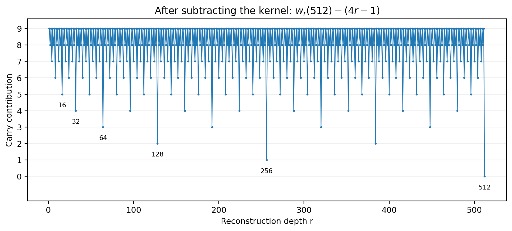
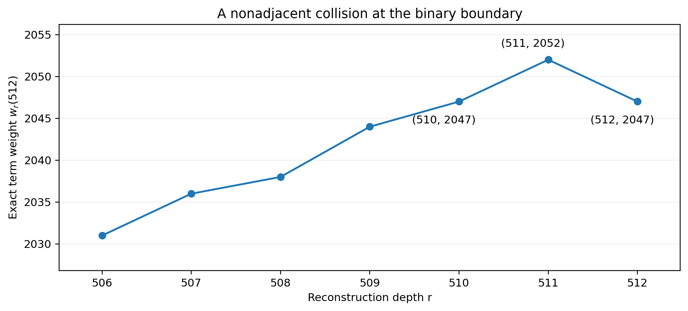

# Reading map and current claim boundary

This is a cumulative record of the dyadic Euler-tail investigation. It includes a short reconstruction of the original matrix and edge mechanisms, the complete recovered proof notes from versions 1 through 4, and the new version-5 continuation. The source bundle retains the associated programs, exact result files, certificate atlases and audit logs. Large machine-readable certificate tables are supplied in the bundle rather than printed as hundreds of redundant rows.

The historical notes are retained to preserve the development, not to erase corrections. Where a historical interpretation conflicts with the correction register or a later theorem, the later statement governs. Each continuation retains its own equation-numbering convention. Version 4 is the consolidated mathematical base. Version 5 adds certified stopping bounds, exact precision distributions and the next irregular-wall classifications.

## Current result map

| Question | Current answer | Main location |
|---|---|---|
| Uniform precision after depth $M$ | $2^{4M+3}$, optimally over all Euler rows | Foundations and Continuation IV |
| Exact weight of one omitted term | $4m-1+v_2\binom Nm$ for target $E_{2N}$ | Foundations |
| Whole remainder at any depth | Exact finite-polynomial reduction | Continuation IV, Section 8 |
| Regular shifted walls | Exact root-emergence and valuation laws | Continuation IV, Sections 4–6 |
| Irregular walls $17,33,49$ | Complete coefficient certificates at the finite exceptional distances | Continuations IV and V |
| Shifted-wall labels through 64 | Classified at every valid scale | Continuation V |
| Frequency of extra cancellation | Exact rational generating function from a completed atlas | Continuation V |
| Mean precision after complete wall separation | $4\cdot2^L$ at $r=2^L-j$ | Continuation V |
| Guaranteed finite root resolution | Explicit bound when the prepared polynomial has nonzero resultant with its derivative | Continuation V |
| Every arbitrary depth explicitly classified | Not established | Continuing ledger |
| Universal simplicity of every residual polynomial | Not established | Continuing ledger |
| Lean checking in these continuations | None performed | Audit boundary |

## Notation that must not be conflated

The original Euler subscript is $2N$. The reconstruction depth is $m$. A truncation retains $m=0,\ldots,M$, and $r=M+1$ is its first omitted depth. The variable $q$ indexes the residual layers after the first omitted summand has been factored out. At a shifted wall, $j$ labels the dominant residual layer and $r=2^L-j$. The distance beyond that wall is $\delta=L-L_j$. Finally $x=N-r$ is a row offset, not a reconstruction depth.

The kernel coefficients are $\beta_m$ and $\kappa_m$. The notation $\beta_m$ here does not denote a value of the Dirichlet beta function. The dyadic source $A(N)$ is also distinct from the wall constant $A_j$ used in the older notes.

Throughout, $v_2(2)=1$ and $v_2(0)=\infty$. A zero residue modulo $2^P$ certifies only a valuation of at least $P$. Root residues identify finite prefixes of dyadic numbers. They are not claims that the roots are rational integers.

## Correction register

| Earlier interpretation | Correct statement |
|---|---|
| A factorial or complex beta-function simplification alone explains the $p$-adic globalization | The operative construction is a filtered triangular inverse, followed by integral normalization and tail control |
| The odd-prime literal sum can simply use $p=2$ | Its even generating function has a double zero. The dyadic construction first removes that obstruction and uses a different source |
| Two powers of two per retained layer is the sharp dyadic rate | It is a coarse floor. Combining the inverse coefficient with the factorial gives the optimal exponent $4M+3$ |
| Carry boundaries are merely near powers of two | Adjacent weights obey the exact increment $4+v_2(N-m)-v_2(m+1)$ |
| Minimum-weight clusters always contain at most two terms | The preserved proof gives a three-minimum counterexample at $N=2^{68}$ |
| A multiple residual root automatically lifts | It may disappear after the next normalization. Root lifting requires an appropriate coefficient certificate |
| $\delta>2d_i$ is an exact emergence threshold | It is sufficient. At a regular wall the exact condition is $\delta\ge d_i+k_i$ |
| Moving beyond a wall forces monotone root counts | False for irregular walls. The size-33 family has one, zero, then two roots at distances 26, 27 and 28 |
| A finite coefficient zero establishes a repeated root or exact zero | It supplies only a precision lower bound. Unresolved branches remain unresolved |
| The odd-edge factor $1-\varepsilon_pp^n$ may always be dropped | It is automatically one modulo $p^k$ only when $k\le n$ |

## Evidence and append-only policy

The incoming v4 archive was restored from mounted bytes. All 42 entries in its integrity ledger matched. Its main audit was rerun successfully, and the rerun output is retained separately. Versions 1 through 3 remain historical evidence unless a new test explicitly covers them. The corrected v4 proof and the new v5 proofs are mathematical arguments, not claims of theorem-prover acceptance.

New future continuations should be appended after Continuation V. They should identify any superseded statement, retain the original note, record a precise proof boundary, and save the executable checks with their actual ranges. The manuscript and its Markdown/LaTeX sources are versioned artifacts, not a promise of background or automatic updates.

\clearpage

# Foundations. From filtered matrices to dyadic carry walls

This chapter reconstructs the mathematical starting point so the later notes can be read without the preceding conversation. The three constructions below are related, but they are not interchangeable.

## The odd-prime matrix and successive cancellation

Use signed Euler numbers

\[
\operatorname{sech}t=\sum_{n\ge0}E_n\frac{t^n}{n!},
\qquad E_0=1,\ E_2=-1,\ E_4=5,\ E_6=-61.
\]

For an odd positive integer $p$, define

\[
S_n(p)=\sum_{a=0}^{p-1}(-1)^a(2a+1)^n.
\]

The finite geometric sum and its even part give

\[
\sum_{N\ge0}S_{2N}(p)\frac{t^{2N}}{(2N)!}
=\cosh^2(pt)\operatorname{sech}t.
\]

Therefore the even sequences satisfy $S=T(p)E$, with the beginning of the infinite matrix

\[
T(p)=
\begin{pmatrix}
1&0&0&0&\cdots\\
2p^2&1&0&0&\cdots\\
8p^4&12p^2&1&0&\cdots\\
32p^6&120p^4&30p^2&1&\cdots\\
\vdots&\vdots&\vdots&\vdots&\ddots
\end{pmatrix}.
\]

Every row is finite. The diagonal is one, so forward substitution constructs the inverse without an analytic convergence assumption. Multiplication by $\operatorname{sech}^2(pt)$ identifies it explicitly. If the positive tangent numbers satisfy

\[
\tan z=\sum_{m\ge0}T_{2m+1}\frac{z^{2m+1}}{(2m+1)!},
\]

then

\[
\boxed{
E_n=\sum_{m=0}^{n/2}(-1)^mT_{2m+1}
\binom n{2m}p^{2m}S_{n-2m}(p)
}\qquad(n\text{ even}).
\]

Each inverse subdiagonal contains $p^{2m}$. When $p$ is an odd prime, retaining through depth $M$ gives a congruence modulo $p^{2M+2}$ uniformly in the row. At any fixed precision, only finitely many inverse diagonals can matter, even though the same operator describes all rows.

### One exact cancellation row

The forward equations are

\[
\begin{aligned}
S_6&=E_6+30p^2E_4+120p^4E_2+32p^6E_0,\\
S_4&=E_4+12p^2E_2+8p^4E_0,\\
S_2&=E_2+2p^2E_0,\qquad S_0=E_0.
\end{aligned}
\]

Subtracting $30p^2S_4$ removes $E_4$, adding $240p^4S_2$ removes the induced $E_2$ term, and subtracting $272p^6S_0$ removes the final constant term. The result is

\[
\boxed{E_6=S_6-30p^2S_4+240p^4S_2-272p^6S_0.}
\]

At $p=3$, the power sums are $S_0=1$, $S_2=17$, $S_4=545$, and $S_6=14897$. Directly,

\[
14897-147150+330480-198288=-61.
\]

The successive cancellation is exact algebra. Its increasing prime divisibility is what makes truncation a controlled $p$-adic approximation.

## The odd-prime edge tower

For an odd prime $p$, put $\varepsilon_p=(-1)^{(p-1)/2}$ and

\[
q_p(a)=\frac{a^{p-1}-1}{p}\qquad(p\nmid a).
\]

At an edge $n=\lambda(p-1)-2r\ge2$, define the unit reciprocal moments

\[
R_{s,\ell}(p)=\sum_{\substack{0\le a<p\\p\nmid(2a+1)}}
\frac{(-1)^a q_p(2a+1)^\ell}{(2a+1)^{2s}}.
\]

For a unit base $b$,

\[
b^{\lambda(p-1)-2s}
=\frac{(1+pq_p(b))^\lambda}{b^{2s}}.
\]

Substitute this exact binomial expansion into the inverse matrix formula. The unique nonunit base $b=p$ contributes a combined term $\varepsilon_pp^nE_n$. Thus

\[
\begin{aligned}
(1-\varepsilon_pp^n)E_n
={}&\sum_{m=0}^{n/2}\sum_{\ell=0}^{\lambda}
(-1)^mT_{2m+1}\binom n{2m}\binom\lambda\ell\\
&\hspace{16mm}\cdot p^{2m+\ell}R_{r+m,\ell}(p).
\end{aligned}
\]

At precision $p^k$, the visible retained region is $2m+\ell<k$. The prefactor on the left can be omitted automatically only when $k\le n$. This is the higher odd-prime edge construction. It is not the dyadic root problem developed in the remainder of this record.

## Where factorial lanes enter

A separate residue-section example clarifies the role of Pochhammer cancellation. Consider

\[
\mathcal S_{10,4}(t)=\sum_{n\ge0}\frac{t^{10n+4}}{(10n+4)!}.
\]

The exact factorial-lane decomposition is

\[
(10n+4)!=4!\prod_{r=5}^{14}(r)_{n;10}
=4!\,10^{10n}\prod_{r=5}^{14}\left(\frac r{10}\right)_n.
\]

The parameter $r/10=1$ supplies $(1)_n=n!$. After removing the forced $t^4/4!$ term and using the divided-power basis $t^{10n}/(10n)!$, the normalized coefficient is

\[
g_n=\frac{4!(10n)!}{(10n+4)!}
=\frac{24}{(10n+1)(10n+2)(10n+3)(10n+4)}.
\]

Every denominator factor is a unit at five. Consequently $v_5(g_n)=0$. The reciprocal divided-power sequence is determined by

\[
C_0=1,\qquad
C_n=-\sum_{q=0}^{n-1}\binom{10n}{10q}g_{n-q}C_q.
\]

The integral lower-triangular recurrence preserves $5$-adic integrality. Here integrality refers to the divided-power coordinates. It must not be confused with integrality of the ordinary Taylor coefficients, whose factorial denominators remain in the basis. Strong finite-difference claims require their own hypotheses and do not follow merely from this cancellation.

## Why the dyadic source is different

At $p=2$, the literal alternating sum is $1-3^n$. Its even generating function is

\[
\cosh t-\cosh3t=-2\sinh(2t)\sinh t.
\]

Its constant coefficient vanishes, and the first nonzero term has degree two. A unit-diagonal inverse cannot be obtained by blindly substituting two into the odd literal-sum transform. Removing the double-zero factor instead leads to

\[
A(N)=\frac{3^{2N+2}-1}{4(2N+1)(2N+2)},
\]
\[
\sum_{N\ge0}A(N)\frac{t^{2N}}{(2N)!}
=\frac{\sinh(2t)\sinh t}{2t^2}.
\]

Its inverse factor is $4t^2/\sinh^2(2t)$ because the product is $\operatorname{sech}t$. This gives the dyadic reconstruction used in all subsequent continuations.

The numerator and denominator of $A(N)$ have the same power of two:

\[
v_2(3^{2N+2}-1)=2+v_2(2N+2)
=v_2\bigl(4(2N+1)(2N+2)\bigr).
\]

Thus $A(N)$ is a dyadic unit. For the inverse,

\[
\kappa_m=\beta_m2^{2m}(2m)!
=-2^{4m}(2m-1)B_{2m}.
\]

The classical Bernoulli denominator theorem gives $v_2(B_{2m})=-1$ [S1], hence the exact positive-depth kernel weight is $4m-1$. This is where the apparent separate digit-sum and factorial losses combine into the sharp four-bit rate.

## The sharp uniform bound and its limitation

For target $E_{2N}$, each omitted term has exact valuation

\[
w_m(N)=4m-1+v_2\binom Nm.
\]

Retaining $m\le M$ therefore yields

\[
\boxed{v_2\mathcal T_M(N)\ge4M+3.}
\]

At $N=M+1$ there is exactly one omitted term. Its binomial coefficient and source value are one, so equality holds. No stronger exponent works uniformly over all rows for that same truncation.

This does not determine a particular whole tail. When several minimum-weight terms occur, their unit residues can cancel. The later research concerns exactly that additional cancellation.

## Exact binary boundaries

For consecutive positive depths,

\[
\boxed{w_{m+1}(N)-w_m(N)
=4+v_2(N-m)-v_2(m+1).}
\]

Put $a=v_2(N+1)$ and $t=v_2(m+1)$. If $t<a$, the increment is four. If $t>a$, it is $4+a-t$. If $t=a$, write $N+1=2^aA$, $m+1=2^aB$ with $A,B$ odd. Then the increment is $4+v_2(A-B)\ge5$.

An adjacent tie therefore occurs exactly when

\[
\boxed{v_2(m+1)=v_2(N+1)+4.}
\]

Larger binary jumps can create nonadjacent ties. At $N=512$, the increments from depths 510 to 511 and then to 512 are $+5,-5$. The two outside weights are equal while the middle one is higher.

The following historical continuations start at this distinction between a minimum term weight and the valuation of their sum.
