# Komorebi Quadratic-Form Engine and K-COS

**Komorebi P. · Final traditional edition · October 7, 2026**

*Memory-Bounded Structured Solvers, Query-Adaptive Spectral Packets, and Directed-Rounding Extreme-Tail Enclosures*

This editable text contains the complete traditional edition, including proofs, experiments, companion contracts, and bibliography. Statement and reference numbers match the typeset PDF.

## Abstract

Gaussian quadratic forms occur throughout statistics, numerical analysis, signal processing, kernel methods, and variance-component inference. This work develops a single computational framework for central positive, central indefinite, and positive noncentral forms, with particular emphasis on two difficult regimes: operators too large to reside in accelerator memory and survival probabilities many hundreds or thousands of decades into the tail.

The method separates storage, structural propagation, rank compression, and spectral tail evaluation. Exact block identities permit out-of-core factor actions without changing the represented operator. Polyphase light-cone theorems and certified approximate light cones turn structural locality into phase-aware scheduling. Range-residual invariants quantify unresolved spectral mass and trigger exact residual completion when the remaining rank is small. The final tail layer uses exponential tilting, query-adaptive spectral packets, log-domain accumulation, and explicit support and Fourier-mode remainder bounds.

For exact supplied positive spectra, a directed-rounding backend returns a logarithmic probability interval and an accuracy-driven controller refines internal resolution until the requested multiplicative probability accuracy is proved or fails closed. In the archived September 2026 exact control $0.02\chi^2_{80}$, the solver reported tail enclosures through $10^{-5000}$; at the $10^{-5000}$ point a $10^{-18}$ requested relative accuracy is met with a certified ratio-minus-one of approximately $9.2\times10^{-20}$. A fresh October 7, 2026 run confirms the deepest control with directed ratio upper endpoint below $9.202\times10^{-20}$; an independent exact Erlang interval is fully contained. The final regression suites pass 58 of 58 tests. Additional archived validation includes a rank-1997 production-scale positive spectrum near $10^{-922}$, a corrected strong-dependence spectrum near $10^{-458}$, signed finite-endpoint controls through $10^{-200}$, a rank-340 mixed-sign tail near $10^{-82}$, and noncentral exact controls through $10^{-40}$.

The central design rule is that approximation is an internal computational choice, not the accuracy contract. A machine-enclosed result is accepted only when its directed-rounding probability interval proves the requested accuracy. A binary64 analytic ledger bounds mathematical approximation error and remains a distinct evidence level because it does not enclose numerical rounding.

## Final-edition contract and reading map

This edition preserves the full matrix-to-tail manuscript from the v1.9 source archive and integrates the complete centered-packet mathematics from the earlier K-COS paper. The scope is a domain-neutral quadratic-form engine; the rare-variant case study is one application.

Three companion objects accompany this traditional text: an explanatory visual guide, executable Python source and fresh validation, and a focused Lean companion. The Lean companion contains 26 freshly kernel-checked finite algebraic and certificate-composition theorem declarations; it does not formally certify the entire probability analysis or the numerical libraries.

Unless a result is explicitly dated October 7, 2026, all numerical measurements, including quantitative prose claims, tables, and plots in the main body are *archived September 2026 development evidence*. They remain intact to preserve the research record. Their precision, implementation versions, and reference convergence are those documented in the original source archive. Fresh checks are separately identified in Appendix [C](#app:fresh-validation); they do not silently replace historical measurements or establish an unmeasured hardware speedup.

The word “certificate” has three distinct meanings here. Structural certificates are exact inequalities proved in the real-arithmetic model. Analytic probability ledgers bound packet, support, and Fourier truncation errors in that model. Directed-rounding probability enclosures additionally bound all finite numerical arithmetic in the specific interval backend. Binary64 signed, noncentral, and packet calculations are analytic-ledger results, even when their historical API returned `certified=True`. That Boolean alone is not a floating-point enclosure.

The directed positive backend targets an *exactly supplied* positive spectrum of rank greater than two, a nonnegative threshold, a valid positive tilt, a strictly larger positive support endpoint, and at least one retained cosine mode. The accuracy-driven designer currently uses upper-tail queries above the spectral mean. Matrix input certification targets the exact Gram matrix of the supplied binary64 entries. It does not certify unrecorded preprocessing, a statistical model fit, or a real-valued matrix preceding the stored entries.

| Reading path                 | Mathematical content                                                                      | Companion and evidence                                                                                                                                               |
|:-----------------------------|:------------------------------------------------------------------------------------------|:---------------------------------------------------------------------------------------------------------------------------------------------------------------------|
| Representation and structure | Exact factor identities, storage refinement, phase propagation, QR/range cores            | Full proofs here; finite algebraic subset in Lean; original numerical invariance checks                                                                              |
| Spectral uncertainty         | Norm/Weyl bounds, residual moments, exact completion, dense eigensystem post-verification | Proofs here; moderate-dimension directed backend; scalable verification remains open                                                                                 |
| K-COS packets                | Centered complex CGF expansion, query grid, folding, packet/support/mode error budget     | Complete packet theory in Section [26](#sec:packets); analytic and binary64 evidence kept separate |
| Probability accuracy         | Positive directed enclosure and tolerance acceptance                                      | Interval-library correctness is a software dependency; fresh regression checks and archived extreme-tail controls                                                    |

<a id="sec:final-1"></a>

## Results at a glance

The engine is organized around a simple contract: preserve the quadratic form while changing its representation, and report a tail probability only at an accuracy that has been explicitly established.

| Component                    | Resolved statement                                                                                                                                                                               |
|:-----------------------------|:-------------------------------------------------------------------------------------------------------------------------------------------------------------------------------------------------|
| Central positive form        | $X^\top M X$, with $X\sim N(0,\Sigma)$ and $M\succeq0$, reduces exactly to $\sum_j\lambda_j Z_j^2$.                                                                                              |
| Central indefinite form      | For symmetric $M$, the same reduction holds with signed $\lambda_j$, yielding a signed generalized chi-square form.                                                                              |
| Positive noncentral form     | $X\sim N(\mu,\Sigma)$, $M\succeq0$, reduces exactly to a deterministic shift plus $\sum_j\lambda_j\chi^2_1(\delta_j)$.                                                                           |
| Memory-bounded factorization | At fixed resident column width $c$, nuisance-space rank $p$, and Krylov width $s$, streamed sample-space actions use $O(nc+ns+cs+np)$ working storage rather than $O(nm)$.                       |
| Structural scheduling        | Exact and approximate phase light cones certify which operator blocks can affect a finite-depth Krylov query.                                                                                    |
| Spectral recovery            | Range residual trace, square-trace, and spectral-cap information bounds unresolved spectrum; when the remaining rank is small, streamed residual completion restores the exact nonzero spectrum. |
| Extreme-tail contract        | For exact positive spectra, the public input is a requested multiplicative accuracy $\varepsilon$. The solver returns $[p_-,p_+]$ only as certified when $p_+/p_- - 1\le\varepsilon$.            |
| Deepest rigorous control     | For $0.02\chi^2_{80}$ at $p=10^{-5000}$, a requested $10^{-18}$ relative accuracy is certified with achieved ratio-minus-one approximately $9.2\times10^{-20}$.                                  |

The remainder of the manuscript develops these statements from the operator level down to the final probability enclosure.

<a id="sec:gaussian-core"></a>

## General quadratic-form core

The primary mathematical object is a Gaussian quadratic form.

### Central positive forms

Let $$X\sim N(0,\Sigma),
\qquad
M\succeq0,$$ and write $S=\Sigma^{1/2}$. With $X=SZ$, $Z\sim N(0,I)$, $$Q=X^\top MX
=
Z^\top(SMS)Z.$$ If the nonzero eigenvalues of the positive semidefinite operator $$H=SMS$$ are $\lambda_1,\ldots,\lambda_r$, then $$\boxed{
Q\overset d=
\sum_{j=1}^r\lambda_jZ_j^2.
}$$

The numerical tail problem therefore depends only on a positive spectrum, regardless of how that spectrum was generated.

<a id="claim:final-2-1"></a>

**Proposition 2.1** (Representation equivalence). *The same central quadratic-form law may be supplied by any of the following:*

1.  *a nonnegative spectrum $\{\lambda_j\}$;*

2.  *a positive semidefinite matrix $H$;*

3.  *a factor $A$ with $H=AA^\top$ or $H=A^\top A$;*

4.  *a replayable streamed factor $$A=[A_1\ \cdots\ A_B].$$*

*The nonzero spectra of $AA^\top$ and $A^\top A$ are identical, and $$AA^\top=\sum_bA_bA_b^\top.$$*


This proposition is the domain-independent source of the memory-bounded streaming method developed below.

### Central indefinite forms

The positive case is not the natural boundary of the central theory. Let $$X\sim N(0,\Sigma),
\qquad
M=M^\top,$$ where $M$ may be indefinite, and again write $S=\Sigma^{1/2}$. The symmetric operator $$H=SMS$$ has a real signed spectrum.

<a id="claim:final-2-2"></a>

**Theorem 2.2** (Exact central signed reduction). *If $\lambda_1,\ldots,\lambda_r$ are the nonzero eigenvalues of $H$, then $$\boxed{
X^\top M X
\overset d=
\sum_{j=1}^r\lambda_jZ_j^2.
}$$*


*Proof.* Write $X=SZ$ with $Z\sim N(0,I)$ and diagonalize $$SMS=V\Lambda V^\top.$$ Rotational invariance of the standard normal gives $$Z^\top V\Lambda V^\top Z
\overset d=
\sum_j\lambda_jZ_j^2.$$ No positivity assumption on $M$ is needed for this central reduction. ◻


The sign pattern determines the support. If every $\lambda_j\ge0$, the lower endpoint is zero. If every $\lambda_j\le0$, the upper endpoint is zero. If both signs occur, the distribution is unbounded in both directions.

For the right-tail path, the cumulant generating function is $$K(s)
=
-\frac12\sum_j\log(1-2s\lambda_j),$$ with real domain $$\boxed{
\max_{\lambda_j<0}\frac{1}{2\lambda_j}
< s <
\min_{\lambda_j>0}\frac{1}{2\lambda_j}.
}$$ Here a missing negative or positive spectral set gives a domain endpoint $-\infty$ or $+\infty$, respectively. When $q>E[Q]=\sum_j\lambda_j$, the saddlepoint is the unique positive solution of $$K'(\theta)=q$$ inside this domain whenever a positive spectral component is present. The finite-upper-endpoint negative-only case is handled by the same tilted geometry with the endpoint fixed at zero.

The packet representation is sign aware: positive and negative eigenvalues are clustered separately, and each same-sign packet stores a center $\mu$ and centered moments. The local expansion remains $$-\frac12\log(1-2s(\mu+\delta))
=
-\frac12\log(1-2s\mu)
+
\frac12\sum_{n\ge1}
\frac{\alpha(s)^n\delta^n}{n},
\qquad
\alpha(s)=\frac{2s}{1-2s\mu},$$ with the same geometric remainder condition $$|\alpha(s)|\max|\delta|<1.$$

A useful distinction appears in the Fourier tail. Under the saddlepoint tilt, $$\left|\phi_\theta(t)\right|
=
\prod_j
\left[
1+
\left(
\frac{2\lambda_j t}{1-2\theta\lambda_j}
\right)^2
\right]^{-1/4}.$$ If $r$ coefficients are nonzero, then asymptotically $$|\phi_\theta(t)|=O(|t|^{-r/2}).$$ Thus certification difficulty depends strongly on spectral rank, not only on how small the requested probability is.

##### Exact finite-endpoint control.

For $$Q=-0.02\,\chi^2_{80},$$ the right tail is a lower chi-square tail with finite upper endpoint zero. The signed engine agrees with the exact distribution through $$\boxed{p=10^{-200}},$$ with maximum observed log-probability error about $2.84\times10^{-14}$ decades and certificates around $10^{-12}$.

##### Mixed-sign high-rank analytic-ledger control.

A deterministic rank-340 multiscale spectrum with 180 positive and 160 negative coefficients was tested from approximately $10^{-14}$ to $$\boxed{p\approx10^{-81.891937}}.$$ At the deepest point the packetized solver used 35 packets, $K=4096$, and reported a relative certificate $$5.78\times10^{-9}.$$ Its log-probability differed from the unpacketized full-spectrum signed solver by about $1.42\times10^{-12}$ decades. Independent exponential-tilt importance sampling placed the discrepancy at about $1.41$ Monte Carlo standard errors.

##### Retained low-rank limitation.

The exact mixed-sign identity $$Q=0.07(\chi^2_2-\chi^2_2)$$ is Laplace distributed with scale $0.14$, so for $q\ge0$, $$P(Q\ge q)=\frac12e^{-q/0.14}.$$ The computed values agree with this exact law through $10^{-200}$ to roughly $10^{-9}$ decades or better. However, the current analytic COS-series certificate rejects these low-rank mixed cases because the tilted characteristic function decays only as $|t|^{-2}$. The implementation reports this as a certificate failure rather than silently accepting the numerical value.

<a id="fig:signed-certificate-boundary"></a>

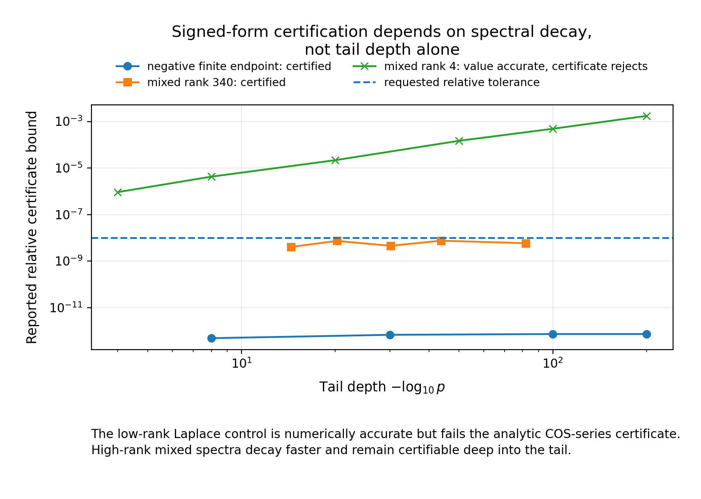

*Signed-form certification boundary. Negative finite-endpoint forms and the rank-340 mixed spectrum remain certifiable in deep tails. The exact rank-4 Laplace control remains numerically accurate but fails the current analytic COS-series certificate because its Fourier decay is much slower.*


### Noncentral positive forms

Now let $$X\sim N(\mu,\Sigma),
\qquad
M\succeq0.$$ Again set $S=\Sigma^{1/2}$ and diagonalize $$SMS=V\Lambda V^\top.$$ Writing $$c=V^\top SM\mu,$$ each positive-eigenvalue direction satisfies $$\lambda_iY_i^2+2c_iY_i
=
\lambda_i
\left(
Y_i+\frac{c_i}{\lambda_i}
\right)^2
-
\frac{c_i^2}{\lambda_i}.$$

<a id="claim:final-2-3"></a>

**Theorem 2.3** (Exact noncentral reduction). *For the positive eigenvalues $\lambda_i>0$, $$\boxed{
Q
\overset d=
q_0
+
\sum_i
\lambda_i
\chi^2_1(\delta_i),
}$$ where $$\delta_i=
\left(\frac{c_i}{\lambda_i}\right)^2$$ and $$q_0
=
\mu^\top M\mu
-
\sum_i\frac{c_i^2}{\lambda_i}
\ge0.$$ If $\Sigma$ is nonsingular on the $M$-active subspace, then $q_0=0$. When $\Sigma$ is singular, $q_0$ is the deterministic quadratic contribution outside the random covariance support.*


*Proof.* Expand $$(\mu+SZ)^\top M(\mu+SZ)
=
Z^\top SMSZ
+
2\mu^\top MSZ
+
\mu^\top M\mu$$ and rotate by $V$. Completing the square gives the displayed noncentral components. For a null vector of $SMS$, $$M^{1/2}Sv=0,$$ hence $$v^\top SM\mu
=
(M^{1/2}Sv)^\top M^{1/2}\mu
=
0,$$ so there is no unresolved stochastic linear term in a zero-eigenvalue direction. The remaining constant is the squared norm of the deterministic component and is therefore nonnegative. ◻


The production API implements this reduction directly. In an isotropic control, $$\Sigma=I,\qquad M=aI,$$ the law collapses to the exact scaled noncentral chi-square distribution $$Q/a\sim\chi^2_d(\|\mu\|^2).$$

<a id="fig:noncentral-controls"></a>

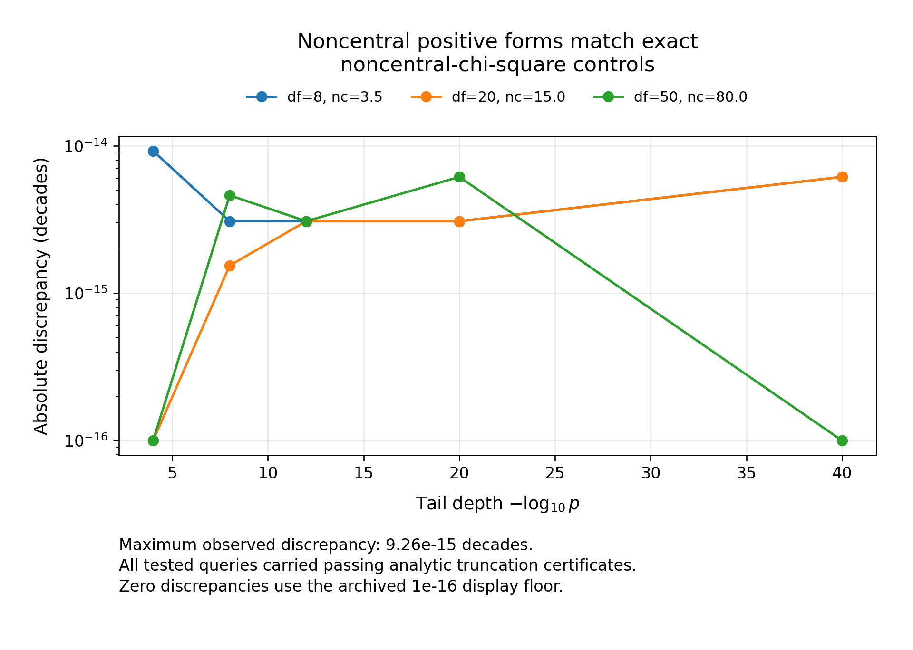

*Independent noncentral controls. Three scaled isotropic Gaussian quadratic forms with different dimensions and noncentralities were compared against SciPy’s noncentral-$\chi^2$ law from $10^{-4}$ through $10^{-40}$. The largest observed discrepancy was approximately $9.3\times10^{-15}$ decades, with all analytic truncation certificates passing.*


### Decomposition axes

The solver separates four logically different representations: $$\boxed{
\text{storage blocks}
\circ
\text{structural phases}
\circ
\text{Krylov/range compression}
\circ
\text{spectral tail packets}.
}$$ Storage blocks answer where data reside. Structural phases answer how the operator propagates. Krylov/range compression answers which subspace has actually been resolved. Spectral packets answer how the final transform is evaluated. These decompositions should not be conflated.

<a id="sec:final-3"></a>

## Demonstrated deep-tail precision

**Evidence date and scope.** All measurements in this section are archived September 2026 runs. Only rows explicitly described as directed rounding are numerical enclosures. The other reported certificates are analytic approximation ledgers evaluated in floating point.

The method is designed for a regime in which direct survival probabilities can underflow long before the mathematical probability becomes numerically unresolvable. The engine therefore treats $\log p$ as the primary numerical quantity and keeps approximation certificates alive in the same extreme-tail regime.

The validation ladder spans seven qualitatively different settings:

| validation regime                                 | deepest $\log_{10}p$ | observed error                               | certificate                                     | spectral size |
|:--------------------------------------------------|:---------------------|:---------------------------------------------|:------------------------------------------------|:--------------|
| directed-rounding $0.02\chi^2_{80}$ control       | $-5000$              | enclosure width $3.37\times10^{-11}$ decades | multiplicative ratio $\le 1+7.75\times10^{-11}$ | 80 df         |
| production-scale positive spectrum                | $-922.031162$        | below stored reference resolution            | $5.71\times10^{-9}$                             | rank 1997     |
| corrected strong-dependence case study            | $-457.973916$        | below stored reference resolution            | $5.20\times10^{-9}$                             | rank 996      |
| heterogeneous inversion benchmark near $10^{-16}$ | $-16$                | $2.88$–$6.52\times10^{-15}$ decades          | independent integral converged                  | ranks 80–120  |
| signed finite-endpoint exact control              | $-200$               | $\le 2.84\times10^{-14}$ decades             | $7.23\times10^{-13}$                            | rank 80       |
| signed mixed multiscale                           | $-81.891937$         | $1.42\times10^{-12}$ decades vs full grid    | $5.78\times10^{-9}$                             | rank 340      |
| noncentral exact controls                         | $-40$                | $\le 9.26\times10^{-15}$ decades             | passing                                         | up to 50 df   |

The analytic scaled-chi-square ladder also includes $$\log_{10}p=-100,-300,-1000,-5000,$$ with respective reported absolute log-probability discrepancies $$2.84\times10^{-14},\quad
<10^{-15},\quad
3.41\times10^{-13},\quad
<10^{-15}$$ in the stored benchmark output. The corresponding analytic relative certificates remain finite throughout, reaching only $$3.85\times10^{-11}$$ at $10^{-5000}$.

A production-scale run with $n=2000$, $m=50{,}000$, 49,951 retained features, and quadratic-form rank 1997 produced $$\boxed{\log_{10}p=-922.0311624669905}$$ using 79 spectral packets and $K=128$. Its independently evaluated full-spectrum tilted reference agreed within the stored reporting precision, while the reported relative certificate was $$5.71\times10^{-9}.$$

The corrected strong-dependence case study independently reached $$\boxed{\log_{10}p=-457.9739160722001}$$ with a finite $5.20\times10^{-9}$ certificate. The signed finite-endpoint control passed its analytic ledger through $10^{-200}$, while a rank-340 mixed-sign multiscale spectrum passed its analytic ledger to $$\boxed{\log_{10}p=-81.89193686056221}.$$ Finally, the noncentral engine matched exact noncentral-chi-square controls from $10^{-4}$ through $10^{-40}$, with maximum observed discrepancy $$9.26\times10^{-15}$$ decades.

<a id="fig:deep-tail-precision-envelope"></a>

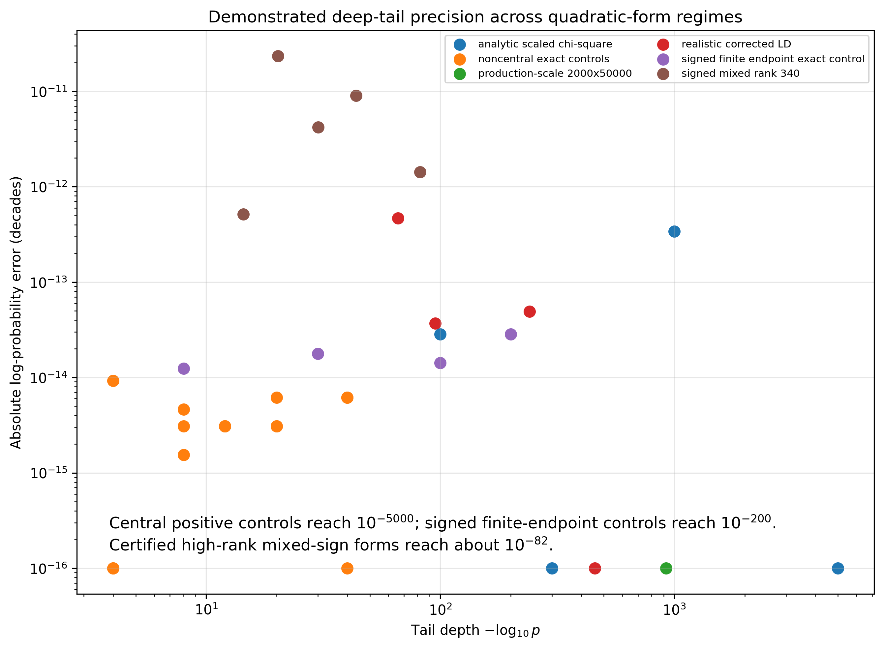

*Demonstrated precision envelope across positive analytic controls, a production-scale rank-1997 spectrum, corrected strong-dependence spectra, signed finite-endpoint and mixed-sign forms, and noncentral exact controls. Points whose stored benchmark difference rounded to zero are placed at $10^{-16}$ decades only to make them visible on the logarithmic vertical axis.*


### Independent characteristic-function inversion near $10^{-16}$

Closed-form controls are important, but they can hide numerical difficulties that appear only for heterogeneous spectra. An independent inversion test was therefore run on four generalized chi-square laws near $$P(Q\ge q)\approx10^{-16}.$$

The reference evaluates the original characteristic function directly through the central Imhof inversion identity $$P(Q\ge q)
=
\frac12
+
\frac1\pi
\int_0^\infty
\frac{\sin\Theta(u)}{u\,R(u)}\,du,$$ where, for distinct positive coefficients $\lambda_j$ with multiplicities $h_j$, $$\Theta(u)
=
\frac12\sum_j h_j\arctan(\lambda_j u)
-
\frac12qu,
\qquad
R(u)
=
\prod_j
\left(1+\lambda_j^2u^2\right)^{h_j/4}.$$ This route does not use exponential tilting, the COS expansion, spectral packets, or the K-COS error controller.

The four spectra include balanced, skewed, dominant-spike, and higher-rank cases. Each reference integral was evaluated at two truncation limits. The omitted integral after $U$ was bounded using $$\frac1\pi
\int_U^\infty\frac{du}{uR(u)}
\le
\frac{C}{\pi p}U^{-p},
\qquad
p=\frac12\sum_jh_j,
\qquad
C=\prod_j\lambda_j^{-h_j/2}.$$

| spectrum | rank | $|\Delta\log_{10}p|$ |  relative difference | reference tail bound / $p$ |
|:---------|-----:|---------------------:|---------------------:|---------------------------:|
| balanced |   80 | $6.52\times10^{-15}$ | $1.50\times10^{-14}$ |       $6.84\times10^{-20}$ |
| skewed   |   80 | $4.13\times10^{-15}$ | $9.50\times10^{-15}$ |       $4.44\times10^{-18}$ |
| spiky    |   80 | $5.19\times10^{-15}$ | $1.20\times10^{-14}$ |       $7.00\times10^{-17}$ |
| balanced |  120 | $2.88\times10^{-15}$ | $6.64\times10^{-15}$ |       $4.19\times10^{-29}$ |

The two inversion truncations agree to between approximately $$1.2\times10^{-21}
\quad\text{and}\quad
3.7\times10^{-17}$$ decades across the four cases. Thus the slow reference is numerically stable at a scale well below the observed K-COS-versus-inversion difference.

<a id="fig:imhof-p1e16"></a>

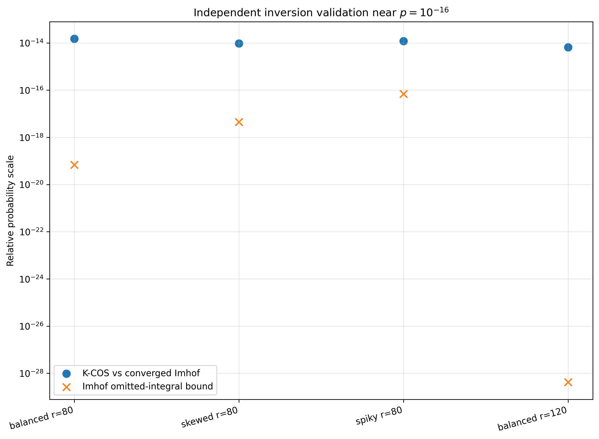

*Independent direct-inversion validation near $p=10^{-16}$ on four heterogeneous spectra. Circles show the relative K-COS/inversion difference; crosses show the analytic bound on the inversion integral omitted beyond the final truncation point.*


This test is complementary to the exact scaled-chi-square controls. It asks whether the solver remains accurate when no single-gamma reduction is available and when an algorithmically different inversion of the full characteristic function is used as the reference.

These results have different evidentiary roles. The scaled-chi-square, finite-endpoint signed, Laplace signed, and noncentral cases provide analytic controls. The heterogeneous inversion battery, production-scale, strong-dependence, and rank-340 mixed-sign cases test irregular spectra for which no single-gamma closed form is available. Together they test correctness against known distributions, representation compression, and stability on the intended high-rank numerical regime. The low-rank Laplace example also records a deliberate certificate failure boundary rather than conflating numerical agreement with certification.

<a id="sec:final-4"></a>

## Directed-rounding deep-tail enclosure

The preceding precision experiments combine analytic approximation bounds with stable floating-point evaluation. A stronger numerical statement is possible: return an interval that is guaranteed to contain the probability represented by an exact supplied positive spectrum.

This section gives the first such backend.

### Interval target

For a positive central quadratic form $$Q=\sum_{j=1}^{r}\lambda_jZ_j^2,
\qquad
\lambda_j>0,$$ the output is not merely a point estimate. It is $$\boxed{
\log_{10}P(Q\ge q)\in[d_-,d_+].
}$$ Hence the corresponding multiplicative uncertainty satisfies $$\boxed{
\frac{p_+}{p_-}\le 10^{d_+-d_-}.
}$$

The finite transform and exponential prefactor are evaluated by directed-rounding interval arithmetic. The resulting interval is enlarged by two independently proved analytic remainders: a support/periodization alias bound and an omitted-COS-mode bound.

### No exact saddlepoint is required

Choose any $$0<\theta<\frac{1}{2\lambda_{\max}}.$$ Exponential tilting gives $$P(Q\ge q)
=
e^{K(\theta)-\theta q}
S_\theta(q),$$ where $$S_\theta(q)
=
E_\theta\!\left[
e^{-\theta(Q-q)}
1_{\{Q\ge q\}}
\right].$$

The interval proof does not require $\theta$ to be the exact saddlepoint. A high-precision saddlepoint is used only as an efficient design choice. Once serialized as an exact decimal input, it is simply a valid tilt inside the MGF domain.

The same is true of the support endpoint $U$ and the auxiliary Chernoff parameter $\eta$. Correctness requires only $$U>q\ge0,\qquad U>0,
\qquad
\theta<\eta<\frac{1}{2\lambda_{\max}}.$$

### Rigorous support and alias control

Under the tilted measure, $$P_\theta(Q>U)
\le
\exp\left\{
K(\eta)-K(\theta)-(\eta-\theta)U
\right\}.$$

The full-characteristic-function cosine expansion periodizes the tilted density on $[0,U]$. Because the original positive quadratic form is supported on $[0,\infty)$, the total positive-tail mass aliased back into one fundamental interval is at most $P_\theta(Q>U)$.

The actual payoff omitted above $U$ is at most $$e^{-\theta(U-q)}P_\theta(Q>U).$$

Therefore $$\boxed{
E_{\rm support}
\le
P_\theta(Q>U)
\left(
1+e^{-\theta(U-q)}
\right).
}$$

### Rigorous infinite-mode control

Define $$a_j=
\frac{2\lambda_j}{1-2\theta\lambda_j}.$$ The normalized tilted characteristic function satisfies $$|\phi_\theta(t)|
=
\prod_{j=1}^r
\left(
1+(a_jt)^2
\right)^{-1/4}.$$

Since $$1+(a_jt)^2\ge(a_jt)^2,$$ we have $$|\phi_\theta(t)|
\le
C_\theta t^{-r/2},
\qquad
C_\theta=\prod_j a_j^{-1/2}.$$

For the payoff coefficient $$I_k=
\int_q^U
e^{-\theta(x-q)}
\cos(k\pi x/U)\,dx,$$ the elementary bound $$|I_k|\le\frac1\theta$$ holds.

Let $$p=\frac r2>1,\qquad K\ge1.$$ For a finite transform retaining modes $0,\ldots,K-1$, $$\boxed{
E_{\rm series}
\le
\frac{2C_\theta}{U\theta}
\left(\frac{U}{\pi}\right)^p
\left[
K^{-p}
+
\frac{K^{1-p}}{p-1}
\right].
}$$

This first interval backend therefore requires $r>2$. Lower-rank positive forms can use a different tail bound and are not claimed by this theorem.

### Final enclosure theorem

Let $\boldsymbol S_K$ be the directed-rounding interval containing the finite $K$-mode tilted COS sum, and set $$E=E_{\rm support}+E_{\rm series}.$$ Then $$\boxed{
S_\theta(q)
\in
\boldsymbol S_K+[-E,E].
}$$

If the lower endpoint of this interval is positive, directed rounding gives $$\boxed{
\log P(Q\ge q)
\in
K(\theta)-\theta q
+
\log\left(
\boldsymbol S_K+[-E,E]
\right).
}$$

All finite arithmetic in this expression is enclosed by the interval backend.

### Independent exact interval control through $10^{-5000}$

For the control $$Q=0.02\chi^2_{80},$$ the survival probability has the finite exact formula $$P(Q\ge q)
=
e^{-x}
\sum_{j=0}^{39}
\frac{x^j}{j!},
\qquad
x=\frac{q}{0.04}.$$

This finite expression was evaluated independently by directed-rounding interval arithmetic, without using K-COS. The K-COS enclosure and this exact control enclosure overlap at $$p=10^{-100},
\qquad
10^{-1000},
\qquad
10^{-5000}.$$

With $K=128$ and 90 interval decimal digits, the resulting K-COS widths are

|       target | width in $\log_{10}p$ | multiplicative ratio minus one |
|-------------:|----------------------:|-------------------------------:|
|  $10^{-100}$ |  $8.95\times10^{-13}$ |           $2.06\times10^{-12}$ |
| $10^{-1000}$ |  $6.94\times10^{-12}$ |           $1.60\times10^{-11}$ |
| $10^{-5000}$ |  $3.37\times10^{-11}$ |           $7.75\times10^{-11}$ |

Thus the $10^{-5000}$ result is not merely a point estimate agreeing with a reference. For the exact supplied spectrum, it comes with a directed-rounding logarithmic enclosure whose probability ratio satisfies $$\boxed{
\frac{p_+}{p_-}
\le
1+7.75\times10^{-11}
}$$ up to the displayed rounding of that ratio.

<a id="fig:interval-tail-width"></a>

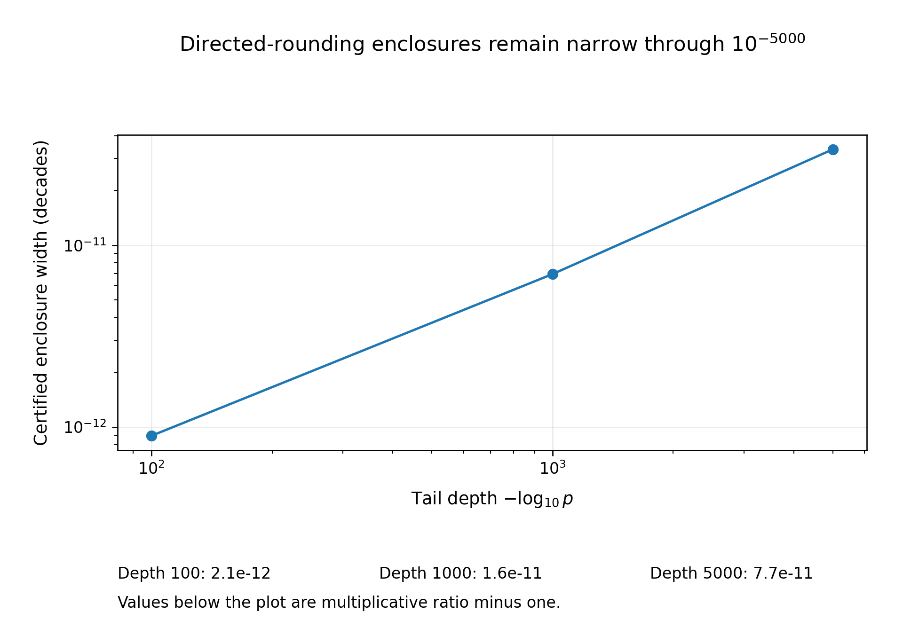

*Width of the directed-rounding K-COS probability enclosure on exact scaled-chi-square controls. The enclosure remains narrow even at $10^{-5000}$.*


### Arithmetic width versus analytic width

At the $10^{-5000}$ control, the interval precision was swept from 40 to 120 decimal digits. The total certified width remained essentially $$3.34247\times10^{-11}$$ decades.

Over the same sweep, the arithmetic-only width contracted from approximately $$7.5\times10^{-37}$$ to $$6.3\times10^{-117}$$ decades.

<a id="fig:interval-arithmetic"></a>

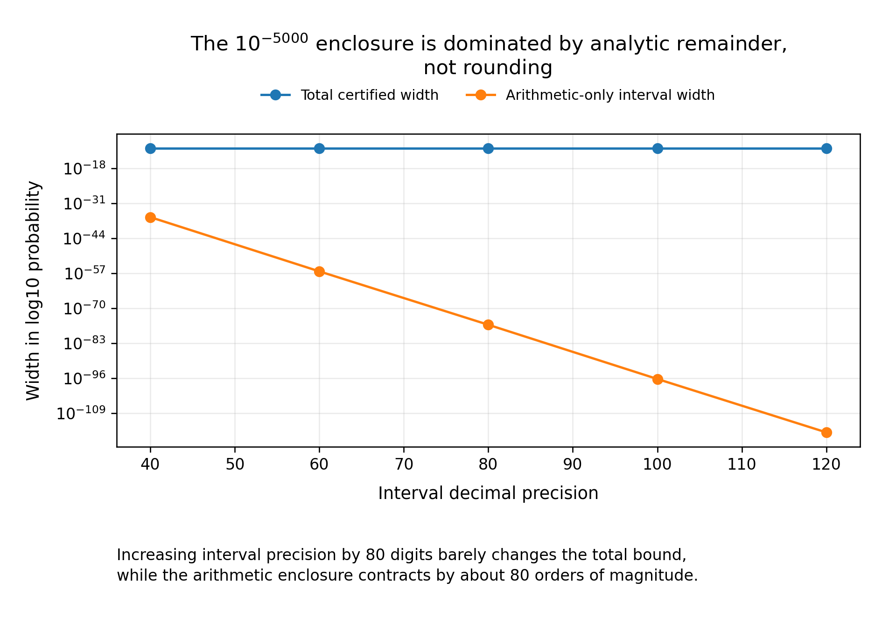

*Arithmetic versus analytic uncertainty at a $10^{-5000}$ tail. The directed-rounding arithmetic enclosure becomes negligible; the final width is controlled by the explicit analytic support and series remainders.*


This separation is important. Increasing numerical precision cannot improve an analytic truncation theorem. Conversely, once interval arithmetic is far below the analytic error budget, numerical rounding is no longer the limiting uncertainty.

### Guarantee boundary

The v1.4 statement is intentionally narrow:

> For an exact supplied positive decimal spectrum of rank greater than two, the backend returns a directed-rounding logarithmic probability enclosure enlarged by proved analytic support/alias and omitted-mode bounds.

The result is conditional on correctness of the interval-arithmetic library implementation. The current implementation uses `mpmath.iv`, whose interval layer applies downward and upward endpoint rounding.

A completely end-to-end guarantee beginning from an arbitrary floating-point matrix requires one more layer: either a rigorously enclosed matrix-to-spectrum computation, or an exact/residual completion step whose linear algebra is also performed with verified interval or ball arithmetic.

The current packetized spectral representation has likewise not yet been ported to interval arithmetic. The first rigorous backend deliberately uses the exact supplied spectrum so that representation error cannot be hidden inside the numerical enclosure.

<a id="sec:final-5"></a>

## Accuracy-driven certification

The public numerical contract should specify the desired accuracy, not the internal transform resolution.

For an exact positive spectrum and threshold $q$, the solver accepts a requested relative multiplicative accuracy $$\varepsilon_{\rm req}>0$$ and returns a certified interval $$[p_-,p_+]$$ only when $$\boxed{
\frac{p_+}{p_-}-1
\le
\varepsilon_{\rm req}.
}$$

In logarithmic coordinates, if $$\log_{10}p\in[d_-,d_+],$$ the acceptance rule is $$\boxed{
10^{d_+-d_-}-1
\le
\varepsilon_{\rm req}.
}$$

No value of $K$, support width, or arithmetic precision appears in the external contract.

<a id="claim:final-5-1"></a>

**Theorem 5.1** (Accuracy contract for the positive exact-spectrum backend). *Assume an exact supplied positive decimal spectrum of rank greater than two, a threshold $q\ge0$ with valid interval-design parameters, and requested multiplicative tolerance $\varepsilon_{\rm req}>0$. Suppose the directed-rounding interval backend returns an enclosure $$\log_{10}p\in[d_-,d_+]$$ that includes the proved support/alias and omitted-mode remainders. If the accuracy-driven controller returns `certified=True`, then $$\boxed{
P(Q\ge q)\in[10^{d_-},10^{d_+}]
}$$ and $$\boxed{
\frac{10^{d_+}}{10^{d_-}}-1
\le
\varepsilon_{\rm req}.
}$$ If the resource caps are reached before this inequality is proved, the controller returns `certified=False` rather than promoting the interval midpoint to a certified answer.*


*Proof.* The directed-rounding backend encloses the finite transform and exponential prefactor and then enlarges that enclosure by the proved support/alias and infinite-mode error bounds. Therefore the true tail probability lies inside the returned interval. The controller encloses $\operatorname{expm1}(\log(10)(d_+-d_-))$ by directed rounding and sets `certified=True` only when the upper endpoint of that ratio enclosure is no larger than the lower endpoint of the exact requested tolerance enclosure. High precision alone is not an enclosure proof. The fail-closed branch follows directly from the controller definition. ◻


### Adaptive refinement

The current controller adjusts three internal resources:

1.  the COS mode count $K$;

2.  the tilted support scale $L$, which changes $U$ and its associated Chernoff parameter;

3.  the interval arithmetic precision.

At each stage the full v1.4 directed-rounding interval is recomputed. If the rounding component is material relative to the requested budget, arithmetic precision is increased. Otherwise the dominant analytic contribution determines the next refinement: mode error increases $K$, while support/alias error increases $L$.

The solver terminates only after the multiplicative inequality above has been proved.

### Fail-closed behavior

If the configured resource caps are exhausted before the requested accuracy is established, the solver does not silently return its midpoint as though it were certified.

Instead it returns $$\boxed{\texttt{certified = false}}$$ together with the unresolved interval and a failure reason.

This behavior is part of the numerical definition of the production solver.

### Accuracy ladder through $10^{-5000}$

The exact control $$Q=0.02\chi^2_{80}$$ was evaluated at tail depths $$10^{-100},
\qquad
10^{-1000},
\qquad
10^{-5000}.$$

For each depth the controller was asked to prove relative multiplicative accuracies $$10^{-8},
\quad
10^{-10},
\quad
10^{-12},
\quad
10^{-14}.$$ All twelve contracts were satisfied.

At the $10^{-5000}$ point, the controller produced:

| requested accuracy | achieved ratio minus one | $K$ | $L$ |
|-------------------:|-------------------------:|----:|----:|
|          $10^{-8}$ |     $3.19\times10^{-10}$ |  64 |  10 |
|         $10^{-10}$ |     $7.70\times10^{-11}$ | 128 |  10 |
|         $10^{-12}$ |     $3.48\times10^{-15}$ | 128 |  12 |
|         $10^{-14}$ |     $3.48\times10^{-15}$ | 128 |  12 |

The gap between requested and achieved accuracy is expected: refinement is discrete, so one additional support or mode refinement can improve the certificate by several orders of magnitude.

A further stress test requested $$10^{-16}
\quad\text{and}\quad
10^{-18}$$ relative accuracy at the same $10^{-5000}$ tail. The solver obtained approximately $$3.05\times10^{-18}$$ and $$9.20\times10^{-20}$$ respectively.

<a id="fig:accuracy-driven"></a>

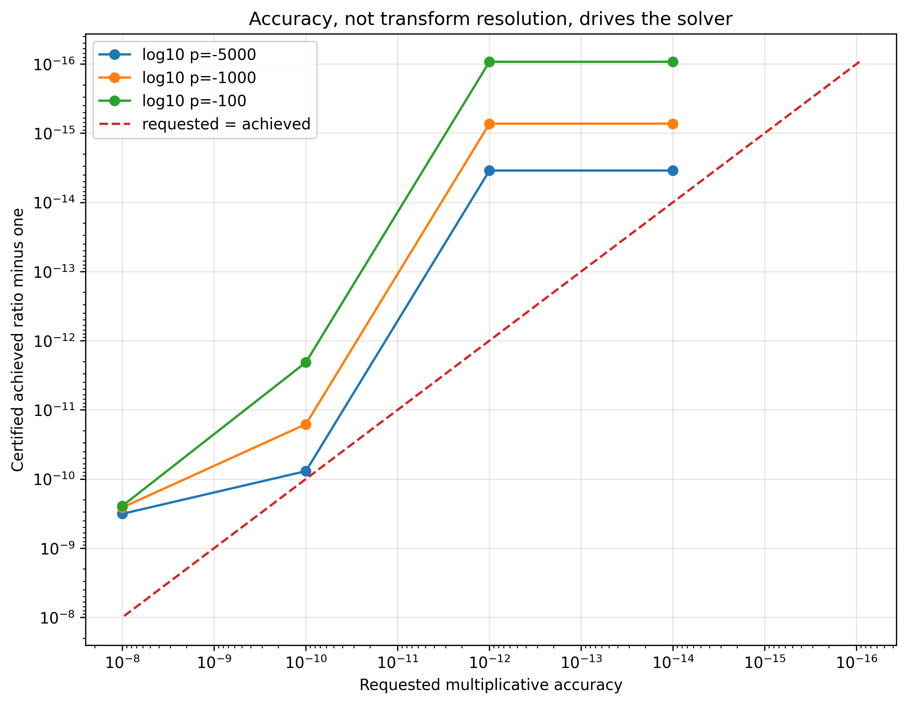

*Accuracy-driven refinement. Each point lies at or below the requested-equals-achieved line because an interval result is labeled certified only after the requested multiplicative probability accuracy has been proved.*


### Acceptance arithmetic and serialization are directed

The acceptance condition must be evaluated as carefully as the probability interval.

An early implementation converted a tiny log-width $w$ using $$10^w-1$$ under the default multiprecision context. At approximately $10^{-15}$ relative scales this could round the ratio to zero.

The enclosure itself remained valid, but that conversion was not acceptable for a certification decision. The final-edition implementation encloses $$\boxed{
\operatorname{expm1}(\log(10)\,w)
}$$ with directed interval arithmetic before deciding whether the requested accuracy has been met. Acceptance compares the upper endpoint of that ratio with the lower endpoint of the requested exact tolerance, so a rounded point estimate cannot promote an unresolved boundary case to success.

Authoritative output strings must preserve the same outer enclosure. The final edition converts each exact binary interval endpoint to a decimal string with `Decimal` and explicit `ROUND_FLOOR` for lower endpoints or `ROUND_CEILING` for upper endpoints. Ordinary interval display formatting is not used as an authoritative serialization method: nearest-rounded decimal text can move an endpoint inward even when the internal interval arithmetic was directed. Matrix-to-tail propagation keeps these endpoint strings and applies the same directed ratio test.

This regression is retained because the correctness requirement applies not only to the tail integral but also to the logic that labels the answer certified.

### Input semantics at $p\approx10^{-16}$

At this accuracy scale, the representation of the threshold $q$ itself is measurable. In the $0.02\chi^2_{80}$ control targeted at $10^{-16}$, rounding the high-precision threshold to binary float64 shifts the exact tail by approximately $$3.83\times10^{-15}$$ decades. The hardened float64 solver evaluated at that same rounded input then differs from the exact tail of the rounded input by approximately $$5.17\times10^{-15}$$ decades.

Accordingly, claims below the float64 input-quantization scale use exact-decimal or interval inputs. The rigorous accuracy contract therefore certifies the mathematical inputs supplied to it, rather than silently identifying a rounded binary threshold with an ideal decimal threshold.

<a id="sec:final-6"></a>

## Verified matrix-to-spectrum bridge

The strongest tail result above begins from a positive spectrum. This section moves the rigor boundary one level upstream by certifying the spectrum produced from a floating-point factor matrix.

### Binary64 input semantics

Let $$A\in\mathbb R^{n\times m}$$ be supplied as an IEEE binary64 array. Each stored entry is treated as its exact dyadic rational value. The target operator is therefore the exact Gram matrix $$H=AA^T$$ defined by those binary64 values, not an unspecified nearby real matrix.

A high-precision symmetric eigensolver is used only to generate candidate quantities $$Q\in\mathbb R^{n\times n},
\qquad
D=\operatorname{diag}(d_1,\ldots,d_n),
\qquad
d_1\ge\cdots\ge d_n\ge0.$$ No correctness claim depends on trusting this eigensolver.

### Post-certified spectral enclosure theorem

<a id="claim:final-6-1"></a>

**Theorem 6.1** (Candidate eigensystem post-certification). *Let $$B=QDQ^T.$$ Suppose directed-rounding computation proves $$\|Q^TQ-I\|_2\le\eta<1$$ and $$\|H-B\|_2\le\rho.$$ Then the ordered eigenvalues of the positive semidefinite matrix $H$ satisfy $$\boxed{
\max\{0,(1-\eta)d_i-\rho\}
\le
\lambda_i(H)
\le
(1+\eta)d_i+\rho
}$$ for every $i$.*


*Proof.* Set $$S=Q^TQ.$$ The first hypothesis gives the Loewner inequalities $$(1-\eta)I\preceq S\preceq(1+\eta)I.$$ The eigenvalues of $$B=(QD^{1/2})(QD^{1/2})^T$$ are the same as those of $$D^{1/2}SD^{1/2}.$$ Hence $$(1-\eta)D
\preceq
D^{1/2}SD^{1/2}
\preceq
(1+\eta)D,$$ and eigenvalue monotonicity yields $$(1-\eta)d_i
\le
\lambda_i(B)
\le
(1+\eta)d_i.$$ Weyl’s perturbation inequality and $\|H-B\|_2\le\rho$ then give $$|\lambda_i(H)-\lambda_i(B)|\le\rho.$$ Combining the two bounds and using $H\succeq0$ proves the claim. ◻


The implementation does not attempt to evaluate the spectral norms above exactly. Instead it encloses every entry of $$Q^TQ-I
\quad\text{and}\quad
H-QDQ^T$$ with directed-rounding interval arithmetic and uses $$\|M\|_2\le\|M\|_F.$$ Thus the reported $\eta$ and $\rho$ are conservative certified upper bounds.

### Monotone propagation into the tail

Let the spectral theorem produce $$\ell_i\le\lambda_i(H)\le u_i.$$ Using the same independent standard normals in all three sums gives $$\sum_i\ell_iZ_i^2
\le
\sum_i\lambda_iZ_i^2
\le
\sum_i u_iZ_i^2
\qquad\text{almost surely}.$$ Therefore $$\boxed{
P\!\left(\sum_i\ell_iZ_i^2\ge q\right)
\le
P(Q\ge q)
\le
P\!\left(\sum_i u_iZ_i^2\ge q\right).
}$$ The lower endpoint is evaluated by the rigorous positive-tail backend on the lower spectrum, and the upper endpoint by the same backend on the upper spectrum. The current controller requires more than two strictly positive coefficients in each endpoint spectrum and a threshold above both endpoint means. An endpoint spectrum outside these implemented conditions is rejected or reported as unsupported; monotone coupling itself remains valid. The final matrix-defined probability interval is accepted only when its multiplicative ratio satisfies the requested accuracy.

### Random dense spectral-containment audit

Three unrelated dense binary64 factors were tested against independently recomputed high-precision eigenvalues of their exact dyadic Gram matrices:

|  factor size | all eigenvalues contained | maximum relative width | time (s) |
|-------------:|--------------------------:|-----------------------:|---------:|
| $12\times18$ |                       yes |   $3.36\times10^{-58}$ |     0.09 |
| $20\times30$ |                       yes |   $1.44\times10^{-57}$ |     0.35 |
| $28\times36$ |                       yes |   $1.20\times10^{-56}$ |     0.80 |

No reference eigenvalue fell outside its certified interval.

### End-to-end matrix-defined tail near $10^{-16}$

A dense $64\times64$ exact-binary factor was constructed from a normalized Hadamard basis with four singular-value groups. The stored binary64 entries are exact dyadic rationals. The spectral postcheck returned $$\eta\le1.65\times10^{-49},
\qquad
\rho\le9.18\times10^{-50}.$$ For example, the leading coefficient was enclosed by $$0.999\ldots97435
<
\lambda_1
<
1.000\ldots02565,$$ with a width of order $10^{-49}$.

At $$q=131.33201485100517,$$ the tail lies near $10^{-16}$. Starting from the factor matrix itself:

| requested relative accuracy | achieved ratio minus one | certified |
|----------------------------:|-------------------------:|----------:|
|                  $10^{-10}$ |     $2.60\times10^{-12}$ |       yes |
|                  $10^{-12}$ |     $4.09\times10^{-15}$ |       yes |

For the $10^{-12}$ request, the final enclosure was approximately $$\log_{10}p
\in
[-15.99999999999996625,
 -15.99999999999996447].$$

This closes the basic numerical chain $$\boxed{
\text{binary64 factor}
\longrightarrow
\text{certified spectrum}
\longrightarrow
\text{certified deep-tail interval}
}$$ at moderate matrix dimension.

### Scalability boundary

The theorem is general, but the present verifier forms a full candidate basis $Q$ and postchecks dense matrices. It therefore closes the correctness boundary before it closes the large-scale memory boundary. For very large streamed factors, the next step is to replace the full-basis postcheck with a verified range-core/residual certificate and interval exact-completion step, so that the matrix-to-spectrum guarantee inherits the same memory-bounded architecture developed elsewhere in this manuscript.

<a id="sec:final-7"></a>

## Weighted-feature specialization

A prominent application constructs the general factor from weighted, covariate-residualized features. A rare-variant kernel statistic is one concrete instance, but the same formulas apply to any feature matrix with nonnegative column weights.

Let $$G\in\mathbb R^{n\times m},
\qquad
W=\operatorname{diag}(w_1,\ldots,w_m),
\quad w_j\ge 0,$$ and let $Q_X\in\mathbb R^{n\times p}$ have orthonormal columns spanning the null-model covariates. Define $$M_X=I-Q_XQ_X^\top,
\qquad
A=M_XGW^{1/2},
\qquad
K=AA^\top.$$

The central implementation difficulty is not the algebraic size of the model but the mismatch between the total factor size $n\times m$ and the working memory of an accelerator. The key point of this manuscript is that several decompositions act on different mathematical coordinates and therefore compose: $$\boxed{
\text{storage blocks}
\circ
\text{structural phases}
\circ
\text{Krylov/range compression}
\circ
\text{spectral tail packets}.
}$$

Storage blocking controls residence. Structural phases encode LD windows, annotations, frequency bands, or other coordinate groups. Krylov methods compress the operator to the rank actually requested. Spectral packets compress the final generalized-$\chi^2$ transform.

<a id="fig:residualization-geometry"></a>

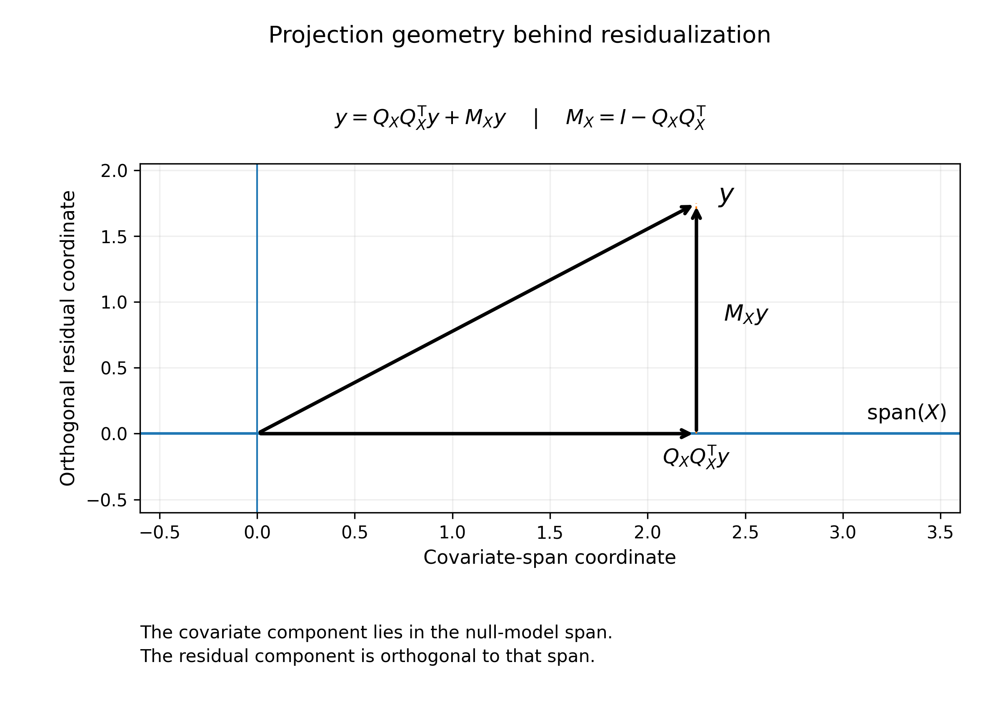

*Residualization is the geometric starting point. Every sample-space vector splits into a component in the covariate span and an orthogonal residual component. The factor $A=M_XGW^{1/2}$ therefore acts only on variation remaining after the null-model covariates have been removed.*


<a id="sec:final-8"></a>

## Variant-block Gram decomposition

Partition the variant indices into disjoint blocks $$\{1,\ldots,m\}
=
J_1\sqcup\cdots\sqcup J_B.$$ Let $$G_b=G_{[:,J_b]},
\qquad
W_b=W_{J_b,J_b},
\qquad
A_b=M_XG_bW_b^{1/2}.$$ Then $$A=[A_1\ \cdots\ A_B].$$

<a id="claim:final-8-1"></a>

**Theorem 8.1** (Additive block Gram identity). *$$\boxed{
K
=
AA^\top
=
\sum_{b=1}^B A_bA_b^\top
=
M_X
\left(
\sum_{b=1}^B G_bW_bG_b^\top
\right)
M_X.
}$$*


*Proof.* Horizontal concatenation gives $$[A_1\ \cdots\ A_B]
\begin{bmatrix}
A_1^\top\\
\vdots\\
A_B^\top
\end{bmatrix}
=
\sum_bA_bA_b^\top.$$ The final form follows from $A_b=M_XG_bW_b^{1/2}$ and $M_X^\top=M_X=M_X^2$. ◻


<a id="claim:final-8-2"></a>

*Remark 8.2*. The theorem is exact for every partition. Block boundaries are execution parameters, not statistical parameters.


<a id="fig:block-kernel-assembly"></a>

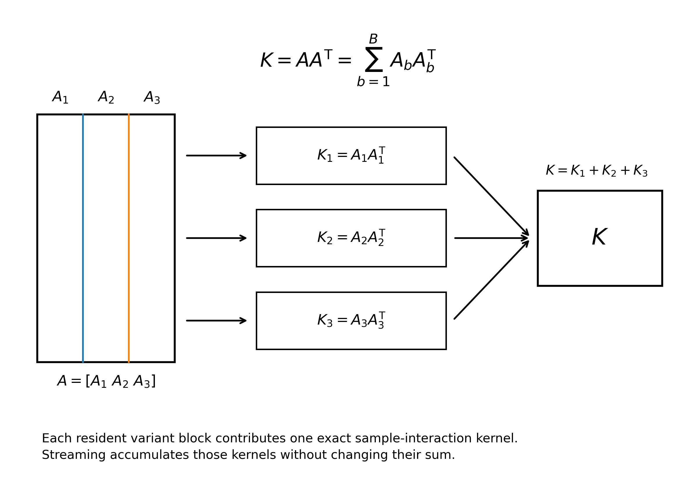

*Exact block-kernel assembly. The sample interaction kernel carried by each resident variant block is $K_b=A_bA_b^\top$, and the full kernel is their exact sum. Streaming changes the order of evaluation, not the operator.*


<a id="sec:final-9"></a>

## Exact streamed kernel actions

<a id="claim:final-9-1"></a>

**Theorem 9.1** (One-pass sample-space streaming action). *For every block vector $V\in\mathbb R^{n\times s}$, $$\boxed{
KV
=
M_X
\sum_{b=1}^B
G_bW_bG_b^\top
M_XV.
}$$*


*Proof.* Apply the additive block Gram identity to $KV$, then associate each block product as $$G_bW_b(G_b^\top M_XV).$$ ◻


<a id="claim:final-9-2"></a>

**Algorithm 9.2** (Streamed $KV$).

1.  Compute $U=M_XV$.

2.  Set $Y=0$.

3.  For each resident block $b$, compute $$T_b=G_b^\top U,
    \qquad
    Y\leftarrow Y+G_b(W_bT_b).$$

4.  Return $M_XY$.


<a id="claim:final-9-3"></a>

**Corollary 9.3** (Working memory independent of total variant count). *If at most $c$ variants are resident and the block-vector width is $s$, then the algebraic working set is $$\boxed{
O(nc+ns+cs+np),
}$$ independent of total variant count $m$.*


## Streamed factor actions and Golub–Kahan

Let $V\in\mathbb R^{m\times s}$ be partitioned conformally: $$V=
\begin{bmatrix}
V_1\\
\vdots\\
V_B
\end{bmatrix}.$$

<a id="claim:final-10-1"></a>

**Theorem 10.1** (Streamed $AV$). *$$\boxed{
AV
=
M_X
\sum_{b=1}^B
G_bW_b^{1/2}V_b.
}$$*


<a id="claim:final-10-2"></a>

**Theorem 10.2** (Streamed $A^\top U$). *For $U\in\mathbb R^{n\times s}$, $$\boxed{
(A^\top U)_b
=
W_b^{1/2}G_b^\top M_XU.
}$$*


*Proof.* Both identities follow by substituting $A=M_XGW^{1/2}$ and partitioning the variant coordinate. ◻


<a id="claim:final-10-3"></a>

**Corollary 10.3** (Streaming Golub–Kahan equivalence). *Any exact-arithmetic algorithm whose access to $A$ occurs only through $AV$ and $A^\top U$ produces the same iterates when those products are implemented by the preceding streamed formulas.*


This applies directly to block Golub–Kahan bidiagonalization, matrix-free singular-value iteration, range finding, and restarted variants. The factor need not be resident.

<a id="sec:final-11"></a>

## Two-pass dual action

The variant-space normal operator is $$H=A^\top A.$$

<a id="claim:final-11-1"></a>

**Theorem 11.1** (Two-pass streamed dual action). *For every $V\in\mathbb R^{m\times s}$, $$\boxed{
HV=A^\top(AV).
}$$ The product is evaluated exactly by a streamed pass forming $Y=AV\in\mathbb R^{n\times s}$, followed by a second streamed pass emitting the blocks $$(HV)_b=W_b^{1/2}G_b^\top M_XY.$$*


This form is particularly natural for variant-space polyphase Krylov iterations because the right-coordinate blocks can be produced and consumed sequentially.

<a id="sec:final-12"></a>

## Two-dimensional sample/variant tiling

A variant block may itself exceed device memory. Let $$H_b=G_bW_b^{1/2}$$ and partition samples into row tiles $I_1,\ldots,I_R$.

<a id="claim:final-12-1"></a>

**Theorem 12.1** (Two-pass residualized tile construction). *Define $$R_b=Q_X^\top H_b.$$ Then $$\boxed{
R_b
=
\sum_r
Q_{X,I_r}^\top H_{b,I_r},
}$$ and after $R_b$ is known, $$\boxed{
A_{b,I_r}
=
H_{b,I_r}-Q_{X,I_r}R_b.
}$$ Consequently, $$\boxed{
K_{I_r,I_s}
=
\sum_b
A_{b,I_r}A_{b,I_s}^\top.
}$$*


*Proof.* The first identity is the row-partitioned matrix product $Q_X^\top H_b$. The second is the definition $M_XH_b=H_b-Q_XQ_X^\top H_b$. The last identity is the corresponding sample-tile expansion of $AA^\top$. ◻


With sample tile height $t$ and resident variant width $c$, the dominant working storage, including a resident covariate tile, is $$O(tc+pc+tp+t^2).$$ This count excludes the backing input store, completed output blocks, allocator overhead, and library workspaces.

<a id="sec:final-13"></a>

## Partition refinement and permutation invariance

<a id="claim:final-13-1"></a>

**Theorem 13.1** (Partition-refinement invariance). *Let $\mathcal J$ be any partition of the variants and let $\mathcal J'$ refine $\mathcal J$. Then $$\boxed{
\sum_{J\in\mathcal J}A_JA_J^\top
=
\sum_{J'\in\mathcal J'}A_{J'}A_{J'}^\top
=
AA^\top.
}$$ The analogous streamed operator action is also invariant.*


*Proof.* Each coarse block is a disjoint union of refined blocks. Apply the additive Gram theorem within each coarse block and sum. ◻


<a id="claim:final-13-2"></a>

**Corollary 13.2** (Adaptive memory splitting). *A runtime may recursively subdivide any block that exceeds available device memory without changing the exact operator.*


<a id="claim:final-13-3"></a>

**Proposition 13.3** (Variant permutation invariance). *If the columns of $G$ and the diagonal entries of $W$ are permuted by the same permutation, $K$ and every streamed sample-space action are unchanged.*


<a id="fig:partition-invariance"></a>

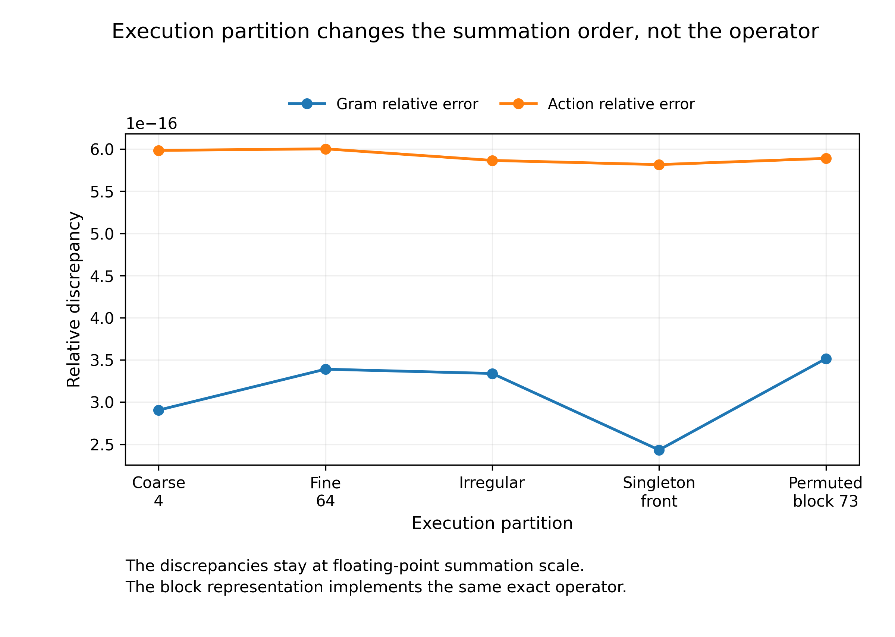

*Partition-refinement invariance in floating-point tests. Coarse, fine, irregular, singleton-heavy, and permuted blockings reproduce the explicitly formed Gram matrix and its action to machine precision. The block schedule is therefore an execution choice rather than a change in the statistical model.*


<a id="sec:final-14"></a>

## Polyphase structure

Let $P_h$ project onto variant phase $h$, and again set $$H=A^\top A.$$ Define the exact phase graph by $$g\to h
\quad\Longleftrightarrow\quad
P_hHP_g\ne0.$$

<a id="claim:final-14-1"></a>

**Theorem 14.1** (Polyphase light cone). *If the graph distance from phase $g$ to phase $h$ exceeds $k$, then $$\boxed{
P_hH^kP_g=0.
}$$*


*Proof.* Insert the projector resolution $\sum_jP_j=I$ between successive factors of $H$. Every nonzero term in $P_hH^kP_g$ corresponds to a phase path of length $k$. If no such path exists, every term vanishes. ◻


<a id="fig:polyphase-lightcone"></a>

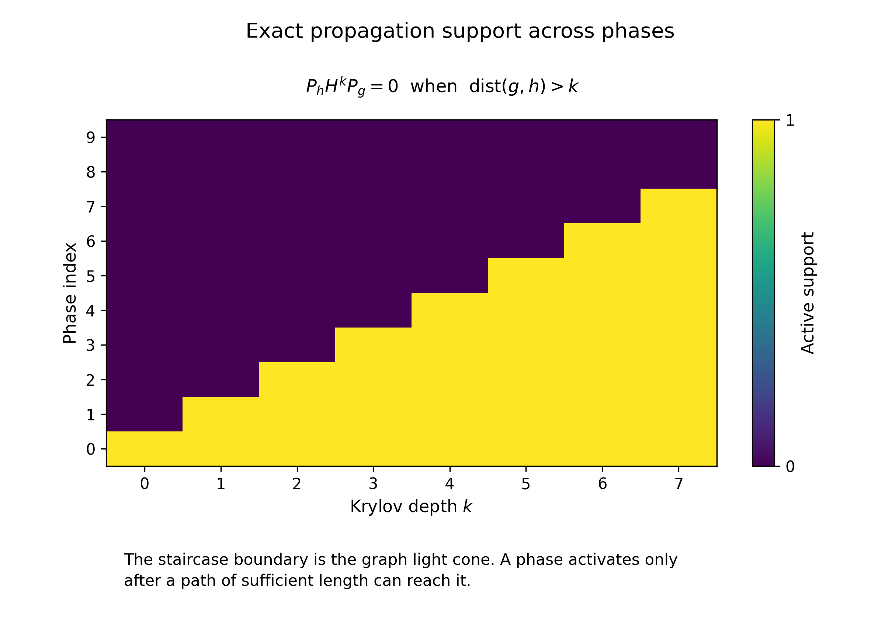

*The exact polyphase light cone. The support of the Krylov iterate expands by at most one graph edge per operator application. Phases outside graph distance $k$ remain identically inactive at depth $k$ and need not be loaded.*


<a id="claim:final-14-2"></a>

**Theorem 14.2** (Streaming-polyphase composition). *At Krylov depth $k$, an exact matrix-free iteration may omit every phase outside the exact light cone. Within each active phase, arbitrary storage refinement may be used.*


*Proof.* The light-cone theorem removes inactive phase contributions exactly. Partition-refinement invariance shows that the remaining active phase operators may be streamed through any exact subpartition. ◻


This is the key composition law: $$\boxed{
\text{mathematical locality}
\longrightarrow
\text{active phases}
\longrightarrow
\text{active storage blocks}.
}$$

<a id="sec:approx-lightcone"></a>

## Certified approximate light cones

The exact light-cone theorem requires literal zero phase couplings. Real LD, annotation, and feature graphs are often only approximately sparse. This section replaces exact support by a computable phasewise envelope.

Let the phase projectors be $P_1,\ldots,P_q$, and let $X$ be a vector or block vector. Define its phase-norm profile $$\rho(X)_g=\lVert P_gX\rVert_F,$$ and define the nonnegative phase-transfer matrix $$\mathcal B_{hg}=\lVert P_hHP_g\rVert_2.$$ The matrix $\mathcal B$ records the strength of every one-step phase transfer without assuming that weak couplings vanish.

<a id="thm:weighted-transfer"></a>

**Theorem 15.1** (Weighted phase-transfer envelope). *For every block vector $X$, $$\boxed{
\rho(HX)\leq \mathcal B\rho(X)
}$$ componentwise. Consequently, for every integer $k\geq0$, $$\boxed{
\rho(H^kX)\leq \mathcal B^k\rho(X).
}$$*


*Proof.* Using $\sum_gP_g=I$ and submultiplicativity, $$\begin{aligned}
\lVert P_hHX\rVert_F
&=\left\lVert\sum_gP_hHP_gX\right\rVert_F\\
&\leq\sum_g\lVert P_hHP_g\rVert_2\lVert P_gX\rVert_F\\
&=(\mathcal B\rho(X))_h.
\end{aligned}$$ Iteration gives the power bound. ◻


Now choose a symmetric set of retained phase blocks and define $$H_0=\sum_{(h,g)\in\mathcal E_0}P_hHP_g.$$ Let $$(\mathcal B_0)_{hg}=
\begin{cases}
\mathcal B_{hg},&(h,g)\in\mathcal E_0,\\
0,&\text{otherwise},
\end{cases}
\qquad
\mathcal R=\mathcal B-\mathcal B_0.$$ Symmetric pair retention preserves self-adjointness of $H_0$, although the following error theorem does not require positive semidefiniteness of $H_0$.

<a id="thm:thresholded-power"></a>

**Theorem 15.2** (Thresholded-power certificate). *For every $k\geq1$, $$\boxed{
\rho\bigl((H^k-H_0^k)X\bigr)
\leq
(\mathcal B^k-\mathcal B_0^k)\rho(X).
}$$ In particular, $$\boxed{
\lVert(H^k-H_0^k)X\rVert_F
\leq
\left\lVert(\mathcal B^k-\mathcal B_0^k)\rho(X)\right\rVert_2.
}$$*


*Proof.* Write $E=H-H_0$. The telescoping identity gives $$H^k-H_0^k
=
\sum_{j=0}^{k-1}H^{k-1-j}EH_0^j.$$ The block-norm matrix of $E$ is $\mathcal R$. Applying Theorem [15.1](#thm:weighted-transfer) successively to each term gives $$\rho\bigl((H^k-H_0^k)X\bigr)
\leq
\sum_{j=0}^{k-1}
\mathcal B^{k-1-j}\mathcal R\mathcal B_0^j\rho(X).$$ The matrix telescoping identity $$\mathcal B^k-\mathcal B_0^k
=
\sum_{j=0}^{k-1}
\mathcal B^{k-1-j}(\mathcal B-\mathcal B_0)\mathcal B_0^j$$ yields the phasewise formula. Orthogonality of the phase projectors gives $$\lVert Y\rVert_F^2=\sum_h\lVert P_hY\rVert_F^2,$$ which proves the global bound. ◻


<a id="cor:approx-lightcone"></a>

**Corollary 15.3** (Certified approximate light cone). *Assume $X$ is supported on a set of start phases $S$. If phase $h$ is not reachable from $S$ by a retained path of length at most $k$, then $$P_hH_0^kX=0$$ and $$\boxed{
\lVert P_hH^kX\rVert_F
\leq
\bigl[(\mathcal B^k-\mathcal B_0^k)\rho(X)\bigr]_h.
}$$ Thus an exact zero outside the retained light cone is replaced by a certified nonzero leakage budget.*


<a id="claim:final-15-4"></a>

**Corollary 15.4** (Scalar threshold law). *For any induced matrix norm, let $$M=\max\{\lVert\mathcal B\rVert,\lVert\mathcal B_0\rVert\}.$$ Then $$\boxed{
\lVert\mathcal B^k-\mathcal B_0^k\rVert
\leq
kM^{k-1}\lVert\mathcal R\rVert.
}$$ Hence weak discarded coupling produces a first-order error bound proportional to the discarded transfer norm and to the Krylov depth.*


<a id="thm:polynomial-certificate"></a>

**Theorem 15.5** (Krylov-polynomial certificate). *Let $$p(t)=\sum_{j=0}^d a_jt^j.$$ Then $$\boxed{
\rho\bigl((p(H)-p(H_0))X\bigr)
\leq
\sum_{j=1}^d
|a_j|(\mathcal B^j-\mathcal B_0^j)\rho(X).
}$$*


*Proof.* Apply Theorem [15.2](#thm:thresholded-power) to every nonconstant power and use the triangle inequality. The constant terms cancel. ◻


The polynomial theorem covers arbitrary vectors in a finite Krylov space, including polynomial filters and restarted combinations, rather than only the monomial $H^kX$.

<a id="claim:final-15-6"></a>

**Corollary 15.6** (Certified phase pruning). *If a thresholded phase graph is chosen so that $$\left\lVert
(\mathcal B^k-\mathcal B_0^k)\rho(X)
\right\rVert_2
\leq\tau,$$ then replacing $H^kX$ by $H_0^kX$ incurs Frobenius error at most $\tau$. The same statement holds for a Krylov polynomial with the certificate in Theorem [15.5](#thm:polynomial-certificate).*


This turns graph thresholding into an error-budget decision. A phase or interface is not discarded because it merely appears small; it is discarded only when the weighted sum of all paths using discarded couplings remains inside the requested tolerance.

<a id="fig:approx-lightcone-certificate"></a>

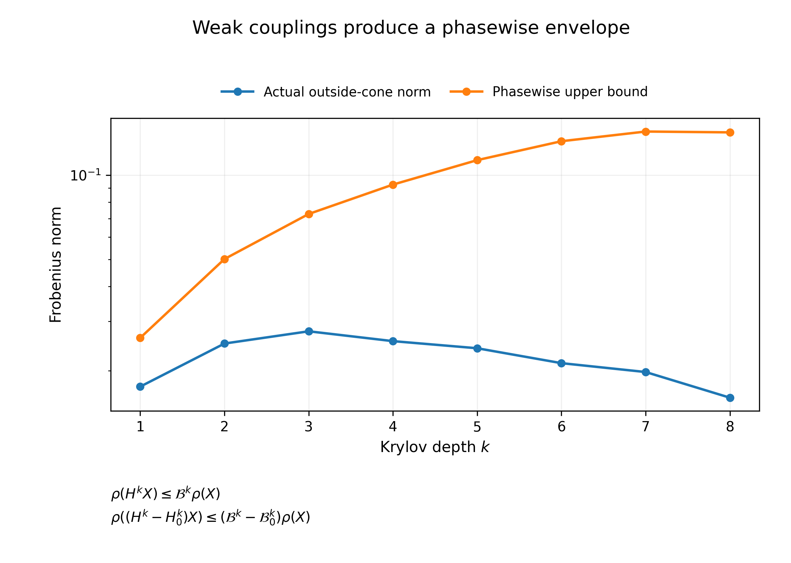

*Weak long-range phase couplings replace the exact zero outside the retained light cone by a nonzero but certified envelope. In this PSD test, the phasewise transfer-matrix certificate bounds the observed leakage at every depth from one through eight.*


<a id="fig:threshold-tradeoff"></a>

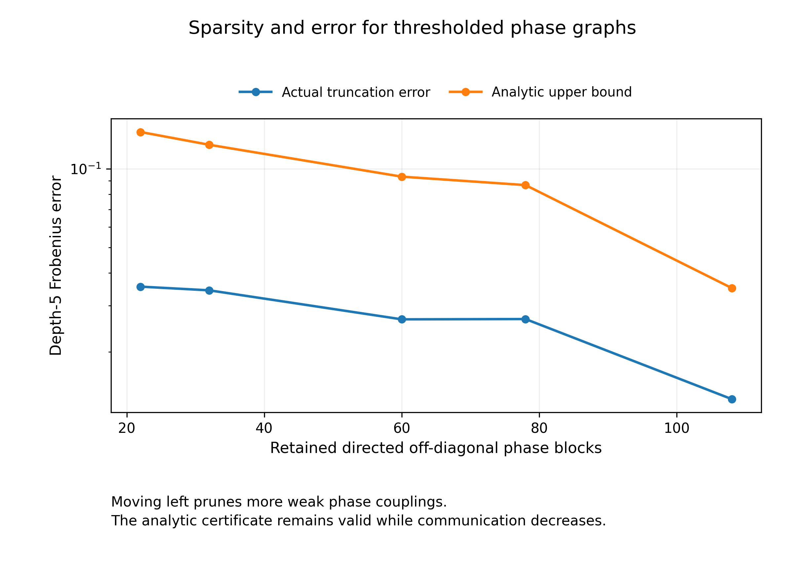

*Certified phase-graph sparsification at Krylov depth five. Retaining fewer off-diagonal phase blocks reduces communication and operator work while the transfer-matrix bound remains above the measured truncation error. The bound is intentionally conservative because it ignores cancellation and singular-vector alignment.*


### Numerical audit

The validation operator has twelve phases of width four. A block-bidiagonal factor generates a positive-definite local operator $H_0$, and weak symmetric long-range blocks are then added to obtain $H$. Both normalized operators remain positive definite. A three-column start block is supported in phase zero.

For depths one through eight:

- every observed phase norm lay below $\mathcal B^k\rho(X)$;

- every observed thresholding error lay below $(\mathcal B^k-\mathcal B_0^k)\rho(X)$;

- the largest total observed-error-to-certificate ratio was approximately $0.669$.

A separate hard-threshold sweep retained between $22$ and $132$ directed off-diagonal phase blocks. Every measured depth-five error remained below its certificate; the largest observed-error-to-certificate ratio was approximately $0.376$. Finally, a degree-four signed polynomial in $H$ satisfied the phasewise polynomial certificate in all twelve phases, with maximum ratio approximately $0.068$.

These computations validate the implementation and illustrate sharpness. The universal result is supplied by the preceding proofs, not by the finite test.

<a id="sec:budget-scheduler"></a>

## Certified budget-optimal phase scheduling

The preceding section answers a validation question: given a retained phase operator $H_0$, how large can the Krylov error be? This section turns that certificate into a selection rule. The goal is to remove as much phase communication as possible while remaining inside a prescribed error budget.

Let $\mathcal E$ denote the set of undirected off-diagonal phase pairs. Because $H$ is self-adjoint, $\mathcal B$ is symmetric. For a phase pair $e=\{h,g\}$ define the nonnegative matrix $\Delta_e$ by $$(\Delta_e)_{hg}=\mathcal B_{hg},\qquad
(\Delta_e)_{gh}=\mathcal B_{gh},$$ with every other entry zero. If $\mathcal O\subseteq\mathcal E$ is the set of omitted pairs, define $$\mathcal B_{\mathcal O}
=\mathcal B-\sum_{e\in\mathcal O}\Delta_e.$$ The diagonal is always retained.

For depth $k\ge1$ and starting phase profile $\rho_0=\rho(X)$, define the *edge risk vector* $$\boxed{
q_e^{(k)}
=
\sum_{j=0}^{k-1}
\mathcal B^{k-1-j}\Delta_e\mathcal B^j\rho_0
}$$ and its scalar risk $$\boxed{
\beta_e^{(k)}=\lVert q_e^{(k)}\rVert_2.
}$$ Unlike the raw block norm $\mathcal B_{hg}$, this quantity depends on the start profile and on Krylov depth.

<a id="thm:edge-additive-majorant"></a>

**Theorem 16.1** (Edge-additive leakage majorant). *For every omitted set $\mathcal O\subseteq\mathcal E$, $$\boxed{
0\le
(\mathcal B^k-\mathcal B_{\mathcal O}^k)\rho_0
\le
\sum_{e\in\mathcal O}q_e^{(k)}
}$$ componentwise. Consequently, $$\boxed{
\lVert(H^k-H_{\mathcal O}^k)X\rVert_F
\le
\left\lVert
(\mathcal B^k-\mathcal B_{\mathcal O}^k)\rho_0
\right\rVert_2
\le
\sum_{e\in\mathcal O}\beta_e^{(k)}.
}$$*


*Proof.* The first inequality in the second display is Theorem [15.2](#thm:thresholded-power). For the transfer matrices, the exact noncommutative telescoping identity is $$\mathcal B^k-\mathcal B_{\mathcal O}^k
=
\sum_{j=0}^{k-1}
\mathcal B^{k-1-j}
(\mathcal B-\mathcal B_{\mathcal O})
\mathcal B_{\mathcal O}^j.$$ All matrices and $\rho_0$ are nonnegative, and $0\le\mathcal B_{\mathcal O}\le\mathcal B$ entrywise. Hence $$\mathcal B_{\mathcal O}^j\rho_0
\le
\mathcal B^j\rho_0.$$ Substituting $$\mathcal B-\mathcal B_{\mathcal O}
=
\sum_{e\in\mathcal O}\Delta_e$$ and distributing the sum gives the componentwise majorant. The final scalar bound follows from the Euclidean triangle inequality. ◻


<a id="claim:final-16-2"></a>

**Corollary 16.2** (Polynomial edge-risk certificate). *Let $$p(t)=\sum_{d=0}^{D}a_dt^d.$$ Define $$q_e^{(p)}
=
\sum_{d=1}^{D}|a_d|q_e^{(d)},
\qquad
\beta_e^{(p)}=\lVert q_e^{(p)}\rVert_2.$$ Then $$\boxed{
\lVert(p(H)-p(H_{\mathcal O}))X\rVert_F
\le
\sum_{e\in\mathcal O}\beta_e^{(p)}.
}$$ Thus the same scheduling machinery applies to finite Krylov combinations and polynomial filters.*


<a id="claim:final-16-3"></a>

**Corollary 16.3** (Query-invisible phase pair). *If $$\Delta_e\mathcal B^j\rho_0=0
\qquad
\text{for every }0\le j<k,$$ then $$\beta_e^{(k)}=0.$$ Therefore a phase pair can be large in operator norm and still have zero risk for a particular finite-depth query. A magnitude-only threshold cannot represent this distinction.*


### Equal-cost optimality

Suppose each retained phase pair has the same communication or scheduling cost. Under the additive certificate, a set of omitted pairs is feasible if $$\sum_{e\in\mathcal O}\beta_e^{(k)}\le\tau.$$ Sort the risks as $$\beta_{(1)}\le\beta_{(2)}\le\cdots\le\beta_{(N)}.$$

<a id="thm:unit-cost-optimal"></a>

**Theorem 16.4** (Cardinality-optimal certified pruning). *Let $r$ be the largest integer satisfying $$\sum_{i=1}^{r}\beta_{(i)}\le\tau.$$ Then omitting the $r$ least-risk phase pairs is feasible, and no feasible omitted set can contain more than $r$ pairs under the scalar additive certificate.*


*Proof.* Among all subsets of cardinality $r+1$, the smallest possible sum of risks is $$\sum_{i=1}^{r+1}\beta_{(i)}.$$ By maximality of $r$, that sum exceeds $\tau$. Hence no set of $r+1$ omitted pairs is feasible. The prefix of length $r$ is feasible by construction. ◻


This is a genuine optimization theorem, not a heuristic threshold rule. The optimization target is the additive certificate itself; the tighter exact transfer envelope can leave additional slack.

### Exact-envelope refinement

After the cardinality-optimal additive schedule is found, recomputing $$\left\lVert
(\mathcal B^k-\mathcal B_{\mathcal O}^k)\rho_0
\right\rVert_2$$ may reveal unused budget. Additional pairs can then be removed one at a time, provided the exact transfer envelope remains below $\tau$.

<a id="claim:final-16-5"></a>

**Proposition 16.5** (Certified refinement). *Any sequence of additional omissions accepted only when $$\left\lVert
(\mathcal B^k-\mathcal B_{\mathcal O}^k)\rho_0
\right\rVert_2\le\tau$$ remains a valid $\tau$-certificate for the original operator error.*


The refinement rule used in the reference implementation chooses, among all currently feasible next omissions, the pair that produces the smallest increase in the exact transfer envelope. It is certified but is not claimed globally optimal.

### Unequal communication costs

Let $c_e\ge0$ denote the communication or storage cost saved by omitting pair $e$. Under the scalar additive certificate, the exact discrete selection problem is $$\boxed{
\max_{x_e\in\{0,1\}}
\sum_e c_ex_e
\quad\text{subject to}\quad
\sum_e\beta_e^{(k)}x_e\le\tau.
}$$ This is the $0$–$1$ knapsack problem. Hence unequal-cost scheduling is combinatorial in general. The implementation supplies a safe cost-to-risk greedy heuristic; its output remains certified because it never exceeds the additive risk budget. A fractional-knapsack relaxation supplies an upper bound on the maximum possible saved cost.

<a id="fig:budget-scheduler-comparison"></a>

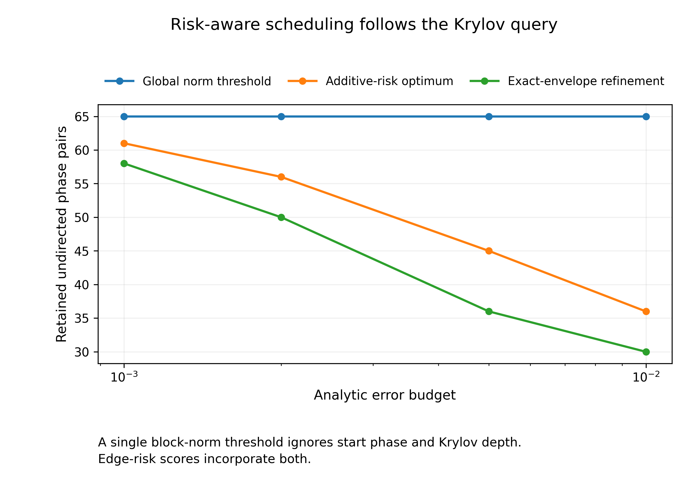

*Depth-five pruning under a fixed certified error budget. A global block-norm threshold is nearly unable to prune this example without crossing the requested tolerance, whereas query-aware edge risks remove many phase pairs. The exact-envelope refinement safely uses slack left by the additive majorant.*


<a id="fig:edge-risk-vs-norm"></a>

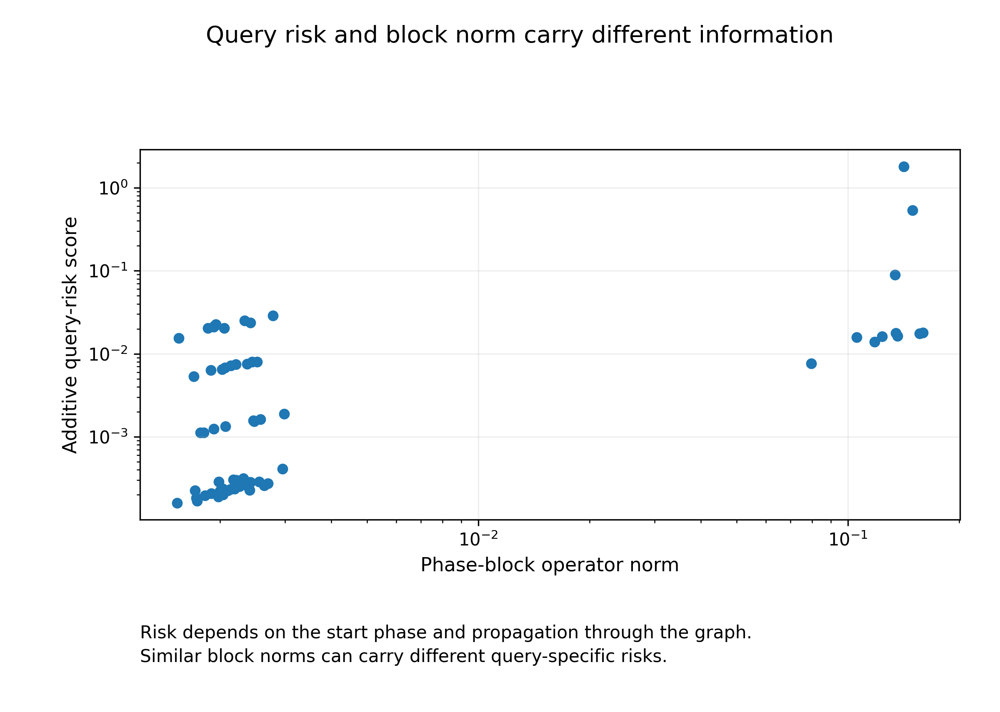

*Raw phase-block magnitude and finite-depth query risk are different quantities. The edge score $\beta_{hg}^{(5)}$ incorporates the start profile and every depth-five transfer path through the phase graph; the block norm $\mathcal B_{hg}$ does not.*


### Numerical audit

The twelve-phase operator from Section [15](#sec:approx-lightcone) was reused at Krylov depth five. There are $66$ undirected off-diagonal phase pairs. For error budgets $10^{-3}$, $2\times10^{-3}$, $5\times10^{-3}$, and $10^{-2}$, the additive-optimal scheduler retained respectively $61$, $56$, $45$, and $36$ pairs. Exact-envelope refinement reduced those counts further to $58$, $50$, $36$, and $30$ pairs while remaining inside budget.

In the same test, the best single global threshold on the raw block norm retained $65$ pairs at every one of those four budgets. The difference is structural: the global threshold is blind to start phase and Krylov depth.

A separate six-phase problem contains $15$ candidate phase pairs, so all $2^{15}=32768$ subsets can be enumerated. At four distinct budgets, the sorted-risk scheduler matched the brute-force cardinality optimum under the additive certificate in every case. The exact-envelope greedy refinement also matched the brute-force exact-envelope optimum in cardinality for all four budgets in this finite audit. The latter agreement is empirical and is not promoted to a theorem.

For an unequal-cost eight-phase test, costs were proportional to the bytes in symmetric dense phase blocks. The cost-to-risk heuristic saved $5408$ bytes out of a $9472$-byte communication proxy while using additive risk $0.011632$ under budget $0.012$. The fractional relaxation upper bound was $5647.8$ bytes, placing the greedy schedule within about $4.25\%$ of that relaxation bound on this instance.

<a id="sec:double-buffer"></a>

## Asynchronous double-buffer execution model

The mathematical streaming identities do not require transfers and GEMMs to be serial. Consider $B$ storage blocks. Let $t_b$ be the transfer time for block $b$ and $c_b$ its device compute time.

<a id="claim:final-17-1"></a>

**Proposition 17.1** (Ideal two-buffer pipeline). *In a model with perfect asynchronous overlap, transfer of block $b+1$ may run while block $b$ is being processed. The serial one-buffer time is $$T_{\rm serial}=\sum_{b=1}^{B}(t_b+c_b),$$ whereas the two-buffer pipeline time is $$\boxed{
T_{\rm pipe}
=
t_1
+
\sum_{b=1}^{B-1}\max\{c_b,t_{b+1}\}
+
c_B.
}$$ For uniform times $t_b=t$ and $c_b=c$, $$T_{\rm pipe}=t+c+(B-1)\max\{t,c\}.$$*


*Proof.* After the first block arrives, every interior pipeline stage finishes only when both the current computation and the next transfer have completed. Their joint stage duration is therefore the maximum of those two times. The initial transfer and final compute cannot be hidden and form the two boundary terms. ◻


If one resident block uses $M_{\rm block}$ bytes and all other fixed working state uses $M_{\rm fixed}$ bytes, the corresponding memory models are $$M_{\rm single}=M_{\rm fixed}+M_{\rm block},
\qquad
\boxed{
M_{\rm double}=M_{\rm fixed}+2M_{\rm block}.
}$$ The proposition is a scheduling model, not a hardware timing claim. PCIe or NVLink contention, kernel launch overhead, synchronization, page pinning, and library workspaces can reduce realized overlap.

<a id="fig:double-buffer-model"></a>

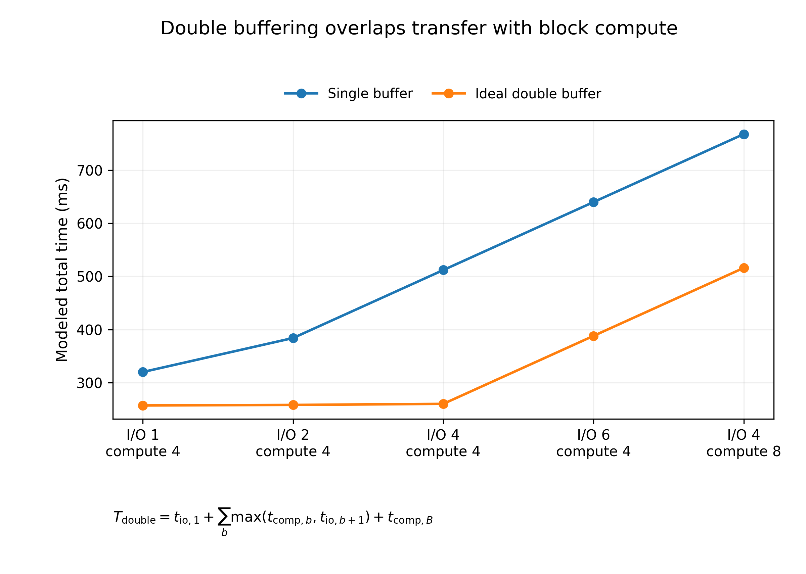

*Idealized effect of asynchronous double buffering over $64$ streamed blocks. The largest modeled speedup occurs when transfer and computation times are comparable, because neither resource is left idle for most of the pipeline. The additional cost is one extra resident block buffer.*


<a id="sec:final-18"></a>

## Phase-local rank

Let $R$ be a newly generated Krylov residual and $$R_h=P_hR.$$

<a id="claim:final-18-1"></a>

**Theorem 18.1** (Minimal exact phase width). *Let $$r_h=\operatorname{rank}(R_h).$$ Every phase-supported basis spanning $\operatorname{range}(R_h)$ has at least $r_h$ vectors, and a rank-revealing QR or compact SVD attains exactly $r_h$.*


This justifies nonuniform Krylov block widths by phase.

<a id="fig:phase-local-rank"></a>

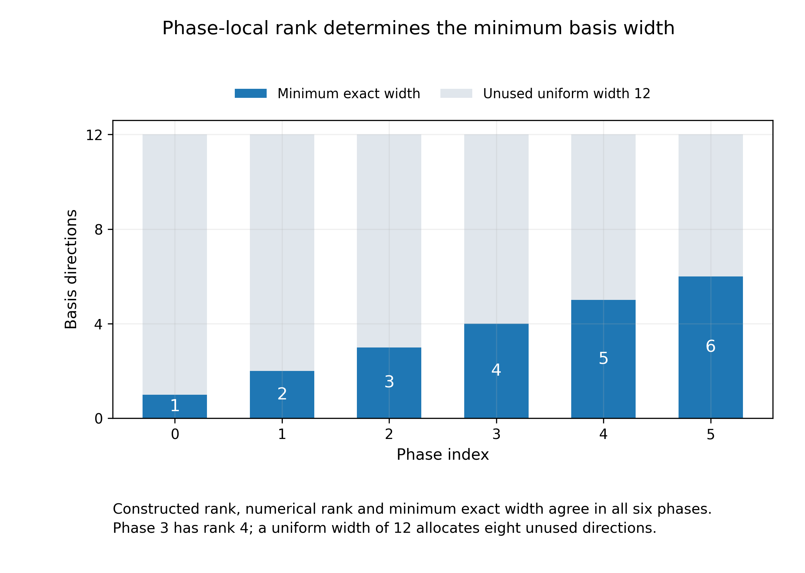

*Phase-local rank as a dimension law. The archived six-phase audit records constructed rank, numerical rank and minimum exact width of one through six, with the remaining capacity wasted by a uniform width of twelve. A rank-revealing factorization keeps the new directions. This summary replaces an annotated singular-value curve whose raw plotted vector was not archived.*


<a id="sec:final-19"></a>

## Low-rank interface messages

If an inter-phase coupling has exact factorization $$P_hHP_g
=
U_{hg}V_{hg}^\top$$ of rank $r_{hg}$, then $$\boxed{
P_hHP_gx
=
U_{hg}(V_{hg}^\top x).
}$$

This representation reduces storage and communication. It does not automatically reduce wall-clock time unless the factors are applied through batched or fused kernels; a Python reference implementation can lose to dense BLAS despite lower arithmetic and storage.

<a id="sec:final-20"></a>

## Exact QR-core updates

Suppose $$A=QR,
\qquad
Q^\top Q=I,$$ and append a new block $U$. Set $$C=Q^\top U,
\qquad
F=U-QC,
\qquad
F=Q_\perp R_\perp,
\qquad Q_\perp^\top Q_\perp=I,
\qquad Q^\top Q_\perp=0.$$ Here the columns of $Q_\perp$ form an orthonormal basis of the nonzero residual range; zero residual directions are omitted.

<a id="claim:final-20-1"></a>

**Theorem 20.1** (Exact QR-core update). *$$[A,U]
=
[Q,Q_\perp]
\begin{pmatrix}
R&C\\
0&R_\perp
\end{pmatrix}.$$ Therefore the nonzero eigenvalues of $[A,U][A,U]^\top$ are exactly the eigenvalues of the small core Gram.*


*Proof.* The first block product is $QR=A$; the second is $QC+Q_\perp R_\perp=QC+F=U$. The stated orthogonality conditions make $[Q,Q_\perp]$ an isometry on the compact core space. Left multiplication by this isometry preserves all nonzero singular values of the core, and squaring them yields the Gram eigenvalues. ◻


This is useful for overlapping genomic windows and small incremental variant updates.

<a id="fig:qr-core-equivalence"></a>

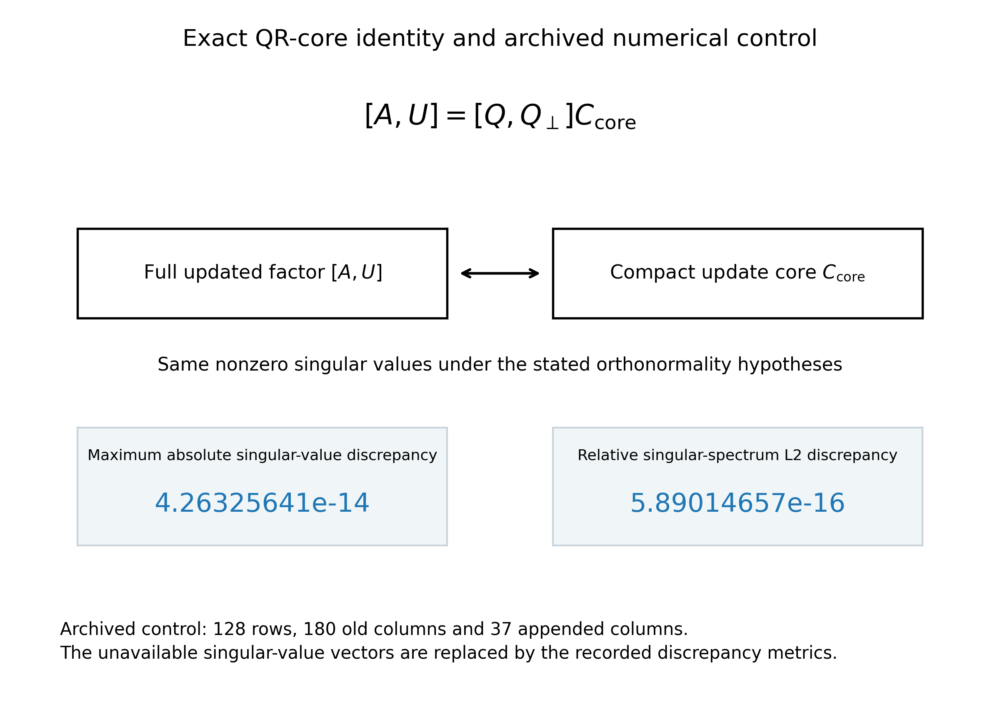

*QR-core spectral equivalence under the stated orthonormality hypotheses. The diagram pairs the exact factor identity with the archived maximum absolute and relative $\ell_2$ singular-spectrum discrepancies for a 128-row factor with 180 old and 37 appended columns. Recorded audit metrics replace the overlaid singular-value curves, whose raw vectors were not archived.*


<a id="sec:final-21"></a>

## Range-core spectral compression

Suppose an orthonormal basis $Q_r$ captures the factor range: $$\operatorname{range}(A)\subseteq\operatorname{range}(Q_r).$$ Then $$A=Q_rB,
\qquad
B=Q_r^\top A.$$

<a id="claim:final-21-1"></a>

**Theorem 21.1** (Exact range core). *The nonzero eigenvalues of $$K=AA^\top$$ are exactly the eigenvalues of $$BB^\top.$$*


Thus the computational pipeline can terminate its data-streaming stage after the range is captured: $$\boxed{
\text{streamed data}
\to
\text{small spectral core}
\to
\text{tail evaluation}.
}$$

<a id="sec:final-22"></a>

## From phase pruning to certified quadratic-form tails

The previous sections certify the effect of phase pruning on Krylov propagation. A SKAT-like test ultimately depends on the spectrum itself, so one more bridge is needed: $$\text{phase pruning}
\longrightarrow
\text{operator error}
\longrightarrow
\text{spectral error}
\longrightarrow
\text{tail-probability error}.$$

### Block-norm operator domination

Let $$E=H-H_0$$ be the self-adjoint error introduced by phase pruning. Using the same orthogonal phase projectors $P_h$, define $$\mathcal C_{hg}
=
\|P_hEP_g\|_2.$$

<a id="claim:final-22-1"></a>

**Theorem 22.1** (Block-norm operator certificate). *$$\boxed{
\|E\|_2
\le
\|\mathcal C\|_2.
}$$*


*Proof.* For any vector $x$, let $$r_g=\|P_gx\|_2.$$ Then $$\|P_hEx\|_2
\le
\sum_g
\|P_hEP_g\|_2\,\|P_gx\|_2
=
(\mathcal C r)_h.$$ Orthogonality of the phase decomposition gives $$\|Ex\|_2^2
=
\sum_h\|P_hEx\|_2^2
\le
\|\mathcal C r\|_2^2
\le
\|\mathcal C\|_2^2\|r\|_2^2
=
\|\mathcal C\|_2^2\|x\|_2^2.$$ Taking the supremum over unit vectors proves the claim. ◻


The important computational point is that $\mathcal C$ is only a phase-by-phase matrix. The same block norms already used to construct the polyphase scheduler therefore provide a global operator certificate.

### Weyl enclosure of the quadratic-form coefficients

Assume $$H\succeq0$$ and let the eigenvalues of $H$ and $H_0$, in decreasing order, be $$\lambda_i
\qquad\text{and}\qquad
\mu_i.$$ If $$\|H-H_0\|_2\le\varepsilon,$$ Weyl’s inequality gives $$|\lambda_i-\mu_i|\le\varepsilon.$$

<a id="claim:final-22-2"></a>

**Corollary 22.2** (Positive spectral interval). *For every $i$, $$\boxed{
\ell_i
=
\max\{0,\mu_i-\varepsilon\}
\le
\lambda_i
\le
u_i
=
\max\{0,\mu_i+\varepsilon\}.
}$$*


This remains valid even if symmetric phase pruning makes $H_0$ slightly indefinite.

### Certified generalized-$\chi^2$ tail bracket

For independent standard normal variables $Z_i$, define $$Q_-=\sum_i\ell_iZ_i^2,
\qquad
Q=\sum_i\lambda_iZ_i^2,
\qquad
Q_+=\sum_i u_iZ_i^2.$$

<a id="claim:final-22-3"></a>

**Theorem 22.3** (Stochastic tail enclosure). *For every threshold $q$, $$\boxed{
\Pr(Q_-\ge q)
\le
\Pr(Q\ge q)
\le
\Pr(Q_+\ge q).
}$$*


*Proof.* Couple all three quadratic forms using the same normal variables $Z_i$. Since $$0\le\ell_i\le\lambda_i\le u_i$$ for every $i$, $$Q_-\le Q\le Q_+$$ almost surely. Taking upper-tail events yields the result. ◻


The two endpoint probabilities can be evaluated by the same K-COS machinery used for the unpruned spectrum. Its numerical error certificate is separate from the spectral enclosure above.

### A dual-budget pruning rule

The local Krylov certificate from the previous section and the global spectral certificate answer different questions. The former asks whether omitted couplings matter to the current Krylov query; the latter asks whether they can move the spectrum enough to matter to the final test.

A production schedule should therefore enforce $$\boxed{
\sum_{e\in\mathcal O}\beta_e^{(k)}
\le
\tau_K,
\qquad
\|\mathcal C_{\mathcal O}\|_2
\le
\tau_\lambda.
}$$

The implementation uses a conservative greedy rule: phase pairs are considered in increasing query-risk order, and a pair is omitted only when adding it preserves both inequalities. The rule is certified but is not claimed to be globally optimal under the two simultaneous constraints.

<a id="fig:dual-budget-tail"></a>

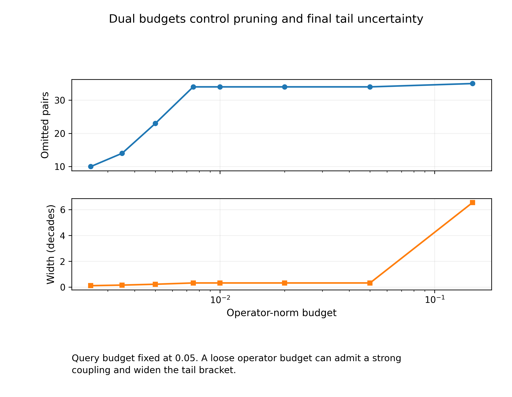

*Dual-budget phase pruning. The query-local budget controls Krylov propagation while the operator budget controls final spectral and tail uncertainty. A loose operator budget can admit a strong coupling and widen the tail interval by several decades even when the Krylov-local budget still passes.*


In the deterministic ten-phase experiment, fixing the query budget at $0.05$ and the operator budget at $0.005$ removed $23$ of $45$ undirected phase pairs. At a true probability of $10^{-8}$, the certified tail interval was $$10^{-8.11143}
\le
p
\le
10^{-7.89036},$$ a width of about $0.221$ decades. With an operator budget of $0.0075$, $34$ pairs were removed and the interval widened to about $0.320$ decades. By contrast, allowing a strong coupling to be removed under a very loose operator budget produced a multi-decade interval.

### Certify after prune

There is a second route that does not use the pruned operator as the final spectral approximation. Let $U$ be any orthonormal sample-space basis, possibly generated cheaply from a pruned or approximate Krylov process, and define $$B=U^\top A,
\qquad
F=(I-UU^\top)A,
\qquad
\delta=\|F\|_2.$$

<a id="claim:final-22-4"></a>

**Theorem 22.4** (Range-core singular-value certificate). *Let the singular values of $A$ be $\sigma_i(A)$, and let $\widetilde\sigma_i(B)$ denote the singular values of $B$ padded by zeros to the ambient spectral dimension. Then $$\boxed{
\left|
\sigma_i(A)
-
\widetilde\sigma_i(B)
\right|
\le
\delta.
}$$ Consequently, $$\max\{0,\widetilde\sigma_i(B)-\delta\}^2
\le
\lambda_i(AA^\top)
\le
\left(
\widetilde\sigma_i(B)+\delta
\right)^2.$$*


*Proof.* Because $U$ has orthonormal columns, $$A=UB+F$$ and $$\|A-UB\|_2=\|F\|_2=\delta.$$ The nonzero singular values of $UB$ are exactly those of $B$. The standard singular-value perturbation inequality gives the stated bound. Squaring the nonnegative endpoints gives the eigenvalue interval. ◻


This provides a useful architecture: $$\boxed{
\text{pruned operator for basis discovery}
\to
\text{one exact streamed factor check}
\to
\text{certified spectral core}.
}$$

### A retained negative result

The preceding theorem is exact, but a correct interval need not be useful.

In a full-rank $50\times50$ stress test, a pruned Krylov basis of dimensions $12$ through $48$ left range residuals between roughly $0.87$ and $0.99$ times the leading singular value. The corresponding $10^{-8}$ tail intervals were therefore vacuous or thousands of decades wide. At dimension $50$, the range residual fell to approximately $1.2\times10^{-15}$, and the tail interval collapsed to the exact value.

<a id="fig:range-core-cert"></a>

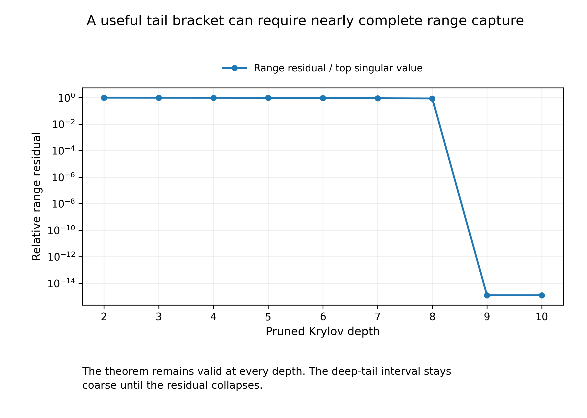

*Certify-after-prune range residual. The range-core theorem is valid at every depth, but a deep-tail full-spectrum guarantee can remain useless until the range residual is genuinely small. This negative result is retained as a stopping-rule lesson rather than hidden as an implementation failure.*


The practical lesson is that range-core certification is a stopping test, not a promise that a severely incomplete basis automatically yields a useful full-spectrum tail bound.

<a id="sec:final-23"></a>

## Trace-aware residual certification and exact completion

The spectral bridge in the preceding section used an operator-norm residual as if every unresolved coefficient could move independently by the same amount. That is rigorous but unnecessarily pessimistic once a nontrivial range basis has already been captured. The residual has considerably more structure.

Let $U\in\mathbb R^{n\times r}$ have orthonormal columns and define $$B=U^\top A,
\qquad
F=(I-UU^\top)A.$$ Then $$A=UB+F,
\qquad
U^\top F=0.$$

<a id="claim:final-23-1"></a>

**Theorem 23.1** (Exact core–residual decomposition). *$$\boxed{
A^\top A
=
B^\top B+F^\top F.
}$$ In particular the unresolved spectral term $$R=F^\top F$$ is positive semidefinite.*


*Proof.* Expand $(UB+F)^\top(UB+F)$. The two cross terms vanish because $U^\top F=0$, while $U^\top U=I$. ◻


This changes the certification problem. Instead of an arbitrary Hermitian error, the missing term is a positive residual with measurable spectral moments. Define $$t=\operatorname{tr}R,
\qquad
v=\operatorname{tr}(R^2),
\qquad
\rho=\|R\|_2.$$ Then $$\boxed{
 t=\|F\|_F^2,
 \qquad
 v=\|FF^\top\|_F^2,
 \qquad
 \rho=\|F\|_2^2.
}$$ The first quantity is the exact missing mean of the Gaussian quadratic form; the second records how concentrated the residual spectrum is; the third is its largest possible coefficient.

### A trace–Frobenius–cap MGF envelope

Set $$C=B^\top B,
\qquad
H=C+R,
\qquad
c=\lambda_{\max}(C).$$ For $0<2\theta(c+\rho)<1$, put $$\alpha=(1-2\theta c)^{-1}.$$

<a id="claim:final-23-2"></a>

**Theorem 23.2** (Trace–Frobenius–cap log-MGF certificate). *For the Gaussian quadratic form with coefficient matrix $H$, $$K_H(\theta)
=-\frac12\log\det(I-2\theta H)$$ satisfies $$\boxed{
K_H(\theta)
\le
K_C(\theta)
+
\theta\alpha t
+
\frac{\theta^2\alpha^2v}
     {1-2\theta\alpha\rho}.
}$$*


*Proof.* Factor the determinant through the known core: $$I-2\theta(C+R)
=
(I-2\theta C)^{1/2}
(I-2\theta T)
(I-2\theta C)^{1/2},$$ where $$T=(I-2\theta C)^{-1/2}
R
(I-2\theta C)^{-1/2}.$$ Since $$\|(I-2\theta C)^{-1/2}\|_2^2=\alpha,$$ we have $$\operatorname{tr}T\le\alpha t,
\qquad
\operatorname{tr}(T^2)\le\alpha^2v,
\qquad
\|T\|_2\le\alpha\rho.$$ For every eigenvalue $x$ of $T$, $$-\frac12\log(1-2\theta x)
\le
\theta x
+
\frac{\theta^2x^2}
     {1-2\theta\alpha\rho}.$$ The scalar inequality follows from the power series of $-\log(1-u)$ and a geometric bound on all terms of degree at least two. Summing over the eigenvalues of $T$ proves the result. ◻


<a id="claim:final-23-3"></a>

**Corollary 23.3** (Trace-aware Chernoff upper tail). *For $Q=Z^\top HZ$ with $Z\sim N(0,I)$, $$\boxed{
\Pr(Q\ge q)
\le
\inf_{0<2\theta(c+\rho)<1}
\exp\{\widehat K_H(\theta)-\theta q\},
}$$ where $\widehat K_H$ is the preceding MGF upper bound.*


A complementary lower endpoint is immediate from $$H=C+R\succeq C.$$ Using the same normal vector, $$Z^\top HZ\ge Z^\top CZ$$ almost surely, and therefore $$\boxed{
\Pr(Z^\top CZ\ge q)
\le
\Pr(Z^\top HZ\ge q).
}$$ The lower endpoint can be evaluated by K-COS on the captured core spectrum, while the upper endpoint is obtained from the optimized trace-aware Chernoff bound.

### Finite stress test

The previous coefficient-wise Weyl interval was intentionally conservative. On the same full-rank, 50-dimensional stress test used in the preceding section, its $10^{-8}$ tail interval remained thousands of decades wide until essentially the complete range had been captured. Preserving the exact residual trace and higher residual moments changes that behavior substantially.

| Krylov depth | basis dimension | v0.7 Weyl width | v0.8 moment width |
|-------------:|----------------:|----------------:|------------------:|
|            4 |              24 |          90,097 |             11.86 |
|            5 |              30 |          16,511 |              9.76 |
|            6 |              36 |           3,747 |              7.67 |
|            7 |              42 |           2,275 |              5.70 |
|            8 |              48 |           1,165 |              3.39 |

Tail-bracket width at a true probability of $10^{-8}$. The trace/moment certificate is still conservative, but it is orders of magnitude narrower than coefficient-wise Weyl inflation before full range capture.

<a id="fig:trace-moment-vs-weyl"></a>

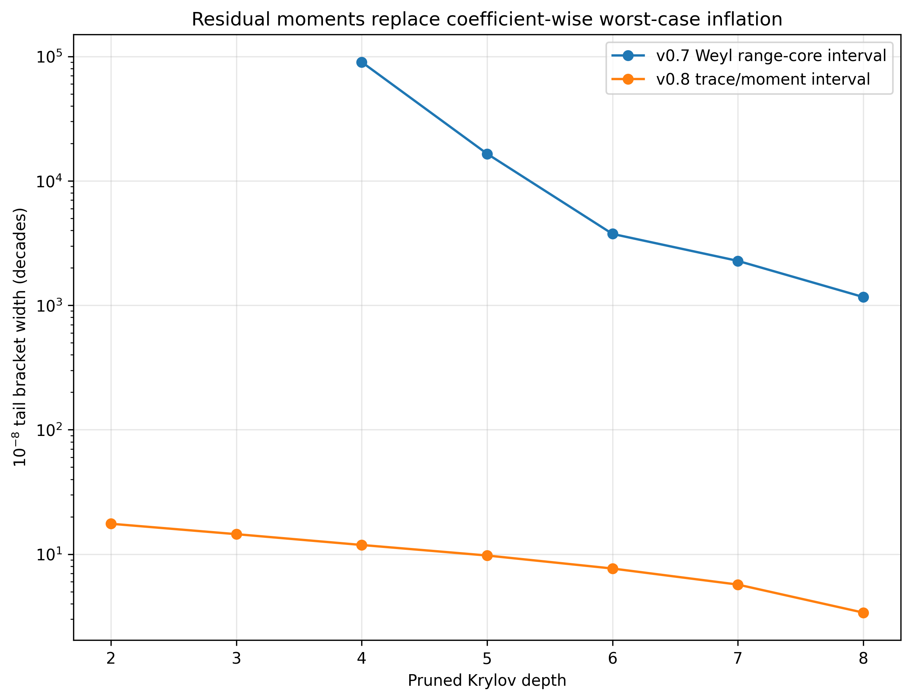

*Incomplete-range tail certification before exact completion. The trace/moment bound preserves the amount and concentration of unresolved spectral mass instead of shifting every coefficient by one worst-case radius.*


A separate random implementation audit used 120 random factor/range pairs and four admissible positive tilts per pair, for 480 MGF comparisons. Both the trace/cap and trace–Frobenius–cap envelopes dominated the exact log MGF in every tested case. The trace–Frobenius–cap form was at least as tight as the trace/cap form in approximately 83.5% of those comparisons. This finite sweep audits the implementation; the theorem above supplies the universal argument.

### Residual rank from moments

The same invariants determine when it is better to stop approximating the missing spectrum and complete it exactly. Let $$s=\operatorname{rank}F=\operatorname{rank}R.$$ If the nonzero eigenvalues of $R$ are $r_1,\ldots,r_s$, then $$t=\sum_i r_i,
\qquad
v=\sum_i r_i^2,
\qquad
r_i\le\rho.$$

<a id="claim:final-23-4"></a>

**Theorem 23.4** (Residual-rank bracket). *$$\boxed{
\left\lceil
\max\left\{
\frac{t}{\rho},
\frac{t^2}{v}
\right\}
\right\rceil
\le
\operatorname{rank}F
\le
n-r.
}$$ The zero-residual case is interpreted separately as rank zero.*


*Proof.* The inequality $t\le s\rho$ gives $s\ge t/\rho$. Cauchy–Schwarz gives $$t^2
=
\left(\sum_{i=1}^s r_i\right)^2
\le
s\sum_{i=1}^s r_i^2
=sv,$$ so $s\ge t^2/v$. Finally, every column of $F$ lies in $\operatorname{range}(U)^\perp$, whose dimension is $n-r$. ◻


Whenever the integer lower bound equals $n-r$, the missing rank is certified exactly without computing a residual SVD.

<a id="fig:residual-rank-completion"></a>

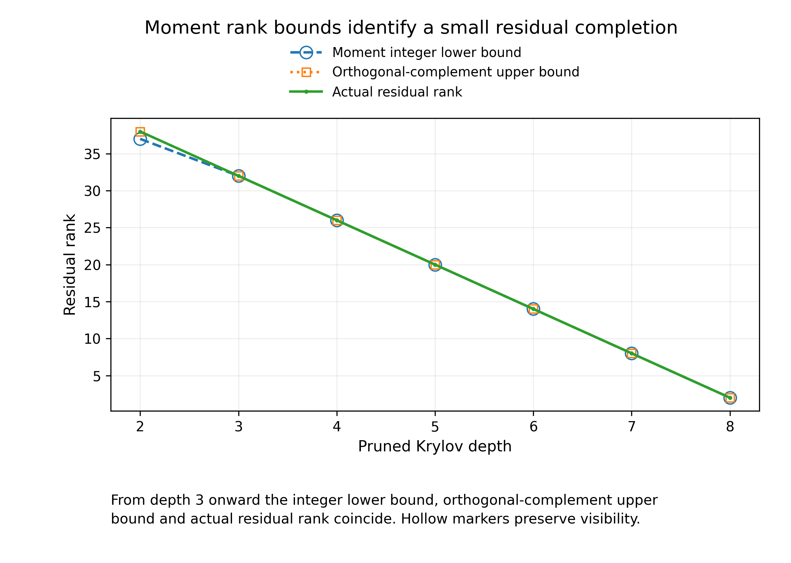

*Residual-rank certification in the full-rank stress test. From depth 3 onward the moment lower bound meets the orthogonal-complement upper bound. At depth 8 exactly two residual directions remain.*


### Exact residual completion

Suppose a compact factorization of the residual is $$F=WD,$$ where $W$ has orthonormal columns. Since $F$ lies in the orthogonal complement of $U$, $$U^\top W=0.$$

<a id="claim:final-23-5"></a>

**Theorem 23.5** (Exact residual completion). *$$\boxed{
A
=
[U\;W]
\begin{bmatrix}
B\\D
\end{bmatrix}.
}$$ Consequently, the nonzero singular values of $A$ are exactly the singular values of the stacked completion core $$\mathcal C_{\rm complete}
=
\begin{bmatrix}
B\\D
\end{bmatrix}.$$*


This identity admits a column-streamed implementation. For each residual column block, project against the residual basis accumulated so far, append only genuinely new directions through rank-revealing QR or SVD, and extend the coordinate matrices of earlier blocks with zero rows. New residual directions are orthogonal to every earlier residual block by construction, so no earlier data block must be revisited.

In the deterministic stress test, exact residual completion reproduced the full singular spectrum at relative errors between approximately $2\times10^{-16}$ and $6\times10^{-16}$ for all tested incomplete bases. The resulting $10^{-8}$ tail differed from the full-spectrum reference by less than $10^{-14}$ decades. At depth 8 the candidate range had dimension 48, the missing rank was certified as exactly two, and appending those two residual directions closed the spectrum without another approximate Krylov stage.

### Hybrid stopping rule

The resulting production logic is not “approximate forever.” It is a certified handoff between two regimes: $$\boxed{
\begin{array}{c}
\text{streamed / pruned Krylov}\\[2mm]
\downarrow\\[-1mm]
\text{residual moments }(t,v,\rho)\\[2mm]
\downarrow\\[-1mm]
\begin{cases}
\text{continue Krylov}, & \text{residual range still large},\\
\text{exact streamed residual completion}, & \text{completion rank affordable}.
\end{cases}
\end{array}
}$$

The trace-aware tail certificate remains useful as a rigorous intermediate bound and as a stopping diagnostic. Once only a small number of residual directions remain, exact completion is mathematically preferable to forcing a worst-case tail envelope to become artificially sharp.

<a id="sec:final-24"></a>

## Rare-variant kernel case study

The preceding sections establish operator identities and certified numerical bounds. This section tests the same machinery on the project’s existing rare-variant SKAT simulation layer, including explicit LD structure, covariates, per-variant standardization, rare-variant weighting, and the phenotype-space score statistic.

### Simulation provenance and implementation correction

Two established genotype generators were used.

The first is a latent-Gaussian block-LD generator. Within a genomic block, alleles are obtained by thresholding correlated Gaussian latent variables at variant-specific minor-allele frequencies.

The second is a copy-LD generator in which haplotype states persist along a block with high probability and are occasionally redrawn. During the v0.9 audit, a reproducibility defect was found in an earlier simulator implementation: the genotype matrix was allocated with `np.empty` and then updated using `+=`. Because the initial contents of `np.empty` are unspecified, those old copy-LD benchmark values are not reproducible evidence. The v0.9 generator uses an explicitly zero-initialized matrix before haplotype accumulation. All copy-LD results reported below use the corrected implementation.

### Tested LD regimes

Four deterministic scenarios were evaluated.

| scenario            |  $n$ |  $m$ | rank | median adjacent $r^2$ | effective rank |
|:--------------------|-----:|-----:|-----:|----------------------:|---------------:|
| latent LD, moderate |  600 | 3000 |  596 |                0.0069 |          441.9 |
| latent LD, strong   |  600 | 3000 |  596 |                0.1140 |          240.3 |
| copy LD, strong     |  600 | 3000 |  596 |                0.8298 |          200.1 |
| copy LD, large      | 1000 | 5000 |  996 |                0.8179 |          353.0 |

Realistic rare-variant simulation scenarios. Adjacent $r^2$ is computed within the simulated LD blocks after variant standardization.

The corresponding spectra therefore span a substantial range of concentration: stronger LD reduces effective rank even when the nominal quadratic-form rank remains close to the sample residual dimension.

<a id="fig:realistic-ld-rank"></a>

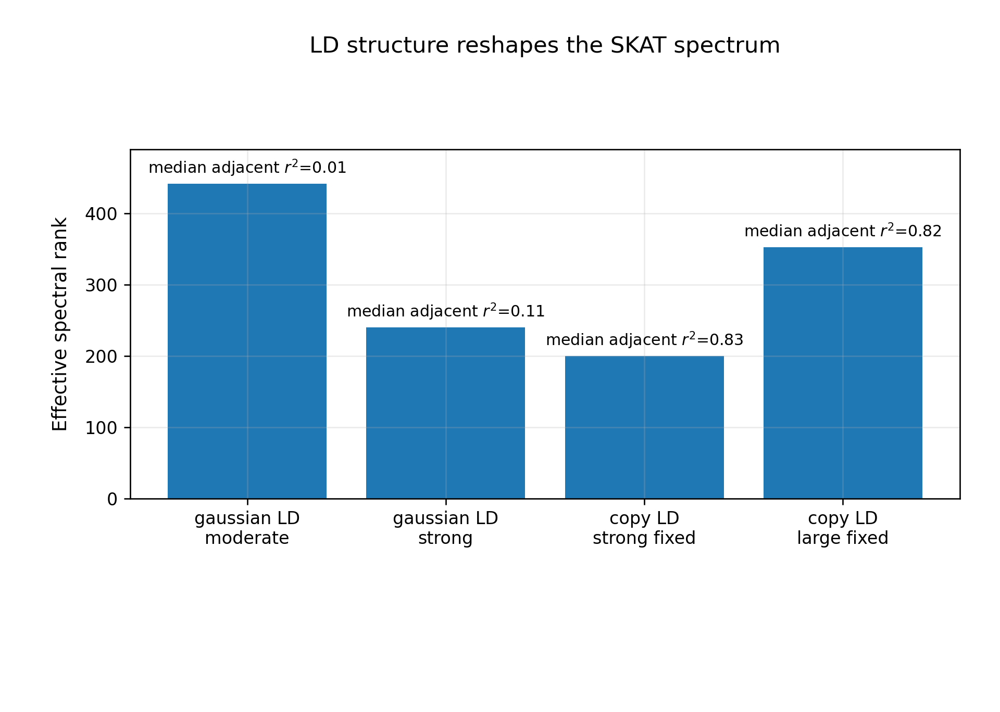

*LD structure changes the effective spectral rank. The corrected copy-LD models create much stronger local dependence than the latent-Gaussian moderate-LD case, while all remain within the same streamed SKAT pipeline.*


### Streaming directly from raw genotype blocks

The raw genotype matrix was streamed in resident variant blocks of widths 31, 127, and 509. Within each block the implementation performs

$$G_b
\to
G_b-\bar G_b
\to
\text{variance scaling}
\to
M_X G_b
\to
W_b^{1/2}
\to
A_bA_b^\top,$$

without materializing the full weighted factor.

Across all four LD scenarios and all three resident block sizes, the largest relative discrepancy against the fully materialized kernel was

$$\boxed{6.61\times10^{-16}}.$$

<a id="fig:realistic-streaming"></a>

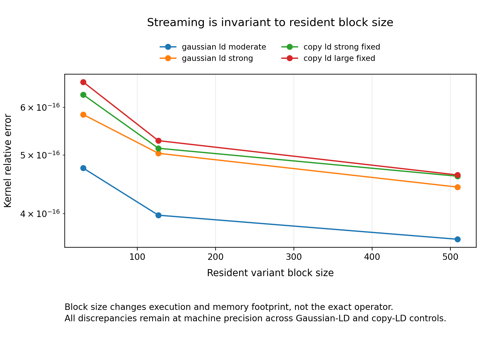

*Raw-genotype streaming reproduces the materialized SKAT kernel across multiple LD regimes and block sizes. The observed discrepancies are at floating-point summation scale.*


This test is stronger than applying the streamed identity to a precomputed factor because the centering, variance scaling, covariate projection, and rare-variant weights are all performed inside the block loop.

### Phenotype-space equivalence

For each scenario, 100 Gaussian null residual draws were evaluated in three ways:

1.  directly through the factor, $$Q=\frac12\|A^\top e\|_2^2;$$

2.  through the sample kernel, $$Q=\frac12 e^\top Ke;$$

3.  through the eigencoordinates of $K$.

The worst relative discrepancy across all draws and all scenarios was

$$\boxed{8.32\times10^{-16}}.$$

Thus the simulated phenotype path, the streamed kernel, and the generalized $\chi^2$ spectral representation agree to floating-point precision.

### Deep tails on realistic LD spectra

For every scenario, tail queries were generated at tilt fractions 0.90, 0.97, and 0.99 of the positive singularity. K-COS was compared with a higher-resolution full-spectrum tilted reference.

The large corrected copy-LD case was then pushed further, to fractions 0.995, 0.997, 0.999, and 0.9995. The deepest tested reference value was

$$\boxed{\log_{10}p=-457.973916}.$$

At that point the displayed K-COS and high-resolution full-spectrum values were identical. Across the complete realistic-LD battery, the largest absolute discrepancy was

$$\boxed{3.21\times10^{-12}\ \text{decades}}.$$

<a id="fig:realistic-deep-tail"></a>

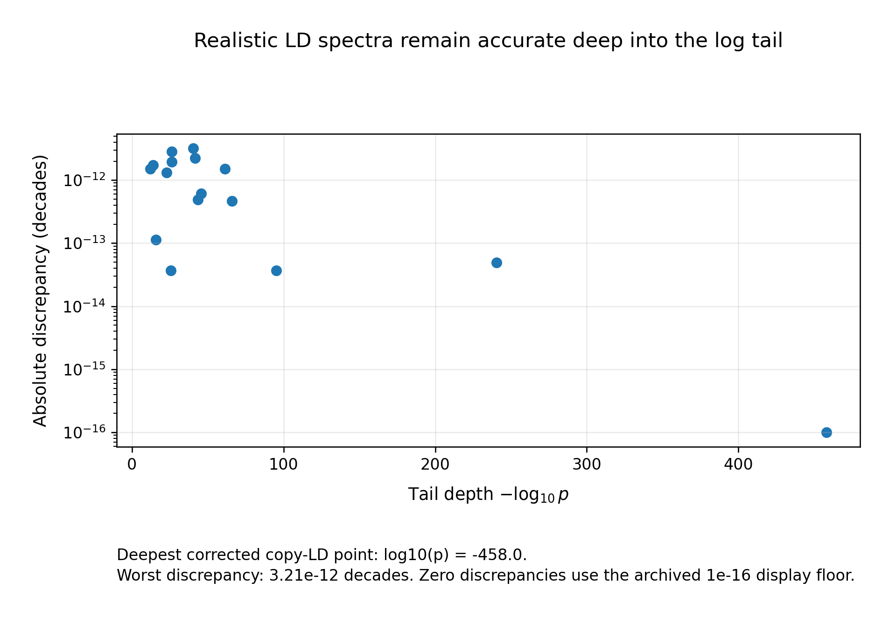

*K-COS versus the high-resolution full-spectrum tilted reference on realistic LD spectra. Accuracy remains at roughly machine-scale in log probability through the deepest corrected copy-LD query, near $10^{-458}$.*


For the $n=1000$, $m=5000$ corrected copy-LD spectrum, selected results are

| tilt fraction | $\log_{10}p$ | K-COS $K$ |          absolute error (decades) |
|--------------:|-------------:|----------:|----------------------------------:|
|        0.9950 |   -65.950669 |      2048 |              $4.69\times10^{-13}$ |
|        0.9970 |   -95.305034 |      2048 |              $3.70\times10^{-14}$ |
|        0.9990 |  -240.602047 |      8192 |              $4.94\times10^{-14}$ |
|        0.9995 |  -457.973916 |     16384 | below stored reference resolution |

### Interpretation and boundary

This simulation block does not add a new algebraic theorem. It supplies a more demanding validation layer for the theorem chain already proved. Specifically, it shows that the exact streaming identities and the K-COS deep-tail machinery remain numerically stable under substantially different rare-variant LD structures and through the complete raw-genotype preprocessing path.

The evidence remains synthetic. These generators do not reproduce every population-genetic feature of a sequencing cohort, and this block is not an external-cohort replication. It also addresses the Gaussian linear-model null; finite-sample Bernoulli or logistic calibration remains a separate statistical problem.

<a id="sec:final-25"></a>

## General production API and deep-tail arithmetic hardening

The preceding mathematics is exposed through a domain-neutral engine rather than through a SKAT-only entry point. The central positive engine accepts:

- an explicit nonnegative spectrum;

- a positive semidefinite matrix;

- a dense factor $A$;

- a replayable streamed column-factor source;

- or a covariance/quadratic-matrix pair $(\Sigma,M)$.

A signed central engine accepts a signed spectrum, a symmetric operator, or $$(\Sigma,M),\qquad M=M^\top,$$ and performs the exact central-indefinite reduction proved in Section [2](#sec:gaussian-core). A separate noncentral positive engine accepts $$(\mu,\Sigma,M),\qquad M\succeq0,$$ and performs the corresponding noncentral reduction.

### Log-domain packet error accumulation

At extreme tail depths the analytic packet certificate contains sums of the form $$\frac{2}{U}
\sum_k
|I_k|
\left(
e^{\varepsilon_k}-1
\right).$$ Direct evaluation can overflow even when the candidate is destined to be rejected by the adaptive planner. The hardened implementation instead computes $$\log\left(
\frac{2}{U}
\sum_k
|I_k|
\left(
e^{\varepsilon_k}-1
\right)
\right)$$ by log-sum-exp arithmetic, and compares this quantity with the logarithm of the requested tolerance before converting a final accepted bound back to float64.

This change does not weaken the mathematical bound; it changes only its floating-point representation.

### Reference convergence is part of verification

An independently evaluated reference is useful only if its own numerical resolution has converged. In a rank-350 deep-tail audit, an initial fixed-grid reference appeared to disagree with the adaptive answer. Increasing the reference COS grid gave discrepancies of approximately $$1.88\times10^{-2},
\quad
2.6\times10^{-3}\text{--}4.0\times10^{-3},
\quad
1.39\times10^{-4},
\quad
2.60\times10^{-8}$$ decades as the grid was refined through $$K=4096,\ 8192,\ 16384,\ 32768.$$

<a id="fig:reference-convergence"></a>

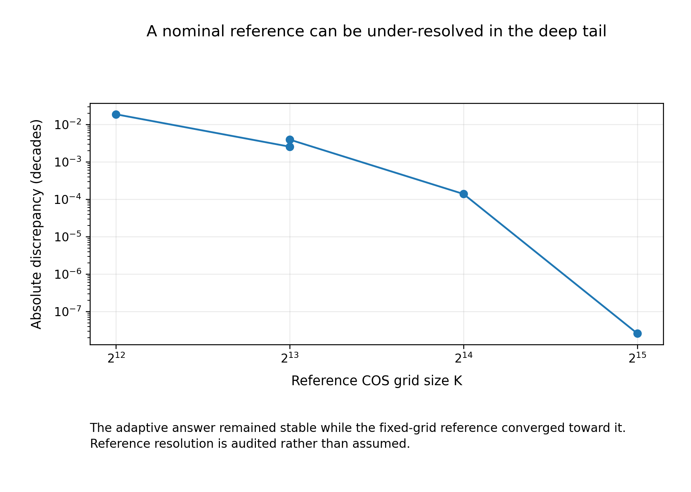

*Reference-convergence audit. The adaptive certified answer remains stable while an initially under-resolved fixed-grid reference converges toward it. A single nominally large reference grid is therefore not treated as authoritative without its own refinement check.*


The production verification rule is consequently two-sided: the adaptive solver must satisfy its own certificate, and any external or fixed-grid reference used for comparison must demonstrate numerical convergence.

<a id="sec:packets"></a>

## Centered spectral packets and K-COS

Matrix storage packets operate before eigendecomposition. The spectral packets here operate after the eigenvalues are available and compress the *transform*, not the probability law into a moment-matched surrogate. The same operator can therefore use storage blocks, structural phases, range compression, and spectral packets simultaneously.

The packet results in this section are mathematical approximation theorems. Their binary64 implementation reports a separate analytic ledger. The directed-rounding positive backend developed earlier in this manuscript currently evaluates the supplied positive spectrum directly; it does not automatically validate a binary64 packet approximation. A combined directed packet implementation must enclose packet centers, moments, remainders, and transform arithmetic.

<a id="fig:spectral-packets"></a>

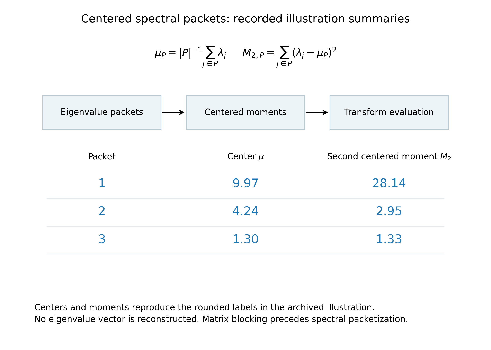

*A second decomposition layer: centered spectral moments compress the complex transform after the operator problem has produced a spectrum. This schematic uses the definitions for nonempty packets and preserves the rounded packet-center and second-moment labels from the archived illustration, independently of physical storage blocks. It does not reconstruct the unavailable original eigenvalue vector.*


### Quadratic-form transform and saddlepoint tilt

Let <a id="eq:Q"></a>
$$Q=\sum_{j=1}^{r}\lambda_j Z_j^2,
\qquad \lambda_j>0.
$$ The moment generating function exists for $$\Re s < \frac{1}{2\lambda_{\max}},
\qquad
\lambda_{\max}=\max_j\lambda_j,$$ and its cumulant generating function is <a id="eq:cgf"></a>
$$\kappa(s)=\log \mathbb Ee^{sQ}
=-\frac12\sum_{j=1}^{r}\log(1-2s\lambda_j).
$$ For real $\theta<1/(2\lambda_{\max})$, <a id="eq:derivatives"></a>
$$\kappa^{(m)}(\theta)
=2^{m-1}(m-1)!\sum_{j=1}^{r}
\frac{\lambda_j^m}{(1-2\theta\lambda_j)^m},
\qquad m\ge1.
$$ At $\theta=0$, this recovers the standard cumulant identity $$\operatorname{cum}_m(Q)=2^{m-1}(m-1)!\sum_j\lambda_j^m.$$

<a id="thm:saddle"></a>

**Theorem 26.1** (Unique upper-tail saddlepoint). *If $q>\mathbb EQ=\sum_j\lambda_j$, there exists a unique $$\theta_*=\theta(q)\in\left(0,\frac{1}{2\lambda_{\max}}\right)$$ satisfying <a id="eq:saddle"></a>
$$\kappa'(\theta_*)=q.
$$*


*Proof.* By [(3)](#eq:derivatives), $$\kappa'(\theta)=\sum_j\frac{\lambda_j}{1-2\theta\lambda_j}$$ is continuous and strictly increasing on the stated interval. It equals $\mathbb EQ$ at $\theta=0$ and diverges as $\theta\uparrow1/(2\lambda_{\max})$. The intermediate value theorem and strict monotonicity give existence and uniqueness. ◻


Define the exponentially tilted law by <a id="eq:tilt-density"></a>
$$f_{\theta}(x)=e^{\theta x-\kappa(\theta)}f(x).
$$ Its characteristic function is <a id="eq:tilt-cf"></a>
$$\phi_{\theta}(t)
=\exp\{\kappa(\theta+\mathrm{i}t)-\kappa(\theta)\},
$$ and $\mathbb E_{\theta}Q=\kappa'(\theta)$. Therefore the choice [(4)](#eq:saddle) moves the query $q$ to the mean of the tilted law.

For any $\theta>0$ in the transform domain, <a id="eq:tilt-tail"></a>
$$\mathbb P(Q\ge q)
=e^{\kappa(\theta)-\theta q}
\mathbb E_{\theta}\!\left[e^{-\theta(Q-q)}\mathbf 1_{\{Q\ge q\}}\right].
$$ This identity is classical exponential tilting; K-COS uses it to avoid subtracting a CDF value numerically close to one.

### Centered spectral packets

Let a nonempty packet $P\subset\{1,\ldots,r\}$ contain $n_P\ge1$ eigenvalues. Define its center $$\mu_P=\frac{1}{n_P}\sum_{j\in P}\lambda_j,
\qquad
\delta_j=\lambda_j-\mu_P,$$ and centered moments <a id="eq:centeredmoments"></a>
$$M_{P,m}=\sum_{j\in P}\delta_j^m,
\qquad m\ge0.
$$ Thus $M_{P,0}=n_P$ and $M_{P,1}=0$.

<a id="thm:packet"></a>

**Theorem 26.2** (Centered packet expansion). *Fix $s\in\mathbb C$ with $\Re s<1/(2\lambda_{\max})$, use the principal logarithm, and define <a id="eq:alpha-rho"></a>
$$\alpha_P(s)=\frac{2s}{1-2s\mu_P},
\qquad
\rho_P(s)=|\alpha_P(s)|\max_{j\in P}|\delta_j|.
$$ For a nonnegative integer expansion order $p$, if $\rho_P(s)<1$, then the packet contribution to [(2)](#eq:cgf) is <a id="eq:packet-expansion"></a>
$$\begin{aligned}
\kappa_P(s)
&=-\frac{n_P}{2}\log(1-2s\mu_P)
+\frac12\sum_{m=1}^{p}
\frac{\alpha_P(s)^m}{m}M_{P,m}
+R_{P,p}(s),

\end{aligned}$$ where <a id="eq:packet-remainder"></a>
$$|R_{P,p}(s)|
\le
\frac{n_P}{2}
\frac{\rho_P(s)^{p+1}}{(p+1)(1-\rho_P(s))}.
$$*


*Proof.* For $j\in P$, $$1-2s\lambda_j
=(1-2s\mu_P)(1-\alpha_P(s)\delta_j).$$ The transform-domain condition gives positive real part for each $1-2s\lambda_j$ and for $1-2s\mu_P$. The disk condition gives positive real part for $1-\alpha_P\delta_j$. The two factor arguments therefore sum inside $(-\pi,\pi)$, so their principal logarithms add without a branch ambiguity. Hence $$-\frac12\log(1-2s\lambda_j)
=-\frac12\log(1-2s\mu_P)
-\frac12\log(1-\alpha_P\delta_j).$$ When $|\alpha_P\delta_j|<1$, $$-\log(1-z)=\sum_{m\ge1}\frac{z^m}{m}.$$ Summing over $j\in P$ gives [(10)](#eq:packet-expansion). The remainder satisfies $$\left|\sum_{m\ge p+1}\frac{z^m}{m}\right|
\le
\sum_{m\ge p+1}\frac{|z|^m}{p+1}
=\frac{|z|^{p+1}}{(p+1)(1-|z|)}.$$ Using $|z|\le\rho_P(s)$ and summing $n_P$ terms yields [(11)](#eq:packet-remainder). ◻


<a id="claim:final-26-3"></a>

*Remark 26.3* (What is compressed). A packet of $n_P$ eigenvalues is replaced by its center and $p$ centered moments. Large spectral spikes may be retained exactly. If the representation contains $s$ exact eigenvalues and $R$ packets of order $p$, evaluation of the CGF on $N$ frequencies costs $O(N(s+Rp))$ arithmetic operations after compilation, instead of $O(Nr)$ direct eigenvalue-transform evaluations.


<a id="claim:final-26-4"></a>

*Remark 26.4* (Query dependence). The relevant packet condition is not merely geometric closeness of eigenvalues. It is the complex-grid quantity $\rho_P(\theta_*+\mathrm{i}u_k)$. Thus a partition suitable for one tail query or one COS grid need not be suitable for another.


### Tilted COS tail functional

Because $Q\ge0$, K-COS uses the interval $[0,b]$. Throughout the following functional and packet-error results, assume $b>q\ge0$, $b>0$, $0<\theta<1/(2\lambda_{\max})$, and an integer mode count $N\ge1$. Let $$u_k=\frac{k\pi}{b},
\qquad k=0,1,\ldots,$$ and define the exponentially weighted cosine integrals <a id="eq:J-def"></a>
$$J_k(q,b,\theta)
=\int_q^b e^{-\theta(x-q)}\cos(u_kx)\,dx.
$$ They admit the closed form <a id="eq:J-formula"></a>
$$J_k
=\Re\left[
 e^{\mathrm{i}u_k q}
 \frac{1-e^{(-\theta+\mathrm{i}u_k)(b-q)}}{\theta-\mathrm{i}u_k}
\right].
$$ The prime on a cosine sum denotes half weight for $k=0$.

If the exact tilted characteristic function is used, the $N$-mode finite-window expression is <a id="eq:tail-cos"></a>
$$T_{N,b}
=\frac{2}{b}\sum_{k=0}^{N-1}{}'
J_k\,
\Re\left[e^{\kappa(\theta+\mathrm{i}u_k)-\theta q}\right].
$$ The cancellation of $\kappa(\theta)$ in [(14)](#eq:tail-cos) is useful numerically: the likelihood-ratio prefactor from [(7)](#eq:tilt-tail) and the normalization in [(6)](#eq:tilt-cf) do not need to be formed separately inside each mode.

### Propagation of packet error

Let $\widehat\kappa(s_k)$ be the packet approximation at $$s_k=\theta+\mathrm{i}u_k,$$ and suppose <a id="eq:Bk"></a>
$$|\widehat\kappa(s_k)-\kappa(s_k)|\le B_k.
$$ For disjoint packets, $B_k$ can be chosen as the sum of the packet bounds [(11)](#eq:packet-remainder).

<a id="thm:packet-tail"></a>

**Theorem 26.5** (Finite-grid packet-to-tail bound). *Let $\widehat T_{N,b}$ be obtained from [(14)](#eq:tail-cos) by replacing $\kappa(s_k)$ by $\widehat\kappa(s_k)$. Then <a id="eq:packet-tail-bound"></a>
$$|\widehat T_{N,b}-T_{N,b}|
\le \varepsilon_{\mathrm{pkt}},
$$ where <a id="eq:eps-pkt"></a>
$$\varepsilon_{\mathrm{pkt}}
=
\frac{2}{b}
 e^{\kappa(\theta)-\theta q}
\sum_{k=0}^{N-1}{}'
|J_k|\bigl(e^{B_k}-1\bigr).
$$*


*Proof.* Write $\Delta_k=\widehat\kappa(s_k)-\kappa(s_k)$. Then $$|e^{\widehat\kappa(s_k)-\theta q}-e^{\kappa(s_k)-\theta q}|
\le
|e^{\kappa(s_k)-\theta q}|\,(e^{|\Delta_k|}-1).$$ Moreover $$\Re\kappa(\theta+\mathrm{i}u_k)-\kappa(\theta)
=\log|\phi_{\theta}(u_k)|\le0,$$ so $$|e^{\kappa(s_k)-\theta q}|
\le e^{\kappa(\theta)-\theta q}.$$ Substitute this into the finite cosine sum and apply the triangle inequality. ◻


### Positive support, truncation, and cosine periodization

Using full characteristic-function coefficients on $[0,b]$ reconstructs the even $2b$-periodization of the tilted density rather than the strictly truncated density. For a nonnegative density supported on $[0,\infty)$, the total mass folded back into $[0,b]$ equals the tilted mass above $b$. This gives a clean error control for the positive quadratic-form setting.

<a id="lem:folding"></a>

**Lemma 26.6** (Integrated cosine identity by folding). *Let $\nu_\theta$ be the tilted probability measure and let $F_b:[0,\infty)\to[0,b]$ fold each interval of length $2b$ by reflection. Then $\cos(k\pi F_b(x)/b)=\cos(k\pi x/b)$. For $h(x)=e^{-\theta(x-q)}\mathbf1_{[q,b]}(x)$, $$\int h\,d(F_{b\#}\nu_\theta)
=\frac2b\sum_{k=0}^{\infty}{}'
J_k\,\Re\phi_\theta(k\pi/b).$$ The series is absolutely convergent for every positive rank $r\ge1$.*


*Proof.* A positive weighted chi-square sum has an absolutely continuous law; its folded measure therefore has no atom at the jump of $h$. The even periodic extension of $h$ has bounded Fejér means, which converge at every continuity point. Dominated convergence identifies the integral of those means with $\int h\,d(F_{b\#}\nu_\theta)$. Their cosine coefficients are the Cesàro weighted coefficients $2J_k/b$, and folding preserves the cosine moments $\Re\phi_\theta(k\pi/b)$. Finally $J_k=O(k^{-1})$ and $|\phi_\theta(k\pi/b)|=O(k^{-r/2})$, as follows directly from the product formula below. Thus the coefficient products are $O(k^{-1-r/2})$; their absolute sum converges. The Cesàro sums and ordinary sum have the same limit, proving the displayed identity. This argument justifies the weighted functional without requiring pointwise convergence of the reconstructed density at every boundary. ◻


<a id="prop:support"></a>

**Proposition 26.7** (Support and periodization bound). *Let the finite positive spectrum have rank $r\ge1$, and let $b>q\ge0$, $b>0$, and $0<\theta<1/(2\lambda_{\max})$. Let $$\tau_{\theta}(b)=\mathbb P_{\theta}(Q>b).$$ Then the combined error from (i) replacing the tilted density on $[0,b]$ by its full-coefficient cosine periodization and (ii) omitting the original integral over $(b,\infty)$ is bounded by <a id="eq:eps-support"></a>
$$\varepsilon_{\mathrm{sup}}
\le
e^{\kappa(\theta)-\theta q}\,
\tau_{\theta}(b)
\left(1+e^{-\theta(b-q)}\right).
$$*


*Proof.* By Lemma [26.6](#lem:folding), the infinite cosine functional integrates the folded measure. The part of that measure originating from $(b,\infty)$ is nonnegative and has total mass $\tau_{\theta}(b)$. On $[q,b]$, the weight $e^{-\theta(x-q)}$ is at most one, so its contribution to the weighted functional is at most $\tau_{\theta}(b)$. For the omitted original tail, $x\ge b$ implies $$e^{-\theta(x-q)}\le e^{-\theta(b-q)},$$ so that term is at most $e^{-\theta(b-q)}\tau_{\theta}(b)$. Multiplication by the likelihood-ratio prefactor in [(7)](#eq:tilt-tail) gives [(18)](#eq:eps-support). ◻


The tilted tail probability itself can be bounded by Chernoff’s inequality. For $\eta>\theta$ inside the transform domain, <a id="eq:tilted-chernoff"></a>
$$\tau_{\theta}(b)
\le
\exp\left\{
\kappa(\eta)-\kappa(\theta)-(\eta-\theta)b
\right\}.
$$ When $b>\kappa'(\theta)$, the minimizing $\eta$ is the unique solution of <a id="eq:eta"></a>
$$\kappa'(\eta)=b.
$$ For the saddlepoint tilt, $\kappa'(\theta_*)=q<b$, so such an $\eta$ exists.

### A specialized omitted-mode bound

The tilted characteristic function has an especially transparent modulus.

<a id="lem:modulus"></a>

**Lemma 26.8** (Tilted characteristic-function modulus). *Define <a id="eq:aj"></a>
$$a_j=\frac{2\lambda_j}{1-2\theta\lambda_j}>0.
$$ Then <a id="eq:phi-modulus"></a>
$$|\phi_{\theta}(t)|
=\prod_{j=1}^{r}\left(1+(a_jt)^2\right)^{-1/4}.
$$ Define the logarithmic decay rate <a id="eq:beta"></a>
$$\beta(t)
=-\frac{d\log|\phi_{\theta}(t)|}{d\log t}
=\frac12\sum_{j=1}^{r}
\frac{(a_jt)^2}{1+(a_jt)^2}.
$$ Then $\beta(t)$ is nondecreasing for $t\ge0$.*


*Proof.* Taking the modulus of each factor in [(6)](#eq:tilt-cf) gives [(22)](#eq:phi-modulus). Differentiating its logarithm gives [(23)](#eq:beta). Each summand $x/(1+x)$ with $x=(a_jt)^2$ is nondecreasing in $t$. ◻


<a id="cor:power-envelope"></a>

**Corollary 26.9** (Power envelope from one frequency). *For $t\ge t_0>0$, <a id="eq:power-envelope"></a>
$$|\phi_{\theta}(t)|
\le
|\phi_{\theta}(t_0)|
\left(\frac{t}{t_0}\right)^{-\beta(t_0)}.
$$*


*Proof.* By Lemma [26.8](#lem:modulus), $$\frac{d\log|\phi_{\theta}(t)|}{d\log t}=-\beta(t)\le-\beta(t_0)$$ for $t\ge t_0$. Integrating from $t_0$ to $t$ proves the claim. ◻


For $k\ge1$, the exact integral [(13)](#eq:J-formula) implies <a id="eq:J-bound"></a>
$$|J_k|
\le \frac{2}{u_k}.
$$

<a id="thm:cos-tail"></a>

**Theorem 26.10** (Omitted COS-mode certificate). *Let $N\ge1$, $b>q\ge0$, and $u_N=N\pi/b$ and $\beta_N=\beta(u_N)$. If $\beta_N>0$, then the contribution of all exact tilted-COS modes $k\ge N$ to the weighted tail functional is bounded by <a id="eq:eps-cos"></a>
$$\varepsilon_{\mathrm{COS}}
\le
 e^{\kappa(\theta)-\theta q}
\frac{4|\phi_{\theta}(u_N)|}{\pi}
\left(\frac1N+\frac1{\beta_N}\right).
$$*


*Proof.* Using the cosine coefficient magnitude $2|\phi_{\theta}(u_k)|/b$ and [(25)](#eq:J-bound), the omitted series is at most $$e^{\kappa(\theta)-\theta q}
\frac{4}{\pi}
\sum_{k=N}^{\infty}\frac{|\phi_{\theta}(u_k)|}{k}.$$ By Corollary [26.9](#cor:power-envelope), $$|\phi_{\theta}(u_k)|
\le
|\phi_{\theta}(u_N)|\left(\frac{k}{N}\right)^{-\beta_N}.$$ Therefore $$\sum_{k=N}^{\infty}\frac{|\phi_{\theta}(u_k)|}{k}
\le
|\phi_{\theta}(u_N)|N^{\beta_N}
\sum_{k=N}^{\infty}k^{-\beta_N-1}.$$ Finally, $$\sum_{k=N}^{\infty}k^{-\beta_N-1}
\le N^{-\beta_N-1}+\int_N^{\infty}x^{-\beta_N-1}\,dx
=N^{-\beta_N-1}+\frac{N^{-\beta_N}}{\beta_N},$$ which yields [(26)](#eq:eps-cos). ◻


### Combined analytic certificate

<a id="thm:combined"></a>

**Theorem 26.11** (K-COS analytic error certificate). *Let $p=\mathbb P(Q\ge q)$, and let $\widehat p$ be the finite K-COS approximation formed with*

1.  *an upper interval endpoint $b>q$,*

2.  *an integer $N\ge1$ of cosine modes,*

3.  *a packet approximation satisfying [(15)](#eq:Bk) on the finite grid.*

*Under the positive-spectrum and parameter hypotheses of Proposition [26.7](#prop:support), <a id="eq:combined"></a>
$$|p-\widehat p|
\le
\varepsilon_{\mathrm{an}}
:=\varepsilon_{\mathrm{pkt}}+\varepsilon_{\mathrm{sup}}+\varepsilon_{\mathrm{COS}}.
$$ If $\varepsilon_{\mathrm{an}}<|\widehat p|$, then <a id="eq:relative-certificate"></a>
$$\frac{|p-\widehat p|}{|p|}
\le
\frac{\varepsilon_{\mathrm{an}}}
{|\widehat p|-\varepsilon_{\mathrm{an}}}.
$$*


*Proof.* Decompose the error into packet error on the retained grid, support and periodization error, and the exact omitted cosine series. The first is bounded by Theorem [26.5](#thm:packet-tail), the second by Proposition [26.7](#prop:support), and the third by Theorem [26.10](#thm:cos-tail). This proves [(27)](#eq:combined). Also $$|p|\ge |\widehat p|-|p-\widehat p|
\ge |\widehat p|-\varepsilon_{\mathrm{an}},$$ which gives [(28)](#eq:relative-certificate). ◻


<a id="claim:final-26-12"></a>

*Remark 26.12* (Certificate boundary). Theorem [26.11](#thm:combined) is an *analytic approximation certificate*. It does not enclose IEEE floating-point rounding in complex logarithms, exponentials, root finding, or summation. A machine-level certificate would require directed rounding, interval arithmetic, or a comparable validated-numerics layer.


### Finite refinability

The combined error terms correspond to three distinct obstructions. Packet error is reduced by splitting spectral packets or raising packet order; support error is reduced by increasing $b$; cosine-series error is reduced by increasing $N$.

<a id="prop:finite-refinement"></a>

**Proposition 26.13** (Existence of a finite analytic refinement). *Fix a finite positive spectrum $\{\lambda_j\}_{j=1}^{r}$, an upper-tail query $q>\mathbb EQ$, and $\varepsilon>0$. There exist a finite interval endpoint $b>q$, a finite number of cosine modes $N$, and a finite packet partition (allowing singleton packets) for which the analytic error bound in [(27)](#eq:combined) is below $\varepsilon$.*


*Proof.* First choose $b$ sufficiently large that [(18)](#eq:eps-support) is below $\varepsilon/3$. This is possible because the tilted law has a moment generating function in a nontrivial right neighborhood of zero and hence its Chernoff bound tends to zero exponentially as $b\to\infty$. Hold this $b$ fixed. By [(22)](#eq:phi-modulus), $|\phi_{\theta}(t)|\to0$ polynomially as $t\to\infty$, while $\beta(t)\to r/2>0$. Therefore [(26)](#eq:eps-cos) tends to zero as $N\to\infty$, so a finite $N$ makes it below $\varepsilon/3$. Finally, split every packet to singletons if necessary. A singleton has $\delta_j=0$, so its packet remainder is exactly zero. Hence a finite partition makes $\varepsilon_{\mathrm{pkt}}<\varepsilon/3$. Summing the three terms proves the claim. ◻


<a id="claim:final-26-14"></a>

*Remark 26.14*. Proposition [26.13](#prop:finite-refinement) proves existence of a finite representation meeting any analytic tolerance. It does not by itself prove that every possible greedy refinement schedule terminates optimally. The prototype planner refines the largest currently certified obstruction and is evaluated empirically below.


### Adaptive K-COS algorithm

The prototype accepts $(\lambda_1,\ldots,\lambda_r,q,\tau)$, where $\tau$ is a requested relative tolerance.

1.  Solve $\kappa'(\theta_*)=q$.

2.  Initialize an upper interval $b=q+L\sqrt{\kappa''(\theta_*)+\sqrt{\kappa^{(4)}(\theta_*)}}$ and a mode count $N$.

3.  Retain the largest spectral spikes exactly and place the remaining sorted eigenvalues into coarse packets.

4.  Evaluate $\rho_P(\theta_*+\mathrm{i}u_k)$ and the packet remainder bound on the actual COS grid. Split packets until the propagated packet contribution is within its budget.

5.  Evaluate the support/alias certificate from [(18)](#eq:eps-support)–[(20)](#eq:eta).

6.  Evaluate the omitted-mode certificate [(26)](#eq:eps-cos).

7.  If the combined relative certificate exceeds $\tau$, refine whichever analytic error source dominates: split packets, increase $b$, or increase $N$.

8.  Return the tail probability, the compiled spectral passport, and the error ledger.

The resulting object is query dependent. Schematically, <a id="eq:compiler-map"></a>
$$(\Lambda,q,\tau)
\longmapsto
\mathcal P_{\Lambda,q,\tau}
\longmapsto
(\widehat p,\text{certificate}),
$$ where $\mathcal P_{\Lambda,q,\tau}$ stores exact spikes, packet centers, centered moments, packet radii, and the selected COS parameters.

### Archived packet-prototype experiments

These tables and three associated figures are the original September 2026 packet-prototype measurements. Their returned analytic bounds exclude floating-point roundoff. The original prototype predates the interval backend and independent inversion checks already presented above; the following measurements are preserved rather than recast as fresh benchmarks.

#### Exactly solvable chi-square stress test

To isolate the effect of exponential tilting, we first used $$Q=0.02\chi^2_{80},$$ whose survival probabilities are available directly from the chi-square distribution. Table [3](#tab:chi) compares a global COS calculation with query-centered tilted COS.

<a id="tab:chi"></a>

| True tail $p$ | $N$ | Global COS rel. error | Tilted COS rel. error |
|--------------:|----:|----------------------:|----------------------:|
|     $10^{-6}$ |  64 |   $3.56\times10^{-8}$ |  $2.71\times10^{-14}$ |
|    $10^{-10}$ |  64 |   $1.64\times10^{-4}$ |  $6.59\times10^{-15}$ |
|    $10^{-10}$ | 128 |   $2.03\times10^{-6}$ |  $9.05\times10^{-15}$ |
|    $10^{-14}$ |  64 |                $1.43$ |  $3.53\times10^{-14}$ |
|    $10^{-14}$ | 128 |   $6.15\times10^{-2}$ |  $3.87\times10^{-14}$ |

Relative error in an exactly solvable chi-square family.


The test demonstrates the numerical motivation for tilting: evaluating a small tail directly under the shifted law is substantially more stable than reconstructing a global CDF and subtracting from one. This observation is not a novelty claim for exponential tilting itself.

#### Genotype-derived spectra

The second experiment used the existing Komorebi SKAT benchmark generator. Synthetic genotype matrices were centered and scaled, residualized against three covariates, weighted by $(1-\mathrm{MAF})^{24}$, and converted to the positive quadratic-form spectrum $$\lambda=\tfrac12\operatorname{eig}(AA^{\mathsf T}).$$ Three independent $n=400$, $m=1200$ genotype sets yielded numerical rank $397$. Four upper-tail queries per spectrum were generated by choosing saddlepoint locations at fractions $0.70,0.80,0.85,0.90$ of the transform singularity. The comparison reference used exact-spectrum tilted COS with $N=2048$ and a large support parameter $L=20$. The adaptive method was asked for a relative analytic tolerance of $10^{-8}$.

Across the twelve queries:

- every requested $10^{-8}$ analytic certificate passed;

- the worst observed relative error was $6.148608\times10^{-11}$;

- the largest returned analytic relative bound was $7.917203\times10^{-9}$;

- the planner selected $N\in\{64,128\}$, $L\in\{10,11,12,13\}$, and 11–16 packets.

Figure [28](#fig:coverage) plots the observed errors against the returned analytic bounds. Every point lies above the equality line because the vertical coordinate is the bound.

<a id="fig:coverage"></a>

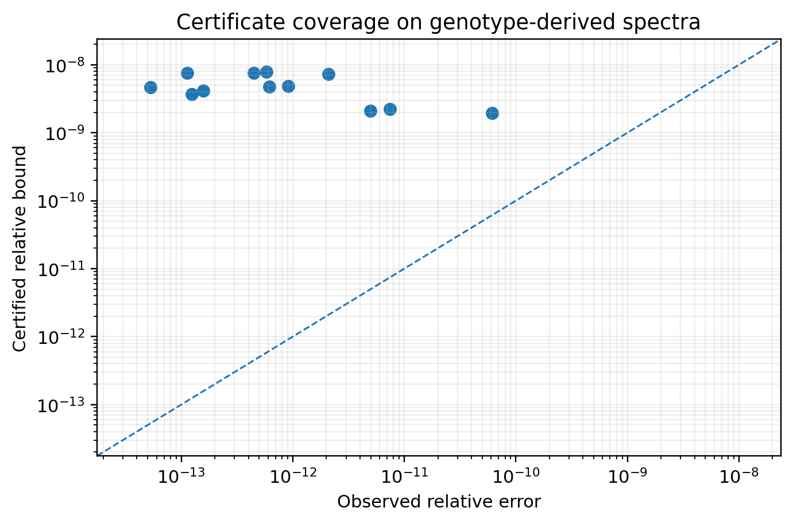

*Observed relative error versus the analytic certificate on twelve genotype-derived tail queries. The dashed line is equality.*


#### Tolerance ladder

At a reference tail probability near $8.99\times10^{-15}$, the same engine was requested to meet three tolerances. Table [4](#tab:ladder) shows how the representation refined automatically.

<a id="tab:ladder"></a>

| Requested $\tau$ | $N$ | $L$ | Packets |       Analytic bound |       Observed error |
|-----------------:|----:|----:|--------:|---------------------:|---------------------:|
|        $10^{-6}$ | 128 |  10 |      10 |  $3.56\times10^{-7}$ | $3.63\times10^{-12}$ |
|        $10^{-8}$ | 128 |  12 |      15 |  $4.87\times10^{-9}$ | $9.14\times10^{-13}$ |
|       $10^{-10}$ | 256 |  14 |      24 | $8.21\times10^{-11}$ | $5.65\times10^{-14}$ |

Adaptive refinement at an extreme-tail query.


<a id="fig:ladder"></a>

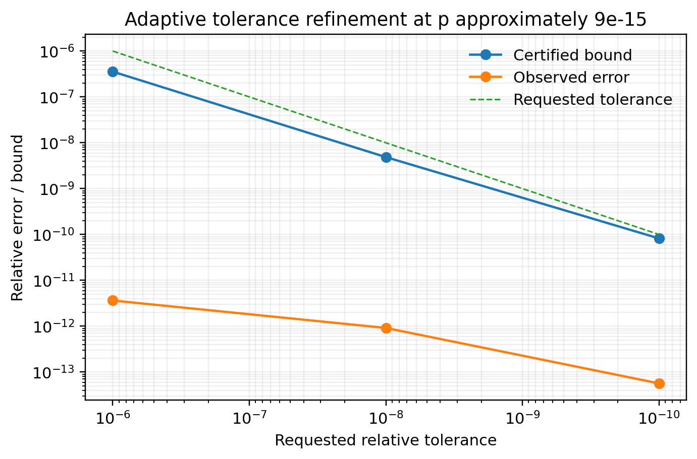

*Requested tolerance, returned certificate, and observed error for one extreme-tail query.*


#### Prototype runtime scaling

Table [5](#tab:runtime) reports median CPU timings from the Python prototype. “Adaptive total” includes planning and analytic error checks. “Compiled evaluation” measures reuse of an already compiled spectral passport at the selected grid.

<a id="tab:runtime"></a>

| Rank | Packets | Exact tilted | Adaptive total | Compiled eval. | Compiled speedup |
|-----:|--------:|-------------:|---------------:|---------------:|-----------------:|
|  397 |      13 |      6.66 ms |       10.45 ms |       0.549 ms |     $12.1\times$ |
|  797 |      16 |     13.32 ms |       11.49 ms |       0.604 ms |     $22.0\times$ |
| 1197 |      17 |     21.52 ms |       11.24 ms |       0.651 ms |     $33.1\times$ |

Prototype runtime scaling on genotype-derived spectra.


<a id="fig:runtime"></a>

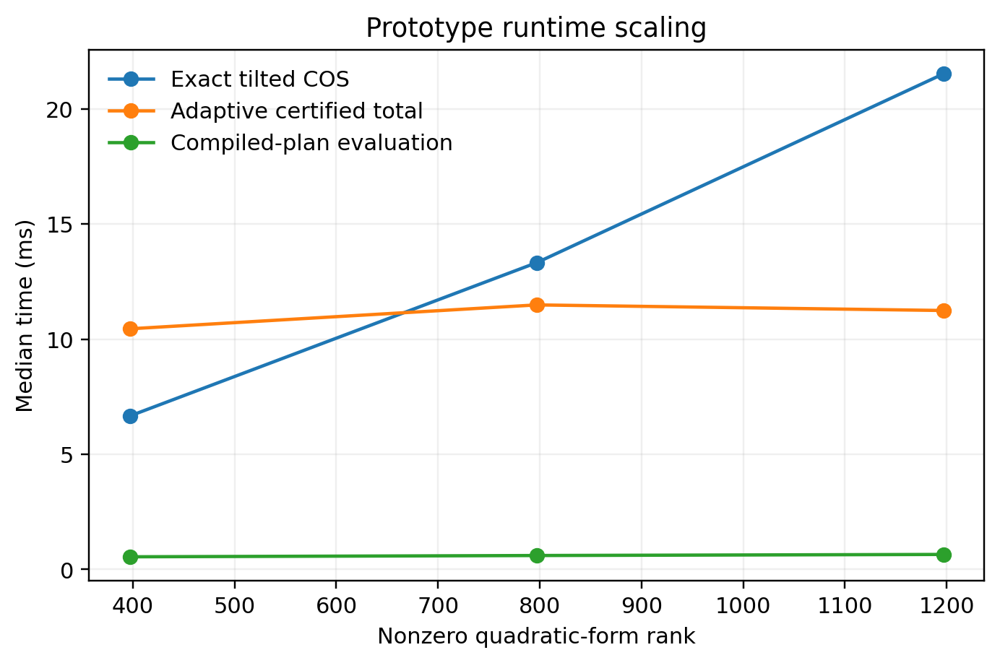

*Median runtime of exact tilted COS, adaptive K-COS with analytic ledger including planning, and evaluation of an already compiled passport.*


The planning overhead matters. At rank 397, one adaptive analytic-ledger query is slower than one exact tilted-COS query. The crossover appears between ranks 397 and 797 in this prototype, while compiled reuse is much faster. No universal speedup claim is therefore made.

<a id="sec:final-27"></a>

## Memory planning law

Let $d$ be the number of bytes per floating scalar, $c$ the resident variant count, $s$ the Krylov width, and $p$ the covariate rank. Ignoring library workspace and allocator overhead, a streamed sample-space action has working memory on the order of $$\boxed{
d\,[nc+2ns+cs+np+O(ps+c)].
}$$

The full factor costs $$dnm.$$

For fixed $n,p,s,c$, $$\boxed{
\frac{M_{\rm stream}}{M_{\rm full}}
=
O\!\left(
\frac{c}{m}
+
\frac{s}{m}
+
\frac{p}{m}
\right),
}$$ so device memory remains bounded as total variant count grows.

|       $m$ | full factor (MiB) | streamed $KV$ (MiB) | tiled Gram (MiB) |
|----------:|------------------:|--------------------:|-----------------:|
|    10,000 |             152.6 |              16.308 |            8.555 |
|    50,000 |             762.9 |              16.308 |            8.555 |
|   100,000 |           1,525.9 |              16.308 |            8.555 |
|   500,000 |           7,629.4 |              16.308 |            8.555 |
| 1,000,000 |          15,258.8 |              16.308 |            8.555 |

Algebraic float64 memory model for $n=2000$, $p=4$, Krylov width $s=16$, resident variant block $c=1024$.

<a id="fig:memory-law"></a>

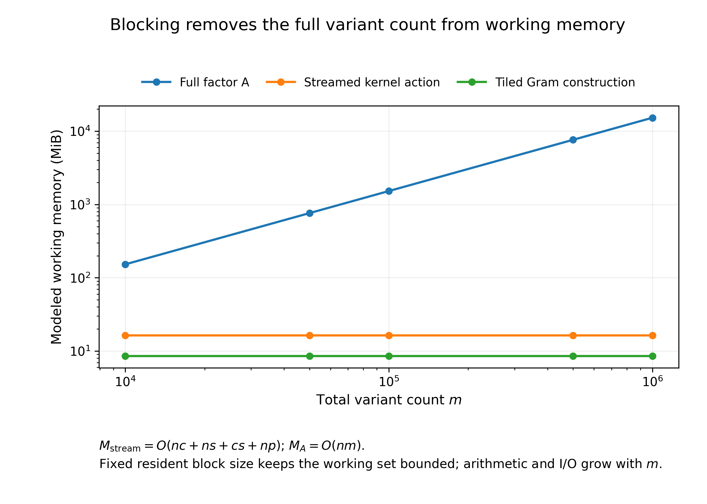

*The memory law. The complete factor grows linearly with total variant count $m$, whereas the streamed kernel action and the two-dimensional tiled construction remain bounded when resident block size, Krylov width, and covariate rank are fixed.*


<a id="sec:final-28"></a>

## Numerical verification

All identities were compared against explicitly formed reference matrices.

| partition          | blocks |  Gram relative error | action relative error |
|:-------------------|-------:|---------------------:|----------------------:|
| coarse 4           |      4 | $2.91\times10^{-16}$ |  $5.99\times10^{-16}$ |
| fine 64            |     32 | $3.39\times10^{-16}$ |  $6.00\times10^{-16}$ |
| irregular          |      9 | $3.34\times10^{-16}$ |  $5.87\times10^{-16}$ |
| singleton-front    |     21 | $2.43\times10^{-16}$ |  $5.82\times10^{-16}$ |
| permuted, block 73 |     29 | $3.52\times10^{-16}$ |  $5.89\times10^{-16}$ |

Partition-invariance checks.

A hierarchical coarse-to-fine refinement gave relative discrepancy $$3.17\times10^{-16}.$$

For an explicitly PSD polyphase operator $$H=L^\top L$$ with block-bidiagonal $L$, the smallest eigenvalue was approximately $$2.86,$$ and the largest norm observed outside the exact $k$-step light cone was $$\boxed{0}.$$

The QR-core update reproduced the full singular spectrum with relative $\ell_2$ discrepancy $$5.89\times10^{-16}.$$

<a id="sec:final-29"></a>

## Method synthesis: composable decompositions

The solver is organized around four independent decomposition axes: $$\boxed{
\mathcal D
=
\mathcal D_{\rm storage}
\circ
\mathcal D_{\rm phase}
\circ
\mathcal D_{\rm rank}
\circ
\mathcal D_{\rm spectrum}.
}$$ This display describes the pipeline schematically, not four endomorphisms proved to commute pairwise. The precise commutation theorem below is for exact storage refinement and a fixed structural phase partition. Full range capture or residual completion preserves the nonzero spectrum exactly; a truncated packet representation instead preserves the requested tail within its explicit analytic error bound.

They answer different questions. Storage decomposition controls what is resident. Phase decomposition controls where information can propagate. Rank decomposition controls how many directions must be retained. Spectral packetization controls the cost of the final deep-tail transform. The central structural fact is that these representations can be changed independently without changing the exact operator when their respective invariance conditions are satisfied.

### Storage-phase commutation

Fix a structural phase partition $$\{1,\ldots,m\}=\mathcal P_1\sqcup\cdots\sqcup\mathcal P_H$$ and let each phase be subdivided into arbitrary storage blocks $$\mathcal P_h
=
J_{h1}\sqcup\cdots\sqcup J_{hB_h}.$$ Let $S$ denote this physical storage subdivision. The phase projectors $P_h$ are defined by the structural phases, not by $S$.

<a id="claim:final-29-1"></a>

**Theorem 29.1** (Storage-phase commutation theorem). *Let $$A=M_XGW^{1/2},
\qquad H=A^\top A,$$ and let $S$ and $S'$ be any two exact storage refinements that respect the same structural phase partition. Then:*

1.  *the exact operator $H$ is identical under $S$ and $S'$;*

2.  *every phase coupling $P_hHP_g$ is identical under $S$ and $S'$;*

3.  *the exact phase graph and every $k$-step polyphase light cone are identical under $S$ and $S'$;*

4.  *any exact matrix-free Krylov method applied through streamed products produces the same Krylov subspaces in exact arithmetic under $S$ and $S'$.*


*Proof.* Storage refinement changes only the order and grouping of finite sums. By partition refinement invariance, the streamed products reconstruct the same $A$, $A^\top$, and therefore the same $H=A^\top A$. Since each $P_h$ is fixed by the structural phase partition, every block $P_hHP_g$ is unchanged. The phase graph is defined only by these blocks, so its path structure and light cones are unchanged. Finally, an exact matrix-free Krylov method depends only on repeated applications of the same operator to the same starting block; hence its generated subspaces are identical. ◻


<a id="claim:final-29-2"></a>

**Corollary 29.2** (Adaptive resident-block scheduler). *An implementation may change resident block size at runtime—including recursively splitting a phase block after an allocation failure—without changing the exact phase graph or exact Krylov trajectory, provided all required storage blocks are processed exactly.*


This separates *mathematical locality* from *physical storage granularity*. A phase may remain fixed as an LD window or annotation class while its physical representation is subdivided according to free GPU memory, scalar precision, transfer granularity, or stream count.

### Frontier-to-I/O theorem

<a id="claim:final-29-3"></a>

**Theorem 29.3** (Exact frontier-to-I/O reduction). *Suppose a validated exact phase graph of the fixed operator $H=A^\top A$ is already supplied and the initial Krylov block is supported on a phase set $F_0$. Keep covariate projections, weights, and structural phase metadata fixed, and assume all factor-action blocks required for the retained phase operator are available. At depth $k$, let $F_k$ be the graph $k$-neighborhood of $F_0$. Then no storage block lying wholly in a phase outside $F_k$ can affect the $k$-step Krylov vector. Such a block need not be loaded when evaluating the requested power through the restricted factor $A_{F_k}$. Storage blocks mixing active and inactive phases require a separate refinement before this omission is valid.*


*Proof.* For every phase $h\notin F_k$ and every starting phase $g\in F_0$, the polyphase light-cone theorem gives $P_hH^kP_g=0$. Storage-phase commutation allows each active phase operator to be evaluated through arbitrary exact storage blocks. Every path of length at most $k$ beginning in $F_0$ stays in $F_k$. Consequently restriction to $P_{F_k}HP_{F_k}=A_{F_k}^\top A_{F_k}$ preserves the requested $k$-step power on the initial support, including its zero outside output. Blocks wholly outside the retained phase set may therefore be omitted from this restricted factor evaluation. ◻


The theorem turns an algebraic support statement into an execution law: $$\boxed{
\text{Krylov depth}
\longrightarrow
\text{reachable phases}
\longrightarrow
\text{storage blocks that must be transferred}.
}$$ Discovery or verification of the phase graph may itself require all inputs. The theorem does not claim minimum total I/O, omission of mixed-phase blocks, or correctness for an unverified approximate graph. The scheduler is constrained by the exact operator graph rather than solely by available memory.

### Full method stack

The complete positive-form solver may therefore be written as $$\boxed{\begin{aligned}
A
&\longrightarrow \text{resident storage blocks}\\
&\longrightarrow \text{structural phase frontier}\\
&\longrightarrow \text{phase-local Krylov/range core}\\
&\longrightarrow \text{residual moment certificate or exact completion}\\
&\longrightarrow \{\lambda_j\}\\
&\longrightarrow \text{centered spectral packets}\\
&\longrightarrow \log P(Q\ge q).
\end{aligned}}$$

Three invariances make the stack composable:

1.  storage refinement does not change the represented operator;

2.  structural phase scheduling does not depend on physical block size;

3.  once the spectrum or a certified spectral enclosure is obtained, the tail engine is independent of the application that produced it.

The resulting method can be aggressive during basis discovery and still return to exactness. Approximate phase pruning is controlled by query and operator budgets; unresolved range structure is measured by trace, square-trace, and spectral-cap invariants; and when the remaining rank is small, streamed residual completion restores the exact nonzero spectrum before the final tail evaluation.

### Method summary

The resolved synthesis is $$\boxed{\begin{aligned}
&\text{exact streamed factor actions}
+\text{ structural light cones}
+\text{ certified pruning}\\
&+\text{ phase-local rank}
+\text{ residual moment certificates}
+\text{ exact residual completion}\\
&+\text{ spectral packets}
+\text{ log-domain extreme-tail evaluation}.
\end{aligned}}$$

The central design principle is separation of representation from semantics: changing how an operator is stored, scheduled, compressed, or evaluated must not silently change the mathematical quadratic form. Each approximation layer therefore either carries an explicit certificate or terminates in an exact completion step.

<a id="sec:prior-work"></a>

## Prior work and the contribution boundary

Characteristic-function methods for quadratic forms substantially predate this engine. Imhof’s 1961 paper is a foundational historical comparator [\[1\]](#bib:Imhof1961). Davies’ Algorithm AS 155 treats linear combinations of noncentral chi-square variables with signed coefficients and an optional Gaussian term, using characteristic-function inversion and explicit truncation/integration controls [\[2\]](#bib:Davies1980). Its documented difficult low-degree cases are relevant to the retained low-rank limitations here.

The Fourier-cosine representation and the use of characteristic-function values for cosine coefficients are due to Fang and Oosterlee [\[3\]](#bib:FangOosterlee2008). Their formulation distinguishes finite-domain coefficients from the full characteristic-function coefficients used to approximate them. The support/folding argument above supplies the particular positive-law alias bound needed here; a general COS accuracy theorem is not inherited without checking its hypotheses.

No novelty is claimed for Gaussian spectral reduction, exponential tilting, saddlepoint centering, Fourier-cosine inversion, Weyl bounds, QR updates, or out-of-core multiplication themselves. The proposed contribution is their explicit integration with independently adjustable storage, structural, range-residual, and query-specific centered spectral representations. The packet compiler in Section [26](#sec:packets) is a concrete mechanism: its local CGF remainder is propagated to the requested tail functional and refined jointly with support and mode errors. The finite refinement theorem is an existence theorem, not a complexity guarantee or proof of planner optimality.

The primary-source check for this final edition verified the listed COS and Davies formulas and the Imhof bibliographic record. It was not an exhaustive priority search. The archived independent Imhof-style inversion checks support accuracy on their tested heterogeneous spectra; they do not provide a universal runtime comparison with a mature Davies implementation.

<a id="sec:final-31"></a>

## Guarantee levels and scope

The framework contains several different evidence levels. They are kept separate because a proved algebraic identity, a finite numerical validation, and a directed-rounding probability enclosure are different kinds of claims.

| Statement                                       | Status                                   | Meaning                                                                                                                                                                                                                                                        |
|:------------------------------------------------|:-----------------------------------------|:---------------------------------------------------------------------------------------------------------------------------------------------------------------------------------------------------------------------------------------------------------------|
| Block factor and streamed-action identities     | proved                                   | Exact finite-dimensional matrix identities; storage blocking introduces no mathematical approximation.                                                                                                                                                         |
| Storage-phase commutation and exact light cones | proved                                   | Physical block refinement does not change the structural phase graph; phases outside the exact finite-depth frontier contribute zero.                                                                                                                          |
| Approximate light-cone and pruning certificates | proved + tested                          | Weak discarded couplings carry explicit finite-depth transfer and operator-norm budgets.                                                                                                                                                                       |
| Range residual and exact completion             | proved + tested                          | The unresolved factor is measured directly; small residual rank can be completed exactly.                                                                                                                                                                      |
| Positive exact-spectrum tail enclosure          | directed rounding + proved remainders    | For rank $>2$, the finite transform is enclosed numerically and enlarged by proved support/alias and infinite-mode bounds.                                                                                                                                     |
| Accuracy-driven positive tail solver            | certified / fail-closed                  | A result is accepted only after $p_+/p_- - 1\le\varepsilon_{\rm requested}$ is proved.                                                                                                                                                                         |
| Positive noncentral engine                      | exact reduction + tested tail solver     | The Gaussian form is reduced to a deterministic shift plus positive noncentral chi-square components.                                                                                                                                                          |
| Signed / indefinite engine                      | proved reduction + analytic-ledger tests | High-rank and finite-endpoint cases passed analytic error checks; low-rank mixed-sign forms remain limited by slow Fourier decay of the present COS certificate.                                                                                               |
| Binary64 factor to rigorous spectrum            | implemented at moderate dimension        | Candidate eigensystems are post-certified by directed-rounding orthogonality and reconstruction bounds, then propagated monotonically into the tail. The remaining issue is scalable streamed/subspace verification rather than the basic correctness theorem. |

Three boundaries remain material:

1.  scale the verified matrix-to-spectrum bridge to streamed range-core and residual-completion linear algebra without materializing a full dense basis;

2.  replace the conservative low-rank mixed-sign Fourier-tail certificate with a rigorous convolution or quadrature route;

3.  implement the proven streamed and residual-completion algorithms in the final native GPU runtime and measure transfer/compute crossover on hardware.

These are boundaries of the implementation, not hidden assumptions in the certified positive matrix-to-tail result at moderate dimension.

<a id="sec:final-32"></a>

## Conclusion

The quadratic-form problem can be separated into representation, structure, spectral recovery, and tail evaluation.

At the representation level, factors can be streamed in blocks without changing the operator. At the structural level, phase graphs constrain finite-depth propagation and allow certified scheduling. At the spectral level, unresolved range structure is measured rather than guessed and can be completed exactly when its rank becomes small. At the probability level, exponential tilting and spectral packets make extreme tails computationally tractable, while directed-rounding interval arithmetic and analytic remainder bounds turn the positive exact-spectrum calculation into an explicit probability enclosure.

The resulting numerical contract is deliberately stronger than “approximately evaluate a small probability.” For the rigorous positive backend, the user supplies an accuracy requirement. Internal resolution is refined until that requirement is proved, or the solver returns an uncertified interval rather than claiming success.

The deepest archived September 2026 exact control reaches $$p=10^{-5000}.$$ At that point the archived accuracy-driven run reported relative multiplicative uncertainty below $10^{-18}$. This establishes that extreme-tail depth by itself is not the limiting numerical variable; the meaningful limit is whether the complete error ledger can be made smaller than the requested tolerance.

The matrix-to-spectrum bridge now closes that upstream correctness gap for moderate binary64 factors by post-certifying an otherwise untrusted candidate eigensystem. The remaining rigorous frontier is primarily one of scalable representation: carry the same enclosure through streamed range cores and residual completion without forming a full dense eigenbasis, while extending the fail-closed accuracy contract to difficult low-rank mixed-sign forms.

## References

1.  <span id="bib:Imhof1961" label="bib:Imhof1961"></span> J. P. Imhof, Computing the distribution of quadratic forms in normal variables, *Biometrika* 48(3–4) (1961), 419–426. [doi:10.1093/biomet/48.3-4.419](https://doi.org/10.1093/biomet/48.3-4.419).

2.  <span id="bib:Davies1980" label="bib:Davies1980"></span> R. B. Davies, Algorithm AS 155: The distribution of a linear combination of $\chi^2$ random variables, *Applied Statistics* 29(3) (1980), 323–333. [doi:10.2307/2346911](https://doi.org/10.2307/2346911).

3.  <span id="bib:FangOosterlee2008" label="bib:FangOosterlee2008"></span> F. Fang and C. W. Oosterlee, A novel pricing method for European options based on Fourier-cosine series expansions, *SIAM Journal on Scientific Computing* 31(2) (2008), 826–848. [doi:10.1137/080718061](https://doi.org/10.1137/080718061).

<a id="sec:final-A"></a>

## Reference pseudocode

``` python
def stream_KV(block_source, V, project=lambda x: x):
    U = project(V)
    Y = zeros_like(U)
    for A_block in block_source:
        Y += A_block @ (A_block.T @ U)
    return project(Y)

def certified_tail(q, spectrum, relative_accuracy):
    # Refines support, COS modes, and interval precision.
    # Returns certified=False if the requested accuracy is not proved.
    return certified_positive_logsf(
        q, spectrum, relative_accuracy=relative_accuracy
    )
```

<a id="sec:final-B"></a>

## Reproducibility and evidence package

The release accompanying this manuscript contains the executable engine, interval backend, deterministic regression tests, numerical evidence tables, and proof-audit notes used to support the quantitative claims.

The principal production-facing files are:

- `quadratic_form_engine.py`: general central/noncentral interface;

- `accuracy_driven.py`: fail-closed tolerance-driven controller;

- `interval_kcos.py`: directed-rounding positive-tail backend;

- `kcos_v2_hardened.py`: log-domain adaptive positive-tail engine;

- `generalized_tail.py`: signed and noncentral generalized forms;

- `residual_completion.py`: exact completion of unresolved factor range.

Evidence tables record exact-control, realistic-spectrum, signed-form, noncentral, interval-enclosure, and requested-accuracy experiments. The release also records negative results and corrected implementation defects so that failed reference calculations or superseded simulation defects are not silently reused as evidence.

<a id="app:fresh-validation"></a>

## Fresh final-edition validation

### Executed regression groups on October 7, 2026

The staged final Python source passed all 58 executed regression tests, with zero failures, errors, or skips. The runs used Python 3.12.14 and the recorded scientific/interval dependencies. Exact commands, source hashes, module lists, elapsed times, standard output, and result manifests are retained in the release validation directory.

| Regression group                                                   | Tests | Result |
|:-------------------------------------------------------------------|------:|:-------|
| Streaming, phases, pruning, residuals, spectral bridge, case study |    31 | pass   |
| Directed positive COS interval backend                             |     3 | pass   |
| Accuracy-driven positive controller                                |     2 | pass   |
| Verified dense spectrum and matrix-to-tail bridge                  |     4 | pass   |
| Signed and noncentral analytic-ledger engines                      |     8 | pass   |
| Directed acceptance and endpoint-serialization regressions         |    10 | pass   |
| Total                                                              |    58 | pass   |

The final nonfinite serialization guard adds an explicit infinity/NaN regression; the complete directed group was rerun on that final source. Production groups and finite controls were run immediately before this nonfinite-only guard. Hash-pinned manifests preserve that distinction.

These counts describe executed finite checks. They are distinct from the mathematical proofs in the text and from the Lean declaration count. Passing signed/noncentral tests does not turn their binary64 analytic ledgers into directed machine enclosures.

### Fresh extreme-tail control with independent containment

The final serialized backend was run on the exact supplied spectrum $$Q=0.02\chi^2_{80},$$ with the literal decimal threshold beginning $$q=470.874490072839519665842558646653705377688346050339\ldots.$$ The full input string, not this abbreviated display, is in the control manifest. Its tail is near $10^{-5000}$. Requested multiplicative uncertainty $10^{-18}$ was accepted by the directed predicate after seven refinements, using $K=256$, $L=14$, and 50 interval decimal digits. The proven ratio upper endpoint satisfies $$\boxed{\frac{p_+}{p_-}-1\le9.202\times10^{-20}.}$$ The full retained upper endpoint is approximately $9.2014149826333253\times10^{-20}$; the displayed inequality rounds outward. The logarithmic width is approximately $3.996123752659559\times10^{-20}$ decades.

An independent interval calculation of the finite Erlang expression $$e^{-x}\sum_{j=0}^{39}\frac{x^j}{j!},\qquad x=q/0.04,$$ at the *same literal threshold* is fully contained in the returned K-COS interval. The measured runtime for this fresh control was 5.218 seconds in the recorded environment. This is an exact-spectrum control, not a rank-80 matrix eigensolver certification or a universal hardware claim.

### Fresh exact-binary64 matrix-to-tail control

A dense $64\times64$ factor was constructed as a normalized Hadamard matrix with singular values $1,3/4,1/2,1/4$, each repeated 16 times. Its entries are exact binary64 dyadic rationals, so the target Gram spectrum is known: $$1,\quad9/16,\quad1/4,\quad1/16$$ with the same multiplicities. Every one of the 64 known eigenvalues was contained in the directed post-certified spectral intervals.

For the exact literal threshold $q=131.33201485100517$, the matrix-defined tail is near $10^{-16}$. Requested multiplicative uncertainty $10^{-12}$ was accepted, with final ratio upper endpoint satisfying $$\boxed{\frac{p_+}{p_-}-1\le2.783\times10^{-15}.}$$ The unrounded upper endpoint is approximately $2.7829391894740692\times10^{-15}$. The candidate used 50 decimal digits, the spectrum postcheck used 65 interval decimal digits, and the combined run took 34.618 seconds. Orthogonality and reconstruction norm upper bounds were approximately $1.6471\times10^{-49}$ and $9.1752\times10^{-50}$, respectively, with those displayed bounds rounded outward.

This example verifies the complete supplied-factor route at moderate dense dimension. It does not establish directed correctness of arbitrary statistical preprocessing or a streamed, memory-bounded large-scale spectral postcheck.

### Publication corrections and their boundary

The final code adds a directed ratio acceptance predicate and preserves outer endpoint strings through matrix-to-tail propagation. It serializes exact binary interval bounds by directed decimal conversion. This repairs two specific gaps in the original source: ambient point precision could collapse a narrow log interval, and nearest-rounded display strings could move an endpoint inward. The new regressions exercise these cases and exact acceptance boundaries.

The directed enclosure remains conditional on the correctness of the interval library and the stated input/domain restrictions. A finite test suite is evidence for this implementation, not a formal proof of its full numerical runtime. The fresh control JSON retains all authoritative input and output strings; abbreviated text and plotted summaries are descriptive.

<a id="app:lean-contract"></a>

## Lean claim-coverage contract


The focused namespace is `KomorebiQCOS`. Its 26 theorem declarations cover exact finite algebra and arithmetic consequences of supplied bounds. The model supplies the real factor $A$, uses finite column sets and finite sample indices, and does not formalize the preprocessing that produced that factor. Its sample Gram convention is $AA^\top$. Applying a statistic with normalization $Q=\tfrac12v^\top Kv$ requires carrying that scalar factor explicitly.

| Traditional claim                        | Named Lean declarations                                     | Exact formal coverage                                                                                                          |
|:-----------------------------------------|:------------------------------------------------------------|:-------------------------------------------------------------------------------------------------------------------------------|
| Column blocking and partition refinement | `gramEntry_union`, `gramEntry_reindex`                      | Entrywise Gram additivity for disjoint finite blocks and invariance under a matching bijective reindexing                      |
| Streamed sample-kernel action            | `matrixAction_gram_eq_streamed`, `streamedAction_union`     | Exact finite interchange of sums and block accumulation for $Kv=A(A^\top v)$                                                   |
| Additivity of operator/statistic         | `matrixAction_gram_union`, `quadraticForm_gram_union`       | Disjoint block sums preserve the action and quadratic form                                                                     |
| Gram positivity                          | `quadraticForm_gram_eq_energy`, `quadraticForm_gram_nonneg` | Exact sum-of-squares identity and nonnegativity                                                                                |
| Supplied coefficient order               | `weightedSquares_mono`, `weightedSquares_tail_imp`          | Pointwise order and event implication for supplied weighted sums of squares; no eigenvalue construction or probability measure |
| Combining layer errors                   | `errorBound_compose`                                        | Triangle-inequality addition of two assumed absolute error bounds                                                              |
| Requested-budget acceptance              | `errorBound_accept`                                         | An assumed error bound meets an assumed larger tolerance; no machine ratio or numerical-rounding implementation                |
| Enclosure and positivity                 | `enclosed_positive`                                         | A supplied interval with a positive lower endpoint gives positivity of its enclosed real value                                 |

No row substitutes a short algebraic lemma for the full corresponding traditional theorem. In particular, the pointwise coefficient theorem is one leaf of probabilistic tail sandwiching. The enclosure theorem composes supplied bounds; it does not prove their numerical construction.

The following remain outside this focused formal module: Gaussian rotation and distributional reduction, the finite spectral theorem, Weyl inclusion, phase-graph support and pruning estimates, QR spectral equivalence, residual completion and moment inequalities, complex logarithmic packet expansion, folding/COS inversion and analytic remainder bounds, interval-library correctness, directed serialization, controller software, and hardware execution. Their evidence is given by the traditional proofs, source audits, and numerical checks stated elsewhere.

Compiler verification and standard axiom dependencies are recorded in the Lean companion and its declaration inventory. The reproducible companion includes `FiniteGram.lean`, `Certificates.lean`, and the explicit axiom-audit entry point. Compiler acceptance establishes the listed Lean statements for the exact-real model; it does not establish the omitted numerical or probabilistic claims.

<a id="app:provenance"></a>

## Source and figure provenance

The traditional text incorporates the full `FINAL_MANUSCRIPT.tex` from `Komorebi_Quadratic_Form_Engine_v1.9_Verified_Matrix_to_Tail_Source` and the mathematical and experimental core of the standalone `K-COS_Query_Adaptive_Spectral_Packetization_v0.1_Source` archive. Original matrix-engine figures remain unchanged under `../engine/figures_final/`; the three original packet-prototype figures are copied unchanged under `figures_packets/`. The final `figures_final/` directory contains 24 layout derivatives and four unchanged originals. Derivatives move annotations and legends into reserved space, wrap labels, distinguish coincident series and separate the two metrics in Figure [19](#fig:dual-budget-tail). Their numerical inputs are the archived tables; these layout changes add no empirical evidence.

The raw plotted vectors for Figures [17](#fig:phase-local-rank), [18](#fig:qr-core-equivalence) and [27](#fig:spectral-packets) were not archived. Their replacement visuals use, respectively, the exact recorded phase-rank audit, the exact recorded QR discrepancy audit, and the original rounded packet-center and second-moment labels with the formal packet definitions. No hidden singular-value or eigenvalue samples are inferred. The portable scripts `relayout_figures.py` and `relayout_late.py` record source hashes, plotted coordinates and preservation checks in their figure-layout reports. Underlying tables and original illustrations remain in the executable source and historical archives accompanying the combined release.

The final-edition modifications add the scope contract, integrate packet proofs, justify the integrated cosine identity by folding and Fejér means, make QR complement orthogonality explicit, include resident covariate-tile storage, clarify graph-knowledge assumptions, and distinguish analytic ledgers from directed numerical enclosures. Exact source hashes and the fresh validation manifest are provided with the release.
