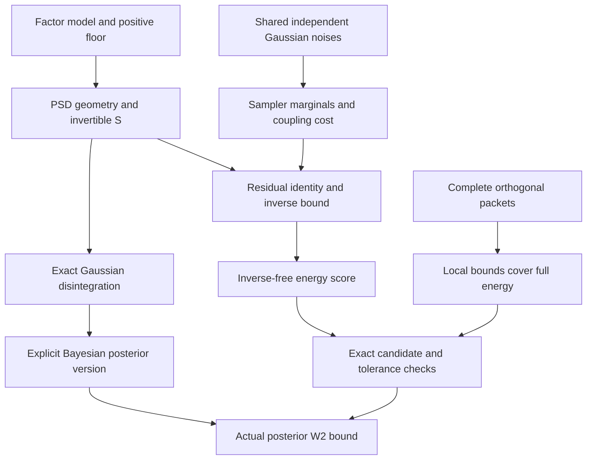
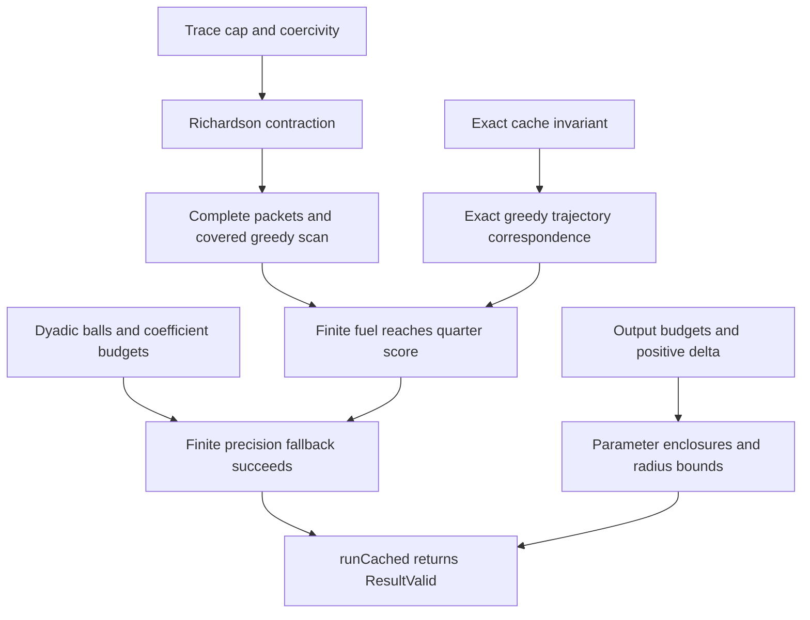

# Independent publication audit

Audit date: 2026-10-08. Reviewer: isolated mathematical source-audit subagent. This final report was reconstructed from the raw definitions and proofs, not from release dashboards. The authoritative tree is `source/FD_Certified_Inference_Core_v1.0.0_Checked`; it was read only. The review covers all eight manuscript fragments: the four mathematical chapters/companions, introduction, closing chapter, shared definitions and document assembly.

## Normalized claim and primary verdict

**Primary verdict: conditional on a named input.** The normalized claim below has a coherent, gap-free source-level proof composition in the inspected project proofs. Formal verification remains conditional here on the archived Lean receipts and the pinned Mathlib dependency (commit `aeb72f1e9981b6d35b426b16dca7759be3e7ba06`): this host has not freshly compiled Lean, and the exact external Mathlib source is not embedded in the checked archive. This limitation is evidential; it is not a mathematical counterexample or a discovered gap in the project composition.

Let `ι, κ, υ, ω, α, β` be finite types, with the declared decidable equalities on `ι, κ, α, β`. Let a rational model contain exact arrays `H : κ × ι`, `L : ι × υ`, `N : κ × ω`, a scalar `σ`, a mean `m`, and an observation `y`. Define

\[
P=LL^T,\quad R=NN^T+\sigma I,\quad S=HPH^T+R,\quad v=y-Hm,\quad F(B)=PH^T-BS.
\]

Assume `σ>0`. Let `Q_a` and `D_b` be rational self-adjoint, idempotent, pairwise orthogonal, complete projector families on output and input coordinates respectively. Let `seed : α` and a finite list `scan` containing every `a : α` be given. For every positive rational `ε, δ`, finite list of precision probes, and arbitrary initial rational gain `B`, canonical `CachedPosterior.runCached` returns some `r` satisfying `PosteriorOutput.ResultValid`. In particular:

1. the exact finite candidate and tolerance checks return true;
2. the standard all-coupling `W₂` between the explicit Bayesian posterior version `M.posterior` at the represented observation and the Joseph Gaussian for `r.candidate.gain` is at most `ε`;
3. every returned dyadic mean/covariance ball encloses the corresponding exact rational parameter of that same Joseph Gaussian and has absolute radius at most `δ`;
4. its declared output precision and arrays agree with canonical `outputPrecision` and `evaluate`.

The soundness implication from an actual successful return needs no model-validity hypotheses supplied separately by the caller: the runtime setup guard, proved outward certificate construction and final rational tolerance test establish them. Termination does require the displayed hypotheses. `seed` makes `α` inhabited. No positivity/nonemptiness is required for the state, observation, or factor dimensions. The gain itself stays the exact rational `B` passed to `roundedCandidate` (`RoundedCandidate.lean:14/19`); the certificate evaluation and parameter intervals use dyadic rounding.

Operationally, canonical `certifyRounded` executes `checkSetup`, constructs `roundedCandidate`, and executes `checkTolerance` (`RoundedCandidate.lean:52–58`). It does **not** execute the separate full exact-residual `checkCandidate`; its soundness theorem proves that predicate true from construction correctness. The standalone `checkCandidate` does recompute all exact finite obligations. These two certification routes must not be conflated in an implementation or cost explanation.

The target posterior is the explicit `fdPosteriorKernel` version, proved by an equality of the prior/likelihood joint and evidence/posterior joint. Equality to Mathlib's arbitrary canonical posterior kernel is evidence-almost everywhere. A statement of pointwise equality with every canonical kernel at every externally selected observation is stronger and unsupported.

## Claim cards

| ID | Claim, objects, and exact range | Evidence and dependencies | Audit conclusion |
|---|---|---|---|
| C1 | `runCached` universally succeeds for the finite exact rational factor model, positive noise floor, valid complete projector families, covered output scan, positive rational `ε,δ`, arbitrary rational initial gain and arbitrary finite probes. | `CachedPacketOutput.lean:20`, `CachedPacketSolver.lean:37`, `GreedyPacketConvergence.lean:54`, `RoundedSolverSearch.lean:25`, `PosteriorOutputPrecision.lean:56`. | Source composition passed, with formal-dependency qualification above. |
| C2 | Any successful `runCached` return is `ResultValid`, hence bounds the explicit posterior version's actual measure error and encloses the returned Joseph law parameters. | `CachedPacketOutput.lean:34`, `PosteriorOutputSolver.lean:28`, `RationalPosteriorCertificate.lean:40/55`, `PosteriorOutputSemantics.lean:36`. | Passed at exact model/measure scope. |
| C3 | A valid exact cached state has residuals `Q_a F(B)`, exact energies and total; every exact cached iterate has exactly the recomputed greedy gain for the same model, seed and scan. | `CachedPacketState.lean:33/66`, `CachedPacketTrajectory.lean:27/45/53`. | Passed. This does not identify different stopping policies or independently rounded cached states. |
| C4 | Independently rounded gain and cached residual centers need not preserve cache validity; in the scalar exhibited case cached score is zero while true score is two, and final certification rejects at `ε=1/10`. | `CachedRoundingBoundary.lean:10–33`; directly recomputed below. | Refutation of the stronger naive-rounding extension. |
| C5 | Seven archived tiny exact rational reference cases compare cached selective, recomputed selective and full Richardson under a common score stop and final certification/output; they are bounded observations. | `checks/benchmark_cached.py`, `checks/cached_posterior.py`, `computations/release-final/benchmark/benchmark.json`. | Bounded empirical comparison; no asymptotic or universal runtime claim. |

## Dependency graph reconstructed from proofs

The graph has no circular dependence: posterior semantics are proved before certified rational solver soundness; greedy convergence uses only exact model geometry and packet energy; cache trajectory equality transfers that convergence; final certification is applied once after search. The named Mathlib spectral, Gaussian and disintegration leaves are external formal dependencies. All other displayed load-bearing arrows have internal project proofs.

## Obligation matrix

| Obligation | Status | Decisive check / boundary |
|---|---|---|
| Exact model and coefficient domain | passed | `RationalCertificateChecker.lean:8/28–40`: factor arrays are exact rationals; no uncertain measurements or floating conversions. |
| Genuine probability objects and posterior identification | passed | `FDGaussianConditioning.lean:11`: equality of joint measures; `:34` is only canonical evidence-a.e. agreement. |
| Approximate law is a Joseph Gaussian and covariance PSD | passed | `FDGainSampler.lean:20/31`; `PosteriorOutputSemantics.lean:22/28/36`. |
| All-coupling transport metric, integrability and exact cost | passed | `QuadraticTransport.lean:16/21/26`; `FDGaussianQuadraticMoment.lean:13/34/47`; `FDInexactGainCoupling.lean:12/24/38`. |
| Residual algebra, inverse norm and energy majorant | passed | `FDInexactGainAlgebra`, `FDInnovationConditioning.lean:24/59`, `FDResidualEnergyCertificate.lean:16/39/53`. Only `S^{-1}` occurs in proof; no inverse prior or posterior covariance is required. |
| Rectangular packet coverage and orthogonality | passed | `RationalPacketCertificates.lean:13`, complete two-sided energy decomposition; without completeness omitted residual directions are not covered. |
| Greedy selection actually maximizes current energy | passed | `GreedyPacketSelection.lean:9/48/55`; ties preserve incumbent; duplicate scan labels allowed. |
| Cache state remains in domain | passed | `CachedPacketState.lean:66`; selected residual advances by right multiplication by full `I-ηS`, all unselected output residuals remain fixed. |
| Adaptive selection order and recomputation equality | passed | `CachedPacketTrajectory.lean:27/53`; proof uses cached exact energies, not guessed or stale selection. |
| Finite fuel handles initial fixed points, zero rate, empty state/observation spaces | passed | `GeometricFuel.lean:11/31`, trace cap adds `σ`; `seed` supplies packet count positivity. `ε>0` is essential to termination theorem. |
| Rounded final arithmetic encloses exact candidate residual | passed | `DyadicBall`, `RationalBall`, `RoundedModel`, `RoundedCandidate`; centers round down and inflated radii round up. Fixed fractional precision uses unbounded integers. |
| Finite precision schedule cannot lose fallback | passed | `RoundedSolverSearch.lean:14/26`, `PrecisionCompleteness.lean:29/54`; no score monotonicity in precision is assumed. |
| Output intervals refer to same certified law | passed | `PosteriorOutputSemantics.lean:36`; output tolerance `δ` does not redefine the law whose gain was certified. |
| Naive independent rounded cache validity | failed | Valid scalar counterexample gives apparent score 0, exact score 2. |
| Benchmark finite coverage and output interpretation | passed | Seven named cases, max state dimension 8, deterministic inputs; same stop `ε²/4`; core total includes setup/iteration/certification/output. |
| Universal benchmark speedup or rational bit complexity | out of scope | No such theorem; iteration matrix/selection work counters do not count preprocessing, final checking arithmetic or growing rational bit lengths. |
| Host/parser/exporter/physical-model/practical-sampler refinement | out of scope | No formal transfer from Python or serialized JSON, nor from exact laws to a finite machine RNG. |
| Fresh Lean compilation / exact external Mathlib source verification | conditional | Current audit has no Lean/Lake execution and no exact pinned Mathlib source tree; archived receipts are historical evidence. |

## Smallest boundary example recomputed from definitions

Take `H=P=R=σ=y=Q=D=1`, `m=0`, `B₀=0`. Then `S=2`, `Λ=σ+tr(S)=3`, `η=1/3`, and one exact update yields `B₁=1/3`, `F(B₁)=1/3`. Independently rounding both centers down at precision zero gives stored gain `0` and stored residual `0`. Thus the stored total and score are zero, but the residual at the stored gain is `F(0)=1`, and true score is `1·(1+1)/1=2`. Consequently `Valid` fails. This is a counterexample to reusing the exact-cache invariant after independent rounding, not a counterexample to canonical `runCached`.

The two posterior/Joseph laws in this scalar case also make the semantics concrete: exact posterior is `N(1/2,1/2)`; the rounded stored gain `0` yields `N(0,1)`. A zero cache score plainly cannot justify arbitrarily small posterior error.

## Archive evidence, kept separate from this audit

The historical final receipt is sealed `2026-09-12T16:59:01.808824+00:00` and records Lean `4.34.0-rc2`, Mathlib commit `aeb72f1e9981b6d35b426b16dca7759be3e7ba06`, 117 final modules, 86 inherited unchanged modules, one Lean thread and warning-as-error. Its explicit boundary says the seal checks successful receipt/source/output/dependency hashes and full axiom coverage, and is not itself a new Lean run. The final receipt also retains failed earlier completed attempts; these are not successful final receipts. This report must not be described as a fresh build or as independent kernel checking.

Fresh read-only archive consistency checks in this audit found that all 117 current module source SHA-256 values match the before/after hashes of their successful archived receipts, each with exit status zero. A token scan of all project Lean sources found no `sorry`, custom `axiom`, `native_decide`, `unsafe`, or `implemented_by` constructs. The historical axiom report states coverage of 543 declarations with only `Classical.choice`, `Quot.sound`, and `propext` allowed. These are consistency checks of archive content and archived claims, not reexecution of Lean.

The delivered original ZIP independently hashes to `844ae280ea4be7e7c25906e00733f0130996b32aa110c53951df00f8c18fa488`. A fresh comparison of all 940 non-directory ZIP members with their extracted authoritative files found no missing files and no byte-hash mismatch. This supports the closing chapter's intact-source claim without relying only on a dashboard status.

Pinned raw files read in this audit:

| Artifact | SHA-256 |
|---|---|
| `Komorebi/CachedPacketOutput.lean` | `28386b0c2925eb7eeeea959719f142187ba16cbe9d6fee1776a227ff7144175a` |
| `Komorebi/CachedPacketSolver.lean` | `482fb8134e16939284d9aad9b4ba9bc38292369330c42aa3847b8cc28f2f532e` |
| `Komorebi/FDGaussianConditioning.lean` | `668a6bc4d2c78ca5dbbcdd967c715eae1d31a7757f8b4a9baa60d75894bd2772` |
| `Komorebi/RationalPosteriorCertificate.lean` | `4c0f5ad71cb89d999d56c8e9c29c09bce1ec5d2b251447a58264c1630b881c41` |
| `Komorebi/CachedPacketTrajectory.lean` | `9d678755a31f28798e8deb72a1e5f318c853cd864135cecfeb7de62a1c45e2af` |
| `Komorebi/CachedRoundingBoundary.lean` | `446ff900da564eed75020bbe93d75b5318aae47be04e9ba2b2c80a430af54af0` |
| `computations/release-final/benchmark/benchmark.json` | `38ceefcf70cc887d1f2ef2dfae1602cb2a43b22d8d58394af14f6d5ecde5222b` |

## Remaining check and strongest safe statement

No missing internal mathematical implication was found in the prioritized load-bearing source composition. The remaining evidential check is to stage the exact source in the pinned Lean/Mathlib environment and freshly kernel-check the project and its axiom audit. The strongest safe publication statement is the normalized exact-model theorem above, with the explicit posterior-version, exact-cache and output-law boundaries intact. No new mathematical theorem search or global novelty assessment was performed.

Commands used: batched read-only `cat`, `nl -ba`, and `rg` inspections of the named project modules; Python standard-library `hashlib`/`json` checks of successful receipt hashes, benchmark structure and source excerpts; direct `fractions.Fraction` recomputation of the scalar boundary and worked-example covariances. No canonical runtime or source file was executed with write effects. The benchmark timer scope was audited in `checks/cached_posterior.py:96–130`, and static benchmark export semantics in `checks/benchmark_cached.py:31–58`. Core timers include validation, setup/initial cache, iteration, final certification and parameter output inside `solve`; they exclude model parsing before `solve`, export, and Lean checking. Work counters skip zero left factors in matrix multiplication and exclude preprocessing/certificate/output arithmetic and rational bit complexity.

## Manuscript comparison

### Visual guide: first complete source pass

The initial complete `visual.tex` (554 lines) was read directly. Its mathematical narrative matches the raw model, version-of-posterior boundary, exact cached trajectory, operational rounded certification, distinct tolerances, interval law interpretation, rounded-cache counterexample, and static-vs-program-instance evidence distinction. Both worked examples' final gains, scores, precision attempts and returned interval radii were checked against the exact fixture definitions and archived JSON.

The following precise corrections were sent directly to the author and parent:

| Locator in first complete `visual.tex` | Finding and raw resolution | Status |
|---|---|---|
| line 421 | Correct Joseph coefficient `130379/390625` was decomposed as `1/3+256/1171875`. The difference is `512/1171875`. Since `K−B₄=(16/1875)P` and `PSP=6P`, the covariance excess is `(512/1171875)P`. | Correction requested; mathematical resolution exact. |
| lines 120, 153 | Squared energies rendered as superscript `{,2}`; intended superscript is `2`. | Local notation correction requested. |
| line 505 | Producer timing source cites `results/benchmark_draft/benchmark.json`, but quoted times in line 500 are release-final values. Draft coordinate cached median is 2.310864 ms, whereas final is 2.378700 ms. | Requested citation to `computations/release-final/benchmark/benchmark.json`. |

The corrected guide was inspected: the excess now reads `512/1171875`, both energy superscripts read `2`, and the timing source now names `computations/release-final/benchmark/benchmark.json`. These corrections are resolved. The added center-covariance diagnostic is exact: `[[1/4,3/4],[3/4,9/4]]` is the Gram matrix of `(1/2,3/2)`, its downward half-grid centers are `[[0,1/2],[1/2,2]]`, and the quadratic form at `(-3,1)` equals `−1`. It is correctly labelled a fresh rational diagnostic, not a new Lean theorem. No additional load-bearing mathematical discrepancy was found in the guide.

### Solver chapter and publication introduction

The complete solver chapter was read directly, including the cache-preservation proof, exact selection and trajectory proof, geometric contraction and natural ceiling fuel, precision fallback, complete output record, both exact worked examples, separate rounded full-gain branch, and benchmark/evidence scope. The introduction's theorem and proof composition were also checked against the raw source.

The solver's additional rounded full-gain formulas were checked against `RoundoffTracking.lean`, `RoundoffConvergence.lean`, and `RoundoffEnergy.lean`: the uniform tracking energy floor `6d h²/(1−q)²`, residual-score coefficient `12d E(S)w/(1−q)²`, update precision floor `ε²/8`, and exact full-step target `ε²/16` match the actual declarations. This remains a separate branch from cached selective updates.

The solver now explicitly says that canonical certification constructs an outward candidate and runs its tolerance test while proving `checkCandidate=true`, and separately describes the untrusted-candidate exact checker. The benchmark correctly separates producer medians, selective iteration ratios and archived per-instance Lean checking, and does not certify measured Python traces or all benchmark parameter arrays.

Two local corrections were requested: restore missing backslashes in `C_{\mathrm{ver}}` and `C_{\mathrm{out}}`, and replace wording that increasing precision necessarily tightens the actual enclosure with the proved statement that sufficiently high precision bounds inflation. The source requires sufficient precision, not monotonicity of the actual score in precision. Both corrections were inspected and are resolved. The newly added coordinate covariance matrix `[[156868,−78432],[−78432,98041]]/117649` and discrepancy `(2/1029,1/2058)` were independently checked against `C_B=C_*+6(B−K)(B−K)^T`; both are exact. No further internal mathematical gap was found.

### Foundations chapter

The complete foundations chapter was read against the raw semantic and geometric proofs. Its factor-model range, singular covariance support, explicit posterior version, canonical evidence-almost-everywhere boundary, signs in the common-noise sampler, exact residual coupling cost, inverse-free floor estimate, complete packet energy decomposition and rational checker transfer all agree with the source. The chapter correctly distinguishes partial orthogonal families from complete families, and does not claim every real PSD covariance admits the chosen rational factor representation. Its finite proposal-policy discussion is a consequence of checking accepted candidates, not a theorem about arbitrary external optimizers or parsers.

The singular-prior example in Section `foundation-singular-example` was checked directly: for `P=diag(1,0)`, `H=(1,1)`, `R=σ=1`, `y=1`, `m=0`, the posterior gain is `(1/2,0)^T` and covariance `diag(1/2,0)`. The proposed gain `(1/3,0)^T` has Joseph covariance `diag(5/9,0)`, residual energy `1/9`, common-noise cost `1/12`, and inverse-free score `2/9`. Thus `ε=1/2` passes. The manuscript correctly labels this as a worked arithmetic specialization rather than a freshly compiled concrete Lean instance. No load-bearing discrepancy was found.

### Lean companion

The companion's contract explanations were checked against the definitions and proof bodies they explain. It keeps the exact input hypotheses, the operational-versus-proved candidate-check distinction, the two different full/selective update branches, exact output law, rounded-cache failure, and static-certificate-versus-complete-execution boundaries explicit. It also states that source fragments require their ambient imports, namespace and variables; they are not promised as isolated compilable files. The rebuild instructions correctly use a working copy and distinguish project recompilation using pinned Mathlib caches from a clean rebuild of all external dependencies.

The first complete generated companion repeated later declarations within several supposedly individual source excerpts. This was a presentation/extraction defect, not a mathematical source failure. It was sent directly to the author and resolved by ending a fragment at the next top-level declaration or namespace end. Independent validation of the revised manuscript found exactly 94 source-attributed listings: 47 definitions and 47 complete proof bodies. All 94 bodies match the named raw line spans byte-for-byte, all excerpt SHA-256 values match under the stated no-terminal-newline convention, and no two spans overlap within a raw file. The rotated Joseph coefficient is corrected to `130379/390625`. No remaining mathematical contract discrepancy was found.

The companion presents September kernel runs, axiom reports and measured durations as archived evidence. Its publication-side inventory is a fresh byte/location/import/receipt check. Neither this companion nor the present audit establishes fresh independent Lean kernel checking, universal Python refinement, parser correctness, a physical model, or a finite-machine sampling guarantee.

### Closing chapter, shared definitions and document assembly

The complete closing chapter was read directly. Its assurance map (`closing.tex:13–22`), distinct fresh/archived evidence (`:26–35`), bounded cost interpretation (`:37–42`), extension requirements (`:44–51`) and final integrated conclusion (`:53–56`) agree with the raw definitions and theorem scopes. Its rounded-verifier row is consistent with candidate validity established by outward construction and tolerance checking. It identifies the explicit posterior version and canonical evidence-a.e. agreement, and returns intervals for the same Joseph approximation rather than a Gaussian defined only by rounded centers. The proposed rounded-cache, sequential, changing-packet, host-refinement and executable-sampling extensions are expressly additional contracts, with no unsupported universal theorem asserted.

The fresh-computation claims were checked against the actual code in `scripts/verify_publication_examples.py` and its recorded version-2 manifest. The code constructs an independent exact rational inverse and Joseph factor covariance, compares cached residuals/energies at each recorded state, checks the exact covariance excess and coupling-score inequality, reproduces both deterministic archived example returns, compares every returned mean/covariance interval to the independently assembled parameters, and exercises the two rounding obstructions. The current recorded input/output artifacts match their manifest hashes. This is inspection and provenance confirmation of the named bounded publication run, not a second execution of that run or a universal implementation theorem.

The four external bibliography records were checked against their official PMLR, JMLR and arXiv primary metadata pages: Nutini et al. (2015), Nutini–Laradji–Schmidt (2022), Wilson et al. (2021), and Daumas–Melquiond (arXiv `cs/0701186v2`, revised 24 May 2007). Authors, titles, venues, volumes, page ranges and version/date agree. The narrowly scoped component attributions are recorded separately in `reviews/literature_publication_check.md`; they add no external unproved dependency or global novelty claim to this proof audit. Primary metadata URLs checked were `https://proceedings.mlr.press/v37/nutini15.html`, `https://jmlr.org/papers/v23/18-045.html`, `https://jmlr.org/papers/v22/20-1260.html` and `https://arxiv.org/abs/cs/0701186v2`.

The `common.tex` definitions of rational/real/natural notation, Frobenius norm, trace and `W_2` were inspected. `main.tex` includes introduction, foundations, solver and closing in the expected order. Their remaining content is presentation/document assembly. No substantive mathematical or evidence discrepancy was found in these three additional fragments. PDF rendering, glyphs and page coverage remain the separate artifact review's scope.

### Final manuscript snapshots and outcome

| Manuscript | Lines | SHA-256 |
|---|---:|---|
| `main.tex` | 10 | `019728c7234f76ecc54570c4a5ffa94449a8f5d2916a494fb286b8025f6d6921` |
| `common.tex` | 61 | `cf99d73326e5a9ab5cd1c4e74050deda399430fb7e7d2786fa919ac8a5b29e42` |
| `introduction.tex` | 81 | `c66935ed20ae78267eb90f86ad267959b242f817ae16b042116477debc53e8b6` |
| `foundations.tex` | 513 | `310cc079c819a7d0d3679f15e73088df2d9ddf552f4bda4f97647e1d68289e9d` |
| `solver.tex` | 777 | `b854d1cfbcc058494c1b5b03c6ff7e01687d3d0d57e79f35c8549e8f5efd850f` |
| `closing.tex` | 76 | `e65228812d41c5131bd169ffc4ed8e54f8f27320645b91d75f1f44ea580f45f6` |
| `lean.tex` | 1929 | `903cbaf1696c5d21d1c4f14681c9cdc1a1c01e6aa0c5522427031ef2f56f6903` |
| `visual.tex` | 560 | `78fbfad7bc5e0c08979682b53330f375f0ddc84fb785060920568686a1282070` |

These snapshots were taken after the final layout edits. The final guide table-of-contents formatting, companion listing/paragraph spacing, table width, continuous section pagination and 94 source-locator page-space guards, and closing bibliography page break change presentation only. The final 94 companion excerpts were rechecked and still have zero raw-span or hash mismatches and zero overlaps.

All substantive and local corrections requested in this bounded review are resolved at these snapshots. The normalized exact-model theorem has no discovered internal gap in the inspected proof composition. The primary verdict remains conditional on the explicitly named archived formal verification and pinned external dependency evidence, since this audit did not freshly execute Lean. These completed manuscript reviews do not enlarge the theorem beyond its stated exact mathematical input and output scope.
