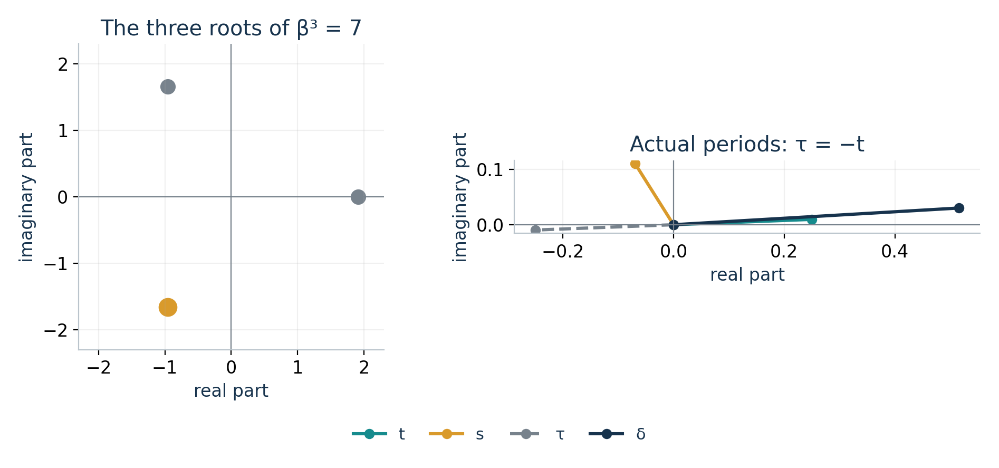
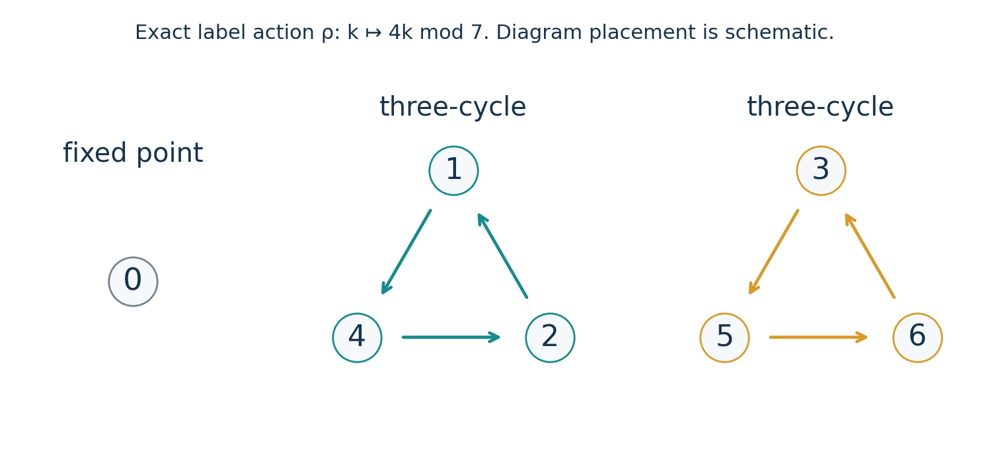
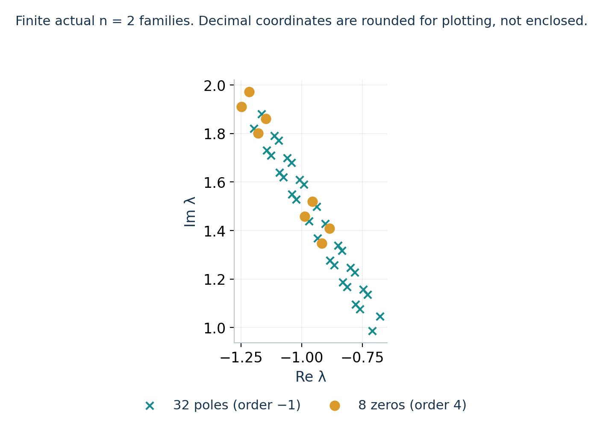
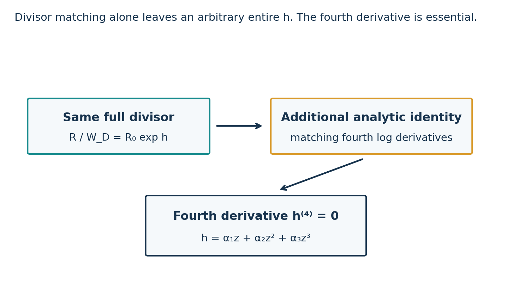
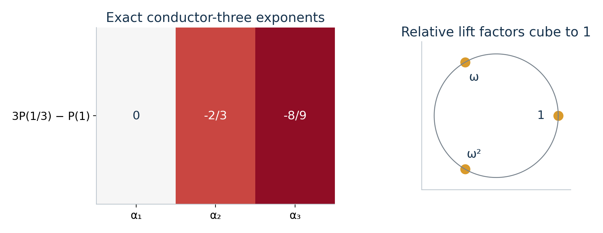

# Cubic Divisor Transport and Reconstruction

**Komorebi P. · Final traditional companion edition · October 7, 2026**

## Abstract

For a fixed pure-cubic elliptic-gamma specialization, we give the complete signed divisor of its principal-seven correction through an integer ceiling formula. Explicit families establish cubic growth of both zeros and poles. This excludes a precisely specified class of finite fixed-period theta expressions along affine lines. An ungrouped absolutely convergent genus-three divisor product cancels every singularity; an exact fourth logarithmic derivative forces the remaining factor to be a cubic exponential. Reflection and a period-one transition then determine its quadratic and cubic coefficients and give a branch-free special-cube reconstruction. The development includes the normalized fifth-torsion kernel, finite norm transport, the explicit conductor and modulus comparison, and the polarized remaining arithmetic target. The reconstruction is complex analytic. It does not prove the original gamma/class-field identity or solve Hilbert’s twelfth problem. Fresh exact, numerical and Lean checks are reported with their finite scopes; the current Lean core covers integer coefficient algebra rather than the analytic reconstruction.

## Fixed data, conventions, and the claim boundary

Fix throughout 
$$
\begin{aligned}
 \omega&=e^{2\pi i/3},&\beta&=7^{1/3}\omega^2,&\epsilon&=2-\beta,&\rho&=\epsilon^{-1},\\
 \tau&=(\beta^2+2\beta)/15,&t&=-\tau,&s&=-(\beta+2)/15,&
 \delta&=(\tau+2s+4)/7.
\end{aligned}$$ The real cube root $7^{1/3}$ is positive; this fixes the lower complex embedding of $\beta$. We have $\Im t,\Im s,\Im\delta>0$, $\Im\tau<0$ and $|\rho|<1$. The last follows from $N(\epsilon)=1$ and $0<2-7^{1/3}<1$ at the real embedding. The numbers $1,t,s$ are rationally independent: a rational linear relation becomes a polynomial of degree at most two in $\beta$, contradicting its irreducible cubic minimal polynomial.

*The chosen cubic embedding and its actual periods. The right panel has equal aspect; rounded drawing coordinates illustrate the exact definitions in [(1)](#eq:fixed-data).*

For positive imaginary periods use the additive product convention 

$$\begin{aligned}
 \theta_0(z;a)&=\prod_{n\ge0}(1-e^{2\pi i(z+na)})(1-e^{2\pi i((n+1)a-z)}),\\
 \Gamma_{\rm ell}(z;a,b)&=\prod_{j,k\ge0}
 \frac{1-e^{2\pi i((j+1)a+(k+1)b-z)}}{1-e^{2\pi i(ja+kb+z)}}.
\end{aligned}$$ The negative-first-period continuation is $$\Gamma_{\rm ell}(z;-t,s)=\Gamma_{\rm ell}(z+t;t,s)^{-1}.$$ Consequently the main scalar function is $$F(z)=\frac{\Gamma_{\rm ell}(z;\tau,s)^5}{\Gamma_{\rm ell}(5z;5\tau,5s)}
 =\frac{\Gamma_{\rm ell}(5(z+t);5t,5s)}{\Gamma_{\rm ell}(z+t;t,s)^5},
 \qquad U_\Gamma=F(1/3).$$ This convention agrees with the checked primary authors’ copy of Bergeron–Charollois–García [\[1\]](#bib:BCG). All analytic identities at removable or polar points mean meromorphic identities. Pointwise divisions require nonzero denominators.

Put $q_a(z)=\theta_0(z;a)^5/\theta_0(5z;5a)$. Direct product identities and the inherited modular normalization give 
$$
\begin{aligned}
 F(z+1)&=F(z),&\frac{F(z+\tau)}{F(z)}&=q_s(z),&
 \frac{F(z+s)}{F(z)}&=q_t(z)^{-1},\\
 q_s(z)&=q_t(\rho z),&F(0)&=\epsilon^2,&F(1/3)F(2/3)&=1.
\end{aligned}$$ The two elliptic lattices are homothetic, $\rho\Lambda_s=\Lambda_t$, with $\Lambda_a=\mathbb Z+\mathbb Za$. This is not an endomorphism of the single elliptic lattice $\Lambda_t$. Section [2](#sec:theta) proves the exact rational fifth-torsion normalization and explains the covariance without omitting its scalar.

We use $F_0=\mathbb Q(\omega)$ for the imaginary-quadratic field, to separate it from the scalar gamma function $F$. The eta quotient is $\mathcal H(a)=\eta(5a)/\eta(a)^5$; the integer step function $H(n)$ used in the divisor formula is a different object. The symbol $R_0$ is the scalar anchor, while $R_*$ is a counting cutoff radius. In the arithmetic block $\varrho$ is a ray character and a radical lift, as explicitly indicated there; it is distinct from the contracting period multiplier $\rho$.

### The arithmetic candidate is fixed independently

Let $J=2+3\omega$ and choose the Gauss branch $$X=\beta^{-1}\sum_{a=1}^{6}\chi_7(a)e^{6\pi ia/7},\qquad
 (\chi_7(1),\ldots,\chi_7(6))=(1,\omega,\omega^2,\omega^2,\omega,1),\quad X^3=J.$$ Then $E=\mathbb Q(\omega,\beta,X)$ has degree eighteen. The retained arithmetic construction defines $$\begin{aligned}
 \nu&=(X+\beta/X-\beta^2)/3,&v&=-\beta^2\nu-2\nu^2,\\
 Y&=(4\beta^2+\beta-14)v^2+(11\beta-23)v-\beta^2+3\beta-3,\\
 Z&=\frac{(-2\beta^2+7\beta-8)v^2+(-10\beta^2+11\beta+17)v}{3}
       +7-\beta-\beta^2,\\
 U_{\rm alg}&=\frac{Y-(1+2\omega)Z}{2}.
\end{aligned}$$ These formulas choose no coefficient or branch by fitting $U_\Gamma$. The original desired identity is $U_\Gamma=U_{\rm alg}$. The established modulus comparison is $|U_\Gamma|=|U_{\rm alg}|$. The remaining exact phase comparison is stated in Section [9](#sec:remaining); neither numerical proximity nor the analytic reconstruction supplies it.

## Canonical fifth-torsion normalization

*Source anchor N: preserved mathematical development; exact source path and hash are in the claim/source inventory. Retained local equation numbers carry this prefix.*

### Analytic input and conventions

Let $t$ be any point of the upper half-plane and $E_t=\mathbb C/(\mathbb Z+\mathbb Zt)$. The classical product convention is [\[1\]](#bib:BCG)

$$\theta_0(z;t)=\prod_{n\ge0}(1-e^{2\pi i(z+nt)})(1-e^{2\pi i((n+1)t-z)}).$$

Retain from the preceding multiplication-norm proof:

$$\operatorname{div}(q_t)=4[0]-[P]-[-P]-[2P]-[-2P],\qquad P=1/5,$$

and, for $n$ prime to five,

$$\prod_{\eta\in E_t[n]}q_t(z+\eta)=q_t(nz).                  \tag{N1.1}$$

The scalar in (N1.1) is exactly one. This is important: an unspecified norm multiplier would not suffice below. The inherited proof derives (N1.1) from the theta product by finite real root-of-unity averaging and vertical residue splitting. This block also tests it at the required nonzero two- and three-torsion points independently of the rational formula.

The normalization can also be checked directly here. Finite root averaging gives

$$\prod_{a=0}^{n-1}\theta_0(w+a/n;t)=\theta_0(nw;nt).$$

Next, splitting the two defining products into vertical residues gives

$$\prod_{b=0}^{n-1}\theta_0(nz+bt;nt)=\theta_0(nz;t).$$

For the smoothing denominator, multiplication by five permutes the real residues modulo n; the same two steps apply with period 5t. The numerator becomes $\theta_0(nz;t)^5$ and the denominator becomes $\theta_0(5nz;5t)$. This proves (N1.1) with no omitted multiplier and without using the unknown scalar $c_t$.

Write

$$x(z)=\wp_t(z),\quad y(z)=\wp_t'(z),\quad
 f(X)=4X^3-g_2X-g_3.$$

The classical equation is $y(z)^2=f(x(z))$. The addition and duplication laws used below are those of this convention [\[7\]](#bib:DLMFWeierstrass). In particular the y-coordinate here is the full Weierstrass derivative, not its half.

Set

$$a=x(P),\quad b=x(2P),\quad d=a-b,\quad y_a=y(P),\quad y_b=y(2P),$$

$$Q_5(X)=(X-a)(X-b).$$

All of $d,y_a,y_b$ are nonzero: a point of exact order five is neither two-torsion nor equal up to sign to its double. Comparing divisors yields a nonzero scalar $c_t$ with

$$q_t(z)=c_t/Q_5(x(z)).                                    \tag{N1.2}$$

Also $q_t(z)\sim c_tz^4$ at zero. The problem in this development is to determine this scalar exactly without a choice of cube root or eta multiplier.

### A scalar is fixed by two coprime norm exponents

Suppose two nonzero elliptic functions with the same divisor differ by a scalar $r$, and both satisfy the exactly normalized degree-two and degree-three multiplication laws. On the degree-four and degree-nine fibers those laws imply

$$r^4=r,\qquad r^9=r.$$

Thus $r^3=r^8=1$, and

$$r=(r^3)^3/r^8=1.                                       \tag{N2.1}$$

More generally, if $c^3=A$ and $c^8=B$ with $c\ne0$, then

$$\boxed{c=A^3/B.}                                       \tag{N2.2}$$

This is a uniqueness and recovery statement within a fixed divisor class. It does NOT say that arbitrary functions are determined by two norms. In particular it does not contradict the nonconstant norm-one factor established in the preceding note.

The commutative-group statements (N2.1)-(N2.2), including uniqueness and the fixed-norm conditions, are formalized in `H12CoprimeNormalization`.

### The fifth-torsion ordinate identity

Since $2P$ doubles to $4P=-P$, let $\ell,m$ be the full-y tangent slopes at $P,2P$. The addition law gives

$$\ell^2=4(2a+b),\quad m^2=4(a+2b),$$

$$\ell d=y_a+y_b,\qquad md=y_a-y_b.                       \tag{N3.1}$$

Subtract the squares of the last two equalities:

$$4y_ay_b=(\ell^2-m^2)d^2=4d^3.$$

Therefore

$$\boxed{y_ay_b=d^3,\qquad f(a)f(b)=d^6.}                 \tag{N3.2}$$

The polynomial implication from (N3.1) to (N3.2) is formalized. The fact that the actual elliptic points satisfy (N3.1) is supplied by the ordinary group-law argument here, not by an undeclared formal assumption.

Define the third division polynomial in this convention:

$$\psi_3(X)=3X^4-\tfrac32g_2X^2-3g_3X-\tfrac1{16}g_2^2,$$

and the duplication numerator

$$\phi_2(X)=X^4+\tfrac12g_2X^2+2g_3X+\tfrac1{16}g_2^2.$$

The identities

$$Xf(X)-\phi_2(X)=\psi_3(X),\qquad
 b=\phi_2(a)/f(a),\quad a=\phi_2(b)/f(b)$$

give

$$\psi_3(a)=f(a)d,\qquad \psi_3(b)=-f(b)d.$$

Consequently

$$\boxed{\psi_3(a)\psi_3(b)=-d^8.}                        \tag{N3.3}$$

The minus sign in (N3.3) is retained. It disappears only after the square used below.

### Evaluate both scalar powers without ambiguity

Let $z\to0$ in (N1.1). The fourth-order zero gives

$$\boxed{\prod_{\eta\in E_t[n]\setminus\{0\}}q_t(\eta)=n^4}
 \quad(5\nmid n).                                      \tag{N4.1}$$

#### Degree two

The three x-coordinates of nonzero two-torsion are the roots of $f(X)/4$. Hence

$$\prod_{\eta\in E_t[2]\setminus\{0\}}Q_5(x(\eta))
 =\frac{f(a)f(b)}{16}.$$

Using (N4.1),

$$c_t^3=16\prod_{\eta\ne0}Q_5(x(\eta))=f(a)f(b)=d^6.       \tag{N4.2}$$

Degree two alone determines $c_t/d^2$ only up to a cube root of unity.

#### Degree three

The eight nonzero three-torsion points have four x-coordinates, each repeated twice; those coordinates are the roots of $\psi_3(X)/3$. Therefore

$$\prod_{\eta\in E_t[3]\setminus\{0\}}Q_5(x(\eta))
 =\left(\frac{\psi_3(a)\psi_3(b)}9\right)^2.$$

The $3^4=81$ in (N4.1) cancels the denominator:

$$c_t^8=(\psi_3(a)\psi_3(b))^2=d^{16}.                    \tag{N4.3}$$

Combining the coprime exponents in (N4.2)-(N4.3),

$$\boxed{c_t=(c_t^3)^3/c_t^8=d^{18}/d^{16}=d^2.}           \tag{N4.4}$$

This closes the scalar-normalization subproblem completely.

### Canonical theta normal form

Equations (N1.2) and (N4.4) prove

$$\boxed{
 q_t(z)=\frac{(a-b)^2}{(x(z)-a)(x(z)-b)}
       =\frac{\operatorname{disc}(Q_5)}{Q_5(x(z))}.
 }                                                       \tag{N5.1}$$

Writing $S_5=a+b$ and $P_5=ab$, the symmetric form is

$$q_t(z)=\frac{S_5^2-4P_5}{x(z)^2-S_5x(z)+P_5}.            \tag{N5.2}$$

Thus the formula depends on the unordered fifth-torsion kernel, not a choice between its two x-coordinates. Under a change of generator $P\mapsto2P$, $a,b$ swap and the formula is unchanged.

Define a dimensionless elliptic coordinate

$$\mathsf X_t(z)=\frac{x(z)-a}{a-b}.$$

Then

$$\boxed{q_t(z)=\frac1{\mathsf X_t(z)(\mathsf X_t(z)+1)}.}   \tag{N5.3}$$

Swapping $a,b$ changes $\mathsf X$ to $-1-\mathsf X$, leaving (N5.3) fixed. Scaling all Weierstrass x-coordinates by the same nonzero factor also leaves the formula fixed. These field identities are formalized in `H12CanonicalTheta`.

The identities are interpreted meromorphically at their zeros and poles. Numerical pointwise evaluations and group-valued Lean applications use nonzero sampled values.

### An explicit order-five plane-curve normalization

The same calculation places the entire elliptic curve in an order-five normal form without adjoining square roots. Put

$$u=-y_b/y_a,\qquad \lambda=y_a/d,$$

and for an arbitrary point $(x,y)$, define

$$X=\frac{x-a}{\lambda^2},\qquad
 Y=\frac{y-y_a-(1-u)\lambda(x-a)}{2\lambda^3}.$$

Then

$$\boxed{Y^2+(1-u)XY-uY=X^3-uX^2,}                        \tag{N6.1}$$

with $P=(0,0)$, $2P=(u,u^2)$, and

$$\boxed{q_t(z)=\frac{u^2}{X(z)(X(z)-u)}.}                  \tag{N6.2}$$

Here is a derivation rather than an assumption of that model. From (N3.2),

$$d=-u\lambda^2,\quad y_a=-u\lambda^3,\quad y_b=u^2\lambda^3.$$

The first tangent slope is $(1-u)\lambda$. Equation (N3.1) therefore gives

$$a=\lambda^2(1-6u+u^2)/12.$$

Writing $b_2=1-6u+u^2$, $b_4=u^2-u$, the derivative and curve equation imply

$$g_2=\lambda^4(b_2^2/12-2b_4),\quad
 g_3=\lambda^6(-b_2^3/216+b_2b_4/6-u^2).$$

Substitution proves (N6.1). This coefficient calculation is independently checked symbolically over $\mathbb Q(u)$ and numerically at the specified analytic lattices. The full geometric change-of-variables theorem is not Lean-formalized in the corresponding source checkpoint.

The parameter $u$ remains analytically defined. Calling the curve a rational normal form does not assert that $u$ is an algebraic number at the cubic period.

### The actual cubic inter-chart covariance

Return to

$$\beta^3=7,\quad\epsilon=2-\beta,\quad\rho=\epsilon^{-1},
 \quad t=-(\beta^2+2\beta)/15,\quad s=-(\beta+2)/15.$$

The retained modular relation gives $\rho\Lambda_s=\Lambda_t$. Since

$$\rho=4-15t,\quad\rho/5\equiv-1/5\pmod{\Lambda_t},$$

scaling of the Weierstrass function gives

$$a_s=\rho^2a_t,\quad b_s=\rho^2b_t,\quad c_s=\rho^4c_t,$$

and hence

$$\mathsf X_t(\rho z)=\mathsf X_s(z),\qquad
 \boxed{q_t(\rho z)=q_s(z).}                              \tag{N7.1}$$

Thus the phase-free theta covariance has a proof through the canonical fifth-torsion normal form as well as its earlier eta-multiplier proof. This statement is about two homothetic elliptic lattices, not an endomorphism of the single lattice $\Lambda_t$.

### Recovery of every signed unit carry

Use the predecessor’s conventions

$$w_v=\tfrac13+(b\tau+cs+a)/2,\quad v=(b,c,a)\in\{0,1\}^3,
 \quad T(b,c,a)=(a,b,c),\quad \tau=-t.$$

Its proved unit carry is

$$F(\rho w_v)=F(w_{Tv})B_v,\qquad
 B_v=\prod_{j=0}^{A_v-1}q_t(w_{T^2v}+js),
 \quad A_v=5+4b-2c+7a.$$

By (N5.3) this now has the exact expression

$$\boxed{
 B_v=\prod_{j=0}^{A_v-1}
 \frac1{\mathsf X_t(w_{T^2v}+js)
             (\mathsf X_t(w_{T^2v}+js)+1)}.
 }                                                       \tag{N8.1}$$

This includes the full normalization of every factor. It does not discard the scalar.

The predecessor’s signed gains were, in bit-index order,

$$(76,-28,8,0,-16,0,0,0).$$

When written with the unnormalized denominators $Q_5$, the corresponding known powers of $d=a-b$ are

$$(152,-56,16,0,-32,0,0,0).$$

In particular, the aggregate of the three first-order carries retains the factor

$$c_t^{-36}=d^{-72}.                                      \tag{N8.2}$$

It would be false to set this factor to one. Formula (N8.1) incorporates it automatically.

The same substitution works for every oriented three-step return product $J_{n,v}$ from the predecessor. Consequently ALL seven nontrivial signed-channel limits have finite rational elliptic expressions without a separately supplied eta constant. The first-order limits still have only their guaranteed first-order local cancellation; this normalization change does not upgrade their convergence rate.

These facts use the inherited analytic return theorem. Its limit remains the actual signed gamma value; it has not been independently evaluated in the ray field.

## Conductors and finite multiplication-norm transport

*Source anchor T: foundation v0.1–v0.4. These transport results concern analytic elliptic functions or their divisor classes, not an arithmetic evaluation of their coefficients.*

### Exactly normalized elliptic norms

On $E_t=\mathbb C/\Lambda_t$ define $N_nf(w)=\prod_{nz=w}f(z)$ for integers $n\ge1$, with all $n^2$ preimages counted. The product is independent of the representative lift. Root-of-unity averaging and vertical residue splitting in [(2)](#eq:theta-product) give 
$$
 N_nq_t(w)=\begin{cases}q_t(w),&5\nmid n,\\1,&5\mid n.\end{cases}$$ In the prime-to-five case the two product identities are $$\prod_{a=0}^{n-1}\theta_0(z+a/n;t)=\theta_0(nz;nt),\qquad
 \prod_{b=0}^{n-1}\theta_0(nz+bt;nt)=\theta_0(nz;t).$$ Multiplication by five permutes the real residues in the smoothing denominator. When $5\mid n$, real averaging retains only frequencies already deleted by fifth smoothing. This proves the scalar one in both cases, rather than a norm formula up to a root of unity.

The point $S=s\bmod\Lambda_t$ has infinite order by rational independence. Put $$\psi(w)=\frac{q_t(w)^2}{q_t(2w)q_t(2w+s)}.$$

**Proposition 3.1** (All finite norms of the return kernel). *For every integer $n\ge1$, $$N_n\psi(w)=
 \begin{cases}
 1,&5\mid n,\\[2pt]
 \displaystyle\frac{q_t(w)^2}{q_t(2w)q_t(2w+ns)},&5\nmid n,\ n\text{ odd},\\[7pt]
 \displaystyle\frac1{q_t(w)^2q_t(w+ks)^4},&5\nmid n,\ n=2k.
 \end{cases}$$*

*Proof.* For odd $n$, doubling permutes $E_t[n]$. For $n=2k$, it maps $E_t[n]$ to $E_t[k]$ with four lifts per point, so each denominator norm is a fourth power. Apply [(5)](#eq:qnorm) and cancel the numerator. If $5\mid n$ then all these norms are one, including the even case since $5\mid k$. ◻

For $n=2k+1$ prime to five, $B_k(w)=\prod_{j=0}^{k-1}q_t(2w+(2j+1)s)$ gives $$N_{2k+1}\psi(w)=\psi(w)\frac{B_k(w)}{B_k(w+s)}.$$ For $n=2k$ prime to five, $C_k(w)=\prod_{j=0}^{k-1}q_t(w+js)^4$ gives $$N_{2k}\psi(w)=q_t(w)^{-6}\frac{C_k(w)}{C_k(w+s)}.$$ Finite products therefore retain explicit endpoint multipliers. Closing a permutation of labels does not remove them or fix the scalar normalization of a separate orbit.

### The exact information lost by doubling

Quotient nonzero meromorphic elliptic functions by constants and translation coboundaries $A(w+s)/A(w)$. Set $e=[q_t]$, $p=[\psi]$ in additive notation. These generate a free $\mathbb Z^2$: the divisor charges on the disjoint infinite translation orbits of $0$ and $-S/2$ are respectively $(4,4)$ and $(0,-4)$. A finite divisor coboundary has charge zero on every orbit by telescoping, so a relation $ae+bp=0$ forces $b=0$ then $a=0$.

The norm matrices on this free subgroup are $$N_n=I\quad(n\text{ odd},5\nmid n),\qquad
 N_n=\begin{pmatrix}1&-6\\0&0\end{pmatrix}\quad(n\text{ even},5\nmid n),\qquad
 N_n=0\quad(5\mid n).$$ The middle matrix is a split integral projector with image $\mathbb Z(1,0)$ and kernel $\mathbb Z(6,1)$. Its primitive kernel class $6e+p$ is nonzero, as its two charges are $28,-4$. Thus repeated full doubling cannot recover the deleted component. The residue-ten matrix law is multiplicative; its finite coefficient statement belongs to the inherited formal core, whereas the application of divisors to analytic functions is an ordinary argument.

### The fifth-isogeny differential retains its constant

Let $a=\wp_t(1/5)$, $b=\wp_t(2/5)$ and $L_t=(q_t'/q_t)'$. The enlarged lattice is $\Lambda_t^+=\tfrac15\mathbb Z+\mathbb Zt$, with $\wp_+(z)=25\wp_{5t}(5z)$. The degree-five quotient satisfies 
$$
 L_t(z)=\wp_+(z)-5\wp_t(z)+2(a+b).$$ At zero $L_t$ has principal part $-4/z^2$; at the four nonzero kernel points it has $+1/(z-P_j)^2$, with no simple-pole terms. Thus $L_t-\wp_++5\wp_t$ is a constant elliptic function. The canonical formula gives $q_t(z)=(a-b)^2z^4[1+(a+b)z^2+O(z^4)]$, fixing that constant as $2(a+b)$. The degree-five quotient is equivalently the paired sum $$\wp_+(z)=\wp_t(z)+\sum_{j=1}^{4}[\wp_t(z+j/5)-\wp_t(j/5)].$$ The analytic identity determines a rational isogeny map once elliptic coordinates are chosen. It does not assert that the period-dependent parameter is an algebraic number or identify this cubic-period curve with the separate equianharmonic CM curve.

## Arithmetic conductors and the exact modulus comparison

*Source anchor A: preserved mathematical development; exact source path and hash are in the claim/source inventory. Retained local equation numbers carry this prefix.*

### Fixed conventions and inherited arithmetic

Set

$$\omega=e^{2\pi i/3},\quad \beta=7^{1/3}\omega^2,\quad
J=2+3\omega,\quad \bar J=-1-3\omega,\quad J\bar J=7.$$

Write

$$F_0=\mathbb Q(\omega),\qquad K=\mathbb Q(\beta),\qquad
\epsilon=2-\beta,\qquad \mathcal R=-\log(2-7^{1/3})>0.$$

Here $\mathcal R$ is the regulator of $K$, and

$$\log|\epsilon|=\mathcal R/2. \tag{A1.1}$$

Indeed, $N_{K/\mathbb Q}(\epsilon)=1$ and its real image is $2-7^{1/3}$. The class number is three and $\epsilon$ is a fundamental unit. These arithmetic facts are recorded in BCG, section 5.2; the earlier unramified-cubic note also proves the class-number and ray-field identification used here.

Take

$$\mathfrak f=(3,\beta-1),\qquad
E=K(\omega,\theta),\qquad \theta=2\cos(6\pi/7).$$

The inherited arithmetic proof identifies $E$ as the narrow ray class field of modulus $\mathfrak f$ and the real place. It has degree six over $K$ and degree eighteen over $\mathbb Q$.

Let

$$X=\frac1\beta\sum_{a=1}^{6}\chi_7(a)e^{6\pi ia/7},$$

where the character values for $a=1,\ldots,6$ are $1,\omega,\omega^2,\omega^2,\omega,1$. Then

$$X^3=J,\qquad E=\mathbb Q(\beta,X,\omega). \tag{A1.2}$$

This fixes a specific cube-root branch. The preceding CM note proves, with this branch,

$$X=\frac{\Omega^2}{\wp_{\Lambda_0}(1/J)},\qquad
\Lambda_0=\mathbb Z+\mathbb Z\omega,\qquad
\Omega=e^{\pi i/6}\frac{\Gamma_{\rm Euler}(1/3)^3}{2\pi}. \tag{A1.3}$$

That proof uses actual seven-torsion and a lattice estimate for the branch, not numerical recognition.

The arithmetic Frobenius $\sigma$ at the norm-two prime acts by

$$\sigma(\beta)=\beta,\quad \sigma(\omega)=\omega^2,\quad
\sigma(X)=\omega\beta/X. \tag{A1.4}$$

The norm-five prime has the same Artin class. In particular, $\sigma$ generates $\operatorname{Gal}(E/K)$.

**Actual complex conjugation is a different automorphism.** Denote it by $\kappa$. In the chosen embedding,

$$\kappa(\beta)=\omega^2\beta,\quad \kappa(\omega)=\omega^2,
\quad \kappa(X)=\omega\beta/X. \tag{A1.5}$$

For the last formula, the conjugate Gauss resolvent is $7/G$, and $\bar\beta=\omega^2\beta$. Formula (A1.5) follows directly. It must not be replaced by the involution $\sigma^3$, which fixes $K$.

### The major change of route: Artin induction

The splitting field $F_0(\beta)/\mathbb Q$ has group $S_3$, while $\mathbb Q(\theta)/\mathbb Q$ is cyclic cubic. Their intersection is Galois over $\mathbb Q$; it cannot have degree three because $S_3$ has no cyclic cubic quotient. Hence

$$\operatorname{Gal}(E/\mathbb Q)=S_3\times C_3. \tag{A2.1}$$

Use generators

$$r:\beta\mapsto\omega\beta,\qquad
c:\omega\mapsto\omega^2,\qquad
s_0:\theta\mapsto\theta^2-2,$$

where each generator fixes the other specified primitive generators as appropriate. Thus $r,c$ generate the $S_3$ factor, $c$ fixes $\beta,\theta$, and $s_0$ generates the second factor. We have

$$\operatorname{Gal}(E/K)=\langle c,s_0\rangle,
\qquad \sigma=cs_0,
\qquad \operatorname{Gal}(E/F_0)=\langle r,s_0\rangle.$$

Let $\varrho(r)=\omega,\varrho(s_0)=1$, and let $\eta(s_0)=\omega,\eta(r)=1$. The three odd ray characters of $K$ are

$$\chi_j(c)=-1,\qquad \chi_j(s_0)=\omega^j,\qquad j=0,1,2.$$

The elementary character identity

$$\operatorname{Ind}_{C_2}^{S_3}(\operatorname{sgn})
=\operatorname{sgn}\oplus\operatorname{Std},
\qquad
\operatorname{Std}=\operatorname{Ind}_{C_3}^{S_3}(\varrho)$$

and induction invariance of Artin L-functions give

$$\boxed{L_K(s,\chi_j)
=L_{\mathbb Q}(s,\chi_{-3}\chi_7^j)\,
L_{F_0}(s,\varrho\eta^j).} \tag{A2.2}$$

For $j=0$, use the primitive Dirichlet character of conductor three, not its imprimitive extension to modulus twenty-one. All three odd ray characters are ramified at $\mathfrak f$, so their Artin L-functions agree with the partial-zeta convention omitting that prime. Induction includes the local factors at ramified primes through the inertia-invariant spaces. No unproved Artin holomorphy statement is used.

The even characters make no contribution to the derivative at zero. The nontrivial even characters have at least two archimedean zeros. The trivial character has the zero of $\zeta_K$, together with the extra zero of $1-3^{-s}$. This also agrees with BCG, section 3.1.

Exact finite Dirichlet sums give

$$D_0=L(0,\chi_{-3})=1/3,\qquad
D_1=L(0,\chi_{-3}\chi_7)=-2\omega,\qquad
D_2=-2\omega^2. \tag{A2.3}$$

For example, the latter two use $-21^{-1}\sum_{a=1}^{21}a\chi_{-3}(a)\chi_7(a)^j$.

For the untwisted cubic factor,

$$L_{F_0}(s,\varrho)=\zeta_K(s)/\zeta_{\mathbb Q}(s).$$

The analytic class number formula, $h_K=3$, and $\zeta_{\mathbb Q}(0)=-1/2$ give

$$L_{F_0}'(0,\varrho)=3\mathcal R. \tag{A2.4}$$

Thus the cubic regulator contributes a known normalization; it is not a free scalar left over from a cocycle.

### A six-class imaginary-quadratic calculation

Put $\lambda=\varrho\eta$. Since both $r$ and $s_0$ send $X$ to $\omega^2X$, $\lambda$ is the inverse Kummer character for $F_0(X)/F_0$. Its conductor is

$$\mathfrak m=3J\mathscr O_{F_0}. \tag{A3.1}$$

Here is an explicit verification. The Eisenstein integers are principal, and the six units map bijectively to $(\mathscr O_{F_0}/3)^\times$. Every ideal coprime to three therefore has a unique generator $\alpha\equiv1\pmod3$. Since $J\equiv-1\pmod3$, cubic reciprocity gives

$$\lambda((\alpha))=(J/(\alpha))_3^2=(\alpha/J)_3^2. \tag{A3.2}$$

This proves that the conductor divides $3J$. It must contain $J$, because the valuation of the Kummer radicand there is one. If its exponent at the prime above three were at most one, its conductor would divide $(1-\omega)J$. The ray class group of that modulus has order two, so it has no nontrivial cubic character. Hence the conductor is exactly (A3.1).

The ray group modulo $3J$ has order

$$\frac{63(1-1/3)(1-1/7)}6=6.$$

Its six classes have unique primary rational representatives

$$1,4,10,13,16,19.$$

Reduction modulo $J$ sends $\omega$ to $4\in\mathbb F_7$. Formula (A3.2) groups the representatives as follows:

| Index $m$ | Representatives | $\lambda$-value |
|:----------|:----------------|:----------------|
|           | 1, 13           | 1               |
| 1         | 4, 10           | $\omega$        |
| 2         | 16, 19          | $\omega^2$      |

Let $Z_m(s)$ be the sum of the two ray partial zeta functions in row $m$, and write $\ell_m=Z_m'(0)$. Then

$$L_{F_0}'(0,\lambda)=\ell_0+\omega\ell_1+\omega^2\ell_2,
\qquad
L_{F_0}'(0,\lambda^2)=\ell_0+\omega^2\ell_1+\omega\ell_2. \tag{A3.3}$$

The sum of all six ray partial zeta functions is

$$\zeta_{F_0}(s)(1-3^{-s})(1-7^{-s}),$$

whose derivative at zero vanishes. Therefore

$$\ell_0+\ell_1+\ell_2=0. \tag{A3.4}$$

Conjugation of the base field by $c$ sends $\varrho\eta^2$ to $\varrho^{-1}\eta^2=\lambda^2$, so

$$L_{F_0}(s,\varrho\eta^2)=L_{F_0}(s,\lambda^2).$$

Combining (A2.2)–(A3.4) and performing inverse Fourier transformation on $C_2\times C_3$ yields

$$\boxed{\zeta_{\mathfrak f}'(c^e s_0^k,0)
=(-1)^e\left(\frac{\mathcal R}{6}-\ell_{k-1}\right).} \tag{A3.5}$$

All subscripts on $\ell$ are taken modulo three. To check the constants directly, the two nontrivial Fourier contributions are

$$-\frac13\left(\omega^{1-k}L_{F_0}'(0,\lambda)
+\omega^{2-2k}L_{F_0}'(0,\lambda^2)\right).$$

In (A3.3), the coefficient of $\ell_{k-1}$ in the parentheses is two and the other two coefficients are minus one. Equation (A3.4) turns the parentheses into $3\ell_{k-1}$.

**Euler-factor warning.** Replacing $3J$ by $21=3J\bar J$ would remove the Euler factor at the other prime over seven. Its $\lambda$-value is one, so this inserts $1-7^{-s}$ and destroys the desired first derivative. That imprimitive derivative is zero. The checker verifies this as a separate normalization control, not as the desired L-value.

### Kronecker normalization fixed explicitly

For $z=a\omega+b\notin\Lambda_0$, define the positive quantity

$$H(z)=e^{-\pi\operatorname{Im}(\omega)B_2(a)}
|1-e^{2\pi iz}|
\prod_{n\ge1}|(1-e^{2\pi i(n\omega+z)})(1-e^{2\pi i(n\omega-z)})|,
\tag{A4.1}$$

where initially $0\le a<1$ and $B_2(a)=a^2-a+1/6$. This is the absolute value of the usual Siegel function. Its value is independent of the representative of $z$ modulo $\Lambda_0$.

For the shifted Epstein series

$$\mathcal E_z(s)=\sum_{m,n\in\mathbb Z}|m+n\omega+z|^{-2s},$$

continued from $\Re s>1$, the precise normalization is

$$\mathcal E_z(0)=0,\qquad \mathcal E_z'(0)=-2\log H(z). \tag{A4.2}$$

A normalization derivation is given in the normalization subsection below (source A8). In particular, no factor of two is inferred from an unspecified Mellin convention.

For the ray class represented by $\alpha$, all its integral ideals are generated exactly once by the elements of $\alpha+3J\mathscr O_{F_0}$. The congruence condition eliminates all nontrivial units. Therefore its partial zeta function is

$$63^{-s}\mathcal E_{\alpha/(3J)}(s).$$

There is no scale contribution to its derivative, because $\mathcal E_z(0)=0$. Set

$$V_0=H(1/(3J))H(13/(3J)),$$ $$V_1=H(4/(3J))H(10/(3J)),\qquad
V_2=H(16/(3J))H(19/(3J)).$$

Then

$$\ell_m=-2\log V_m,
\qquad V_0V_1V_2=1. \tag{A4.3}$$

### The CM products collapse to three explicit units

Let $u=1/J$ and $T=\bar J/3\equiv2/3\pmod{\Lambda_0}$. The three pairs of points above are, respectively,

$$\{T\pm2u\},\quad\{T\pm u\},\quad\{T\pm3u\}. \tag{A5.1}$$

Indeed, $T=7u/3$, so their numerators over $3J$ are $1,13$, $4,10$, and $-2,16$. The last numerator $-2$ may be replaced by $19$ since $21/(3J)=\bar J\in\Lambda_0$.

On the normalized curve $E_0:y^2+y=x^3$, set

$$x(z)=\wp_{\Lambda_0}(z)/\Omega^2.$$

The previous seven-torsion proof gives

$$x(u)=X^{-1},\quad x(2u)=\omega^2X^{-1},\quad x(3u)=\omega X^{-1}. \tag{A5.2}$$

Also,

$$x(T)=-\omega. \tag{A5.3}$$

For completeness, $T$ is nonzero three-torsion and its normalized x-coordinate is a root of $3x(x^3+1)$. The lattice is invariant under ordinary conjugation, so $\wp(1/3)$ and its derivative are real. Since $g_3(\Lambda_0)>0$, the real differential equation $\wp'^2=4\wp^3-g_3$ implies $\wp(1/3)>0$. The argument of $\Omega^2$ is $\pi/3$, selecting $-\omega$ among the three roots of $x^3=-1$.

The classical sigma addition identity is

$$\frac{\sigma_\Lambda(T+z)\sigma_\Lambda(T-z)}{
\sigma_\Lambda(T)^2\sigma_\Lambda(z)^2}
=\wp_\Lambda(z)-\wp_\Lambda(T). \tag{A5.4}$$

The theta expression for (A4.1), or the sigma–theta relation, turns (A5.4) into the same identity for absolute Green functions up to a constant independent of $z$. The quadratic exponential corrections cancel by the parallelogram identity. Furthermore, $H(\omega z)=H(z)=H(-z)$, either from (A4.2) and the isometries of $\Lambda_0$, or from the theta transformations.

Since $2u\equiv\omega^2u$ and $3u\equiv-\omega u$, all three factors $H(ku)$ are equal. Thus for one positive constant $C$, the same for all three rows,

$$V_0=C|\omega^2/X+\omega|,\quad
V_1=C|1/X+\omega|,\quad
V_2=C|\omega/X+\omega|. \tag{A5.5}$$

Multiplication and (A4.3) give $C^3|X^{-3}+1|=1$. Cubing each equation in (A5.5) now removes the unknown constant exactly:

$$\boxed{V_m^3=|a_m|,} \tag{A5.6}$$

where the three algebraic values simplify to

$$\begin{aligned}
a_0&=\frac{(\omega^2+\omega X)^3}{1+J}
=(1+\omega)X^2-X+1,\\
a_1&=\frac{(1+\omega X)^3}{1+J}
=-X^2+(1+\omega)X+1,\\
a_2&=\frac{(\omega+\omega X)^3}{1+J}
=-\omega X^2-\omega X+1.
\end{aligned} \tag{A5.7}$$

Exact reduction gives

$$a_0+a_1+a_2=3,\qquad
\sum_{i<j}a_i a_j=6\omega,\qquad a_0a_1a_2=1.$$

In particular, the $a_m$ are algebraic units, satisfying

$$a_m^3-3a_m^2+6\omega a_m-1=0. \tag{A5.8}$$

Equations (A4.3) and (A5.6) prove

$$\boxed{\ell_m=-\frac23\log|a_m|.} \tag{A5.9}$$

This is the evaluated comparison. The unknown logarithmic constants have been replaced by explicit algebraic units without using any elliptic-gamma algebraicity assumption.

Substitution into (A3.5) yields the explicit partial-zeta theorem

$$\boxed{\zeta_{\mathfrak f}'(c^e s_0^k,0)
=(-1)^e\left(\frac{\mathcal R}{6}+\frac23\log|a_{k-1}|\right).} \tag{A5.10}$$

### Identifying the previously constructed W

Recall the integral cubic coordinate

$$\nu=(X+\beta/X-\beta^2)/3,\quad v=-\beta^2\nu-2\nu^2,
\qquad v^3-\beta v^2+1=0.$$

The earlier unit is

$$W=(A_W+\omega B_W)/3,$$

$$\begin{aligned}
A_W&=(21\beta-42)v^2+(-15\beta^2+30\beta)v-\beta^2-4\beta+11,\\
B_W&=3\beta^2v^2+(18\beta-42)v-11\beta^2+13\beta+7.
\end{aligned} \tag{A6.1}$$

Let $N_\kappa(z)=z\kappa(z)=|z|^2$ in the fixed embedding. The six exact identities needed for the comparison are

$$\boxed{N_\kappa(\sigma^hW)
=N_\kappa(\epsilon a_{h+1}^2)^{(-1)^h},\quad 0\le h<6.} \tag{A6.2}$$

These are identities in the explicitly presented degree-eighteen field, not fits to the logarithms. They can be checked by substituting (A1.4), (A1.5), (A5.7), and (A6.1), then reducing using

$$\beta^3=7,\quad X^3=2+3\omega,\quad \omega^2+\omega+1=0.$$

A basis for the rational calculation is $\beta^iX^j\omega^k$, $0\le i,j<3$, $0\le k<2$. For odd $h$, multiply the two norms instead of dividing: the residual is their product minus one. Both supplied implementations obtain the exact zero polynomial in all six cases.

Taking real logarithms of positive norms gives

$$\log|\sigma^h W|=(-1)^h\left(\frac{\mathcal R}{2}+2\log|a_{h+1}|\right)
=-3\zeta_{\mathfrak f}'(\sigma^{h+5},0). \tag{A6.3}$$

Consequently $W_{\rm St}=\sigma(W)$ satisfies

$$\zeta_{\mathfrak f}'(\sigma^h,0)
=-\frac13\log|\sigma^hW_{\rm St}|
=-\frac16\log|\sigma^hW_{\rm St}|^2. \tag{A6.4}$$

The one-step shift is essential. The unshifted $W$ belongs to the original raw gamma value’s ray-class indexing, not the identity class.

#### Completing the Stark conditions for this extension

The earlier note proves that $W$ is an algebraic unit, $\mu(E)=\mu_6$, all its embeddings above the real place of $K$ have modulus one, and adjoining a sixth root produces an abelian extension of $K$. These statements are preserved by $\sigma$. Together with (A6.4), this verifies the three conditions stated by BCG in section 3.3 for this specific field and modulus.

The archived source checks rechecked the following inherited algebraic certificates. In particular,

$$W^5=\sigma(W)U_{\rm alg}^6,$$

and, for $c_6=-\omega^2$,

$$W^{21}=c_6U_{\rm alg}^{25}\sigma(U_{\rm alg})^5\sigma^2(U_{\rm alg}).$$

For $t^6=W$, the lift $\varrho(t)=t^5/U_{\rm alg}$ commutes with $t\mapsto c_6t$, and satisfies $\varrho^6(t)=c_6^4t$. Irreducibility is checked at the residue assignment $(\beta,v,\omega)=(32,99,48)$ over $\mathbb F_{181}$, where $W=23$ and $T^6-23$ is irreducible. The earlier local-integrality argument validates this reduction. The resulting abelian group is $C_2\times C_{18}$.

These arithmetic statements concern $W$, not the still unproved algebraicity of the gamma value.

### Closing the actual gamma modulus gap

The original analytic value is

$$U_\Gamma=\frac{\Gamma_{\rm ell}(1/3;\tau,s_{\rm per})^5}
{\Gamma_{\rm ell}(5/3;5\tau,5s_{\rm per})},
\quad
\tau=(\beta^2+2\beta)/15,\quad s_{\rm per}=-(\beta+2)/15.$$

BCG section 5.2 identifies this raw expression with the geometric value at ray-class index five. The norm-five smoothing ideal has Artin class $\sigma$. Their Theorem 3.2 therefore gives, unconditionally,

$$\log|U_\Gamma|^2
=\zeta_{\mathfrak f}'(1,0)-5\zeta_{\mathfrak f}'(\sigma^5,0). \tag{A7.1}$$

Using (A6.3),

$$\zeta_{\mathfrak f}'(1,0)-5\zeta_{\mathfrak f}'(\sigma^5,0)
=\frac13\left(5\log|W|-\log|\sigma(W)|\right).$$

The exact algebraic smoothing identity $W^5/\sigma(W)=U_{\rm alg}^6$ turns this into $2\log|U_{\rm alg}|$. Thus

$$\boxed{|U_\Gamma|=|U_{\rm alg}|.} \tag{A7.2}$$

There is also a smaller explicit algebraic expression:

$$\log|U_\Gamma|^2
=\mathcal R-\ell_2-5\ell_1
=\mathcal R+\frac23\log|a_2a_1^5|,$$

or

$$\boxed{|U_\Gamma|^3=|\epsilon^3a_2a_1^5|.} \tag{A7.3}$$

In particular the positive real number $|U_\Gamma|$ is algebraic. This conclusion does not extend automatically to the complex number $U_\Gamma$.

#### The whole logarithmic ray packet

The same argument evaluates the moduli of the admissible geometric gamma values for every ray class and every smoothing ideal covered by BCG’s theorem:

$$|\mathbf\Gamma_{\mathfrak a,h}(\mathfrak f\mathfrak b^{-1})|^6
=\left|(\sigma_{\mathfrak b}W_{\rm St})^{N(\mathfrak a)-\sigma_{\mathfrak a}}\right|.
\tag{A7.4}$$

This is an equality of absolute values. It is not an Artin action on an already algebraic gamma value and does not specify the phase of a sixth root.

### Derivation of the shifted Epstein normalization

Let $\tau=x+iy$ with $y>0$, and $z=a\tau+b$, initially $0<a<1$. Apply Poisson summation in the integer coordinate $m$ of

$$\mathcal E_z(s)=\sum_{n,m\in\mathbb Z}
\left((m+b+(n+a)x)^2+(n+a)^2y^2\right)^{-s}.$$

The zero Fourier mode is

$$\sqrt\pi\,\frac{\Gamma(s-1/2)}{\Gamma(s)}\,
 y^{1-2s}\bigl[\zeta(2s-1,a)+\zeta(2s-1,1-a)\bigr].$$

At zero its value vanishes. Its derivative equals $2\pi y B_2(a)$, using $\Gamma(-1/2)=-2\sqrt\pi$, $1/\Gamma(s)=s+O(s^2)$, and $\zeta(-1,a)=-B_2(a)/2$.

The nonzero Fourier modes, obtained from the usual Gaussian integral, are exponentially convergent near $s=0$ for $0<a<1$. Their derivative sums to

$$-2\log|1-e^{2\pi iz}|
-2\sum_{n\ge1}\log|(1-e^{2\pi i(n\tau+z)})(1-e^{2\pi i(n\tau-z)})|.$$

Combining the two terms gives (A4.2). Extension to $a=0$, away from lattice points, follows by continuation in $z$. Equivalently,

$$H_\tau(z)=e^{-\pi(\Im z)^2/y}
\left|\frac{\theta_1(\pi z;e^{\pi i\tau})}{\eta_{\rm Ded}(\tau)}\right|.$$

This representation and the sigma–theta relation justify the absolute CM-product addition step above (source A5), including the cancellation of quadratic exponential corrections.

## Principal-seven transport and its complete divisor

*Source anchor P: v0.12–v0.13 principal-seven and divisor proofs. The formulas are typeset in mathematical notation; the source originals remain intact.*

### The seven-point product

Use the fixed periods of Section [1](#sec:setting). Define $$S_5(z;a,b)=\frac{\Gamma_{\rm ell}(z;a,b)^5}
 {\Gamma_{\rm ell}(5z;5a,5b)},\qquad
 F(z)=S_5(z+t;t,s)^{-1}.$$ All identities below are meromorphic identities; their quotients at apparent exceptional points mean meromorphic continuation. Let $$\Lambda_5=\mathbb Z\tau+\mathbb Zs+\tfrac15\mathbb Z,
 \qquad \delta=\frac{\tau+2s+4}{7}.$$ The period identities, obtained from $\beta^3=7$, are 
$$
\begin{aligned}
 \beta\tau&=2\tau+4s+1,&\beta s&=-\tau,&\beta&=-15s-2,\\
 \beta\delta&=-8s-1,&7\delta&=\tau+2s+4.
\end{aligned}$$ The seven-point product and its correction are 
$$
 P_7(z)=\prod_{k=0}^{6}F(z+k\delta)
 =\frac{S_5(z;s,\delta)}{S_5(z;t,\delta)S_5(z+s;t,\delta)},
 \qquad R(z)=\frac{P_7(z)}{F(\beta z)}.$$ The product identity is an actual gamma multiplication identity, not the assertion $P_7(z)=F(\beta z)$. For completeness, its elementary product proof is retained from v0.12: rewrite $t=2s+4-7\delta$, regard periods modulo integers, and perform real root averaging and vertical residue splitting in the defining gamma products. The resulting split factors are precisely $S_5(z;s,\delta)$, $S_5(z;t,\delta)^{-1}$ and $S_5(z+s;t,\delta)^{-1}$. The full source derivation and its positive-period convention are reproduced in Appendix [A](#sec:seven-product-proof). No scalar inferred from a numerical sample is inserted.

*The exact action of the inverse unit on the seven cover labels is $k\mapsto4k\pmod7$. The diagram places the fixed label and two three-cycles schematically; representative transport retains its theta carries.*

### Base divisor and the integral lift

Define $$H(n)=\mathbf1_{\{n>0\}},\qquad
 w(c)=\begin{cases}4,&5\mid c,\\-1,&5\nmid c.\end{cases}$$ The function $H$ here is an integer step function, distinct from the eta quotient $\mathcal H$ and the locally defined CM Green quantity $H(z)$ used elsewhere.

**Theorem 5.1** (Base half-space divisor). *The divisor of $F$ is supported on $\Lambda_5$. At its uniquely parametrized point, 
$$
 \operatorname{ord}_{a\tau+bs+c/5}F=w(c)\,[H(a)-H(b)].$$*

*Proof.* For positive periods $t,s$, the defining gamma product has a simple zero at $jt+ks+\mathbb Z$ for $j,k\ge1$, a simple pole for $j,k\le0$, and no divisor in the mixed cones. Rational independence of $1,t,s$ prevents collisions. The argument $z+t$ has coordinates $(1-a,b)$ in the $(t,s)$ basis, giving gamma order $H(b)-H(a)$. In $$F(z)=\frac{\Gamma_{\rm ell}(5(z+t);5t,5s)}
 {\Gamma_{\rm ell}(z+t;t,s)^5},$$ the numerator contributes for every integer $c$ and the denominator only when $5\mid c$. Their difference is [(9)](#eq:base-divisor). The same product lists all possible zeros and poles. ◻

The rank-three additive group $\Lambda_5\subset\mathbb C$ is nondiscrete. This does not make the divisor dense: its selected nonzero coefficients have locally finite support.

Multiplication by $\beta$ in the ordered basis $(\tau,s,1/5)$ is $$N_5=\begin{pmatrix}2&-1&0\\4&0&-3\\5&0&-2\end{pmatrix},\qquad
 N_5^3=7I,\quad\det N_5=7,\quad
 N_5^{-1}=\frac17\begin{pmatrix}0&-2&3\\-7&-4&6\\0&-5&4\end{pmatrix}.$$ Its quotient generator is $(1,2,20)/7$, representing $\delta$. Thus $$\beta^{-1}\Lambda_5=\Lambda_5+\mathbb Z\delta.$$ Write a potential singular point as 
$$
 \lambda(a,b,c)=\frac{a\tau+bs+c/5}{\beta},\qquad
 p=\left\lceil\frac{3c-2b}{7}\right\rceil,\qquad
 k=7p+2b-3c\in\{0,\ldots,6\}.$$ Exactly one argument $\lambda+k\delta$ lies in $\Lambda_5$. Its integral coordinates are 
$$
 (\widehat a,\widehat b,\widehat c)=(p,2p-a,20p+5b-8c).$$ Indeed $N_5(\widehat a,\widehat b,\widehat c)^T=(a,b-8k,c-5k)^T$, which expresses $\beta(\lambda+k\delta)=\beta\lambda+k(-8s-1)$. The other six digits fail integrality. Also $$\widehat c-2c=5(4p+b-2c),\qquad w(\widehat c)=w(c).$$ This transports the fifth-smoothing weight exactly.

**Theorem 5.2** (Complete ceiling divisor). *There are no zeros or poles of $R$ outside $\beta^{-1}\Lambda_5$. At [(10)](#eq:lambda), 
$$
 m_\lambda:=\operatorname{ord}_{\lambda}R
 =w(c)\,[H(p)-H(2p-a)-H(a)+H(b)]\in\{-4,-1,0,1,4\}.$$*

*Proof.* Apply Theorem [5.1](#thm:base-divisor) at the unique integral numerator lift [(11)](#eq:lift) and subtract the denominator order at $\beta\lambda$. The weights agree. To bound the bracket, when $a\le0,p>0$ it is $H(b)$; when $a>0,p\le0$ it is $H(b)-1$. In the other cases it is a difference of two zero-one values. Thus it lies in $\{-1,0,1\}$. ◻

In particular, $$\operatorname{ord}_{n\tau}R=4\quad(n\ge1),\qquad
 \operatorname{ord}_{ns}R=-4\quad(n\in\mathbb Z\setminus\{0\}),\qquad
 \operatorname{ord}_{-n}R=4\quad(n\ge1).$$ For these assertions the triples are $(2n,4n,5n)$, $(-n,0,0)$ and $(0,15n,10n)$ respectively. At zero the order is zero. Lean verifies the integer identities; the interpretation as complex orders is the ordinary product argument.

### All transition multipliers and the scalar anchor

**Theorem 5.3** (Theta transitions). *The following hold meromorphically: 

$$\begin{aligned}
 K(z):=\frac{R(z+1)}{R(z)}&=\prod_{r=1}^{15}q_t(\beta z-rs)^{-1},\\
 \frac{R(z+s)}{R(z)}&=\frac{q_s(\beta z-\tau)}{\prod_{k=0}^{6}q_t(z+k\delta)},\\
 \frac{R(z+\tau)}{R(z)}&=
 \frac{\prod_{k=0}^{6}q_s(z+k\delta)\prod_{r=0}^{3}q_t(\beta z+rs)}
 {q_s(\beta z)q_s(\beta z+\tau)},\\
 \frac{R(z+\delta)}{R(z)}&=
 \frac{q_s(z)}{q_t(z)q_t(z+s)\prod_{r=1}^{8}q_t(\beta z-rs)}.
\end{aligned}$$*

*Proof.* Use $F(z+1)=F(z)$, $F(z+\tau)/F(z)=q_s(z)$ and $F(z+s)/F(z)=q_t(z)^{-1}$. For [(13)](#eq:K), $P_7$ is period one and $\beta=-15s-2$, producing fifteen negative $s$ shifts in the denominator. For [(14)](#eq:Rs) use $\beta s=-\tau$. For [(15)](#eq:Rtau), $\beta\tau=2\tau+4s+1$ gives two $q_s$ factors and four reciprocal $q_t$ factors; the $2\tau$ shift disappears from $q_t$ by ellipticity. Finally $P_7(z+\delta)/P_7(z)=F(z+7\delta)/F(z)$ and the last two identities of [(7)](#eq:period-identities) give [(16)](#eq:Rdelta). ◻

Under $z\mapsto z+1$ the triple changes to $(a,b-15,c-10)$, leaving $p$ and $w(c)$ unchanged. Formula [(12)](#eq:complete-divisor) gives $$\operatorname{ord}_{z+1}R-\operatorname{ord}_zR
 =-w(c)\mathbf1_{\{1\le b\le15\}},$$ the divisor of [(13)](#eq:K). Under $z\mapsto z+\delta$ the triple becomes $(a,b-8,c-5)$; its digit decreases by one modulo seven, and its pivot increases exactly when the old digit is zero. These universal carry statements include negative coordinates.

**Theorem 5.4** (Three-theta anchor). *$R$ is regular and nonzero at zero, and 
$$
 R_0:=R(0)=\prod_{j=0}^{2}q_t(u_j)^{-1},\qquad
 u_j=\frac{t+\delta}{2}+j\delta.$$*

*Proof.* Let $\mathcal H(a)=\eta(5a)/\eta(a)^5$. Direct product cancellation gives $$S_5(z;a,b)\sim\frac5{(2\pi)^4}\mathcal H(a)\mathcal H(b)z^{-4}.$$ The ratio in [(8)](#eq:p7) therefore has value $P_7(0)=[\mathcal H(s)/\mathcal H(t)]/S_5(s;t,\delta)$. Since $F(0)=\mathcal H(s)/\mathcal H(t)=\epsilon^2$, the eta factors cancel and $R_0=S_5(s;t,\delta)^{-1}$. The period relation is $s=(t+\delta)/2+3\delta-2$. At the central point, $S_5((t+\delta)/2;t,\delta)=1$ by termwise coincidence of the gamma numerator and denominator factors, at both scales. Three positive $\delta$ shifts now give [(17)](#eq:R0). The three arguments have $s$ coefficients $1/7,3/7,5/7$ relative to $(1,t,s)$ and thus avoid the divisor of $q_t$. ◻

A nonzero meromorphic function with transitions [(13)](#eq:K), [(14)](#eq:Rs), [(16)](#eq:Rdelta) and anchor [(17)](#eq:R0) equals $R$. Its ratio with $R$ has periods $1,s,\delta$. Their rational independence makes this rank-three subgroup nondiscrete. Arbitrarily small nonzero periods force the derivative to vanish at every regular point; hence the ratio is constant, and its value at zero is one. This is analytic uniqueness, not an arithmetic evaluation at $1/3$.

### The conjugation divisor cannot be discarded

Put $R^\#(z)=\overline{R(\overline z)}$. The cubic fields $\mathbb Q(\beta)$ and $\mathbb Q(\overline\beta)$ are distinct: equality would put $\beta/\overline\beta=\omega$ in a cubic field. Their intersection is $\mathbb Q$. The support of $\operatorname{div}R$ lies in the first, and that of $R^\#$ in the second. Since $\tau$ is irrational (indeed $\beta=2-1/(4+15\tau)$), $$\operatorname{ord}_{\tau}(R/R^\#)=4.$$ Thus this naive conjugation quotient is not a holomorphic unit. A constant polarization, root of unity or nowhere-zero holomorphic gauge cannot change this order. A relative scalar model must match the complete divisor, beginning with order four at $\tau$; agreement at this one point alone is insufficient. Divisor matching on $\mathbb C$ also does not supply torus periodicity or a principal-norm coboundary. The special-value reality problem at the rational point $1/3$ remains separate.

## Cubic divisor growth and canonical reconstruction

*Source anchor D: v0.14. This section gives the analytic arguments in rendered mathematical notation, incorporating the fresh audit’s precise finite-theta grammar and the distinct cutoff symbol $R_*$.*

### Explicit three-dimensional families

For integers $n\ge1$, $1\le i,j,k\le n$, define 
$$
 Z_{i,j,k}^{(n)}=\lambda(-i,j,5(n+k)),\qquad
 P_{i,j,k,r}^{(n)}=\lambda(-i,j,5(n+k)-r),\quad 1\le r\le4.$$ Every such triple has $a<0$, $b>0$, $3c>2b$. Hence $p>0$ and the bracket in [(12)](#eq:complete-divisor) is one. The $Z$ points have order four and the $P$ points have order minus one. Rational independence makes the parameter map injective. The pole indices are distinct because $5(k-k')=r-r'$ forces both sides to vanish; the zero and pole families are disjoint by $c$ modulo five.

**Theorem 6.1** (Two-sided cubic growth). *Let $n_+(r)$ and $n_-(r)$ count the zeros and poles of $R$ in $|z|\le r$, with multiplicity. Then $$n_+(r)=\Theta(r^3),\qquad n_-(r)=\Theta(r^3),\qquad
 n_D(r):=n_+(r)+n_-(r)=\Theta(r^3).$$ In particular, for $K_0=(|\tau|+|s|+2)/|\beta|$, $$n_+(K_0n)\ge4n^3,\qquad n_-(K_0n)\ge4n^3.$$ These are unsigned counts; no cubic lower bound for a signed zero-minus-pole mass is asserted.*

*Proof.* In [(18)](#eq:families), $|a|,b\le n$ and $0<c\le10n$. The triangle inequality places every displayed point in $|z|\le K_0n$. There are $n^3$ distinct zero points of multiplicity four and $4n^3$ distinct simple poles.

For the upper bound first consider $F$. A nonzero coefficient in [(9)](#eq:base-divisor) has $H(a)\ne H(b)$, so the imaginary parts of $a\tau$ and $bs$ have the same sign. Therefore $$|\Im(a\tau+bs)|=|a|\Im t+|b|\Im s.$$ A bounded complex radius bounds $|a|$ and $|b|$ by $O(r)$; the real part then bounds $|c|$ by $O(r)$. There are $O((1+r)^3)$ triples, and absolute weights are at most four. The seven translated numerator factors and the scaled denominator in [(8)](#eq:p7) give a finite union of such cone supports and cannot increase this order. Combining the upper bound with the explicit lower families, choosing $n=\lfloor r/K_0\rfloor$, proves the assertion for all sufficiently large $r$. ◻

### A worked ceiling calculation

At $n=1$ the family consists of the zero $\lambda(-1,1,10)$ and four poles $\lambda(-1,1,c)$, $c=6,7,8,9$. The exact digit data are

| $c$ | $3c-2$ | $p=\lceil(3c-2)/7\rceil$ | $k=7p+2-3c$ | $m_\lambda$ |
|----:|-------:|-------------------------:|------------:|------------:|
|   6 |     16 |                        3 |           5 |        $-1$ |
|   7 |     19 |                        3 |           2 |        $-1$ |
|   8 |     22 |                        4 |           6 |        $-1$ |
|   9 |     25 |                        4 |           3 |        $-1$ |
|  10 |     28 |                        4 |           0 |         $4$ |

For example, the zero has integral lift $(\widehat a,\widehat b,\widehat c)=(4,9,5)$, so $H(4)-H(9)-H(-1)+H(1)=1$ and $w(10)=4$. The $c=6$ pole has lift $(3,7,17)$ and $w(6)=-1$. This finite example illustrates the exact global formula; it does not establish the universal statement by sampling. The same construction at $n=3$ has 27 zero points and 108 pole points, each side with total multiplicity 108.

*The actual $n=2$ divisor families have eight order-four zeros and 32 simple poles. Drawing coordinates are rounded; the cubic-growth proof uses the exact integer parametrization for all $n$.*

### The precise finite-theta obstruction

**Theorem 6.2** (Fixed affine finite-theta class). *Fix finitely many symmetric period matrices $\Omega_\ell$ with positive-definite imaginary parts $\Im\Omega_\ell$, affine maps $z\mapsto A_\ell z+b_\ell$, and finite derivatives of their Riemann theta restrictions. Let $P,Q$ be nonzero entire functions formed by finite polynomial expressions in these restrictions, derivatives and polynomials in $z$. Let $u$ be a single global nowhere-zero entire function. Every meromorphic function $$u(z)\frac{P(z)}{Q(z)}$$ has zero and pole counts $O(r^2)$. Thus $R$ is not representable in this class.*

*Proof.* For $Y=\Im\Omega>0$, the defining theta series has terms bounded by $$\exp\{-\pi n^TYn+2\pi\|n\|\,\|\Im(Az+b)\|\}.$$ Completing the square, and absorbing half of the positive quadratic form into a convergent Gaussian sum, gives $C\exp(C'|z|^2)$ for a fixed affine restriction. Cauchy estimates on fixed-radius circles give the same form for each fixed derivative. Finite sums, products and polynomial factors preserve this bound. Jensen’s formula [\[8\]](#bib:Jensen) applied about a point where $P$ is nonzero, using an outer circle of twice the radius, bounds its zero count by $O(r^2)$; the same holds for $Q$. Cancellation only decreases their divisor counts. The factor $u$ contributes no finite divisor. Theorem [6.1](#thm:cubic-growth) contradicts this bound for $R$. ◻

The single global unit in this grammar cannot be moved inside arbitrary sums: $1+e^{z^3}$ has cubically many zeros and would invalidate that enlarged claim. The theorem concerns fixed finite dimensions and affine one-dimensional restrictions. It leaves infinite products, nonlinear arguments, varying period matrices, nontrivial gerbe transition data and special-value identities at $1/3$ outside its scope.

### The genus-three divisor product

Let $D=\{\lambda:m_\lambda\ne0\}$; zero is not in $D$. Define 
$$
 E_3(w)=(1-w)e^{w+w^2/2+w^3/3},\qquad
 W_D(z)=\prod_{\lambda\in D}E_3(z/\lambda)^{m_\lambda}.$$ Negative exponents mean the quotient of the separate positive and negative entire products.

**Theorem 6.3** (Canonical regularizer and absolute genus). *The products defining $W_D$ converge normally on compact sets away from their poles, and $$\operatorname{div}W_D=\operatorname{div}R,\qquad W_D(0)=1,\qquad
 (\log W_D)^{(j)}(0)=0\quad(1\le j\le3).$$ Genus three is sufficient and minimal for this ungrouped absolute construction. Special signed groupings are not excluded.*

*Proof.* The cubic upper bound gives $\sum_D|m_\lambda|/|\lambda|^4<\infty$, by partial summation or dyadic shells. For $|w|<1$, $$\log E_3(w)=-\sum_{k\ge4}\frac{w^k}{k}.$$ On each fixed compact set the tail logarithms are thus absolutely and uniformly summable. The finitely many remaining factors supply exactly the stated orders, and each factor has its first three logarithmic jets zero at the origin. Normal convergence justifies taking these jets termwise.

The lower bound $n_D(r)\ge c r^3$ yields divergence of $\sum_D|m_\lambda|/|\lambda|^3$: partial summation contains $3\int n_D(r)r^{-4}\,dr$, which diverges logarithmically. For a fixed $z\ne0$, $$\log E_2(z/\lambda)=-\frac{z^3}{3\lambda^3}+O(|\lambda|^{-4}).$$ Its weighted absolute logarithm sum diverges, because the fourth-power remainder is summable. This proves failure of ungrouped absolute genus two, without a claim about cancellations in specially grouped signed products. ◻

**Proposition 6.4** (Explicit analytic tail). *If $n_D(r)=\sum_{|\lambda|\le r}|m_\lambda|\le Ar^3$ for all $r\ge R_*$, then for $T\ge R_*$ and $|z|\le T/2$, 
$$
 \sum_{|\lambda|>T}\frac{|m_\lambda|}{|\lambda|^4}\le\frac{4A}{T},
 \qquad |\log W_{D,>T}(z)|\le\frac{2A|z|^4}{T}.$$*

*Proof.* Partial summation gives the first upper bound by dropping its nonpositive boundary term and using $4\int_T^\infty Ar^3r^{-5}\,dr=4A/T$. For the tail factors the canonical branch satisfies $|\log E_3(w)|\le |w|^4/[4(1-|w|)]\le |w|^4/2$, proving the second inequality. The condition $|z|\le T/2$ keeps these tail factors away from zeros and fixes the logarithm through its power series. ◻

This is an analytic bound conditional on an explicit counting constant $A$ and cutoff $R_*$. A bounded integer search alone does not certify those infinite-support hypotheses. No evaluated numerical enclosure of $W_D(1/3)$ is claimed here.

### The fourth logarithmic derivative fixes the remaining degree

**Theorem 6.5** (Cubic-exponential reconstruction). *For the actual correction $R$, 
$$
 (\log R)^{(4)}(z)=-6\sum_{\lambda\in D}\frac{m_\lambda}{(z-\lambda)^4},$$ locally normally away from $D$. Consequently 
$$
 R(z)=R_0\exp(\alpha_1z+\alpha_2z^2+\alpha_3z^3)W_D(z),\qquad
 \alpha_j=\frac{(\log R)^{(j)}(0)}{j!}.$$ The logarithmic derivatives are branch independent.*

*Proof.* The notation $(\log R)^{(4)}$ means the third derivative of $R'/R$, a single-valued meromorphic function. The sine partial fractions [\[9\]](#bib:DLMFSine) give $$\frac{d^4}{dw^4}\log(1-e^{2\pi iw})
 =-6\sum_{n\in\mathbb Z}(w-n)^{-4}.$$ The linear exponential factor relating $1-e^{2\pi iw}$ to $\sin\pi w$ has zero fourth logarithmic derivative. Apply this identity to each factor of the defining double gamma products. Their three-index cone supports have $O(r^3)$ counting. Initially work off the union of the individual gamma-factor divisors. The fourth-power sums are locally absolutely convergent there; rearrangement, multiplication by the argument scale $\beta$ and cancellation of multiplicities are legitimate. After coefficient cancellation, meromorphic continuation gives [(21)](#eq:fourth) on $\mathbb C\setminus D$, including points where individual singularities canceled. A conditionally convergent third-power sum is never used.

The canonical factor satisfies $(\log E_3(z/\lambda))^{(4)}=-6/(z-\lambda)^4$, so the same identity holds for $W_D$. Its divisor agrees with that of $R$. Thus $R/W_D$ extends to a nowhere-zero entire function, and on the simply connected plane has an entire logarithm $h$. The fourth derivative of $h$ vanishes, hence $h$ is a polynomial of degree at most three. Its value at zero is fixed by $R_0$, and the vanished canonical jets identify the coefficients in [(22)](#eq:cubic-reconstruction). ◻

Divisor matching alone would give $e^{h(z)}$ for an arbitrary entire $h$. The fourth-log identity is the extra analytic statement forcing a cubic polynomial; no unproved finite-order estimate for the ratio is used.

*The logical role of the fourth logarithmic derivative. Matching every divisor order makes the ratio a holomorphic unit; the additional analytic identity fixes the remaining exponent to degree at most three.*

### Reflection fixes the quadratic coefficient

The product and continuation convention yield $$F(z)F(-z)=\frac{q_t(z)}{q_s(z)},\qquad
 \frac{F(w+7\delta)}{F(w)}=\frac{q_s(w)}{q_t(w)q_t(w+s)}.$$ Pair the labels $k$ and $7-k$ in $P_7(z)P_7(-z)$. For $1\le k\le6$, $$F(z+k\delta)F(-z+(7-k)\delta)=q_t(z+k\delta-s)^{-1}.$$ The unpaired $k=0$ term retains $q_t(z)/q_s(z)$. Dividing by the reflected denominator gives 
$$
 R(z)R(-z)=T(z):=
 \frac{q_t(z)q_s(\beta z)}{q_s(z)q_t(\beta z)}
 \prod_{k=1}^{6}q_t(z+k\delta-s)^{-1}.$$ Its apparent singularities at zero are removable, and $T(0)=R_0^2$.

Let $L_t=(q_t'/q_t)'$ and $S_t=\wp_t(1/5)+\wp_t(2/5)$. The normalized theta formula gives $$L_t(z)=-4z^{-2}+2S_t+O(z^2),\qquad S_s=\rho^2S_t.$$ Since $7\delta-2s=-t+4$, evenness and $t$-periodicity pair the six translated $L_t$ terms. Using $s=u_0+3\delta-2$, their sum is $2\sum_{j=0}^{2}L_t(u_j)$. The second logarithmic derivative of [(23)](#eq:reflection) cancels all $z^{-2}$ terms, leaving $$(\log T)''(0)=2(1-\beta^2)(1-\rho^2)S_t-2\sum_{j=0}^{2}L_t(u_j).$$ The left side is $4\alpha_2$. Therefore 
$$
 \boxed{\alpha_2=\frac12\left[(1-\beta^2)(1-\rho^2)S_t-
 \sum_{j=0}^{2}L_t(u_j)\right].}$$ The factor $1/2$ is fixed by reflection and is not a numerical fit.

### The period-one transition fixes the cubic coefficient

The points $0,1,1/3$ are regular and nonzero for $R$ and $W_D$. For $1$, [(13)](#eq:K) has nonzero factors at zero. For $1/3$, $\beta/3=-5s-2/3$, whose rational coordinate is not a rational fifth; rational independence excludes a singular lattice point. Define 
$$
 B_D(1)=(\log W_D)''(1)
 =\sum_{\lambda\in D}m_\lambda\left[-\frac1{(\lambda-1)^2}
 +\frac1{\lambda^2}+\frac2{\lambda^3}\right].$$ The combined summand is $O(|\lambda|^{-4})$, so this is an absolutely convergent sum. Its terms must remain combined; the separately divergent lower-power sums are not substituted. Taking two logarithmic derivatives of [(22)](#eq:cubic-reconstruction) at the transition [(13)](#eq:K) gives $$(\log K)''(0)=6\alpha_3+B_D(1).$$ Since $L_t$ is even, 
$$
 \boxed{\alpha_3=-\frac16\left[\beta^2\sum_{r=1}^{15}L_t(rs)+B_D(1)\right].}$$ Evaluating the period-one ratio also determines 
$$
 e^{\alpha_1}=\frac{K(0)e^{-\alpha_2-\alpha_3}}{W_D(1)}.$$ This evaluates the exponential, without choosing an unjustified principal logarithm.

**Theorem 6.6** (Branch-free special cube). *The exact analytic reconstruction at $z=1/3$ is 
$$
 \boxed{R(1/3)^3=R_0^3K(0)\frac{W_D(1/3)^3}{W_D(1)}
 \exp\left(-\frac23\alpha_2-\frac89\alpha_3\right).}$$ The right side consists of specified theta values and derivatives, algebraic period data and absolutely convergent genus-three products and sums. It contains no gamma value, arbitrary normalization scalar or new root choice.*

*Proof.* Cube [(22)](#eq:cubic-reconstruction) at $1/3$ to get $R_0^3e^{\alpha_1+\alpha_2/3+\alpha_3/9}W_D(1/3)^3$, then substitute [(27)](#eq:expalpha1). The resulting exponents are $-2\alpha_2/3$ and $-8\alpha_3/9$. ◻

This is an analytic representation by an infinite transcendental product. It does not identify that product with a class-field value or prove $U_\Gamma=U_{\rm alg}$.

*For $P(z)=\alpha_1z+\alpha_2z^2+\alpha_3z^3$, the exact coefficients of $3P(1/3)-P(1)$ are $0,-2/3,-8/9$. Cubing removes the possible relative logarithm-lift factor. This illustrates the analytic identity [(28)](#eq:cube), not an arithmetic evaluation.*

### The repaired conjugation quotient and its boundary

For $f^\#(z)=\overline{f(\overline z)}$, the canonical product $W_D^\#$ has the conjugate divisor. Hence 
$$
 \frac{R/R^\#}{W_D/W_D^\#}
 =\frac{R_0}{\overline{R_0}}
 \exp\left(\sum_{j=1}^{3}(\alpha_j-\overline{\alpha_j})z^j\right).$$ This is entire and nowhere zero, with modulus one on the real axis. It cancels all unmatched divisor orders by a canonical meromorphic factor. That factor is not a holomorphic-unit gauge or a finite theta section. Regularity on the scalar plane does not establish periodic descent to $\mathbb T^3$, identify a based multiplier with $U_\Gamma/U_{\rm alg}$, or supply the principal-norm coboundary of Section [8](#sec:rigidity). Those remain distinct obligations.

## The polarized algebraic phase target

*Source anchor Q: preserved mathematical development; exact source path and hash are in the claim/source inventory. Retained local equation numbers carry this prefix.*

*Numerical intervals and decimal diagnostics in this source-derived arithmetic section are retained historical checkpoint evidence; they are not the fresh v0.14 replay and are not newly certified by this edition.*

### Fixed field, branch, and distinct involutions

Let

$$\omega^2+\omega+1=0,\quad J=2+3\omega,\quad
 \beta^3=7,\quad \xi^3=J.$$

Use the fixed embedding $\omega=e^{2\pi i/3}$, $\beta=7^{1/3}\omega^2$, and the retained Gauss branch

$$\xi=\beta^{-1}\sum_{k=1}^6\chi_7(k)e^{6\pi i k/7},
 \qquad (\chi_7(1),\ldots,\chi_7(6))=(1,\omega,\omega^2,\omega^2,\omega,1).$$

The inherited arithmetic construction identifies

$$E=\mathbb Q(\omega,\beta,\xi),\quad F_0=\mathbb Q(\omega),
 \qquad \operatorname{Gal}(E/F_0)=C_3^2.$$

The actual arithmetic candidate $U=U_{\rm alg}$ is defined by the retained rational formulas in `prior/ARITHMETIC_INPUT.md`. This block starts from those formulas. No gamma value is used to find or fit coefficients.

Define the three CM units

$$a_0=(1+\omega)\xi^2-\xi+1,\quad
 a_1=-\xi^2+(1+\omega)\xi+1,\quad
 a_2=-\omega\xi^2-\omega\xi+1.$$

They satisfy

$$a_0a_1a_2=1,\qquad a_j^3-3a_j^2+6\omega a_j-1=0.$$

Write

$$\epsilon_j=2-\omega^j\beta,\qquad \epsilon=\epsilon_0,
 \qquad \epsilon_0\epsilon_1\epsilon_2=1.$$

In the fixed embedding $\epsilon_1=2-7^{1/3}>0$, and $\epsilon_2=\overline\epsilon$.

Two involutions must remain distinct:

$$\iota(\beta)=\beta,\quad \iota(\omega)=\omega^2,\quad \iota(\xi)=\beta/\xi,$$

whereas actual complex conjugation $\kappa$ is

$$\kappa(\beta)=\omega^2\beta,\quad \kappa(\omega)=\omega^2,
 \quad \kappa(\xi)=\omega\beta/\xi.$$

Direct substitution gives the useful index relation

$$\boxed{\kappa(a_j)=\iota(a_{j+1})},\qquad j\pmod3. \tag{Q1}$$

All displayed algebraic identities are checked in an 18-dimensional rational quotient implementation. Construction of $U$, the cubic coordinate, and the $a_j$ is also independently repeated by SymPy Groebner reduction over $\mathbb Q$.

### Exact reconstruction from four cubic-subfield norms

Let $\gamma_{ij}$ fix $\omega$ and send

$$\beta\mapsto\omega^i\beta,\qquad \xi\mapsto\omega^j\xi.$$

There are four order-three subgroups of $C_3^2$, generated by

$$(1,0),\ (0,1),\ (1,1),\ (1,2).$$

Every nonidentity group element lies in exactly one of these four subgroups; the identity lies in all four. Hence, for any nonzero $z\in E$,

$$\boxed{
 \prod_{H\text{ a line}}N_{E/E^H}(z)
   =z^3N_{E/F_0}(z).
 } \tag{Q2}$$

This is a multiplicative incidence identity, not a theorem asserting an analytic Artin action. The finite algebra is compiled in `H12LineNorms` over a commutative ring, with its field division corollary under the explicit nonzero norm hypothesis.

Put

$$\mathcal A=a_0a_1^3=\frac{a_1^2}{a_2},\qquad
 \mathcal B=a_0^2a_1^4=\left(\frac{a_1}{a_2}\right)^2.$$

For the actual $U$, exact field arithmetic gives:

| Line generator | Fixed field      | Norm of U                     |
|:---------------|:-----------------|:------------------------------|
| (1,0)          | $F_0(\xi)$       | $\omega\mathcal A$            |
| (0,1)          | $F_0(\beta)$     | $\omega\epsilon_2/\epsilon_1$ |
| (1,1)          | $F_0(\beta/\xi)$ | $\omega/\iota(\mathcal A)$    |
| (1,2)          | $F_0(\beta\xi)$  | $\omega$                      |
|                |                  |                               |

Also $N_{E/F_0}(U)=1$. Thus (Q2) proves

$$\boxed{
 U_{\rm alg}^3=\omega\frac{\epsilon_2}{\epsilon_1}
                 \frac{\mathcal A}{\iota(\mathcal A)}.
 } \tag{Q3}$$

The same calculation for the inherited pre-smoothing unit $W$ gives line norms

$$-\mathcal B,\quad -\epsilon_2/\epsilon_1,\quad
 -1/\iota(\mathcal B),\quad -1,$$

and total norm $-1$. Consequently

$$\boxed{W^3=-\frac{\epsilon_2}{\epsilon_1}
                   \frac{\mathcal B}{\iota(\mathcal B)}.} \tag{Q4}$$

The minus sign comes from division by the total norm and must be retained.

#### A direct Lean certificate for (Q3)

The normalized polynomial $U_{21}(\beta,\xi,\omega)=21U$ is explicitly defined in `H12CMNormCertificate.lean`. It is the normal form of the inherited candidate, as checked in both rational implementations. Also

$$\mathcal A=4(1+\omega)\xi^2-(6\omega+4)\xi+1,$$

$$7\iota(\mathcal A)
 =-8\beta^2\omega\xi-12\beta^2\xi
    +6\beta\omega\xi^2+16\beta\xi^2+7.$$

Lean proves the denominator-free relation

$$U_{21}^3(2-\omega\beta)(7\iota\mathcal A)
 =64827\,\omega[2+(1+\omega)\beta]\mathcal A,$$

using only $\beta^3=7$, $\xi^3=2+3\omega$, and $\omega^2+\omega+1=0$. Here $64827=21^3\cdot7$. Five small polynomial reductions replace one resource-heavy monolithic certificate. The field corollary gives (Q3) with explicit nonzero denominator hypotheses.

The geometric field interpretation and the conversion from the original rational Gauss formula to $U_{21}$ are not silently assumed as axioms in Lean: the formal statement is about that explicit polynomial presentation, while the conversion is verified by the two separate exact arithmetic implementations.

### Polarization recovers the full algebraic phase

By (Q1),

$$\iota(\mathcal A)=\frac{\kappa(a_0)^2}{\kappa(a_1)},$$

and $a_0a_1a_2=1$ therefore gives

$$\frac{\mathcal A}{\iota\mathcal A}
  =\frac{a_1^2\overline{a_1}^{\,3}\overline{a_2}^{\,2}}{a_2}.$$

Moreover $\epsilon_2/\epsilon_1=\epsilon\overline\epsilon^{\,2}$. Equation (Q3) becomes

$$U_{\rm alg}^3=
 \omega\epsilon\overline\epsilon^{\,2}
 \frac{a_1^2\overline{a_1}^{\,3}\overline{a_2}^{\,2}}{a_2}. \tag{Q5}$$

Define the explicit nonzero algebraic factor

$$\boxed{C=\frac{\epsilon a_1a_2^3}{\omega}}$$

and the positive real algebraic number

$$R_+=|\epsilon|^4|a_1|^6|a_2|^4.$$

Multiplication of (Q5) gives the exact phase theorem

$$\boxed{C U_{\rm alg}^3=R_+>0.} \tag{Q6}$$

The positivity uses actual complex conjugation, not $\iota$. The polynomial factor rearrangement and positivity implication are checked in Lean, with their hypotheses exposed.

Numerically,

$$C\approx13.80641265880838653-46.68563220754137422i,$$

$$R_+\approx3619549.58981670163340845644692077486836844.$$

These decimals illustrate the exact identities; they are not their proof.

### Why the naive complex lift of the modulus is false

The retained Stark calculation gives

$$|U_\Gamma|^3=|\epsilon^3a_2a_1^5|.$$

Deleting absolute-value signs would assert a false identity even for $U_{\rm alg}$. In fact

$$\boxed{
 \frac{U_{\rm alg}^3}{\epsilon^3a_2a_1^5}
 =\omega\left(\frac{\overline\epsilon}{\epsilon}\right)^2
       \left(\frac{\overline{a_1}}{a_1}\right)^3
       \left(\frac{\overline{a_2}}{a_2}\right)^2.
 } \tag{Q7}$$

The right side has modulus one but is not in $\mu_6$: the rational quotient calculation proves its sixth power differs from one. Its value is approximately

$$0.2625544763772951843-0.9649171710225931849i.$$

We do not claim here that it is not a root of unity of any order. The verified negative statement is precisely that it is not a sixth root of unity. This correction is different from the still-unidentified discrepancy $U_\Gamma/U_{\rm alg}$.

### The remaining gamma theorem can be a reality theorem

Use the inherited exact modulus theorem $|U_\Gamma|=|U_{\rm alg}|$. It is not re-proved in the corresponding source checkpoint. From (Q6),

$$|C U_\Gamma^3|=R_+.$$

The retained historical directed-interval calculation reported

$$3.6\cdot10^6<\Re(C U_\Gamma^3)<3.7\cdot10^6.$$

Therefore the single still-unproved assertion

$$\boxed{\Im(C U_\Gamma^3)=0} \tag{Q8}$$

would imply $C U_\Gamma^3=R_+$, then $U_\Gamma^3=U_{\rm alg}^3$. The retained historical checkpoint distance bound $|U_\Gamma/U_{\rm alg}-1|<1/2$ would select $U_\Gamma=U_{\rm alg}$.

`H12PolarizedReality.normalized_reality_with_branch` proves this implication in Lean. Exact reality, modulus equality, nonzero factors, positive real parts, and the branch enclosure are separate visible hypotheses. The function does not manufacture (Q8).

Equivalently, the missing phase condition is

$$\overline{C U_\Gamma^3}=C U_\Gamma^3,
 \qquad
 \left(\frac{U_\Gamma}{\overline{U_\Gamma}}\right)^3
   =\frac{\overline C}{C}. \tag{Q9}$$

This singles out a conjugation-sensitive comparison, rather than suggesting that ordinary norms by themselves recover phase.

#### A conjugate-chart version of the next target

From the defining product and its continuation,

$$\overline{F_{t,s}(z)}=F_{-\bar t,-\bar s}(-\bar z).$$

At the actual thirds, the inherited inversion identity gives

$$F_{-\bar t,-\bar s}(1/3)=\overline{U_\Gamma}^{\,-1}.$$

Thus (Q9) is equivalently a prescribed value for the cube of the product of the gamma special values in the original and conjugate charts. No Artin action on gamma values is assumed. Establishing that complex transport identity remains an open route, not an executed proof in the corresponding source checkpoint.

## A conditional principal-norm rigidity route

*Source anchor S: v0.10–v0.12. This is a theorem about a supplied smooth or holomorphic relative multiplier; the gamma comparison has not supplied such a multiplier with all its hypotheses.*

### The actual two commuting actions

On $X=\mathbb C^3/\mathbb Z^3\simeq(\mathbb C^*)^3$ and its real torus $\mathbb T^3$, use $$M=\begin{pmatrix}0&1&0\\-4&2&15\\-1&0&4\end{pmatrix},\quad
 N=2I-M=\begin{pmatrix}2&-1&0\\4&0&-15\\1&0&-2\end{pmatrix},\quad
 A=M^T,\quad B=N^T.$$ The period row $(\tau,s,1)$ satisfies $(\tau,s,1)M=\epsilon(\tau,s,1)$ and $(\tau,s,1)N=\beta(\tau,s,1)$. We have $MN=NM$, $\det M=1$, $\det N=7$ and $N^3=7I$. Thus $N$ is a degree-seven cover on $X$. On the compact lattice $\mathbb Z[\omega]^3$ its degree is 49; these refer to different lattices.

The kernel on $X$ has representatives $j(1,2,4)^T/7$, $0\le j\le6$. The conductor point $p_3=e_2/3$ obeys $Mp_3-p_3=(0,5,1)^T$ and $Np_3-p_3=(0,-5,-1)^T$. The dual character $e_k(v)=e^{2\pi ik^Tv}$ satisfies $e_k(Mv)=e_{Ak}(v)$. Frequency transport is distinct from the scalar return sequence $F(\rho^m/3)$.

The cubic characteristic polynomial $(x-2)^3+7$ gives a stable real eigenvalue $a=2-7^{1/3}\in(0,1)$ and a conjugate unstable pair of modulus $a^{-1/2}>1$. Every nonzero integer $A$-orbit escapes in both directions: otherwise an integer vector would tend to zero along positive or negative iterates. Fourier orbit sums are therefore absolutely convergent for smooth coefficients. The dual degree-seven image is exactly $$k\in B\mathbb Z^3\quad\Longleftrightarrow\quad
 \ell(k):=k_0+2k_1+4k_2\equiv0\pmod7.$$ Indeed $k-\ell(k)e_0=B(-k_1,k_2,-8k_2)^T$ and $B(0,-2,15)^T=7e_0$. If $\ell(k)=7r$ its explicit preimage is $(-k_1,k_2-2r,15r-8k_2)^T$.

### The convergent transfer proof

For functions on $\mathbb T^3$, let $$S_Nh(v)=\sum_{\kappa\in\ker N}h(v+\kappa),\quad
 C_Nh(v)=h(Nv),\quad L_Nh(v)=\sum_{Nw=v}h(w),\quad
 \delta_Mh=h-h\circ M.$$ The transfer $L_N$ is unnormalized. For $h=\sum c_ke_k$, $$S_Nh=\sum_{k\in B\mathbb Z^3}7c_ke_k,\qquad
 L_Nh=\sum_k7c_{Bk}e_k,\qquad S_Nh=(L_Nh)\circ N,
 \qquad L_NC_Nh=7h.$$ Since $M$ permutes $\ker N$ and commutes with $N$, the required operators commute with composition by $M$.

**Theorem 8.1** (Principal-norm rigidity). *Let $h,r$ be smooth mean-zero complex functions on $\mathbb T^3$. If 
$$
 S_Nh-h\circ N=\delta_Mr,$$ then $h=\delta_Mg$ for a smooth mean-zero $g$, with convergent formula $$g=-\frac17\sum_{j\ge1}L_N^jr.$$ If $h,r$ extend holomorphically to all of $X$, so does $g$.*

*Proof.* Apply $L_N/7$ to [(30)](#eq:norm-coboundary). The trace relation gives $L_Nh-h=(1/7)\delta_M L_Nr$, and induction yields $$L_N^nh-h=\frac17\delta_M\sum_{j=1}^{n}L_N^jr.$$ Because $B^3=7I$, $$L_N^{3n}f=\sum_{k\ne0}343^nc_{7^nk}e_k$$ for a mean-zero $f$. For any $C^q$ norm choose $s>\max(q,3)$. Smooth Fourier coefficients have finite weighted $\ell^1$ norms of every order, and the displayed expression is bounded, up to a derivative convention constant, by $$7^{n(3-s)}\sum_{k\ne0}\|k\|^s|c_k|.$$ It tends geometrically to zero and is summable. The other two residue classes are obtained by the fixed continuous operators $L_N,L_N^2$. The series for $g$ converges in every $C^q$ norm; taking the limit gives $h=\delta_Mg$. For a global holomorphic function on $X$, its Laurent coefficients decay faster than every fixed exponential. On each compact product annulus the decay at $7^nk$ dominates both $343^n$ and the annular factor $e^{R\|k\|}$, proving normal convergence there and a global holomorphic $g$. ◻

For a finite Laurent $r$ of coordinate height at most $H$, choose $n$ with $7^n>H$. Then $L_N^{3n}r=0$, so the series terminates by a derived bound. The finite coefficient recurrence has an integer Lean certificate; the smooth convergence and geometric interpretation above are ordinary analytic results.

### Phase-only compatibility and the missing identification

Suppose a genuine nonzero relative multiplier has been constructed as $$a_\Delta(v)=\alpha e^{2\pi im^Tv}e^{h(v)},\qquad
 m\in\mathbb Z^3,\quad h\text{ mean zero},$$ and its based ratio is actually identified with $U_\Gamma/U_{\rm alg}$. Write $h^\#(v)=\overline{h(\overline v)}$. It suffices to establish [(30)](#eq:norm-coboundary) for $h-h^\#$. The theorem gives $h-h^\#=g-g\circ M$. The gauge $e^{-g/2}$ replaces the periodic logarithm by $(h+h^\#)/2$, real on the real torus. Since $Mp_3=p_3$ modulo the lattice, this periodic gauge has equal values at the two endpoints, leaving $$\frac{a_\Delta(p_3)}{a_\Delta(0)}=e^{2\pi im_2/3}e^{\text{real number}}.$$ After the based identification the exact modulus equality forces that real exponent to vanish. The ratio then has cube one, and an independent branch enclosure can select one. The constant $\alpha$ cancels in this based ratio; it cannot simply be discarded in the unbased principal norm, where it contributes $\alpha^6$.

Neither the required periodic relative multiplier nor its phase-only norm relation is supplied by [(29)](#eq:regularized-conjugation). Scalar-plane divisor repair, periodic descent, based arithmetic identification and the norm equation are separate mathematical inputs. This conditional route is retained to locate the missing implication, not applied as if these inputs were proved.

## The exact remaining arithmetic comparison

The fixed arithmetic presentation gives, with $a_0,a_1,a_2$ as in the polarized block, $$C_{\rm pol}=\frac{\epsilon a_1a_2^3}{\omega},\qquad
 C_{\rm pol}U_{\rm alg}^3=R_+:=|\epsilon|^4|a_1|^6|a_2|^4>0.$$ The modulus theorem gives $|C_{\rm pol}U_\Gamma^3|=R_+$. The exact statement still missing is 
$$
 \Im(C_{\rm pol}U_\Gamma^3)=0.$$ Reality together with a valid positive-real-part enclosure would give $C_{\rm pol}U_\Gamma^3=R_+$, hence $U_\Gamma^3=U_{\rm alg}^3$. A valid independent bound $|U_\Gamma/U_{\rm alg}-1|<1/2$ would select the root $U_\Gamma=U_{\rm alg}$. A numerical enclosure containing zero for the imaginary part proves no exact reality statement; equality remains unproved however small the displayed residual.

The new canonical product advances the scalar analytic comparison by supplying every divisor order, its normal convergence, a gamma-free anchor and the exact polynomial phase coefficients. Its branch-free cube [(28)](#eq:cube) still contains an infinite transcendental product. Evaluating that regularized product arithmetically, or providing a phase-sensitive regulator/cocycle comparison, would be an additional theorem. No such theorem follows from the finite-theta obstruction, the modulus comparison, or the formal integer calculations.

The scope of the final results is therefore a fixed complex analytic reconstruction and a precise arithmetic boundary. There is no general Hilbert-12 theorem, no full gamma/class-field identification, and no priority assertion based on a literature search. The relative torus route of Section [8](#sec:rigidity) is a sufficient conditional completion mechanism, with its missing hypotheses stated separately.

## Fresh verification and its exact scope

All computations in this section are fresh replay evidence for this final companion edition. Original checkpoint outputs remain archived as historical evidence and are not relabeled as fresh runs. The evidence directories contain their input/source hashes, commands, exact assertions and controls. Runtime variations do not change a mathematical statement.

### Current integer Lean core

The freshly checked current v0.14 block has 25 theorem declarations: 14 inherited unchanged from the principal-divisor block and 11 cubic-growth coefficient theorems. The fresh one-worker compilation treats warnings as errors. All 25 transitive axiom audits allow only the standard dependencies `propext`, `Classical.choice` and `Quot.sound`; no `sorryAx` or custom axioms occur. The false control is rejected. The precise inventory is in the separate Lean guide and `lean/verification/current/BUILD_AUDIT.json`.

These declarations concern triples of integers, ceiling/digit algebra, smoothing weights, bounded coefficient values and family identities. They do not formalize complex orders, local finiteness, cubic analytic counting, Jensen’s theorem, normal convergence, canonical products, fourth-log differentiation, the cubic-exponential reconstruction, gamma arithmetic or a class-field identification.

| Manuscript claim                                                                                                                                                                            | Formal consequence checked                                  | Ordinary input outside that consequence                             |
|:--------------------------------------------------------------------------------------------------------------------------------------------------------------------------------------------|:------------------------------------------------------------|:--------------------------------------------------------------------|
| Theorem [5.2](#thm:complete-divisor)                                                                               | Integer lift, ceiling carry and signed coefficient identity | Product zeros/poles and divisor interpretation                      |
| Coefficient values $\{-4,-1,0,1,4\}$                                                                                                                                                        | Universal step-function and smoothing-weight bound          | Identification with complex orders                                  |
| Theorem [6.1](#thm:cubic-growth) families                                                                              | Integer chamber, congruence and weight values               | Complex parameter injection, radius estimates and infinite counting |
| Theorem [6.3](#thm:regularizer)                                                                                         | No current analytic formalization                           | Absolute sums, normal convergence and divisor products              |
| Theorems [6.5](#thm:reconstruction), [6.6](#thm:cube) | Exact symbolic finite exponent controls support replay      | Ordinary complex logarithms, differentiation and infinite products  |
| Equation [(31)](#eq:remaining-reality)                                                       | Not proved                                                  | Exact gamma arithmetic/phase comparison remains open                |

The deduplicated inherited selection contains 42 mathematical modules and 453 distinct theorem declarations. Fresh complete type and transitive-axiom checks cover every declaration: 438 module audits, eight focused CM-norm audits and seven exact-source-prefix phase-regulator audits. The only dependencies are the same three standard axioms, with no `sorryAx` or custom axioms. The single all-import/combined process remains incomplete under the three-gigabyte memory limit; the independent module/declaration checks are complete. The current 25-declaration subset is also checked separately. This distinction is recorded in the Lean companion and its ledger; the inherited coverage must not be described as a successful combined process.

### Exact and numerical replay

The current exact checker passes 20 named assertions with five negative controls. Its finite lift range contains 2,197 triples, and its family run checks 92,480 points for $1\le n\le16$. A separate finite extension passes nine named checks and four controls over 4,913 triples, 15,125 family points for $1\le n\le10$, 135 actual complex positions at $n=3$ and three exact polynomial samples.

At requested precisions 40 and 70 decimal digits (65 and 95 actual working digits, including 25 guards) the current numerical replay checks four reflection/anchor identities, one quadratic-jet diagnostic and three negative controls. The maximum identity errors are approximately $1.9204\times10^{-62}$ and $1.2792\times10^{-92}$. The finite-difference jet residual is approximately $3.9284\times10^{-11}$ at both precisions: its fixed step causes a truncation residual, so it is a diagnostic rather than an exact identity proof. The independent extension checks 15 floating identities at 80 working digits, with maximum error approximately $2.1231\times10^{-72}$.

These floating calculations are not directed interval certificates. They evaluate neither the full infinite divisor product nor an exact gamma/class-field equality. Finite equality checks and negative controls can detect implementation and transcription errors within their tested ranges; the universal conclusions rest on the ordinary proofs.

### Authoring and proofread boundary

The source originals are preserved. Mathematical prose from the proper-TeX theta, modulus and polarization sources is integrated with prefixed local equation numbers. The assembler protects mathematical spans before converting prose citations and compares every such span after only declared notation substitutions. The plaintext principal-divisor and reconstruction formulas are manually typeset and separately checked against the originals; their audit is recorded independently rather than being called an unchanged-token copy.

During authoring, the first citation transformation attempted to replace the mathematical torsion notation $E_t[2]$ by a citation. The mathematical-token guard rejected this draft before it entered the manuscript. Protecting display and inline math before prose transformations corrected the conversion. This failure and fix are retained in the scoped proofread report. No mathematical assertion is inferred from a rejected authoring draft.

The final proofread audit distinguishes conservative typography from deliberate notation namespacing, the scoped finite-theta grammar, and ordinary proof dependencies. PDF checks inspect the actual final rendered pages. Layout validation and finite computation do not convert unformalized analytic arguments into Lean theorems.

## Full seven-product series proof

For positive imaginary periods $t,s,d$ with $t+7d=2s+4$, put $P=e^{2\pi it}$, $Q=e^{2\pi is}$, $D=e^{2\pi id}$ and $Z=e^{2\pi iz}$. Then $PD^7=Q^2$. In a common convergence region the fifth-smoothed logarithms are $$\begin{aligned}
 \log S_5(z;a,b)&=5\sum_{\substack{n\ge1\\5\nmid n}}
 \frac{Z^n-(A_0B_0/Z)^n}{n(1-A_0^n)(1-B_0^n)},\\
 \log F_{t,s}(z)&=-5\sum_{\substack{n\ge1\\5\nmid n}}
 \frac{P^nZ^n-Q^nZ^{-n}}{n(1-P^n)(1-Q^n)},
\end{aligned}$$ where $A_0=e^{2\pi ia},B_0=e^{2\pi ib}$ in the first line. At one surviving frequency suppress the index $n$. Summing seven shifts multiplies the two coefficients by $\sum_{k=0}^{6}D^k$ and $\sum_{k=0}^{6}D^{-k}$. The exact identities are $$\begin{aligned}
 \frac{P\sum_{k=0}^{6}D^k}{(1-P)(1-Q)}
 &=\frac{1+Q}{(1-P)(1-D)}-\frac1{(1-Q)(1-D)},\\
 \frac{Q\sum_{k=0}^{6}D^{-k}}{(1-P)(1-Q)}
 &=\frac{D}{1-D}\left[-\frac{Q}{1-Q}
 +\frac{P(1+1/Q)}{1-P}\right].
\end{aligned}$$ They follow from $PD^7=Q^2$ and the two rearrangements $$P-Q^2=(1+Q)(1-Q)-(1-P)
 =P(1+Q)(1-Q)-Q^2(1-P).$$ These coefficients match exactly the logarithm of $S_5(z;s,d)/[S_5(z;t,d)S_5(z+s;t,d)]$. A common region exists: choose $\Im s>6\Im d$ and $0<\Im z<\Im s-6\Im d$. Then $\Im t=2\Im s-7\Im d>0$ and every series is absolutely convergent. Exponentiating proves the identity there. The positive-parameter cone $\Im d>0,\ 2\Im s>7\Im d$ is connected; meromorphic continuation in parameters and argument proves [(8)](#eq:p7) throughout. The real shift four contributes no extra exponential.

The raw identity $P_7(z)=F(\beta z)$ is false. At $z=\tau=-t$, $F$ has a zero of order four while the other six shifted factors are nonzero: their $t$ coefficients have nonintegral residues $-k/7$. The denominator argument of positive-period $F(\beta\tau)$ has mixed-sign coordinates $(-1,4)$, since $\beta\tau=2\tau+4s+1$, and is regular and nonzero. Thus $\operatorname{ord}_{\tau}R=4$. An overall scalar cannot repair a nonzero divisor order.

## Source history and retained comparison routes

This edition integrates the canonical v0.14 analytic result with its prerequisite arithmetic and transport proofs. The complete original history is retained under `sources/`; this appendix records its roles without promoting an abandoned route or an old empirical status to a current theorem.

| Source stage         | Mathematical role retained                                                           | Boundary or correction                                                           |
|:---------------------|:-------------------------------------------------------------------------------------|:---------------------------------------------------------------------------------|
| Early CM/Gauss notes | Fixed field, Gauss branch, unit presentation and seven-torsion CM comparison         | No gamma phase identity obtained by recognition                                  |
| Stark modulus        | Conductor $3J$, character normalization, Epstein derivative and unit norm comparison | Modulus equality does not determine complex phase                                |
| v0.1                 | Multiplication norms and the integral doubling projector                             | Its deleted nonzero component cannot be recovered by repeated symmetric norms    |
| v0.2                 | Signed eight-point unit packet and explicit carries                                  | Higher-order channels do not remove the first-order phase normalization          |
| v0.3                 | Exact fifth-torsion discriminant normalizer                                          | Rational elliptic coefficients at the cubic period are still analytic            |
| v0.4                 | Fifth-isogeny differential and quotient map                                          | Interchart homothety is not a finite CM isogeny identification                   |
| v0.5                 | Conductor Green endpoint and phase-log lift                                          | Conditional branch selection requires an exact phase-sensitive comparison        |
| v0.6                 | Four-subfield norms and algebraic polarization                                       | The remaining analytic theorem can be stated as exact reality                    |
| v0.7                 | Oriented seven-torsion fixed sectors of a CM threefold                               | A common threefold does not automatically descend a scalar gamma section         |
| v0.8                 | Hodge obstruction, complementary torsion and Gauss character                         | A unit-invariant ordinary line bundle class is not supplied by flat labels alone |
| v0.9                 | Explicit seven-dimensional projective descent packet                                 | It does not construct the required meromorphic gamma section                     |
| v0.10                | Gauge-invariant class test and based conductor holonomy                              | Raw mixed commutators on the Stein cover are not holomorphic class invariants    |
| v0.11                | Fourier orbit obstruction and conjugation-only criterion                             | No finite periodic-point test certifies global flattening                        |
| v0.12                | Actual seven-product and second-action transfer rigidity                             | The raw gamma principal norm is false; its correction matters                    |
| v0.13                | Full ceiling divisor, transitions and three-theta anchor                             | Naive conjugation still has unmatched meromorphic orders                         |
| v0.14                | Cubic growth, genus-three regularization and special cube                            | Plane regularity and arithmetic evaluation remain distinct                       |

### The scalar missing from a closed finite orbit

The earlier index-23 and index-10 orbit decompositions are $529=1+528$ and $100=1+3+8\cdot12$. They are exact finite permutation data. For values $z_j$ on a cycle of length $d$, replacing every value by $cz_j$ leaves all adjacent ratios unchanged, including their product one, but multiplies the cycle product by $c^d$. An anchor on another fixed-point orbit does not remove this freedom. Thus orbit closure alone does not evaluate a primitive analytic sector or fix its scalar. The modulus proof instead uses Artin induction, the regulator and normalized CM Green products; the complex phase still requires an additional comparison.

### Three geometries must stay distinct

The scalar plane carries the meromorphic correction and its canonical divisor product. The intermediate cover $X=\mathbb C^3/\mathbb Z^3$ carries periodic multipliers and a degree-seven principal cover. The compact CM threefold has lattice $\mathbb Z[\omega]^3$ and degree 49 for the same matrix. Finite projective representations or oriented torsion sectors can encode cocycle data in the compact model. They do not alone provide a scalar meromorphic section with the divisor of $R$, a periodic relative multiplier or a based arithmetic identification. The final regularizer resolves the first of these scalar-plane requirements while leaving the others explicit.

### Editable source and provenance

The manuscript uses source anchors N (theta normalization), T (norm transport), A (arithmetic modulus), P (principal divisor), D (canonical reconstruction), Q (polarization) and S (conditional rigidity). `CLAIM_SOURCE_INVENTORY.json` records original hashes and copied span counts; the scoped proofread report records the manual mathematical transcription and audit status. Four v0.2 replay-receipt output hashes refer to payloads that were not preserved and remain unverified; intact archived manifests do not repair those missing receipts. Fresh v0.14 evidence is independent. Every diagram caption distinguishes an actual finite family from a schematic or analytic bound. Original verification programs and outputs retain their provenance under their source directories; the verification companions report fresh runs separately.

## References

1.   N. Bergeron, P. Charollois and L. E. García, *Elliptic units for complex cubic fields (On Eisenstein’s Jugendtraum)*. Checked primary authors’ 44-page PDF, <https://webusers.imj-prg.fr/~pierre.charollois/BCG_cubic.pdf>. The source checkpoints identify arXiv:2311.04110v2; this edition’s literature verification authenticates the authors’ copy and its controlling formulas, rather than silently identifying its bytes with the inaccessible v2 artifact. Product/continuation conventions, Theorem 3.2 and the fixed example in Section 5.2 are the controlling uses.

2.   J. S. Milne, *Class Field Theory*, version 4.03, August 6, 2020. Cubic reciprocity and Artin induction in Chapter VIII. <https://www.jmilne.org/math/CourseNotes/CFTc.pdf>.

3.   J. W. Cogdell, *On Artin $L$-functions*, author’s PDF, Section 2.2, local inertia-invariant Euler factors and induction compatibility. <https://math.osu.edu/~cogdell/artin-www.pdf>.

4.   A. V. Sutherland, *18.785 Lecture 19: The analytic class number formula*, November 15, 2016. Residue formula and completed zeta functional equation. MIT course notes. <https://math.mit.edu/classes/18.785/2016fa/LectureNotes19.pdf>.

5.   NIST Digital Library of Mathematical Functions, Section 21.2: multidimensional theta definition and Gaussian-scaled bound. <https://dlmf.nist.gov/21.2>.

6.   NIST Digital Library of Mathematical Functions, Section 1.10: analytic infinite products and termwise logarithmic differentiation. <https://dlmf.nist.gov/1.10>.

7.   NIST Digital Library of Mathematical Functions, Sections 23.6 and 23.10: Weierstrass sigma–theta relation and addition identities; in particular Equation 23.10.3. <https://dlmf.nist.gov/23.10.E3>.

8.   T. Tao, *246B Notes 1: Zeroes, poles, and factorisation of meromorphic functions*, December 23, 2020. Jensen formula and finite-growth zero bounds. <https://terrytao.wordpress.com/2020/12/23/246b-notes-1-zeroes-poles-and-factorisation-of-meromorphic-functions/>.

9.   NIST Digital Library of Mathematical Functions, Section 4.22: infinite products and partial fractions for trigonometric functions. <https://dlmf.nist.gov/4.22>.
