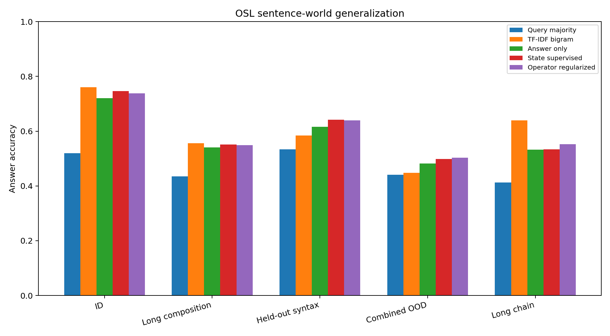
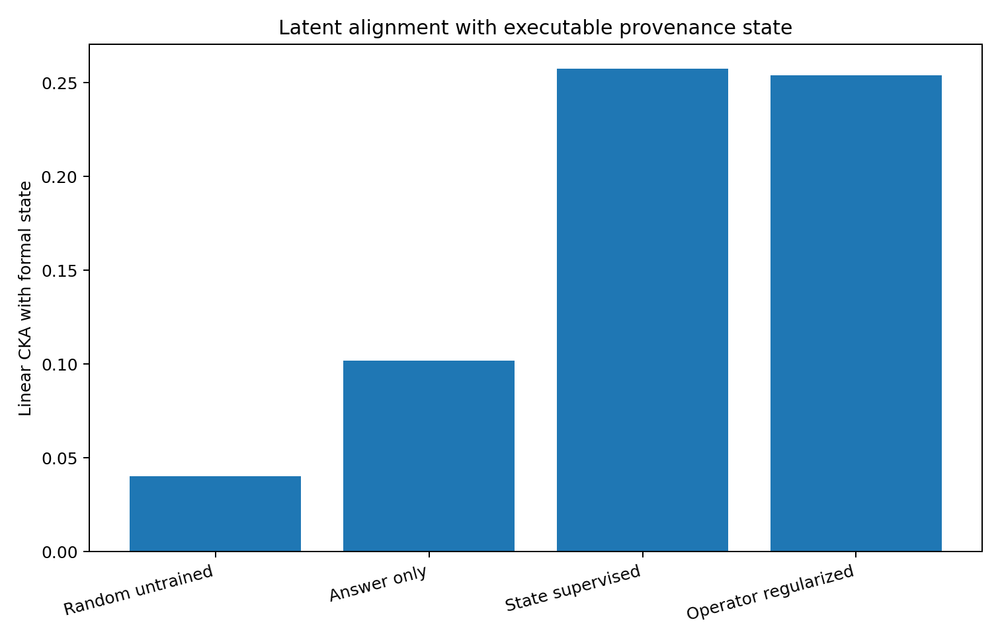
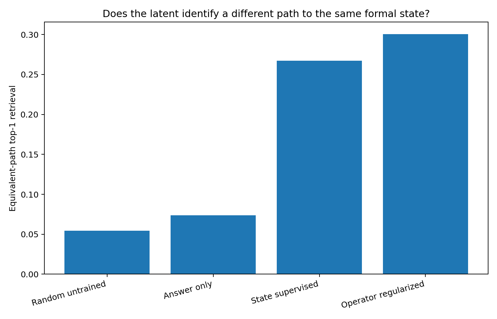
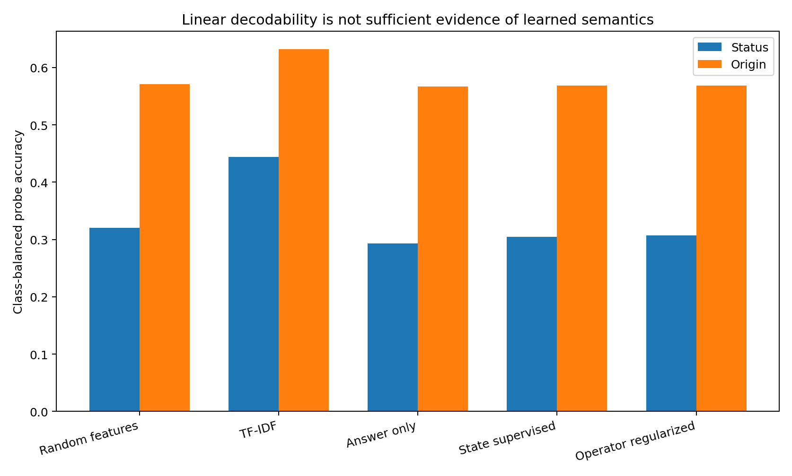
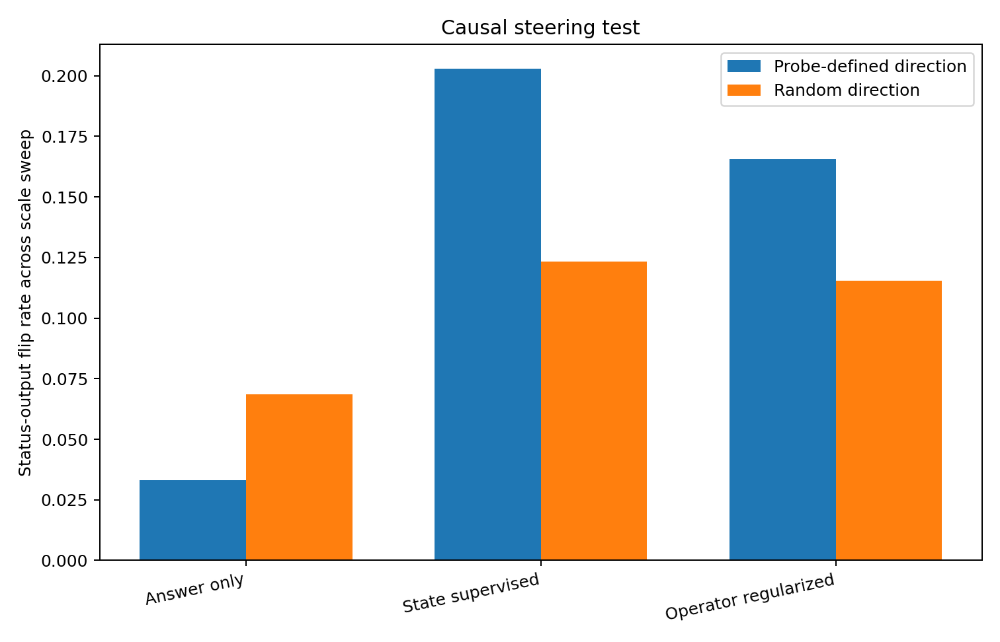

# OSL Emergent Operator Geometry Pilot v0.6

## Final adjudication

**Result:** Partial operator-relevant structure, but not a spontaneously formed formal OSL-like language.

The predeclared frozen suite passed 8 of 8 endpoints. Stronger post-outcome controls then showed that two initially positive diagnostics—linear state probing and affine transition prediction—were largely explained by random recurrent features and surface lexical structure. The final conclusion is therefore narrower than the frozen endpoint count alone.

## Behavioral generalization

| System | ID | Long composition | Held-out syntax | Combined OOD | Long chain |
|---|---:|---:|---:|---:|---:|
| Query-type majority | 52.00% | 43.50% | 53.37% | 44.04% | 41.25% |
| TF-IDF bigram | 76.04% | 55.54% | 58.46% | 44.75% | 63.92% |
| Answer only | 72.03% | 54.10% | 61.64% | 48.22% | 53.25% |
| State supervised | 74.67% | 55.10% | 64.18% | 49.86% | 53.35% |
| Operator regularized | 73.85% | 54.94% | 63.92% | 50.25% | 55.22% |

Sentence-only training beat the per-query majority baseline on every split. It beat TF-IDF on held-out syntax and the combined long-plus-syntax split, but TF-IDF remained stronger in-distribution, on long composition alone, and on explicit communication chains. This is evidence for some sequence-sensitive generalization, not a decisive symbolic-emergence result.

## Formal-state geometry

| Representation | Linear CKA | RSA Spearman | Equivalent-path top-1 | MRR |
|---|---:|---:|---:|---:|
| Random untrained | 0.0402 | 0.0131 | 5.44% | 0.1335 |
| Answer only | 0.1017 | -0.0086 | 7.39% | 0.1484 |
| State supervised | 0.2576 | 0.1228 | 26.72% | 0.4173 |
| Operator regularized | 0.2539 | 0.1214 | 30.06% | 0.4602 |

Answer-only training raised linear CKA above the untrained architecture, but its RSA correlation with formal state remained approximately zero. Explicit state supervision produced a much larger alignment. Operator regularization yielded the best equivalent-path retrieval, indicating that the quotient-style loss successfully compressed different derivations of the same executable state.

## Controls that changed the interpretation

| Probe | Status balanced accuracy | Origin balanced accuracy |
|---|---:|---:|
| Random untrained recurrent features | 32.06% | 57.10% |
| TF-IDF story features | 44.38% | 63.16% |
| Answer only | 29.27% | 56.67% |
| State supervised | 30.48% | 56.86% |
| Operator regularized | 30.69% | 56.82% |

Random untrained features and TF-IDF features matched or exceeded the trained latent probes. Therefore linear decodability alone does not show that the model learned the provenance algebra.

The fitted affine transition metric was even more diagnostic of the problem: untrained recurrent features obtained R² = 0.9965, compared with 0.8348 after answer-only training. The metric primarily measured the recurrent architecture, not learned operator semantics.

## Causal steering

| Arm | Probe-direction status flip | Random-direction status flip | Coherent conversion |
|---|---:|---:|---:|
| Answer only | 3.32% | 6.85% | 0.00% |
| State supervised | 20.28% | 12.34% | 1.43% |
| Operator regularized | 16.55% | 11.54% | 1.04% |

State-supervised and operator-regularized models showed somewhat higher status-output flips along probe-defined directions than along random directions. However, complete coherent conversion across status, direct-observation, safe-write, knowledge, and origin queries remained near 1% and was not reliably above the random control. This fails the stronger causal-symbol hypothesis.

## What arose and what did not

### Supported

- Generated sentence worlds can train a small recurrent model to perform provenance-sensitive reasoning above majority baselines and to generalize modestly to longer and syntactically rearranged stories.
- Answer-only training changes latent geometry relative to an untrained network, including weak formal-state CKA and improved equivalent-path retrieval.
- Explicit formal-state supervision sharply strengthens alignment with the executable state.
- Algebraic equivalence regularization further strengthens path invariance and modestly improves several OOD answer splits.

### Not supported

- Linear probe decodability is not evidence of learned symbolic state in this setup; random and lexical features explain it.
- Affine latent transition predictability is not evidence of learned operators; the untrained recurrent architecture scores higher.
- The probe-defined provenance direction does not causally implement a coherent observed-versus-communicated operator in the answer head.
- The experiment does not show open-ended symbol discovery or a naturally emergent OSL language.

## Next decisive experiment

The next study should freeze the random-feature and lexical controls in advance, hold out entire algebra generators rather than only longer compositions, use architecture-independent causal interventions, require systematic zero-shot recombination, and compare recurrent, transformer, state-space, and explicit symbolic baselines. A stronger criterion would require causal edits that change all logically implied answers while preserving unrelated content.

## Reproducibility

- Pre-outcome freeze: `182c2d5502be70e76605ee935ff982dc5815e8c8d0e259d5803bb7fa43bdef5a`
- Frozen analysis: `5e96c5661aa614b5a371fbb08e4e3ae6354649cbfd31f9bc9a80062c27d82de9`
- Final adjudication: `4ae8814cd9935f852a96d90d32ebdd4725102b25842fdb829be18ca6fcac3f0d`
- Deterministic metric replay: `True`

## Claim boundary

This controlled pilot supports partial operator-relevant representation formation under generated sentence pressure. It does not establish spontaneous OSL emergence, open-ended symbol formation, or the same effect in large language models.
