# Signal Reconstruction: Visual Guide

**Packets, finite innovation, internal phase lifting, and native synthesis**

Komorebi P. · Final companion edition · 6 October 2026

Full Markdown, editable TeX, exact figure code, finite controls, and source correspondence are included.

## 1. Reconstruction has a declared information contract

**Traditional claim correspondence:** SG-07. Complete proofs are in the traditional paper.

A reconstruction result begins with an object class, an observation map, and an error metric. Finite measurements can identify an infinite-looking object when the object has finite innovation and the measurement map is injective on that class. A different class can require a different amount of information. The phrase exact recovery always refers to the printed contract.

This companion follows the signal from complete packet coordinates into incomplete observations, then through edge identification and native synthesis. The drawings explain the geometry of the proofs. Their exact finite controls use rational or Gaussian-rational arithmetic; floating evaluations are used for continuous curves and conditioning diagnostics.

The central distinction is between storing all packets and measuring selected coefficients. Interleaving a complete polyphase atlas reconstructs every stored sample. Recovering an unknown edge from a few Fourier coefficients needs a separate theorem. Complete-coordinate identities do not supply measurement injectivity by themselves.

The traditional paper gives the formal prose statements and proofs. The Lean guide records the scope of related formal sources and verification evidence. The present unknown-edge Prony and internal phase-lift results are not certified by the earlier known-edge Lean material.

$$
f\in\mathcal F,\qquad M:\mathcal F\to Y,\qquad \widehat f=\mathcal R(Mf).
$$

$$
\mathcal R\circ M=I_{\mathcal F}\quad\Longrightarrow\quad M\text{ is injective on }\mathcal F.
$$

**Source:** `sources/seed_calculus/Projector_Resolved_Seed_Calculus_From_Seed_to_Reconstruction_KaTeX.md` · 0. The typed seed system

**Source:** `sources/unknown_edge/Universal_Unknown_Edge_Recovery_KaTeX.md` · 1. The exact boundary

## 2. A packet keeps its content and its address

**Traditional claim correspondence:** SG-01, SG-03. Complete proofs are in the traditional paper.

Let $X$ be a vector space over a field and let a finite projector family satisfy idempotence, pairwise annihilation, and completeness. The packet indexed by $\alpha$ is the actual subspace $P_\alpha X$. Analysis records its content; synthesis adds the components. No metric or orthogonality is needed for this algebraic statement.

Our finite signal is $x=(2,-1,3,0,1,4,-2,5)^{\mathsf T}\in\mathbb Q^8$. Order-four polyphase coordinates retain the original residue address. The channels are $(2,1)$, $(-1,4)$, $(3,-2)$, and $(0,5)$. Their interleaving returns the original eight entries exactly.

A parent packet that groups complete children remains exact. Parity packets split into residues modulo four. Approximation starts when a child is dropped, rounded, or replaced by a statistic. A smaller address catalogue need not imply a smaller content space.

$$
P_\alpha P_\beta=\delta_{\alpha\beta}P_\alpha,\qquad \sum_\alpha P_\alpha=I_X.
$$

$$
x=\sum_\alpha P_\alpha x,\qquad x_r[q]=x[4q+r].
$$

$$
P_{2,0}=P_{4,0}+P_{4,2},\qquad P_{2,1}=P_{4,1}+P_{4,3}.
$$

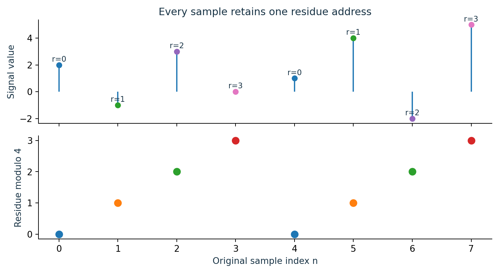

Every stored entry has one residue address. Refinement reorganizes complete contents without deleting information.

**Source:** `sources/seed_calculus/Projector_Resolved_Seed_Calculus_From_Seed_to_Reconstruction_KaTeX.md` · 4. Addresses and projectors

**Source:** `sources/seed_calculus/Projector_Resolved_Seed_Calculus_From_Seed_to_Reconstruction_KaTeX.md` · Step 2: exact order-four polyphase coordinates

**Source:** `sources/seed_calculus/Projector_Resolved_Seed_Calculus_From_Seed_to_Reconstruction_KaTeX.md` · Step 3: nested phase refinement

## 3. Transfer blocks act between packets

**Traditional claim correspondence:** SG-02, SG-03, SG-04. Complete proofs are in the traditional paper.

For a linear operator $T$, the transfer block $P_\beta TP_\alpha$ carries source packet $\alpha$ into target packet $\beta$. It is a linear map, and it may contain many scalar entries. The full operator is the sum of all its blocks. Composition contracts over intermediate packet addresses.

Take the cyclic shift $Ue_j=e_{j+1\bmod8}$ and $T=2I-U+3U^2$. The exact output for the preceding signal is $(-7,11,13,-6,11,7,-5,24)^{\mathsf T}$. Reordering the coordinates into four polyphase packets changes the visible block pattern while preserving the operator.

The operator can also be moved into Fourier coordinates by an invertible transform. The packet atlas and the operator block structure are related choices. One atlas may expose a banded spatial action; another may diagonalize it. Neither view changes the represented finite map.

$$
T_{\beta\alpha}=P_\beta TP_\alpha,\qquad T=\sum_{\alpha,\beta}T_{\beta\alpha}.
$$

$$
(ST)_{\gamma\alpha}=\sum_\beta S_{\gamma\beta}T_{\beta\alpha}.
$$

$$
P_\beta TP_\alpha=\sum_{\sigma\succ\beta}\sum_{\rho\succ\alpha}Q_\sigma TQ_\rho,\qquad P_\alpha=\sum_{\rho\succ\alpha}Q_\rho.
$$

$$
P_\alpha=V^{-1}E_\alpha V\quad(V\text{ invertible; }E_\alpha\text{ complete coordinate selectors}).
$$

$$
(Tx)_j=2x_j-x_{j-1}+3x_{j-2}\quad\text{with indices modulo }8.
$$

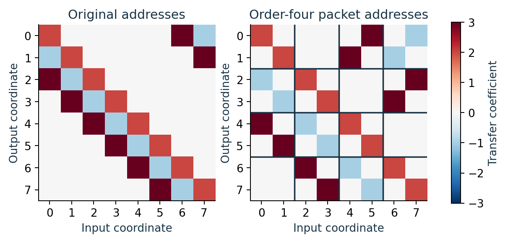

The same rational operator in two coordinate orders. The heavy lines mark packet boundaries in the polyphase atlas.

**Source:** `sources/seed_calculus/Projector_Resolved_Seed_Calculus_From_Seed_to_Reconstruction_KaTeX.md` · 6. Transfer blocks

**Source:** `sources/seed_calculus/Projector_Resolved_Seed_Calculus_From_Seed_to_Reconstruction_KaTeX.md` · 7. Operator paths

**Source:** `sources/seed_calculus/Projector_Resolved_Seed_Calculus_From_Seed_to_Reconstruction_KaTeX.md` · 9. Transform atlases

## 4. Convolution becomes a polyphase kernel system

**Traditional claim correspondence:** SG-05. Complete proofs are in the traditional paper.

For $h,x\in\ell^1(\mathbb Z)$, let $y=h*x$ and fix integer $N\ge1$. Split every input index as $m=Nt+a$, where $0\le a<N$. At output index $Nq+b$, the kernel address becomes $N(q-t)+b-a$. This produces the channel kernel $h_{ba}$ below.

Absolute summability justifies regrouping the convolution sum. For finitely supported sequences the same calculation is a finite identity. The resulting $N\times N$ array consists of sequence kernels acting between the phase channels, so it is a genuine transfer-block representation of convolution.

The channel formulas preserve every sample when all phases are kept. Filtering, dropping channels, or downsampling without the adjacent information changes the map and reintroduces its own recovery obligations.

$$
x_a[t]=x[Nt+a],\qquad y_b[q]=y[Nq+b],\qquad h_{ba}[k]=h[Nk+b-a].
$$

$$
y_b[q]=\sum_{a=0}^{N-1}\sum_{t\in\mathbb Z}h_{ba}[q-t]x_a[t].
$$

**Source:** `sources/seed_calculus/Projector_Resolved_Seed_Calculus_From_Seed_to_Reconstruction_KaTeX.md` · Step 2: exact order-four polyphase coordinates

**Source:** `sources/seed_calculus/Projector_Resolved_Seed_Calculus_From_Seed_to_Reconstruction_KaTeX.md` · 6. Transfer blocks

## 5. Sampling masks expose an alias obstruction

**Traditional claim correspondence:** SG-06, SG-07. Complete proofs are in the traditional paper.

A finite observation map cannot recover an unrestricted function. If $h\ne0$ is invisible to every measurement, then $f$ and $f+h$ have identical data. For point sampling, a narrow nonzero interval can lie between adjacent sample sites. For coefficient sampling, a function supported on unmeasured Fourier modes supplies an invisible difference.

Decomposition has a separate obstruction. If the background and edge classes are linear and share a nonzero object $h$, then $s+j=(s+h)+(j-h)$. Even full knowledge of the sum cannot choose uniquely between those two component assignments. The direct-sum hypothesis resolves this ambiguity in the known-edge example.

For a single unit-circle phase with known nonzero amplitude, measuring powers $z^n$ at positive indices $n\in\mathcal N$ identifies phases only modulo the roots of unity annihilated by every selected power. With $d=\gcd(\mathcal N)$, the common ambiguity is the group of $d$th roots of unity. Bezout's identity proves this statement.

The plot compares $\{6,10\}$ with $\{6,11\}$. A phase difference of $\pi$ is invisible in the first set and visible in the second. This is a one-atom, known-amplitude calculation. A multi-atom mixture and unknown amplitude require the recurrence and offset arguments developed below.

$$
Mh=0\Longrightarrow M(f+h)=Mf.
$$

$$
z^n=w^n\ (n\in\mathcal N)\iff(z/w)^d=1,\qquad d=\gcd(\mathcal N).
$$

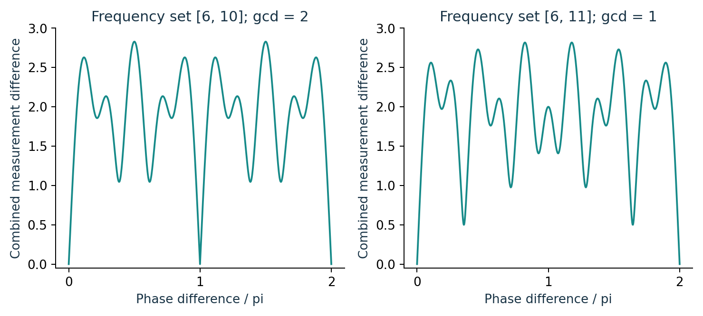

The combined chord error vanishes at every common alias. A gcd of one removes this particular phase ambiguity.

**Source:** `sources/unknown_edge/Universal_Unknown_Edge_Recovery_KaTeX.md` · 1. The exact boundary

**Source:** `sources/self_calibration/Self_Calibrating_Polyphase_Gibbs_Reconstruction_KaTeX.md` · 3. Polyphase reorganization

## 6. One periodic signal will carry the Gibbs example

**Traditional claim correspondence:** SG-10. Complete proofs are in the traditional paper.

Work on $\mathbb T=\mathbb R/(2\pi\mathbb Z)$. The signal contains a degree-five trigonometric background and an interval edge. The convention for the interval is right-continuous at its left endpoint and excludes its right endpoint. Fourier coefficients alone identify an integrable function almost everywhere. Point values at jumps require this additional representative convention.

The smooth and edge components form a direct sum on the declared model. Every trigonometric polynomial is continuous, while every nonzero multiple of the interval mask has a jump. Their intersection is zero. The associated projectors are therefore algebraically well-defined on this model.

These projectors do not automatically become data-driven algorithms for a signal with unknown geometry. The following sections first treat the known edge, then recover the geometry under finite-dictionary or finite-rate assumptions.

$$
s(x)=\frac14+\frac25\cos(2x)-\frac13\sin(3x)+\frac15\cos(5x),
$$

$$
j(x)=\mathbf1_{[-\pi/3,\,\pi/3)}(x),\qquad f=s+j.
$$

$$
\mathcal M_5=\mathcal T_5\oplus\operatorname{span}_{\mathbb R}\{j\},\qquad P_s+P_j=I_{\mathcal M_5}.
$$

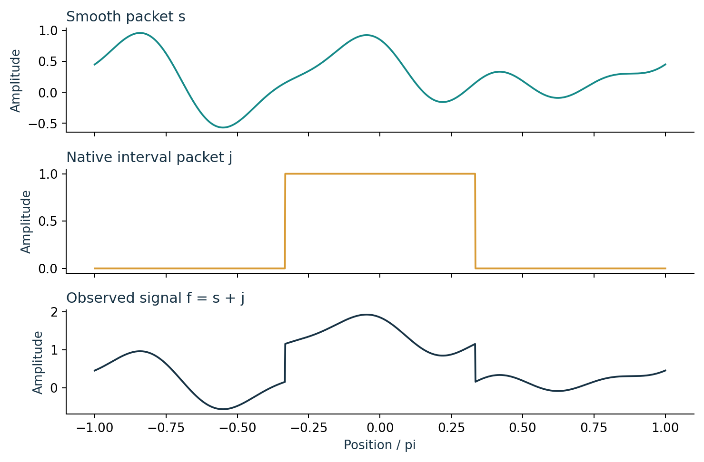

The smooth background, native interval, and observed sum have different useful reconstruction coordinates.

**Source:** `sources/gibbs_case/Projector_Resolved_Gibbs_Case_Study_KaTeX.md` · 1. The single signal

**Source:** `sources/gibbs_case/Projector_Resolved_Gibbs_Case_Study_KaTeX.md` · 7. The exact model space

**Source:** `sources/gibbs_case/Projector_Resolved_Gibbs_Case_Study_KaTeX.md` · 8. Smooth and edge projectors

## 7. The edge tail is structured rather than featureless

Use normalized Fourier coefficients and unnormalized integration in all later $L^1$ norms. Integrating the interval mask gives its exact coefficients. The mean is one third. Every nonzero coefficient contains a $1/n$ envelope and a six-residue phase factor.

The residue zeros are exact. A plotted tiny floating value at a theoretically zero coefficient is a drawing artifact. The phase values are $0$, $\sqrt3/2$, or $-\sqrt3/2$ according to the residue of $n$ modulo six.

For $M\ge5$, the smooth packet is reproduced exactly by the Fourier partial sum. The global approximation error therefore comes entirely from sending the interval packet through that same Fourier truncation block.

$$
\widehat g(n)=\frac1{2\pi}\int_{-\pi}^{\pi}g(x)e^{-inx}\,dx,\qquad S_Mg=\sum_{|n|\le M}\widehat g(n)e^{inx}.
$$

$$
\widehat j(0)=\frac13,\qquad \widehat j(n)=\frac{\sin(n\pi/3)}{\pi n}\quad(n\ne0).
$$

$$
M\ge5\Longrightarrow S_Mf-f=S_Mj-j.
$$

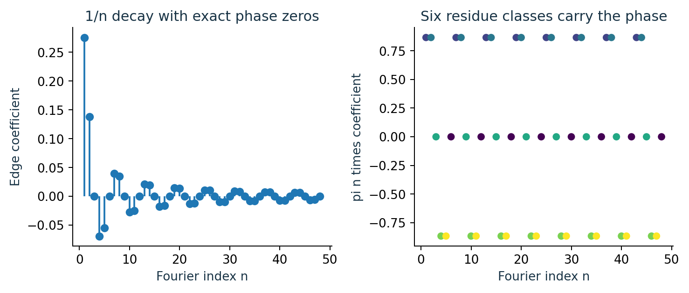

After multiplying by $\pi n$, the tail becomes its six-phase pattern. The envelope and phase have separate roles.

**Source:** `sources/gibbs_case/Projector_Resolved_Gibbs_Case_Study_KaTeX.md` · 2. Fourier conventions

**Source:** `sources/gibbs_case/Projector_Resolved_Gibbs_Case_Study_KaTeX.md` · 3. Exact Fourier coefficients of the edge packet

**Source:** `sources/gibbs_case/Projector_Resolved_Gibbs_Case_Study_KaTeX.md` · 4. Raw Fourier reconstruction

## 8. The Gibbs layer shrinks while its first overshoot persists

**Traditional claim correspondence:** SG-12. Complete proofs are in the traditional paper.

The Dirichlet kernel sharpens near a discontinuity but has alternating sidelobes. At the right edge $a=\pi/3$, the scaled inward coordinate is $x=a-z/(M+1/2)$. The limiting local profile is the sine-integral formula below.

The derivative of this profile is $\sin z/(\pi z)$. Its first positive maximum occurs at $z=\pi$, giving the classical normalized Gibbs constant. The layer has width proportional to $1/M$, while its normalized overshoot remains approximately $0.08949$.

The first panel shows this contraction in ordinary coordinates. The second rescales the same layer. Native synthesis of the discontinuity changes the reconstruction operator used for that packet; it does not invalidate the Gibbs theorem for global Fourier truncation.

$$
D_M(u)=\frac{\sin((M+1/2)u)}{\sin(u/2)},\qquad S_Mj(x)=\frac1{2\pi}\int_{-a}^aD_M(x-t)\,dt.
$$

$$
\lim_{M\to\infty}S_Mj\!\left(a-\frac{z}{M+1/2}\right)=\frac12+\frac1\pi\operatorname{Si}(z).
$$

$$
G=\frac{\operatorname{Si}(\pi)}{\pi}-\frac12\approx0.08948987223608.
$$

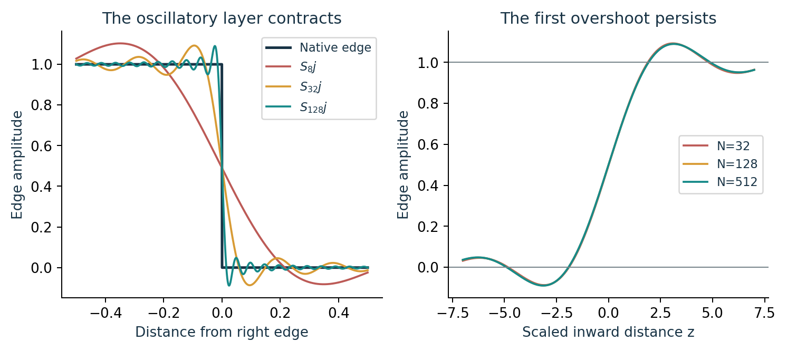

Ordinary and scaled edge coordinates describe different aspects of the same classical limit.

**Source:** `sources/gibbs_case/Projector_Resolved_Gibbs_Case_Study_KaTeX.md` · 5. Dirichlet-kernel form

**Source:** `sources/gibbs_case/Projector_Resolved_Gibbs_Case_Study_KaTeX.md` · 6. Scaled edge coordinate

## 9. Known geometry turns edge recovery into a coefficient fit

**Traditional claim correspondence:** SG-09, SG-10. Complete proofs are in the traditional paper.

Suppose $f=s+am$, the mask $m$ is known, and $s$ is bandlimited to degree $K$. Select nonzero mask coefficients at a finite set of frequencies above $K$. The smooth coefficients vanish there, so the data identify the scalar amplitude by a least-squares functional.

The formula uses the complex Euclidean norm on the selected coefficient vector. Let $\widehat a$ be the fit computed from corrupted coefficient data $a v+\eta$. Cauchy--Schwarz gives an amplitude error at most $\|\eta\|_2/\|v\|_2$, where $v$ is the mask coefficient vector. A mask with very weak selected coefficients is poorly conditioned even when identification is algebraically unique.

On the exact declared direct sum, $P_Jf=\ell(f)m$ and $P_S=I-P_J$ are complementary projectors. For $M\ge K$, $S_MP_S+P_J=I$. The plot is a floating illustration of this known-mask fit; it is not an unknown-geometry guarantee.

$$
v=(\widehat m(k))_{k\in\mathcal K}\ne0,\qquad\ell(g)=\frac{\sum_{k\in\mathcal K}\overline{\widehat m(k)}\widehat g(k)}{\sum_{k\in\mathcal K}|\widehat m(k)|^2}.
$$

$$
\ell(s+am)=a,\qquad|\widehat a-a|\le\frac{\|\eta\|_2}{\|v\|_2}.
$$

$$
P_J^2=P_J,\qquad P_S=I-P_J,\qquad S_MP_S+P_J=I\quad(M\ge K).
$$

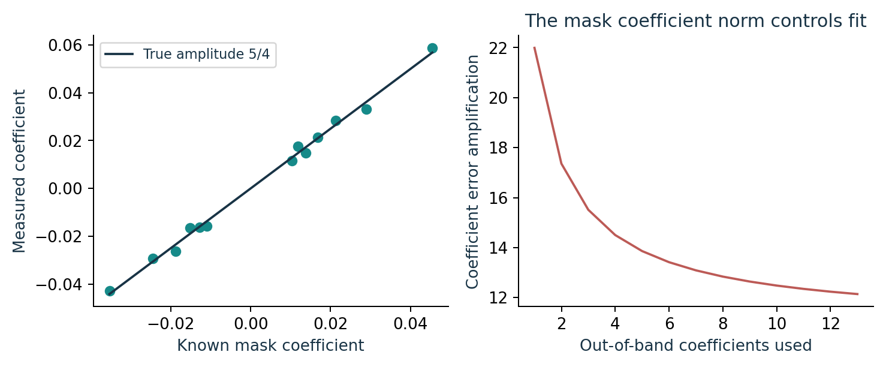

Each additional useful coefficient increases the mask coefficient norm. Its reciprocal governs amplitude error amplification.

**Source:** `sources/singularity_dictionary/Singularity_Exact_Gibbs_Circumvention_KaTeX.md` · Choose out-of-band odd frequencies

**Source:** `sources/gibbs_case/Projector_Resolved_Gibbs_Case_Study_KaTeX.md` · 9. The resolved reconstruction operator

## 10. Finite unknown masks become residualized candidate rays

**Traditional claim correspondence:** SG-16. Complete proofs are in the traditional paper.

For sampled data, let $B$ be a background design and let $P_B$ be the orthogonal projector onto its actual column space. A full-column QR matrix must not be treated as a range basis when $B$ is rank deficient. Use an actual orthonormal range basis or a rank-aware pseudoinverse construction.

The model is $y=B\theta+Aq+\eta$ with a mask from a finite dictionary. Residualization removes the background exactly. Each nonzero $Rq$ generates a candidate ray when amplitude is constrained positive, or a line when both signs are allowed. A unique positive ray gives exact mask identification for noiseless data.

The rational control uses eight samples, constant background two, mask $(1,1,1,0,0,0,0,0)$, and amplitude $5/4$. Its profiled amplitude is exactly $5/4$. A one-sample translated mask has objective $55/24$, while the true objective is zero. The complementary mask gives the opposite residualized ray and a negative fitted amplitude, so the positive-amplitude convention rejects it.

$$
R=I-P_B,\qquad Ry=A\,Rq+R\eta.
$$

$$
\widehat A(q)=\frac{\langle Rq,Ry\rangle}{\|Rq\|_2^2},\qquad J(q)=\|Ry-\widehat A(q)Rq\|_2^2.
$$

$$
\|Rq_*\|_2^2=\frac{15}{8},\qquad J(q_*)=0,\qquad J(q_{\rm shifted})=\frac{55}{24}.
$$

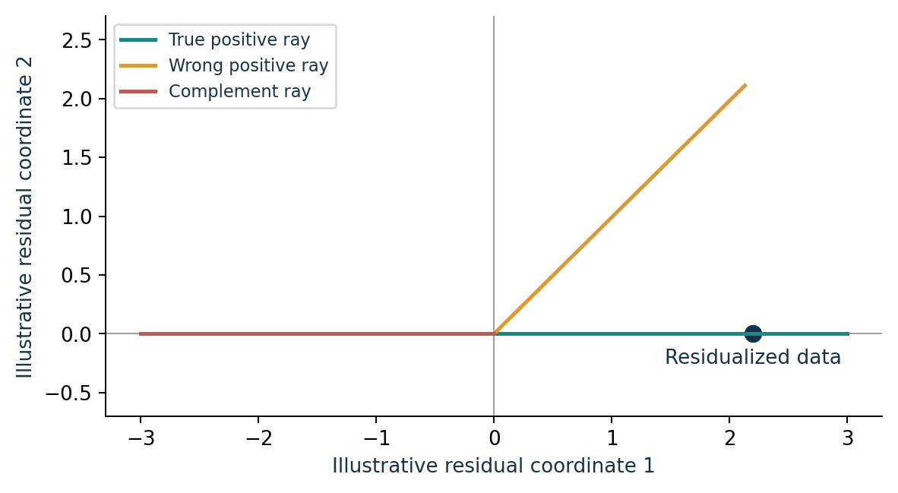

The ray drawing is schematic. The manuscript gives an eight-dimensional exact rational instance, including the rejected complement.

**Source:** `sources/gibbs_case/Projector_Resolved_Gibbs_Case_Study_KaTeX.md` · 14. Smooth-background projector

**Source:** `sources/gibbs_case/Projector_Resolved_Gibbs_Case_Study_KaTeX.md` · 15. Profile amplitude for one candidate packet

**Source:** `sources/gibbs_case/Projector_Resolved_Gibbs_Case_Study_KaTeX.md` · 16. Finite exact recovery theorem

## 11. Finite mask errors have a geometric certificate

**Traditional claim correspondence:** SG-16, SG-17. Complete proofs are in the traditional paper.

For a finite library, use the closed positive ray $C_q=\{aRq:a\ge0\}$. The constrained scalar fit is $\max(0,\widehat A(q))$. Let $\Gamma$ be the minimum distance from the true residualized datum to any wrong ray. Distance to a nonempty closed set is 1-Lipschitz.

A perturbation $e$ puts the true ray within $\|e\|_2$ and every wrong ray at distance at least $\Gamma-\|e\|_2$. Thus $\|e\|_2<\Gamma/2$ preserves the selected mask. This is a norm-distance gap. A squared objective gap must be square-rooted before being substituted into it.

For binary masks, partition the coordinates into common support, first-only support, and second-only support. The error is respectively $a-\widetilde a$, $a$, and $-\widetilde a$. The exact squared norm follows by summing those contributions. With equal unit amplitudes it is simply the size of the symmetric support difference.

$$
\Gamma=\min_{q\ne q_*}\operatorname{dist}(Ry,C_q)>0,\qquad\|e\|_2<\Gamma/2\Longrightarrow q_*\text{ remains uniquely selected}.
$$

$$
\begin{aligned}\|aq-\widetilde a\widetilde q\|_2^2&=|a-\widetilde a|^2|S\cap\widetilde S|\\&\quad+|a|^2|S\setminus\widetilde S|+|\widetilde a|^2|\widetilde S\setminus S|,\end{aligned}
$$

$$
S=\operatorname{supp}q,\quad\widetilde S=\operatorname{supp}\widetilde q,\qquad\|q-\widetilde q\|_2^2=|S\triangle\widetilde S|.
$$

**Source:** `sources/gibbs_case/Projector_Resolved_Gibbs_Case_Study_KaTeX.md` · 16. Finite exact recovery theorem

**Source:** `sources/gibbs_case/Projector_Resolved_Gibbs_Case_Study_KaTeX.md` · 18. Packet perturbation identity

## 12. Sparse uniqueness is a secant-kernel statement

**Traditional claim correspondence:** SG-14, SG-15. Complete proofs are in the traditional paper.

Let $D\in\mathbb R^{m\times n}$ be a finite edge dictionary and $A=RD$. Two $s$-sparse coefficient vectors have identical residualized data exactly when their difference is a kernel vector with at most $2s$ nonzeros. Conversely, every such vector can be split into a difference of two $s$-sparse vectors.

This kernel-secant condition is the reliable statement for every $s\ge0$. For $s=0$, only the zero coefficient vector is allowed and uniqueness is automatic. A conventional spark value of $n+1$ for a full-column-rank matrix can make the shorthand inequality misleading when $2s>n$. We retain the kernel condition instead of depending on that convention.

For a nonzero secant family, define $\gamma_{2s}$ as the minimum smallest singular value over all nonempty supports of size at most $\min(2s,n)$. Supports wider than the measurement dimension have smallest singular value zero in this injectivity sense. They must not be assigned the smallest returned singular value of a wide matrix, which can omit its kernel.

If the truth and estimate are both $s$-sparse, their residual allowances yield $\|A(\widehat\alpha-\alpha_0)\|_2\le2\varepsilon$. A positive restricted singular value then gives the displayed coefficient bound.

$$
\ker A\cap\{h:\|h\|_0\le2s\}=\{0\}.
$$

$$
\gamma_{2s}=\inf_{h\ne0,\ \|h\|_0\le2s}\frac{\|Ah\|_2}{\|h\|_2}>0,
$$

$$
\|R\eta\|_2\le\varepsilon,\quad\|A\widehat\alpha-Ry\|_2\le\varepsilon\Longrightarrow\|\widehat\alpha-\alpha_0\|_2\le\frac{2\varepsilon}{\gamma_{2s}}.
$$

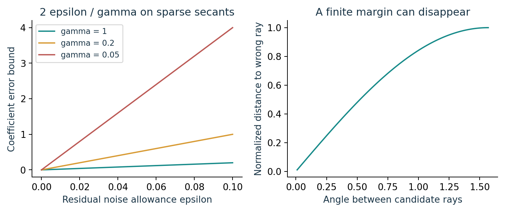

A small restricted singular value amplifies the same residual allowance. Distinct candidate rays can become nearly indistinguishable.

**Source:** `sources/unknown_edge/Universal_Unknown_Edge_Recovery_KaTeX.md` · Exact recovery theorem

**Source:** `sources/unknown_edge/Universal_Unknown_Edge_Recovery_KaTeX.md` · Stability theorem

**Source:** `sources/complex_benchmark/Complex_Signal_Image_Gibbs_Benchmark_KaTeX.md` · 6. Two-dimensional finite dictionary

## 13. Differentiation converts unknown jumps into finite moments

**Traditional claim correspondence:** SG-18. Complete proofs are in the traditional paper.

Now allow off-grid edge locations. Let $j$ be a real periodic piecewise-constant function with $r$ distinct active jumps, nonzero amplitudes $a_\ell$, and zero mean. Periodicity requires their sum to vanish. The zero-mean normalization assigns the constant term to the smooth packet.

The distributional derivative is a finite point measure. Multiplying Fourier coefficients by $2\pi i n$ converts its coefficients into a sum of complex exponentials. A background bandlimited to $K$ disappears at every positive frequency $n>K$.

The exact finite control uses nodes $1,i,-1,-i$ and amplitudes $1,2,-1,-2$. Their moments lie in the Gaussian rationals and obey $m_{n+4}=m_n$. The drawing shows both real and imaginary parts. This four-node control verifies the finite implementation without substituting for the general Vandermonde proof.

$$
Dj=\sum_{\ell=1}^r a_\ell\delta_{\tau_\ell},\qquad\sum_{\ell=1}^ra_\ell=0,\qquad z_\ell=e^{-i\tau_\ell}.
$$

$$
m_n=2\pi i n\widehat f(n)=\sum_{\ell=1}^ra_\ell z_\ell^n\quad(n>K).
$$

$$
(z_1,z_2,z_3,z_4)=(1,i,-1,-i),\qquad(a_1,a_2,a_3,a_4)=(1,2,-1,-2).
$$

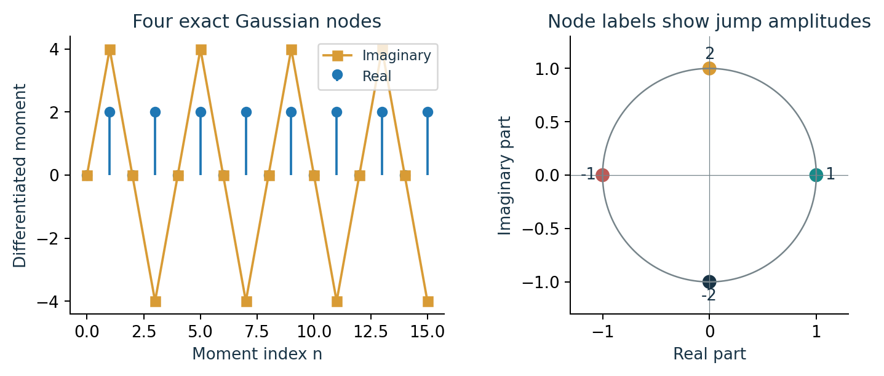

The unknown geometry becomes a finite node-amplitude problem. All displayed control moments are exact Gaussian-rational values.

**Source:** `sources/unknown_edge/Universal_Unknown_Edge_Recovery_KaTeX.md` · 3. The off-grid finite-rate class

**Source:** `sources/unknown_edge/Universal_Unknown_Edge_Recovery_KaTeX.md` · 4. The derivative packet

## 14. A complete two-edge Prony calculation

**Traditional claim correspondence:** SG-20, SG-21, SG-22. Complete proofs are in the traditional paper.

Take the mean-zero interval $j(x)=\mathbf1_{[0,\pi)}(x)-1/2$. Its jumps are $+1$ at zero and $-1$ at $\pi$, so its nodes are $1$ and $-1$. Choose an odd starting index $n_0>K$ above the bandlimited background and set $\mu_q=m_{n_0+q}$. The measured high-frequency block then alternates between two and zero.

The $2\times2$ Hankel matrix built from $\mu_0,\mu_1,\mu_2$ is twice the identity. The recurrence solve gives constant coefficient $-1$ and linear coefficient zero, hence $Q(z)=z^2-1$. Its roots give the two locations. The amplitude solve using the actual indices $n_0,n_0+1$ returns $1$ and $-1$. A solve in shifted powers $q=0,1$ instead returns coefficients $a_\ell z_\ell^{n_0}=(1,1)$; multiplying by $z_\ell^{-n_0}$ restores the physical jumps.

Periodic integration returns a piecewise-constant function up to a constant. Subtracting its mean supplies the displayed edge packet. The low-frequency smooth coefficients are then obtained by subtracting the reconstructed edge coefficients from the observations. Exact equality of Fourier data means equality almost everywhere; the right-continuous convention fixes the endpoint values.

$$
\mu_0,\mu_1,\mu_2,\mu_3=2,0,2,0,\qquad H_2=\begin{pmatrix}2&0\\0&2\end{pmatrix}.
$$

$$
H_2\begin{pmatrix}q_0\\q_1\end{pmatrix}=-\begin{pmatrix}\mu_2\\\mu_3\end{pmatrix}\Longrightarrow(q_0,q_1)=(-1,0).
$$

$$
Q(z)=z^2-1,\qquad \tau_\ell=-\arg z_\ell\pmod{2\pi}.
$$

$$
\widehat s(n)=\widehat f(n)-\widehat j(n)\quad(|n|\le K).
$$

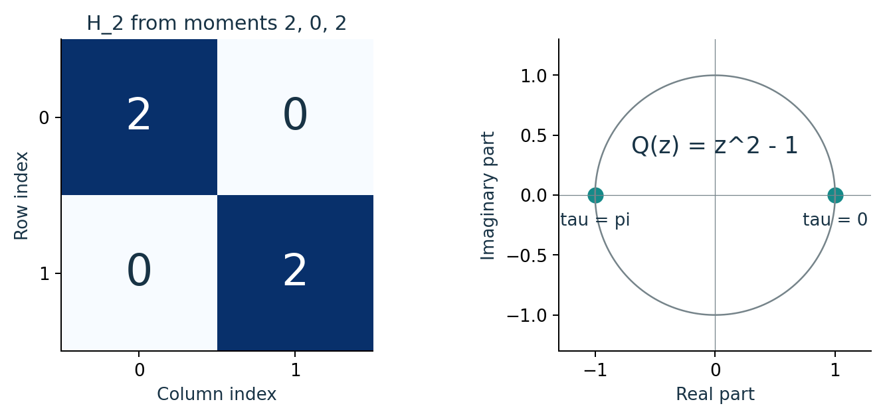

The recurrence, roots, locations, and amplitudes can all be checked by hand in this two-edge instance.

**Source:** `sources/unknown_edge/Universal_Unknown_Edge_Recovery_KaTeX.md` · 6. The annihilating polynomial

**Source:** `sources/unknown_edge/Universal_Unknown_Edge_Recovery_KaTeX.md` · 7. Jump amplitudes and packet reconstruction

## 15. Hankel rank determines the unknown order

**Traditional claim correspondence:** SG-19, SG-22. Complete proofs are in the traditional paper.

For distinct nodes and nonzero amplitudes, the $q\times q$ Hankel matrix factors as a Vandermonde matrix, an invertible diagonal matrix, and the transpose Vandermonde matrix. When $q\ge r$, the first factor has full column rank and the transpose has full row rank. Their composition has rank $r$. The transpose is algebraic, not an adjoint.

An upper bound $L$ on the active jump count lets one use a sufficiently large Hankel matrix and infer the actual count. The consecutive-moment construction uses $2L$ high-frequency coefficients and $2K+1$ low-frequency coefficients. This is a sufficient construction budget, not a minimality result.

The no-edge case has rank zero and requires only the bandlimited background coefficients. It is a trivial mathematical branch. The inherited edge-recovery API assumes at least two active jumps and does not implement that branch, so its successful tests do not certify a no-edge API.

$$
H_q=(m_{n_0+i+j})_{i,j=0}^{q-1}=V_q\operatorname{diag}(a_\ell z_\ell^{n_0})V_q^{\mathsf T},
$$

$$
\operatorname{rank}H_q=r\quad(q\ge r),\qquad n_0=K+1.
$$

$$
\{\widehat f(n):-K\le n\le K\}\ \cup\ \{\widehat f(n):K+1\le n\le K+2L\}.
$$

**Source:** `sources/unknown_edge/Universal_Unknown_Edge_Recovery_KaTeX.md` · 5. Hankel rank and the unknown number of edges

**Source:** `sources/unknown_edge/Universal_Unknown_Edge_Recovery_KaTeX.md` · 8. Universal theorem on the declared class

## 16. Noisy order recovery needs a spectral gap

**Traditional claim correspondence:** SG-23, SG-28. Complete proofs are in the traditional paper.

In noisy data, numerical rank is not an exact integer observable. Write $H=H_0+E$, where $H_0$ has rank $r$. Weyl's inequalities separate the last true singular value from perturbation-generated singular values when $\sigma_r(H_0)>2\|E\|_2$. A threshold strictly between $\|E\|_2$ and $\sigma_r(H_0)-\|E\|_2$ then returns the correct count.

The relevant norm is the matrix spectral norm. An entrywise envelope $|E_{ij}|\le\varepsilon_m$ gives $\|E\|_2\le\|E\|_F\le q\varepsilon_m$ for a $q\times q$ Hankel matrix. Replacing this with $\varepsilon_m$ would lose the dimensional factor.

Fourier measurement noise is amplified by differentiation: $\epsilon_n=2\pi in\eta_n$. For an $h\times w$ rectangular Hankel matrix, $\|E\|_2\le\sqrt{hw}\max|\epsilon_n|$. A fixed Fourier coefficient noise envelope therefore becomes larger at higher sampled frequencies; the tail gain and measurement noise cannot be identified with each other.

The inherited implementation instead chooses the largest adjacent singular-value ratio. That heuristic is not the threshold theorem. A fresh exact square-Hankel witness has true count three and perturbed singular values $(400,396,4,0.4)$, with $\|E\|_2=0.4$. The theorem's gap holds and threshold two returns three, while the largest-ratio heuristic returns two. Thus a successful benchmark of that heuristic does not implement the general threshold guarantee.

The plotted matrix uses the four Gaussian nodes in a $6\times6$ Hankel matrix and a deterministic cosine perturbation of size $0.03$. Its singular values are floating diagnostics, not certified intervals. The exact rank-four factorization is proved algebraically; the plotted gap illustrates the perturbation criterion.

$$
\sigma_r(H)\ge\sigma_r(H_0)-\|E\|_2,\qquad\sigma_{r+1}(H)\le\|E\|_2.
$$

$$
\sigma_r(H_0)>2\|E\|_2\Longrightarrow\text{a valid rank threshold exists}.
$$

$$
|E_{ij}|\le\varepsilon_m\Longrightarrow\|E\|_2\le q\varepsilon_m.
$$

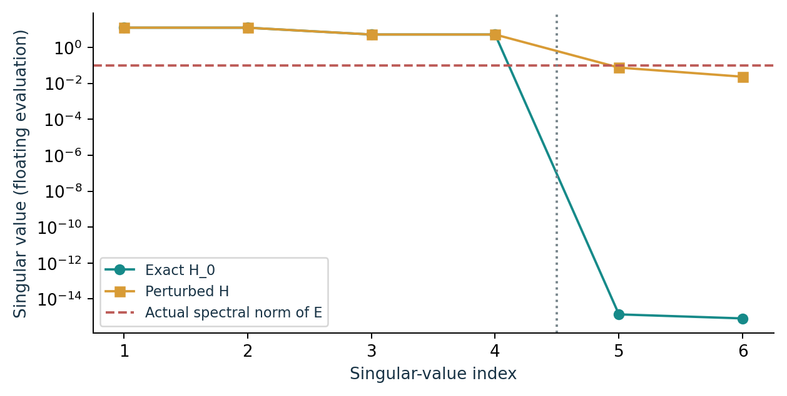

The red line is the actual floating spectral norm of this perturbation. A finite rank gap has a quantitative noise obligation.

**Source:** `sources/self_calibration/Self_Calibrating_Polyphase_Gibbs_Reconstruction_KaTeX.md` · 4. Unknown order from a Hankel gap

## 17. Perturbation must pass through coefficients, roots, and amplitudes

**Traditional claim correspondence:** SG-24, SG-25, SG-26. Complete proofs are in the traditional paper.

Once the true order has been fixed, write the exact Prony system as $Hq=-v$ and the noisy one as $(H+E)\widetilde q=-(v+e)$. If $\|H^{-1}\|_2\|E\|_2<1$, a Neumann-series inverse exists. Subtracting the systems gives the coefficient bound below. This estimate does not choose the order.

Next choose disjoint disks of radius $\rho$ around the true distinct roots and write the perturbed polynomial as $\widetilde Q=Q+E_Q$. If this coefficient error polynomial is smaller than the true polynomial on every circle, Rouche's theorem gives one recovered root per disk. A complex chord disk is not automatically an angular location bound. The test involves true root centers and true coefficient errors, so it is a conditional stability statement rather than a noisy-data-only certificate.

Finally fit amplitudes using the matched nodes. Write the exact amplitude data as $m=Va$, the measured data as $m+e_a$, and the fitted-node design as $\widetilde V=V+\Delta V$. A full-column-rank Vandermonde matrix with $\sigma_{\min}(V)>\|\Delta V\|_2$ remains injective after perturbation. Its least-squares inverse controls the amplitude error. Unit-node normalization is needed for the elementary power bound $|\widehat z^n-z^n|\le n|\widehat z-z|$ at nonnegative powers.

The three stages expose different denominators. A small moment residual cannot replace the Hankel inverse allowance, root separation, and Vandermonde singular value. These are the local inverse bounds assumed in the asymptotic composition.

$$
\|\widetilde q-q\|_2\le\frac{\|H^{-1}\|_2}{1-\|H^{-1}\|_2\|E\|_2}(\|e\|_2+\|E\|_2\|q\|_2).
$$

$$
0<\rho<\frac12\min_{j\ne\ell}|z_j-z_\ell|,\qquad Q(z)=\prod_\ell(z-z_\ell),
$$

$$
\sup_{|z-z_\ell|=\rho}|E_Q(z)|<\min_{|z-z_\ell|=\rho}|Q(z)|\Longrightarrow\text{one root in each disk}.
$$

$$
\|\widehat a-a\|_2\le\frac{\|e_a\|_2+\|\Delta V\|_2\|a\|_2}{\sigma_{\min}(V)-\|\Delta V\|_2}.
$$

**Source:** `sources/unknown_edge/Universal_Unknown_Edge_Recovery_KaTeX.md` · 10. Stability certificate

## 18. Collision rules out separation-free parameter stability

**Traditional claim correspondence:** SG-08. Complete proofs are in the traditional paper.

For opposite jumps at zero and $\delta$, the differentiated moments are $1-e^{-in\delta}$. Every fixed finite frequency set sees a vector tending to zero as the two edges collide. Both jump amplitudes remain one in absolute value. The corresponding Vandermonde columns become nearly parallel.

This directly refutes a uniform stable inverse for the labelled jump parameters. A fixed-two-edge counterexample also rules out a uniform location-set bound from $L^1$ function distance. Place a pulse of width $\delta$ at zero and another of the same width at $\pi$. Each pulse has two nonzero jumps. Their $L^1$ difference is $2\delta$, while the distance between their unordered location sets stays near $\pi$. Their Fourier data difference is also $O(\delta)$ on a fixed frequency set.

The pulse functions themselves become small in $L^1$, so these examples must be interpreted in the stated target metric. Small function error and small location-set error are different requests. An arbitrary fixed-edge-count statement does not supply a separation-free location bound.

$$
m_n(\delta)=1-e^{-in\delta},\qquad |m_n(\delta)|\le|n|\delta.
$$

$$
\sigma_{\min}\!\begin{pmatrix}1&1\\1&e^{-i\delta}\\\vdots&\vdots\\1&e^{-i(q-1)\delta}\end{pmatrix}\longrightarrow0\quad(\delta\to0).
$$

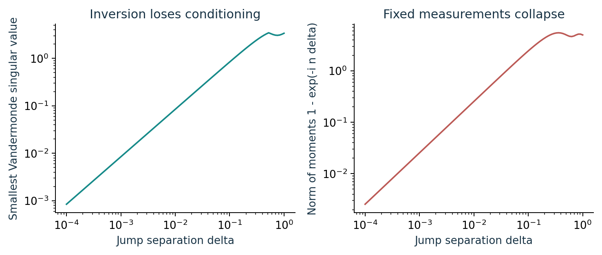

A fixed finite measurement design loses both signal size and inversion conditioning near a jump collision.

**Source:** `sources/unknown_edge/Universal_Unknown_Edge_Recovery_KaTeX.md` · 1. The exact boundary

**Source:** `sources/unknown_edge/Universal_Unknown_Edge_Recovery_KaTeX.md` · 10. Stability certificate

**Source:** `sources/complex_benchmark/Complex_Signal_Image_Gibbs_Benchmark_KaTeX.md` · 5. Noise and collision boundary

## 19. Polyphase moments trade one ambiguity for useful structure

**Traditional claim correspondence:** SG-27, SG-34. Complete proofs are in the traditional paper.

Decimate the moment indices with integer $N\ge2$ and offsets $r=0,1,\ldots,J-1$, where $J\ge2$. In this section write $L$ for the actual jump count, to distinguish it from the offset index $r$. Let $q_0N>K$ in the bandlimited exact model. All channel indices are positive and above the smooth bandwidth.

Every offset shares the aliased nodes $u_\ell=z_\ell^N$, while its coefficients retain a physical phase factor. This is the same complete residue-address idea applied to a selected high-frequency lattice. The selected measurements remain a finite subset, so their budget and injectivity still require explicit hypotheses.

For $L_{\max}=4$, $N=3$, and $q_0=2$, the base channel uses nine coefficients and the adjacent channel uses four. There are thirteen high-frequency innovation samples. The four Gaussian nodes stay distinct after cubing. Decimation by four would collapse them all to one, supplying an exact negative control.

$$
m_{(q_0+q)N+r}=\sum_{\ell=1}^L b_{\ell,r}u_\ell^q,\qquad u_\ell=z_\ell^N,
$$

$$
b_{\ell,r}=a_\ell z_\ell^{q_0N+r},\qquad b_{\ell,r+1}=z_\ell b_{\ell,r}.
$$

$$
|\mathcal I_0|+|\mathcal I_1|=(2L_{\max}+1)+L_{\max}=3L_{\max}+1.
$$

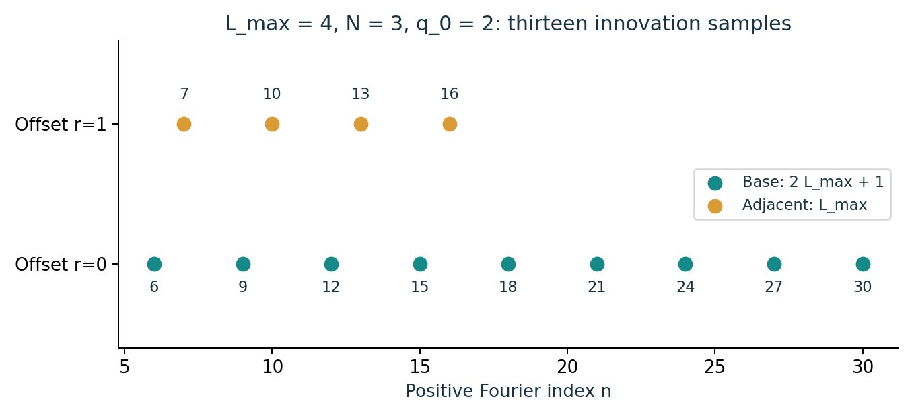

The two offsets have distinct roles: the base channel supplies order and aliased nodes; the adjacent channel supplies physical phase.

**Source:** `sources/self_calibration/Self_Calibrating_Polyphase_Gibbs_Reconstruction_KaTeX.md` · 3. Polyphase reorganization

**Source:** `sources/self_calibration/Self_Calibrating_Polyphase_Gibbs_Reconstruction_KaTeX.md` · 10. Explicit finite innovation budget

## 20. Offset coefficients lift the physical phase internally

**Traditional claim correspondence:** SG-29, SG-30. Complete proofs are in the traditional paper.

Assume the aliased nodes are distinct and matched consistently across offset fits. For a nonzero coefficient $b=b_{\ell,0}$, exact offsets obey $b_r=bz^r$. Two exact adjacent coefficients already give $z=b_1/b_0$. Extra offsets provide a phase average and a consistency test.

The normalized adjacent cross-product sum equals the true unit phase in exact arithmetic. The three-dimensional helix displays real part, imaginary part, and offset index simultaneously. This third axis records actual channel order.

For fitted coefficients with absolute error at most $\varepsilon$, expand each adjacent product into its exact term and three error terms. The sum error relative to its exact magnitude is bounded by $2\varepsilon/|b|+(\varepsilon/|b|)^2$. Normalizing a nonzero complex number doubles this worst-case chord allowance, yielding the displayed phase bound. Small $|b|$ weakens the guarantee.

$$
S=\sum_{r=0}^{J-2}\overline{\widehat b_r}\widehat b_{r+1},\qquad\widetilde z=\frac{S}{|S|}\quad(S\ne0).
$$

$$
S_{\rm exact}=(J-1)|b|^2z,\qquad\widetilde z_{\rm exact}=z.
$$

$$
|\widetilde z-z|\le4\frac{\varepsilon}{|b|}+2\left(\frac{\varepsilon}{|b|}\right)^2.
$$

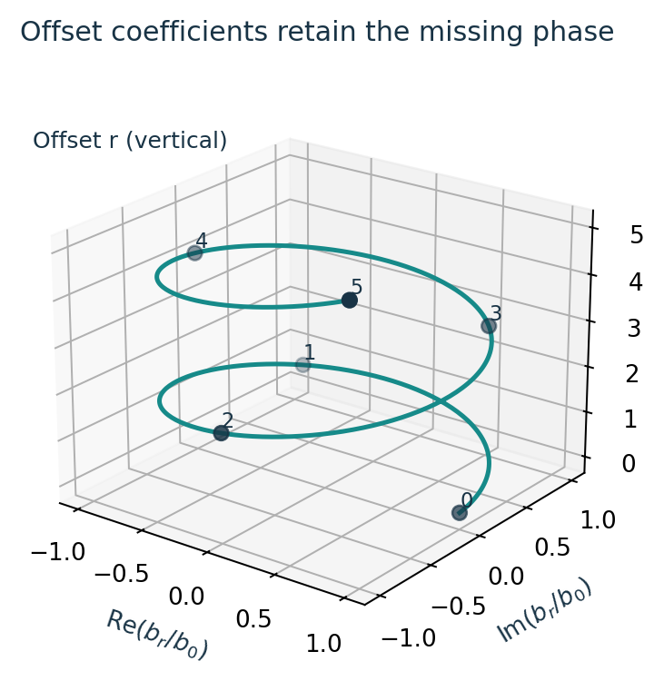

Offsets rotate a nonzero coefficient by the physical phase $z$. The vertical coordinate is the offset index.

**Source:** `sources/self_calibration/Self_Calibrating_Polyphase_Gibbs_Reconstruction_KaTeX.md` · 6. Offset phase estimator

## 21. The principal root need not be the physical root

**Traditional claim correspondence:** SG-32. Complete proofs are in the traditional paper.

For integer $N\ge2$, normalize a nonzero aliased estimate to the unit circle. Its $N$ candidate roots are equally spaced with adjacent chord distance $2\sin(\pi/N)$. A principal complex root is merely one convention and can be far from the true location. When $N=1$, there is one root and branch selection is trivial.

For $N=5$ and $z=e^{4\pi i/5}$, the aliased node is one. The principal root is one, while the true phase is a different fifth root of unity. The phase estimate from adjacent offsets identifies the appropriate candidate without an externally supplied location neighborhood.

Let $\rho$ denote the candidate continuously associated with the true phase as the aliased node is perturbed. If the sum of the phase-estimator chord error and the associated-root chord error is smaller than half the candidate separation, the nearest-candidate rule uniquely selects $\rho$. This is the precise oracle-equivalence margin.

$$
\bar u=\widehat u/|\widehat u|,\qquad\rho_k=\exp\!\left(\frac{i(\arg\bar u+2\pi k)}N\right),\quad0\le k<N.
$$

$$
|\widetilde z-z|+|\rho-z|<\sin(\pi/N)\Longrightarrow\text{nearest-root selection returns }\rho.
$$

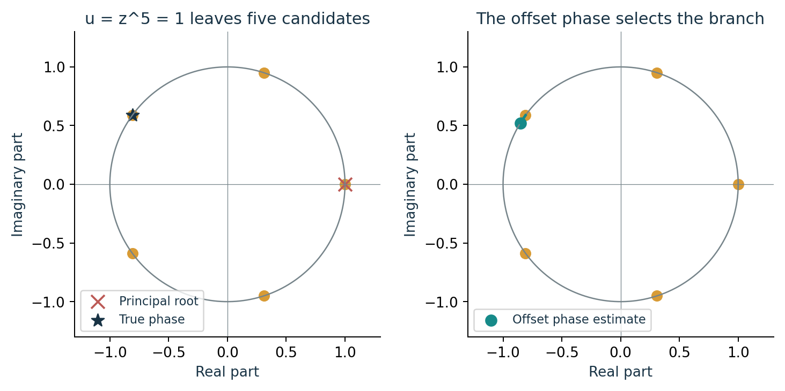

A principal-root convention selects the wrong physical phase in this exact example. Offset information resolves the ambiguity.

**Source:** `sources/self_calibration/Self_Calibrating_Polyphase_Gibbs_Reconstruction_KaTeX.md` · 5. Aliased-node recovery

**Source:** `sources/self_calibration/Self_Calibrating_Polyphase_Gibbs_Reconstruction_KaTeX.md` · 7. Branch lifting

## 22. The root gain is conditional on branch and conditioning

**Traditional claim correspondence:** SG-33, SG-35. Complete proofs are in the traditional paper.

For two normalized alias nodes with chord distance at most $\eta<2$, their short angular difference is at most $2\arcsin(\eta/2)$. On associated roots, the angular difference is divided by $N$. This gives the exact chord gain formula.

A smooth Fourier tail bounded by $C_s(1+|n|)^{-p-2}$ produces differentiated perturbations of order $N^{-p-1}$ along the high-frequency lattice, provided the starting index is comparable to $N$. Uniform local inverse bounds for Prony and coefficient fitting, a Hankel gap, nonzero coefficients, distinct aliases, and the branch margin are additional hypotheses.

Under those hypotheses, a node error of order $N^{-p-1}$ gives a location error of order $N^{-p-2}$ on the correct branch. The larger decimation also narrows the branch margin. Aliased nodes can collide as $N$ varies, so one cannot infer a uniform theorem solely from the smooth-tail exponent.

The composition uses established ideas from finite-rate-of-innovation sampling, Prony reconstruction, decimated exponential fitting, and shifted de-aliasing. The publication positions its combined contract and proof obligations rather than claiming every ingredient is historically new.

$$
|\rho-z|\le2\sin\!\left(\frac1N\arcsin\frac\eta2\right)\le\frac2N\arcsin\frac\eta2.
$$

$$
|\widehat s(n)|\le C_s(1+|n|)^{-p-2}\Longrightarrow|2\pi in\widehat s(n)|=O(|n|^{-p-1}).
$$

$$
|\widehat u-u|=O(N^{-p-1})\Longrightarrow|\widehat\tau-\tau|_{\mathbb T}=O(N^{-p-2})\quad\text{under the stated local hypotheses}.
$$

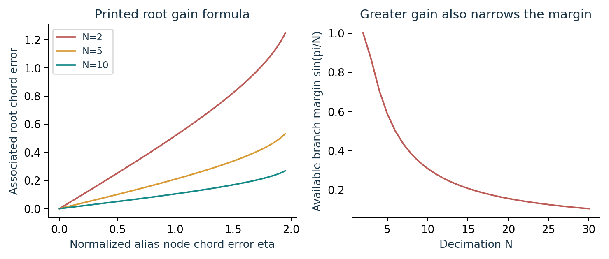

The gain and the shrinking branch margin must be tracked together. The plotted curves evaluate the printed formulas.

**Source:** `sources/self_calibration/Self_Calibrating_Polyphase_Gibbs_Reconstruction_KaTeX.md` · 2. Smooth-tail class

**Source:** `sources/self_calibration/Self_Calibrating_Polyphase_Gibbs_Reconstruction_KaTeX.md` · 8. One-order root gain

**Source:** `sources/self_calibration/Self_Calibrating_Polyphase_Gibbs_Reconstruction_KaTeX.md` · 11. Perturbed theorem

**Source:** `sources/self_calibration/Self_Calibrating_Polyphase_Gibbs_Reconstruction_KaTeX.md` · 17. What is new in the theorem package

## 23. A small validation residual is a local consistency check

**Traditional claim correspondence:** SG-31. Complete proofs are in the traditional paper.

The offset relation also supplies an a posteriori diagnostic. Compare each fitted next coefficient with the fitted phase times its predecessor, and normalize by the fitted coefficient norm. A zero residual says these fitted coefficients lie on one phase recurrence.

This is useful for rejecting mismatched branches, inconsistent offsets, or poor coefficient fits. It does not prove that an unmodelled smooth burst is an edge, that every true edge was found, or that an instrument obeys the Fourier measurement model. A coherent wrong model can also have a small internal residual.

The count gap, coefficient fit, phase residual, branch margin, and end-to-end reconstruction residual answer different questions. A responsible certificate preserves them separately rather than compressing every success into one score.

$$
\nu=\frac{\left(\sum_{r=0}^{J-2}|\widehat b_{r+1}-\widetilde z\widehat b_r|^2\right)^{1/2}}{\left(\sum_{r=0}^{J-2}|\widehat b_r|^2\right)^{1/2}},
$$

$$
\sum_{r=0}^{J-2}|\widehat b_r|^2>0\quad\text{is required for this normalization}.
$$

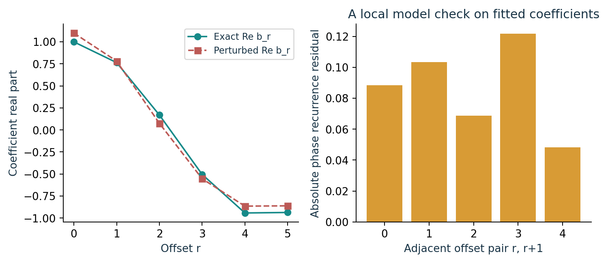

Each adjacent offset pair contributes to the phase-recurrence diagnostic. This is a fitted-model check with a stated denominator condition.

**Source:** `sources/self_calibration/Self_Calibrating_Polyphase_Gibbs_Reconstruction_KaTeX.md` · 6. Offset phase estimator

**Source:** `sources/self_calibration/Self_Calibrating_Polyphase_Gibbs_Reconstruction_KaTeX.md` · 18. Boundaries

## 24. Native synthesis removes the edge truncation block

**Traditional claim correspondence:** SG-10, SG-11, SG-36. Complete proofs are in the traditional paper.

Let $A_M$ be a bounded linear smooth reconstruction operator in the norm being used. After estimating the edge, subtract it before smooth reconstruction and add it back in its native representation. This exact operator identity separates smooth approximation error from edge estimation error.

When the edge is exactly recovered, the whole remaining error is $s-A_Ms$. A bandlimited background with $M\ge K$ is reproduced exactly. An analytic background with exponentially decaying coefficients gives an exponentially small uniform smooth-tail bound. The discontinuity introduces no extra truncation term because it is restored directly.

When the edge estimate is imperfect, the error depends on the same norm and the boundedness of $A_M$ in that norm. One cannot insert an $L^1$ edge bound into a uniform-norm synthesis theorem. The following sections make this metric distinction explicit.

$$
\widehat f_M=A_M(f-\widehat j)+\widehat j,
$$

$$
f-\widehat f_M=(s-A_Ms)+(I-A_M)(j-\widehat j),
$$

$$
\|f-\widehat f_M\|\le\|s-A_Ms\|+(1+\|A_M\|)\|j-\widehat j\|.
$$

$$
|\widehat s(n)|\le Ce^{-\rho|n|}\Longrightarrow\|s-S_Ms\|_\infty\le\frac{2Ce^{-\rho(M+1)}}{1-e^{-\rho}}\quad(\rho>0).
$$

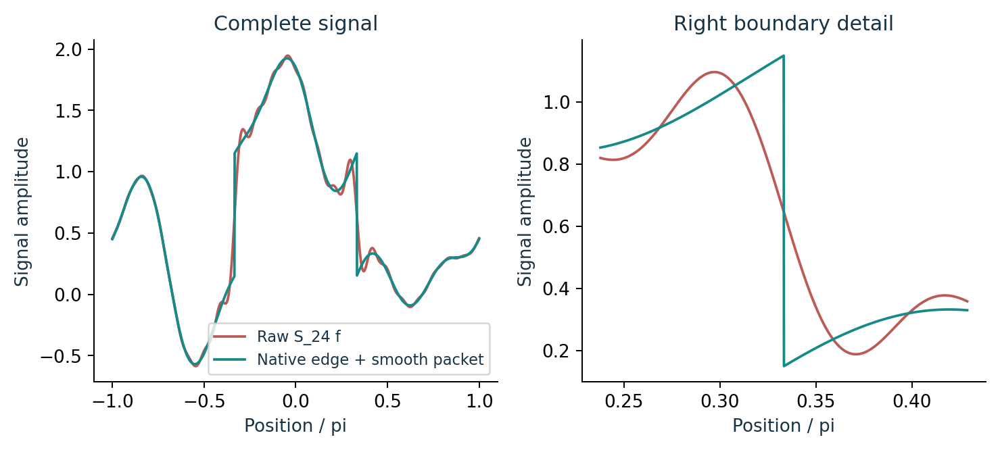

The exact finite-rate example restores the native interval. It sends only the smooth packet through the Fourier truncation block.

**Source:** `sources/gibbs_case/Projector_Resolved_Gibbs_Case_Study_KaTeX.md` · 9. The resolved reconstruction operator

**Source:** `sources/gibbs_case/Projector_Resolved_Gibbs_Case_Study_KaTeX.md` · 11. General smooth packets

**Source:** `sources/unknown_edge/Universal_Unknown_Edge_Recovery_KaTeX.md` · 9. Gibbs-free synthesis

**Source:** `sources/self_calibration/Self_Calibrating_Polyphase_Gibbs_Reconstruction_KaTeX.md` · 12. Gibbs-free synthesis

## 25. Mean-zero edge synthesis has a corrected location constant

**Traditional claim correspondence:** SG-21, SG-37. Complete proofs are in the traditional paper.

On a circle of length $T$, define the mean-zero unit-jump sawtooth $h_\tau(x)=1/2-((x-\tau)\bmod T)/T$. Its distributional derivative is $\delta_\tau-1/T$. If the amplitudes sum to zero, $j=\sum_\ell a_\ell h_{\tau_\ell}$ is piecewise constant with exactly the specified derivative and zero mean.

The sawtooth has unnormalized $L^1$ norm $T/4$. Two translated sawtooths at shortest circular distance $d\le T/2$ differ by constants on the two arcs between their jumps. Direct integration gives $2d(1-d/T)$, which is at most $2d$. The coefficient-one bound $d$ is false for $0<d<T/2$.

The plotted example makes the failure concrete. Move the first edge of $\mathbf1_{[0,T/2)}-1/2$ to $d$ while keeping the second edge fixed and preserving zero mean. The edge error is $2d(1-d/T)>d$. The mean adjustment spreads part of the difference over the rest of the circle.

After matching equal-count jump lists, split amplitude and location errors by adding and subtracting $\sum_\ell\widehat a_\ell h_{\tau_\ell}$. This proves the bound below. The correction is substantive mathematics, so it is explicitly recorded rather than treated as a typography fix.

$$
\|h_\tau\|_1=T/4,\qquad\|h_\tau-h_{\widehat\tau}\|_1=2d(1-d/T)\le2d.
$$

$$
\|j-\widehat j\|_1\le\frac T4\sum_\ell|a_\ell-\widehat a_\ell|+2\sum_\ell|\widehat a_\ell|\,d_{\mathbb T}(\tau_\ell,\widehat\tau_\ell).
$$

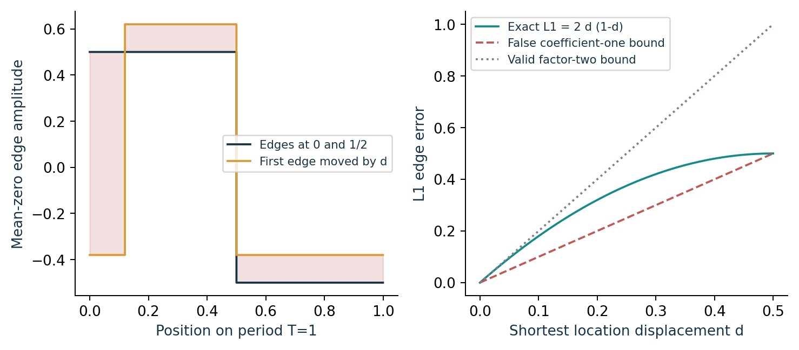

The exact curve lies above the false coefficient-one bound and below the valid factor-two bound. Here $T=1$.

**Source:** `sources/unknown_edge/Universal_Unknown_Edge_Recovery_KaTeX.md` · 7. Jump amplitudes and packet reconstruction

**Source:** `sources/self_calibration/Self_Calibrating_Polyphase_Gibbs_Reconstruction_KaTeX.md` · 12. Gibbs-free synthesis

## 26. Location error is not uniform function error

**Traditional claim correspondence:** SG-08, SG-13, SG-38. Complete proofs are in the traditional paper.

A shifted jump can have arbitrarily small location displacement while its essential uniform difference remains comparable to the jump amplitude. The interval between the true and estimated locations has nonzero width, and one signal has crossed the jump there while the other has not. Therefore an $L^\infty$ location-Lipschitz claim is false without changing the target or allowing a boundary exclusion.

In unnormalized $L^1$, the preceding bound converts the rate-preserving location and amplitude errors into function error. If amplitudes are uniformly bounded and there are finitely many matched jumps, the amplitude term is $O(N^{-p-1})$ and the location term is $O(N^{-p-2})$ under the local recovery assumptions.

A piecewise-constant periodic estimate uses real jump amplitudes with zero sum. Taking real parts and orthogonally projecting the amplitude vector onto the zero-sum hyperplane cannot increase its Euclidean distance to the true real zero-sum vector. The rate argument may use these normalization steps; it does not assert that every inherited numerical fit automatically enforces them.

For a Fejer smooth reconstruction operator, positivity and normalized mass give $\|A_M\|_{L^1\to L^1}\le1$, hence a synthesis multiplier at most two. For raw Fourier partial sums, their $L^1$ operator norm is governed by the Dirichlet-kernel Lebesgue constant and grows with $M$. A claim of a constant multiplier for that family would need an additional argument.

$$
\|j-\widehat j\|_1=O(N^{-p-1})+O(N^{-p-2})\quad\text{under matched bounded-amplitude hypotheses}.
$$

$$
\|A_M\|_{1\to1}\le1\Longrightarrow\|f-\widehat f_M\|_1\le\|s-A_Ms\|_1+2\|j-\widehat j\|_1.
$$

$$
a\le g\le b\text{ a.e.}\Longrightarrow a\le\sigma_Mg\le b\quad\text{for Fejer averaging}.
$$

**Source:** `sources/gibbs_case/Projector_Resolved_Gibbs_Case_Study_KaTeX.md` · 12. Fejer, Lanczos, and spectral filtering

**Source:** `sources/self_calibration/Self_Calibrating_Polyphase_Gibbs_Reconstruction_KaTeX.md` · 11. Perturbed theorem

**Source:** `sources/self_calibration/Self_Calibrating_Polyphase_Gibbs_Reconstruction_KaTeX.md` · 12. Gibbs-free synthesis

## 27. Shared locations and higher jump jets retain the grammar

**Traditional claim correspondence:** SG-39, SG-40. Complete proofs are in the traditional paper.

Multiple channels can share node locations while having different amplitudes. Their recurrence systems share one annihilating polynomial. Stacking equations can restore rank when an individual channel is weak, provided the stacked system actually has the required rank. A channel with a zero amplitude does not by itself reveal that node.

For piecewise-polynomial or higher jump-jet models, moments contain polynomial factors in the index multiplying each exponential. The annihilator becomes confluent, with repeated node factors. This changes the number of coefficients and the conditioning obligations.

On offset channels, a nonzero highest-degree confluent coefficient retains a simple $z^r$ factor. Its adjacent ratio can still recover the physical phase. The leading singular coefficient must be nonzero, nodes must be distinguishable in the relevant confluent system, and a stable numerical implementation requires additional inverse bounds. This is an algebraic extension contract, not a tested arbitrary-jet solver.

$$
m_n^{(c)}=\sum_\ell a_{c\ell}z_\ell^n,\qquad Q(z)=\prod_\ell(z-z_\ell).
$$

$$
m_n=\sum_\ell P_\ell(n)z_\ell^n,\quad\deg P_\ell\le d\Longrightarrow\prod_\ell(E-z_\ell)^{d+1}m=0.
$$

$$
\gamma_{\ell,v,d}=C_\ell z_\ell^v,\quad C_\ell\ne0\Longrightarrow\gamma_{\ell,1,d}/\gamma_{\ell,0,d}=z_\ell\quad(v\text{ is the offset}).
$$

**Source:** `sources/unknown_edge/Universal_Unknown_Edge_Recovery_KaTeX.md` · Shared locations across channels

**Source:** `sources/unknown_edge/Universal_Unknown_Edge_Recovery_KaTeX.md` · Piecewise-polynomial packets

**Source:** `sources/self_calibration/Self_Calibrating_Polyphase_Gibbs_Reconstruction_KaTeX.md` · 16. Higher jump jets

## 28. Finite image geometry obeys the same residual dictionary theorem

**Traditional claim correspondence:** SG-14. Complete proofs are in the traditional paper.

An image vector can be modelled as background coefficients plus a sparse combination of finitely many geometric masks. Residualizing the background gives the same matrix $A=RD$ and the same secant-kernel criterion. The theorem depends on the finite library actually declared; it does not identify arbitrary edge curves.

The exact rational image control has $25$ pixels, constant background two, and three disjoint four-pixel masks. Their residualized dictionary has full column rank because some pixels remain uncovered. If a linear combination of the masks were constant, it would vanish on uncovered pixels and hence have zero coefficients on every mask.

The first two panels show a larger drawing of this declared geometry, with three masks and amplitudes $1,3/4,-1/2$. The last panel uses a seven-point star outside the three-mask library and plots its least-squares residual after background removal. This diagnostic is a floating full-library fit, not a claim that a sparse selector recovered the star.

$$
y=Bc+D\alpha+\eta,\qquad Ry=(RD)\alpha+R\eta.
$$

$$
\ker(RD)\cap\{h:\|h\|_0\le2s\}=\{0\}\quad\text{is the declared finite-library injectivity condition}.
$$

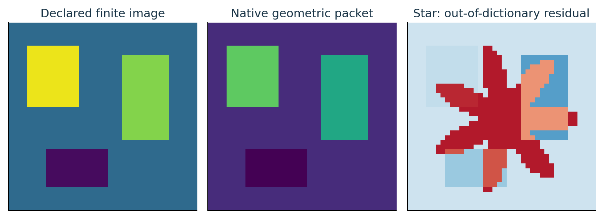

Native masks recover declared geometry. A star outside the library leaves a structured residual even under a full-library least-squares fit.

**Source:** `sources/unknown_edge/Universal_Unknown_Edge_Recovery_KaTeX.md` · Two-dimensional finite dictionaries

**Source:** `sources/complex_benchmark/Complex_Signal_Image_Gibbs_Benchmark_KaTeX.md` · 6. Two-dimensional finite dictionary

**Source:** `sources/complex_benchmark/Complex_Signal_Image_Gibbs_Benchmark_KaTeX.md` · 8. Out-of-dictionary results

## 29. Finite model mismatch enters the same residual allowance

**Traditional claim correspondence:** SG-15, SG-41. Complete proofs are in the traditional paper.

Choose an admissible $s$-sparse approximate representation $D\alpha_0$ of an actual edge $j$, and define $e=j-D\alpha_0$. The observation is $y=Bc+j+\eta=Bc+D\alpha_0+e+\eta$. Model mismatch and measurement noise enter the residualized data together. If their combined residualized norm is at most $\varepsilon$, the same restricted singular-value argument controls any $s$-sparse estimate with fitting residual at most $\varepsilon$.

Adding and subtracting $D\alpha_0$ turns coefficient error into edge error. The representation mismatch $\delta$ remains visible in the final bound. This is a finite-dictionary theorem under explicit sparse-feasibility and restricted-injectivity assumptions. It does not show that a particular greedy selector meets them.

The coordinate error bound also yields support thresholding. If each nonzero true coefficient exceeds $4\varepsilon/\gamma$ in magnitude, thresholding the estimated vector with strict cutoff $2\varepsilon/\gamma$ returns the true support. An estimated support can fail this condition even while waveform error is small.

$$
\|R(e+\eta)\|_2\le\varepsilon,\quad\|A\widehat\alpha-Ry\|_2\le\varepsilon\Longrightarrow\|\widehat\alpha-\alpha_0\|_2\le2\varepsilon/\gamma.
$$

$$
\|j-D\alpha_0\|_2\le\delta\Longrightarrow\|j-D\widehat\alpha\|_2\le\delta+2\|D\|_2\varepsilon/\gamma.
$$

**Source:** `sources/unknown_edge/Universal_Unknown_Edge_Recovery_KaTeX.md` · Stability theorem

**Source:** `sources/complex_benchmark/Complex_Signal_Image_Gibbs_Benchmark_KaTeX.md` · 11. Main conclusion

## 30. The benchmark preserves its failures as scientific evidence

The supplied complex benchmark includes exact-model cases and stress cases with chirps, bursts, or rough backgrounds. The controlled bandlimited, analytic, and algebraic-tail examples recover their stated counts in the recorded runs. Their numerical errors and conditions remain finite implementation evidence.

The localized-burst case has six true jumps and returns nine estimated jumps. Its waveform error improves, but its unknown-order identification fails. Matching location and amplitude errors are not finite values when the counts differ. This failure prevents a misleading inference from low waveform RMSE to correct geometry.

Finite geometric dictionaries perform well when the true image lies in the declared library. Stars, text, nested rings, natural images, and a natural-background hybrid lie outside the exact finite background/edge assumptions. The hybrid can select additional geometry to explain unmodelled background detail.

The original per-method runtime tables contain zeros produced by a key mismatch. They are not speed measurements. Case-level runtime is usable where actually recorded. The release keeps the original sources and gives the execution repairs and fresh records separately.

$$
\text{true count}=6,\qquad\text{burst-case estimated count}=9.
$$

$$
\text{smaller waveform RMSE}\centernot\Longrightarrow\text{correct edge count or correct locations}.
$$

**Source:** `sources/complex_benchmark/Complex_Signal_Image_Gibbs_Benchmark_KaTeX.md` · 4. Complex one-dimensional cases

**Source:** `sources/complex_benchmark/Complex_Signal_Image_Gibbs_Benchmark_KaTeX.md` · 8. Out-of-dictionary results

**Source:** `sources/complex_benchmark/Complex_Signal_Image_Gibbs_Benchmark_KaTeX.md` · 10. Natural-background hybrid

## 31. Adaptive packet completion is a different observation contract

**Traditional claim correspondence:** SG-42, SG-43, SG-44, SG-45. Complete proofs are in the traditional paper.

The two inherited infinite-packet experiments adapt a mask family to fully available image arrays. An ideal closed-subspace projection converges to the target only if the selected subspaces become dense in the declared Hilbert space. The ideal result requires explicit grammar completeness and convergence hypotheses.

The numerical implementations refit with a default ridge of $10^{-9}$, which is a regularized fit rather than the exact orthogonal projection used by the ideal theorem. They also cap registered seed masks at $120$ or $180$. The per-iteration candidate frontier has a separate budget. These finite caps truncate the ideal grammar and change the computation.

Full-pixel truth and truth-residual completion make these experiments adaptive approximation studies. They do not establish blind recovery from limited measurements. Clipping reconstructed intensities to $[0,1]$ is a nonlinear operation; it is nonexpansive relative to a truth lying in that box, but it does not retain a linear projector identity.

These experiments belong in the same reconstruction programme because they explore richer packet families. They need their own observation, complexity, and model-mismatch analysis before becoming a general recovery theorem.

$$
\overline{\bigcup_n V_n}=H,\quad V_n\subseteq V_{n+1}\Longrightarrow P_{V_n}f\to f\quad(f\in H).
$$

$$
\|f-P_{V_{n+1}}f\|\le\|f-P_{V_n}f\|,\qquad f-P_{V_n}f\perp V_n.
$$

$$
\widehat c_\lambda=\operatorname*{argmin}_c\bigl(\|Dc-y\|_2^2+\lambda\|c\|_2^2\bigr),\qquad\lambda=10^{-9}.
$$

$$
D^{\mathsf T}(y-D\widehat c_\lambda)=\lambda\widehat c_\lambda.
$$

$$
\|C(x)-f\|_2\le\|x-f\|_2\quad(f\in[0,1]^m),\qquad C(t)=\min(1,\max(0,t)).
$$

$$
r=f-q\Longrightarrow q+r=f\quad\text{when the full residual is retained}.
$$

**Source:** `sources/infinite_packet/infinite_packet_gibbs_reconstruction.py` · infinite\_packet\_gibbs\_reconstruction.py

**Source:** `sources/infinite_packet/infinite_packet_gibbs_reconstruction_spd.py` · infinite\_packet\_gibbs\_reconstruction\_spd.py

## 32. Completion requires bounded maps and an actual limit

**Traditional claim correspondence:** SG-42, SG-46. Complete proofs are in the traditional paper.

Let $D$ be a dense linear subspace of a normed space $X$. If bounded linear operators $A,B:X\to Y$ agree on $D$, choose $x_n\in D$ tending to any $x\in X$. Their continuity forces equality on $x$. This proves uniqueness of bounded extension.

A finite packet identity on a dense core can therefore extend when its represented operators have bounded extensions. An infinite sum needs a specified convergent synthesis in a specified topology. The finite identity alone supplies no convergence theorem.

For orthogonal projection onto nested selected spans, density of the actual selected union gives strong convergence by best approximation. A dense candidate pool need not mean a capped or greedy selected sequence is dense. This distinction separates the ideal completion theorem from the finite adaptive implementation.

$$
A|_D=B|_D,\quad\overline D=X\Longrightarrow Ax=\lim_nAx_n=\lim_nBx_n=Bx.
$$

$$
\overline{\bigcup_nV_n}=H\Longrightarrow\|f-P_{V_n}f\|\to0\quad\text{for nested closed selected spans}.
$$

**Source:** `sources/seed_calculus/Projector_Resolved_Seed_Calculus_From_Seed_to_Reconstruction_KaTeX.md` · 13. Completion

**Source:** `sources/infinite_packet/infinite_packet_gibbs_reconstruction_spd.py` · infinite\_packet\_gibbs\_reconstruction\_spd.py

## 33. What the guide establishes and what the sources contain

The complete source bundle includes the Markdown files, editable TeX, original and newly drawn vector figures, plotting code, finite controls, raw source packages, and verification records. The Markdown companion preserves the same paragraphs, displayed equations, captions, and source correspondence as this PDF.

This guide contains 21 original figures. Its exact finite checks cover rational packet identities, residualized masks, Gaussian-rational moments and offsets, a two-edge Prony example, the corrected zero-mean $L^1$ formula, and a finite image dictionary. Their tested bounds and resource-limited run are recorded in the visual validation manifest. Floating conditioning plots are explicitly distinguished from exact arithmetic.

The mathematical prose supports exact reconstruction on declared finite-rate and finite-dictionary classes, local stability under explicit conditioning, internal phase lifting under a branch margin, and native synthesis in a matching norm. It also retains concrete obstructions to unrestricted recovery and separation-free parameter stability.

The earlier Lean sources concern related known-edge and finite-mask statements. They do not formalize this complete unknown-edge/self-calibration paper. Fresh numerical runs, archived evidence, source inspection, and Lean verification are recorded separately. No assertion count is presented as a proof of a universal analytic claim.

**Source:** `sources/unknown_edge/Universal_Unknown_Edge_Recovery_KaTeX.md` · 13. Final claim

**Source:** `sources/self_calibration/Self_Calibrating_Polyphase_Gibbs_Reconstruction_KaTeX.md` · 18. Boundaries

**Source:** `sources/complex_benchmark/Complex_Signal_Image_Gibbs_Benchmark_KaTeX.md` · 11. Main conclusion
