# Smith chart through exact packets, passivity, and reconstruction

**Author: Komorebi P.**  
**Extended reading edition · revised 11 November 2026**  
**Status: unpublished draft. The current synthesis result, its certificate, and the remaining six-element question are distinguished throughout this edition.**

A Smith chart begins with a simple question: what happens to a load impedance when a wave propagates along a line? The answer becomes especially clear after changing from normalized impedance to reflection coordinates. We will perform that classical calculation exactly, then keep the same reflection disk while changing the *objects of study*. Rather than only moving points, we will decompose entire analytic response functions, reconstruct them from cyclic packets, and ask whether incomplete representations still describe passive electrical networks.


## Current result and reading map {#current-result}

The latest exact construction realizes the degree-six impedance \(Z_6(s)\) using **four inductors, three capacitors, and fourteen positive resistors, with no transformers**. Its reduced rational degree gives a lower bound of six reactive elements. The circuit certificate gives an upper bound of seven:

\[
\boxed{6\le q_{\min}\le7.}
\]

Here \(q_{\min}\) counts physical inductors and capacitors among finite, ordinary, passive RLC one-ports with no transformers. An exact six-element construction would attain the degree lower bound. A complete exclusion of six would show that the seven-element construction is minimal. Neither alternative has been established.

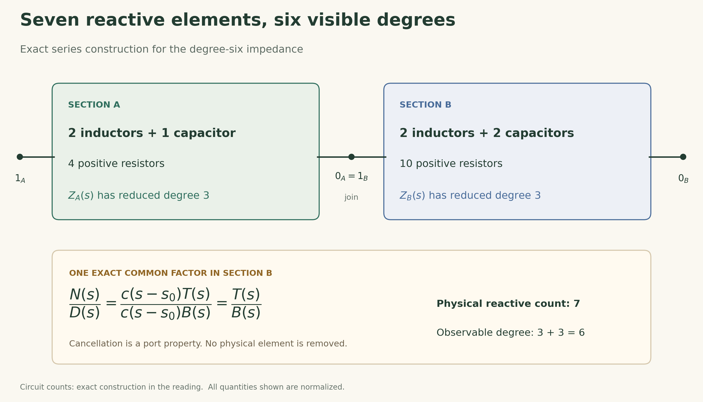

*Construction map. The two passive sections are connected in series. The second section has one exact common factor in its nodal numerator and denominator. Canceling that factor reduces the observed rational degree; it does not delete a physical component.*

| Quantity | First section \(Z_A\) | Second section \(Z_B\) | Complete circuit |
|---|---|---|---|
| Inductors and capacitors | \(2L+1C\) | \(2L+2C\) | \(4L+3C\), seven reactive elements |
| Positive resistors | 4 | 10 | 14 |
| Reduced input degree | 3 | 3 | 6 |
| Total ideal components | 7 | 14 | 21 |

The earlier **seven-component** inductor example has three reactive elements and four resistors. It is a different construction from the **seven-reactive** degree-six example above.

The [exact synthesis chapter](#seven-reactive-exact) states the circuit and its rational existence certificate. The [arbitrary-order separation theorem](#arbitrary-order-separation) gives a second, independent exact-versus-approximate boundary. The [cancellation argument](#dark-mode-reader-proof) explains why the first numerical approach became singular. The [verification register](#verification-register-and-reproducible-records) gives the reproducible commands and separates exact proofs from numerical diagnostics. Historical stages remain in the reading, with their scope and later resolution stated explicitly.

## The calculation in view

This extended example is written to be read independently of the [interactive Smith chart laboratory](https://komorebip.github.io/Operation-KOMOREBI/smith-chart.html). The laboratory lets a reader inspect the geometry and run finite numerical tests. This chapter supplies the algebra that should not be hidden behind a plot.

Three exact calculations organize the argument. The first follows one load through a lossless transmission line:

\[
\Gamma_L=\frac{-1+2i}{5},\qquad
\Gamma_{\rm in}=\frac{2+i}{5},\qquad
Z_{\rm in}=100+50i\ \Omega.
\]

The second reconstructs the impedance coordinate from all three order-three packets:

\[
z(1/2)=\frac97+\frac87+\frac47=3.
\]

The third reconstructs the reflection response of a lossless two-port:

\[
F(3/4)=\frac{310+288-108}{539}=\frac{10}{11}.
\]

Removing that response's negative packet produces a reflection coefficient *larger than one*. A later calculation shows that certain structured packet selections remain contractive, although their unions need not. This failure motivates the reconstruction problem developed in the second half of the chapter.

The equations here fall into different categories. The Smith-chart conformal map, roots-of-unity filters, Schwarz lemma, and Nevanlinna–Pick interpolation are established mathematics. Exact packet formulas, finite examples, obstruction witnesses, and transformed interpolation certificates are derived here from those tools. Their **historical novelty has not been established**. A computation marked as a finite check is not a claim of formal or general proof. A positive-real or Schur response is not automatically a circuit with a prescribed component topology.

[Start with the worked load](#one-load-through-a-transmission-line) · [Jump to passive networks](#from-the-chart-to-a-passive-two-port) · [Jump to completion certificates](#passive-completion-from-incomplete-packets) · [Open the laboratory](https://komorebip.github.io/Operation-KOMOREBI/smith-chart.html)

## How to read the calculation

The chapter follows one chain. We begin with a physical load, move to reflection coordinates, split analytic functions into residue packets, and learn exactly where ordinary coordinate manipulations stop preserving a physical constraint. We then replace naive truncation with certificates for existence, impossibility, uniqueness, and uncertainty.

| Stage | Object | What we calculate | What must be retained |
|---|---|---|---|
| Classical geometry | A load \(Z\) and reference \(Z_0\) | \(\Gamma\), impedance circles, lossless propagation | Physical units and the load/reference distinction |
| Cyclic calculus | An analytic \(F(t)\) | Projectors \(\mathcal P_{N,j}\), reconstruction, refinement | All residue classes or an explicit residual |
| Dual coordinates | \(z(t)\) and \(y(t)\) | Exact closed forms and dyadic parity | Nonlinear inversion is not packetwise inversion |
| Passive two-port | \(S\) and a load reflection \(t\) | Terminated response, safe coset masks, and a failing truncation | Global contractivity of the full response |
| Finite completion | Partial orbit packet measurements | Pick matrix, feasibility and uniqueness | Observed measurements exactly |
| Frequency and load | \(S(s)\) and \(t\) | Global compatibility, uncertainty, reciprocity | Causality, real-time symmetry, joint contractivity and realization constraints |
| Physical realization | The full rational impedance \(Z_6(s)\) | Exact circuit identity, positive components, and a canceled internal mode | The degree lower bound and the topology certificate |

The main narrative uses complex arithmetic and exact rational examples. The accompanying Python programs check worked identities, finite interpolation witnesses, and circuit certificates in their stated scopes. All mathematical diagrams are generated from equations using Python. The [verification register](#verification-register-and-reproducible-records) distinguishes exact certificate replay from numerical regression and identifies the recovered sources.

## Conventions and two distinct complex variables

Fix a positive **real** reference impedance \(Z_0\). Let \(Z=R+iX\) be the physical load and put

\[
z=\frac Z{Z_0}=r+ix,\qquad
\Gamma=\frac{z-1}{z+1},\qquad
z=\frac{1+\Gamma}{1-\Gamma}.
\tag{1}
\]

The normalized admittance is \(y=1/z\). The physical admittance is \(Y=y/Z_0\). The letter \(x\) in \(z=r+ix\) denotes normalized reactance. Later, \(t\) will denote a *variable load reflection coefficient*, rather than an already selected point \(\Gamma_L\). We use \(s\) for complex frequency in \(\mathbb C_+=\{s:\Re s>0\}\), and \(\zeta\) or \(w\) for a disk coordinate when confusion is possible.

A network reflection response is **Schur** when it is analytic and has modulus at most one on the disk. A frequency-dependent scattering matrix \(S(s)\) is bounded-real passive in the present convention when it is analytic on \(\mathbb C_+\) and satisfies \(S(s)^*S(s)\preceq I\) there. This abstract notion of passivity does not prescribe a resistor, capacitor, inductor, transmission-line layout, or circuit order. For a network with real-valued impulse responses, one must additionally impose the conjugate symmetry \(S(\bar s)=\overline{S(s)}\); we return to that distinction below.

| Symbol | Meaning | Domain |
|---|---|---|
| \(Z,Z_0\) | Physical load and positive real reference impedance | Ohms |
| \(z,y\) | Normalized impedance and admittance | Dimensionless |
| \(\Gamma_L,t\) | Selected load reflection and variable load reflection | \(\lvert t\rvert\leq1\) physically, analytic formulas use \(\lvert t\rvert<1\) |
| \(s\) | Complex frequency | \(\Re s>0\) |
| \(N,j\) | Packet order and residue index | \(N\ge2,\ 0\le j<N\) |
| \(\omega_N\) | Primitive root \(e^{2\pi i/N}\) | Unit circle |
| \(\mathcal P_{N,j}\) | Cyclic projector acting on an analytic function | Function space, not a physical network component |

**Scope rule.** A statement about analytic functions of the load variable \(t\) does not, by itself, prove causality or passive behavior across the frequency variable \(s\). Similarly, a matrix-valued function of a *scalar* load \(t\) is not automatically the same problem as termination by a noncommuting load matrix.

## One load through a transmission line

Take

\[
Z_L=25+25i\ \Omega,\qquad Z_0=50\ \Omega.
\]

Normalize first:

\[
z_L=\frac12+\frac i2.
\]

Apply the Cayley map without numerical approximation:

\[
\begin{aligned}
\Gamma_L
&=\frac{-1+i}{3+i}
 =\frac{(-1+i)(3-i)}{10}
 =\boxed{\frac{-1+2i}{5}}.\\
|\Gamma_L|^2&=\frac15,\qquad
\operatorname{VSWR}=\frac{1+|\Gamma_L|}{1-|\Gamma_L|}
=\boxed{\frac{3+\sqrt5}{2}}.
\end{aligned}
\tag{2}
\]

The load is strictly passive because \(R=25>0\), and its reflection coefficient lies inside the unit disk.

For a lossless line of length \(\ell\), measured **toward the source** from the load, with phase constant \(\beta=2\pi/\lambda\), the reflection coefficient is

\[
\Gamma_{\rm in}=\Gamma_L e^{-2i\beta\ell}.
\]

At \(\ell=\lambda/8\), the multiplier is \(e^{-i\pi/2}=-i\). Thus

\[
\Gamma_{\rm in}=-i\frac{-1+2i}{5}
=\boxed{\frac{2+i}{5}}.
\]

Invert the Cayley map:

\[
\begin{aligned}
z_{\rm in}&=\frac{1+(2+i)/5}{1-(2+i)/5}
 =\frac{7+i}{3-i}=\boxed{2+i},\\
Z_{\rm in}&=Z_0z_{\rm in}
=\boxed{100+50i\ \Omega}.
\end{aligned}
\tag{3}
\]

The load impedance changed while \(|\Gamma|=1/\sqrt5\) remained fixed. This is the geometrical basis of lossless Smith-chart rotation. The input impedance also follows by substituting \(\tan(\beta\ell)=1\) into the standard transmission-line formula.

### Four boundary checks before proceeding

The formulas cover matched, short-circuited, and purely reactive loads directly. An *ideal open* is a limiting case, because the impedance coordinate diverges at the right endpoint of the disk.

| Physical load | Normalized impedance | Reflection coefficient | Interpretation |
|---|---|---|---|
| \(Z=Z_0\) | \(z=1\) | \(\Gamma=0\) | Matched load, no reflection |
| \(Z=0\) | \(z=0\) | \(\Gamma=-1\) | Ideal short circuit |
| \(Z\to+\infty\) | \(z\to+\infty\) | \(\Gamma\to1\) | Ideal open circuit, reached as a limit |
| \(Z=iX\), real \(X\) | \(z=iX/Z_0\) | \(\lvert\Gamma\rvert=1\) | Purely reactive, lossless boundary |

The inverse map \(z=(1+\Gamma)/(1-\Gamma)\) is undefined at \(\Gamma=1\). In particular, a numerical routine should **represent an ideal open explicitly**, rather than treat a large finite resistance as algebraic infinity. By contrast, \(\Gamma=-1\) maps exactly to the short-circuit value \(z=0\). These cases explain why we state analytic packet formulas on the *open* disk even when the Smith chart itself includes a physical boundary.

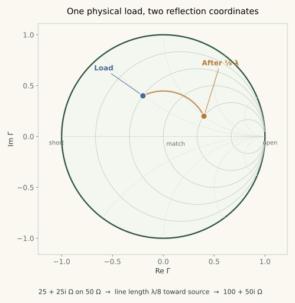

*Figure 1. The geometry is generated from \(\Gamma=(z-1)/(z+1)\). The indicated arc is a transmission-line rotation, not a separate cyclic projector packet.*

### Why the chart consists of circles

Write \(\Gamma=u+iv\). The inverse transform gives

\[
r=\frac{1-u^2-v^2}{(1-u)^2+v^2},\qquad
x=\frac{2v}{(1-u)^2+v^2}.
\tag{4}
\]

Holding normalized resistance \(r\ge0\) fixed and completing a square yields

\[
\boxed{\left(u-\frac r{1+r}\right)^2+v^2
=\frac1{(1+r)^2}.}
\tag{5}
\]

For fixed nonzero normalized reactance \(x\), we likewise obtain

\[
\boxed{(u-1)^2+\left(v-\frac1x\right)^2
=\frac1{x^2}.}
\tag{6}
\]

The load in (2) has \(r=x=1/2\) and \((u,v)=(-1/5,2/5)\). It satisfies both circle equations exactly:

\[
\left(-\frac15-\frac13\right)^2+\left(\frac25\right)^2=\frac49,
\qquad
\left(-\frac15-1\right)^2+\left(\frac25-2\right)^2=4.
\]

Finally,

\[
1-|\Gamma|^2=\frac{4r}{|z+1|^2}.
\tag{7}
\]

This identity proves that the right impedance half-plane maps into the reflection disk. It also shows why the unit circle represents the lossless boundary \(R=0\), apart from the ideal open at \(\Gamma=1\), where the inverse map has a pole.

## Rotations as rational impedance transformations

The same coordinates reveal a useful algebraic action. Let \(C(z)=(z-1)/(z+1)\), and let \(R_{N,k}(t)=\omega_N^k t\). Pulling the rotation back to impedance gives

\[
T_{N,k}=C^{-1}\circ R_{N,k}\circ C.
\]

By substitution,

\[
\boxed{
T_{N,k}(z)=
\frac{(1+\omega_N^k)z+(1-\omega_N^k)}
{(1-\omega_N^k)z+(1+\omega_N^k)}.
}
\tag{8}
\]

The group law follows by conjugation:

\[
T_{N,k}\circ T_{N,\ell}=T_{N,(k+\ell)\bmod N}.
\]

At \(N=2,k=1\), the multiplier is \(-1\), and the formula collapses to

\[
\boxed{T_{2,1}(z)=\frac1z=y.}
\tag{9}
\]

Thus ordinary impedance–admittance inversion appears as the two-phase instance of a cyclic action. This action is an exact reformulation of the Cayley geometry. It does not define a new transmission line, and a general phase rotation should not be interpreted as a physically measured line length unless the propagation model supplies that interpretation.

## Split an analytic response into cyclic packets

Let \(F(t)=\sum_{m\ge0}a_mt^m\) be analytic near the origin. For \(N\ge2\), define

\[
\boxed{
(\mathcal P_{N,j}F)(t)=\frac1N\sum_{k=0}^{N-1}
\omega_N^{-jk}F(\omega_N^k t).
}
\tag{10}
\]

The finite roots-of-unity identity

\[
\frac1N\sum_{k=0}^{N-1}\omega_N^{k(m-j)}
=\begin{cases}1&m\equiv j\pmod N,\\0&\text{otherwise}\end{cases}
\]

then gives a *coefficient formula*:

\[
\boxed{\mathcal P_{N,j}F(t)=\sum_{q\ge0}a_{j+qN}t^{j+qN}.}
\tag{11}
\]

This formula is valid coefficientwise for a formal power series, and analytically wherever the underlying series converges. It immediately proves

\[
F=\sum_{j=0}^{N-1}\mathcal P_{N,j}F,
\quad \mathcal P_{N,j}^2=\mathcal P_{N,j},
\quad \mathcal P_{N,j}\mathcal P_{N,k}=0\ (j\ne k).
\tag{12}
\]

The operators split **monomial degrees**, not angular wedges of the Smith chart. That distinction prevents a common geometric misunderstanding.

### Exact refinement, not merely a finer plotting grid

Whenever \(N\mid M\), every degree congruent to \(j\) modulo \(N\) belongs to exactly one of the finer residue classes \(j,j+N,\ldots,j+(M/N-1)N\) modulo \(M\). Hence

\[
\boxed{\mathcal P_{N,j}F=
\sum_{a=0}^{M/N-1}\mathcal P_{M,j+aN}F.}
\tag{13}
\]

For a dyadic step,

\[
\mathcal P_{N,j}F=\mathcal P_{2N,j}F+\mathcal P_{2N,j+N}F.
\]

There is no approximation here. The statement concerns exact coefficient support. Any numerical error from evaluating the packets in floating-point arithmetic is separate.

For coprime \(m,n\), the commuting projectors \(\mathcal P_{m,a}\) and \(\mathcal P_{n,b}\) select the unique residue class modulo \(mn\) solving the Chinese remainder congruences \(j\equiv a\pmod m\) and \(j\equiv b\pmod n\). This is the dyadic–odd factorization of the same degree-selection rule.

### Nonlinear operations introduce residue coupling

If \(F_j=\mathcal P_{N,j}F\) and \(G_k=\mathcal P_{N,k}G\), then the product has degrees congruent to \(j+k\) modulo \(N\). Therefore

\[
\boxed{\mathcal P_{N,r}(FG)
=\sum_{j+k\equiv r\pmod N}F_jG_k.}
\tag{14}
\]

For example, two order-three packet-2 components multiply into packet 1, because \(2+2\equiv1\pmod3\). Retaining only diagonal packet products would discard this interaction. The rule is a direct consequence of polynomial multiplication. In signal-processing language, off-diagonal interactions are genuine rather than numerical artifacts.

## A complete exact impedance and admittance calculation

Now apply the projectors to the physical normalized impedance coordinate itself, viewed as an analytic function of its reflection variable:

\[
z(t)=\frac{1+t}{1-t}=1+2t+2t^2+\cdots,
\qquad |t|<1.
\]

Selecting degrees modulo \(N\) and summing geometric series gives

\[
\boxed{\mathcal P_{N,0}z(t)=\frac{1+t^N}{1-t^N},
\quad\mathcal P_{N,j}z(t)=\frac{2t^j}{1-t^N},\quad1\le j<N.}
\tag{15}
\]

The corresponding admittance is

\[
y(t)=\frac{1-t}{1+t}=z(-t).
\]

When \(N\) is even, each residue class has one fixed parity, so

\[
\boxed{\mathcal P_{N,j}y=(-1)^j\mathcal P_{N,j}z.}
\tag{16}
\]

When \(N\) is odd, parity alternates within the same residue class. Direct summation instead yields

\[
\boxed{\begin{aligned}
\mathcal P_{N,0}y(t)&=\frac{1-t^N}{1+t^N},\\
\mathcal P_{N,j}y(t)&=\frac{2(-1)^jt^j}{1+t^N},\quad1\le j<N.
\end{aligned}}
\tag{17}
\]

Alternatively, refining from odd \(N\) to even \(2N\) separates the two parities:

\[
\boxed{\mathcal P_{N,j}y
=(-1)^j\bigl(\mathcal P_{2N,j}z-\mathcal P_{2N,j+N}z\bigr).}
\tag{18}
\]

### Worked example: order three at \(t=1/2\)

The starting impedance is \(z(1/2)=3\). Since \(t^3=1/8\), (15) gives

\[
\begin{aligned}
\mathcal P_{3,0}z(1/2)&=\frac{1+1/8}{1-1/8}=\frac97,\\
\mathcal P_{3,1}z(1/2)&=\frac{2(1/2)}{1-1/8}=\frac87,\\
\mathcal P_{3,2}z(1/2)&=\frac{2(1/4)}{1-1/8}=\frac47.
\end{aligned}
\]

The exact reconstruction is

\[
\boxed{\frac97+\frac87+\frac47=3.}
\tag{19}
\]

For admittance, the starting value is \(y(1/2)=1/3\). Because the order is odd, (17) gives

\[
\boxed{\frac79-\frac89+\frac49=\frac13.}
\tag{20}
\]

The order-three odd packet can be checked through the order-six parity refinement:

\[
\mathcal P_{3,1}y(1/2)
=-\left(\frac{64}{63}-\frac8{63}\right)
=-\frac89.
\]

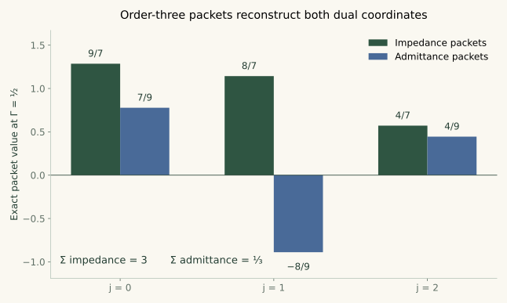

*Figure 2. Three algebraic components reconstruct each function. An isolated packet need not itself be a physical impedance or admittance.*

### The two-phase case explains ordinary inversion

For \(N=2\), (15) becomes

\[
\mathcal P_{2,0}z=\frac{1+t^2}{1-t^2},\qquad
\mathcal P_{2,1}z=\frac{2t}{1-t^2}.
\]

Since \(y(t)=z(-t)\),

\[
\boxed{\mathcal P_{2,0}z=\frac{z+y}{2},\qquad
\mathcal P_{2,1}z=\frac{z-y}{2}.}
\tag{21}
\]

For \(t=1/2\), these are \(5/3\) and \(4/3\), whose sum is 3. The even packet of admittance remains \(5/3\), while its odd packet is \(-4/3\), giving \(1/3\). This is a decomposition *of two functions related by inversion*. It does **not** mean that the reciprocal of each packet is the corresponding admittance packet.

### Passivity is not preserved packet by packet

A positive-real analytic impedance function has \(\Re F(t)\ge0\) in the disk. The zero residue packet is an average of such functions at rotated arguments, so it remains positive-real. For \(z(t)\),

\[
\mathcal P_{N,0}z(t)=\frac{1+t^N}{1-t^N}
\]

is visibly positive-real because \(|t^N|<1\).

But for \(j>0\), every packet \(\mathcal P_{N,j}F\) vanishes at the origin. If a nonzero such packet had nonnegative real part throughout the disk, its real part would be a nonnegative harmonic function attaining its minimum zero at an interior point. The minimum principle would force the harmonic real part to vanish identically. Analyticity and the value at the origin would then force the whole packet to vanish. Hence a **nonzero packet of nonzero residue cannot itself be positive-real**.

This is a structural limitation on additive impedance-packet synthesis, not a new law of energy conservation.

### Apparent poles are canceled by complete reconstruction

Every nonzero packet in (15) has denominator \(1-t^N\), which vanishes at the \(N\)-th roots of unity. The original impedance has only one pole at \(t=1\). The extra boundary poles disappear when all packets are summed.

For example, with \(N=2\), the even and odd packets separately have poles at \(t=-1\), but their sum is \((1+t)/(1-t)\), which is regular and zero there. **Deleting a packet can expose a boundary singularity that did not exist in the full physical response.** These are boundary statements, outside the strict series domain \(\lvert t\rvert<1\).

### Orthogonality is an energy budget, not pointwise magnitude addition

Write \(F_\rho(\theta)=F(\rho e^{i\theta})\). Different residue classes have disjoint Fourier support, so Parseval gives

\[
\frac1{2\pi}\int_0^{2\pi}|F_\rho(\theta)|^2\,d\theta
=\sum_{j=0}^{N-1}\frac1{2\pi}\int_0^{2\pi}
|\mathcal P_{N,j}F_\rho(\theta)|^2\,d\theta.
\tag{22}
\]

For \(z(t)=1+2\sum_{m\ge1}t^m\), at \(\rho=1/2\) and \(N=3\), the packet energies are

\[
E_0=\frac{67}{63},\quad E_1=\frac{64}{63},\quad E_2=\frac{16}{63},
\quad E_0+E_1+E_2=\frac73.
\]

They are **angular mean-square energies**, not the squares of the three packet values in (19). Keeping those notions separate is necessary when interpreting a packet spectrum.

## From the chart to a passive two-port

A Smith-chart point is not the whole network. Let a two-port scattering matrix at one operating frequency be

\[
S=\begin{pmatrix}S_{11}&S_{12}\\S_{21}&S_{22}\end{pmatrix}.
\]

Terminate the second port with load reflection \(t\). Solving the two scattering equations for the input reflection gives the standard identity

\[
\boxed{F(t)=S_{11}+\frac{S_{12}S_{21}t}{1-S_{22}t}.}
\tag{23}
\]

Set \(a=S_{11}\), \(b=S_{12}S_{21}\), and \(d=S_{22}\). On \(|dt|<1\),

\[
F(t)=a+b\sum_{m\ge1}d^{m-1}t^m.
\]

The exact projectors of the terminated response are therefore

\[
\boxed{\begin{aligned}
\mathcal P_{N,0}F(t)&=a+\frac{bd^{N-1}t^N}{1-d^Nt^N},\\
\mathcal P_{N,j}F(t)&=\frac{bd^{j-1}t^j}{1-d^Nt^N},
\qquad 1\le j<N.
\end{aligned}}
\tag{24}
\]

Unlike the coordinate-only example, these packets now refer to the termination response of a specified two-port. If \(S^*S\preceq I\), passive termination implies that the full \(F\) is Schur. The same statement does not automatically hold for arbitrary sums of selected packets.

### Worked example: a lossless network becomes nonpassive after truncation

Take the reciprocal scattering matrix

\[
S=\begin{pmatrix}
\tfrac12&\tfrac{\sqrt3}{2}\\
\tfrac{\sqrt3}{2}&-\tfrac12
\end{pmatrix}.
\]

Its columns are orthonormal, so \(S^*S=I\). Thus the network is lossless at the operating frequency. Its terminated response is

\[
F(t)=\frac{\frac12+t}{1+\frac12 t}.
\]

Choose \(N=3\) and \(t=3/4\). Substituting \(a=1/2\), \(b=3/4\), and \(d=-1/2\) into (24) gives

\[
\begin{aligned}
p_0&=\frac{310}{539},\\
p_1&=\frac{288}{539},\\
p_2&=-\frac{108}{539}.
\end{aligned}
\]

The complete response is

\[
\boxed{F(3/4)=p_0+p_1+p_2=\frac{490}{539}=\frac{10}{11}<1.}
\tag{25}
\]

Suppose we discard packet 2. The truncated response becomes

\[
\boxed{p_0+p_1=\frac{598}{539}>1.}
\tag{26}
\]

Its corresponding normalized input impedance is

\[
\frac{1+598/539}{1-598/539}
=\boxed{-\frac{1137}{59}}.
\]

A negative real impedance is not the passive response we began with. The failure does not come from numerical precision or from an active physical component. It comes from an **incomplete representation** that no longer satisfies the global constraint obeyed by the full response.

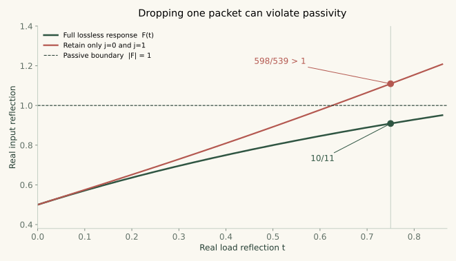

*Figure 3. The truncated packet sum exceeds the unit-reflection bound. The dashed boundary is the passive scalar Schur limit.*

### A safe way to retain packets: refine a single residue class

The failure in (26) does not mean **every** incomplete packet representation loses passivity. We can identify a whole family of selections that preserves the Schur bound exactly.

**Proposition (contractive coset retention).** Let \(d\mid N\), choose a residue \(0\le a<d\), and retain precisely the order-\(N\) classes

\[
J_{d,a}=\{j\in\{0,\ldots,N-1\}: j\equiv a\pmod d\}.
\]

For every analytic Schur function \(F\),

\[
\boxed{\sum_{j\in J_{d,a}}\mathcal P_{N,j}F
=\mathcal P_{d,a}F,\qquad
\biggl|\sum_{j\in J_{d,a}}\mathcal P_{N,j}F(t)\biggr|
\le |t|^a\le1.}
\tag{27a}
\]

The first identity is exact residue refinement. The second follows because \(\mathcal P_{d,a}F\) is a weighted average of rotated Schur values and vanishes to order at least \(a\) at the origin. The generalized Schwarz lemma supplies the factor \(|t|^a\). This proves analytic contractivity of the **selected external response**, not its realization by a prescribed internal circuit.

A worked example uses the lossless network from (25), at \(t=3/4\). Refine from order three to order six. Then

\[
\begin{aligned}
\mathcal P_{6,0}F+\mathcal P_{6,3}F&=\mathcal P_{3,0}F=\frac{310}{539},\\
\mathcal P_{6,1}F+\mathcal P_{6,4}F&=\mathcal P_{3,1}F=\frac{288}{539}.
\end{aligned}
\]

Each retained coset is contractive **for every Schur function**, not just at this point. But the *union* of these two individually safe cosets selects \(J=\{0,1,3,4\}\). Its value is

\[
\boxed{\sum_{j\in\{0,1,3,4\}}\mathcal P_{6,j}F(3/4)
=\frac{598}{539}>1.}
\tag{27b}
\]

So universal contractivity is **not closed under unions of safe packet masks**. This explains precisely how selecting two individually bounded components can recreate the truncated-network failure. The guarantee is a sufficient family of safe masks, not a claim that all other masks are unsafe for every particular network. The construction is an application of classical cyclic Fourier projection.

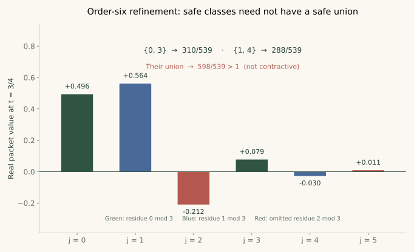

*Figure 4. Each displayed packet is an algebraic coefficient-class contribution. Two separate coset sums are universally Schur-contractive, while retaining their union can exceed the passive bound.*

### What survives in individual reflection packets

For any Schur function \(F\), every single projector \(\mathcal P_{N,j}F\) is also Schur. It is an average of rotated values of \(F\) with unimodular weights, so the triangle inequality bounds its norm by one. Because it has a zero of order at least \(j\) at the origin, the generalized Schwarz lemma sharpens this to

\[
\boxed{|\mathcal P_{N,j}F(t)|\le|t|^j.}
\tag{27}
\]

The bound is sharp: \(F(t)=t^j\) attains it. A single packet can remain contractive while a **sum of selected packets** does not, as (26) shows. Contractivity of a packet is a property of its analytic values, not proof that it represents the same hardware topology or the same internal two-port.

### A sharp classification of universally passive cyclic packet filters

The coset construction above supplies a useful *family* of safe selections, but the failure of their union raises a more exact question: **which fixed linear combinations of cyclic packets preserve contractivity for every passive analytic response?** Here is a complete answer for the scalar-load disk model and, with the operator norm, for matrix-valued analytic responses. The argument is an application of classical finite Fourier analysis and Nevanlinna–Pick interpolation. It is not a claim of new priority over bounded multiplier or positive-operator theory.

Fix an integer \(N\ge2\) and coefficients \(m_0,\ldots,m_{N-1}\in\mathbb C\). Define the *cyclic packet filter*

\[
T_mF(t)=\sum_{j=0}^{N-1}m_j\mathcal P_{N,j}F(t),
\quad \omega_N=e^{2\pi i/N},
\quad w_k=\frac1N\sum_{j=0}^{N-1}m_j\omega_N^{-jk}.
\tag{27c}
\]

The inverse Fourier identity, with the signs as written, gives

\[
\boxed{T_mF(t)=\sum_{k=0}^{N-1}w_kF(\omega_N^kt),\qquad
m_j=\sum_{k=0}^{N-1}w_k\omega_N^{jk}.}
\tag{27d}
\]

**Theorem (exact universal cyclic-filter norm).** On the scalar Schur class \(\mathcal S=\{F:\mathbb D\to\overline{\mathbb D}\text{ analytic}\}\), the filter is universally contractivity-preserving if and only if

\[
\boxed{\sum_{k=0}^{N-1}|w_k|\le1.}
\tag{27e}
\]

More precisely, the operator norm of \(T_m\) on the bounded analytic functions \(H^\infty(\mathbb D)\) is exactly \(\sum_k|w_k|\). The same criterion is **necessary and sufficient** for preserving the operator-norm Schur ball of analytic \(q\times q\) matrix functions, for every fixed \(q\ge1\).

**Proof.** Equation (27d) and the triangle inequality give \(\|T_mF\|_\infty\le(\sum_k|w_k|)\|F\|_\infty\), also with matrix operator norms. Conversely suppose \(L=\sum_k|w_k|>1\), and choose a real \(c\) with \(1/L<c<1\). For \(r<1\), set \(t_k=r\omega_N^k\) and prescribe \(F(t_k)=c\overline{w_k}/|w_k|\) when \(w_k\ne0\), and \(F(t_k)=0\) otherwise. The scalar Pick matrix has diagonal entries at least \((1-c^2)/(1-r^2)\), tending to infinity as \(r\uparrow1\). Its off-diagonal entries remain bounded because the distinct roots of unity keep \(1-t_k\overline{t_\ell}\) away from zero for \(k\ne\ell\). Consequently the Pick matrix is positive definite for \(r\) sufficiently close to one. The classical Pick theorem supplies a scalar Schur interpolant with these values. But then \(T_mF(r)=c\sum_k|w_k|=cL>1\), a contradiction to universal contractivity. The same boundary-interpolation argument shows the operator norm is *at least* \(L\) by taking \(c\uparrow1\). The matrix condition is sufficient by the operator-norm triangle inequality and necessary by embedding the scalar counterexample as \(F(t)I_q\). \(\square\)

In particular, a single cyclic projector has inverse Fourier weights of modulus \(1/N\), and a retained residue coset reduces to a subgroup character average. Each has total absolute weight one. The exact criterion therefore includes the earlier safe single-packet and coset constructions. It also explains why an arbitrary **union** need not stay safe.

**Corollary (constant-preserving filters).** Requiring \(T_m1=1\), equivalently \(m_0=1\) or \(\sum_kw_k=1\), makes (27e) equivalent to

\[
\boxed{w_k\text{ is a nonnegative real number for every }k,\qquad\sum_kw_k=1.}
\tag{27f}
\]

Indeed, equality in \(1=|\sum_kw_k|\le\sum_k|w_k|\le1\) forces all nonzero weights to have the same phase, which is positive real because their sum is one. Thus **universally safe, constant-preserving masks are precisely probability averages of cyclic rotations**. For conjugation symmetry \(F(\bar t)=\overline{F(t)}\), the additional sufficient and necessary condition for every such response is \(w_k=w_{N-k}\). The corresponding Fourier gains \(m_j\) are real. Matrix transpose reciprocity of \(F\) is preserved whenever its values are symmetric, since the filter is linear in the matrix entries. None of these facts fixes a hardware topology.

The distinction between \(|m_j|\le1\) and (27e) is essential: **individually bounded packet gains do not certify a safe combined filter**. Consider two order-four masks:

| Filter | Gains \((m_0,m_1,m_2,m_3)\) | Rotation weights \((w_0,w_1,w_2,w_3)\) | Universal norm |
|---|---|---|---|
| Hard retention of residues 0, 1, 3 | \((1,1,0,1)\) | \((3/4,1/4,-1/4,1/4)\) | \(3/2\), unsafe |
| First Fejér taper | \((1,1/2,0,1/2)\) | \((1/2,1/4,0,1/4)\) | \(1\), safe |

The safe weights are the order-four Fejér averages \(w_k=|1+\omega_4^k|^2/8\). The associated multiplier is a convex combination of four rotated responses. More generally, whenever \(0\le M<N\), the cyclic Fejér weights

\[
w_k=\frac1{N(M+1)}\left|\sum_{\ell=0}^M\omega_N^{k\ell}\right|^2
\tag{27g}
\]

are nonnegative and sum to one by orthogonality. They consequently preserve analytic contractivity, and their symmetry preserves the real-coefficient condition. This is the standard Fejér positivity mechanism expressed as a packet operator.

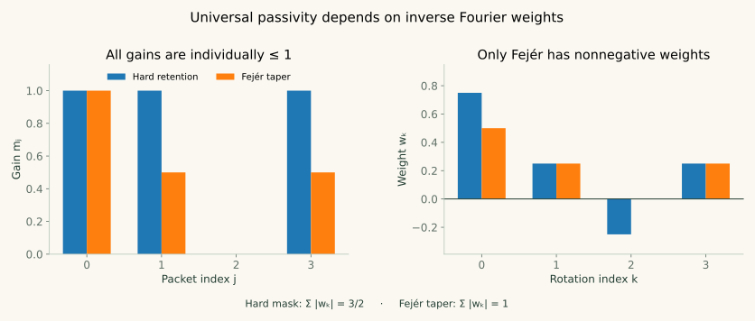

*Figure 5. Both filters have individual gains of magnitude at most one, but the hard mask contains a negative rotation weight. The nonnegative Fejér weights preserve every Schur response. They also give a closest universal repair of this hard mask.*

**Exact passive-to-nonpassive witness.** Take the real-coefficient disk automorphism

\[
F_a(t)=\frac{a+t}{1+at},\qquad a=\frac9{10}.
\]

For \(0<a<1\), the identity

\[
1-|F_a(t)|^2=\frac{(1-a^2)(1-|t|^2)}{|1+at|^2}\ge0
\]

proves its contractivity on the entire disk. At the real load \(t=99/100\), the full reflection and the two filtered responses are, in exact arithmetic,

\[
\begin{aligned}
F_a(t)&=\frac{1890}{1891}\approx0.9994711793,\\
T_{\rm hard}F_a(t)&=\frac{537154524810}{369752957839}\approx1.4527389529,\\
T_{\rm Fej}F_a(t)&=\frac{3380183640}{3392228971}\approx0.9964491398.
\end{aligned}
\tag{27h}
\]

The hard mask produces a *nonpassive* normalized impedance

\[
\boxed{\frac{1+T_{\rm hard}F_a(t)}{1-T_{\rm hard}F_a(t)}=
-\frac{906907482649}{167401566971}\approx-5.4175.}
\tag{27i}
\]

The Fejér mask remains inside the reflection disk not merely at this test point, but **uniformly for every analytic Schur function**, as proved above. The hard-filter witness is exact and real-coefficient; neither numerical instability nor lack of conjugate symmetry explains its failure.

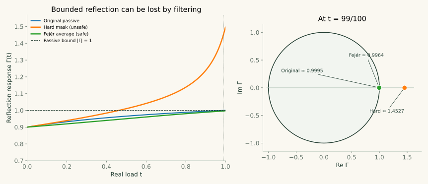

*Figure 6. At \(t=0.99\) the hard-filter output lies beyond the unit-reflection boundary, while the original and Fejér-filtered responses remain inside. The inset traces the real-load response as \(t\) varies.*

**Positive-real functions and noncommuting coordinates.** If \(z(t)\) has nonnegative real part on the disk, then the probability-weighted filter \(T_mz=\sum_kw_kz(\omega_N^kt)\) also has nonnegative real part. This follows directly by taking real parts of the convex average. It does *not* mean that filtering impedance commutes with the Cayley conversion of a filtered reflection. For \(z(t)=(1+t)/(1-t)\), the same order-four Fejér filter gives, at \(t=1/2\),

\[
\boxed{T_{\rm Fej}z(1/2)=\frac95\ne\frac53=
\frac{1+T_{\rm Fej}\Gamma(1/2)}{1-T_{\rm Fej}\Gamma(1/2)},\qquad\Gamma(t)=t.}
\tag{27j}
\]

Both sides are positive real, but they describe **different passive external responses**. This is a concrete exact noncommutation between a linear representation filter and the nonlinear impedance–reflection map. The guarantee here is functional passivity, not preservation of the original circuit's element values, order, or topology.

**Exact least-distortion repair of a signed mask.** There is a quantitative consequence of the same theorem. Suppose a constant-preserving mask has **real**, possibly negative rotation weights with \(\sum_kw_k=1\). We wish to replace it with a universally safe, constant-preserving mask \(p_k\ge0\), \(\sum_kp_k=1\). Then

\[
\boxed{\inf_{p\in\Delta_N}\|T_w-T_p\|_{H^\infty\to H^\infty}
=\inf_{p\in\Delta_N}\sum_k|w_k-p_k|
=\sum_k|w_k|-1=2\sum_{w_k<0}|w_k|.}
\tag{27k}
\]

Here \(\Delta_N\) is the probability simplex. For the proof, let \(\alpha\) be the total absolute weight of the negative entries. The positive entries sum to \(1+\alpha\). Every nonnegative probability vector must eliminate at least \(\alpha\) of negative mass, and the total weight constraint forces at least another \(\alpha\) of compensating change among positive entries. This proves the lower bound \(2\alpha\). Setting the negative entries to zero and reducing the positive entries by total \(\alpha\) attains equality. The first equality is the sharp cyclic-filter norm theorem applied to the difference operator.

For the hard order-four mask, \(\alpha=1/4\). Its Fejér replacement \((1/2,1/4,0,1/4)\) is **a closest safe mask in universal operator norm**, with exact repair distance \(1/2\). Therefore, for every scalar or matrix Schur response,

\[
\boxed{\|T_{\rm hard}F-T_{\rm Fej}F\|_\infty\le\tfrac12,}
\tag{27l}
\]

and no safe unital rotation average can give a smaller **uniform worst-case operator error** for this hard filter. This does not mean the Fejér filter is uniquely optimal, or that it minimizes the pointwise error for a particular circuit. The result quantifies the cost of repairing a *representation operation*, not hardware or exact-data synthesis.


## Incomplete packets can hide two different passive networks

The previous example showed that discarding a packet can destroy passivity. The next example shows that the missing information need not be recoverable, even if passivity is imposed.

Consider two reciprocal, passive two-ports

\[
S_\pm=\begin{pmatrix}0&\sqrt{b_\pm}\\\sqrt{b_\pm}&d_\pm\end{pmatrix},
\quad(d_+,b_+)=\left(\frac12,\frac{63}{160}\right),
\quad(d_-,b_-)=\left(-\frac12,\frac{65}{160}\right).
\tag{28}
\]

Both satisfy \(S_\pm^*S_\pm\preceq I\), as can be checked by the nonnegative principal minors of \(I-S_\pm^*S_\pm\).

At order \(N=3\) and load reflection \(t=1/2\), they produce:

| Observation | Network + | Network − |
|---|---:|---:|
| Matched-load reflection \(a\) | 0 | 0 |
| Observed \(p_0\) | \(1/80\) | \(1/80\) |
| Observed \(p_1\) | \(1/5\) | \(1/5\) |
| Unobserved \(p_2\) | \(+1/20\) | \(-1/20\) |
| Full reflection \(F(1/2)\) | \(21/80\) | \(13/80\) |

Thus two passive physical networks have identical observed packets but full responses separated by \(1/10\). Any single estimate based only on the observed data incurs error at least \(1/20\) on one of the two networks.

This is a **non-identifiability obstruction**. No algorithm using only these observations can choose the correct network without additional measurements or a stronger model assumption.

A simple passive completion of the observed scalar packet values is

\[
G(t)=\frac1{80}+\frac25t.
\]

Indeed, \(|G(t)|\le 1/80+2/5=33/80<1\) on the disk and at \(t=1/2\) its first two order-three packets are exactly the observed values. Its missing packet is zero. This completion is passive as a Schur function, but it is not asserted to be the unique response of one prescribed two-port architecture.

## Passive completion from incomplete packets

We now keep the measured packets exactly and impose global contractivity, rather than repairing an arbitrary truncation by rescaling it.

Fix a radius \(0<\rho<1\) and order \(N\). Let \(\omega=\omega_N\), and sample an unknown scalar Schur function at the cyclic orbit

\[
t_k=\rho\omega^k,\quad v_k=F(t_k),\qquad k=0,\ldots,N-1.
\]

The orbit packets and inverse Fourier transform are

\[
p_j=\frac1N\sum_{k=0}^{N-1}\omega^{-jk}v_k,
\qquad v_k=\sum_{j=0}^{N-1}\omega^{kj}p_j.
\tag{29}
\]

Only some \(p_j\) may be observed. We want to know whether **any** Schur function can realize the observed values, without changing them.

### The classical Pick criterion in packet coordinates

The Szegő kernel on the orbit is

\[
K_{k\ell}=\frac1{1-\rho^2\omega^{k-\ell}}.
\]

Let \(U_{kj}=\omega^{kj}/\sqrt N\). Then \(U^*KU=\Lambda\), where

\[
\lambda_j=\frac{N\rho^{2j}}{1-\rho^{2N}},
\quad\Lambda=\operatorname{diag}(\lambda_0,\ldots,\lambda_{N-1}).
\]

Define a cyclic convolution matrix by \(C(p)_{ab}=p_{(a-b)\bmod N}\). The Nevanlinna–Pick theorem, transformed by \(U\), gives the following exact finite criterion:

> **Finite orbit passive completion theorem.** Suppose values of \(p_j\) are fixed for \(j\) in an observed set. There exists a scalar analytic Schur function realizing those values if and only if the unobserved packets can be chosen so that
>
> \[
> \boxed{\begin{pmatrix}
> \Lambda&C(p)\Lambda\\
> \Lambda C(p)^*&\Lambda
> \end{pmatrix}\succeq0.}
> \tag{30}
> \]

**Proof.** The ordinary Pick matrix at the orbit is \(P=K-\operatorname{diag}(v)K\operatorname{diag}(v)^*\). The Pick theorem says \(P\succeq0\) is necessary and sufficient. Because \(K\) is positive definite, this is equivalent by a Schur complement to

\[
\begin{pmatrix}K&\operatorname{diag}(v)K\\K\operatorname{diag}(v)^*&K\end{pmatrix}\succeq0.
\]

Apply the unitary transformation \(\operatorname{diag}(U^*,U^*)\). We have \(U^*KU=\Lambda\) and \(U^*\operatorname{diag}(v)U=C(p)\). This produces (30). The missing packets enter **affinely in the real and imaginary parts**, so the feasible completion problem is a semidefinite feasibility problem. The argument is an exact coordinate change of the classical interpolation criterion. \(\square\)

A feasible matrix certifies existence of a bounded analytic reflection function in the **load variable**. It does not force that function to come from an assigned internal two-port or fixed circuit topology. The same construction with matrix-valued samples uses block kernels and an identity factor on the channel space.

### A complete two-node Pick calculation

To see the finite criterion without a large determinant, let \(N=2\), \(\rho=1/2\), and take the Schur response \(F(t)=t/2\). The two orbit observations and their packet coordinates are

\[
\begin{aligned}
(v_0,v_1)&=\bigl(F(1/2),F(-1/2)\bigr)=(1/4,-1/4),\\
(p_0,p_1)&=\bigl((v_0+v_1)/2,(v_0-v_1)/2\bigr)=(0,1/4).
\end{aligned}
\]

The kernel, its Fourier eigenvalue matrix, and the packet convolution matrix are

\[
K=\begin{pmatrix}4/3&4/5\\4/5&4/3\end{pmatrix},\quad
\Lambda=\begin{pmatrix}32/15&0\\0&8/15\end{pmatrix},\quad
C(p)=\begin{pmatrix}0&1/4\\1/4&0\end{pmatrix}.
\]

The packet-coordinate Schur complement is exactly

\[
\boxed{\Lambda-C(p)\Lambda C(p)^*
=\begin{pmatrix}21/10&0\\0&2/5\end{pmatrix}\succ0.}
\tag{30a}
\]

Thus these **complete packet observations** are strictly feasible. This calculation is a finite interpolation certificate. The actual witness \(F(t)=t/2\) shows existence independently, and the positive eigenvalues give a nonzero conditioning margin that we can quantify below. If a packet were missing, the unknown value would enter the same matrix as an optimization variable; the measured packet could not simply be discarded from the condition.

### Matrix-valued packets: a complete noncommutative Pick example

The scalar completion theorem extends **without commuting the sampled matrices**. Let \(F:\mathbb D\to\mathbb C^{q\times q}\) be analytic and contractive in operator norm. At the orbit \(t_k=\rho\omega_N^k\), write \(W_k=F(t_k)\) and define matrix packet values

\[
P_j=\frac1N\sum_{k=0}^{N-1}\omega_N^{-kj}W_k,
\qquad W_k=\sum_{j=0}^{N-1}\omega_N^{kj}P_j.
\]

Let \(L=\Lambda\otimes I_q\), with the same positive scalar eigenvalues \(\lambda_j=N\rho^{2j}/(1-\rho^{2N})\) as before. Now \(\mathcal C(P)\) is an \(N\)-by-\(N\) **block** cyclic convolution matrix, whose block \((a,b)\) is \(P_{(a-b)\bmod N}\). Matrix-valued Nevanlinna–Pick interpolation gives the exact criterion

\[
\boxed{\begin{pmatrix}
L&\mathcal C(P)L\\
L\mathcal C(P)^*&L
\end{pmatrix}\succeq0.}
\tag{30b}
\]

The proof is the scalar Fourier-conjugation argument applied to the \(Nq\)-dimensional kernel \(K\otimes I_q\): the orbit values form the block diagonal matrix \(\operatorname{diag}(W_0,\ldots,W_{N-1})\), and conjugating by \(U\otimes I_q\) produces \(\mathcal C(P)\). **No product of noncommuting packet matrices is reordered.** Equation (30b) is necessary and sufficient for a matrix Schur interpolant matching the specified orbit packet data. If entire packets or individual entries are unknown, their real and imaginary parts enter this matrix inequality affinely, giving an exact finite semidefinite completion problem. It does *not* guarantee realization with prescribed RF scattering blocks or topology. The underlying matrix interpolation theorem is classical; see Delsarte–Genin–Kamp and Chen–Koç in the sources below.

**Feasible example with noncommuting packets.** Take \(N=2\), \(\rho=1/2\), and the Pauli-type real matrices

\[
X=\begin{pmatrix}0&1\\1&0\end{pmatrix},\qquad
Z=\begin{pmatrix}1&0\\0&-1\end{pmatrix}.
\]

Choose

\[
\boxed{F(t)=\frac14X+\frac t3 Z,\qquad
P_0=\frac14X,\quad P_1=\frac16Z.}
\tag{30c}
\]

Since \(\|F(t)\|_2\le1/4+|t|/3\le7/12<1\), this is a globally contractive analytic matrix response. Yet

\[
[P_0,P_1]=P_0P_1-P_1P_0
=\frac1{12}\begin{pmatrix}0&-1\\1&0\end{pmatrix}\ne0.
\]

At the two measured points the values are \(W_\pm=X/4\pm Z/6\), each of operator norm \(\sqrt{13}/12\). The ordinary matrix Pick matrix has positive leading principal minors

\[
\boxed{\frac{131}{108},\quad\frac{17161}{11664},\quad
\frac{415663}{393660},\quad\frac{10067929}{13286025}.}
\tag{30d}
\]

These exact minors certify positive definiteness. In fact the uniform bound \(\|F\|_\infty\le7/12\) yields the independent lower bound \(\Pi_F\succeq(19/54)I_4\) at the two nodes. If only \(P_0=X/4\) is observed, both the displayed \(P_1=Z/6\) and \(P_1=0\) are feasible, demonstrating **matrix-valued non-identifiability** despite exact measurements.

**Infeasible example although every sampled value is contractive.** Keep \(N=2\) and \(\rho=1/2\), but prescribe

\[
\boxed{P_0=\frac12Z,\qquad P_1=\frac12X.}
\tag{30e}
\]

Individually these meet the sharp one-packet bounds \(\|P_0\|_2\le1\) and \(\|P_1\|_2\le\rho\). The reconstructed node values \(W_\pm=(Z\pm X)/2\) satisfy \(W_\pm^*W_\pm=I_2/2\), so **both node values are strictly contractive**. Nonetheless their ordinary four-by-four Pick matrix is

\[
\Pi=\begin{pmatrix}
2/3&0&4/5&2/5\\
0&2/3&-2/5&4/5\\
4/5&-2/5&2/3&0\\
2/5&4/5&0&2/3
\end{pmatrix}.
\]

For \(v=(1,0,-1,0)^T\), direct multiplication gives

\[
\boxed{v^*\Pi v=-\frac4{15}<0.}
\tag{30f}
\]

Thus no matrix Schur function matches both matrix packets, despite the individual packet bounds and the strictly contractive orbit values. This is an exact joint-data obstruction, not a noncommutative version of a physical scattering-network synthesis theorem.

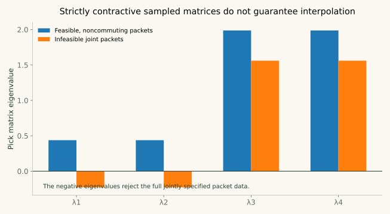

*Figure 7. All four eigenvalues are positive for the noncommuting feasible data, while the jointly incompatible data have negative eigenvalues despite strictly contractive measured node values.*

Finally, a *single* prescribed \(q\)-by-\(q\) packet \(P_j\) at radius \(\rho\) is feasible if and only if \(\|P_j\|_2\le\rho^j\). Necessity follows by applying the order-\(j\) Schwarz bound to the contractive projected function and taking the operator norm; sufficiency uses the explicit completion \(F(t)=t^jP_j/\rho^j\). The two examples show why these independent bounds do not settle simultaneous matrix packet completion.

### The easiest sharp special case: one known packet

The sharp inequality (27) immediately gives a complete characterization if only **one** packet is measured at one radius:

\[
\boxed{\text{A prescribed }p_j\text{ is Schur-feasible}\iff |p_j|\le\rho^j.}
\tag{31}
\]

Necessity is (27). Sufficiency uses the explicit Schur completion

\[
F(t)=\frac{p_j}{\rho^j}t^j.
\]

For instance, with \(N=3,\rho=1/2,j=1,p_1=1/5\), the polynomial \(F(t)=2t/5\) realizes that packet exactly and has norm at most \(2/5\). When two or more packets are specified, independent one-packet inequalities do not capture their joint compatibility. That is why the full matrix is needed.

### A surprising unique missing-packet case

Return to the lossless two-port of (25). Fix \(N=3\), \(\rho=3/4\), and suppose only

\[
p_0=\frac{310}{539},\qquad p_1=\frac{288}{539}
\]

are observed. Could the missing \(p_2\) be different while remaining compatible with **any** scalar Schur function? Surprisingly, no.

Write \(p_2=x+iy\), and let

\[
\Lambda=\frac1{3367}\operatorname{diag}(12288,6912,3888),
\qquad M=\Lambda-C(p)\Lambda C(p)^*.
\]

Take real vectors \(u=(3,8,0)^T\), \(v=(-9,0,64)^T\), and the positive semidefinite matrix

\[
H=593uu^T+3vv^T\succeq0.
\]

A direct exact expansion gives the identity

\[
\boxed{\operatorname{tr}(HM)=
-\frac{337121280}{3367}\left[
\left(x+\frac{108}{539}\right)^2+y^2\right].}
\tag{32}
\]

Feasibility of (30) requires \(M\succeq0\). Two positive semidefinite matrices satisfy \(\operatorname{tr}(HM)\ge0\), but the expression in (32) is nonpositive. It can vanish only at

\[
\boxed{p_2=-\frac{108}{539}.}
\tag{33}
\]

That value is feasible because it comes from the original lossless response. Therefore the missing packet is uniquely determined among **all scalar Schur functions**, not only among the rational two-port models considered above. The completed Pick matrix has rank one. Its data in fact identify the corresponding disk automorphism.

The exact witness (32) is included in the Python verification suite. Its arithmetic is reproduced symbolically, not inferred from floating-point eigenvalues.

The same witness gives a **quantitative rejection margin** for any incorrect missing packet, with the two observed values held exact. Since \(\operatorname{tr}H=55820\) and a Hermitian matrix satisfies \(\operatorname{tr}(HM)\ge\lambda_{\min}(M)\operatorname{tr}H\) whenever \(H\succeq0\), equation (32) implies

\[
\boxed{\lambda_{\min}(M(p_2))\le
-\frac{16856064}{9397297}
\left|p_2+\frac{108}{539}\right|^2.}
\tag{33a}
\]

Thus a deviation \(p_2+108/539=1/100\) forces an eigenvalue at most \(-16856064/93972970000\). This is an **exact infeasibility margin for a fixed pair of observations**, not a noise-robustness certificate when \(p_0\) or \(p_1\) also changes. The distinction matters near a rank-deficient Pick matrix.

### When uniqueness fails, quantify the possible answers

For a fixed complete orbit \(t_0,\ldots,t_{N-1}\), a new point \(\zeta\notin\{t_k\}\), and unknown value \(w=F(\zeta)\), augment the Pick matrix by the new node. The resulting positive-semidefinite condition describes exactly the allowable values of \(w\). If some packets remain missing, both the packets and \(w\) are variables in an affine block LMI. Its feasible projection onto the complex \(w\)-plane is convex.

When the original Pick matrix is strictly positive definite, the allowable \(w\) form a **sharp disk**, computable by a Schur complement. That disk quantifies what the observations cannot determine, without inventing missing information. Choosing the disk center independently at different loads is not necessarily the response of one analytic network. A globally valid interpolant must be constructed from one consistent completed dataset.

### Numerical conditioning is part of the proof obligation

The eigenvalues of the orbit kernel are \(\lambda_j\), so

\[
\boxed{\kappa_2(K)=\rho^{-2(N-1)}.}
\tag{34}
\]

At \(N=16,\rho=1/2\), the condition number is \(2^{30}\). A floating-point positive eigenvalue with an unqualified tolerance is not an exact passivity certificate in that regime. For numerical implementation, one must report conditioning, interval or rational certificates, and the accuracy of measured packet values.

### A quantitative tolerance for finite orbit measurements

Exact Pick feasibility uses exact data. To make a finite numerical certificate meaningful, we can bound the effect of perturbing the completed orbit values before computing the Pick matrix.

Let the orbit Szegő matrix be \(K_{k\ell}=(1-t_k\overline{t_\ell})^{-1}\), let \(D=\operatorname{diag}(v_0,\ldots,v_{N-1})\), and define

\[
P(v)=K-DKD^*,\qquad M=\|v\|_\infty.
\]

If an approximate dataset \(\widetilde v\) satisfies \(\|\widetilde v-v\|_\infty\le\varepsilon_v\), then direct expansion and the spectral norm inequality give

\[
\boxed{\|P(\widetilde v)-P(v)\|_2
\le \|K\|_2(2M\varepsilon_v+\varepsilon_v^2).}
\tag{34a}
\]

For the equally spaced orbit of radius \(\rho\), \(\|K\|_2=N/(1-\rho^{2N})\). Consequently, **if a fixed completed dataset** has \(\lambda_{\min}(P(v))\ge\eta>0\) and the right side of (34a) is smaller than \(\eta\), every dataset within the stated error bound remains feasible. Conversely, if \(\lambda_{\min}(P(v))\le-\eta\), the same strict margin guarantees that every such nearby dataset remains infeasible. This is Weyl's eigenvalue perturbation inequality applied to a Hermitian Pick matrix.

**Exact example.** Choose \(N=3\), \(\rho=1/2\), and the constant Schur response \(F(t)=1/2\). Its orbit values are all \(1/2\), with

\[
\|K\|_2=\frac{64}{21},\qquad
\lambda_{\min}(P)=\frac17.
\]

If **each** of its three packet values is perturbed by at most \(1/100\), the inverse Fourier transform gives \(\varepsilon_v\le3/100\). Then the bound is

\[
\boxed{
\frac{64}{21}\left(\frac3{100}+\frac9{10000}\right)
=\frac{412}{4375}<\frac17.}
\tag{34b}
\]

Hence all such perturbed *complete* packet datasets still admit a Schur interpolant. The numerical margin is conservative, and it becomes zero at a singular Pick matrix. In particular, the rank-deficient unique-packet example (32) cannot receive a positive robustness guarantee from this elementary strict-eigenvalue criterion. Nor does it settle noisy **partial** packet feasibility without optimizing over the missing values. These qualifications are essential when translating an exact symbolic certificate to measured data.

## Reconstruct a fixed reciprocal two-port

The scalar Schur completion theorem allows arbitrary analytic contractive functions. A stronger model asks for a **specific architecture**:

\[
S=\begin{pmatrix}a&c\\c&d\end{pmatrix},\qquad S^*S\preceq I,
\qquad F(t)=a+\frac{c^2t}{1-dt}.
\]

Assume the matched-load reflection \(a\) is known, with one nonzero load \(t\) and measured packets \(p_0,p_1\), where \(p_1\ne0\). Dividing the two formulas in (24) gives

\[
\boxed{(dt)^{N-1}=\frac{p_0-a}{p_1}.}
\tag{35}
\]

Thus there are at most \(N-1\) possible branches for \(\xi=dt\). Each produces

\[
\boxed{d=\frac\xi t,\qquad
c^2=\frac{p_1}{t}(1-\xi^N).}
\tag{36}
\]

For each branch, choose either square root of \(c^2\) and test \(S^*S\preceq I\). The sign of \(c\) is an internal port gauge and does not affect the terminated scalar response.

The final passivity check can be performed without numerical frequency sampling. With \(b=c^2\), form

\[
I-S^*S=\begin{pmatrix}
1-|a|^2-|c|^2 & -(\overline a c+\overline c d)\\
-(a\overline c+c\overline d)&1-|d|^2-|c|^2
\end{pmatrix}.
\tag{36a}
\]

This Hermitian matrix is positive semidefinite **if and only if** both diagonal entries are nonnegative and their product is at least \(|\overline a c+\overline c d|^2\). For the lossless example (25), the unwanted branch has \(a=d=1/2\), \(c^2=1455/2156\), and both diagonal entries equal \(81/1078\). Its determinant is

\[
\boxed{\det(I-S^*S)=-\frac{194421}{290521}<0,}
\tag{36b}
\]

so that branch is rejected **by an exact physical passivity calculation**. The original branch \(d=-1/2\), \(c^2=3/4\) instead gives \(S^*S=I\).

This finite procedure is **exhaustive for the stated reciprocal scalar two-port architecture**. It does not identify the internal transmission coefficients of an arbitrary nonreciprocal network. It does not impose frequency dependence.

In the ambiguous example (28), \(N=3\) reduces (35) to \((dt)^2=1/16\). Both signs of \(dt\) pass physical passivity, yielding the two different networks. In the lossless example, the two algebraic branches have \(d=\pm1/2\), but the positive branch fails the full scattering contraction test. The negative branch is the original lossless network. An additional measured packet \(p_2\) at \(N\ge3\) resolves \(d=p_2/(tp_1)\) immediately when the denominator is nonzero.

### Two load radii can remove the branch ambiguity

For the more general scalar response \(F(t)=a+bt/(1-dt)\), assume \(b\ne0\), and suppose the order-\(N\) packets \(p_{0,i},p_{1,i}\) are known at two nonzero loads \(t_1,t_2\), with \(p_{1,i}\ne0\). Write

\[
u_i=\frac{t_i}{p_{1,i}},\quad x_i=t_i^N,\quad
v_i=t_i^{N-1}p_{1,i}.
\]

By equation (24), \(u_i=(1-d^Nx_i)/b=\alpha-\beta x_i\), where \(\alpha=1/b\) and \(\beta=d^N/b\). When \(x_1\ne x_2\), solve this two-point affine equation exactly:

\[
\boxed{\beta=\frac{u_1-u_2}{x_2-x_1},\quad
\alpha=u_1+\beta x_1,\quad
b=\alpha^{-1},\quad d^N=\beta/\alpha.}
\tag{36c}
\]

The zero packets supply a consecutive power: \(p_{0,i}=a+d^{N-1}v_i\). If \(v_1\ne v_2\), then

\[
\boxed{d^{N-1}=\frac{p_{0,1}-p_{0,2}}{v_1-v_2},\quad
 d=\frac{d^N}{d^{N-1}},\quad a=p_{0,1}-d^{N-1}v_1.}
\tag{36d}
\]

The ratio for \(d\) assumes \(d\ne0\). When \(d^N=0\), the model instead has \(d=0\), \(p_{0,i}=a\), and \(p_{1,i}=bt_i\), making direct recovery simpler. These are **identification formulas for the scalar rational family**, not a guarantee of stable recovery from noisy measurements or an identification of \(S_{12}\) and \(S_{21}\) separately.

**Worked rational example.** Use the lossless two-port from (25), with \(N=3\), \(t_1=1/2\), and \(t_2=3/4\). Its first two packets at the two loads are

| Load | \(p_0\) | \(p_1\) |
|---|---:|---:|
| \(t_1=1/2\) | \(34/65\) | \(24/65\) |
| \(t_2=3/4\) | \(310/539\) | \(288/539\) |

The resulting \(\alpha=4/3\) and \(\beta=-1/6\) give \(b=3/4\), \(d^3=-1/8\). The zero-packet difference yields \(d^2=1/4\), hence \(d=-1/2\) and \(a=1/2\). All three rational response parameters are recovered uniquely. This example shows precisely how **additional load data resolve a one-load algebraic ambiguity**, under the stated nondegeneracy assumptions.

There is an important distinction between **recovering the external terminated response** and **recovering all internal hardware coefficients**. Even an exact external rational function may admit distinct internal realizations.

## Matrix packets without commuting the network blocks

The scalar two-port formulas do not cover genuine multiport feedback. Let a passive scattering matrix be partitioned as

\[
S=\begin{pmatrix}A&B\\C&D\end{pmatrix},\qquad S^*S\preceq I,
\]

and let \(T\) be a strictly contractive matrix termination. The external reflection response is

\[
\boxed{F(T)=A+BT(I-DT)^{-1}C.}
\tag{37}
\]

Put \(Q=DT\). We rotate the *whole termination* by a scalar root of unity. The degree expansion is

\[
F(T)=A+\sum_{m\ge1}BT(DT)^{m-1}C.
\]

The exact packet formulas are

\[
\boxed{\begin{aligned}
\mathcal P_{N,0}F(T)
&=A+BTQ^{N-1}(I-Q^N)^{-1}C,\\
\mathcal P_{N,j}F(T)
&=BTQ^{j-1}(I-Q^N)^{-1}C,\quad1\le j<N.
\end{aligned}}
\tag{38}
\]

Every multiplication order is retained. We have **not** assumed that \(DT=TD\) or that the scattering blocks commute with the load. The geometric series converges because \(\|D\|\le1\), \(\|T\|<1\), and hence \(\|DT\|<1\).

### A complete noncommuting example

Take two internal channels and choose

\[
A=0,\qquad B=C=\frac13I_2,\qquad
D=\begin{pmatrix}\frac13&0\\0&-\frac14\end{pmatrix},
\qquad
T=\begin{pmatrix}0&\frac12\\\frac12&0\end{pmatrix}.
\]

The full four-port scattering matrix is contractive because it is the sum of the block swap with norm \(1/3\) and the internal block \(D\) with norm \(1/3\). Hence \(\|S\|\le2/3<1\). The termination has \(\|T\|=1/2\).

But

\[
DT=\begin{pmatrix}0&\frac16\\-\frac18&0\end{pmatrix},
\qquad
TD=\begin{pmatrix}0&-\frac18\\\frac16&0\end{pmatrix},
\]

so they do not commute. Nevertheless \(Q^2=-I_2/48\), and the order-two packet formulas simplify exactly to

\[
\begin{aligned}
\mathcal P_{2,0}F(T)&=\begin{pmatrix}-\frac1{147}&0\\0&\frac4{441}\end{pmatrix},\\
\mathcal P_{2,1}F(T)&=\begin{pmatrix}0&\frac8{147}\\\frac8{147}&0\end{pmatrix}.
\end{aligned}
\]

The sum reconstructs the full passive response:

\[
\boxed{F(T)=\begin{pmatrix}-\frac1{147}&\frac8{147}\\\frac8{147}&\frac4{441}\end{pmatrix}.}
\tag{39}
\]

This is an exact rational matrix calculation, checked independently in the Python script. It demonstrates a valid noncommuting use of the packet equations. It is **not** the complete multiport physical realization problem: we have fixed a passive four-port and calculated its response, rather than synthesized an unknown network from arbitrary incomplete matrix data.

### A conservative repair when preserving every observation is unnecessary

Suppose some **nonzero** residue packets in a set \(J\subseteq\{1,\ldots,N-1\}\) are discarded. If \(\|D\|\le\delta\), \(\|T\|\le r\), and \(\delta r<1\), the resolvent formula gives

\[
\boxed{\|F(T)-H(T)\|\le E_J(r),\qquad
E_J(r)=\frac{\|B\|\|C\|r}{1-(\delta r)^N}
\sum_{j\in J}(\delta r)^{j-1}.}
\tag{40}
\]

Here \(H\) is the retained-packet response. Since the original response is contractive, \(\|H(T)\|\le1+E_J(r)\) on that load ball. The rescaled function

\[
G(T)=\frac{H(T)}{1+E_J(r)}
\]

is contractive there, with error at most \(2E_J(r)/(1+E_J(r))\). This gives a computable **bounded-real repair with an error certificate**. Its key limitation is that rescaling changes the retained packet measurements. It is not an exact data-preserving completion and cannot replace the Pick interpolation problem above.

## Frequencies must agree with one physical network

So far, the main interpolation variable has been the load reflection \(t\). A passive RF network must also vary analytically with complex frequency. Let \(S(s)\), \(\Re s>0\), be the scattering matrix of a reciprocal scalar two-port:

\[
S(s)=\begin{pmatrix}a(s)&c(s)\\c(s)&d(s)\end{pmatrix},
\qquad S(s)^*S(s)\preceq I.
\]

The terminated response is

\[
F(s,t)=a(s)+\frac{c(s)^2t}{1-d(s)t}.
\tag{41}
\]

For \(N\ge3\), fixed nonzero load \(t_i\), and nonzero \(p_{1,i}\), the first two nonconstant cyclic packets at frequency \(s_i\) determine

\[
\boxed{d_i=\frac{p_{2,i}}{t_ip_{1,i}},\qquad
c_i^2=\frac{p_{1,i}}{t_i}\left[1-(d_it_i)^N\right].}
\tag{42}
\]

If the matched-load response \(a_i\) is known, the sampled scattering matrix is determined up to the two square-root branches of \(c_i\). These branches do not necessarily extend analytically across frequency.

### Global frequency compatibility through a matrix Pick test

For each consistent choice of coupling signs at \(m\) frequency nodes, form

\[
S_i=\begin{pmatrix}a_i&c_i\\c_i&d_i\end{pmatrix}.
\]

The right-half-plane matrix Pick kernel is

\[
\boxed{\Pi_{ij}=\frac{I_2-S_iS_j^*}{s_i+\overline{s_j}}.}
\tag{43}
\]

The classical matrix Nevanlinna–Pick theorem guarantees an analytic contractive matrix interpolant when \(\Pi\succeq0\). Because the specified matrices are symmetric, a solution can be symmetrized by averaging it with its transpose, preserving both contractivity and the sampled values. Thus **one of the finitely many sign branches must pass the full Pick condition**, and this is necessary and sufficient for an analytic reciprocal bounded-real *scattering matrix* interpolating the given samples.

This statement allows a general analytic scattering matrix. It does not impose an RLC topology, a fixed element count, or a degree bound. These qualifications matter as much as the matrix criterion.

### Real-time symmetry: one further feasibility condition

For real-valued time-domain networks with a **fixed real reference impedance**, the scattering transfer matrix must obey

\[
\boxed{S(\overline s)=\overline{S(s)}.}
\tag{43a}
\]

In particular, each sample at a **positive real Laplace point** \(s_i>0\) must be a real matrix. This requirement is not encoded in the unrestricted complex-matrix Pick condition (43). The nodes used in the numerical examples below are interior Laplace points, **not** imaginary-axis RF frequency samples.

There is nevertheless an exact strengthening of the interpolation test. Suppose the finite node set is invariant under conjugation, and the target scattering samples are symmetric and satisfy \(S_{\bar i}=\overline{S_i}\). Then an analytic, contractive, **reciprocal and real-time symmetric** interpolant exists if and only if the ordinary block Pick matrix (43) is positive semidefinite. Indeed, take any matrix Schur interpolant \(Q(s)\) and average its transpose and reflected conjugate:

\[
\boxed{S_{\mathrm{real,rec}}(s)=\frac14\left[
Q(s)+Q(s)^T+\overline{Q(\overline s)}
+\overline{Q(\overline s)}^{\,T}\right].}
\tag{43b}
\]

All four terms remain analytic and contractive on \(\mathbb C_+\). Their average preserves every specified symmetric conjugate-compatible value. Necessity follows from the Pick theorem. For the two-port packet branch test, this means that at positive real nodes one must first choose **real** \(a_i,d_i,c_i\) branches before testing (43). If \(c_i^2<0\) at such a node, no real-time symmetric reciprocal two-port can match that response, even though a complex one may be Schur-compatible.

**Exact counterexample.** At \(s=1\), set \(N=3\), \(t=1/2\), and prescribe \(p_0=p_2=0\), \(p_1=-1/8\). The complex symmetric constant scattering matrix

\[
S_{\mathrm{cx}}=\begin{pmatrix}0&i/2\\i/2&0\end{pmatrix}
\]

is contractive, with \(S_{\mathrm{cx}}^*S_{\mathrm{cx}}=I/4\); its single-node right-half-plane Pick matrix is \(3I/8\succ0\). Its terminated response is \(F(s,t)=-t/4\), giving exactly the prescribed packets. However, the packet formulas force \(d=p_2/(tp_1)=0\), \(a=p_0=0\), and \(c^2=p_1/t=-1/4\). At real \(s=1\), a real-time symmetric reciprocal network would require \(c\in\mathbb R\), which is impossible. **Complex Schur feasibility alone is not a physical-realness certificate.** This does not change the earlier Pick theorem; it identifies an additional restriction on its admissible scattering samples.

The symmetrization above guarantees analytic bounded-real real-symmetric scattering interpolation. It still does not guarantee a prescribed RLC circuit topology or degree bound.

### A two-frequency impossibility certificate

Take positive real frequencies \(s_1=1\) and \(s_2=2\), with \(N=3\) and \(t=1/2\). Suppose the matched reflections vanish, the packet \(p_2\) vanishes, and

\[
p_1(s_1)=\frac1{32},\qquad
p_1(s_2)=\frac9{32}.
\]

Equation (42) forces \(d_1=d_2=0\) and \(c_1=\pm1/4\), \(c_2=\pm3/4\). Every individual sampled matrix is contractive. But for a scalar Schur coupling, the right-half-plane Schwarz–Pick inequality requires

\[
\left|\frac{c_2-c_1}{1-\overline{c_1}c_2}\right|
\le\left|\frac{s_2-s_1}{s_2+\overline{s_1}}\right|=\frac13.
\]

The most favorable same-sign branch gives \(8/13>1/3\). The opposite-sign branch gives \(16/19>1/3\). The corresponding scalar Pick determinants are

\[
\boxed{\det\Pi_{++}=-\frac{407}{18432},\qquad
\det\Pi_{+-}=-\frac{1943}{18432}.}
\tag{44}
\]

Both are negative. The data are **separately passive at both measured frequencies** but cannot belong to one globally passive reciprocal two-port.

### Every frequency pair can pass while the triple fails

Choose frequencies \(s=1,2,3\) with \(a=d=0\), \(t=1/2\), and coupling magnitudes \((1/20,1/6,1/20)\). The observed order-three \(p_1\) values are \((1/800,1/72,1/800)\), and \(p_2=0\).

For the all-positive coupling branch, the Pick matrix is

\[
\Pi=\begin{pmatrix}
399/800&119/360&399/1600\\
119/360&35/144&119/600\\
399/1600&119/600&133/800
\end{pmatrix}.
\]

Its three two-node principal determinants are all positive:

\[
\frac{12397}{1036800},\qquad
\frac{53067}{2560000},\qquad
\frac{343}{320000}.
\]

Yet

\[
\boxed{\det\Pi=-\frac{3981887}{82944000000}<0.}
\tag{45}
\]

The remaining coupling-sign branches also fail the complete Pick condition. Thus **every individual pair can be compatible with some passive interpolation, while the full triple is incompatible**. Pairwise tests do not certify a single global causal-passive network.

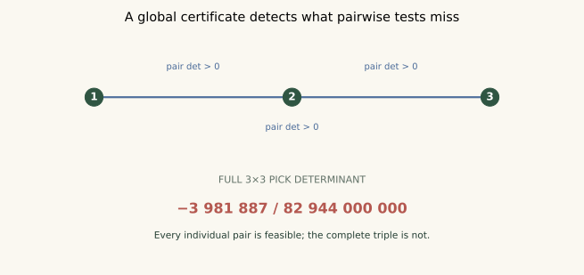

*Figure 8. Each edge represents a feasible two-frequency subproblem. The three-node dataset fails the full positivity test.*

### A constructive passive completion and sharp uncertainty

For a compatible pair of observations \(c(1)=1/2\) and \(c(3)=2/3\), the rational function

\[
c(s)=\frac{4s}{5s+3}
\]

is analytic and contractive on \(\Re s>0\). Its only pole is at \(-3/5\), and the inequality

\[
|5s+3|^2-|4s|^2=9|s|^2+30\Re s+9>0
\]

proves its bounded-real property without sampling a frequency grid.

If no observation is available at \(s=2\), we can calculate the complete feasible disk of \(w=c(2)\) without relying on a numerical optimizer. In the order of measured frequencies \(s=1,3\), the fixed Pick matrix is

\[
K=\begin{pmatrix}3/8&1/6\\1/6&5/54\end{pmatrix},\qquad
\det K=\frac1{144}>0.
\]

The new observation contributes the row

\[
k(w)=\left(\frac{1-w/2}{3},\frac{1-2w/3}{5}\right)
\]

and diagonal entry \((1-|w|^2)/4\). A direct Schur-complement calculation gives

\[
\boxed{\frac{1-|w|^2}{4}-k(w)K^{-1}k(w)^*
=\frac{1387}{2700}
\left[\left(\frac{45}{1387}\right)^2
-\left|w-\frac{848}{1387}\right|^2\right].}
\tag{46a}
\]

Thus the augmented Pick matrix is positive semidefinite exactly when

\[
\boxed{\left|w-\frac{848}{1387}\right|\le\frac{45}{1387}.}
\tag{46}
\]

This disk is **sharp**: every value in it is attained by some scalar Schur interpolant matching both observations. It is a statement about one unmeasured frequency, not a guarantee that choosing independent disk centers at several frequencies will produce one globally compatible analytic function.

An explicit rational passive interpolant reaches the center:

\[
\boxed{c_\star(s)=
\frac{4(s+2)(25s+3)}{(7s+5)(17s+39)}.}
\tag{47}
\]

Exact substitution shows \(c_\star(1)=1/2\), \(c_\star(2)=848/1387\), and \(c_\star(3)=2/3\). We can prove its contractivity **directly**, without appealing to a sampled frequency grid. Put \(s=x+iy\), where \(x>0\), and define

\[
P(s)=4(s+2)(25s+3),\qquad Q(s)=(7s+5)(17s+39).
\]

Expanding and collecting conjugate terms yields the exact factorization

\[
\boxed{\begin{aligned}
|Q(s)|^2-|P(s)|^2
={}&3\bigl[19(x^2+y^2)+146x+171\bigr]\\
&\cdot\bigl[73(x^2+y^2)+190x+73\bigr]>0.
\end{aligned}}
\tag{47a}
\]

Both bracketed factors are strictly positive for \(x>0\), and the poles of \(c_\star\) lie at \(-5/7\) and \(-39/17\), outside the right half-plane. Hence \(c_\star\) is analytic and strictly contractive throughout \(\Re s>0\). This is a complete global passivity proof for the scalar coupling used here.

The disk center is pointwise minimax for \(c(2)\) under absolute error. The corresponding terminated reflection involves \(c(s)^2\), so the minimax property does **not** automatically transfer after squaring. Nor does the contractive coupling by itself prescribe an RLC topology.

## One last compatibility layer: frequency and load simultaneously

A function can pass every single-frequency test in \(t\) and every single-load test in frequency while failing to be **jointly** contractive in both variables.

Map the frequency half-plane into a disk using \(z(s)=(s-1)/(s+1)\). In disk coordinates \((z,t)\), fix \(0<r,q<1\) and four observations

\[
\begin{array}{c|cc}
& t=q&t=-q\\\hline
z=r&a&-a\\
z=-r&-a&a
\end{array}
\tag{48}
\]

A jointly analytic Schur function realizes all four values **if and only if**

\[
\boxed{|a|\le rq.}
\tag{49}
\]

To prove necessity, take the odd projection in each coordinate:

\[
H(z,t)=\frac{F(z,t)-F(-z,t)-F(z,-t)+F(-z,-t)}4.
\]

It remains jointly contractive and vanishes to first order in each variable. Applying Schwarz's lemma twice gives \(|H(z,t)|\le|z||t|\). The observations force \(H(r,q)=a\), so \(|a|\le rq\). For sufficiency, the explicit function \(F(z,t)=a zt/(rq)\) interpolates the four observations and is jointly contractive exactly under the same bound.

For \(r=q=1/2\) and \(a=1/3\), each row and column separately admits a Schur interpolation because \(1/3<1/2\). But no jointly contractive analytic response exists because \(1/3>1/4\). The smallest possible worst-case discrepancy at the four nodes is exactly

\[
\boxed{\varepsilon_*=(|a|-rq)_+=\frac1{12}.}
\tag{50}
\]

The lower bound follows by applying the odd–odd projector to the errors. It is attained by replacing \(a\) with the nearest number of magnitude \(rq\) in the explicit product completion.

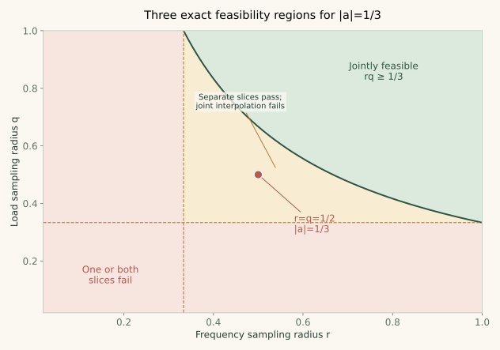

*Figure 9. At fixed \(|a|=1/3\), separate slice tests are weaker than the joint condition \(rq\ge1/3\).* 

For arbitrary bidisk data, one cannot replace two-variable compatibility by independent row and column Pick matrices. More general cases require the established Schur–Agler framework or equivalent multivariable interpolation machinery. The four-point problem above is an exactly solvable restricted case, not a universal bidisk completion algorithm.

## Reciprocity imposes an obstruction beyond passivity

Even when a response is jointly Schur, it need not admit a realization by a reciprocal two-port.

Take

\[
F(s,t)=\frac14\frac{s-1}{s+1}t,
\qquad z(s)=\frac{s-1}{s+1}.
\tag{51}
\]

The nonreciprocal scattering matrix

\[
S_{\rm nr}(s)=\begin{pmatrix}0&1/2\\z(s)/2&0\end{pmatrix}
\]

is passive and realizes (51), since \(S_{\rm nr}^*S_{\rm nr}=\operatorname{diag}(|z(s)|^2/4,1/4)\preceq I\).

If an analytic reciprocal two-port had the same complete terminated response, its coupling \(c(s)\) would satisfy

\[
\boxed{c(s)^2=\partial_tF(s,0)=\frac{z(s)}4.}
\tag{52}
\]

The right side has a simple zero at \(s=1\). But every zero of a square of a holomorphic function has even multiplicity. Therefore **no analytic reciprocal scalar two-port can realize (51) exactly**, even though the response is jointly passive and has a nonreciprocal passive realization.

The obstruction is quantitative. For any reciprocal passive candidate \(G\), consider \(|z(s)|=r\) and \(|t|=\tau\). A Cauchy estimate in the load variable bounds the difference of first load coefficients by the uniform response error divided by \(\tau\). If the error were smaller than \(r\tau/4\), Rouché's theorem would make the holomorphic square \(c(s)^2\) have one zero inside the frequency contour, which is impossible. Thus

\[
\boxed{\sup_{|z(s)|=r,\,|t|=\tau}|G(s,t)-F(s,t)|\ge\frac{r\tau}4.}
\tag{53}
\]

The bound is sharp. The zero reciprocal network attains it. At \(r=1/2\), \(\tau=2/3\), the irreducible error is \(1/12\).

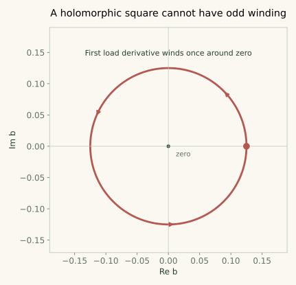

*Figure 10. The first load coefficient winds once around zero. A holomorphic square has even winding and cannot match it on this contour.*

### An equal-size multiport determinant obstruction

For a reciprocal scattering matrix with two port groups each of dimension \(q\), written

\[
S(s)=\begin{pmatrix}A(s)&B(s)\\B(s)^T&D(s)\end{pmatrix},
\]

and a scalar termination \(tI_q\), the first load-response coefficient is

\[
R_1(s)=\partial_tF(s,0)=B(s)B(s)^T.
\]

Therefore,

\[
\boxed{\det R_1(s)=(\det B(s))^2.}
\tag{54}
\]

An odd-order zero of \(\det R_1\) rules out an exact reciprocal realization **in that equal-size architecture**. For example, consider the explicit nonreciprocal four-port

\[
S_{\mathrm{nr}}(s)=\frac12
\begin{pmatrix}
0&I_2\\
\operatorname{diag}(z(s),1)&0
\end{pmatrix},\qquad z(s)=\frac{s-1}{s+1}.
\]

It is contractive on the right half-plane: its squared scattering norm is bounded by \(1/4\), since \(|z(s)|<1\). Terminating the internal group by \(tI_2\) gives the external response

\[
F(s,t)=\frac t4\operatorname{diag}(z(s),1).
\]

Its first load derivative has \(\det\partial_tF(s,0)=z(s)/16\), with a simple zero. It cannot be realized by an analytic reciprocal four-port with two equally sized two-channel groups and scalar termination \(tI_2\).

The obstruction also supplies a **uniform error floor**. Fix \(0<r,\tau<1\), and suppose a reciprocal passive candidate \(G\) approximates the response on the contours \(|z(s)|=r\) and \(|t|=\tau\) with operator-norm error at most \(E\). By the Cauchy coefficient estimate in \(t\), its first load coefficient \(R_1^G\) satisfies

\[
\bigl\|R_1^G(s)-\tfrac14\operatorname{diag}(z(s),1)\bigr\|_2
\le\delta,\qquad\delta=E/\tau.
\]

For two-by-two matrices, the determinant perturbation identity gives

\[
\left|\det R_1^G(s)-\frac{z(s)}{16}\right|
\le\frac\delta2+\delta^2.
\]

If \(E<r\tau/20\), then \(\delta<r/20\), and, because \(r<1\),

\[
\frac\delta2+\delta^2
<\frac r{40}+\frac{r^2}{400}
<\frac r{16}=\left|\frac{z(s)}{16}\right|
\quad\text{on }|z(s)|=r.
\]

Rouché's theorem would force \(\det R_1^G(s)\) to have one zero inside that frequency contour. Yet reciprocity forces \(\det R_1^G=(\det B)^2\), which has only even-order zeros. The contradiction proves

\[
\boxed{\sup_{|z(s)|=r,\,|t|=\tau}
\|G(s,t)-F(s,t)\|_2\ge\frac{r\tau}{20}.}
\tag{54a}
\]

For \(r=1/2\) and \(\tau=2/3\), this gives the conservative bound \(1/60\). The bound is **not asserted to be sharp**. The parity condition is necessary, not sufficient, for reciprocal passive synthesis. None of this chooses a specified component topology.

## Boundary-adapted sampling: useful and limited

Return to the impedance and admittance functions (15)–(17). Near \(t=1\), the impedance map \(z(t)\) has a pole, while near \(t=-1\), the admittance map \(y(t)\) has a pole. Their derivative magnitudes motivate the symmetric weight

\[
w(t)=\frac1{|1-t|^2}+\frac1{|1+t|^2}.
\tag{55}
\]

At \(t=\rho e^{i\theta}\), let \(P_q(\phi)=(1-q^2)/(1-2q\cos\phi+q^2)\) be the classical Poisson kernel. A direct denominator calculation gives

\[
\boxed{w(\rho e^{i\theta})=
\frac2{1-\rho^2}P_{\rho^2}(2\theta).}
\tag{56}
\]

After normalization to total angular mass one, the density is

\[
\boxed{p_\rho(\theta)=
\frac{1-\rho^4}{2\pi(1-2\rho^2\cos2\theta+\rho^4)}.}
\tag{57}
\]

This creates two concentrations near the open and short directions. Equal-mass quantiles give an exact nonuniform phase grid for that **specific coordinate-sensitivity weight**. Equally dividing the integrated weight minimizes the largest mass of any interval in such a partition. It does **not** minimize arbitrary interpolation error or replace model-aware rational fitting.

The earlier numerical prototype reported better interpolation of \(z\) and \(y\) on a fixed lossless-line orbit for this grid, but also gave the counterexample \(h(t)=t\), where uniform angular sampling was much better. We retain the latter warning and do not use sampling performance as evidence for a universal theorem.

The mathematical lesson is that exact packet identities and an adaptive sampling heuristic serve **different purposes**. The first provide algebraic reconstruction rules. The second proposes a way to place finite measurements when open- and short-circuit sensitivities dominate. Measurement noise, circuit resonances, and baseline rational fitting must be analyzed before making engineering performance claims.

## A compact method for reading each proof

Across the examples, the same six questions recur. Recording their answers prevents an exact algebraic identity from being misread as a physical synthesis claim.

| Question | In the present worked examples |
|---|---|
| What is the object? | A physical load, a scalar Schur function, a matrix-valued response, or an entire scattering network |
| What are the independent variables? | \(t\) for load, \(s\) for frequency, or both |
| What is observed? | Full function values, finitely many orbit packets, or individual S-parameter samples |
| What is being reconstructed? | A coordinate function, external reflection response, or internal scattering realization |
| What condition must be preserved? | Exact packet data, analytic boundedness, reciprocity, or a fixed topology |
| What is proved? | An identity, an existence criterion, a unique answer, an obstruction, or a bounded approximation error |

A projector is an exact algebraic tool. A feasible positive-semidefinite matrix is a certificate in a specified analytic interpolation class. Neither is automatically a manufacturable network.

### Why the three notions of passivity cannot be conflated

The three levels below impose different types of constraints. Passing one does not automatically certify the next.

1. **Passive coordinate value.** A single impedance satisfies \(\Re Z\ge0\), or a single reflection coefficient satisfies \(|\Gamma|\le1\).
2. **Passive analytic response.** A function is bounded-real throughout a load disk, frequency half-plane, or bidisk. This is a global claim involving an entire domain.
3. **Passive physical realization.** A frequency-domain response is implemented by one specified network architecture, with the required real-time symmetry, degree, reciprocity if requested, and component constraints.

The finite Pick theorem addresses the second claim for one load variable. The reciprocal branch theorem addresses a restricted instance of the third claim at one frequency. The frequency Pick test glues finite scattering samples into a bounded-real analytic scattering matrix, but still does not choose a particular circuit topology. The determinant parity argument shows that even global Schur passivity is insufficient for every reciprocal architecture.

### Which examples are intentionally *not* proofs of novelty?

The identity \(\Gamma=(z-1)/(z+1)\), resistance and reactance circle equations, roots-of-unity coefficient filtering, scalar and matrix Nevanlinna–Pick interpolation, Poisson kernel normalization, Schwarz lemma, and Rouché's theorem are all well-known mathematical tools. Their placement inside a unified worked Smith-chart pathway may be a useful exposition or computational method. A priority claim would require an independent survey of RF network synthesis, multirate systems, and operator interpolation literature.

## From a safe packet mask to an explicit minimal-state passive RLC circuit

The operator-norm result above guarantees a *bounded analytic reflection response*. That is a step toward a physical network, but not yet a circuit diagram. The next question is whether the frequency-dependent function after filtering admits a finite one-port composed of passive resistors, inductors, and capacitors, and what reactive order the filter forces. The following results settle this for a representative nontrivial instance. Here **minimal** refers to the number of independent reactive elements, not the total number of components, physical size, insertion loss, or manufacturing cost.

### Reality and a finite-order existence criterion

Fix a time scale \(\tau>0\), use physical Laplace frequency \(p_{\rm phys}\), and introduce the dimensionless half-plane coordinate \(s=\tau p_{\rm phys}\), with \(\Re s>0\). The frequency-dependent disk coordinate is

\[
t=\frac{s-1}{s+1},\qquad \Re s>0\ \Longleftrightarrow\ |t|<1.
\tag{R1}
\]

Let \(F(t)\) be a real-rational Schur function, and suppose a cyclic filter has nonnegative rotation weights \(w_k\) summing to one and satisfying \(w_k=w_{N-k}\). Then

\[
G(t)=\sum_{k=0}^{N-1}w_kF(\omega_N^kt)
\tag{R2}
\]

is real-rational and Schur-contractive: nonnegative averaging preserves contractivity, while conjugate-pair rotations preserve real coefficients. Unless \(G\equiv1\), its normalized Cayley impedance

\[
\boxed{z_G(s)=\frac{1+G((s-1)/(s+1))}{1-G((s-1)/(s+1))}}
\tag{R3}
\]

is real-rational and positive-real in the right half-plane. At every point at which \(z_G\) is finite,

\[
\Re z_G(s)=\frac{1-|G(t)|^2}{|1-G(t)|^2}\ge0.
\tag{R4}
\]

A finite passive RLC one-port therefore exists by the **classical positive-real realization theorem** (Bott–Duffin). This is an existence statement, not a guarantee of a specified topology or component count. More quantitatively, if \(F\) has reduced scalar rational degree \(d\) and exactly \(K\) of the \(w_k\) are nonzero, the rational degree of \(G\) and the resulting Cayley impedance is **at most \(Kd\)**. This follows by taking a common denominator for the \(K\) rotated rational functions; cancellations can lower the bound. The degree bound is not a bound on the total number of circuit elements produced by arbitrary synthesis procedures.

The symmetric-weight assumption is substantive. A safe probability average of complex rotations need not preserve the real-rational condition without it, and a function that is analytic and contractive only in an arbitrary geometric variable is not automatically a physically realizable, causal one-port. The specified half-plane map and reality condition are part of the theorem.

### First-order family: an explicit resistor–inductor or resistor–capacitor circuit

The elementary reflection response \(\Gamma(t)=bt\), with real \(|b|\le1\), has the impedance

\[
\boxed{z_b(s)=\frac{(1+b)s+(1-b)}{(1-b)s+(1+b)}.}
\tag{R5}
\]

For \(0<b<1\), this equals a series resistor and a parallel resistor–inductor branch:

\[
\boxed{z_b(s)=r_s+\left(r_p^{-1}+(\ell s)^{-1}\right)^{-1}},
\quad r_s=\frac{1-b}{1+b},\quad
r_p=\frac{4b}{1-b^2},\quad
\ell=\frac{4b}{(1+b)^2}.
\tag{R6}
\]

For \(-1<b<0\), set \(c=-b>0\). The dual realization is a series resistor plus a parallel resistor–capacitor branch:

\[
\boxed{z_{-c}(s)=r_s+\left(r_p^{-1}+c_p s\right)^{-1}},
\quad r_s=\frac{1-c}{1+c},\quad
r_p=\frac{4c}{1-c^2},\quad
c_p=\frac{(1+c)^2}{4c}.
\tag{R7}
\]

Here and below the physical element values are \(R=Z_0r\), \(L=Z_0\tau\ell\), and \(C=\tau c_p/Z_0\), with real reference resistance \(Z_0>0\). The limits \(b=1,0,-1\) give a pure inductor, matched resistor, and pure capacitor, respectively. With the previous first Fejér taper, \(F(t)=t\) becomes \(G(t)=t/2\); its circuit is thus **exactly** \(r_s=1/3\), \(r_p=8/3\), \(\ell=8/9\). In this one-degree case, safe filtering does *not* increase the reactive order.

### A pure inductor whose safe filtered response requires three reactive states

Now start with the disk automorphism

\[
F(t)=\frac{\frac13+t}{1+\frac13t}.
\tag{R8}
\]

Its half-plane impedance is \(z_{\rm original}(s)=2s\), representing **one ideal inductor** with \(L=2Z_0\tau\). Apply the *same* safe order-four Fejér average,

\[
G(t)=\tfrac12F(t)+\tfrac14F(it)+\tfrac14F(-it).
\tag{R9}
\]

Direct exact simplification gives

\[
\boxed{z_{\rm Fej}(s)=\frac{P(s)}{Q(s)}=
\frac{9s^3+14s^2+11s+2}{s^3+7s^2+7s+3}.}
\tag{R10}
\]

The boundary positive-real certificate is explicit:

\[
\boxed{\Re z_{\rm Fej}(i\omega)=
\frac{3(1+\omega^2)^2(2+3\omega^2)}{(3-7\omega^2)^2+(7\omega-\omega^3)^2}>0}
\qquad(\omega\in\mathbb R).
\tag{R11}
\]

The denominator cannot vanish for real \(\omega\), as its two constituent real polynomials have no common real zero. More importantly, \(\operatorname{Res}_s(P,Q)=2916\ne0\), while the discriminant of \(Q\) is \(-684<0\). Thus the reduced impedance has **degree three**, consisting of a negative real pole and a nonreal conjugate pair. A finite conventional one-port made solely from resistors and inductors, or solely from resistors and capacitors, has only real nonpositive poles; neither of those restricted component families can realize this response. A mixture of inductive and capacitive storage is required. These are structural consequences of an otherwise universally safe filtering operation.

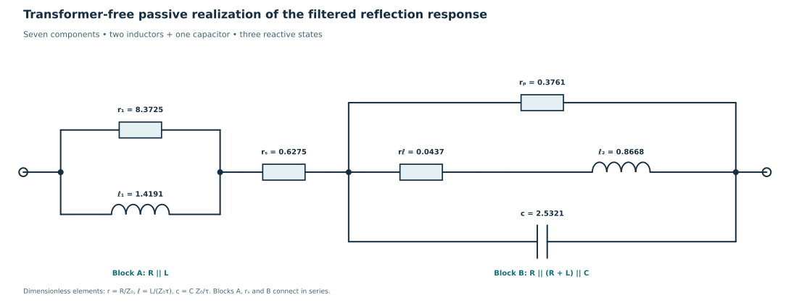

*Figure 11. A transformer-free realization with four positive resistors, two positive inductors, and one positive capacitor. Blocks A and B and the middle resistor are connected in series; the parallel subcircuits are shown explicitly. Values are normalized to \(Z_0\) and \(\tau\).* 

### Exact seven-component synthesis and a minimal-reactive-element certificate

The circuit in Figure 11 implements the following three series stages:

\[
\boxed{z_{\rm circuit}(s)=
\underbrace{\left(r_1^{-1}+(\ell_1s)^{-1}\right)^{-1}}_{\text{parallel }R_1,L_1}
+r_s+
\underbrace{\left(r_p^{-1}+(r_{\ell}+\ell_2s)^{-1}+c_2s\right)^{-1}}_{\text{parallel }R_p,(R_{\ell}+L_2),C_2}.}
\tag{R12}
\]

The seven coefficients are not fitted numerically. They are **algebraically defined exactly** using the unique real root \(p\in(5.899687,5.899688)\) of

\[
p^3-7p^2+7p-3=0.
\tag{R13}
\]

First put

\[
\begin{aligned}
u&=7-p,&v&=3/p,\\
r_1&=\frac{49p^2-52p+25}{p(3p^2-14p+7)},&\ell_1&=r_1/p,\\
A&=9-r_1,& B&=14-r_1u-pA,\\
C_0&=2/p,&D&=B-Au,\\
E&=C_0-Av,&q&=E/D.
\end{aligned}
\tag{R14}
\]

Then set

\[
\boxed{r_s=A,\qquad r_p=\frac{D}{u-q},\qquad
\ell_2=\frac{D}{v-q(u-q)},\qquad
r_{\ell}=q\ell_2,\qquad c_2=\frac1D.}
\tag{R15}
\]

All values are positive. An exact rational interval computation, using the enclosing rational endpoints in (R13), certifies positivity of every denominator and element. For convenience, their decimal approximations are

\[
\begin{aligned}
r_1&\simeq8.372464470,&\ell_1&\simeq1.419136871,\\
r_s&\simeq0.627535530,&r_p&\simeq0.376146338,\\
r_{\ell}&\simeq0.043674688,&\ell_2&\simeq0.866824711,\\
c_2&\simeq2.532117406.
\end{aligned}
\tag{R16}
\]

To verify the identity, observe that \(Q(s)=(s+p)(s^2+us+v)\) and that the numerator splits into a first-order RL contribution and a remaining quadratic positive-real branch. The definitions (R14)–(R15) force the second branch to be \((Ds+E)/(s^2+us+v)\). Substituting the values in (R12) and reducing modulo the cubic equation (R13) yields the **exact rational identity**

\[
\boxed{z_{\rm circuit}(s)\equiv z_{\rm Fej}(s).}
\tag{R17}
\]

For a concrete dimensional example, choose \(Z_0=50\,\Omega\) and \(\tau=1\,\mathrm{ns}\). The original load is \(100\,\mathrm{nH}\). The replacement contains resistances of approximately \(418.62\,\Omega\), \(31.38\,\Omega\), \(18.81\,\Omega\), and \(2.18\,\Omega\), two inductances of \(70.96\,\mathrm{nH}\) and \(43.34\,\mathrm{nH}\), and one capacitance of \(50.64\,\mathrm{pF}\). These values describe an *ideal lumped circuit*, not a fabricated or calibrated broadband RF network.

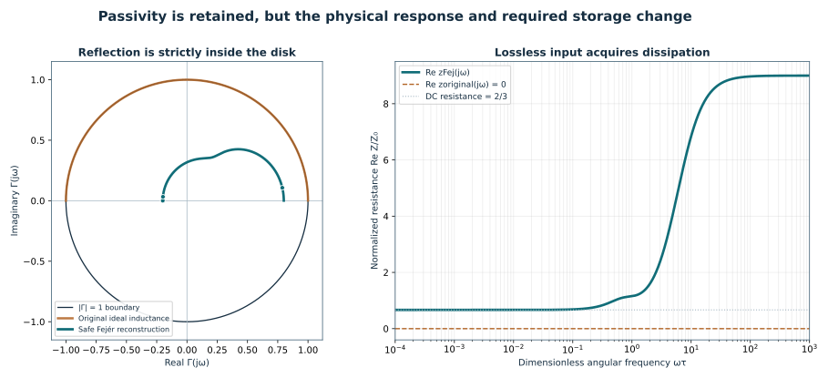

*Figure 12. The original lossless reflection follows the unit-circle boundary. The safe filtered reflection lies inside the disk and has positive input resistance over the frequency axis. The realization is exact as a rational function, rather than a fit to the plotted samples.*

**Sharp reactive-state conclusion.** The displayed network contains exactly **three independent reactive elements**: two inductors and one capacitor. Any finite lumped RLC realization with \(n\) independent reactive elements has a driving-point rational McMillan degree at most \(n\). The exact nonzero resultant in (R10) gives degree three, so *every* such realization needs at least three reactive elements. Our seven-component network attains that lower bound. We have therefore established **minimal reactive element count for this specific filtered inductor**, not minimal resistor count, minimal total elements, unique topology, or a universal synthesis method for arbitrary matrix-valued packet measurements.

### Verification and the remaining synthesis boundary

The companion `smith_realization_checks.py` contains **40 passing exact symbolic and rational-interval checks**. They verify the cubic reflection-to-impedance identity, positive-real boundary identity, discriminant, resultant, rational pole isolation, exact network decomposition, universal first-order RC/RL family, and certified strict positivity of all component values. The independent `smith_realization_ac_validate.py` also compares the assembled circuit against the exact rational target at **1,401 sampled frequencies**, with maximum normalized relative residual below **1.53 × 10⁻¹³** in double precision. It exports a 50 Ω SPICE example as `smith_fejer_minimal_reactive.cir`. The external SPICE simulator was **not run**. The results supplement the separate 65 mask-filter checks and an independently rerun older 118-check chapter suite; none constitutes a Lean proof or a physical measurement.

This closes a **specific finite realization problem**: a given safe cyclic filter applied to a pure inductor can be synthesized exactly with an explicit passive circuit and a provably minimal number of reactive elements. The larger problem remains open: find efficient, certified minimal-order synthesis for general scalar and matrix packet completions under specified reciprocity, bandwidth, noise, and hardware-topology constraints. The classical positive-real existence theorem alone does not provide those optimizations.

## Exact order proliferation under cyclic filtering

The preceding seven-component circuit proves that one particular safe packet filter of a single inductor needs exactly three independent reactive elements. The underlying order growth is more general. Here the relevant complexity is the **reduced rational-map degree** of a driving-point impedance, which supplies a lower bound on the number of independent ideal lumped inductors and capacitors. A degree lower bound does **not** by itself supply a circuit attaining it.

### Rotated-pole theorem: when the upper bound is attained

Let \(F(t)\) be a nonconstant rational Schur function that is **proper as a rational function of \(t\)**, meaning that it has no pole at infinity. Suppose it has exactly \(d\) distinct simple finite poles \(p_1,\ldots,p_d\). Suppose the poles do not collide under the used cyclic rotations: all \(p_i/\omega_N^k\), for \(1\le i\le d\) and \(k\in S\), are pairwise distinct. Define

\[
G(t)=\sum_{k\in S}w_kF(\omega_N^kt),\qquad w_k\ne0,\qquad |S|=K.
\tag{O1}
\]

**Exact-order theorem.** The reduced rational degree of \(G\) is exactly \(Kd\). Indeed, \(F(\omega_N^kt)\) has a simple pole at each \(p_i/\omega_N^k\), with nonzero residue. By hypothesis no other summand has a pole there. Thus no finite pole cancels, so the rational sum has exactly \(Kd\) simple finite poles. Properness is preserved by rotation and addition, so there is no extra pole at infinity. The reduced rational-map degree is therefore exactly \(Kd\). Both the independent-variable map \(t=(s-1)/(s+1)\) and the value map \(G\mapsto (1+G)/(1-G)\) are invertible Möbius transformations and do not change rational-map degree.

If the weights are in addition a real-symmetric probability distribution, \(w_k\ge0\), \(\sum w_k=1\), \(w_k=w_{N-k}\), and \(F\) has real coefficients, then \(G\) is real-rational Schur. Its Cayley impedance is rational positive-real in the right half-plane. Every exact ideal lumped RLC realization consequently requires **at least \(Kd\) independent reactive elements**. This is a lower bound, not a universal minimal-element synthesis algorithm. The pole-disjointness condition is essential: rotational symmetries and repeated pole orbits can reduce the degree.


**Why the condition at infinity matters.** The function

\[
H(t)=\frac14\left(t+\frac1{t-2}\right)
=\frac{(t-1)^2}{4(t-2)}
\]

is Schur on the disk, since for \(|t|<1\) its modulus is at most \((|t|+1/(2-|t|))/4<1/2\). It has one simple finite pole, at \(2\), but rational-map degree two because it also has a pole at infinity. Counting only finite poles would already give the wrong degree for one summand. The noncentral automorphism and LC functions used below are proper, so the corrected hypothesis retains both applications.

### Every noncentral inductance in the automorphism family has order three

For \(-1<a<1\), take

\[
F_a(t)=\frac{a+t}{1+at},\qquad
z_a^{\mathrm{input}}(s)=\frac{1+a}{1-a}s.
\tag{O2}
\]

The input is a pure inductor with physical value \(L_a=Z_0\tau(1+a)/(1-a)\). For \(a\ne0\), its reflection function has the simple pole \(t=-1/a\). The order-four Fejér mask from the preceding section uses three rotations, at \(1,i,-i\), with positive weights \(1/2,1/4,1/4\). They yield three different poles and therefore degree exactly three **for every \(a\in(-1,0)\cup(0,1)\)**.

For completeness, put

\[
\begin{aligned}
N_a(s)&=(3a^2+2a+3)s^3+7(1-a^2)s^2+(5a^2-2a+5)s+(1-a^2),\\
D_a(s)&=(1-a^2)s^3+(5a^2+2a+5)s^2+7(1-a^2)s+(3a^2-2a+3).
\end{aligned}
\tag{O3}
\]

Then the entire filtered family has the exact closed form

\[
\boxed{z_a^{\mathrm{Fej}}(s)=\frac{1+a}{1-a}\frac{N_a(s)}{D_a(s)},\qquad
\operatorname{Res}_s(N_a,D_a)=131072a^6.}
\tag{O4}
\]

The nonzero resultant verifies the degree calculation algebraically. At \(a=0\), two common factors \((s+1)^2\) cancel and the impedance reduces to \((3s+1)/(s+3)\), a one-reactive-element resistor–inductor circuit. This is a **singular exact-order transition**. For arbitrarily small nonzero \(a\), degree three remains necessary for exact equality, even though the response approaches the first-order circuit continuously.

The denominator also has a useful universal pole classification. Its discriminant is

\[
\begin{aligned}
\operatorname{Disc}_sD_a
&=-64a^2\bigl(7a^4+44a^3+330a^2+44a+7\bigr),\\
7a^4+44a^3+330a^2+44a+7
&=7\left(a^2+\frac{22}{7}a+1\right)^2+\frac{1728}{7}a^2>0.
\end{aligned}
\tag{O5}
\]

For every \(a\ne0\), the cubic has one real pole and one nonreal conjugate pair. Its coefficients and cubic Routh–Hurwitz determinant are positive:

\[
(5a^2+2a+5)\,7(1-a^2)-(1-a^2)(3a^2-2a+3)
=16(1-a^2)(2a^2+a+2)>0.
\tag{O6}
\]

Thus all poles lie in the left half-plane, while the nonreal pair rules out pure resistor–inductor and pure resistor–capacitor realizations. **Both inductive and capacitive storage are required** for the noncentral family. The existing seven-component realization at \(a=1/3\) attains the three-reactive-element lower bound. Attainment for every parameter is not claimed.

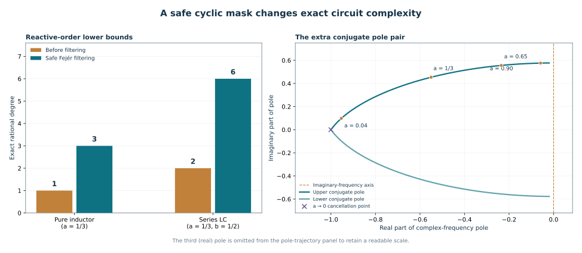

*Figure 13. A safe filter can multiply the exact reactive-order lower bound. As the automorphism parameter \(a\) approaches zero, the conjugate pole pair approaches the canceling double factor at \(s=-1\); the effective approximation order can be smaller than the exact order.*

### Uniform dissipation bound, and a sharp bound in the synthesized case

The filter is not merely contractive. An explicit weighted-variance identity gives a strict boundary margin. For the real automorphism \(F_a\), and any nonnegative rotation weights summing to one, write \(\nu=\sum_k w_k\omega_N^k\). On the unit circle \(|t|=1\), all rotated values of \(F_a\) have unit modulus and hence

\[
\begin{aligned}
1-|G(t)|^2
&=\sum_{k<\ell}w_kw_\ell
\bigl|F_a(\omega_N^kt)-F_a(\omega_N^\ell t)\bigr|^2,\\
&\ge\left(\frac{1-|a|}{1+|a|}\right)^2
\underbrace{\sum_{k<\ell}w_kw_\ell|\omega_N^k-\omega_N^\ell|^2}_{1-|\nu|^2}.
\end{aligned}
\tag{O7}
\]

The inequality uses the exact difference formula

\[
F_a(u)-F_a(v)=\frac{(1-a^2)(u-v)}{(1+au)(1+av)}.
\]

For a probability filter involving two or more distinct rotations, \(|\nu|<1\), giving an explicit positive margin at *every* boundary frequency. For our Fejér filter, \(\nu=1/2\), so

\[
\boxed{1-|G(t)|^2\ge\frac34\left(\frac{1-|a|}{1+|a|}\right)^2 \quad (|t|=1).}
\tag{O8}
\]

The universal bound is conservative. At \(a=1/3\) a stronger **sharp** result follows from elementary polynomial factorization. Put \(x=t+t^{-1}=2\cos\theta\in[-2,2]\) for \(|t|=1\). Then

\[
|G(t)|^2=\frac{27x^3+90x^2+144x+160}{(3x+10)(9x^2+64)},
\tag{O9}
\]

and its difference from \(16/25\), after multiplying by the positive denominator, is

\[
\frac{16}{25}(3x+10)(9x^2+64)-(27x^3+90x^2+144x+160)
=\frac3{25}(2-x)\bigl[(9x+24)^2+464\bigr]\ge0.
\tag{O10}
\]

Equality holds at \(t=1\). The maximum-modulus principle therefore gives the *exact* closed-disk norm

\[
\boxed{\lVert G\rVert_{H^\infty(\mathbb D)}=\frac45.}
\tag{O11}
\]

For the ideal \(50\,\Omega\) one-port, this gives \(|\Gamma(j\omega)|\le4/5\) at every frequency, a worst-case VSWR of at most \(9\) and return loss of at least \(20\log_{10}(5/4)\approx1.94\,\mathrm{dB}\). An independent, sharper **resistance** bound follows from the exact expression (R11): setting \(x=\omega^2\) and \(B(x)=(3-7x)^2+x(7-x)^2\),

\[
\boxed{\Re z_{1/3}^{\mathrm{Fej}}(i\omega)-\frac23
=\frac{x(25x^2+2x+49)}{3B(x)}\ge0.}
\tag{O12}
\]

Equality holds at zero frequency, so the exact minimum of normalized input resistance is \(2/3\), or \(33\frac13\,\Omega\) at \(Z_0=50\,\Omega\). The underlying model remains ideal lumped RLC, without parasitics or material losses beyond its positive resistors.

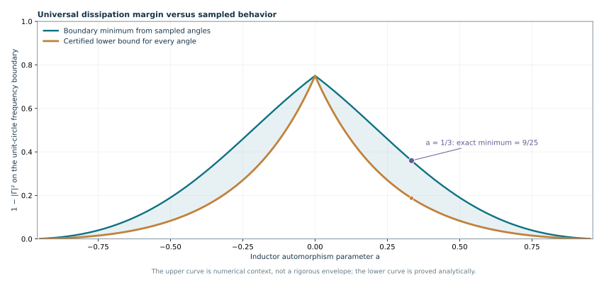

*Figure 14. The solid lower envelope is proved for the entire automorphism family. The other curve is a numerical boundary search, shown for context only; the \(a=1/3\) maximum reflection has a separate exact certificate in (O9)–(O11).*

### A two-reactive-element lossless network becomes degree six

Order proliferation is not restricted to first-order loads. Take the product of two disk automorphisms,

\[
F_{\rm LC}(t)=\frac{(2t+1)(3t+1)}{(t+2)(t+3)}.
\tag{O13}
\]

Its normalized frequency-domain impedance is

\[
\boxed{z_{\rm LC}(s)=\frac{6s^2+1}{5s}=\frac65s+\frac1{5s}.}
\tag{O14}
\]

This is an ideal **series inductor and capacitor**, with dimensionless inductance \(6/5\) and capacitance \(5\). At \(Z_0=50\,\Omega\), \(\tau=1\,\mathrm{ns}\), the values are \(L=60\,\mathrm{nH}\), \(C=100\,\mathrm{pF}\). The input has rational degree two and zero resistance on the imaginary-frequency axis at every finite, nonzero frequency.

The two poles of \(F_{\rm LC}\), at \(t=-2,-3\), have disjoint orbits under the rotations \(1,i,-i\). The theorem predicts filtered degree \(2\cdot3=6\), and direct symbolic simplification gives

\[
\boxed{z_{\rm LC}^{\rm Fej}(s)=\frac{P_6(s)}{5D_6(s)},}
\quad\begin{aligned}
P_6(s)&=450s^6+1385s^5+2477s^4+2200s^3+1142s^2+335s+75,\\
D_6(s)&=30s^6+159s^5+275s^4+344s^3+250s^2+89s+5.
\end{aligned}
\tag{O15}
\]

The polynomials are coprime. Thus **any exact ideal lumped RLC realization uses at least six independent reactive elements**. Existence of some passive RLC realization follows from the classical rational positive-real synthesis theorem; an exactly six-reactive passive realization **with an ideal transformer combiner** is constructed below, whereas a six-reactive, transformer-free RLC-only synthesis remains unresolved.

Its boundary dissipation has an independent algebraic certificate. For \(x=\omega^2\ge0\), let

\[
H(x)=900x^4-323x^3-141x^2+307x+25.
\tag{O16}
\]

Then

\[
\boxed{\Re z_{\rm LC}^{\rm Fej}(i\omega)
=\frac{3(1+\omega^2)^2H(\omega^2)}{|D_6(i\omega)|^2}.}
\tag{O17}
\]

Although \(H\) contains negative coefficients, it is strictly positive for all \(x\ge0\). On \([0,1]\), its *degree-four Bernstein coefficients* are
\(25,407/4,155,104,768\), all positive. On \([1,\infty)\), write \(x=1+y\), \(y\ge0\), to obtain

\[
H(1+y)=900y^4+3277y^3+4290y^2+2656y+768>0.
\tag{O18}
\]

These two certificates establish strict positive-real boundary resistance and rule out any imaginary-axis zero of \(D_6\). They independently corroborate the Schur convexity proof, not a physical fabrication test.

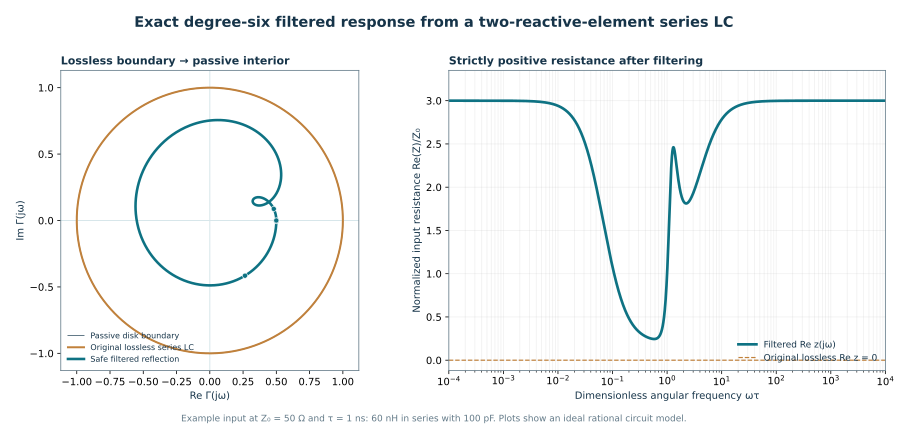

*Figure 15. A two-state lossless series LC network becomes a strictly dissipative sixth-degree positive-real impedance after the same Fejér packet filter. Six reactive elements are necessary for an exact circuit, but a circuit meeting that bound remains to be synthesized.*

### Interpretation and exact-versus-approximate complexity

| Input and mask | Exact input degree | Exact filtered degree | What is proved about a circuit |
|---|---:|---:|---|
| \(F_0(t)=t\), three-rotation Fejér | 1 | 1 | Explicit one-reactive RL realization |
| \(F_{1/3}(t)\), three-rotation Fejér | 1 | 3 | Explicit seven-component RLC with exactly 3 reactive elements, meeting the lower bound |
| \(F_a(t)\), \(0<|a|<1\), same Fejér | 1 | 3 | At least 3 reactive elements; explicit minimum-state topology not shown for every \(a\) |
| \(F_{\rm LC}(t)\), same Fejér | 2 | 6 | At least 6 reactive elements; explicit minimum-state topology remains open |

A safe filter is therefore **not complexity-neutral**. It can turn a lossless response into a strictly dissipative one while increasing exact reactive order by a factor equal to the number of independently rotated pole families. Nevertheless, exact order is sensitive to pole coincidences and may be much larger than the order needed for a finite-error approximation. In particular, \(F_a\to t\) uniformly on the unit disk as \(a\to0\), because

\[
\lvert F_a(t)-t\rvert=\left\lvert\frac{a(1-t^2)}{1+at}\right\rvert
\le\frac{2|a|}{1-|a|},\qquad |t|\le1.
\tag{O19}
\]

The same bound holds after a probability-weighted rotation average. Hence the new modes disappear continuously in amplitude as \(a\to0\) even though the exact reduced degree jumps at \(a=0\). An error-tolerant circuit synthesis question must therefore specify a frequency band, reflection or impedance error norm, and component constraints before claiming a practical minimum state count.

### A universal one-inductor approximation with an exact reflection-error certificate

The singular degree transition at \(a=0\) has a constructive resolution when an approximation is acceptable. Keep the constant and first Taylor coefficients of the filtered reflection, set \(b_a=(1-a^2)/2\), and define

\[
\boxed{H_a(t)=a+b_at.}
\tag{O20}
\]

Since \(|a|+b_a=1-\frac12(1-|a|)^2<1\), this is a real-rational **strictly Schur** function for every such parameter. Its Cayley impedance is positive-real, with reduced rational degree one. In fact, it has an explicit passive series-resistor and parallel resistor–inductor realization:

\[
\begin{aligned}
z_{H_a}(s)
&=\frac{(1+a+b_a)s+(1+a-b_a)}{(1-a-b_a)s+(1-a+b_a)}\\
&=r_s+\frac{r_p\ell s}{r_p+\ell s},
\end{aligned}
\tag{O21}
\]

where

\[
\boxed{
 r_s=\frac{(1+a)^2}{(1-a)(a+3)},\qquad
 r_p=\frac{8(1+a)}{(1-a)^2(a+3)},\qquad
 \ell=\frac{8(1+a)}{(1-a)(a+3)^2}.}
\tag{O22}
\]

All three values are strictly positive for \(-1<a<1\). As before, \(R=Z_0r\) and \(L=Z_0\tau\ell\). This is a physical one-reactive approximation to the filtered response, not a truncated Taylor polynomial interpreted as a standalone load.

The error is analytically controlled over the **entire unit disk**. The Fejér mask has monomial multipliers

\[
 m_n=\frac12+\frac12\cos\left(\frac{\pi n}{2}\right),
 \qquad(m_1,m_2,m_3,m_4)=(1/2,0,1/2,1).
\tag{O23}
\]

Using the Taylor expansion \(F_a(t)=a+(1-a^2)\sum_{n\ge1}(-a)^{n-1}t^n\), the retained terms are precisely \(H_a(t)\). The omitted terms start at degree three. Since all \(m_n\ge0\), their absolute coefficient sum gives a global bound, and the coefficients align at \(t=-1\) for \(a>0\) and at \(t=1\) for \(a<0\). Hence the bound is **attained**:

\[
\boxed{\|G_a-H_a\|_{H^\infty(\mathbb D)}
=(1-a^2)\frac{\frac12|a|^2+|a|^3+\frac12|a|^4}{1-|a|^4}
=\frac{a^2(1+|a|)^2}{2(1+a^2)}.}
\tag{O24}
\]

This is a sharp **all-frequency absolute reflection-error certificate**, not an assertion that \(H_a\) is the best possible degree-one approximant. In particular, the error is of order \(a^2\), improving the preceding first-order continuity bound. At \(a=1/10\) it is \(121/20200\approx0.0059901\), despite exact filtered degree three.

At \(a=1/3\), where the full three-state circuit is already known, the simpler circuit is

\[
\boxed{z_H(s)=\frac{8s+4}{s+5}
=\frac45+\frac{\frac{36}{5}\cdot\frac{36}{25}s}{\frac{36}{5}+\frac{36}{25}s},
\qquad\|G_{1/3}-H_{1/3}\|_\infty=\frac4{45}.}
\tag{O25}
\]

At \(Z_0=50\,\Omega\) and \(\tau=1\,\mathrm{ns}\), this uses a \(40\,\Omega\) series resistor and a parallel \(360\,\Omega\) resistor–\(72\,\mathrm{nH}\) inductor branch. It replaces the previous seven-component exact circuit with **three positive components** at a controlled approximation error.

An important Smith-chart qualification is that absolute reflection and absolute impedance errors are different metrics. For the same example,

\[
 z_{\rm Fej}(s)-z_H(s)=
 \frac{(s-1)^3(s+2)}{(s+5)(s^3+7s^2+7s+3)}.
\tag{O26}
\]

Writing \(x=\omega^2\ge0\), the difference between squared denominator and numerator magnitudes on the imaginary-frequency axis is exactly

\[
53x^3+867x^2+171x+221>0.
\tag{O27}
\]

The normalized impedance error is strictly smaller than one at every finite boundary frequency and tends to one as \(\omega\to\infty\). By the maximum-modulus principle for the stable bounded rational difference,

\[
\boxed{\|z_{\rm Fej}-z_H\|_{H^\infty(\Re s>0)}=1.}
\tag{O28}
\]

Thus the same passive approximation has **sharp reflection error \(4/45\)** and **sharp normalized impedance error \(1\)**, corresponding to \(50\,\Omega\) in the stated example. Both are correct: a small difference on the reflection disk need not be small in ohms near the Cayley map's high-impedance region. Practical specifications should state which metric matters.

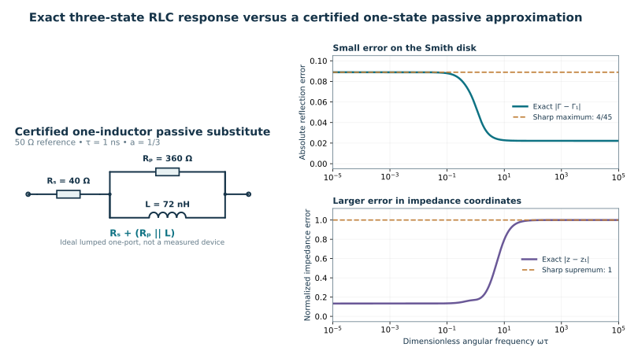

*Figure 16. The first-order passive RL replacement meets a global, sharp reflection-error guarantee while its normalized impedance error has a different sharp maximum. All plotted curves are generated from exact rational formulas, not measured RF data.*

The results in this section are proved by the displayed algebra, pole isolation, standard positive-real and degree principles, and the supplemental Python checker. No priority claim or blanket minimal-circuit theorem is made.


## Exactly six reactive elements with an ideal reciprocal combiner

The filtered degree-six LC response from (O15) admits a fully specified passive realization with exactly six reactive elements, **provided an ideal static transformer and isolation resistor are allowed**. This result does not imply six-reactive-element realizability with an RLC-only network. The ideal transformer carries no independent energy-storage state, but is an additional, excluded device for the transformer-free problem.

Write the original two-reactive-element series-LC reflection and its conjugate rotation average as

\[
F(t)=\frac{(2t+1)(3t+1)}{(t+2)(t+3)},\qquad
H(t)=\frac{F(it)+F(-it)}{2}
=\frac{6(1-t^2)^2}{(t^2+4)(t^2+9)}.
\tag{C1}
\]

The safe fourth-order Fejér response is \(G(t)=(F(t)+H(t))/2\). Under \(t=(s-1)/(s+1)\), the normalized impedance of \(H\) is

\[
z_H(s)=1+\frac{48s}{35(s^2+1)}
-\frac{48s}{7(5s^2+14s+5)}.
\tag{C2}
\]

It has an exact series decomposition into a parallel LC tank and the parallel connection of a resistor with a series RLC branch:

\[
\boxed{
 z_H(s)=
 \underbrace{\left(\frac{1}{(48/35)s}+(35/48)s\right)^{-1}}_{\text{parallel LC}}
 +\underbrace{\left(1+\frac1{25/24+(35/48)s+1/((48/35)s)}\right)^{-1}}_{\text{resistor parallel to series RLC}}.
}\tag{C3}
\]

The first part uses one inductor and one capacitor, and the second uses one inductor, one capacitor, and two resistors. All coefficients are positive. The reduced denominator of \(z_H\) has degree four, so this **four-reactive-element** circuit attains its degree lower bound. The \(F\) circuit is the original series LC with \(L=6/5,C=5\).

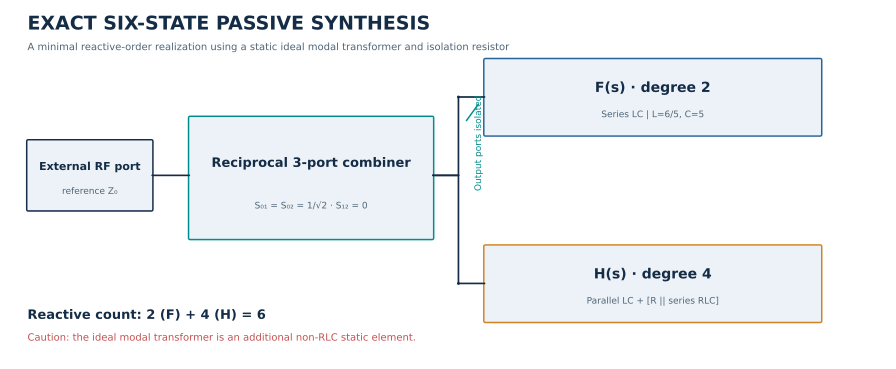

*Figure 17. Exact 2+4 reactive-state construction in the broader class allowing an ideal static modal transformer.*

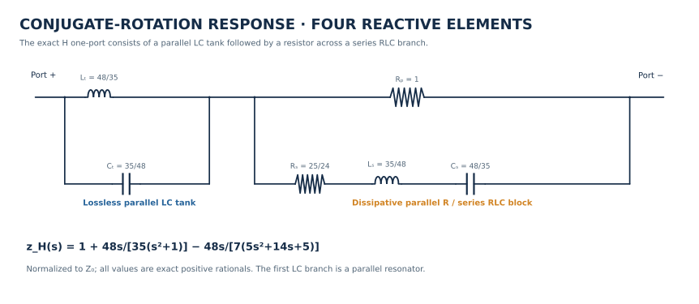

*Figure 18. Exact normalized values, no fitted elements.*

Connect the two subnetworks to the output terminals of a reciprocal, static, three-port with scattering matrix

\[
S=\begin{pmatrix}
0 & 1/\sqrt2 & 1/\sqrt2\\
1/\sqrt2 & 0 & 0\\
1/\sqrt2 & 0 & 0
\end{pmatrix}.
\tag{C4}
\]

Its passivity matrix is

\[
I-S^{\mathsf T}S=
\begin{pmatrix}
0&0&0\\
0&1/2&-1/2\\
0&-1/2&1/2
\end{pmatrix}\succeq0.
\tag{C5}
\]

Because the outputs have zero mutual scattering and zero direct output reflection, the terminated input reflection is exactly

\[
\boxed{\Gamma_{\mathrm{in}}(t)=\tfrac12F(t)+\tfrac12H(t)=G(t).}
\tag{C6}
\]

Equivalently, if \(a=z_F(s)\) and \(b=z_H(s)\), the input impedance is

\[
\boxed{z_G(s)=\frac{2ab+a+b}{a+b+2}.}
\tag{C7}
\]

The circuit therefore uses exactly **six** energy-storage elements (two in \(F\), four in \(H\)), plus an ideal static three-port coupling device. This achieves the rational-degree lower bound **only in that wider component class**. A separate exact polynomial certificate also proves \(\lvert G(t)\rvert\le 4/5\) for all \(\lvert t\rvert\le1\), hence normalized \(\Re z_G(s)\ge1/9\) on the right half-plane.

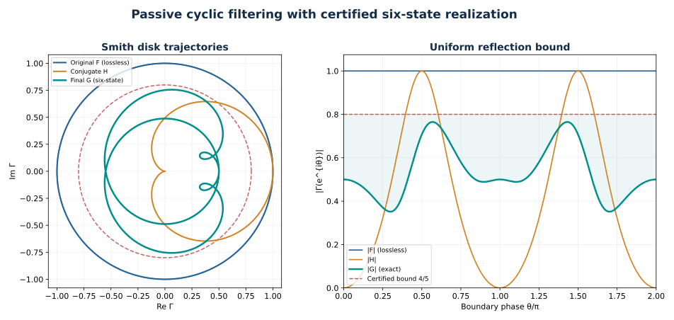

*Figure 19. The bound is established algebraically in the companion checker, not inferred from the plotted samples.*

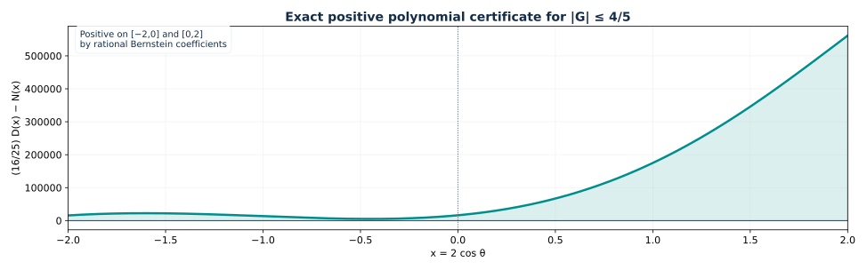

*Figure 20. Exact certificate for \(\lvert G\rvert\le4/5\); plotting is supporting illustration only.*

The code `smith_six_state_checks.py` records the exact identities, passive element values, nonnegative scattering dissipation, and rational boundary certificate. It does not establish a transformer-free RLC-only synthesis.


## Transformer-free synthesis: a precise decision theorem and a topology obstruction

**Scope and status.** This section strengthens the preceding realization discussion but does not claim that the six-state filtered LC example has a six-reactive-element, transformer-free circuit. It proves a general **finite decision criterion at any prescribed reactive-element count**, derives a strict obstruction to the most direct resistive composition strategy, and identifies the computational obstacle to using the criterion at order six. It is an exact algebraic reduction, not an efficient completed computer-algebra synthesis for every input. Author: Komorebi P.

### Why exact McMillan degree is not always the realizable reactive-element count

The rational degree \(d=\max(\deg P,\deg Q)\) of a reduced impedance \(Z(s)=P(s)/Q(s)\) is a lower bound on the number \(q\) of physical inductors and capacitors in an ordinary transformer-free RLC network. **Equality is not universal.** Classical research on biquadratic minimum functions gives degree-two positive-real functions whose transformer-free realizations require more than two reactive elements. A safe cyclic filter guarantees positive-realness when its reflection output is also real-rational, not a minimum-order circuit. [1–3]

For an example of the relevant boundary geometry, let

\[
Z_*(s)=\frac{s^2+\tfrac12s+\tfrac23}{s^2+\tfrac13s+\tfrac32}.
\]

It is reduced and positive-real. Its poles lie strictly in the open left half-plane and

\[
\Re Z_*(i\omega)=
\frac{(\omega^2-1)^2}{(\tfrac32-\omega^2)^2+\omega^2/9}\ge 0.
\]

It is a *biquadratic minimum function* because the real part vanishes at finite nonzero frequencies. We do not infer an exact minimal count for this specific example from its degree or this boundary calculation alone. The classical results establish the obstruction for the class. Consequently, the unrestricted hypothesis that **every** safe cyclic filter has a transformer-free realization using exactly its rational degree is false: it already includes the identity filter acting on degree-two positive-real impedances.

### Universal finite test for any fixed reactive-element budget

**Theorem (finite transformer-free synthesis decision).** Let \(Z(s)=P(s)/Q(s)\) be a nonzero, finite, real-rational positive-real driving-point impedance with coefficients in the real algebraic numbers, and reduced degree \(d\). Fix an integer \(q\ge d\). There is an explicitly constructible **finite collection of polynomial systems over the real algebraic numbers** such that:

1. At least one system has a real solution if and only if \(Z\) is the driving-point impedance of a finite **transformer-free** network with exactly \(q\) ideal positive inductors and capacitors, together with any finite number of positive resistors and ideal wires.
2. Every solution returns an exact circuit topology and positive element values. If the input data are real algebraic, the values can be selected to be real algebraic.
3. If every system is infeasible, no such \(q\)-reactive-element RLC realization exists. The answer can be decided exactly in principle using quantifier elimination over real closed fields.

By searching \(q=d,d+1,\ldots\), this yields a terminating, in-principle constructive method for the **globally minimum number of reactive elements**, because the Bott–Duffin positive-real synthesis theorem guarantees at least one finite transformer-free RLC realization. This is a decidability and certificate theorem. The amount of computation can be enormous, and it is **not** a practical uniform minimum-order synthesis formula.

**Proof, reduction of resistor-only internal nodes.** Choose the grounded port terminal as node \(0\), the excited port terminal as node \(1\), and let \(B\) contain both terminals and every endpoint of the \(q\) reactive edges. Then

\[
2\le |B|\le 2q+2.\tag{S1}
\]

All remaining nodes touch resistors only. Remove any disconnected components invisible at the port. If such components contain surplus reactive edges, they can instead be replaced by electrically inactive dangling reactive edges attached to the retained graph, preserving an *exactly* \(q\)-element count without changing the port response. The nodal conductance matrix of the remaining resistor network is a weighted graph Laplacian. Its Schur complement onto \(B\) is again a symmetric Laplacian with nonpositive off-diagonal entries. Thus elimination of every resistor-only internal node produces **only ordinary nonnegative conductances between pairs of nodes in \(B\)**. It changes no port impedance and does not require a transformer, negative resistance, or additional reactive edge. Multiple resistors between the same two boundary nodes combine into one conductance. Therefore at most

\[
\boxed{\binom{2q+2}{2}}
\tag{S2}
\]

resistor edges suffice in this finite normal form. The bound is for an existence search, not a sharp minimal resistor count.

**Proof, exact algebraic characterization.** Enumerate integers \(m=2,\ldots,2q+2\), the placements of \(q\) labeled reactive edges (inductors or capacitors, including parallel placements) on \(m\) nodes, and allow a nonnegative resistor conductance \(g_{uv}\ge0\) for each node pair. Use positive capacitor values \(c_j>0\) and positive reciprocal inductor values \(h_j=1/\ell_j>0\). For each oriented edge \(e\), let \(b_e\) be its incidence column after grounding node \(0\), and form

\[
Y(s)=\sum_{u<v}g_{uv}b_{uv}b_{uv}^{\mathsf T}
+s\sum_{e\in\mathcal C}c_e b_e b_e^{\mathsf T}
+\frac1s\sum_{e\in\mathcal L}h_e b_e b_e^{\mathsf T}.\tag{S3}
\]

Let \(D(s)=\det Y(s)\) and \(N(s)=\det Y_{\widehat{1}\widehat{1}}(s)\), where the latter removes the row and column of terminal \(1\), and a zero-dimensional determinant is defined as \(1\). The connectedness condition is simply \(D(1)>0\): every present edge has positive admittance at \(s=1\), and Kirchhoff's matrix–tree theorem detects whether the graph is connected to ground. For a connected network, Cramer's rule gives

\[
\boxed{Z_{\rm circuit}(s)=\frac{N(s)}{D(s)}.}\tag{S4}
\]

Equality to the target is equivalent to the vanishing of all coefficients in the polynomial obtained by clearing powers of \(s\) from

\[
\boxed{P(s)D(s)-Q(s)N(s)=0.}\tag{S5}
\]

Because at most \(q\) inductive admittances contribute factors \(1/s\), multiplication by \(s^q\) clears all these denominators. Hence each topology gives finitely many **polynomial equalities and strict or weak polynomial inequalities** in the real element parameters. Quantifier elimination decides whether such a set is nonempty. Positivity and graph connectedness make \(Y\) invertible in \(\Re s>0\), because every active edge admittance has strictly positive real part there. The resulting impedance is positive-real. This proves both necessity and sufficiency.

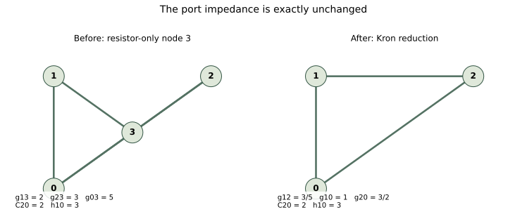

*Figure 21. A reproducible rational example of Kron reduction, showing that pure resistor-only interior nodes can be eliminated without changing the impedance.*

There are finitely many placements for each \(q\), so the test is finite. A nonempty semialgebraic set defined over real algebraic numbers contains an algebraic point, giving exact algebraic element values. The outer search terminates by the classical transformer-free realization theorem. \(\square\)

**Important qualification.** Ordinary arbitrary real-valued coefficients cannot be treated as exact finite input unless an appropriate coefficient oracle is supplied. The finite algorithm is stated for real algebraic data. For nonrational analytic Schur functions, a finite ideal lumped RLC network generally cannot reproduce the response exactly. The isolated zero-impedance and infinite-impedance limits are handled separately as ideal shorts and opens.

### A sharp no-go for the obvious two-network resistive combiner

The previous exact six-state construction used an ideal three-port passive combiner, with a transformer-based bright mode and resistor-based dark-mode termination. For arbitrary normalized positive input impedances \(a,b\), its driving-point impedance is

\[
\boxed{M(a,b)=\frac{2ab+a+b}{a+b+2}.}\tag{S6}
\]

Suppose a *fixed resistor-only interconnection* were to implement \(M(a,b)\) by placing a **single copy** of a variable two-terminal impedance \(a\) and a single copy of \(b\) in the circuit. Specialize them to ordinary positive resistors. For any passive resistive network carrying a unit input current, Thomson's minimum-dissipation principle gives

\[
\frac{\partial R_{\rm eff}}{\partial a}=I_a^2.\tag{S7}
\]

All resistor voltage drops follow the monotone potential ordering. Choose a threshold between the endpoint potentials of edge \(a\). The directed cut separating those potentials carries total input current exactly one, with nonnegative current along every cut edge, so \(0\le I_a\le1\). Consequently

\[
\boxed{0\le\frac{\partial R_{\rm eff}}{\partial a}\le1.}\tag{S8}
\]

On the other hand,

\[
\frac{\partial M}{\partial a}
=\frac{2(b+1)^2}{(a+b+2)^2},\qquad
\left.\frac{\partial M}{\partial a}\right|_{a=1,b=10}
=\frac{242}{169}>1.\tag{S9}
\]

This contradicts (S8). An equivalent purely finite witness is

\[
M(2,10)-M(1,10)=\frac{121}{91}>1=2-1.\tag{S10}
\]

**Theorem.** No fixed network made solely of positive resistors, ideal wires, and one occurrence of each variable one-port \(a,b\), can reproduce (S6) for **all** positive \(a,b\). This explains why the previous sum-mode ideal transformer cannot simply be replaced by an arbitrary resistor-only mixer that leaves both subcircuits untouched. It does **not** exclude a special transformer-free six-reactive realization of our particular frequency-dependent target, with its energy-storage edges redistributed.

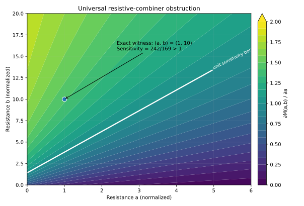

*Figure 22. The region above the threshold shows a genuine obstruction to a universal resistor-only two-network combiner. It is not a no-go for every possible six-reactive RLC circuit.*

### What the decision theorem says about the outstanding degree-six example

For the previously established filtered LC response,

\[
Z_6(s)=\frac{450s^6+1385s^5+2477s^4+2200s^3+1142s^2+335s+75}
{5(30s^6+159s^5+275s^4+344s^3+250s^2+89s+5)},\tag{S11}
\]

the numerator and denominator are coprime, so **every** transformer-free circuit realizing it requires \(q\ge6\) reactive elements. For the equality case \(q=6\), the theorem reduces the entire search to circuits on at most \(14\) retained nodes, with at most \(\binom{14}{2}=91\) resistor conductances, plus the six positive reactive parameters. Every graph placement has a finite algebraic feasibility test, but the number of placements and quantifier-elimination complexity are formidable.

The earlier transformer-and-resistor three-port construction establishes a passive **six-reactive realization in a broader ideal-network class**. It does not settle whether the semialgebraic transformer-free \(q=6\) family is feasible. A heuristic search of simple five-node topologies made numerical approximations only, with no exact polynomial identity; a low numerical residual cannot establish feasibility, and numerical failure cannot establish impossibility. Therefore the q=6 transformer-free question is **not yet closed for this particular impedance**.

### Independent tests and precise outstanding claims

The companion Python code `smith_transformerfree_decision.py` constructs the grounded nodal cofactors, tests the coefficient identities, validates exact witnesses for 0-, 1-, 2-, and 3-reactive circuits, verifies an explicit resistor-only node elimination, and checks the rational sensitivity contradiction. The executable demonstration does not include a complete implementation of real quantifier elimination, and its successful tests do **not** count as a completed q=6 decision.

The two new companion programs were rerun in this edition: `smith_six_state_checks.py` passed **37 exact assertions**, and `smith_transformerfree_decision.py` passed **11 exact tests** of cofactor identities, Kron reduction, and obstructions. Neither program executes full CAD.

**What is settled:** finite semialgebraic reducibility and exact decidability at fixed storage budget (for algebraic input), global termination in principle under the classical RLC existence theorem, and impossibility of the most direct universal transformer-free mixing scaffold. **What remains:** construct an exact transformer-free six-reactive circuit, or exclude every admissible six-reactive topology. The later seven-reactive certificate proves that one additional reactive element suffices, so resolving the six-element case would determine the minimum. No originality or priority claim is made for the decidability approach without a separate literature review.

**Historical sources (context, not premises of the algebraic proofs).** [1] Timothy H. Hughes, *On the Synthesis of Passive Networks without Transformers* (University of Cambridge, 2014), https://doi.org/10.17863/CAM.12341. [2] T. H. Hughes, *Why RLC Realizations of Certain Impedances Need Many More Energy Storage Elements Than Expected*, *IEEE Transactions on Automatic Control* (2017), https://doi.org/10.1109/TAC.2017.2667585. [3] T. H. Hughes, A. Morelli, and M. C. Smith, *On a Concept of Genericity for RLC Networks*, *Systems & Control Letters* 134 (2020), https://doi.org/10.1016/j.sysconle.2019.104562.

## Six reactive elements: signatures and graph restrictions {#six-state-invariants}

**Author: Komorebi P.**  
**Research status: unpublished, 8 November 2026.**  
**Main unresolved question:** whether the particular positive-real degree-six impedance below admits a **transformer-free** realization with exactly six independent inductors and capacitors. This note establishes new necessary restrictions for that fixed problem. It does **not** settle its feasibility.

> **Research record.** This chapter develops one route on its stated date. Its local obstructions apply to the circuit classes stated here. The [current result](#current-result) and [exact seven-reactive construction](#seven-reactive-exact) give the later status.


### Precise target

The impedance obtained from the three-phase passive Fejér filtering of the lossless series-LC reflection function is

\[
Z_6(s)=\frac{450s^6+1385s^5+2477s^4+2200s^3+1142s^2+335s+75}{5(30s^6+159s^5+275s^4+344s^3+250s^2+89s+5)}.
\]

Its numerator and denominator are coprime and have degree six. Any exact RLC realization therefore needs at least six independent reactive elements. The previously verified two-state LC plus four-state RLC construction attains this degree with an **ideal transformer-based** lossless-combining network. It does not solve the transformer-free restriction.

### Theorem A: the six-state component signature is forced

Let \(a_6,\ldots,a_0\) and \(b_6,\ldots,b_0\) be the coefficients of the numerator and denominator, respectively. For \(k=1,\ldots,6\) construct the classical \(2k\times2k\) Sylvester matrix \(S_{2k}\) whose first two rows are

\[
(b_6,b_5,\ldots,b_{7-2k}),\qquad (a_6,a_5,\ldots,a_{7-2k}),
\]

and whose subsequent pairs shift these rows one column to the right, filling any absent negative-degree coefficient with zero. The exact determinant signs are

\[
\operatorname{sgn}(1,\det S_2,\det S_4,\det S_6,\det S_8,\det S_{10},\det S_{12})=(+,-,-,+,+,+,-).
\]

There are three sign variations and three sign permanences. The classical extended Cauchy-index/Sylvester-counting theorem therefore implies the following **necessary** result:

> If a transformer-free resistor–inductor–capacitor one-port realizes \(Z_6\) using exactly six reactive elements, then it uses exactly **three inductors and three capacitors**.

This calculation applies an existing theorem in network synthesis; it is **not** a novel general theorem. Its sign convention was independently checked on a pure inductor, a pure capacitor, the source series-LC impedance, and the existing four-reactive-element \(H\) branch. The \(H\) example requires the prescribed zero-determinant sign convention.

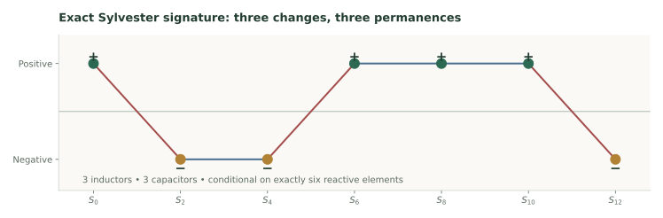

### Theorem B: no four-node six-state topology exists

Number the port node 1, ground node 0, and any internal nodes 2 onward. For a conventional lumped network with independent L/C components, let \(G_L\) consist of the three inductor edges and \(G_C\) of the three capacitor edges.

Because \(Z_6(0)=Z_6(\infty)=3\), \(G_L\) cannot contain a path from 1 to 0 (which would short the port at DC), and \(G_C\) cannot contain such a path (which would short the port as \(s\to\infty\)). If any same-type reactive edges form a cycle, the corresponding reactive variables satisfy a loop constraint and the driving-point rational degree is **strictly less** than the total six reactive elements. Thus each same-type graph must be a forest in any degree-six, six-element realization.

A forest on four vertices with three edges is a spanning tree, and hence connects 0 to 1. That contradicts the required finite nonzero DC impedance. **At least five network nodes, counting the port and ground, are necessary.** This lower bound assumes ordinary independent ideal L/C components without mutual inductance or ideal transformers; adding arbitrary resistors does not circumvent it.

### Theorem C: a unique real-Laplace reactive-sensitivity crossing

For any connected transformer-free one-port, drive one ampere at an arbitrary **positive real Laplace argument** \(s>0\). All ideal branch admittances are then positive real. Differentiating the grounded nodal matrix \(Y(s)\) shows

\[
Z'(s)=-v(s)^{\mathsf T}Y'(s)v(s)
=\sum_{\ell\in L} L_\ell I_\ell(s)^2-\sum_{c\in C} C_c V_c(s)^2.
\tag{A}
\]

Here \(I_\ell(s)\) and \(V_c(s)\) are real branch currents and voltages under the unit-current port excitation at the **real** parameter \(s\). This is an exact circuit-sensitivity identity, **not** a time-averaged sinusoidal energy equality.

For this target,

\[
Z_6'(0)=-40,\qquad \lim_{s\to\infty}s^2Z_6'(s)=\frac{20}{3}.
\]

Consequently the capacitive term dominates at the DC limit, and the appropriately scaled inductive term dominates at the high-frequency Laplace limit. Explicitly,

\[
\sum_C C_cV_c(0)^2-\sum_L L_\ell I_\ell(0)^2=40,
\qquad
\sum_L\frac{V_\ell(\infty)^2}{L_\ell}-\sum_C\frac{I_c(\infty)^2}{C_c}=\frac{20}{3}.
\]

The rational derivative has the form

\[
Z_6'(s)=\frac{40J(s)}{D(s)^2},\quad
J(s)=3750s^{10}+12360s^9+31679s^8+70780s^7+111388s^6+111300s^5+64642s^4+16020s^3-3314s^2-3260s-625,
\]

where \(D(s)\) denotes the full denominator of \(Z_6\). The descending coefficient signs of \(J\) change **once**. Since \(J(0)<0\) and its leading coefficient is positive, Descartes' rule and the intermediate value theorem give **exactly one** positive root. Its certified rational bracket is

\[
\boxed{0.3353104<s_*<0.3353105.}
\]

At this single real-Laplace value, any exact circuit must satisfy

\[
\boxed{\sum_L L_\ell I_\ell(s_*)^2=\sum_C C_c V_c(s_*)^2.}
\]

This does not by itself determine topology, but supplies an exact frequency-wide sensitivity identity against which a proposed network can be checked.

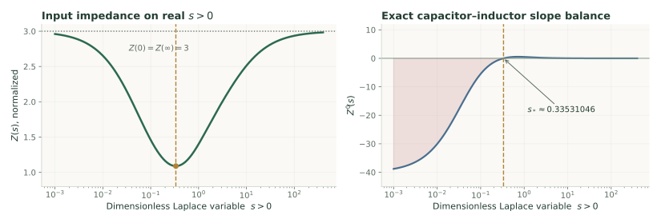

### Theorem D: low/high endpoint visibility prunes reactive graphs

If every capacitor has both endpoints in the same connected component of the **inductor-only** subgraph, all its voltages vanish at DC. Formula (A) would give \(Z_6'(0)\ge0\), contradicting \(-40\). Therefore **some capacitor must bridge distinct inductor-short components**. Dually, **some inductor must bridge distinct capacitor-short components** in the high-frequency limit, or the coefficient \(20/3\) would have the wrong sign.

We enumerated all ways of placing three distinct L edges and three distinct C edges among node pairs. L and C are permitted to share an edge; duplicates of the **same** reactive type on one pair are excluded because they can be combined without increasing rational degree.

| Exact labelled reactive-graph count | Four nodes | Five nodes | Six nodes |
|:--|--:|--:|--:|
| Initial placements | 400 | 14,400 | 207,025 |
| No L/C-only port shorts | 4 | 3,249 | 92,416 |
| Also no same-type cycles | 0 | 2,500 | 82,944 |
| Also both endpoint slope signs possible | 0 | **1,934** | **80,232** |

For five nodes, quotienting the 1,934 survivors by permutations of the three internal-node labels and exchange of the two external terminals produces exactly **168 distinct reactive-placement classes**. The classes retain **arbitrary resistor conductances between any node pair** and are therefore a complete *reactive-placement* catalogue under the stated constraints, not a complete classification of positive component solutions.

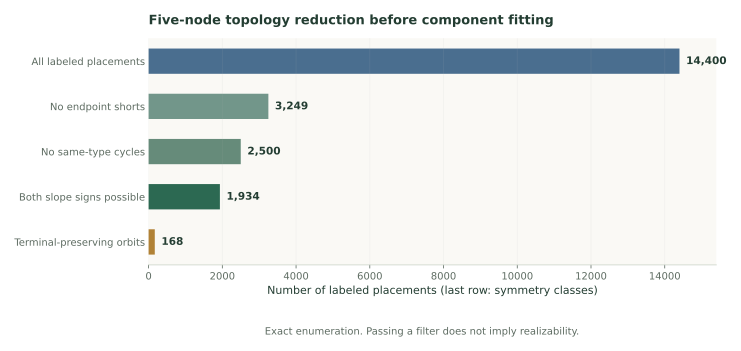

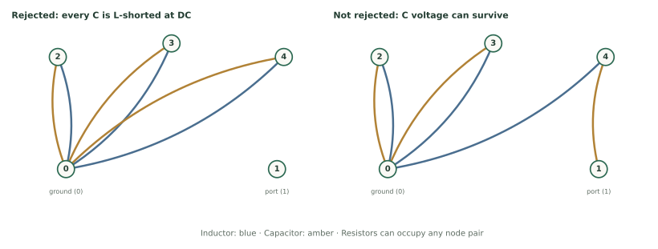

### Additional all-frequency constraints on exposed resistors

If a resistor \(R_s\) is attached **in series with the entire remaining passive network**, then \(R_s\le\operatorname{Re}Z_6(i\omega)\) at every real \(\omega\). Choosing the rational sample \(\omega=3/5\) yields the exact necessary bound

\[
\boxed{R_s\le\frac{6206853}{25267405}\approx0.245647.}
\]

Similarly, if \(R_p\) is attached **in parallel across the entire remaining passive one-port**, passivity implies \(1/R_p\le \operatorname{Re}(1/Z_6(i\omega))\). At \(\omega=9/10\),

\[
\boxed{R_p\ge\frac{34799940603159}{6501829077953}\approx5.35233.}
\]

These are normalized resistance values, not ohms until a reference \(Z_0\) is chosen. They only constrain directly exposed top-level resistors, not arbitrary interior resistors. An especially simple excluded topology is \(R_p=3\) in parallel with three series-RLC resonators: at \(s=i\), the remainder would require negative conductance \(-2/15\).

### Computation and status

The new code `smith_q6_invariant_certificates.py` regenerates the exact Sylvester determinants, derivative polynomial, rational brackets, graph counts, symmetry orbit totals, and simple resistor bounds. It passes **39 exact/census/regression checks**. The earlier five independent test suites were rerun and passed **216/216 checks** in their respective reported scopes. Total across these distinct suites: **255 passing checks**. None substitutes for a universal quantifier-elimination run.

The new *numerical* one-start search fitted all 168 five-node orbit representatives. Its best sampled discrepancy was about \(1.135\times10^{-3}\). A separate exploratory seven-node fit reached approximately \(6.01\times10^{-5}\) on a different sampling grid. These are **not** algebraic identities; neither a near-match nor a numerical optimizer's failure proves feasibility or impossibility.

**Unresolved:** no exact transformer-free circuit with exactly six reactive elements was constructed, and no exhaustive impossibility certificate over five or more nodes was obtained. The graph restrictions narrow the search but leave five-node and higher-node candidates.

**Next constructive target:** take the 168 five-node classes, encode the nodal cofactor identity with three L and three C and nonnegative resistor conductances, use exact algebraic elimination to resolve any selected class, and only claim a circuit after its rational identity and all component signs are proven. To exclude the full \(q=6\) case would still require a certificate over every permissible node count, up to the previously established 14-node normal form.

#### References and scope of originality

- T. H. Hughes, *On the Synthesis of Passive Networks without Transformers* (University of Cambridge, 2014), chapters on extended Cauchy index and minimal reactive counts.
- A. Morelli, *Synthesis of Electrical and Mechanical Networks of Restricted Complexity* (University of Cambridge, 2019), Section 3.3 (Sylvester determinant-count theorem, including zero sign convention).
- The earlier unpublished Smith chart physical-realization and transformer-free decision notes, which supply the exact rational target, ideal-transformer witness, and finite cofactor feasibility reduction.

**Priority:** the classical counting theorem, nodal sensitivity identity, graph cycle constraints, and real algebraic feasibility concepts are established ingredients. Their computed consequences for this particular rational target are independently reproducible calculations; no claim of general mathematical novelty or publication priority is made.


## Exact pole-pair splitting and a transformer-free extraction family {#pole-pair-extraction}

**Author: Komorebi P.**  
**Research status:** Unpublished, 9 November 2026.  
**Scope:** A mathematically certified reduction of the degree-six transformer-free circuit synthesis question, not its complete resolution. All figures are generated in Python.

> **Research record.** This chapter develops one route on its stated date. Its local obstructions apply to the circuit classes stated here. The [current result](#current-result) and [exact seven-reactive construction](#seven-reactive-exact) give the later status.


### The original degree-six synthesis target

The target of the preceding Smith chart investigation is

\[
Z_6(s)=\frac{450s^6+1385s^5+2477s^4+2200s^3+1142s^2+335s+75}{5(30s^6+159s^5+275s^4+344s^3+250s^2+89s+5)}.
\]

The numerator and denominator are relatively prime. Its McMillan degree is six and any conventional lumped RLC one-port therefore requires at least six independent reactive states. Earlier work gave a six-reactive realization with an ideal transformer-based combiner, but **not** an exact transformer-free six-reactive network.

### A real pole-pair decomposition

Let \(P\) and \(D\) denote the numerator and full denominator above. The polynomial \(D\) has exactly two distinct negative real roots \(\alpha<\beta<0\) and two nonreal complex-conjugate pairs. All are simple.

Define the residues

\[
A=\frac{P(\alpha)}{D'(\alpha)},\qquad B=\frac{P(\beta)}{D'(\beta)},
\]

and the real quadratic and numerator coefficients

\[
p=-(\alpha+\beta),\quad q=\alpha\beta,\quad a=A+B,\quad b=-(A\beta+B\alpha).
\]

Then for any real \(r\), the real-pole section is defined **exactly** by

\[
\boxed{Z_{2,r}(s)=r+\frac{as+b}{s^2+ps+q}.}
\]

The remaining section \(Z_{4,r}=Z_6-Z_{2,r}\) has degree exactly four, with poles equal to the two retained complex-conjugate pairs. The identity is exact by partial fractions, since \(Z_6(\infty)=3\). The coefficients, displayed solely for orientation, are

| Real-pole section parameter | Approximate value |
|:--|--:|
| \(p\) | 3.47701199106231 |
| \(q\) | 0.231896402301099 |
| \(a\) | −7.34939470450779 |
| \(b\) | 0.139256919027936 |

No rounded coefficient is used to define the circuit in the proof.

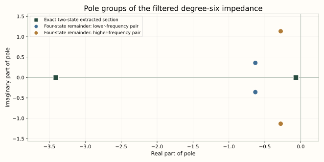

### Proving that the fourth-order remainder is passive

For any real quadratic section

\[
T(s)=r+\frac{as+b}{s^2+ps+q},\qquad p,q,r>0,
\]

set \(u=\omega^2\). Direct calculation gives

\[
\operatorname{Re}T(i\omega)
=\frac{ru^2+Mu+C}{(q-u)^2+p^2u},
\]

where

\[
M=r(p^2-2q)+ap-b,\qquad C=q(rq+b).
\]

Thus \(C>0\) and either \(M\geq0\) or \(4rC-M^2>0\) (when \(M<0\)) certify strict boundary positive-realness. Because all poles lie in the open left half-plane, the maximum/minimum principle then establishes positive-realness throughout \(\operatorname{Re}s>0\).

The two conjugate-pole sections have exact coefficients obtained from their algebraic pole residues. Give the first the constant \(r_1=1/20\), and the second \(r_2=59/20-r\). Their constants sum to \(3-r\). For all

\[
\boxed{\frac{213}{100}\leq r\leq \frac{11}{5}},
\]

we have \(r_2\geq3/4\). The certificate script verifies that the first section is positive-real at \(r_1=1/20\), and the second at \(r_2=3/4\). Increasing the second constant cannot invalidate passivity. Therefore **\(Z_{4,r}\) is positive-real throughout the whole displayed interval**.

The high-frequency constant of \(Z_{4,r}\) is \(3-r\). In the illustrative case \(r=11/5\) it is \(4/5\). No transformer-free four-reactive realization is claimed here.

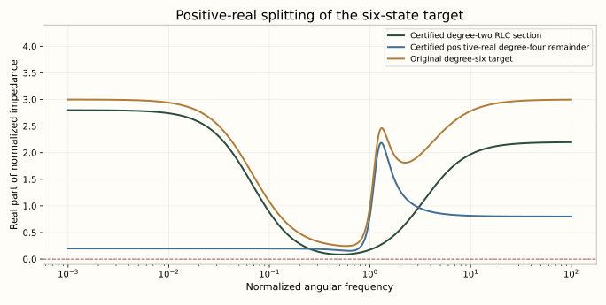

### Exact transformer-free synthesis of the two-reactive section

Consider a three-node circuit with port node 1, internal node 2, and ground node 0. There is a resistor of conductance \(G\) directly between port and ground, a resistor of conductance \(A_c\) in parallel with an inductor between nodes 1 and 2, and a resistor of conductance \(B_c\) in parallel with a capacitor between nodes 2 and 0. Write the inductor's admittance as \(\ell/s\) and the capacitor's as \(cs\). All five parameters \(G,A_c,B_c,\ell,c\) must be positive.

Its exact driving-point impedance, calculated by series/parallel reduction or a nodal cofactor, is

\[
Z_{\triangle}(s)=
\frac{cs^2+(A_c+B_c)s+\ell}
{c(G+A_c)s^2+[G(A_c+B_c)+A_cB_c+\ell c]s+\ell(G+B_c)}.
\]

Define the following positive quantities from \(p,q,a,b,r\):

\[
k=\frac1r,\qquad h=\frac1{r+b/q},\qquad
T=p+\frac ar,\qquad W=q+\frac br.
\]

For any \(G\) satisfying

\[
\boxed{
E(G)=kpT(k+h-2G)-(kh-G^2)T^2-W(k+h-2G)^2=0,
}
\]

set

\[
\boxed{
A_c=k-G,\quad B_c=h-G,\quad
c=\frac{k+h-2G}{T},\quad \ell=cW.
}
\]

Matching the coefficient of \(s^2\), then the constant coefficient, and finally the coefficient of \(s\), proves identically that \(Z_{\triangle}=Z_{2,r}\). In other words, \(E(G)=0\) is not an approximate fitting condition: it is exactly the remaining nodal polynomial identity.

**Theorem (uniform positive extraction).** For every real \(r\in[213/100,11/5]\), there exists a \(G\) strictly between 0 and \(h\) satisfying \(E(G)=0\). The above expressions then give a positive, transformer-free network with one inductor and one capacitor, realizing \(Z_{2,r}\) exactly. Moreover, \(Z_{4,r}=Z_6-Z_{2,r}\) remains positive-real and has degree four.

**Proof.** With the coefficients \(p,q,a,b\) defined by the exact algebraic poles, rational root isolation and interval arithmetic establish \(k>h>0\), \(T>0\), \(W>0\), and

\[
\boxed{E(0)<0<E(h)}
\]

uniformly for \(r\in[213/100,11/5]\). In the reproducible certificate, the \(0.07\)-wide interval is divided into 70 exact rational subintervals of width \(1/1000\). Every outward-rounded enclosure certifies those strict signs and the necessary positivity conditions. In particular, the largest interval upper bound recorded for \(E(0)\) is below \(-0.0223\), and the smallest lower bound for \(E(h)\) exceeds \(0.00127\). Continuity supplies a root in \((0,h)\) by the intermediate value theorem. The component formulas are positive on this open interval. Their symbolic coefficient matching proves the exact circuit identity. The preceding positive-real certificate proves the statement about the remainder. ∎

The degree-two section has two distinct uncancelled poles and therefore **cannot** be realized with fewer than two reactive elements. The constructed two-reactive network is minimum in that precise sense.

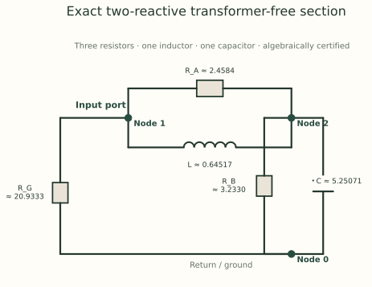

#### A concrete component certificate at \(r=11/5\)

A rational isolating bracket for the positive algebraic root is

\[
\boxed{\frac{4777}{100000}<G<\frac{4778}{100000}.}
\]

The exact interval evaluation shows \(E(4777/100000)<0\) and \(E(4778/100000)>0\). The resulting approximate normalized components are shown below. Exact values are defined by the preceding algebraic equations, not by these rounded numbers.

| Branch or element | Exact definition | Approximate normalized value |
|:--|:--|--:|
| Direct port-to-ground resistor | \(1/G\) | 20.93331601 |
| Port-to-internal-node resistor | \(1/(k-G)\) | 2.45836323 |
| Internal-node-to-ground resistor | \(1/(h-G)\) | 3.23303769 |
| Inductor between port and internal node | \(1/(cW)\) | 0.64516837 |
| Capacitor between internal node and ground | \(c\) | 5.25070881 |

In one physical scaling with \(Z_0=50\,\Omega\), \(\tau=1\,\mathrm{ns}\), normalized values give resistances multiplied by \(50\,\Omega\), inductance multiplied by \(Z_0\tau=50\,\mathrm{nH}\), and capacitance multiplied by \(\tau/Z_0=20\,\mathrm{pF}\). All elements are strictly passive and finite.

### What is now closed and what remains open

| Scope | Status |
|:--|:--|
| Decompose \(Z_6\) into a degree-two and degree-four section, each positive-real for every \(r\) in a continuous interval | **Proved** |
| Give a minimum-two-reactive, transformer-free RLC circuit for the degree-two section over the interval | **Proved constructively** |
| Give a transformer-free four-reactive RLC circuit for the remainder \(Z_{4,r}\) for at least one allowed \(r\) | **Open in this work** |
| Conclude a six-reactive, transformer-free realization of the original degree-six target | **Not yet proved** |
| Establish that the general technique or these instances have research publication priority | **Not established** |

The latest numerical fourth-order topology search did **not** obtain an exact residual identity. Its best recorded maximum scaled discrepancy was about \(6.3\times10^{-4}\) at \(r=2.15\) in one exploratory run. This is not a nonexistence proof and is intentionally excluded from theorem statements.

The most useful next calculation is to solve the four-reactive nodal cofactor equations for \(Z_{4,r}\) **with \(r\) left as a tunable real parameter in the certified interval**, rather than fixing \(r\) before searching. The one-parameter freedom offers additional room for a positive network solution without sacrificing exactness of the first section.

### Verification and literature boundaries

The provided program `smith_q6_pole_split_certificate.py` uses SymPy's exact real/complex root isolation and outward-rounded `mpmath.iv` interval evaluation. It checks the algebraic pole allocation, positive-real quadratic tests, and the triangle's sign-changing polynomial equation, including 70 interval subproofs of the uniform theorem. The figure generator uses only NumPy and Matplotlib.

The method builds on classical network synthesis, positive-real functions, partial fractions, rational root isolation, and low-order RLC realizability. The particular construction and interval family are derived here, but originality compared with the complete literature has not been established. Relevant known results include the synthesis criteria of Chen and Smith for one-inductor/one-capacitor realizations (see the discussion in [Synthesis of biquadratic impedances with at most four passive elements](https://www.sciencedirect.com/science/article/abs/pii/S0016003213003852)), and Hughes' [transformer-free network synthesis thesis](https://www.repository.cam.ac.uk/items/0db868a3-5c51-4e0f-98ac-ae821db31fdc).

**Boundary:** No new general RLC realization theorem, no universal circuit-order minimization theorem, no proof of transformer-free six-reactive feasibility, and no SPICE or hardware validation is claimed.


## A second RLC extraction and the pole-pair barrier {#second-pole-pair-extraction}

**Author: Komorebi P.**  
**Status:** Unpublished research note, 9 November 2026.  
**Scope:** A constructive transformer-free realization of a degree-four portion of the same degree-six target. The full six-reactive-element existence question remains unresolved. All visual figures in this section are generated using Python.

> **Research record.** This chapter develops one route on its stated date. Its local obstructions apply to the circuit classes stated here. The [current result](#current-result) and [exact seven-reactive construction](#seven-reactive-exact) give the later status.


### Exact decomposition into three quadratic pole groups

Recall the positive-real impedance

\[
Z_6(s)=\frac{450s^6+1385s^5+2477s^4+2200s^3+1142s^2+335s+75}{5(30s^6+159s^5+275s^4+344s^3+250s^2+89s+5)}.
\]

The denominator has two distinct negative real roots and two distinct conjugate nonreal pole pairs. For each nonreal upper-half-plane pole \(\zeta\), define its exact residue \(A_\zeta=P(\zeta)/D'(\zeta)\), where \(P,D\) are the exact polynomials above. Combining the conjugate residues yields coefficients

\[
p=-2\operatorname{Re}\zeta,\quad q=|\zeta|^2,\quad a=2\operatorname{Re}A_\zeta,\quad b=-2\operatorname{Re}(A_\zeta\overline{\zeta}).
\]

Thus the exact pole-pair contribution is \((as+b)/(s^2+ps+q)\). This definition, rather than rounded coefficients, is used in all certificates.

Let \(Z_{\rm real,r}\) denote the real-pole section constructed in the preceding chapter, with constant resistance \(r\in[213/100,11/5]\). Order the nonreal pole pairs by increasing positive imaginary part and denote their strictly proper contributions by \(T_{\rm mid}\) and \(T_{\rm high}\). Then

\[
\boxed{Z_6(s)=Z_{\rm real,r}(s)+T_{\rm mid}(s)+\big[(3-r)+T_{\rm high}(s)\big].}
\]

The first term has an exact positive one-L/one-C transformer-free realization for every \(r\) in the interval, already certified. We now construct a second such circuit for \(T_{\rm mid}\), with **zero** constant feedthrough.

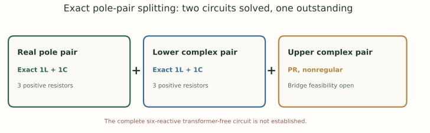

### Exact transformer-free synthesis of the middle pole pair

For the lower nonreal pole pair, interval-verified coefficients satisfy

| Exact coefficient | Approximate value |
|:--|--:|
| \(p\) | 1.264171323567376 |
| \(q\) | 0.527631229674494 |
| \(a\) | 0.105233907980455 |
| \(b\) | 0.046021275795695 |

The target is

\[
\boxed{T_{\rm mid}(s)=\frac{as+b}{s^2+ps+q}.}
\]

Consider a grounded three-node circuit. Between the input and ground, place conductance \(G\) in parallel with capacitor \(c\). Connect the input to an internal node through conductance \(A\). From the internal node to ground, place conductance \(B\) in parallel with an inductor of inverse inductance \(\ell\) (admittance \(\ell/s\)). Its input impedance is

\[
Z_{\rm mid,circuit}(s)=\frac{(A+B)s+\ell}{c(A+B)s^2+[G(A+B)+c\ell+AB]s+\ell(G+A)}.
\]

Choose \(G=1\), and define

\[
\begin{aligned}
h&=q/b,\\
A&=h-G,\\
X&=(p-aG-b/a)/a,\\
B&=AX/(A-X),\\
c&=1/a,\\
\ell&=(b/a)(A+B).
\end{aligned}
\]

These formulas satisfy exactly

\[
\boxed{Z_{\rm mid,circuit}(s)=T_{\rm mid}(s).}
\]

**Proof.** Divide the circuit numerator and denominator by \(c(A+B)\). The coefficient of \(s\) in the numerator becomes \(1/c=a\). The constant term becomes \(\ell/[c(A+B)]=b\). The denominator constant is \(\ell(G+A)/[c(A+B)]=b(G+A)=q\). The denominator linear coefficient is

\[
G/c+\ell/(A+B)+AB/[c(A+B)]
=aG+b/a+aAB/(A+B)=p,
\]

by the defining equation \(AB/(A+B)=X\). This is a rational identity for arbitrary nondegenerate \(p,q,a,b,G\). No approximation enters the algebra. ∎

Outward-rounded root-isolation intervals establish \(a,b,h-G,X,A-X,B,c,\ell>0\) for our algebraic coefficients. The same calculation verifies \(ap-b>0\) and \(bq>0\), so \(T_{\rm mid}\) is positive-real: the real part of its boundary values has numerator \((ap-b)\omega^2+bq>0\).

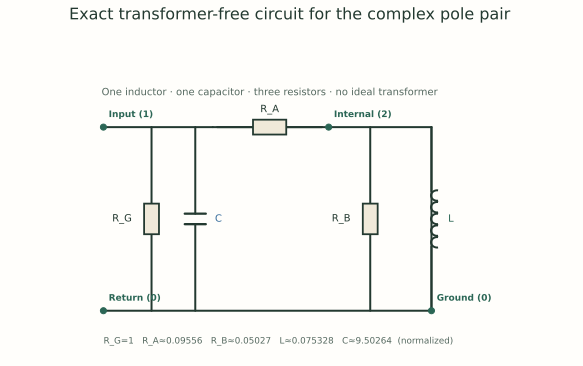

| Element | Algebraically exact value | Approximate normalized value |
|:--|:--|--:|
| Resistor \(R_G\), input to ground | \(1/G\) | 1.00000000 |
| Resistor \(R_A\), input to internal | \(1/A\) | 0.09555715 |
| Resistor \(R_B\), internal to ground | \(1/B\) | 0.05027419 |
| Capacitor, input to ground | \(c=1/a\) | 9.50264054 |
| Inductor, internal to ground | \(L=1/\ell\) | 0.07532766 |

The two nonoverlapping pole pairs have total reduced rational degree four. Connecting their explicitly synthesized two-reactive circuits in **series** realizes their sum exactly with two inductors and two capacitors. Thus the minimum reactive order of this **particular degree-four subnetwork** is four, since its rational degree is four.

### The remaining pair is positive-real but nonregular

Write the upper nonreal pole-pair remainder as

\[
Z_{\rm high,r_h}(s)=r_h+\frac{a_hs+b_h}{s^2+p_hs+q_h},\quad r_h=3-r\in[4/5,87/100].
\]

Here \((p_h,q_h,a_h,b_h)\) are algebraic and approximately

\[
(p_h,q_h,a_h,b_h)\approx (0.5588166854,1.3621478393,0.5774941299,-0.9367979986).
\]

The prior quadratic positivity test, verified again using outward-rounded intervals on seven rational subintervals, proves **strict positive-realness** for every allowed \(r_h\).

However, classical biquadratic **regularity** fails. For

\[
Z(s)=\frac{As^2+Bs+C}{Ds^2+Es+F},
\]

one regularity classification uses \(\Delta=AF-CD\) and

\[
\lambda_1=E(BF-CE)-F\Delta,\quad
\lambda_2=B(AE-BD)-A\Delta.
\]

The classical cases when \(\Delta>0\) require \(\lambda_1\geq0\) or \(\lambda_2\geq0\). In our high pole-pair family, \(\Delta=-b_h>0\) and exact cancellation gives

\[
\boxed{\lambda_1=p_h(a_hq_h-b_hp_h)+q_hb_h<0,}
\]

\[
\boxed{\lambda_2=r_h(b_h-a_hp_h)-a_h^2<0\qquad(r_h\geq0).}
\]

The sign certificates are exact intervals. Hence the high section is **nonregular for every nonnegative constant allocation for which it is positive-real**, not merely for the displayed interval.

By the established Jiang–Smith series-parallel classification, **no series-parallel one-inductor/one-capacitor circuit realizes this remainder**. Nonregularity **by itself** does not rule out exceptional bridges; the next section establishes their exclusion using the stronger classical bridge criterion. A different six-state circuit that mixes all pole groups remains possible. The classification is classical, and applying it to this algebraic family is the present calculation, not a new general network theorem.

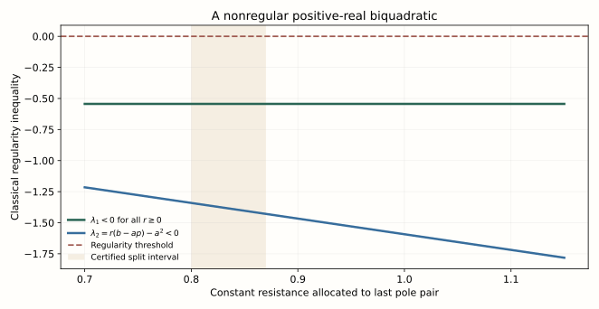

### Full two-reactive bridge obstruction for the last pole pair

The remaining question for this pole-separated approach can actually be settled **negatively**, using the classical Reichert theorem and the exceptional-bridge conditions in the Ladenheim catalogue. Reichert's theorem states that a transformer-free biquadratic realization with two reactive elements and arbitrarily many resistors can always be reduced to at most three resistors. Among those five-element networks, the only nonregular realizations belong to the exceptional bridge class \(V_H\).

Write \(A=r_h\), \(B=r_hp_h+a_h\), \(C=r_hq_h+b_h\), \(D=1\), \(E=p_h\), \(F=q_h\). The established bridge criterion when \(\Delta=AF-CD>0\) requires \(\mu_1\ge0\) **and** that the signs of \(\lambda_1,\lambda_2,\rho_1\) are not all the same, apart from a degenerate all-zero case. Its invariants, defined in standard terms, are

\[
\begin{aligned}
K&=\Delta^2-(AE-BD)(BF-CE),\\
\rho_1&=-K+2CD\Delta,\\
\mu_1&=K-4CD(2AF-2CD-BE).
\end{aligned}
\]

For this exact pole pair, the formulas simplify to

\[
\boxed{K=b_h^2+a_h(a_hq_h-b_hp_h)>0,}
\]

\[
\boxed{\rho_1(r_h)=-K-2b_h(r_hq_h+b_h),}
\]

\[
\boxed{\mu_1(r_h)=K+4(r_hq_h+b_h)(2b_h+a_hp_h+r_hp_h^2).}
\]

The rational root isolation and outward-rounded interval calculations certify that

\[
\rho_1(13/10)<-0.0716,
\qquad \mu_1(13/10)<-2.1852,
\qquad \mu_1(3)<-6.1020.
\]

Moreover, \(\rho_1'(r_h)=-2b_hq_h>0\), so \(\rho_1<0\) for every \(r_h\le13/10\). We already proved \(\lambda_1<0\) and \(\lambda_2<0\) for every \(r_h\ge0\). Hence all three requisite signs agree throughout \([0,13/10]\), and the exceptional-bridge condition fails.

On \([13/10,3]\), \(\mu_1\) is a strictly convex quadratic with leading coefficient \(4q_hp_h^2>0\). A convex function lies at or below the chord between its endpoints, which are both strictly negative here. Thus \(\mu_1<0\) throughout \([13/10,3]\), again contradicting the exceptional-bridge condition. When the numerator constant \(r_hq_h+b_h\) is negative, the candidate is not even positive-real. At the zero boundary, its small-frequency real part is negative, independently excluding passivity.

**Certified obstruction.** For every \(0\le r_h\le3\), the last pole-pair impedance

\[
Z_{\rm high,r_h}(s)=r_h+\frac{a_hs+b_h}{s^2+p_hs+q_h}
\]

**cannot be realized by any transformer-free RLC network having only two reactive elements**, no matter how many resistors it uses. This is an application of a classical necessary-and-sufficient classification to one explicitly given algebraic family. It is not a newly discovered general theorem about biquadratics.

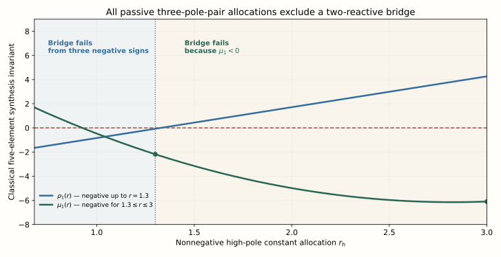

Since \(Z_6(\infty)=3\), the nonnegative feedthrough allocations of three independently passive proper pole-pair subnetworks sum to three. Thus the high-pole section necessarily has \(r_h\in[0,3]\). The other two pole pairs require at least two reactive elements each by degree, while the last now requires at least three. Therefore:

\[
\boxed{\text{Every independently passive, three-pole-pair series realization requires at least 7 reactive elements.}}
\]

This is an **exact class-specific lower bound**. It does *not* establish a seven-reactive upper bound for this construction, nor does it rule out a completely different six-reactive-element network that couples the pole groups internally.

The criterion and Reichert reduction are documented in Alessandro Morelli's 2019 Cambridge thesis, Section 3.2 and Tables 5.9–5.10, building on Jiang and Smith's biquadratic synthesis classification. The inequalities are independently certified for our target in the supplementary script.

### Exact outcome and boundaries

| Question | Result |
|:--|:--|
| Construct the real-pole two-reactive section with strictly positive components | Proven for \(r\in[2.13,2.20]\) in the previous chapter |
| Construct the first nonreal pole-pair section with one L and one C | Proven by exact algebraic circuit identity and strict interval positivity |
| Construct a transformer-free four-reactive circuit for their series sum | Proven; its reactive order is minimal for that degree-four sum |
| Prove the remaining high-pole section positive-real throughout \(r_h\in[0.80,0.87]\) | Proven |
| Exclude two-reactive **series-parallel** realizations of the high-pole section | Proven via classical regularity inequalities |
| Construct or exclude a two-reactive bridge realization of the high-pole section for any passive allocation \(0\le r_h\le3\) | **Proved impossible** by the classical bridge criterion |
| Construct or exclude a six-reactive transformer-free network for \(Z_6\) **without** enforcing an independent pole-pair series split | **Unresolved** |

The reproducible Python script `smith_q6_double_extraction_certificate.py` checks the new symbolic identity and the outward-rounded algebraic inequalities. It is independent of the earlier 86-check extraction-family certificate. The four new figures and circuit schematic were made with Python/Matplotlib.

The literature comparison materially limits novelty claims. Existing necessary and sufficient criteria for two-reactive transformer-free synthesis predate this calculation; see Jiang and Smith, *Regular positive-real functions and five-element network synthesis* (IEEE Transactions on Automatic Control, 2011), DOI [10.1109/TAC.2010.2077810](https://doi.org/10.1109/TAC.2010.2077810), and Morelli, *Synthesis of electrical and mechanical networks of restricted complexity* (2019), available from [Cambridge University Repository](https://api.repository.cam.ac.uk/server/api/core/bitstreams/0008b1b9-9d58-4813-8e97-1db41532cc8c/content). The exact polynomial and its matching circuit values have not been found in the targeted references, but **publication priority is not established**.

**Next decisive step:** abandon independent pole-by-pole series synthesis at six reactive elements and instead solve the coupled six-state nodal cofactor equations. Any exact six-reactive transformer-free realization must mix the pole contributions in its internal circuit topology. The previous 168 five-node graph classes remain candidates, not proofs.


## Exact passive interpolation and the coupled-mode boundary {#four-anchor-continuation}

**Author:** Komorebi P.  
**Date:** 9 November 2026  
**Status:** Unpublished mathematical continuation; no change to the public reader site.  
**Claim scope:** Theorems for one explicit rational impedance and its Schur reflection. These are mathematical results, not demonstrations of priority, hardware performance, or a minimum six-reactive-element transformer-free circuit.

> **Research record.** This chapter develops one route on its stated date. Its local obstructions apply to the circuit classes stated here. The [current result](#current-result) and [exact seven-reactive construction](#seven-reactive-exact) give the later status.


### The unchanged synthesis target

Work in dimensionless Laplace frequency \(s\), normalized reference impedance \(Z_0=1\), and the standard disk coordinate

\[
t=\frac{s-1}{s+1},\qquad \Gamma(t)=\frac{Z(s)-1}{Z(s)+1}.
\]

The degree-six target from the preceding chapters remains

\[
Z_6(s)=\frac{450s^6+1385s^5+2477s^4+2200s^3+1142s^2+335s+75}{5(30s^6+159s^5+275s^4+344s^3+250s^2+89s+5)}.
\]

Its reflection response is exactly the safe four-phase Fejér average of the original two-reactive lossless reflection \(F(t)=(2t+1)(3t+1)/[(t+2)(t+3)]\):

\[
G(t)=\tfrac12F(t)+\tfrac14F(it)+\tfrac14F(-it)=\frac{12t^6+35t^5+103t^4+5t^3+163t^2+210t+72}{2t^6+10t^5+38t^4+130t^3+228t^2+360t+432}.
\]

The numerator and denominator are coprime. Consequently, the McMillan degree is six. The degree lower bound is **not** a general six-reactive transformer-free existence theorem.

### Theorem 1. Exact minimal rational degree at three frequency anchors

Direct substitution gives

\[
\boxed{Z_6(0)=3,\quad Z_6(\infty)=3,\quad Z_6(i)=1+2i.}
\]

Because the coefficients are real, the conjugate data at \(-i\) follow automatically. The corresponding reflection data are \(G(1)=G(-1)=1/2\) and \(G(i)=(1+i)/2\), \(G(-i)=(1-i)/2\). These are four boundary points of the disk.

**Theorem.** Among real-rational positive-real impedances satisfying the displayed three conditions, the least possible rational degree is exactly **three**.

**Lower bound.** A degree-one rational response with identical values at zero and infinity is constant. Any nonconstant degree-two candidate, after normalizing the denominator, is

\[
Z(s)=\frac{3as^2+bs+3c}{as^2+es+c}.
\]

The interpolation condition \(Z(i)=1+2i\) forces \(e=a-c\) and \(b=c-a=-e\). With a stable real quadratic denominator, \(a,c>0\) and \(e\ge0\). If \(e>0\), the numerator has a negative linear coefficient and thus a right-half-plane zero, contradicting positive realness. If \(e=0\), then \(a=c\), \(b=0\), and cancellation leaves the constant response \(Z=3\), also contradicting \(Z(i)=1+2i\). Therefore degree two is impossible, including the boundary-degenerate case.

**Construction.** Define the degree-three Schur polynomial

\[
H_3(t)=\frac12+\frac14(t-t^3).
\]

It takes the same four reflection values as \(G\) and has exact Cayley impedance

\[
\boxed{Z_3(s)=\frac{3s^3+11s^2+7s+3}{s^3+s^2+5s+1}.}
\]

This fraction is coprime. Since \(|H_3(t)|\le1/2+(|t|+|t|^3)/4\le1\) on the unit disk, \(Z_3\) is positive-real. In fact, the exact boundary norm is strictly smaller than one:

\[
\boxed{\|H_3\|_{H^\infty}=\sqrt{13}/4\approx0.901388.}
\]

To verify sharpness, put \(x=\cos\theta\). Then

\[
|H_3(e^{i\theta})|^2=\frac12+x-\frac14x^2-x^3.
\]

The derivative vanishes at \(x=1/2\) and \(x=-2/3\); comparison with the endpoints gives the maximum \(13/16\). This establishes the degree-three upper bound and completes the theorem. **It does not assert that three physical reactive elements suffice without transformers.**

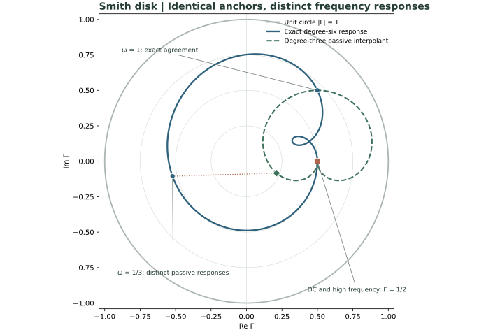

### Theorem 2. A sharper global passivity margin for the degree-six target

On \(t=e^{i\theta}\), set \(x=\cos\theta\). Exact Fourier/Chebyshev reduction of \(|G(t)|^2\) gives

\[
\boxed{R(x)=\frac{6912x^6+20160x^5+23076x^4+2555x^3-14063x^2-840x+7200}{4(3x+5)(4x+5)(9x^2+16)(16x^2+9)}.}
\]

The denominator is strictly positive for \(-1\le x\le1\). The stationary points of \(R\) in this interval are the three roots of

\[
43200x^9+448560x^8+1379556x^7+2101295x^6+1969310x^5+1235710x^4+262862x^3-482545x^2-412428x-65520=0
\]

lying in \((-1,1)\). Exact rational root isolation selects the middle critical point
\(\xi\approx-0.214257162267435\) as the global maximum. Its squared peak is \(R(\xi)\approx0.585034342753307\), so

\[
\boxed{\|G\|_{H^\infty}=\sqrt{R(\xi)}\approx0.764875377269596.}
\]

A simpler fully rational certificate is

\[
\boxed{\|G\|_{H^\infty}<\frac{7649}{10000}=0.7649.}
\]

The checker forms \((7649/10000)^2|D(e^{i\theta})|^2-|N(e^{i\theta})|^2\), expresses it as a degree-six rational-coefficient polynomial in \(x\), and uses exact Sturm root counts to verify that it has **no zero** in \([-1,1]\) and is strictly positive at \(x=0\). There is no frequency-grid approximation in this statement.

Consequently, every point of the normalized six-state impedance obeys the global real-part bound

\[
\boxed{\operatorname{Re}Z_6(i\omega)>\frac{2351}{17649}\approx0.13321\quad\text{for all real }\omega.}
\]

This strengthens the earlier \(1/9\) passivity margin. It is a conservative lower bound on real impedance, not the separately optimized sharp minimum of \(\operatorname{Re}Z_6\).

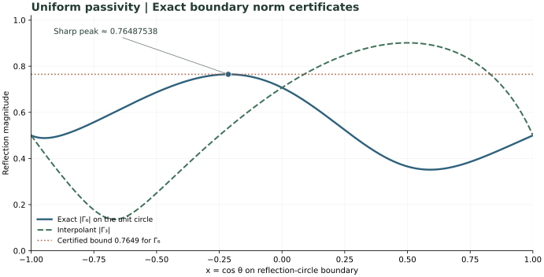

### Theorem 3. Finite-data ambiguity is quantitatively large

The degree-three and degree-six impedances are both strictly passive and agree at \(s=0\), \(s=i\), and \(s=\infty\). Nevertheless, their global responses differ markedly.

The reflection discrepancy admits the **exact factorization**

\[
\boxed{G(t)-H_3(t)=\frac{(t^4-1)(t^5+5t^4+18t^3+82t^2+156t+288)}{2(2t^6+10t^5+38t^4+130t^3+228t^2+360t+432)}.}
\]

The factor \(t^4-1\) explains the four matching disk-boundary points, but does not force small error between them. At normalized \(s=i/3\), equivalently \(t=(-4+3i)/5\), the difference is exactly

\[
G(t)-H_3(t)=\frac{-3000137-88441i}{4088500},
\qquad |G(t)-H_3(t)|^2=\frac{4406821}{8177000}.
\]

Thus \(|G-H_3|>73/100\) at that exact frequency. The same Chebyshev/Sturm procedure used above proves the full-boundary upper bound \(\|G-H_3\|_{H^\infty}<92/125\). The maximum-modulus principle extends this upper bound to the entire disk. Together:

\[
\boxed{\frac{73}{100}<\|G-H_3\|_{H^\infty}<\frac{92}{125}.}
\]

At \(s=i/3\), the two impedances are respectively

\[
Z_6(i/3)=\frac{1875}{6089}-\frac{2764}{30445}i,\qquad Z_3(i/3)=\frac{237}{157}-\frac{42}{157}i.
\]

The rigorous conclusion is a **concrete nonidentifiability example**: matching a finite set of Smith-chart measurements, even exactly and with strict passivity, does not identify the intervening response or its rational degree. The general principle is classical Nevanlinna–Pick/Schur interpolation theory. The particular rational witness and constants are specific calculations and are **not a verified priority claim**.

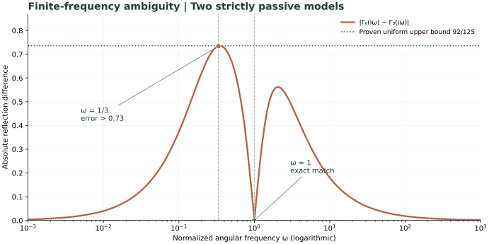

### Relation to the original six-reactive-element synthesis problem

Nothing in these three theorems produces a six-reactive-element transformer-free network for \(Z_6\), nor a proof that such a circuit is impossible. They establish:

1. A rigorous passive interpolation baseline for selected normalized frequencies, with minimum rational degree three.
2. An exact algebraic measure of how much the degree-six target can differ from that baseline despite exact agreement on all prescribed data.
3. A stronger, independently verified all-frequency passivity margin for the degree-six target, useful when certifying future candidates and measurement tolerances.

The previous **three-inductor/three-capacitor allocation** and five-node topology constraints remain necessary conditions. The earlier series-of-independent-pole-pairs obstruction is unaffected. New numerical coupled-circuit fits did not yield a zero-residual algebraic identity; such fits are *not* feasibility or infeasibility certificates.

A next constructive route is to work with the exact nodal cofactor polynomial identities of one fixed coupled 3L+3C topology and search for a certified positive algebraic solution. An exact six-reactive realization would attain the existing degree-six lower bound and establish \(q_{\min}=6\). A complete exclusion of the six-reactive case, combined with the later certified seven-reactive construction, would instead establish \(q_{\min}=7\).

### Reproducibility, prior literature and boundaries

Run `python smith_q6_four_anchor_certificates.py` for the exact SymPy symbolic, Sturm, and rational-interval certificates. Run `python smith_q6_anchor_figures.py` to recreate the three Matplotlib figures. The exact checker includes no fitted component values or numerical root tests in place of a proof. Decimal approximations only display the isolated algebraic constants.

Relevant prior work includes the classical Schur–Nevanlinna interpolation theory, the multi-point Schur interpolation treatment of Bultheel and Lasarow (2008), and transformer-free RLC synthesis/realizability classifications by Jiang and Smith (2011) and Morelli (2019). The present four-anchor theorem should not be described as a newly discovered general interpolation theorem.

- Bultheel and Lasarow, *Solution of a multiple Nevanlinna–Pick problem for Schur functions via orthogonal rational functions*, *Analysis* 28(1), 95–123 (2008). DOI 10.1524/anly.2008.0904.
- Jiang and Smith, *Regular positive-real functions and five-element network synthesis*, *IEEE Transactions on Automatic Control* 56(6), 1275–1290 (2011). DOI 10.1109/TAC.2010.2077810.
- Morelli, *Synthesis of electrical and mechanical networks of restricted complexity*, Cambridge doctoral thesis (2019). https://www.repository.cam.ac.uk/items/c41b15a3-f6b3-4650-b7b9-65f14425f0e1

**Open synthesis gap:** exact transformer-free realization with six energy-storage elements of \(Z_6\), or a valid impossibility proof. **No change has been made to the public GitHub/.io reading site.**


## Exact cubic extraction and its passive complement {#certified-cubic-extraction}

**Author:** Komorebi P.  
**Date:** 2026-11-09  
**Status:** Unpublished research continuation. Exact results are distinguished from numerical candidates.

> **Research record.** This chapter develops one route on its stated date. Its local obstructions apply to the circuit classes stated here. The [current result](#current-result) and [exact seven-reactive construction](#seven-reactive-exact) give the later status.


### Target and the new decomposition

We continue with the exact normalized positive-real driving-point impedance

\[
Z_6(s)=\frac{450s^6+1385s^5+2477s^4+2200s^3+1142s^2+335s+75}{150s^6+795s^5+1375s^4+1720s^3+1250s^2+445s+25}.
\]

There are **monic real cubic polynomials** \(A,B\) and **real quadratic polynomials** \(U,V\), defined without numerical approximation by

\[
150A(s)B(s)=Q_6(s),\qquad U(s)B(s)+V(s)A(s)=\frac{P_6(s)-3Q_6(s)}{150},
\]

and isolated by the exact rational contraction certificate below, such that

\[
\boxed{Z_6(s)=Z_A(s)+Z_B(s)},\quad
Z_A(s)=\frac{11}{5}+\frac{U(s)}{A(s)},\quad
Z_B(s)=\frac45+\frac{V(s)}{B(s)}.
\]

The pole groups are the stable real pole near \(-3.408987\) and the pair near \(-0.632086\pm0.357909i\) for \(A\), and the real pole near \(-0.068025\) and pair near \(-0.279408\pm1.133172i\) for \(B\).

Approximate coefficients in ascending powers of \(s\), with the exact meanings supplied by the polynomial equations:

| Polynomial | Constant | Linear | Quadratic | Cubic |
|:--|--:|--:|--:|--:|
| \(A\) | 1.7986879882 | 4.8371748026 | 4.6731582960 | 1 |
| \(B\) | 0.0926601321 | 1.4001613547 | 0.6268417040 | 1 |
| \(U\) | -3.8218317148 | -9.1279955606 | -7.4354828288 | — |
| \(V\) | 0.1968831915 | -0.7906000057 | 0.7688161621 | — |

### Theorem 1: minimum-reactive, transformer-free realization of the first cubic

Ground node 0 and drive at node 1, with internal nodes 2 and 3. The following *positive* elements constitute a transformer-free RLC one-port:

| Edge | Component | Normalized value (approximate) |
|:--|:--|--:|
| 0–2 | resistor | 8.5046466683 |
| 0–3 | resistor | 2.9645719657 |
| 0–3 | inductor | 0.6451433297 |
| 1–2 | resistor | 0.0388450324 |
| 1–2 | inductor | 0.0632799527 |
| 1–3 | capacitor | 10.2037581680 |
| 2–3 | resistor | 0.0758824815 |

In terms of resistor conductances \(a,b,c,d\), inductor admittance coefficients \(u=1/L_{03}\), \(v=1/L_{12}\), and capacitance \(w=C_{13}\), the exact nodal cofactor impedance is \(N(s)/D(s)\), where

\[
\begin{aligned}
N(s)={}&w(a+c+d)s^3
 +(ab+ad+bc+bd+cd+vw)s^2\\
&+(au+bv+cu+du+dv)s+uv,\\
D(s)={}&w(ab+ac+ad+bc+bd)s^3\\
&+(abc+acd+auw+avw+bcd+bvw+cuw+duw)s^2\\
&+(abv+acu+adv+bdv+cdu+uvw)s+uv(a+d).
\end{aligned}
\]

The exact algebraic component values are the unique positive solution of the following **19 polynomial equations in the certified rational box**: six coefficients of \(AB=Q_6/150\), six of \(UB+VA=(P_6-3Q_6)/150\), and seven of

\[
\boxed{N(s)A(s)-D(s)\left(\tfrac{11}{5}A(s)+U(s)\right)=0.}
\]

The companion `certify_cubic.py` evaluates the equations and their Jacobian at a 47-digit rational center. It constructs a rational approximate inverse \(M\), a **rational** Hessian bound, and proves that the Newton-like map \(x\mapsto x-MF(x)\) contracts a cube of radius \(10^{-23}\) strictly into itself. Specifically, its verified bounds include

\[
\|M\|_\infty<2220,\quad
\|D^2F\|_\infty<60951,\quad
\|I-MDF(x_0)\|_\infty<1.23\cdot10^{-27},
\]

\[
\|MF(x_0)\|_\infty<4.76\cdot10^{-46},\qquad
q<1.36\cdot10^{-15},\qquad
\|MF(x_0)\|_\infty+q10^{-23}<10^{-23}.
\]

Because \(I-MDF(x_0)\) is strictly contractive, \(M\) is invertible. The Banach fixed-point theorem therefore yields a genuine exact root \(F(x)=0\), not just a near-fit. All seven physical component values are positive throughout the certified cube. Since \(A\) has degree three with no cancellation, the circuit uses the minimum possible **three** reactive elements for \(Z_A\). This is a mathematical existence and minimal-reactive-order certificate; it is not a hardware test or a proof of research novelty.

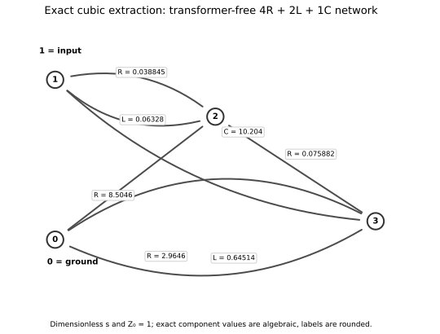

### Theorem 2: the complementary cubic is strictly positive-real

The denominator \(B(s)=s^3+b_2s^2+b_1s+b_0\) is Hurwitz: the certified coefficients satisfy \(b_j>0\) and \(b_2b_1>b_0\).

Put \(x=\omega^2\ge0\). A direct exact computation gives

\[
\operatorname{Re}Z_B(i\omega)=
\frac{c_3x^3+c_2x^2+c_1x+c_0}{|B(i\omega)|^2},
\]

where rational interval evaluation on the same certified algebraic solution proves

\[
c_0>0.025,\quad c_1>0.173,\quad c_2>-0.654,\quad c_3>0.799.
\]

The lower comparison polynomial is strictly positive for all \(x\ge0\), since

\[
\begin{aligned}
&0.799x^3-0.654x^2+0.173x+0.025\\
&=0.799x\left(x-\frac{0.654}{2(0.799)}\right)^2
+\left(0.173-\frac{0.654^2}{4(0.799)}\right)x+0.025>0.
\end{aligned}
\]

Consequently \(Z_B\) is strictly positive-real, so both terms of the exact series decomposition are physically passive immittances. **Positive realness does not, by itself, guarantee three-reactive transformer-free realizability of \(Z_B\).**

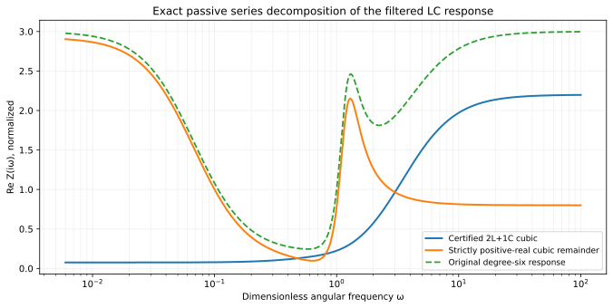

### Historical numerical candidate before certification

**Reading note.** The fit below preceded the exact dark-mode certificate in the next chapter. The recorded residuals remain diagnostics of that earlier solve. The exact four-reactive complement, and hence the seven-reactive full circuit, are established by the later certificate.

A separate five-node network with ten positive resistors, two inductors and two capacitors was fitted to \(Z_B\). Its reactive edges are inductors on 2–4 and 0–3, and capacitors on 3–4 and 1–2. The best recorded sampled scaled complex-response error is approximately \(1.54\times10^{-12}\). A high-precision constrained solve reduces the polynomial identity residual to about \(2.33\times10^{-58}\), while keeping positive components.

**At this stage the candidate was not certified.** The coefficient-equation Jacobian was nearly singular (the recorded active-coordinate condition number was about \(4.4\times10^{33}\)), so the direct contraction check did not establish an exact positive root. The [next chapter](#seven-reactive-exact) resolves this obstruction by exposing the canceled internal mode and certifying a different polynomial system. The six-reactive question remains open.

### Status and originality

- **Proved:** an exact passive split of \(Z_6\) into two cubic positive-real functions, and a **minimum-three-reactive transformer-free** circuit for the first cubic.
- **Resolved in the next chapter:** an exact four-reactive realization of the second cubic, giving a seven-reactive realization of \(Z_6\).
- **Still open:** a six-reactive transformer-free realization of \(Z_6\), or a complete proof that no such realization exists. Minimality of the second cubic's four-reactive realization is also not established.
- **Originality:** no priority claim. Third-order passive-network synthesis and algebraic existence certification have substantial prior literature. The particular polynomial circuit and certified extraction should be compared against the 2017 bicubic synthesis literature and subsequent classifications before any research novelty claim.

#### Reproducibility

The `solve_cubic_exact.py`, `certify_cubic.py` and `certify_cubic_complement.py` files contain the exact definitions and full rational inequalities. They are intended to be rerun in that order after generating `cubic_symbolic.pkl`. The network is independently generated by `derive_cubic.py`. `q4_graph_symbolic.py` and `solve_q4_complement.py` document the numerical-only four-reactive continuation. All diagrams were made with Python and Matplotlib.

#### Reference points

- Zhang, Jiang, Wang, and Neild (2017), *Synthesis of essential-regular bicubic impedances*, DOI 10.1002/cta.2342.
- Hughes, Morelli, and Smith (2019), *On a concept of genericity for RLC networks*, DOI 10.1016/j.sysconle.2019.104562.
- Prior unpublished Smith chart extended editions and their exact checkers are the internal baseline for this instance-specific continuation.


## Exact seven-reactive transformer-free synthesis {#seven-reactive-exact}

**Author:** Komorebi P.  
**Date:** 2026-11-09  
**Status:** Unpublished mathematical continuation. Exact existence certificate reproduced in Python; no originality or hardware claim.

### Main theorem

Let

\[
Z_6(s)=\frac{450s^6+1385s^5+2477s^4+2200s^3+1142s^2+335s+75}{150s^6+795s^5+1375s^4+1720s^3+1250s^2+445s+25}.
\]

**Theorem.** This impedance admits an exact **transformer-free**, passive, finite RLC one-port containing **four inductors and three capacitors**, together with fourteen positive resistors. Its input impedance is identically \(Z_6(s)\), not merely close at sampled frequencies. It follows that the minimum reactive count among transformer-free RLC circuits satisfies

\[
\boxed{6\le q_{\min}\le7.}
\]

The lower bound follows from the reduced rational degree, \(\deg Z_6=6\). The upper bound follows from the explicit two-section series construction and the exact rational existence proof below. We do **not** establish that six reactive elements are impossible, that the fourteen-resistor count is minimal, or that the method is new to the literature.

### Step 1: a certified cubic series split

Define monic real cubics \(A,B\) and quadratics \(U,V\) by

\[
150A(s)B(s)=Q_6(s),\qquad
U(s)B(s)+V(s)A(s)=\frac{P_6(s)-3Q_6(s)}{150}.
\]

Set

\[
Z_A(s)=\frac{11}{5}+\frac{U(s)}{A(s)},\qquad
Z_B(s)=\frac45+\frac{V(s)}{B(s)}.
\]

Then \(Z_A+Z_B=Z_6\) exactly. The earlier 19-polynomial-system certificate proves that \(Z_A\) is realized by the following positive transformer-free circuit:

* Ground node \(0\), input node \(1\), internal nodes \(2,3\).
* Resistor conductances \(a,b,c,d\) on \(0\!:\!2,0\!:\!3,1\!:\!2,2\!:\!3\), respectively.
* Inductor admittances \(u/s,v/s\) on \(0\!:\!3,1\!:\!2\), respectively.
* Capacitor admittance \(ws\) on \(1\!:\!3\).

For the series assembly, use section-local node labels: identify \(0_A\) with \(1_B\), drive \(1_A\), and ground \(0_B\). The two locally defined node-zero references are not the same physical node in the combined circuit.

This first section has **2L+1C+4R**, and its seven exact positive component parameters \((a,b,c,d,u,v,w)\) are part of the certified root of the 19-equation system. The rational center and full equations are included in the accompanying code and data files.

### Step 2: four-reactive transformer-free circuit for the complementary cubic

Take five nodes \(0,1,2,3,4\), with \(0\) ground, \(1\) input, and the others internal. Place a positive resistor on **each of the ten node pairs**, with conductance \(g_{ij}>0\). In parallel with selected resistors add:

| Node pair | Added branch admittance | Type |
|---|---|---|
| \(2-4\) | \(h_0/s\) | Inductor |
| \(0-3\) | \(h_1/s\) | Inductor |
| \(3-4\) | \(h_2s\) | Capacitor |
| \(1-2\) | \(h_3s\) | Capacitor |

All fourteen circuit parameters are strictly positive. Their displayed approximate values are:

| Parameter | Approximate value | Parameter | Approximate value |
|---|---:|---|---:|
| \(g_{01}\) | 0.001899056588 | \(g_{02}\) | 0.000617460176 |
| \(g_{03}\) | 0.000655814238 | \(g_{04}\) | 1.492670624 |
| \(g_{12}\) | 0.005212908509 | \(g_{13}\) | 0.323615315 |
| \(g_{14}\) | 0.011208584021 | \(g_{23}\) | 7.242057029 |
| \(g_{24}\) | 0.000721074167 | \(g_{34}\) | 0.000749245426 |
| \(h_0\) | 0.303820699 | \(h_1\) | 1.048268178 |
| \(h_2\) | 0.939786510 | \(h_3\) | 4.877686264 |

Numbers in this table are **not** substituted as exact components. The exact circuit is defined by the unique real algebraic solution isolated by the rational boxes in `seven_reactive_exact_certificate.json` and `dark_solution_high_precision.json`, with six listed conductances fixed to exact terminating decimal rationals. In normalized units, \(R_{ij}=1/g_{ij}\), \(L_0=1/h_0\), \(L_1=1/h_1\), \(C_0=h_2\), and \(C_1=h_3\).

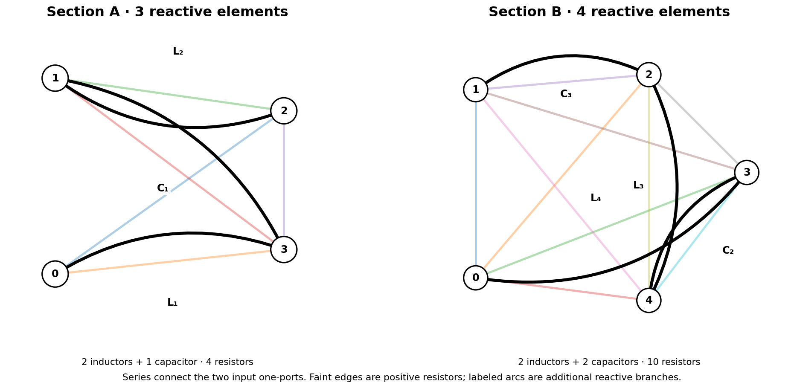

### Step 3: why the earlier numerical solve was nearly singular

Let \(Y(s)\) be the grounded four-by-four nodal admittance matrix. Define its port cofactor and full determinant, after clearing the two inductive denominators, by

\[
N(s)=s^2\det Y_{\widehat{1}\widehat{1}}(s),\qquad
D(s)=s^2\det Y(s).
\]

Both \(N,D\) are degree-four polynomials. Yet the target \(Z_B=T/B\), where

\[
T(s)=\frac45B(s)+V(s),
\]

has reduced degree three. Thus the four-reactive circuit must contain a pole which cancels from the input impedance. Directly solving all eight coefficient equations of \(NB-DT=0\) produces a singular Jacobian at the cancellation: the pole residue varies quadratically with the port-mode coupling.

We instead expose the cancellation by explicitly requiring a **port-dark internal mode** at some nonzero \(s_0\):

\[
\boxed{Y(s_0)(0,\alpha,1,\beta)^\mathsf T=0,\qquad s_0\ne0.}
\]

Its certified values are approximately

\[
s_0=-0.19789300724521315,\qquad
\alpha=0.37850781944694539,\qquad
\beta=3.5481750104501283.
\]

Because the input coordinate of this vector is zero, the internal \(3\times3\) nodal minor is singular as well. Hence \(N(s_0)=D(s_0)=0\). Their common factor removes the extra pole from the driving-point function. This is an **exact algebraic cancellation**, not a small-error approximation.

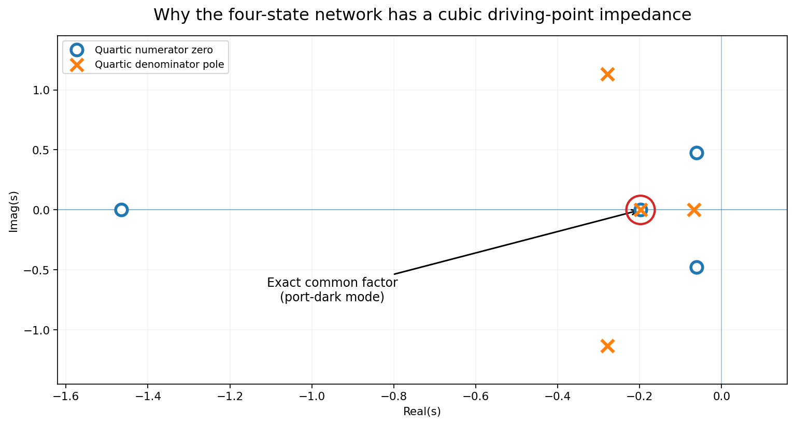

#### Rank-two certificate and the squared coupling obstruction

The internal \(3\times3\) block \(A_\mathrm{int}(s_0)=Y_{\widehat{1}\widehat{1}}(s_0)\) has rank exactly two. The two-by-two minor on nodes \(2,3\), calculated with the exact rational center, is approximately \(-42.55262827488\). The companion `reproduction/exact_seven/src/check_dark_mode_rank.py` bounds its variation over the certified box and proves that this minor remains **strictly below \(-42\)**. The dark eigenvector gives rank at most two, so equality of rank follows.

Write the grounded nodal matrix in port/interior blocks,

\[
Y(s_0)=\begin{pmatrix}a&b^\mathsf T\\b&A_\mathrm{int}\end{pmatrix}.
\]

At a rank-two singular internal block, the adjugate is \(\operatorname{adj}(A_\mathrm{int})=\kappa vv^\mathsf T\) for a nonzero \(\kappa\) and its null vector \(v\). Therefore

\[
\det Y(s_0)=a\det A_\mathrm{int}-b^\mathsf T\operatorname{adj}(A_\mathrm{int})b=-\kappa(b^\mathsf Tv)^2.
\]

The original determinant constraint is **quadratic** in the port coupling \(b^\mathsf Tv\) at the cancellation. Enforcing the linear dark-mode equation \(b^\mathsf Tv=0\) directly removes this singularity from the certificate system. This is a precise algebraic explanation of why increasing floating-point precision did not fix the original Jacobian.

### Step 4: eleven equations replace eight singular equations

Write

\[
F(s)=N(s)B(s)-D(s)T(s)=\sum_{j=0}^{7}F_js^j.
\]

Impose the seven equations \(F_0=\cdots=F_6=0\) and the four components of

\[
s_0Y(s_0)(0,\alpha,1,\beta)^\mathsf T=0.
\]

These are eleven polynomial equations in eleven active variables. Six otherwise free resistor conductances are fixed to positive rationals. The resulting Jacobian is nonsingular on the certified solution box. Once these equations are satisfied, \(N(s_0)=D(s_0)=0\), so \(F(s_0)=0\). But the first seven coefficient equations imply \(F(s)=F_7s^7\). As \(s_0\neq0\), we must have \(F_7=0\). Therefore

\[
\boxed{N(s)B(s)\equiv D(s)T(s).}
\]

This proves \(N/D\equiv Z_B\). The original inverse problem has been solved by **lifting** the singular cancellation into an explicit nodal eigenvector equation.

### Step 5: exact existence certificate and its two levels

Everything in the final acceptance test uses **rational numbers**, not floating point acceptance criteria. The code evaluates every monomial, Jacobian, approximate inverse matrix, residual and norm bound with `fractions.Fraction` after constructing exact rational centers. It applies a fixed-point contraction on closed rational cubes.

First, a 19-dimensional contraction locates the cubic factorization and the \(Z_A\) circuit in a cube of radius \(10^{-80}\):

\[
\|I-M_AJ_A\|_\infty<1.41\times10^{-69},\qquad
q_A<1.46\times10^{-69},
\]

with relative fixed-point displacement smaller than \(2.17\times10^{-31}\) times the cube radius. Second, for **every** first-stage algebraic parameter vector in that certified cube, the eleven-dimensional dark-mode circuit contraction locates an exact positive solution in a cube of radius \(10^{-56}\):

\[
\boxed{q_B<3.76\times10^{-47},\qquad
\frac{\|M_BG_B(y_0)\|_\infty}{10^{-56}}<8.60\times10^{-16}.}
\]

The second assertion includes a rational global bound for the uncertainty in \(B\) and \(T\) from the first stage. The smallest resistor conductance is greater than \(0.000617\), vastly exceeding the box radius, and the dark pole remains strictly negative and nonzero. Therefore every component parameter is positive throughout the solution box.

The proof uses only a finite collection of polynomial equalities, rational inequalities, the determinant/cofactor identity, and the Banach fixed-point theorem. The `reproduction/exact_seven/src/verify_exact.py` source and `seven_reactive_exact_certificate.json` record reproduce the bounds; **the reported decimals above are descriptive only**.

### One canceled factor, and why the coefficient Jacobian is singular {#dark-mode-reader-proof}

The count of seven reactive elements concerns physical energy storage. The degree-six input impedance concerns the part of that storage visible through the port. One collective internal mode is exactly absent from the input impedance. It is not a small correction to the target response. This distinction also explains why solving the original coefficient equations was numerically difficult.

Here is a precise argument for this particular circuit. Keep the cubic target \(Z_B=T/B\) fixed and write the grounded nodal matrix as

\[
Y(s)=\begin{pmatrix}a(s)&b(s)^{\mathsf T}\\b(s)&A_{\rm int}(s)\end{pmatrix},
\qquad
N(s)=s^2\det A_{\rm int}(s),\quad D(s)=s^2\det Y(s).
\]

The certified identity is \(NB=DT\). First observe that \(B\) and \(T\) are coprime. If they had a common root, then \(B=V=0\) there because \(T=\tfrac45B+V\). The identities \(Q_6=150AB\) and \(P_6=150(3AB+UB+VA)\) would make that root common to \(P_6\) and \(Q_6\), contradicting their nonzero resultant.

Both circuit polynomials have degree four. Their leading coefficients are nonzero: the two capacitor edges can occur together in a spanning tree, and also in a spanning forest separating the port from ground, with all required resistor conductances positive. No higher degree occurs because there are only two capacitors and the factor \(s^2\) clears the two inductive denominators. Since \(B\) and \(T\) are coprime cubics, the polynomial identity forces

\[
N(s)=H(s)T(s),\qquad D(s)=H(s)B(s),\qquad \deg H=1.
\]

The certified dark vector makes \(N(s_0)=D(s_0)=0\), so for a nonzero real constant \(c\),

\[
\boxed{H(s)=c(s-s_0).}
\]

There is therefore **exactly one canceled factor** in section B. This is stronger than merely observing a small pole residue in a frequency plot.

For the rank argument, the target values at the canceled pole must be nonzero. Exact rational interval evaluation over the two certified boxes gives the conservative bounds

\[
-\frac{169}{1000}<B(s_0)<-\frac{165}{1000},
\qquad
\frac{246}{1000}<T(s_0)<\frac{252}{1000}.
\]

Hence \(N'(s_0)=cT(s_0)\ne0\) and \(D'(s_0)=cB(s_0)\ne0\). It follows that \(A_{\rm int}(s_0)\) has rank two and \(Y(s_0)\) has rank three. Indeed, a matrix whose rank is deficient by at least two has zero adjugate, which would force the derivative of its determinant to vanish. The already supplied nonzero-minor certificate independently confirms the internal rank.

Let \(v=(\alpha,1,\beta)^{\mathsf T}\) and \(w=(0,v)^{\mathsf T}\). Symmetry and the one-dimensional nullspaces imply

\[
\operatorname{adj}A_{\rm int}(s_0)=\kappa vv^{\mathsf T},\qquad
\operatorname{adj}Y(s_0)=\eta ww^{\mathsf T},
\]

with \(\kappa,\eta\ne0\). For any infinitesimal variation of the circuit component parameters, evaluated at the **fixed** baseline frequency \(s_0\), the determinant differential gives

\[
\mathrm dN=s_0^2\kappa\,v^{\mathsf T}(\mathrm dA_{\rm int})v,
\qquad
\mathrm dD=s_0^2\eta\,v^{\mathsf T}(\mathrm dA_{\rm int})v.
\]

The zero port coordinate of \(w\) is essential: changes in the port row and column do not contribute to the second expression at first order. Differentiating with respect to \(s\) gives the same ratio, so

\[
\frac{\eta}{\kappa}=\frac{D'(s_0)}{N'(s_0)}=\frac{B(s_0)}{T(s_0)}.
\]

Consequently, for \(F(s)=NB-DT\) with the target held fixed,

\[
\mathrm dF(s_0)=B(s_0)\,\mathrm dN-T(s_0)\,\mathrm dD=0.
\]

Let \(J_F\) be the Jacobian of the eight coefficient residuals \((F_0,\ldots,F_7)\) with respect to the network parameters. The preceding equality says

\[
\boxed{(1,s_0,s_0^2,\ldots,s_0^7)J_F=0.}
\]

This nonzero left-null row proves \(\operatorname{rank}J_F\le7\). Every square Jacobian formed by choosing eight network variables is therefore singular at this exact solution. The conclusion concerns this fixed cubic target and its certified canceled mode. It is not a claim about every network fitting problem with eight coefficient equations. Introducing the dark vector supplies the additional geometric information that the coefficient Jacobian loses.

### What the count means under perturbation

Section A uses three reactive components, and section B uses four. Their exact series sum equals the reduced degree-six target \(Z_6\). Section B has degree three because its degree-four nodal polynomials share the single canceled factor proved above. Thus the displayed circuit establishes an upper bound of seven physical reactive components, while the reduced degree of the target establishes a lower bound of six. Deleting one physical component does not generally delete only the hidden mode: that mode is a combination of branch currents and node voltages.

Sufficiently small changes that keep every component positive preserve passivity. They need not preserve the polynomial identity with \(Z_6\), the dark-vector equations, or the cancellation. Some constrained changes may preserve them, so no assertion is made that every perturbation destroys the cancellation. A practical tolerance analysis would need its own frequency range and response-error specification. The exact existence certificate alone does not provide such an error budget.

### Independent verification

A separate nodal-analysis program does not use the spanning-tree coefficient formulas in the certificate. It constructs the grounded circuit matrices and computes

\[
Z_{\mathrm{series}}(s)=Z_A^{\mathrm{nodal}}(s)+Z_B^{\mathrm{nodal}}(s).
\]

At 165 complex right-half-plane evaluation points, the replay of 11 November 2026 gave a largest normalized difference \(\lvert Z_{\rm series}-Z_6\rvert/\max(1,\lvert Z_6\rvert)\) below \(1.46\times10^{-83}\), using the supplied rational centers at 85-digit working precision. This is an **independent numerical regression check**, not a replacement for the exact algebraic proof.

For the illustrative scaling \(Z_0=50\,\Omega\), \(\tau=1\,\mathrm{ns}\), Section B has inductors of approximately 164.57 nH and 47.70 nH, and capacitors of approximately 18.80 pF and 97.55 pF. Its resistor values span roughly 6.9 Ω to 81.0 kΩ. These are ideal lumped-element values, not validated real-world RF hardware or tolerance-robust component selections.

### Consequences and outstanding gap

1. The certified transformer-free lower and upper bounds are **six and seven reactive elements**, respectively. The previous proposed seven-reactive construction is now supported by an exact certificate.
2. The seven-reactive circuit has one algebraically unobservable internal mode. The observable input impedance has degree six even though the circuit contains seven independent energy-storage elements.
3. A putative **six-reactive** circuit would need full observable degree six. It cannot rely on a canceled internal mode of this sort.
4. We have **not** proved a global six-element obstruction or constructed a six-reactive transformer-free realization. The present result does not determine which of six or seven is the minimum.
5. This is a rigorous, particular synthesis example using standard network theory and mathematical certification ideas. Its **research novelty has not been established**. It should be compared with the transformer-free synthesis and bicubic impedance literature before publication.

**Relevant prior literature:** Timothy H. Hughes, *On the Synthesis of Passive Networks without Transformers* (Cambridge repository, 2014), and Zhang, Jiang, Wang and Neild, *Synthesis of essential-regular bicubic impedances*, *International Journal of Circuit Theory and Applications* (2017), DOI 10.1002/cta.2342. These sources are background and do not establish priority for the particular numbers above.


## A new exact-versus-approximate boundary for passive cyclic synthesis {#arbitrary-order-separation}

**Author: Komorebi P. · 11 November 2026 · Unpublished mathematical continuation.**  
**Result status:** an elementary general theorem with a sharp norm formula, proved below and checked independently in Python. Its historical novelty has **not** been established. It is separate from the unresolved transformer-free six-versus-seven reactive-element question for \(Z_6\).

### Uniformly stable, strictly passive responses of arbitrarily high exact order

Fix a real \(a\) with \(0<|a|<1\) and \(0<\rho<1/2\). For every integer \(N\ge4\), put \(\omega=e^{2\pi i/N}\) and

\[
 w_k=\frac{1+2\rho\cos(2\pi k/N)}{N}>0,\quad
 F_a(u)=\frac{a+u}{1+au},\quad
 G_{N,a}(t)=\sum_{k=0}^{N-1}w_kF_a(\omega^kt).
\]

All the weights are positive and sum to one. Their cyclic moments \(\mu_m=\sum_kw_k\omega^{km}\) satisfy \(\mu_m=1\) for \(m\equiv0\pmod N\), \(\mu_m=\rho\) for \(m\equiv\pm1\pmod N\), and \(\mu_m=0\) otherwise. In particular \(\mu_1=\rho\) and \(\mu_2=0\).

**Theorem (arbitrarily high exact order, exponentially accurate passive one-state reduction).** For every \(N\ge4\):

1. \(G_{N,a}\) is a real-rational Schur function, strictly contractive on the closed disk. Its reduced rational degree is **exactly \(N\)**.
2. Setting \(q=-at\), the following *exact* rational identity holds:

\[
 \boxed{G_{N,a}(t)=a+(1-a^2)t\frac{\rho+\rho q^{N-2}+q^{N-1}}{1-q^N}.}
 \tag{A1}
\]

3. The degree-one limit \(G_{*,a}(t)=a+(1-a^2)\rho t\) is Schur. Moreover the full-disk approximation error is **sharp**:

\[
 \boxed{\left\|G_{N,a}-G_{*,a}\right\|_{H^\infty(\mathbb D)}=
 \frac{(1-a^2)|a|^{N-2}\bigl[\rho(1+a^2)+|a|\bigr]}{1-|a|^N}.}
 \tag{A2}
\]

4. Let \(z_{N,a}(s)=(1+G_{N,a}(t(s)))/(1-G_{N,a}(t(s)))\), \(t(s)=(s-1)/(s+1)\). It is real-rational, strictly positive-real, and has degree \(N\). Thus **every exact ideal RLC realization requires at least \(N\) independent reactive elements**, whereas \(z_{*,a}\) can be realized with one inductor and positive resistors.

**Proof.** Each \(F_a\) is a disk automorphism and the \(w_k\) form a positive, real-symmetric probability mask. Their convex average is Schur and has real coefficients. On the boundary, the distinct arguments \(\omega^kt\) have distinct images under the injective automorphism, so the positive average has modulus strictly smaller than one; compactness gives strict closed-disk contractivity. For \(a\ne0\), the \(N\) terms have distinct simple poles at \(-1/(a\omega^k)\), with nonzero residues; no other term has a pole at the same location. Therefore their sum has exactly \(N\) simple poles and no pole at infinity, giving degree \(N\).

Expand \(F_a(u)=a+(1-a^2)\sum_{m\ge1}(-a)^{m-1}u^m\). Filtering by the above moments and summing the three geometric progressions yields (A1). Subtracting the affine limit gives

\[
 G_{N,a}(t)-G_{*,a}(t)
 =(1-a^2)t\frac{q^{N-2}(\rho+q+\rho q^2)}{1-q^N}.
 \tag{A3}
\]

The triangle inequality on \(|t|\le1\) gives the right-hand side of (A2) as an upper bound. At \(t=-\operatorname{sgn}(a)\), we have \(q=|a|\), all factors are aligned, and the upper bound is attained as a boundary supremum. This proves sharpness. Because \(|a|+(1-a^2)\rho<1\), the affine limit is strictly Schur. Möbius changes of variable and value preserve the reduced rational degree, and the Cayley transform maps strict Schur functions to strictly positive-real impedances. The state-degree bound supplies \(N\) necessary reactive elements; the affine limit maps to a positive first-order RL impedance. This proves all claims. \(\square\)

### A rational certificate with a uniform stability gap

Choose \(a=1/3\) and \(\rho=1/4\). The limiting one-state impedance is

\[
 G_*(t)=\frac13+\frac29t,
 \qquad z_*(s)=\frac{7s+5}{2s+4}=\frac54+\frac94\frac{s}{s+2}.
 \tag{A4}
\]

This is exactly a series resistor \(R_s=5/4\) followed by a parallel resistor \(R_p=9/4\) and inductor \(L=9/8\), in normalized impedance and time units. All three components are positive. Equation (A2) simplifies to

\[
 \boxed{E_N:=\|G_N-G_*\|_{H^\infty}=
 \frac{44}{81}\frac{3^{-(N-2)}}{1-3^{-N}}.}
 \tag{A5}
\]

For example, \(E_4=11/180\), \(E_{10}=1/12078\), and \(E_{20}=1/713205900\). Exact reactive-order lower bounds grow as \(N\), while this one-reactive approximation becomes exponentially accurate on the **entire disk**.

The sharp error is also a uniform passivity certificate. Since \(E_N\le E_4=11/180\),

\[
 |G_N(t)|\le\frac59+\frac{11}{180}=\frac{37}{60}
 \qquad(|t|\le1),
\]

which implies the \(N\)-independent impedance bound

\[
 \boxed{\operatorname{Re}z_N(s)\ge\frac{23}{97}>0\qquad(\operatorname{Re}s>0).}
 \tag{A6}
\]

There is also a **uniform pole gap**, not merely stability for each \(N\). On the larger disk \(|t|\le3/2\), we have \(|q|\le1/2\), \(|G_*|\le2/3\), and from (A3), for every \(N\ge4\),

\[
 |G_N-G_*|\le
 \frac{(8/9)(3/2)(1/2)^2(1/4+1/2+1/16)}{1-1/16}
 =\frac{13}{45}.
\]

Therefore \(|G_N|\le43/45<1\) throughout \(|t|\le3/2\). The impedance \(z_N\) has **no pole** in this disk. Under \(s=(1+t)/(1-t)\), every finite pole of \(z_N\) consequently satisfies

\[
 \boxed{\operatorname{Re}s\le-\frac15,}
 \tag{A7}
\]

in normalized Laplace-frequency units. Finally, the Cayley difference formula bounds the *impedance* error:

\[
 \boxed{\|z_N-z_*\|_{H^\infty(\mathbb C_+)}\le\frac{270}{23}E_N.}
 \tag{A8}
\]

Thus the family simultaneously has unbounded exact storage-order lower bounds, an exponential one-state approximation rate, a common strict-positive-real margin, and a common pole-stability gap. The high-order behavior is **not** caused by poles converging to the imaginary axis.

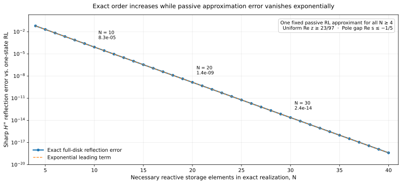

*Figure 42. Sharp, analytical H-infinity reflection errors from equation (A5), displayed on a logarithmic scale. Each point represents a positive cyclic mask with exact rational degree N; the same one-inductor RL impedance approximates every point.*

**Interpretation and novelty boundary.** This explicitly separates exact reactive complexity from passive full-frequency approximation complexity. The proof is self-contained and does not establish historical priority. Degree discontinuities, model reduction, rational approximation, and positive-real synthesis have classical precedents. The new candidate contribution is this **specific closed-form passive cyclic family with an attained exponential error bound and simultaneous uniform passivity and stability certificates**. It deserves an independent literature comparison before publication; it does **not** settle the six-reactive physical-synthesis problem for \(Z_6\).

**Reproduction.** The accompanying `reproduction/new_order_separation/check_order_gap.py` verifies finite-N moment identities, rational values at the equality point, the one-inductor circuit, and numerical samples as diagnostics. The theorem itself follows from the displayed geometric series and inequalities, not from finite testing.


## Verification register and reproducible records


### Certificate replay for this edition

The strongest construction was replayed on **11 November 2026**. The polynomial systems were regenerated from the displayed graphs before the certificate was evaluated. The acceptance inequalities use exact rational arithmetic. Numerical values in this table are readable upper bounds on those exact comparisons.

| Record | Result of this replay | What it establishes |
|---|---|---|
| Degree of \(Z_6=P_6/Q_6\) | \(\gcd(P_6,Q_6)=1\), with both degrees six | At least six reactive elements are needed |
| First cubic and circuit | Rational contraction, \(q_A<1.46\times10^{-69}\) | Exact algebraic first section in a positive component box |
| Complementary circuit | Uniform rational contraction, \(q_B<3.76\times10^{-47}\) | Exact four-reactive second section for the certified first-stage coefficients |
| Second-stage displacement | Displacement divided by radius \(<8.60\times10^{-16}\) | The fixed-point map stays inside its rational box |
| Dark-mode internal rank | Exact minor strictly below \(-42\) | The singular internal block has rank two |
| Independent nodal evaluation | 165 samples, normalized discrepancy \(<1.46\times10^{-83}\) | Numerical implementation cross-check only |

The proof depends on the exact polynomial identities, strict rational inequalities, positive component boxes, and fixed-point argument. The sample check and the figures do not supply the existence proof. No Lean verification is claimed.

The full reading package contains the current sources under `reproduction/exact_seven`. From that directory, run:

```text
python src/generate_exact_systems.py
python src/verify_exact.py
python src/check_dark_mode_rank.py
python src/verify_interval_margins.py
python src/verify_nodal.py
```

The first four commands regenerate and check the algebraic certificate and the nonzero margins used in the cancellation proof. The fifth evaluates the circuit independently at the finite sample set. Python, SymPy, mpmath, and NumPy are needed for this sequence. Matplotlib is used only for rebuilding figures. The exact rational centers and fixed conductances are in `data/`; the rounded component table in the reading is not an exact replacement for them.

### New arbitrary-order separation check

The separate `reproduction/new_order_separation/check_order_gap.py` program passed its finite-N regression checks on 11 November 2026. It checks exact rational reference values, the RL reduction, positive-real bounds, and independent finite sums against the closed cyclic formula for orders 4 through 30. The proof for **all** orders rests on the displayed roots-of-unity and maximum-modulus argument; a finite suite does not certify an infinite theorem. The accompanying `plot_order_gap.py` produced Figure 42 with Python.

### Earlier verification record, retained with its dates

The following paragraphs record the earlier editions' checker coverage. References there to “this revision” mean that earlier stage, not a fresh claim that every historical program was rerun on 11 November. The recovered sources are preserved under `reproduction/`, with a source index in the package. Their counts must not be added together as if they were one proof.

A later full-chapter program `examples/smith_chart_extended.py` was recorded in the prior research audit as passing 171 exact SymPy assertions and writing `verification/smith-chart-extended/results.json`. **That exact 171-check suite was not recovered or rerun in this revision; the recovered `smith_chart_extended.py` has 118 checks and was rerun successfully.** The new standalone program `smith_mask_checks.py` tests the added mask examples and writes its own JSON record. The included `smith_extended_figures_full.py` recreates the earlier **ten** diagrams with Python and Matplotlib; `smith_realization_figures.py` adds two more; and `smith_order_growth_figures.py` adds four further figures.

The earlier audit records **171 passing chapter-level checks** for these mathematical fixtures; this count remains historical until the exact version is rerun:

| Verification block | Representative exact result | Limit of the check |
|---|---|---|
| Physical load and geometry | \(\Gamma_L=(-1+2i)/5\), \(Z_{\rm in}=100+50i\ \Omega\) | Specific reference impedance and lossless-line convention |
| Exact impedance/admittance packets | \(9/7+8/7+4/7=3\), \(7/9-8/9+4/9=1/3\) | Rational points and selected orders |
| Dyadic refinement | \(P_{N,j}=P_{2N,j}+P_{2N,j+N}\) | Exact fixtures, general law proved above |
| Angular packet energy | \(67/63+64/63+16/63=7/3\) | Mean-square, not pointwise energy |
| Noncommuting matrix response | Exact four-port reconstruction (39) | Chosen matrix termination and architecture |
| Passive truncation failure | \(598/539>1\) | One physical lossless two-port |
| Universal order-four mask test | Safe weights sum to 1; hard weights have total variation 3/2 | 65 exact new local regression checks |
| Safe coset packet retention | Two exact order-six cosets combine into contractive order-three packets | Does not certify a particular internal circuit |
| Two-network ambiguity | Same \(p_0,p_1\) but \(p_2=\pm1/20\) | Non-identifiability at a specified load |
| Two-node finite Pick certificate | \(\operatorname{diag}(21/10,2/5)\succ0\) | Specific orbit \(N=2,\rho=1/2\) |
| Noncommuting matrix Pick certificates | Strictly feasible and strictly infeasible two-channel orbit examples | Matrix Schur interpolation, not RF network synthesis |
| Unique missing packet | Positive-semidefinite witness (32) | One finite orbit with a rank-one Pick matrix |
| Missing-packet spectral rejection | \(\lambda_{\min}(M)\le-16856064\lvert p_2+108/539\rvert^2/9397297\) | Exact observed \(p_0,p_1\) fixed |
| Finite Pick noise margin | \(412/4375<1/7\) | Strictly feasible completed data, not arbitrary incomplete measurements |
| Two-load rational identification | \(a=1/2,\ b=3/4,\ d=-1/2\) from two pairs of packets | \(b\ne0\), distinct powers and nonzero denominators |
| Cross-frequency obstruction | Negative two-frequency and three-frequency determinants | Finite real-rational sample nodes |
| Real-time symmetry obstruction | Complex Pick feasibility \(3I/8\) yet no real reciprocal coupling | Positive real Laplace frequency point |
| Passive rational interpolation | \(c_\star(1)=1/2\), \(c_\star(2)=848/1387\), \(c_\star(3)=2/3\) | Construction for one feasible dataset |
| Joint frequency–load obstruction | \(\varepsilon_*=1/12\) | Pure odd–odd four-node data |
| Reciprocal realization obstruction | Odd zero of \(c(s)^2\), sharp scalar error floor \(1/12\) | Reciprocal scalar two-port and enclosing contours |

The analytic proofs are the derivations in the chapter. The executable assertions protect the worked numbers, transformations, and selected witnesses against transcription and implementation errors. **They do not constitute a Lean proof or a universal numerical passivity guarantee.** No formal Lean coverage is claimed for this draft.

**New regression suites (8 November 2026).** The companion `smith_mask_checks.py` runs 65 additional exact SymPy assertions for the classification examples, rotation weights, matrix fixture, and the two noncommuting Cayley calculations. These 65 checks were executed again in this revision. A recoverable older `smith_chart_extended.py` checker was also executed and passed **118/118** assertions. The previously recorded, different 171-check chapter suite was **not** reproduced because its latest exact version was not recovered. The companion `smith_realization_checks.py` adds 40 executed exact symbolic and rational-interval checks of the explicit cubic RLC synthesis and component positivity. The new `smith_order_growth_checks.py` adds **63 executed exact symbolic assertions** for the rotated-pole family, sharp boundary norm, positivity certificates, and the sixth-degree LC result, plus separate numerical boundary and frequency checks. The analytic theorems rest on their written proofs, not on numerical sampling.

### Earlier core-checker commands

For the earlier core calculations, use the scripts in `reproduction/earlier_core` (and the source index for any supplementary program):

```text
python smith_mask_checks.py
python smith_extended_figures_full.py
python smith_realization_checks.py
python smith_realization_figures.py
python smith_order_growth_checks.py
python smith_order_growth_figures.py
python smith_realization_ac_validate.py
python smith_chart_extended.py --output verification/smith-chart-extended
```

The first command requires SymPy and produces `smith_mask_checks.json`; the second requires NumPy and Matplotlib and produces the earlier ten SVG/PNG pairs under `figures/`. The realization figure generator produces two additional SVG/PNG pairs. The order-growth figure generator adds four more; the ideal-combiner and transformer-free decision figures add six more, for the twenty-two diagrams included at that stage of the project. No network connection or external Smith-chart artwork is used. The currently recovered 118-check older chapter program is included and was rerun. The previously reported 171-check version remains a separate regression target and is not claimed to have run here.

For a quick independent calculation without the entire checker, Python's `fractions.Fraction` can reproduce the order-three impedance packets:

```python
from fractions import Fraction as Q

t = Q(1, 2)
N = 3
packets = [(1 + t**N) / (1 - t**N)]
packets += [2 * t**j / (1 - t**N) for j in range(1, N)]
assert packets == [Q(9, 7), Q(8, 7), Q(4, 7)]
assert sum(packets) == Q(3)
print(packets, sum(packets))
```

The earlier chapter checker covered scattering and Pick fixtures. The new independent `smith_mask_checks.py` covers the cyclic-filter examples; use the previously recorded source-bound full checker for the older chapter claims before publication.

## What has been settled and what remains open

| Statement | Status in this draft | Important boundary |
|---|---|---|
| Smith impedance and lossless-line transport | Classical, fully derived | Real positive reference impedance and ideal lossless line |
| Cyclic projectors, refinement, nonlinear selection | Exact consequences of roots-of-unity filtering | A packet is not a physical angular sector |
| Impedance/admittance packet formulas and parity | Exact, fully derived | Convergent series on \(\lvert t\rvert<1\) |
| Nonzero packet failure of positive-realness | Proved from the harmonic minimum principle | Function-theoretic statement, not a new physical law |
| Coset packet selection stays Schur-contractive | Exact for every subgroup coset of residue classes | May not admit the original physical realization |
| Universal cyclic-mask norm and Fejér-safe filtering | Exact Fourier/Schur operator norm with classical Pick necessity | No prescribed circuit topology or hardware synthesis |
| Exact cyclic order multiplication | Proved for proper rational functions with simple disjoint rotation-pole orbits; one- and two-state examples | The no-pole-at-infinity hypothesis is required; a degree bound does not synthesize a circuit |
| Sharp inductor filtering bounds | Exact a=1/3 reflection norm 4/5 and real input resistance >= 2/3 | Ideal lumped network, not parasitic-aware hardware |
| Sixth-degree filtered series LC | Exact degree-six response; six-reactive realization with ideal transformers; certified transformer-free realization with four inductors and three capacitors | Transformer-free minimum remains \(6\le q_{\min}\le7\); six has neither been constructed nor excluded |
| Cubic series decomposition of \(Z_6\) | Exact split into passive cubics; the first has a three-reactive circuit and the second a four-reactive circuit | Minimality of the four-reactive second circuit is not established |
| Port-dark cancellation | Exactly one common factor reduces the second section from degree four to degree three | Cancellation does not remove a physical component or exclude six-element realizations |
| Exact low-order passive approximation | One-inductor RL realization with sharp reflection error 4/45 and normalized impedance error 1 in the selected example | No claim of globally optimal degree-one approximation |
| Nearest safe repair of a signed unital mask | Exact total-negative-mass formula in the universal operator norm | Not a measurement-preserving circuit reconstruction |
| Passive two-port truncation counterexample | Exact, worked witness | Specific lossless reciprocal two-port |
| Restricted two-port branch reconstruction | Exact under specified nondegeneracy | Fixed scalar reciprocal architecture |
| Finite orbit Schur completion LMI | Equivalent to classical Nevanlinna–Pick | Does not synthesize a specified circuit |
| Matrix-valued cyclic packet completion LMI | Exact block Fourier form of classical matrix Nevanlinna–Pick | Matrix Schur function, not fixed physical scattering topology |
| Finite Pick measurement perturbation | A spectral-gap margin quantifies robustness for completed data | Rank-deficient and partial-data cases need further methods |
| Unique and non-unique missing-packet examples | Exact, audited witnesses | Chosen measurement orbits |
| Frequency-wide matrix Pick compatibility | Classical existence criterion in specialized packet coordinates | Does not impose circuit order or topology |
| Real-time symmetric reciprocal interpolation | Exact Pick equivalence for conjugation-closed compatible scattering samples | Branch reality must be checked first; still no topology bound |
| Pairwise vs global frequency obstruction | Exact finite witness | Three specified frequency nodes |
| Joint bidisk pure-character threshold | Sharp special-case theorem | Not a general bidisk interpolation algorithm |
| Scalar and equal-size matrix reciprocal obstructions | Exact necessary constraints | Not sufficient for passive reciprocal synthesis |
| Poisson phase sampling | Exact density and a proposed sampling strategy | No universal reconstruction advantage established |
| Safe-filtered pure-inductor RLC realization and minimal reactive order | **Proved for the displayed scalar model** | Seven positive elements, three independently necessary reactive states; no general topology optimizer |
| Arbitrary-order strict-passive cyclic family with a sharp one-reactive approximation bound | **Proved as an explicit family theorem** | Does not identify the minimum topology for each member or establish historical novelty |
| General incomplete noncommuting multiport synthesis | **Open** | Unknown recovery, topology, complexity, and noisy measurement requirements |

Two questions remain at different scales. For the explicit impedance \(Z_6\), the remaining decision is whether six or seven reactive elements are necessary in a transformer-free circuit. At the broader level, finite and possibly incomplete packet measurements must be reconciled with one globally passive, reciprocal network across both frequency and load. A general solution would preserve the observations, certify impossible datasets, quantify uncertainty, and state what circuit architectures it permits. The worked examples establish particular feasibility results and obstructions within that larger problem.

## Sources and provenance

**Classical foundations**

1. Phillip H. Smith, [*Electronic Applications of the Smith Chart*](https://www.bibliovault.org/BV.book.epl?ISBN=9781884932397), 2nd ed. (1995). The original Smith-chart engineering framework and its matching applications.
2. Joseph F. White, [*The Smith Chart*](https://onlinelibrary.wiley.com/doi/10.1002/0471474827.ch5), in *High Frequency Techniques*. The impedance map, constant resistance/reactance circles, and propagation geometry are classical.
3. Michael Steer, [*Smith Chart*](https://eng.libretexts.org/Bookshelves/Electrical_Engineering/Electronics/Fundamentals_of_Microwave_and_RF_Design_%28Steer%29/08%3A_Graphical_Network_Analysis/8.03%3A_Smith_Chart), *Fundamentals of Microwave and RF Design*. Physical normalization and graphical network analysis.
4. P. P. Vaidyanathan, *Multirate Systems and Filter Banks*, Prentice Hall, 1993. The polyphase and residue-class context.
5. Jim Agler and John E. McCarthy, [*Pick Interpolation and Hilbert Function Spaces*](https://doi.org/10.1090/gsm/044), American Mathematical Society. Classical and bidisk Schur interpolation.
6. Ph. Delsarte, Y. Genin and Y. Kamp, [*The Nevanlinna–Pick Problem for Matrix-Valued Functions*](https://doi.org/10.1137/0136005), *SIAM Journal on Applied Mathematics* **36** (1979), 47–61. The matrix-valued Pick feasibility theorem.
7. Guanrong Chen and Çetin Kaya Koç, [*Computing matrix-valued Nevanlinna–Pick interpolation*](https://doi.org/10.1016/0024-3795(94)90205-4), *Linear Algebra and its Applications*, 1994. Matrix interpolation and computational structure.
8. The standard Cayley, Schwarz, Cauchy, Rouché, maximum-modulus and harmonic minimum principles are used in the proofs. They are not presented as new theorems.
9. Weyl's Hermitian eigenvalue perturbation inequality is used to turn finite Pick spectral gaps into explicit measurement-error margins. The bound is classical and is proved from spectral-norm estimates here.

10. Bott–Duffin synthesis and rational positive-real circuit realizability are classical. See [*Passive linear continuous-time systems: Characterization through structure*](https://www.sciencedirect.com/science/article/pii/S0167691120301985) and the [survey *Electrical Network Synthesis*](https://api.repository.cam.ac.uk/server/api/core/bitstreams/4a496c9a-9083-419e-8c0a-94cebf184864/content) for context. The explicit seven-component instance above is independently checked by exact circuit algebra.

**Operation KOMOREBI source relations**

- [Existing Smith chart guide](https://github.com/KomorebiP/Operation-KOMOREBI/blob/main/docs/demonstrations/SMITH_CHART.md): the published laboratory's mathematical conventions, current scope, and limitations.
- [Live Smith chart laboratory](https://komorebip.github.io/Operation-KOMOREBI/smith-chart.html): interactive impedance, admittance, phase projectors, comparison, zoom, and finite numerical checks.
- The earlier *Projector-Resolved Polyphase Smith Chart* manuscript, the finite passive packet completion note, the cross-frequency completion note, and the joint passivity and realization audit are distinct research sources. The package source index lists the files actually recovered for this edition. These internal research stages are not treated as already published works.

**Editorial provenance.** The 11 November continuation adds the independently derived [arbitrary-order separation theorem](#arbitrary-order-separation), sharp global norm, uniform passivity and pole-gap bounds, together with a 42nd Python-generated figure. The result is not claimed historically novel. This unpublished edition brings together the original Smith-chart calculation and the research continuations dated 8–9 November 2026. The revision of 11 November reconciles their status, corrects the degree theorem's missing hypothesis, expands the singular-Jacobian argument, and replays the exact seven-reactive certificate from regenerated polynomial systems. All mathematical figures are generated in Python. Earlier numerical searches retain their historical status. No publication-priority or hardware-performance claim is made.

## Suggested reading routes

**Geometry and intuition.** Begin with the [worked load with a 50 Ω reference](#one-load-through-a-transmission-line), the [order-three packet arithmetic](#a-complete-exact-impedance-and-admittance-calculation), and the [truncated lossless two-port](#from-the-chart-to-a-passive-two-port). These explain why complete reconstruction matters.

**Passive completion.** Read the safe cyclic masks, [finite Pick certificates](#passive-completion-from-incomplete-packets), uniqueness and ambiguity examples, and then [compatibility across frequency](#frequencies-must-agree-with-one-physical-network) and load.

**Exact physical synthesis.** Start with [order growth](#exact-order-proliferation-under-cyclic-filtering), the degree-six target, and the [seven-reactive construction](#seven-reactive-exact). The [cubic extraction](#certified-cubic-extraction) supplies the first circuit section. The earlier pole-pair chapters explain why one natural route did not settle the six-element question.

**Exact versus approximate order.** The [arbitrary-order cyclic theorem](#arbitrary-order-separation) proves that arbitrarily high exact reactive degree can coexist with a sharp exponentially accurate one-reactive passive approximation and a common stability margin. It is independent of the open six-versus-seven synthesis decision.

**Proof and reproduction.** Use the [verification register](#verification-register-and-reproducible-records) to locate the exact definitions, rational certificates, independent nodal checks, and Python figure sources. Each record states its scope.

[Return to the current result](#current-result) · [Return to the start](#smith-chart-through-exact-packets-passivity-and-reconstruction) · [Open the interactive laboratory](https://komorebip.github.io/Operation-KOMOREBI/smith-chart.html)
