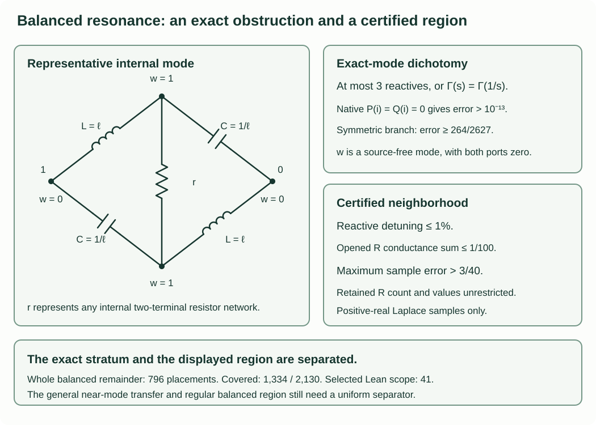

# Typed margins and the balanced resonance gap

Explicit whole-class margins cover all mixed three-reactive circuits and the
four-reactive one-L/one-C classes. Coverage stays **1,334 of 2,130**; the
**796 balanced two-L/two-C placements** remain. This section closes a shared
boundary subproblem and gives a certified neighborhood of it, without counting
that region as a whole-placement exclusion.

| New result | Exact scope |
|---|---|
| Internal-mode dichotomy | With at most two L and two C, a port-zero internal oscillation at $i$ forces a response realizable with at most three reactives, or frequency-inversion symmetry. Arbitrary finite positive resistor networks are allowed. |
| Singular-face margin | For the natural graph pair, $P(i)=Q(i)=0$ implies maximum seven-sample reflection error $>10^{-13}$. |
| Quantitative region | An inversion-symmetric mode face, at most one-percent reactive detuning and opened-resistor conductance sum at most $1/100$, gives error $>3/40$ on the positive-real samples. |
| Remaining implication | Small natural determinants must still be related uniformly to these physical mode neighborhoods through all resistor faces. The regular balanced region also remains open. |

All new proofs have project self-review and exact supporting controls. There
is no added Lean or independent review, hardware measurement or priority claim.
These are normalized **positive-real Laplace** comparisons. The imaginary-axis
component-tolerance extension is false, including for a strictly damped example.

Use $P_H=4+3s+6s^2$, $Q_H=9+2s+6s^2$, $Z_H=P_H/Q_H$,
$h=(Z_H-1)/(Z_H+1)$ and
$S=\{1/2,3/4,1,5/4,3/2,7/4,2\}$. The reference resistance and the
resonant frequency are one. Write
$E_S=\max_{s\in S}|\Gamma(s)-h(s)|$.



## The mode hypothesis is stronger than a loss-free driven response

Ground port zero and write the nodal matrix at $i$ as $A=G+iM$, with
$G$ the real positive semidefinite resistor Laplacian and
$M=C-K$ the capacitor-minus-inductor Laplacian. An internal mode is a
nonzero real node vector $w$ satisfying

$$w_0=w_1=0,\qquad Gw=0,\qquad Mw=0.$$

There is no source injection, including at the port. Every resistor drop is
zero, and the signed reactive currents satisfy KCL at every node. A driven
solution with zero resistor loss has different boundary data; it need not
provide an internal mode.

For the connected port component, the natural polynomials are
$P=s^{n_L}\det A_D(s)$ and $Q=s^{n_L}\det A(s)$, up to their common
positive normalization. If $P(i)=Q(i)=0$, an internal mode exists. Here is
the needed singular-matrix argument, without assuming a finite driven phasor.

If $Az=0$, then $z^*Gz=0$, so $Gz=Mz=0$. Thus the complex kernel is
the complexification of a real common kernel. If this kernel has dimension
at least two, a nonzero real combination has port coordinate zero. The same
is immediate if every kernel vector already has that coordinate zero.

Otherwise let the kernel be spanned by real $v$ with $v_1\ne0$.
Singularity of $A_D$ supplies a real nonzero internal vector $u$ in the
common kernel of $G_D,M_D$. Extend it by $u_1=0$. Resistor energy gives
$Gu=0$ on the full grounded graph; $Mu$ can have only its port coordinate
nonzero. Symmetry and $Av=0$ give
$0=v^TAu=i v_1(Mu)_1$, so $Mu=0$. Then $u$ is another full kernel
vector, independent of $v$, a contradiction. The empty minor is nonsingular
and needs no exception. Detached components are discarded before this test.

## Why four reactive branches leave only small active supports

Remove self-loops. A parallel pair of the same reactive kind can be merged
with positive values, giving at most three reactive branches immediately.
Assume no such pair remains. Call an LC edge active when its mode voltage
drop is nonzero. All resistor and inactive LC edges join equal values of $w$.
Active edges carry nonzero signed currents and have zero divergence everywhere.
Their support therefore has minimum degree two, counting parallel edges.

With at most four edges, there are only the following possibilities:

| Active support | Consequence |
|---|---|
| One parallel LC pair | It has one zero-level attachment; the active appendage can be removed. At most two inactive reactives remain. |
| A three-cycle | Its three mode levels are distinct; it has one zero-level attachment. At most one inactive reactive remains. |
| A triangle with one doubled edge | All four edges are used and the three levels are distinct. The active appendage has one zero-level attachment. |
| Two parallel LC pairs, disjoint or sharing one vertex | Each pair is tuned; the entire response is inversion symmetric. |
| A four-cycle with one zero-level vertex | The active appendage has one attachment to the port's level. |
| A four-cycle with two zero-level vertices | Its two two-edge arcs are tuned series-LC paths. The reduction below gives inversion symmetry. |

This list follows from the degree sum. With four used vertices, every degree
is two, giving a four-cycle or two pairs. With three used vertices and four
edges, the degree sequences are $(2,2,4)$ or $(2,3,3)$, giving the two-pair
or doubled-triangle cases. Two used vertices would have a repeated same-kind
edge, already reduced. With three edges the only remaining support is a
triangle; with two it is an LC pair. Accounting for colors gives eight
unlabelled types, independently enumerated by the exact checks.

A single connected active support must have a zero-level vertex: a path from
the port to it can use resistor or inactive edges only until it first meets
the active support, and those edges preserve $w=0$. In a triangle or doubled
triangle all active vertices are mutually adjacent, so there is at most one
such vertex. In a two-edge pair its endpoints have different levels.

When the active support has one zero-level vertex, the whole subnetwork on
its nonzero levels is attached to the zero-level network at that single
vertex. Inactive LC edges preserve levels too. At positive real $s$, a
one-terminal appendage has a constant-potential solution and zero current;
the positive energy minimum proves that removing it preserves the port
response. Keeping only edges whose two endpoints have level zero therefore
leaves at most two reactive branches. Equality for all positive $s$ is
rational identity. This also handles arbitrary resistor-only nodes and
floating parts of the appendage.

## The surviving four-cycle has inversion symmetry

For a simple active cycle, KCL makes its circulating current constant.
The sum of its reactances is zero at $i$. Two zero-level vertices cannot be
adjacent. If there are two, they are opposite; both intervening two-edge
arcs have zero total reactance. Each arc must contain an L and a C with
$LC=1$. A series arc consequently has impedance

$$Z_j(s)=\ell_j(s+1/s).$$

If the two internal mode levels differ, no resistor component joins them.
Their resistor-only attachments each have a single boundary vertex and can
be discarded. The two arcs in parallel become a single series LC pair with
$\ell=(1/\ell_1+1/\ell_2)^{-1}$. Its response is unchanged by $s\mapsto1/s$.
The same applies if the internal levels agree but their resistor subnetworks
are disconnected.

If the internal levels agree and a resistor network joins them, the arcs
have opposite LC orders and equal values $\ell_1=\ell_2=\ell$. Indeed their
internal mode voltages are proportional to $\ell_1$ and $\ell_2$ with
opposite signs for equal arc order and equal signs for opposite order.
Replace the internal resistor network by its positive effective resistance
$r$. All other resistor-only attachments there are irrelevant. The resulting
balanced bridge has exact impedance

$$Z_B(s)=\ell\,
\frac{r(s^2+1)+2\ell s}{\ell(s^2+1)+2rs}.$$

For example, using $y_L=1/(\ell s)$, $y_C=s/\ell$ and $g=1/r$, the
sum and difference of the two internal nodal equations give

$$Y_B=\frac{2y_Ly_C+g(y_L+y_C)}{y_L+y_C+2g}.$$

This proves the displayed formula for positive $s$, then by rational
identity. It is invariant under $s\mapsto1/s$. Its value at $i$, when
finite, is the real number $\ell^2/r$; no inversion of a singular internal
matrix was assumed. Disconnected internal resistor networks were handled
above. An ideal internal wire can be contracted first and becomes the
two-pair case.

For two active parallel LC pairs, KCL at the degree-two ends forces each
pair to have $LC=1$. Its combined admittance is $(s+1/s)/\ell$.
Replacing both pairs makes the whole nodal network invariant under inversion.
Arbitrary outer resistor networks preserve this symmetry in both cases:
their equations are frequency independent, and the internal block attaches
at only its two zero-level vertices.

Thus an internal-mode graph either has an ordinary realization with at most
three reactives or satisfies

$$Z(s)=Z(1/s),\qquad \Gamma(s)=\Gamma(1/s).$$

The first case has $E_S>10^{-13}$ by the preceding whole three-reactive
margins, with stronger inherited pure-type and smaller-budget bounds.
In the second, $\Gamma(1/2)=\Gamma(2)$, so

$$E_S\ge\frac{|h(2)-h(1/2)|}{2}
=\frac{264}{2627}>10^{-13}.$$

Together with the kernel argument, this proves the singular-face margin.
Resistor open/wire faces can be processed as actual circuit deletion and
contraction. If they disconnect a reactive component or merge reactive
edges, a smaller budget may result. A limiting normalized polynomial pair
is not automatically the natural pair of that processed graph; carrying
that structure through a general limiting sequence is still required.

## A positive-real comparison gives an explicit neighborhood

At a fixed positive real $s$, every branch admittance is a positive real
conductance. For unit port voltage its energy minimum equals the input
admittance $Y$. This minimum remains valid with floating components: the
minimizer is nonunique only by irrelevant constants. If all physical
component values change by relative error at most $\epsilon<1$, then every
admittance changes by a factor between $1-\epsilon$ and $1/(1-\epsilon)$.
Comparing energies before minimizing gives

$$(1-\epsilon)Y\le Y'\le Y/(1-\epsilon).$$

Write $f(y)=(1-y)/(1+y)$. For $t\ge1$,

$$|f(tY)-f(Y)|
=\frac{2(t-1)Y}{(1+Y)(1+tY)}\le\frac{t-1}{2},$$

since the denominator is at least $(1+Y)^2\ge4Y$. Reverse the two
networks when their admittance ratio is below one. Hence, simultaneously
at all positive real $s$ and with no branch-count factor,

$$\boxed{|\Gamma'-\Gamma|\le
\frac{\epsilon}{2(1-\epsilon)}.}$$

This elementary Rayleigh comparison is derived here as a tool; no novelty
claim is made. Open/short ports follow by limits. Its domain is positive-real
Laplace arguments. A damped mixed circuit in the exact controls violates the
same numerical bound on the imaginary axis.

Now compare an actual graph with an ideal mode graph. Change its reactive
values to the supplied ideal values $x_e^*$ within the box
$(1-\epsilon)x_e^*\le x_e\le(1+\epsilon)x_e^*$, then open a
specified set $D$ of resistor edges. Their total opening error is at most
$2\sum_{e\in D}1/R_e$ by the earlier positive-real branch theorem.
If the remaining graph has an inversion-symmetric mode certificate, then

$$E_S\ge\frac{264}{2627}
-\frac{\epsilon}{2(1-\epsilon)}-2\sum_{e\in D}\frac1{R_e}.$$

All retained resistors have arbitrary positive values and count. A concrete
region is

$$\epsilon\le1/100,\qquad
\sum_{e\in D}1/R_e\le1/100,$$

for which exact arithmetic gives

$$\frac{264}{2627}-\frac1{198}-\frac1{50}>\frac3{40}.$$

Thus $E_S>3/40$ throughout that declared region. In a matched four-cycle,
$D$ can be all resistors connecting its zero-level group to its common
internal-mode group. Resistors within either group remain unrestricted.
Other mode patterns are handled by the same consumer with their appropriate
baseline margin; a budget with no positive slack is reported inconclusive.
The certificate checks the actual graph, ideal values, mode, deleted edges,
relative box and remaining rational slack. This is a guarded region, not an
exclusion of all 796 balanced placements or an RF-band tolerance claim.

The source download includes a complete producer/consumer example. From its
root, run:

```text
python -B research/smith-chart/unified/solver/positive_real_comparison.py research/smith-chart/unified/solver/near_mode_example.json --output near-mode-result.json
python -B research/smith-chart/unified/solver/positive_real_comparison.py near-mode-result.json --verify
```

The consumer authenticates the stated requested margin and rejects altered
certificates, out-of-box values and budgets without positive slack.
Its rational interface accepts at most 256 vertices and 4,096 branches;
these are executable resource caps, separate from the theorem's arbitrary
finite resistor count. Self-loops are removed before supplying branch indices.

## Three stronger shortcuts fail

The maintained exact controls include three positive balanced circuits:

| Control | Invariants matched | Seven-sample reflection error |
|---|---|---|
| One-resistor LC bridge | $Z(i)=i$, zero loss, equal positive endpoints | $260/1221$ |
| Two-resistor bridge with an extra shunt C | $Z(0)=4/9$, $Z(\infty)=1$, $Z(i)=i$; both natural quartics have no real roots | $720/11999$ |
| Four-edge LC path with two resistor chords | The same endpoints, $Z(i)=i$ and $Z'(i)=5$ | $5175/65083$ |

The last derivative equals the target's derivative, but its exact cross
polynomial is

$$P Q_H-Q P_H=\frac{69}{263}s(s^2+1)^2\ne0.$$

These refute the scalar endpoint, joint real-root and first-jet shortcuts
for balanced graphs. They have no internal port-zero mode at $i$ and do not
contradict the new classification. None realizes the target or provides a
close-fit counterexample. Explicit positive-square identities independently
confirm the second control's two no-real-root quartics.

## What remains after this step

`solver/resonant_mode_face.py` consumes a rational graph and mode;
`solver/positive_real_comparison.py` consumes the detuning/opening budget.
`solver/check_balanced_resonance.py` checks all eight active-support types,
physical mode graphs, reductions and reciprocal identities, compatible
nonunique phasors, the comparison bounds, and false extensions.
Fresh evidence is `verification/current-exact-009`; every predecessor remains
byte-bound and is replayed by the new outer wrapper.

The exact singular physical stratum and the stated neighborhood are now
separated. A useful whole balanced margin still needs a uniform bridge from
small natural determinants to physical mode neighborhoods, including
resistor faces, and separation on the remaining regular region. Endpoint
data and a first resonance jet are insufficient. Counts remain 1,334 covered
and 796 open; selected Lean coverage stays 41. The other synthesis, resistor
minimum, broader physical-model, independent/formal assurance and priority
contracts retain their existing scope.
