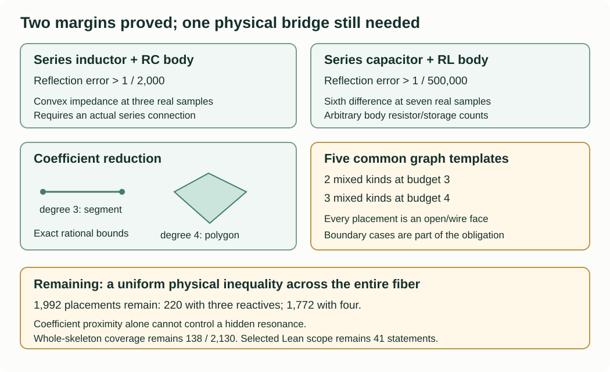

# Series margins, coefficient fibers and physical boundaries

The useful three- and four-reactive margin is still open. This continuation
adds two explicit series-class margins, a necessary inductor-type bound,
an exact quantitative reduction to a line or polygon, and a common template
for the remaining graph placements. Passive counterexamples show why the
reduction cannot be turned into a resonance guarantee by cancellation alone.

Throughout, $Z_H=(6s^2+3s+4)/(6s^2+2s+9)$,
$h=(Z_H-1)/(Z_H+1)$, the reference resistance is one, and
$S=(1/2,3/4,1,5/4,3/2,7/4,2)$. Real samples mean $s>0$;
the resonance statement below concerns $s=i$. These are distinct domains.

## Two series classes now have usable margins

For any finite positive ordinary network of either stated form,

$$Z(s)=\ell s+Z_{RC}(s),\quad \ell>0,
\qquad\text{or}\qquad
Z(s)=\frac{k}{s}+Z_{RL}(s),\quad k>0,$$

the maximum reflection error on $S$ is respectively greater than
$1/2000$ or $1/500000$. The RC or RL body may contain arbitrarily many
resistors and same-kind reactive branches. The series connection must be
actual: no resistor or other branch may bypass it. A positive series resistor
can be absorbed into the body. Open/short constant port cases are separated
directly, and floating components can be removed.

For an RC body the classical Stieltjes form is

$$Z_{RC}(s)=a+\frac{b}{s}+\sum_j\frac{c_j}{s+t_j},
\qquad a,b,c_j\ge0,\quad t_j>0.$$

Consequently $Z$ is convex on the positive real axis: the linear inductor
term has zero second difference, and each remaining nonconstant term has
nonnegative second difference. At the first three equally spaced samples,

$$Z(1/2)-2Z(3/4)+Z(1)\ge0,
\qquad
Z_H(1/2)-2Z_H(3/4)+Z_H(1)=-\frac{607}{43401}.$$

For an RL body write

$$Z_{RL}(s)=a+bs+\sum_j c_j\frac{s}{s+t_j},
\qquad a,b,c_j\ge0,\quad t_j>0.$$

Then $sZ$ is a polynomial of degree at most two plus a positive sum of
$t_j^2/(s+t_j)$ terms: use
$s^2/(s+t)=s-t+t^2/(s+t)$. Its sixth forward difference is nonnegative.
For $w=(1,-6,15,-20,15,-6,1)$ this gives

$$\sum_{j=0}^6 w_j s_j Z(s_j)\ge0,
\qquad
\sum_{j=0}^6 w_j s_j Z_H(s_j)
=-\frac{36810}{45903791}.$$

Here $\sum|w_js_j|=80$. The corresponding norm for the three-point
stencil is four. At every listed sample $-1<h(s)<0$. If
$|\Gamma(s)-h(s)|\le\delta\le1/2$, then

$$|Z(s)-Z_H(s)|
=\frac{2|\Gamma(s)-h(s)|}{|1-\Gamma(s)|\,|1-h(s)|}
\le4\delta.$$

The exact strict inequalities

$$16\left(\frac1{2000}\right)<\frac{607}{43401},
\qquad
320\left(\frac1{500000}\right)<\frac{36810}{45903791}$$

therefore prove the two margins. The replay verifies the rational stencil
identities, not merely a finite grid of pole locations. The Stieltjes
representations are the same classical dependency used in the preceding typed
results. No new historical priority is claimed.

These results complement the terminal-shunt classes. They do not add an
entire complete-resistor-core skeleton to the covered count: its freely
placed resistors can bypass a series element. Indeed the realizable bridge
with $L=C=R_1=R_3=1$, $R_2=2$ has one inductor and violates the convexity
stencil. Thus counting one inductor alone cannot justify the series proof.

## A type obstruction at a loss-free minimum

Suppose a finite positive ordinary network has exactly one inductor of value
$L$, any number of capacitors and resistors, finite positive $Z(0)$ and
$Z(\infty)$, and finite nonzero purely imaginary impedance at $i\omega$,
$\omega>0$. Assume the finite branch phasor solution exists there. Then

$$Z(i\omega)=-i\omega L.$$

This is a written structural theorem, with no restriction on capacitor count.
Here is a proof that makes the support assumptions explicit.

Orient the port current $I$ into terminal $a$ and out of $b$, and the
inductor current $I_L$ from $u$ to $v$. Since
$\operatorname{Re}(Z(i\omega))=0$, the power identity
$\operatorname{Re}(V\overline I)=\sum_R R|I_R|^2$ makes every resistor
current zero. Potentials are therefore equal within each connected component
of the resistor subgraph. Terminals $a,b$ belong to distinct such components,
since $V\ne0$.

At DC, capacitors open and the inductor shorts. Finite DC impedance requires
an $R+L$ path between the terminals. There is only one inductor, so it joins
the resistor component containing $a$ to that containing $b$. Choose its
orientation accordingly. Thus $V_u=V_a$ and $V_v=V_b$ at the minimum.

At infinity, inductors open and capacitors short. Positive infinite-frequency
impedance forbids a capacitor-only path from $a$ to $b$; finite impedance
requires an $R+C$ path between them. The capacitor components containing
$a,b$ are therefore distinct. Sum KCL over each capacitor component. Resistor
currents vanish, so its only possible nonzero external injections are at
$a,b,u,v$. Since $I\ne0$, the component of each terminal contains exactly
one inductor endpoint. All other capacitor components have no injections.

If the components pair $a$ with $u$ and $b$ with $v$, their two boundary
potentials agree. Dividing the capacitor equations by $i\omega$ gives a
positive weighted real Laplacian. With equal boundary potentials its harmonic
solution is constant; this also follows by summing weighted squared voltage
differences. All capacitor currents vanish, including on components without
injections. Since all resistor voltage drops already vanish, the required
$R+C$ path would give $V_a=V_b$, a contradiction. This also handles a terminal
coincident with its inductor endpoint and components consisting of one vertex.

The pairing must instead be $a$ with $v$ and $b$ with $u$. Summed KCL on
the first component gives $I+I_L=0$. The inductor voltage is the port voltage,
so $V=i\omega L I_L=-i\omega L I$, proving the assertion.

Applying $s\mapsto1/s$ to the same physical graph exchanges inductors and
capacitors with reciprocal values and swaps the two finite positive endpoints.
Real coefficients give complex conjugation at the corresponding positive
frequency. Thus a network with exactly one capacitor $C$ under the same
hypotheses has $Z(i\omega)=i/(\omega C)$. These statements do not assert that
all mixed one-inductor networks are regular.

For $Z_H(i)=i$, the one-inductor theorem requires at least two inductors
in any exact realization to which the stated finite phasor hypothesis applies.
It supplies no positive real-sample margin by itself. The blocked-resistor
step agrees with the classical minimum-function analysis in
[Hughes, Lemma 9](https://arxiv.org/pdf/1611.06258v2); the component pairing
argument above is supplied explicitly here and has only project self-review.

An exact control uses $R$ edges $(a,u),(b,v)$ and $C$ edges $(a,v),(b,u)$,
all values one, together with $L=1$ on $(u,v)$. It has endpoint impedances
two and one-half and $Z(i)=-i$. Exchanging $L,C$ gives $Z(i)=i$.
The replay solves both physical graphs independently; these controls do not
prove the universal argument or establish its historical priority.

## Seven samples reduce the coefficients to a line or polygon

Let $Z=P/Q$ have nonnegative coefficients and degree at most $q=3$ or $4$.
Normalize $P(1)+Q(1)=1$, retaining any common factor. The graph polynomial
argument in the preceding section supplies such a pair for an ordinary
network with at most $q$ reactive branches and arbitrary resistor count.

Exact agreement with $h$ at seven positive samples makes
$P Q_H-Q P_H$ vanish identically: its degree is at most $q+2\le6$.
The two target polynomials are coprime: their difference is $5-s$, and
$P_H(5)=169$. Hence

$$P=mP_H,\qquad Q=mQ_H,\qquad
\deg m\le q-2,\qquad m(1)=\frac1{30}.$$

For $q=3$, $m=a+bs$ and nonnegative coefficients are equivalent to
$a,b\ge0$, $a+b=1/30$. This is a closed segment. For $q=4$,
$m=a+bs+cs^2$ and the exact allowed region is

$$a,c\ge0,\qquad b\ge-2a/9,\qquad b\ge-c/3,
\qquad a+b+c=1/30.$$

These are all the restrictions. In the convolution coefficients, $Q_1$ and
$Q_3$ give the two lower bounds on $b$; those bounds imply the other middle
coefficients are nonnegative. Its four vertices in $(a,b,c)$ coordinates are

$$\left(\frac1{30},0,0\right),\quad
\left(0,\frac1{30},0\right),\quad
\left(0,0,\frac1{30}\right),\quad
\left(\frac3{130},-\frac1{195},\frac1{65}\right).$$

The multiplier itself can therefore have a negative coefficient. Assuming
all of its coefficients are nonnegative would omit a valid part of the fiber.

There is also a quantitative certificate. Write
$x=(P_0,\ldots,P_q,Q_0,\ldots,Q_q)$. A sample row is

$$\big((1-h)s^0,\ldots,(1-h)s^q,
-(1+h)s^0,\ldots,-(1+h)s^q\big).$$

For $q=3$ use sample indices $(0,1,2,3,5,6)$, the normalization row and
the coordinate $P_3$; for $q=4$ use all seven samples, the normalization
row and coordinates $P_3,P_4$. The resulting square matrices have exact
rational inverses, checked on both sides. Setting their sample entries to
zero and keeping the normalization and displayed free coordinates gives an
affine-fiber vector $y$. If the maximum sample error is $\delta$, then

$$\|x-y\|_\infty\le C_q\delta,\qquad
C_3=\frac{40341527}{4160}<9698,\quad
C_4=\frac{2009196425}{10368}<193789.$$

Indeed each sample entry has absolute value at most
$\delta\max(1,s^q)$, since $x$ is in the coefficient simplex. The constants
are weighted absolute row sums of the printed inverse. For degree three the
replay compares all seven choices of a six-sample subset and retains the
smallest bound within that construction; no global optimality is asserted.

The affine projection $y$ might have negative coefficients. This can be fixed
without silently treating it as a physical pair. Choose an interior fiber
vector $x_0$ with minimum coefficient $\rho>0$, and put

$$\epsilon=C_q\delta,\qquad
z=\frac{\rho y+\epsilon x_0}{\rho+\epsilon}.$$

Then $z$ is in the actual nonnegative normalized fiber. Since $x,x_0$ are
simplex vectors and every coordinate of $x_0$ is at least $\rho$,

$$\|x-z\|_\infty\le\frac{\epsilon}{\rho+\epsilon}.$$

The certificate uses $m_0=(1/50)+(1/75)s$, $\rho=2/25$, at degree three,
and $m_0=3/190+(2/285)s+(1/95)s^2$, $\rho=6/95$, at degree four.
This is a distance reduction, not a graph exclusion. Both physical necessity
and all cancellation faces still need a uniform separating inequality.

## Five common templates retain every remaining placement

For a fixed list of $q$ reactive kinds, give each branch two fresh endpoints
and keep two separate port nodes. Put a complete resistor core on these
$2q+2$ nodes. Allow each resistor to be finite, open or a wire. Every retained
reactive placement is an exact boundary face of this one template.

To see this, assign each copied endpoint to its original vertex. Choose one
copy as that vertex's anchor, using the port node when appropriate. Join all
other copies to the anchor by resistor wires. Place each original resistor
between the corresponding anchors; open all unused core positions. Contracting
the wires reconstructs every original reactive edge and every resistor
position. Arbitrary eliminated resistor-only vertices were already handled by
the preceding star-mesh reduction. Same-kind parallel and series simplifications
do not need to be assumed for this splitting argument.

Thus the mixed budgets three and four have five common templates, with
$(n_L,n_C)=(1,2),(2,1),(1,3),(2,2),(3,1)$. This consolidates the graph
placement obligations, but does not remove their continuous boundary cases.

The positive-real approximation to each boundary face is also justified.
Replace wires by resistance $\eta$, opens by conductance $\eta$, and keep
finite elements fixed. With the unit reference source, the nodal potentials
minimize

$$E_\eta(v)=(v_a-1)^2+\sum_{\text{finite }e}y_e(s)(\Delta v_e)^2
+\eta\sum_{\text{open }e}(\Delta v_e)^2
+\eta^{-1}\sum_{\text{wire }e}(\Delta v_e)^2.$$

The maximum principle bounds every potential between zero and one. A test
potential constant on every wire cluster bounds the minimum energy uniformly,
so each wire drop tends to zero. Every subsequential limit minimizes the
contracted energy: compare with any potential satisfying the wire constraints,
and drop the nonnegative wire penalty in the lower limit. The contracted
functional has a unique port potential, even if internal floating potentials
are nonunique, because its source term is strictly convex in $v_a$.
Consequently the port reflection converges. This applies at each of the seven
positive samples, including open or short limiting ports. It is not an
imaginary-axis continuity theorem.

The exact combinatorial replay checks all 2,130 mixed representatives at
budgets two through four, including the 1,992 still unresolved by usable
whole-skeleton margins. Five finite-positive approximation controls test the
implemented lifting. A separator valid only when all template resistors are
finite and positive would be insufficient unless its bound is uniform up to
these wire/open faces. Neither positive semidefiniteness of an unconstrained
port matrix nor a finite numerical resistor box supplies that missing proof.

## Passive examples block an unjustified resonance transfer

Start with the retained five-reactive exact physical realization of $Z_H$.
Add a positive series capacitor with $C=1/\epsilon$ to obtain
$Z_H+\epsilon/s$, or a series inductor with $L=\epsilon$ to obtain
$Z_H+\epsilon s$. Both are positive physical six-reactive networks of reduced
degree three. Their seven-sample reflection error is at most $4\epsilon$,
but the respective DC and infinite-frequency reflection errors are $18/13$
and one. Thus degree-three sample control alone does not control endpoints.

For the resonance take a parallel RLC one-port in series, with
$L=\epsilon$, $C=1/\epsilon$, $R=1/\epsilon$. The resulting physical
seven-reactive network has reduced degree four and impedance

$$Z_\epsilon(s)=Z_H(s)+\frac{\epsilon s}{s^2+\epsilon^2s+1}.$$

For every positive real $s$, the added impedance is at most $\epsilon/2$;
the reflection error is therefore at most $\epsilon$. Yet at $s=i$ it adds
$1/\epsilon$ to the impedance and

$$|\Gamma_\epsilon(i)-h(i)|^2
=\frac{2}{1+2\epsilon+2\epsilon^2}\longrightarrow2.$$

At $\epsilon=10^{-8}$ the real-sample error is below $10^{-8}$ while the
resonant reflection error squared exceeds $1.99$. The replay verifies the
physical graph against this formula using exact complex nodal arithmetic.
The additional denominator approaches the allowed multiplier $s^2+1$,
whose zero at $i$ makes naive cancellation unstable.

These examples respect passivity and the degree cap. They use six or seven
physical reactive branches, so they do not refute a separator for at most
three or four branches. They show exactly why the remaining argument needs
the physical reactive-count restrictions in addition to coefficient proximity.

## Current evidence and next obligation

`solver/check_coefficient_routes.py` replays the new inverse/projection,
polygon, shape, graph-lift and physical counterexample controls. A fresh
bounded run is retained in `verification/current-exact-006`; its source hashes
are observed before and after execution. The predecessor suites remain
byte-bound and are replayed by `solver/check_current_routes.py`.

The whole-skeleton covered count remains 138 of 2,130; the unresolved counts
remain 220 at budget three and 1,772 at budget four. Selected Lean coverage
remains forty-one statements. No physical measurement or new priority claim
is introduced. `PHASE4_REVIEW.json` records the project self-review and its
remaining proof obligation.

The next discriminator is a physically necessary inequality for the five
common templates that excludes a neighborhood of the entire coefficient
segment or polygon, including $m(0)=0$, degree-drop faces and $m(i)=0$.
Any proposed inequality must first survive the nonregular bridge, the two
minimum-function type controls, and the wire/open template faces. A bound
that assumes a denominator bounded away from zero at resonance must expose
and justify that additional hypothesis.
