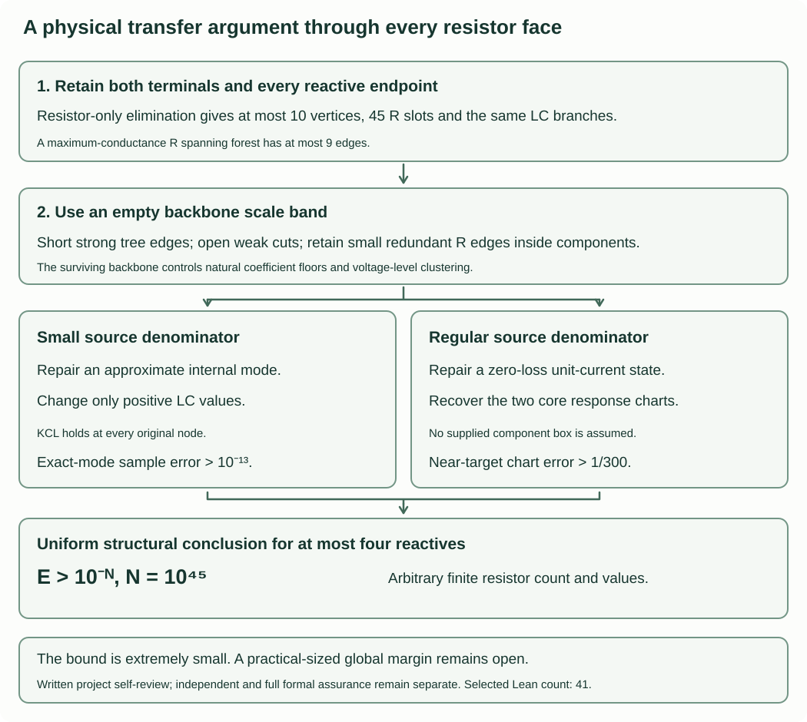

# A uniform physical bound through every resistor face

Author: Komorebi P.

The written argument has project self-review. Independent and complete formal
verification remain separate. The earlier global bound and classical exclusion
already exist; this is a quantitative internal derivation, with no priority claim.

Put

$$H(s)=\frac{4+3s+6s^2}{9+2s+6s^2},\qquad
\Gamma_Z=\frac{Z-1}{Z+1},\qquad
S=\{1/2,3/4,1,5/4,3/2,7/4,2\}.$$

Let $E=\max_{s\in S}|\Gamma_Z(s)-\Gamma_H(s)|$. All arguments s in S are real
Laplace arguments. Networks are finite positive ordinary uncoupled transformer-
free one-ports; resistor count and values are arbitrary.

**Theorem.** Every network with at most four reactive branches satisfies

$$E>10^{-10^{45}}.$$

This is still an extremely small structural bound. In particular
it is not the requested useful hardware separator or a new qualitative result.

## 1. A quantitative zero-loss chart, without a supplied component box

Suppose there are at most two L/two C, the natural denominator satisfies
$Q(i)\ne0$, and a unit-current state has zero resistor loss. Put

$$Z(i)=ia,\qquad Z'(i)=b,\qquad r_0=Z(0),\qquad r_1=Z(\infty).$$

If these four real data differ from $(1,5,4/9,1)$ by at most $h=10^{-3}$,
then $E>1/300$.

Here a,b are real. The derivative is bilinear as in REGULAR_BALANCED.md.
Its support proof generalizes as follows. Positive finite endpoints exclude a
direct LC port edge. A forest with fewer than four active edges must be a port
path; both terminal levels must repeat, or an unavoidable terminal series LC
edge makes an endpoint infinite. The only three-edge repeat pattern has levels
0,a,0,a and jet b=3a. A three-edge cyclic support has three distinct levels and
only one-anchor off-support attachments, hence a pure LC response with no
finite positive DC limit. Separate active circulations require at least four
edges. Since b is near5 and a near1, b=3a is impossible. All four LC are active.

As in the prior proof, any three equal-level active vertices form an independent
set of degree sum at least5, impossible with four edges. Resistor components
therefore reduce to at most two disjoint two-terminal R links. Distinct finite
positive endpoints force exactly two links. The five-vertex disconnected path
and parallel-LC-cycle case has equal endpoints and is excluded. The remaining
cases are a five-vertex port path or a four-vertex three-block path with an
outer block doubled. A doubled middle CC block gives b=3a and is excluded.

The connected forest pairings A and C give, up to path/port reversal and swapping
an unbranched terminal LC order, the physical values

$$L_1=a,\quad C_1=1/a,\quad L_2=(b-a)/2,\quad C_2=2/(b-3a),
\qquad R_a=r_1-r_0,\quad R_b=r_0.$$

Pairing B would give b=3a. The cyclic case gives

$$L_1=\frac{2a^2}{b-a},\quad C_1=\frac{b-3a}{2a^2},\quad C_2=1/a,
\quad L_3=a,\quad R_a=\frac{r_0r_1}{r_1-r_0},\quad R_b=r_1,$$

up to port reversal. These are global algebraic recovery formulas on this
zero-loss stratum, not inverse-chart surjectivity assumptions. In the stated
feature box all denominators are positive. Direct rational inequalities bound
each physical component's relative change from its corresponding nominal
forest/cyclic core by at most10h<=1/100. The nominal sample errors are5175/65083
and25/2769. The established positive-real relative comparison gives

$$E\ge\frac{25}{2769}-\frac1{198}>\frac1{300}>\frac1{1000}.$$

This chart lemma requires the exact zero-loss state, but does not assume in
advance that the physical components lie in a local core box.

For clarity, bounds on the relative component errors in the order listed above
are (h,2h,h/2,3h,4h,3h) for the forest and (3h,5h,2h,h,5h,h) for the cyclic
case. They follow by the triangle inequality and the denominator bounds
a>=1-h, b-a>=4-2h, b-3a>=2-4h and r1-r0>=5/9-2h. In the cyclic R_a bound,
the error numerator is at most(97/9)h+5h² and the denominator at least
4(5/9-2h), giving a relative error below5h at h<=$10^{-3}$.

## 2. Resistor backbones replace lower bounds on redundant R edges

Fix 0<α<=$10^{-16}$. Consider a connected port graph with at most ten vertices,
at most45 R slots and at most two L/two C. Require every reactive value to lie
in[α,1/α]. Every resistor conductance is at most1/α; there is no
lower bound on redundant R conductances. Instead require that each connected
R component has a spanning tree whose conductances are at least α.

Each positive coefficient of a natural tree/two-forest polynomial has a
monomial completion using only backbone R edges. Indeed fix the reactive
subset from an existing monomial. It is an independent edge set. Replacing
the R graph by a spanning forest preserves its component partition, and
therefore the connectivity needed to complete that same reactive subset to
a spanning tree. For the terminal-separating two-forest, first adjoin a forced
artificial edge between the ports and use the same tree completion argument.
This also preserves the exact reactive subset, hence its power of s.

Every such product has at most9 factors, each at least α. Each raw
coefficient is at least $\alpha^{9}$ when nonzero. There are at most2^49 edge subsets
in either sum, each product at most $\alpha^{-9}$. After normalization by
P(1)+Q(1)=1, every positive coefficient is at least

$$\frac{\alpha^{18}}{2^{50}}\ge\alpha^{20}.$$

Common factors, including common powers of s, are not cancelled. The natural
pair has nonnegative coefficients and degree at most four. For completeness,
the tree/forest formulas follow from Cauchy-Binet applied to the grounded
incidence matrix: squared full-rank minors are1 for the required trees or
two-forests and0 otherwise.

## 3. A small real residual can be repaired by changing only LC values

Use incidence orientation with port injection b=(+1 at1,-1 at0). At i,
A=G+iM, M is the sum of C minus1/L incidence rank-one terms. Its grounded
infinity norm is at most8/α. Let x be a real nodal potential, x0=0.
In the mode case b=0 and require |x1|<=h; in the driven case the injection
is b and |x1-1|<=1/4. Suppose

$$\|Mx+b\|_\infty\le h,\qquad
\max_{e\text{ in the R backbone}}|d_ex|\le h,\qquad
h\le\alpha^{6t+10},\quad t\ge10.$$

Take T_j=α^(t(j+1)), j=0,...,5. Among the five disjoint bands
(T_(j+1),T_j], at least one contains none of the at most four LC voltage-drop
magnitudes. Call its upper/lower thresholds Tlarge,Tsmall. Active LC have
|drop|>Tlarge and the rest have |drop|<=Tsmall.

Partition vertices by all R components and all inactive LC edges. Assign one
constant potential φ per class: retain x1 on the class containing port1 in
the driven case, set the ground class to0, set both port classes to0 in the
mode case, and otherwise use one original class vertex value. In the driven
case the two ports cannot share a class: their original difference is near1,
whereas a class diameter is at most100*Tsmall. In either case

$$\|\phi-x\|_\infty\le100T_{\rm small}\le\alpha^{-1}T_{\rm small}.$$

Use R-backbone paths of length at most9 between inactive LC links to obtain
this bound; no individual lower bound on a redundant R edge is used. Active
LC drops remain at least Tlarge/2. All inactive LC and all R drops are zero.
The signed LC flow is f_e=drop/L for L and -C*drop for C. Its divergence differs
from b by at most $\alpha^{-2}$*Tsmall in each grounded coordinate: the bound is
h+(8/α)*100*Tsmall <=(801/α)*Tsmall <=$\alpha^{-2}$*Tsmall.
A spanning-forest correction of the active LC graph changes each flow by at
most9 times that grounded residual bound. In a driven component
containing only one port, a component residual sum would have absolute value1,
which is impossible since nine residuals have sum less than1.

Correct the tree flows by the sums of residuals on their subtrees. This makes
every original node's KCL exact, not merely quotient KCL. Divide each corrected
flow by its nonzero active voltage drop with its L/C sign. The resulting
positive coefficient k'_e differs relatively from k_e by at most α^(t-5);
the physical L/C value differs by at most α^(t-6). Inactive LC are kept.
Thus G φ=0 and M'φ=-b exactly. All R values and every endpoint operation
remain unchanged. In the mode case require ||x||_∞>=1/sqrt(18), so φ
is nonzero. This constructs an actual internal port-zero mode.

## 4. Bounded-backbone separator

**Bounded-backbone lemma.** Under the section 2 conditions, $E>\alpha^{10000}$.
Suppose $E\le\alpha^{10000}$, write $\delta=E$, and use the normalized natural P,Q.
The exact seven-node Vandermonde inverse has infinity norm12800. At every node,
|Δ(s)|<=568 delta for Δ=P Q_H-Q P_H. Consequently every coefficient
of Δ is at most7270400 delta<$\alpha^{-1}$ delta. In particular

$$|\Delta(i)|,\ |\Delta'(i)|\le\alpha^{-2}\delta.$$

The positive-coefficient floor implies P,Q have the same actual lowest order
and the same actual highest degree. Otherwise the first/last cross coefficient
has absolute value at least4 $\alpha^{20}$ or6 $\alpha^{20}$. Thus both endpoints are
finite positive, and each differs from its target by at most $\alpha^{-21}$ delta.

Let $n$ be the grounded matrix dimension, so $1\le n\le9$, and let $e$ be
the grounded unit coordinate vector at terminal 1. The injection vector in
the node equations is this vector with its ground return. Set

$$D=P+Q,\qquad B=A+ee^T,\qquad K=\det B(1).$$

The natural normalization is $P=s^{n_L}\det A_D/K$ and
$Q=s^{n_L}\det A/K$, so $|\det B(i)|=K|D(i)|$.
The backbone argument and matrix norms give
$\alpha^9\le K\le\alpha^{-18}$. Split at $|D(i)|=\alpha^{2000}$.

### Small natural driven denominator

If |D(i)|<=$\alpha^{2000}$, B(i) has a unit complex vector w with
||B(i)w||_2<=|det B(i)|^(1/n)<=$\alpha^{220}$, since n<=9 and1982/9>220.
The nonnegative energy $w^*(G+ee^T)w$ is at most that residual.
Choose the real or imaginary part x with infinity norm at least1/sqrt(18).
Then its port value and backbone drops are tiny. The real/imaginary equations
give ||Mx||_∞<=48 sqrt($\alpha^{220}$/α). These bounds satisfy section3
with t=10 and h<=$\alpha^{70}$. Its correction gives a physical internal mode by
relative LC changes <=$\alpha^{4}$. The established singular-face theorem gives
E_new>$10^{-13}$, whereas relative positive-real comparison gives
E_new<=delta+$\alpha^{4}$/[2(1-$\alpha^{4}$)]<$10^{-13}$. Contradiction.

### Regular driven denominator

If |D(i)|>$\alpha^{2000}$, use Q=(Q_H D-Δ)/(P_H+Q_H) at i. Since
|Q_H(i)|/|(P_H+Q_H)(i)|=1/sqrt(2), it follows that |Q(i)|>=$\alpha^{2001}$.
Then

$$|Z(i)-i|\le\alpha^{-2003}\delta,\qquad |Z'(i)-5|\le\alpha^{-4006}\delta.$$

A cofactor bound gives ||A(i)^-1||_∞<=$\alpha^{-2030}$: its determinant has
absolute value at least $\alpha^{2010}$, its dimension at most9, and its entries/
row norms are bounded by $\alpha^{-2}$. For the unit-current state v=x+i y, put
ell=Re Z(i)>=0. Resistor energy bounds each R current by sqrt(ell/α)
and each backbone drop by sqrt(ell/α). The equations Mx=-Gy and
A x=Gx-iGy imply

$$\|x\|_\infty,\quad\|My+b\|_\infty,\quad
\max_{e\text{ in the R backbone}}|d_ey|
\ \le h=\alpha^{-2040}\sqrt{\ell}.$$

With $\delta\le\alpha^{10000}$, we have $\ell\le\alpha^{7997}$ and
$h\le\alpha^{1958}<\alpha^{70}$. Apply section 3 with $t=10$ to $y$. The new
state is $i\phi$, with $\phi_1=y_1$ and relative physical LC errors at most
$\alpha^4$. Its R-only
endpoint limits are exactly unchanged.

If the new nodal matrix is singular, existence of the driven solution makes
every kernel vector port-zero (the kernel is ker G intersect ker M); the
singular-face margin gives the preceding contradiction. Otherwise it is regular.

The positive first jet controls the reactive currents. Write each original
LC current as $I_e=u_e+iv_e$, and put $w_e=L_e$ or $1/C_e$. Since the real
nodal potential is at most $h$, we have $|v_e|\le2h/\alpha$. Therefore

$$\sum_e w_ev_e^2\le16h^2/\alpha^3<1.$$

The exact bilinear identity gives

$$\operatorname{Re}Z'(i)=\sum_e w_e(u_e^2-v_e^2),$$

which is within $\alpha^{5994}$ of 5. Hence $\sum_e w_eu_e^2<7$ and
$\sum_e w_e|I_e|^2<8$. In particular $|I_e|\le\alpha^{-1}$.
The flow correction changes the real part of the branch current by at most
$\alpha^{-3}T_{\rm small}$; its removed imaginary part is at most $2h/\alpha$.
Because the largest $T_{\rm small}$ is $\alpha^{20}$,
$|I_{\rm new}-I_{\rm old}|\le\alpha^{16}$ and $|I_{\rm new}|\le2\alpha^{-1}$.
The physical relative error $\alpha^4$ changes each weight relatively by at
most $2\alpha^4$. Thus $\sum_e w_e|I_{\rm new}|^2<17$ and

$$|Z'_{\rm new}(i)-Z'_{\rm old}(i)|\le34\alpha^4+12\alpha^{14}<\alpha^2.$$

All four new features are within $\alpha$ of $(1,5,4/9,1)$, so section 1 gives
$E_{\rm new}>1/300$. Positive-real comparison gives

$$E_{\rm new}\le\delta+\frac{\alpha^4}{2(1-\alpha^4)}<\frac1{1000},$$

a contradiction.

## 5. A nine-edge scale gap removes the resistor bounds

Eliminate only R-only internal vertices, retaining all reactive endpoints and
both terminals. This is a frequency-independent Laplacian Schur complement,
leaves the LC branches intact and gives at most ten vertices and45 R slots.

If E is as small as the global threshold, the inherited all-three-
reactive margin and one-edge positive-real rounding force every useful L/C into
[eta,1/eta], eta=2e-14. Otherwise opening/shorting one extreme reactive changes
Γ by at most4eta<1e-13 and leaves at most three reactives. Open/short ports
are compared directly. Nonbalanced four-reactive classes use their existing
stronger one-kind margins. It remains to consider exactly two L/two C.

Choose a maximum-conductance spanning forest T of the R graph. It has at most
nine edges. Put $B_0=10000$, $K_0=B_0+1$ and
$\alpha_j=(10^{-16})^{K_0^j}$ for $j=0,\ldots,10$.
Among ten disjoint bands (α_(j+1),α_j], one contains none of
min(g_e,1/g_e), e in T. Write a=α_j, c=α_(j+1)=a^K0.

Short T edges with g>=1/c; their total resistance is at most9c. Let the
moderate R components be those connected by T edges with g>=a. Delete every
R edge crossing different moderate components. Each such conductance is at
most c, by the maximum-spanning-forest bottleneck property and the empty band.
Any retained nonloop R edge has conductance at most1/a: a larger conductance
would force every T edge on its path to exceed1/a and hence to be at least1/c,
making its ends part of the same contracted component. Each remaining R
component retains a spanning tree with conductances at least a. Keep parallel
R slots distinct after contraction, so the per-slot upper bound is preserved.
Remove LC loops or detached parts; if the useful reactive count drops, use the
inherited three-reactive bound. Otherwise the section2 model applies.

Positive-real R surgery changes Γ by at most
2(9+45)c<=200c. Consequently E_rounded<=E+200a^10001.
For j<=9 and E<=$10^{-10^{45}}$, exact integer exponent comparison gives

$$E<\tfrac14\alpha_9^{10000}\le\tfrac14 a^{10000},
\qquad200a^{10001}<\tfrac14a^{10000}.$$

Thus E_rounded<a^10000, contradicting section4. This closes the uniform transfer implication with a very weak explicit structural margin.

## Review scope and the remaining program

The separate review checks backbone coefficient completion, empty-band
boundaries, parallel R slots, original-node KCL, the endpoint/jet bounds and
the global feature chart. Finite experiments test implementations and exact
constants; they do not replace this universal argument. Even with this bound, independent/formal assurance, practical-sized global margin,
arbitrary-target synthesis, degree-six resistor minimum, broader physical data
and global priority remain separate.

## Checkable regions and execution scope

The global proof uses extremely small theoretical thresholds. A separate
producer/consumer in `solver/backbone_transfer.py` checks supplied exact
physical modes or zero-loss near-target states, actual LC changes, and R
opening/shorting budgets. With the larger feature box of radius1/1000 it can
use the strict baseline1/300. Its graph, rational and JSON resource caps are
execution limits, not hypotheses of the unbounded theorem. Outside a chart
or with nonpositive slack it reports `INCONCLUSIVE`. It does not infer a
measurement or an imaginary-frequency tolerance from positive-real samples.
