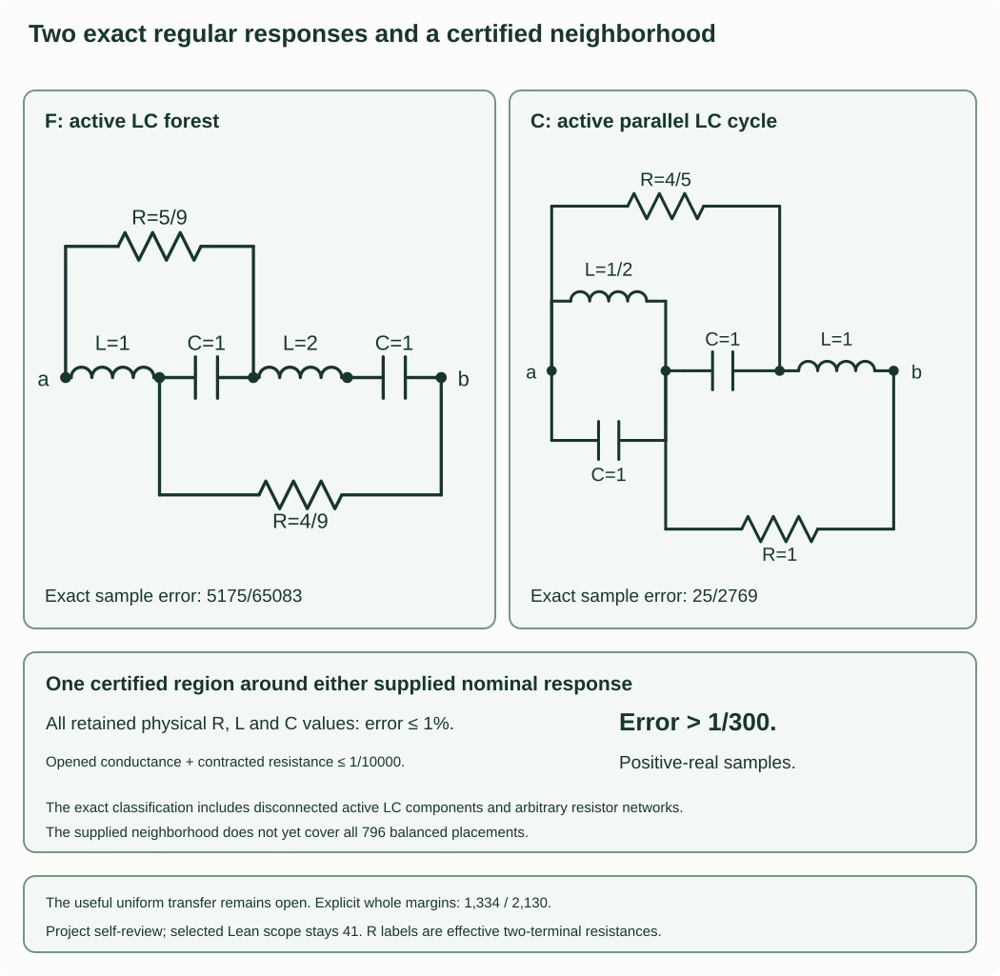

# The regular balanced response has two exact forms

The classification and comparison proofs have project self-review.
Independent and complete formal verification remain separate.



The balanced problem now has a tractable exact-data stratum. Consider a
finite positive ordinary uncoupled RLC one-port with at most two L and two C,
arbitrary finite resistor count and values, and distinct terminals. Remove
loops and components detached from the port component. Its natural pair is
$P=s^{n_L}\det A_D$, $Q=s^{n_L}\det A$, up to one common positive scale.
Assume

$$Q(i)\ne0,\qquad Z(i)=i,\qquad Z'(i)=5,
\qquad Z(0)=\frac49,\qquad Z(\infty)=1.$$

The endpoints are limits on the positive-real Laplace axis. Then its rational
impedance is exactly one of

$$Z_F(s)=\frac{36+121s+198s^2+222s^3+162s^4}
{81+126s+344s^2+126s^3+162s^4},$$

$$Z_C(s)=\frac{8+14s+21s^2+14s^3+4s^4}
{18+23s+22s^2+14s^3+4s^4}.$$

The first has an active LC forest; the second has an active parallel LC
cycle. The support is a multigraph: two parallel active branches count as a
cycle. The complete resistor network reduces to two positive resistor links.
No assumption that the active LC graph is connected is made.

Normalize the reference resistance and resonant frequency to one, and write
$\Gamma_Z=(Z-1)/(Z+1)$. For the same seven samples
$S=\{1/2,3/4,1,5/4,3/2,7/4,2\}$ and target
$Z_H=(4+3s+6s^2)/(9+2s+6s^2)$, put
$E_S(Z)=\max_{s\in S}|\Gamma_Z(s)-\Gamma_{Z_H}(s)|$.
Their maximum reflection errors are

$$E_S(Z_F)=\frac{5175}{65083},\qquad
E_S(Z_C)=\frac{25}{2769}.$$

Thus this exact-data stratum satisfies $E_S\ge25/2769$. These hypotheses
are stronger than a small seven-sample error. This is not yet a useful
uniform margin for all 796 balanced placements; explicit whole-margin
coverage remains 1,334/2,130. The older written global bound and classical
exclusion are already discussed in the compact-model audit. No new priority
or independent/formal verification claim is made here.

## Loss, active currents and the derivative

Use unit port current from terminal1 to terminal0. Since $Q(i)\ne0$ and
$i\ne0$, the grounded nodal matrix is invertible. Its driven state is unique
and analytic near $i$. The real-power identity gives

$$0=\operatorname{Re}Z(i)=\sum_R R|I_R|^2.$$

Every resistor current and voltage drop therefore vanishes. A reactive branch
is called active when its current at $i$ is nonzero; every other branch has
zero voltage drop. There is no active loop edge. KCL gives active degree at
least two at every internal active vertex and degree at least one at each
port. The two ports lie in the same active component: summing KCL on a
component containing exactly one port would leave a nonzero injection.
Any other active component has minimum degree at least two.

With $m$ active edges, the port component has at most one more vertex than
edges, and each other component has at most as many vertices as edges.
Hence there are at most $m+1\le5$ active vertices. This includes disconnected
circulation cycles. It does not delete their zero-current R connections.

For oriented incidence matrix $B$, write $BI=b$, $BI'=0$ and $zI=B^Tv$.
Differentiating $Z=\sum_e z_e I_e^2$ cancels the two current-derivative terms:
$\sum z_e I_e I'_e=v^TBI'=0$. Thus

$$Z'(i)=\sum_L L I_L(i)^2+\sum_C\frac{I_C(i)^2}{C}.$$

This is a bilinear identity without conjugation. The loss identity uses
absolute squares. The distinction matters. Regularity also makes the
unit-current potentials purely imaginary: writing $A(i)=G+iM$, the loss
identity gives $Gv=0$ and $Mv=-ib$. Therefore the real part of $v$ lies in
$\ker G\cap\ker M$, and invertibility makes it zero.

## Fewer than four active branches are impossible

A direct LC edge between the ports is excluded. For real $s>0$, Rayleigh
comparison gives $0<Z(s)\le z_e(s)$. A direct L makes $Z(0)=0$; a direct C
makes $Z(\infty)=0$. Both contradict the positive target endpoints.

First suppose the active support is a forest. Pruning non-port leaves using
KCL shows that it is one simple port path; no source-free forest component
can remain active. Each path current is $\pm1$. Put $x=L$ for L and
$x=1/C$ for C, and measure cumulative path voltage drops in units of $i$.
Their levels $p_0=0$, $p_m=1$ have successive signed differences $+x$ for L
and $-x$ for C. The derivative identity gives

$$\sum_{\rm path}L=3,\qquad \sum_{\rm path}1/C=2.$$

Each non-path connected component uses only zero-drop edges, so it touches
only equal-level path vertices. If a terminal level occurs at only one path
vertex, all such attachments there are one-anchor networks. For every real
$s>0$, positivity and Dirichlet-energy uniqueness make an entire one-anchor
network constant, so it can be removed as a rational-response identity.
The terminal LC edge is then in series with a passive remainder. It forces
infinite impedance at one endpoint. Both terminal levels must therefore
repeat among path vertices. This argument permits inactive LC in the
one-anchor networks; it does not delete individual inactive LC branches.

Repetition is impossible for paths of length at most two. At length three
it forces levels $(0,1,0,1)$, giving L-C-L with values all one and derivative
three, contradicting five. Thus a forest must have all four LC edges active.

If $m\le3$ and the support has a cycle, the port component needs at least
two edges because direct port edges are excluded. A second cyclic component
would need at least two more. Hence the support is connected. A loopless
connected cyclic graph with at most three edges and nonadjacent ports must
be a parallel pair plus one tail, on three vertices. All three potentials
are distinct: adjacent active vertices differ, and the ports differ. Every
off-support component, including any unused LC, is consequently one-anchor
and removable for $s>0$. What remains is a pure LC network. Its nonzero
rational impedance is odd, since $A(-s)=-A(s)$. A finite limit at zero of an
odd rational function is zero, contradicting $Z(0)=4/9$. This disposes of
every smaller active support. All four LC branches must be active.

## Arbitrary resistor networks reduce to two links

All non-active edges are now R. A potential level can contain at most two
active vertices. Indeed, three equal-potential active vertices are an
independent set in the active multigraph and contain at most one port.
Their degree sum would be at least $1+2+2=5$, whereas only four edges can
meet that independent set. This is impossible.

A resistor component touches only one potential level. With one active
anchor it is removable; with two it is exactly a finite positive resistor.
For the latter assertion, impose unit voltage at its two anchors. The
Dirichlet minimum is finite and strictly positive by connectedness, so its
reciprocal is a finite positive resistance. Eliminating its internal nodes
preserves its boundary currents. Parallel contributions combine. Since
each potential level has at most two active anchors, the resulting R links
have disjoint endpoint pairs. At most five active vertices give at most
two such links.

There must be exactly two. With zero or one effective R, the DC and
infinite-frequency resistor graphs have finite positive impedance only
when they use the same sole resistance. They cannot have different finite
values $4/9$ and $1$. Here endpoint graphs are physical L-short/C-open and
C-short/L-open limits. For completeness, for fixed positive real port
voltage all nodal potentials lie in $[0,1]$. A test potential constant on
shorted clusters bounds the energy whenever the ports do not short;
minimizing potentials then approach those cluster constraints, while open
edge energies vanish uniformly. This proves the stated endpoint operation.
A shorted port has zero impedance and a disconnected port infinite impedance.

Consequently there are four or five active vertices and two disjoint R links.

## Five active vertices give the forest response

If connected, four active edges on five vertices form a tree and KCL makes
it a port path. Each level has at most two vertices. Both port levels must
repeat by the terminal argument, so the two R links cover both ports.
With path vertices0,...,4 the only possible pairings are

$$A:(0,2),(1,4),\quad B:(0,3),(1,4),\quad C:(0,3),(2,4).$$

For signed drops $d_j$, $\sum d_j=1$. Pairing A gives
$d_1=1,d_2=-1,d_3+d_4=1$. The L and inverse-C totals3 and2 leave only
LCLC with magnitudes $(1,1,2,1)$ or LCCL with $(1,1,1,2)$.
The R values are $a=5/9,b=4/9$: DC uses $b$ and infinity uses $a+b$.
Pairing C reverses these paths and R values. Pairing B forces
$d_1=d_4=1$, consuming the two L with total two rather than three.
It is impossible. The two A paths differ by interchanging a terminal series
LC pair at a degree-two vertex of the reduced graph, and the C paths reverse
the ports. All four therefore have the displayed response $Z_F$.

If disconnected, the port component has a two-edge path and the other
component a parallel two-edge cycle. KCL on that cycle forces a tuned LC
pair. The port path is also LC: a same-kind path would short one endpoint.
Its three potentials are distinct. Both degree-one port levels must repeat
to avoid an unavoidable terminal series LC edge, so the R links join each
port to a different cycle vertex. The network is a series LC path in parallel
with an R--parallel-LC--R path. At both endpoints the first path opens and
the parallel LC pair shorts, leaving the same R sum. The target endpoints
differ, a contradiction. The disconnected cycle is accounted for rather
than being discarded on the basis of zero R current.

## Four active vertices give the cyclic response

The two R links use all four vertices as two equal-potential pairs. Each
pair contains one port, so the potential levels are precisely $i$ and zero.
Active LC edges run between pairs. The port-to-port edge is excluded, leaving
only three possible cross-pairs. To connect the ports, every cross-pair must
occur: the weak graph is a three-block port path with one block doubled.
The block voltage drops are $i,-i,i$ and the net current in each block is one.

If the middle block is doubled, the two outer single L are both one. The
budget leaves a parallel pair of C in the middle, with total capacitance one.
Its derivative contribution is one, so the total derivative is three. This
case is excluded. If an outer block is doubled, the other outer single L
and the middle single C are one. A parallel LL block would exceed the L
budget and CC has the wrong sign. The doubled block must be parallel LC.
Its value and derivative equations are

$$1/L-C=1,\qquad 1/L+C+2=5,$$

so $L=1/2,C=1$. Up to reversing ports this is

$$L_{12}=1/2,\ C_{12}=1,\ C_{23}=1,\ L_{30}=1,
\quad R_{13}=4/5,\ R_{20}=1.$$

Indeed DC gives $R_{13}\parallel R_{20}=4/9$ and infinity gives $R_{20}=1$.
Direct nodal calculation gives $Z_C$. These arguments cover all possible
active supports, including same-kind parallel branches and disconnected
components. The independent finite support iterator supplies 18 port-fixed
types after the stated filters, not a search over arbitrary component values.

## Exact separation and the physical singular face

For the displayed primitive coefficient pairs,

$$P_FQ_H-P_HQ_F=414s(s^2+1)^2,
\qquad P_CQ_H-P_HQ_C=-4s(s^2+1)^2.$$

Neither response equals $Z_H$; the exact seven-sample errors above follow
by fraction arithmetic. In particular $5175/65083>25/2769>0$.
An exact balanced realization with natural $Q(i)=0$ would also have $P(i)=0$
because its reduced response is finite at $i$. The preceding internal-mode
theorem already separates that physical singular face. Thus the present
classification supplies a structural alternative for the exact regular
case; it does not by itself give the desired useful global approximation bound.

## A certified neighborhood of either regular core

Let a finite nominal graph lie in the exact-data stratum. Starting from an
actual graph, open specified R edges and contract specified R edges to obtain
the same remaining branch graph as the nominal graph. Suppose every retained
physical R,L,C value differs from its nominal value by at most relative
$\epsilon<1$. Put

$$b_R=\sum_{\rm opened}1/R+\sum_{\rm contracted}R.$$

Then on every positive-real Laplace sample,

$$|\Gamma_{\rm actual}-\Gamma_{\rm nominal}|
\le \frac{\epsilon}{2(1-\epsilon)}+2b_R.$$

The relative term is the preceding all-component Dirichlet comparison. For
the surgery terms, drive the positive-real network through the unit reference
resistor from voltage one. Nodal voltages lie in $[0,1]$. A voltage-level cut
shows each branch current has magnitude at most total source current, hence
at most one. The sensitivity identities are

$$\frac{\partial\Gamma}{\partial g_e}=-2(\Delta v_e)^2,
\qquad \frac{\partial\Gamma}{\partial R_e}=2i_e^2.$$

For the second, combine the unit-current Thomson derivative with the reference
source-current factor. Integrating $g_e$ down to zero costs at most $2g_e$;
integrating $R_e$ down to zero costs at most $2R_e$. At the endpoints the
same positive-real energy argument identifies deletion or contraction,
including open/short ports. Sequential surgery and the triangle inequality
give the claimed sum without a branch-count factor.

Therefore $E_S\ge25/2769-\epsilon/(2(1-\epsilon))-2b_R$. In particular,

$$\epsilon\le1/100,\quad b_R\le1/10000
\quad\Longrightarrow\quad
E_S\ge\frac{25}{2769}-\frac1{198}-\frac1{5000}>\frac1{300}.$$

This is a supplied physical neighborhood, not an automatic consequence of
small normalized natural determinants or small real-sample fitting error.
It uses all-component relative bounds, including retained resistors. The
consumer has explicit resource caps separate from the arbitrary-finite-graph
theorem. The comparison is on $s>0$; no imaginary-frequency or measured
hardware tolerance claim follows. The missing uniform regular/mode transfer,
independent review and complete formal assurance remain explicit.

From the unified source directory, produce and consume the worked certificate:

```text
python -B solver/regular_balanced.py solver/regular_core_example.json --output regular-certificate.json
python -B solver/regular_balanced.py regular-certificate.json --verify
```

The consumer checks the nominal rational response directly against the two
displayed cores, then recomputes every physical budget and the requested
strict margin. Changed data or certificate fields are rejected. A valid
budget with nonpositive slack returns `INCONCLUSIVE`, with no strict margin.
The implementation accepts rational inputs within caps of 64 nodes, 256
edges, 256 bits per numerator/denominator and 512 KiB of JSON. Those caps
limit the consumer, not the arbitrary-finite-graph mathematical statement.
