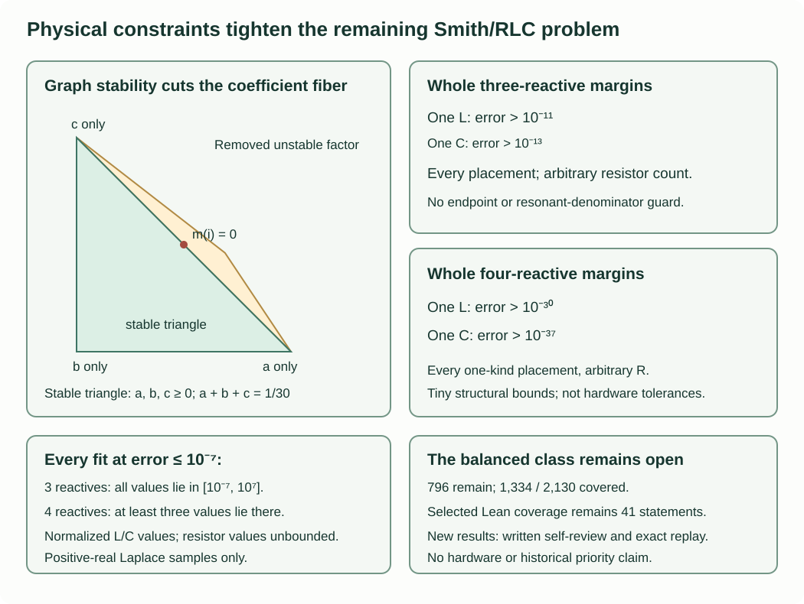

# Physical stability and quantitative one-inductor constraints

The coefficient reduction now has an additional physical constraint. The
natural graph polynomials have no right-half-plane zeros, so the limiting
degree-four multiplier lies in a triangle inside the preceding quadrilateral.
A one-inductor energy inequality gives explicit margins on stated coefficient
regions. A separate branch-rounding theorem bounds the reactive values in
every sufficiently accurate three/four-reactive fit. These results retain all
resistor counts and placements. The whole one-L/one-C theorem above combines
these intermediate bounds to remove the regional guards.

Use the same target $P_H=6s^2+3s+4$, $Q_H=6s^2+2s+9$,
$Z_H=P_H/Q_H$, reflection $h=(Z_H-1)/(Z_H+1)$ and seven positive-real
Laplace samples $S$ as above. The reference resistance and resonant frequency
are normalized to one. All new proof audits are project self-review.

## The natural graph pair has a stability constraint

Discard components disconnected from the port component, and handle open
ports separately. For a connected ordinary positive graph, ground terminal
zero and let $A(s)$ be its nodal admittance matrix. Every branch admittance
$1/R$, $sC$ or $1/(sL)$ has positive real part when $\operatorname{Re}s>0$.
For every nonzero grounded potential vector $v$,

$$\operatorname{Re}(v^*A(s)v)
=\sum_e\operatorname{Re}(y_e(s))|\Delta v_e|^2>0.$$

Connectedness makes the inequality strict. The same argument applies to the
principal minor $A_D(s)$ obtained by fixing both terminal potentials: every
remaining component has a path to a fixed terminal. Thus both determinants
are nonzero in the open right half-plane. The empty Dirichlet minor has
determinant one, so it is included.

The natural impedance pair is

$$P(s)=s^{n_L}\det A_D(s),\qquad
Q(s)=s^{n_L}\det A(s),\qquad Z=P/Q.$$

Normalize by $P(1)+Q(1)=1$. The spanning-tree/forest argument already used
above gives nonnegative real coefficients and degree at most the reactive
count. Multiplication by $s^{n_L}$ introduces no right-half-plane zero.
Consequently every root of each nonzero natural polynomial is in the closed
left half-plane. This assertion concerns the graph pair, including its
common factors; passivity of the cancelled rational function alone is weaker.

For any real polynomial of degree at most four with those roots and positive
leading coefficient, factor the real roots into nonnegative linear factors
and pair conjugate roots into quadratic factors with nonnegative coefficients.
Grouping gives

$$p(s)=(As^2+Bs+C)(Ds^2+Es+F),
\qquad A,B,C,D,E,F\ge0,$$

with constant or linear factors allowed. Define, padding missing coefficients
by zero,

$$\mathcal H(p)=p_3p_2p_1-p_4p_1^2-p_3^2p_0.$$

An exact polynomial identity proves the necessary inequality

$$\mathcal H(p)=BE\bigl((AF-CD)^2+(AE+BD)(BF+CE)\bigr)\ge0.$$

No converse for weak Hurwitz inequalities is asserted. In particular, a
boundary polynomial can satisfy this one inequality and still be unstable.

On the target fiber $P=P_H(a+bs+cs^2)$ the same identity becomes

$$\mathcal H(P)=3bG,\qquad
G=(6a-4c)^2+(6b+3c)(3a+4b).$$

In the preceding nonnegative coefficient quadrilateral,
$a,c\ge0$, $b\ge-2a/9$, $b\ge-c/3$ and $a+b+c=1/30$.
If $b<0$, then $a,c>0$ and

$$6b+3c\ge c,\qquad 3a+4b\ge19a/9.$$

Moreover

$$\begin{aligned}
&(6a-4c)^2+\frac{19}{9}ac-\frac12(a+c)^2\\
&\qquad=\frac{71}{2}\left(a-\frac{422}{639}c\right)^2
+\frac{197}{11502}c^2\ge0.
\end{aligned}$$

Hence $G\ge(a+c)^2/2\ge1/1800$ when $b<0$.
The necessary condition $\mathcal H(P)\ge0$ excludes every such point.
The physical limiting fiber therefore lies in the closed triangle

$$a,b,c\ge0,\qquad a+b+c=1/30.$$

The preceding quadrilateral remains the exact larger fiber for arbitrary
nonnegative coefficient pairs. The new graph constraint cuts away its
negative-multiplier vertex. At that vertex $\mathcal H(Q)=0$ while
$\mathcal H(P)<0$, so using only the single denominator inequality would
miss this obstruction. Its common factor is proportional to $Q_H(-s)$;
it cancels from the passive ratio but has right-half-plane roots.

This cut is quantitative. Let $x$ be a normalized physical coefficient pair,
and let $z$ be the nonnegative fiber vector from the preceding certificate,
with $\|x-z\|_\infty\le\eta$. Every $P$ coefficient of that quadrilateral
is at most $1/5$, as its four vertices show. If $\eta\le1/20$, the
$P$ coefficients of both pairs are at most $1/4$. Telescoping the three
cubic products gives

$$|\mathcal H(P_x)-\mathcal H(P_z)|\le\frac9{16}\eta.$$

For a negative multiplier coefficient this implies
$b\ge-675\eta/2$. Replace $m=(a,b,c)$ by

$$m'=\left(\frac{a}{30(a+c)},0,\frac{c}{30(a+c)}\right).$$

Each convolution coefficient changes by at most $9|b|$. Put $u=a/(a+c)$.
The ten changes, divided by $|b|$, are

$$\begin{aligned}
(&-4u,4-3u,-1-2u,3+3u,-6+6u;\\
 &-9u,9-2u,-7+3u,4+2u,-6+6u).
\end{aligned}$$

Every entry has absolute value at most nine for $0\le u\le1$.
Thus distance to the stable triangle is at most $3039\eta$.
For $\eta>1/20$, the simplex bound one suffices. With the earlier
$\epsilon=C_4\delta$, $\rho=6/95$, this proves the explicit bound

$$\operatorname{dist}_\infty(x,\text{stable target triangle})
\le\min\left(1,3039\frac{\epsilon}{\rho+\epsilon}\right).$$

It is a necessary reduction, not a separator of that triangle. The resonant
factor $m=s^2+1$ remains on its boundary.

## A one-inductor inequality from actual branch equations

Consider a finite positive ordinary network with exactly one inductor $L$,
arbitrary capacitors and resistors, and unit-voltage drive. Let

$$Y_s=Y(s),\quad Y_i=Y(i),\quad E=\operatorname{Re}Y_i,
\quad Y_0=Y(0),\qquad s>0.$$

Assume $Y_0$ is finite, a finite branch phasor solution exists at $i$, and
$0\le E<Y_0$. Then

$$\left|\frac{Y_s+isY_i}{1+s^2}\right|
\le\frac{Y_s}{1-\sqrt{E/Y_0}}
+\sqrt{\frac{Y_sE}{1+s^2}}.\tag{energy}$$

Here is the physical proof, including disconnected resistor cores.
At positive real $s$, every branch is a positive real conductance.
Internal potentials lie between the fixed terminal values zero and one.
For any branch with unequal endpoint potentials, sum KCL over the nodes
above a level strictly between those potentials. The port at potential one
is in this set and the grounded port is outside. All crossing currents have
the same outward sign. Therefore

$$|I_L(s)|\le Y_s.$$

Let $G_R$ be the resistor-only effective conductance with the same fixed
terminal values. A bounded minimizing potential $V_R\in[0,1]$ exists even
when the resistor graph is disconnected: set every unforced component to a
constant. The real part of an imaginary-frequency potential is an admissible
real test potential; its imaginary part has zero boundary data. The power
identity and Dirichlet minimum give

$$G_R\le E=\sum_R R|I_R(i)|^2.$$

At DC, capacitors open and the sole inductor becomes a wire. The positive-real
potentials remain in $[0,1]$, and $|I_L(s)|\le Y_s$ stays bounded as
$s\downarrow0$ when $Y_0$ is finite. Every branch potential/current is
rational in $s$; bounded rational functions have finite one-sided limits.
Passing to those limits gives a DC branch solution, including floating
components, and

$$Y_0=\sum_R R I_R(0)^2.$$

Orient $L$ from $u$ to $v$. Apply the finite Green identity first with DC
currents and $V_R$, then with resistor-only currents and the DC potential.
It gives

$$Y_0-G_R=I_L(0)(V_R(u)-V_R(v)),
\qquad |I_L(0)|\ge Y_0-G_R\ge Y_0-E>0.$$

No inverse of a connected resistor-only Laplacian is assumed here. A
self-loop inductor has zero effect and cannot meet $E<Y_0$; removing it
leaves the separately covered RC class.

Write the nonconjugated resistor Gram sums

$$R_{0i}=\sum_R R I_R(0)I_R(i),\qquad
R_{si}=\sum_R R I_R(s)I_R(i).$$

Green's identity and the branch laws yield

$$R_{0i}=Y_0-iL I_L(0)I_L(i),$$
$$R_{si}=K-(s+i)L I_L(s)I_L(i),\qquad
K=\frac{sY_i-iY_s}{s-i}.$$

For the second identity, use the two bilinear port identities and eliminate
the capacitor term. Weighted Cauchy-Schwarz, DC power and positive-real power
give

$$|R_{0i}|\le\sqrt{Y_0E},\qquad
|R_{si}|\le\sqrt{Y_sE}.$$

Set $\alpha=I_L(s)/I_L(0)$, so
$|\alpha|\le Y_s/(Y_0-E)$. Eliminating $I_L(i)$ gives

$$\frac{Y_s+isY_i}{1+s^2}
=\alpha(Y_0-R_{0i})+\frac{i}{s+i}R_{si}.$$

The triangle inequality proves the displayed energy bound, using

$$\frac{Y_0+\sqrt{Y_0E}}{Y_0-E}
=\frac1{1-\sqrt{E/Y_0}}.$$

The finite Green and impedance-change identities already have selected Lean
proofs in the preceding formal core. The new comparison, cut, limit and
regional arguments are written proofs; they do not add to the formal count.

There is a useful zero-loss corollary. If $E=0$ and $Y_i=iB\ne0$, the
energy bound implies $-B\le sY_s$. Letting $s\downarrow0$ gives $B>0$,
so $Z(i)=1/Y_i$ has negative imaginary part. Thus the *sign* theorem for one
inductor needs finite positive DC impedance, without the earlier positive
infinite-frequency endpoint hypothesis. That earlier extra hypothesis was
used to determine the precise value $Z(i)=-iL$. Adding a direct shunt
capacitor to its minimum-function control preserves the negative sign while
changing the magnitude and making the infinite-frequency impedance zero.
Frequency inversion gives the corresponding one-capacitor sign statement
with the endpoint roles exchanged.

## Sample accuracy forces a DC trade-off

Take the natural normalized graph pair and assume at most one inductor.
Networks with no active inductor are already excluded by the stronger RC
margin. For exactly one active inductor, the following are explicit necessary
errors on the seven samples:

| Reactive budget | Physical/coefficient guards | Maximum reflection error |
|---|---|---|
| At most three | $0<Z(0)\le4$ | Greater than $10^{-9}$ |
| At most four | $0<Z(0)\le4$ and $\lvert P(i)\rvert\ge1/100$ | Greater than $10^{-11}$ |

The DC condition is a physical port condition; the four-reactive denominator
guard uses the normalized natural graph polynomial. They are not asserted
for every candidate network. No whole template is newly excluded by this table.

Here is the exact sample-to-energy certificate. Let
$R=P Q_H-Q P_H$, of degree at most $q+2$. At each real sample,

$$|R(s_j)|\le\frac{P_H(s_j)+Q_H(s_j)}2
\max(1,s_j^q)\delta.$$

Lagrange interpolation gives $|R(0)|\le K_0\delta$ and
$|R(i)|\le K_i\delta$. The replay checks reconstruction on every monomial
through degree $q+2$. It bounds complex Lagrange weights by the sum of
absolute real and imaginary parts. The chosen exact constants are

| $q$ | Sample indices | $K_0$ | $K_i$ |
|---|---|---|---|
| 3 | $0,1,2,3,5,6$ | $165851/32$ | $48022$ |
| 4 | all seven | $3141915/64$ | $145754977/288$ |

An optional sufficient coefficient test is $P(0)\ge1/60$. It gives

$$|Y_0-9/4|\le15K_0\delta.$$

At the stated margins this implies $Y_0>1/4$, hence $0<Z(0)<4$.
The physical DC guard does not require this stronger coefficient test and
allows a common factor at zero when the actual DC port limit remains finite.

Since $P_H(i)=-2+3i$, $Q_H(i)=-iP_H(i)$ and $|P_H(i)|>3$,
a lower bound $|P(i)|\ge\beta$ gives

$$|Y_i+i|\le\frac{K_i\delta}{3\beta}=:e.$$

At degree three this denominator bound follows from the sample errors.
In the nonnegative fiber $m=a+bs$, $a+b=1/30$, hence

$$|P_H(i)m(i)|^2=13(a^2+b^2)\ge13/1800>1/144.$$

Let $\eta=C_3\delta/(2/25+C_3\delta)$ from the preceding coefficient
certificate. The four numerator coefficients change evaluation at $i$ by
at most $4\eta$. At $\delta=10^{-9}$ the replay proves
$1/12-4\eta>1/13$, so use $\beta=1/13$. No independent imaginary-axis
guard is required in the three-reactive row. In the four-reactive row use
its explicit $\beta=1/100$.

At $s=1/2$, $Y_H(s)=23/14$. For the chosen tiny $\delta$, the fractional
linear reflection map gives $|Y_s-23/14|\le6\delta$. Thus

$$Y_s\le23/14+6\delta=:Y_s^+.$$

Under the table's DC condition, $Y_0\ge1/4$, and passivity gives
$0\le E\le e<1/4$. Also

$$\operatorname{Re}\frac{Y_s+\tfrac i2Y_i}{5/4}
\ge\frac{23/14-6\delta+\tfrac12(1-e)}{5/4}.$$

For the two stated margins this lower bound is strictly larger than

$$\frac{Y_s^+}{1-\sqrt{4e}}
+\sqrt{\frac{Y_s^+e}{5/4}},$$

contradicting the physical energy inequality. Square roots are rounded upward
by exact integer arithmetic, and the certificate prints positive rational
slack for each row. Since the natural Dirichlet determinant is nonzero at
$i$ under these bounds, the regional hypotheses supply finite phasor
solutions there. The DC limit is finite and positive by the stated physical
condition.

There is a stronger formulation that does not assume the DC condition.
For every $0<\delta\le10^{-9}$, any one-inductor three-reactive fit with
sample error at most $\delta$ must satisfy

$$Y_0<\frac{624286000}{3}\delta.\tag{DC trade-off}$$

The analogous four-reactive statement, retaining $|P(i)|\ge1/100$ and
$0<\delta\le10^{-11}$, is

$$Y_0<\frac{455484303125}{27}\delta.$$

To prove these, suppose instead $Y_0\ge1000e$, where
$e=K_i\delta/(3\beta)$. Then $E/Y_0\le1/1000$. Replace
$\sqrt{4e}$ above by $\sqrt{1/1000}$. At each row's maximum $\delta$,
the exact lower bound still strictly exceeds the resulting energy upper
bound. The upper bound increases with $\delta$ and the lower bound
decreases, so the contradiction holds throughout the stated interval.
The constants are exactly $1000K_i/(3\beta)$.

This covers $Y_0=0$ as a possible escape, corresponding to a DC-open port.
A DC short is not another escape: with one inductor it requires that
inductor directly across the port, and the accepted terminal-L/RC margin
$1/1000$ already excludes such a close fit. These statements use fixed
positive ordinary elements; topology identifications are retained as before.

For example, at error at most $10^{-10}$ the three-reactive fit must have

$$Z(0)>\frac{15000000}{312143}>48,$$

or be DC-open. The target has $Z_H(0)=4/9$. This quantifies a necessary DC
mismatch without claiming the fit exists. At degree three no coefficient
guard remains in this trade-off. At degree four the small-resonant-denominator
region remains outside it. A DC common factor is therefore not automatically
uncontrolled: the actual port DC limit, rather than the raw coefficient,
determines the condition.

## Reactive value bounds for every sufficiently accurate fit

At positive-real $s$, use a unit voltage source with the fixed unit series
reference resistor. Every load-node potential is between zero and the port
potential, which lies in $[0,1]$. The same potential-level cut argument bounds
every branch current by the input current $1-v_{\rm port}\le1$.

For a change in just one branch, the two nodal equations give the exact
finite-change identities

$$\Gamma'-\Gamma=-2(y'-y)\Delta v\,\Delta v'
=2(z'-z)ii',\qquad z=1/y.$$

These follow directly from the bilinear Green identity and the source law;
the finite impedance identity is also in the selected formal core. Therefore
opening a branch of admittance $y$ changes reflection by at most $2y$, and
shorting a branch of impedance $z$ changes it by at most $2z$. Take a limit
through positive finite values to justify deletion and contraction: the
fixed-source port potential has the same positive-real energy limit used in
the preceding template proof. Open and short ports and floating components
are included; no imaginary-axis continuity is asserted.

For an L/C physical value outside $[\eta,1/\eta]$, one of these changes
removes that reactive branch with sample error at most $4\eta$, because
$1/2\le s\le2$. Apply this with $\eta=10^{-7}$ and an admitted fit error
$\delta\le10^{-7}$.

If a three-reactive fit had even one value outside the interval, rounding it
would give a network with at most two reactive branches and error at most

$$10^{-7}+4\cdot10^{-7}<10^{-6},$$

contradicting the accepted two-reactive margin, including its physical
boundary closure. If a four-reactive fit had two such values, round them in
succession. The resulting error would be at most

$$10^{-7}+8\cdot10^{-7}<10^{-6}.$$

Thus every reactive value in a three-reactive fit lies in
$[10^{-7},10^7]$, and at least three of the four reactive values in a
four-reactive fit lie there. These are normalized component values with the
stated reference and frequency convention. Resistor values are not bounded
by this result, and it does not exclude every remaining fit.

The domain restriction is essential. At $i$, a tiny inductor inside a resonant
parallel LC arm can change reflection by $2000/1001$ when shorted, despite
its tiny impedance. A dual series-LC example gives the same change when a
tiny capacitor is opened. The exact physical controls reproduce both; the
positive-real potential/current bounds fail at such imaginary resonances.
This is a mathematical comparison theorem, not measured hardware tolerance.

## Evidence and remaining work

`solver/check_physical_constraints.py` checks polynomial identities, the
triangle repair, natural graph determinants, independent phasor solutions,
the physical energy identities, and exact finite/open/short changes. It
includes disconnected resistor cores, DC floating components, compatible
nonunique imaginary solutions, an incompatible resonant unit-voltage
problem, reversed inductor orientations, and failures of the proposed
imaginary-axis extension. The new standard-library wrapper preserves and
replays the earlier suites; fresh records are in `verification/current-exact-007`.

All three routes have written project self-review. The fixed one-L margins
apply to the displayed DC/resonance regions; the trade-off localizes any
closer three-reactive fit to a high-resistance or open DC port. The component-value bounds
leave resistor faces and one possible extreme four-reactive value. The
stable triangle still contains the DC and resonant cancellation faces.
These intermediate lemmas alone leave whole-skeleton coverage at 138 of 2130.
The whole-class argument above combines them with the real-root and one-C
endpoint theorems, raising coverage to 1334 and leaving only 796 balanced cases.
Selected Lean coverage remains forty-one statements. Independent review,
the complete formal chain, arbitrary mixed minimum synthesis, higher resistor
minima, broader physical models/measurements and priority remain open.
