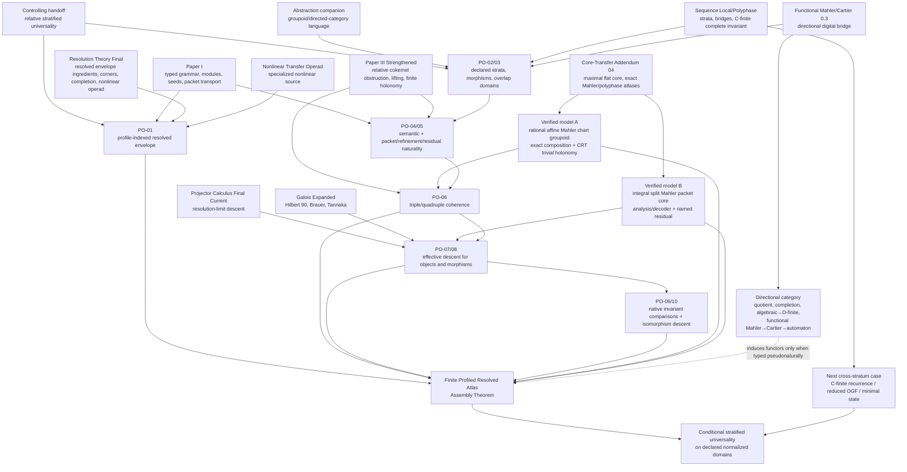

# Komorebi Math — Work Package 0
## Theorem Concordance, Corrected Dependency Graph, and Finite Atlas Assembly Theorem

**Version:** 0.1  
**Status date:** 29 August 2026  
**Controlling handoff:** `Komorebi_Stratified_Universality_Handoff_README(1).md`  
**Claim boundary:** manuscript-level internal audit and formal assembly. No independent peer-review status is inferred.

---

## 1. Result of this work package

The source audit supports the handoff's central correction: the project does **not** need another reconstruction of its foundations. It already has a typed linear nucleus, packet/refinement calculus, nonlinear operadic layer, operator-algebraic completion, finite holonomy and obstruction theories, several exact bridge families, one complete C-finite packet invariant, and several restricted complete coordinate systems. The genuinely new task is assembly.

This work package produces:

1. a statement-level concordance with **55 components**;
2. an edition-control ledger with SHA-256 provenance;
3. explicit supersession decisions for stale theorem ledgers;
4. a corrected dependency graph;
5. a formal **Finite Profiled Resolved Atlas Assembly Theorem**;
6. two verified finite atlas model cases from Addendum 04;
7. a precise list of twelve remaining proof obligations.

Status distribution: classical theorem imported and reinterpreted: 8, conjectural: 6, definition or framework only: 2, proved conditionally: 2, proved internally: 37.  
Domain distribution: Algebraic stratum: 1, Assembly: 9, Digital stratum: 2, Foundations: 15, Functional Mahler stratum: 3, Galois stratum: 4, Groupoids and descent: 7, Holonomic stratum: 1, Linear stratum: 3, Local stratum: 3, Multiplicative stratum: 1, Obstruction theory: 4, Product stratum: 1, Transform stratum: 1.

The correct global claim remains **relative universality**: universality relative to a declared resolved grammar, declared strata, declared bridges, preservation profiles, normalization targets, and an explicitly verified descent doctrine.

---

## 2. Edition-control decisions

| Source family | Selected file / relation | SHA-256 | Decision |
|---|---|---|---|
| Paper I canonical symbolic core | PSC_I_Symbolic_Core.tex | 39c869f3bd16cbef102fe68dcad51125ab4511077cc45de6d91562c0748fa95c | Primary theorem-ID and proof-status spine. Use the Expanded Clarified Edition for exposition, but preserve these stable labels/RecordIDs. |
| Paper I expanded clarified edition | PSC_Paper_I_Expanded_Clarified_Edition.tex | e91239446e2e149bbf571c5bbc7e71a76a6f9a351d68963963cfe87f5fbf3c0f | Co-primary expository edition, not a replacement for the canonical symbolic RecordID spine. |
| Resolution Theory final journal manuscript | Resolution_Theory_Final_Journal_Manuscript.tex | 3c0f37a5132c04d0715b0b85a88e34020ffdfc299bf6dd79b7fb4c4bdb32ecec | Primary integrated source for finite resolved systems, corner representation/recognition, countable completion, and nonlinear operadic structure. |
| Paper III strengthened Annals edition | PSC_Paper_III_Strengthened_Annals_Edition.tex | 20452d11443835ca9c0e0484250c01fa51e0456574c7f7c7f5549fbd0f934c89 | Supersedes older Paper III status language on the relative universal obstruction: coker(D), naturality, quotient projectors, relative exact sequence, and mapping cones are theorem-level. The choice-free cross-problem assignment of D remains open. |
| Core-Transfer Addendum 04 | Affine_Mahler_Packets_and_Periodic_Test_Sets.tex | d864bebe02eac16037f17dc677dee9078fbc02a093c7b491b31d2b0208bb91e1 | Strongest source for maximal directed cores and the exact finite Mahler/polyphase atlas, composite rank law, sharp channel minimum, and stabilization. |
| Resolution Theory Galois expanded manuscript | Resolution_Theory_Galois_Expanded_Journal_Manuscript.tex | f3c89f23db5f6e1ee8da7c396c0b30d8274154b8d1fca25d18415ec5dfe54480 | Primary source for Galois projector strata and classical descent/reconstruction inputs. |
| Sequence local/polyphase extension | Projector_Seed_Calculus_for_Integer_Sequences_Local_Polyphase_Extension.tex | e310e5fbec56954e4490615acdeecb04122bad9bd9243e79d84a08174039038a | Primary source for the broad sequence grammar, pairwise bridges, persistent C-finite complete packet invariant, and local/polyphase exact transfers. |
| Functional-Mahler/Cartier report 0.3 | Komorebi_Custom_GF_Cartier_Padic_Research_Report_0.3.pdf | 4480786c49abcb60fb39e07acf0e250c9a3af68c38ac7b4801f34bdaefd5a936 | Primary source for the rational functional-Mahler → Cartier → automaton direction and finite-mask Cartier/carry identification. |
| Nonlinear transfer operad specialized manuscript | Nonlinear_Transfer_Operad.tex | 051970594d8b34c2ec5af67e20e063963b7c8684b75a439f62ed2c5f0e70d3a8 | Specialized secondary source. Resolution Theory Final is the integrated primary source for overlapping operadic results. |
| Abstraction as a Resolved Practice | Abstraction_as_a_Resolved_Practice(1).tex | 78bad0bd370fec069f61b5b616dbc5898277229429213a227772a2df4f96861d | Conceptual source for representation groupoids, broader directed categories, and atlas language; not the theorem source for heterogeneous effective descent. |
| Projector Calculus final current | Projector_Calculus_Final_Current.tex | cc313296416b08ccbe73d893e1744ae840b6419fc5b6676805ef722ab0401b39 | Selected exact source for descent–limit interchange and cofinal resolution equivalence. |
| Master migration ledger | Master_Theorem_Migration_Ledger.csv | dceabf345ac09e507a754a928ca716ed2f797ca9aff8d777e104b49ab73dbdd1 | Historical dependency/migration evidence only; it does not override a strengthened theorem edition. |
| Paper III migration/expansion map | MIGRATION_AND_EXPANSION_MAP(1).md | 5f42dc03e5989b8883ce934752c3885ce58ae923b900a02943c86c93e4ca2242 | Authoritative supersession note for the strengthened Paper III rewrite. |
| Remaining open questions after two resolutions | Remaining_Open_Questions_and_Conjectures_After_Two_Resolutions.pdf | 13e41d43b9bbeaf0d4e5ed6dd223f6adfaf46c63ebc51987a118d9ec40843c90 | Historical open-question snapshot. Every “open” entry must be checked against later strengthened editions before reuse. |

### 2.1 Supersession corrections that materially change the theory ledger

**Paper III obstruction status.** Older Paper III editions state a broad universal packet-obstruction principle as conjectural. The strengthened edition and its migration map replace that finite-projector formulation by the canonical quotient class

\[
\operatorname{Ob}_D(r)=[r]\in\operatorname{coker}D,
\]

relative to a declared correction map \(D\). Vanishing, universality relative to \(D\), naturality, packet decomposition, quotient projectors, relative exact sequences, and mapping-cone formulations are theorem-level in the strengthened edition. What remains open is a choice-free rule that canonically supplies the correction datum for arbitrary problems and arbitrary strata.

**Paper I edition policy.** `PSC_I_Symbolic_Core.tex` is the canonical theorem-ID and proof-status spine. `PSC_Paper_I_Expanded_Clarified_Edition.tex` is a stronger expository edition, but the concordance keeps the symbolic-core labels and RecordIDs so later source changes remain traceable.

**Core-Transfer status.** Addendum 04 supersedes the earlier narrow \(m=6,d=3\) boundary as the governing source on the finite affine-Mahler slice. It proves the exact primary rank law for every selected shift set, ring-specific splitting criteria, the sharp minimum

\[
L_{\mathbb Z}(m,d)=\min\bigl(d+1,B(m)\bigr),
\qquad
B(m)=\max_{p\mid m}p^{v_p(m)},
\]

and all-degree stabilization. The \(m=6,d=3\) example is now a sharp negative-control example inside a general theorem rather than the endpoint of the theory.

**Legacy open-question documents.** The master ledger and remaining-open-questions reports are historical evidence, not the final authority. An item marked open there is open now only when no later strengthened theorem resolves it.

**Two Mahler theories remain distinct.** Functional equations \(F(z)=R(z)F(z^p)\) feed Cartier operators and automata. Newton–Mahler expansions \(f(x)=\sum_r c_r\binom xr\) describe local/p-adic interpolation and affine polyphase transfer. The current library has strong results for both but no unrestricted equivalence between them.

---

## 3. Theorem concordance

### Foundations

| ID | Proposed component | Strongest source | Exact theorem/section | Hypotheses | Status | Imported input | What remains |
|---|---|---|---|---|---|---|---|
| FND-01 | Typed linear syntax and module semantics | PSC_I_Symbolic_Core.tex | Def. Typed operator grammar, L169–190; Thm. Typed realization and module equivalence, L202–230; label thm:typed-module-equivalence; Record PSC-I-T-TYPED-MODULE-EQUIVALENCE | Finite vertex quiver; homogeneous source/target relations; unital modules over the quotient path algebra | proved internally | Finite quiver/path algebra formalism | Embed this linear nucleus into the profile-indexed resolved envelope without forcing nonlinear or completed structure on every target. |
| FND-02 | Finite free seed presentations | PSC_I_Symbolic_Core.tex | Thm. Finite free presentation, L321–345; label thm:free-presentation; Record PSC-I-T-FREE-PRESENTATION | Unital ring/module and finite distinguished seed family | proved internally | First isomorphism theorem | Import as the presentation layer of the envelope; specify how presentation changes act in each stratum. |
| FND-03 | Seed rank and functorial inequalities | PSC_I_Symbolic_Core.tex | Def. Seed rank, L430–441; Thm. Quotient monotonicity, L475–511; Cor. Isomorphism invariance, L513–522 | Unital modules; topological form additionally requires continuous actions and continuous surjective maps | proved internally | Basic module theory | State classification target correctly: generator number only, not full module isomorphism. |
| FND-04 | Closed seed-rank formulas | PSC_I_Symbolic_Core.tex | Thm. Generator number modulo Jacobson radical, L659–678; Thm. Semisimple seed-rank formula, L729–765; Thm. Single-operator seed rank, L832–850 | Finite generation; semisimple Artinian top for the closed formula; finite-dimensional single-operator module over a field | proved internally | Nakayama lemma; Wedderburn–Artin; primary decomposition of K[t]-modules | Carry hypotheses into normalized finite-linear strata; do not advertise these as canonical forms for arbitrary grammars. |
| FND-05 | Exact packet coordinates and reconstruction | PSC_I_Symbolic_Core.tex | Thm. Exact packet-coordinate isomorphism, L999ff; Thm. Exact operator reconstruction, L1270ff; Thm. Packet matrix multiplication, L1292ff | Finite complete family of pairwise annihilating idempotents; countable version requires unconditional convergence | proved internally | Direct-sum algebra | Place packet idempotents in the Karoubi/profile layer of the envelope and type finite versus countable reconstruction separately. |
| FND-06 | Block algebra and support calculus | PSC_I_Symbolic_Core.tex | Thm. Full block-algebra representation, L1354ff; Thm. Preorder support algebra decomposition, L1485ff; Thm. Reachability support, L1554ff | Declared packet system; support/preorder hypotheses as printed | proved internally | Finite-dimensional block algebra | Specify which strata retain full block multiplication and which only retain selected blocks/residual certificates. |
| FND-07 | Coordinate transport and transfer naturality | PSC_I_Symbolic_Core.tex | Thm. Coordinate transport, L1754ff; Thm. Naturality of generated hulls and transfer blocks, L1827ff | Intertwining maps and compatible packet maps | proved internally | Functoriality | Use these as local naturality inputs, then verify every concrete bridge separately. |
| FND-08 | Subobject, quotient, and packet exactness | PSC_I_Symbolic_Core.tex | Thm. Packet exact sequence, L1917–1957; Thm. Packet descent through invariant quotient, L1959–1977 | Invariant subspace under every packet idempotent | proved internally | First/third isomorphism theorems | Declare quotient bridges as directional unless the lost packet data are retained and reconstructed. |
| FND-09 | Preservation profiles and theorem transport | PSC_I_Symbolic_Core.tex | Def. Realization functor/profile, L2084–2100; Thm. Equational realization principle, L2102–2126; Prop. Realization export, L2128–2137; Def. Semantic criterion, L2139–2150 | Additive/preadditive functor; every non-equational universal construction used in a proof must be in the verified preservation profile; domain hypotheses checked separately | proved internally | Standard functorial preservation of equations and universal properties | Promote the preservation profile from prose to formal data on every stratum and bridge. |
| FND-10 | Finite resolved transfer and refinement calculus | Resolution_Theory_Final_Journal_Manuscript.tex | Thm. Mixed block representation, L188ff; Thm. Exact refinement law, L340ff; Thm. Resolution double category, L358ff | Finite Hilbert/projector systems; bounded maps; declared refinements | proved internally | Classical Hilbert-space projector calculus | Extract a target-independent algebraic core and profile the Hilbert-specific structure separately. |
| FND-11 | Universal corner extension and faithful realization | Resolution_Theory_Final_Journal_Manuscript.tex | Thm. Universal extension of compatible corner maps, L565ff; Thm. Universal projector-corner representation, surrounding §6 | Compatible multiplicative, involutive, and unit corner data; finite resolved C*-linking system for faithful Hilbert realization | proved internally | Gelfand–Naimark and standard C*-representation inputs, reworked in resolved form | Do not infer Tannakian reconstruction without a faithful exact tensor fiber functor. |
| FND-12 | Recognition and finite faithful dimension | Resolution_Theory_Final_Journal_Manuscript.tex | Thm. Recognition, L722ff; Thm. Minimal faithful dimension, L761ff | Faithful concrete corner realization; finite-dimensional C*-algebra for dimension formula | proved internally | Finite-dimensional C*-algebra structure theory | Record recognition functors and normalization domains in the atlas table. |
| FND-13 | Karoubi, countable, W*, and affiliated completion | Resolution_Theory_Final_Journal_Manuscript.tex | Thm. Countable and unbounded completion, L1121ff; associated countable linking and normal-join theorems | Countable resolved C*-category, faithful nondegenerate representation, and the printed convergence/domain hypotheses | proved internally | Standard C*/W* completion and affiliated-operator machinery | Use profile-indexed completion doctrines; no single completion is preserved by all strata. |
| FND-14 | Nonlinear packet operad and refinement coherence | Resolution_Theory_Final_Journal_Manuscript.tex; Nonlinear_Transfer_Operad.tex as specialized source | Exact multilinear reconstruction L1175ff; Packet Faà di Bruno L1239ff; Colored symmetric operad L1262ff; Nonlinear refinement coherence L1277ff | Finite derivative order and declared smoothness; packet systems complete; refinement compatibility | proved internally | Classical Faà di Bruno/operad theory, rewritten packetwise | Add the colored-operadic layer only to profiles whose target categories support it. |
| FND-15 | Local analytic nonlinear inversion | Resolution_Theory_Final_Journal_Manuscript.tex | Thm. Near-identity nonlinear inverse, L1321ff; specialized preconditioned version in Nonlinear_Transfer_Operad.tex L1115ff | Banach/analytic setting; derivative or preconditioned contraction bounds as printed | proved internally | Banach fixed-point and inverse-function methods | Global nonlinear inversion and a cross-stratum canonical nonlinear normal form remain open. |
### Groupoids, descent, and obstruction

| ID | Proposed component | Strongest source | Exact theorem/section | Hypotheses | Status | Imported input | What remains |
|---|---|---|---|---|---|---|---|
| CAT-01 | Representation groupoids separated from directional transformations | Abstraction_as_a_Resolved_Practice(1).tex; PSC Paper I category of seeded packet systems | Conceptual category/groupoid discussion around L879–909; Paper I Prop. Category of seeded packet systems L1873ff | Invertible maps for the core groupoid; arbitrary typed morphisms in the larger category | definition or framework only | Standard category/groupoid language | Give one authoritative formal definition in the foundations paper and keep quotient, truncation, completion, and compression outside the reversible core. |
| GLU-01 | Finite graph holonomy and global-frame criterion | PSC_Paper_III_Strengthened_Annals_Edition.tex | Gauge covariance L1889ff; Spanning-tree normalization L1903ff; Cycle gluing criterion L1911–1917 | Connected finite graph; invertible edge transports on a fixed fiber type | proved internally | Fundamental group of a graph | Embed as a specialization of finite atlas descent, not as proof of heterogeneous stack effectivity. |
| GLU-02 | Gauge classification of finite transports | PSC_Paper_III_Strengthened_Annals_Edition.tex | Thm. Fundamental holonomy intertwining L1939–1964; Thm. Gauge classification L1974–1988 | Connected finite graph; transports and gauge values in a declared structure group G | proved internally | Graph fundamental group; simultaneous conjugacy | Relate quotient groupoids [Rep/G] to this finite transport classification in the moduli section. |
| GLU-03 | Maximal path-flat core | Affine_Mahler_Packets_and_Periodic_Test_Sets.tex (Core-Transfer Addendum 04) | Thm. 2.1 Maximal flat core; Thm. 2.3 Rectangular directed module atlases, especially L450–490 | Finite strongly connected directed multigraph of modules; edge maps may be rectangular or singular | proved internally | Kernel/rank-nullity calculations | Generalize from finite module diagrams only after an explicit target doctrine is fixed. |
| GLU-04 | Split analysis as a genuine two-chart atlas | Affine_Mahler_Packets_and_Periodic_Test_Sets.tex (Addendum 04) | Cor. 2.4, L493–527 | R-modules X,Y and maps A:X→Y, L:Y→X with LA=I_X | proved internally | Split monomorphism/projector decomposition | Use as the first fully verified normalized atlas case; distinguish consistent core im A from residual ker L. |
| GLU-05 | Exact affine Mahler chart composition and trivial CRT holonomy | Affine_Mahler_Packets_and_Periodic_Test_Sets.tex (Addendum 04) | Thm. 3.1, L569–647 | Degree d finite; characteristic zero for invertibility; coprime multipliers for CRT diamonds | proved internally | Newton/Mahler binomial basis; Chinese remainder theorem | Package finite collections of these charts as an explicit coherent subatlas. |
| DSC-01 | Descent commutes with complete resolution | Projector_Calculus_Final_Current.tex | Resolved descent–limit theorem and Cofinal resolution equivalence, around the chapter “Refinement, infinite completion, and descent” | Compatible group/groupoid action; relevant homotopy/inverse limits exist; equivalences commute coherently with coarsening | proved conditionally | Interchange of compatible limits | The finite categories, transition maps, target completeness, and effectivity hypotheses still must be verified for each actual atlas. |
| OBS-01 | Canonical obstruction relative to declared correction data | PSC_Paper_III_Strengthened_Annals_Edition.tex | Def. Linear correction datum L971–984; Thm. Cokernel obstruction criterion L986–1004 | Declared linear map D:U→V and defect r∈V | proved internally | Universal property of cokernels | A choice-free rule assigning D to every problem and stratum is not proved. |
| OBS-02 | Obstruction naturality and packet decomposition | PSC_Paper_III_Strengthened_Annals_Edition.tex | Thm. Naturality L1008–1029; Thm. Packet decomposition L1031–1061; Prop. Quotient projectors L1067–1093 | Commuting correction square; direct-sum stability or invariance of im D under packet idempotents | proved internally | Functoriality of cokernels; direct sums | Verify these hypotheses bridge by bridge; off-diagonal correction blocks can prevent packet splitting. |
| OBS-03 | Relative/cohomological obstruction | PSC_Paper_III_Strengthened_Annals_Edition.tex | Thm. Relative obstruction exact sequence L1099–1128; Thm. Cone obstruction L1191–1204 | Commuting diagram with exact rows; cochain-map hypotheses for cone formulation | proved internally | Snake lemma / mapping-cone cohomology | Integrate as the defect object for failed bridge coherence and coarse-versus-fine loss. |
| OBS-04 | Nonlinear correction and complete filtered lifting | PSC_Paper_III_Strengthened_Annals_Edition.tex | Right-inverse correction L1278ff; Lyapunov–Schmidt L1352ff; Finitely branching lift tree L1550ff; Complete filtered lifting L1572ff | Closed-range/right-inverse, contraction, finite branching, completeness and filtration gain hypotheses as printed | proved internally | Contraction mapping, Lyapunov–Schmidt, inverse limits | Do not infer that vanishing linear obstruction removes higher nonlinear terms; verify filtered hypotheses in each stratum. |
### Galois and sequence strata

| ID | Proposed component | Strongest source | Exact theorem/section | Hypotheses | Status | Imported input | What remains |
|---|---|---|---|---|---|---|---|
| GAL-01 | Finite Galois projector realization | Resolution_Theory_Galois_Expanded_Journal_Manuscript.tex | Reynolds projector L2880–2914; Resolution Galois correspondence L2916–2950; normality/quotient compression L3010–3037 | Finite Galois extension and characteristic-zero/semisimple realization; faithful field or regular representation where stated | classical theorem imported and reinterpreted | Finite Galois correspondence; Reynolds averaging | Keep this as a declared semisimple Galois stratum rather than evidence for all symmetry strata. |
| GAL-02 | Effective linear semilinear descent | Resolution_Theory_Galois_Expanded_Journal_Manuscript.tex | Thm. Effective vector descent by Hilbert 90 L3502–3528 | Finite Galois L/K; semilinear GL_n(L)-cocycle | classical theorem imported and reinterpreted | Nonabelian Hilbert 90 | Use as a verified effectivity model; it does not prove effectivity for heterogeneous sequence/operator atlases. |
| GAL-03 | Brauer obstruction to projective descent | Resolution_Theory_Galois_Expanded_Journal_Manuscript.tex | Thm. Brauer obstruction L3544–3571 | Finite Galois L/K; projective semilinear descent class in H^1(G,PGL_n(L)) | classical theorem imported and reinterpreted | Nonabelian cohomology exact sequence; relative Brauer group | Type projective atlas objects separately from ordinary vector realizations. |
| GAL-04 | Tannakian reconstructed symmetry | Resolution_Theory_Galois_Expanded_Journal_Manuscript.tex | Thm. Tannakian reconstruction L3607–3631; monoidal boundary L3633–3639 | Neutral Tannakian category; faithful exact tensor fiber functor | classical theorem imported and reinterpreted | Neutral Tannakian reconstruction | Do not infer this group scheme from faithful corner realization alone; verify exact tensor preservation. |
| LIN-01 | C-finite recurrence ↔ rational OGF ↔ finite state | Projector_Seed_Calculus_for_Integer_Sequences_Local_Polyphase_Extension.tex | Thm. Equivalent C-finite descriptions L270–285 | Sequence over a field; eventual recurrence with transient encoded in state | classical theorem imported and reinterpreted | Companion matrices; rational generating functions | Define normalized categories and morphisms so this object-level equivalence becomes an actual atlas equivalence. |
| LIN-02 | Minimal linear dimension and similarity normalization | Projector_Seed_Calculus_for_Integer_Sequences_Local_Polyphase_Extension.tex | Thm. Minimal dimension = Hankel rank L290–309; Cor. reachable-observable reduction L311–316 | Sequence over a field; finite rank for finite-dimensional realization | classical theorem imported and reinterpreted | Hankel realization theory | Specify morphisms and semantic faithfulness for the normalized finite-state category. |
| LIN-03 | Complete persistent C-finite packet invariant | Projector_Seed_Calculus_for_Integer_Sequences_Local_Polyphase_Extension.tex | Thm. Spectral torsion–Fourier packet transfer L562ff; Compiler completeness L1007–1013; Complete C-finite packet normal form L3663–3672 | Persistent C-finite sequence over characteristic zero; active modal data and finite torsion period | proved internally | Jordan/modal decomposition; roots of unity; Hankel theory | Prove compatibility of this invariant with the recurrence/OGF/state atlas and state the exact classification target. |
| HOL-01 | P-recursive ↔ D-finite coefficient translation | Projector_Seed_Calculus_for_Integer_Sequences_Local_Polyphase_Extension.tex | Definitions L1187ff and coefficient translation via Euler operator near L1202; holonomic residue closure Thm. L1219ff | Characteristic and regularity conventions as printed; finite-order differential/recurrence operators | classical theorem imported and reinterpreted | Standard P-recursive/D-finite equivalence and closure | Minimal multisection annihilators, singularity orbits, local exponents, and cancellation signatures remain open. |
| DIG-01 | Finite digit realization ↔ finite k-kernel | Projector_Seed_Calculus_for_Integer_Sequences_Local_Polyphase_Extension.tex | Thm. Digit refinement L1372ff; Cor. Exact radix packet compiler L1379ff | Fixed radix and reading convention; finite digit/state realization | proved internally | Classical automata/kernel correspondence | Define the regular-system normalization and all-moduli packet profile; fixed-radix minimal DFAO is narrower. |
| DIG-02 | Fixed-radix automaton normal form | Projector_Seed_Calculus_for_Integer_Sequences_Local_Polyphase_Extension.tex | Prop. Finite automaton normal form L3678–3680 | Deterministic finite automaton with output; fixed radix and reading convention | classical theorem imported and reinterpreted | Myhill–Nerode minimization | Does not classify all k-regular presentations or all moduli simultaneously. |
| ALG-01 | Selected algebraic branch → packet polynomial system | Projector_Seed_Calculus_for_Integer_Sequences_Local_Polyphase_Extension.tex | Prop. Algebraic packet system L1894ff | Selected branch and exact polynomial relation; branch data retained | proved internally | Root filters and elimination | Directional only: an annihilator/system may forget branch and minimal polynomial; minimal degree and branch-collision invariants remain open. |
| TRN-01 | Invertible transform ↔ transported packet resolution | Projector_Seed_Calculus_for_Integer_Sequences_Local_Polyphase_Extension.tex | Thm. Transform transport L1540ff; triangular inverse results | Declared invertible transform, typically lower triangular with invertible diagonal | proved internally | Conjugation and triangular inversion | Identify restricted transform groups and how native invariants change. |
| PRD-01 | Euler-product exponents ↔ logarithmic-derivative recurrence | Projector_Seed_Calculus_for_Integer_Sequences_Local_Polyphase_Extension.tex | Euler-transform recurrence around §product systems, including the exact logarithmic-derivative relation | Fixed Euler basis and filtered product convergence/formality conditions | proved internally | Formal logarithmic differentiation | No canonical factorization across arbitrary product grammars or nontrivial additive–multiplicative atlas is proved. |
| MUL-01 | Prime-power seeds reconstruct multiplicative functions | Projector_Seed_Calculus_for_Integer_Sequences_Local_Polyphase_Extension.tex | Thm. Prime-power seed L2139ff; Thm. Multiplicative residue packet law L2203ff | Declared multiplicative class and prime-power seed data | proved internally | Unique factorization of integers | Not a universal product-minimality theorem; define normalized morphisms and bridge to product/additive strata. |
| LOC-01 | Finite Newton–Mahler reconstruction and local transfer | Projector_Seed_Calculus_for_Integer_Sequences_Local_Polyphase_Extension.tex | Finite Newton–Mahler reconstruction near L2940; Carmichael–Mahler L2965ff; matrix/adelic transfer L3021ff, L3058ff | Finite degree/precision and declared congruence or unit-mode hypotheses | proved internally | Newton–Mahler interpolation; p-adic congruence tools | Build canonical local normal forms and a combined spectral–local invariant. |
| LOC-02 | Exact Mahler ↔ affine polyphase coordinate transport | Projector_Seed_Calculus_for_Integer_Sequences_Local_Polyphase_Extension.tex; Addendum 04 strengthens it | Thm. Mahler polyphase transfer L3329ff; Addendum 04 Thm. 3.1 | Finite Mahler degree; coefficient ring/precision hypotheses as stated; characteristic zero for invertible single charts | proved internally | Binomial basis and affine substitution | Promote exact formulas into a typed chart category with object and morphism descent. |
| LOC-03 | Sharp minimal integral packet and universal decoder | Affine_Mahler_Packets_and_Periodic_Test_Sets.tex (Addendum 04) | Thm. 5.1 L989–1054; Thm. 7.1 L1199–1253; Thm. 7.2 L1256–1322; Thm. 7.3 L1325–1378; Thm. 8.2 L1569–1646 | Finite degree d and multiplier m; selected shift set; ring-specific splitting criteria | proved internally | Smith normal form; finite-field rank; p-adic/CRT reasoning | Use as exact native normalization on this finite local slice; it is not a global local normal form. |
| FMH-01 | Rational functional-Mahler mask → Cartier representation | Komorebi_Custom_GF_Cartier_Padic_Research_Report_0.3.pdf | Thm. 3.1 Rational-mask Cartier identity; Thm. 3.2 finite linear representation | F(z)=R(z)F(z^p) over the declared finite-field/rational-mask setting; bounded mask degree | proved internally | Cartier operators over finite fields | Keep separate from Newton–Mahler interpolation; no unrestricted equivalence between the two Mahler theories. |
| FMH-02 | Functional-Mahler finite state → automaton | Komorebi_Custom_GF_Cartier_Padic_Research_Report_0.3.pdf | Cor. 3.3 constructive automaticity | Finite Cartier state space obtained from the rational mask | proved internally | Finite-state reachability | Directional constructor; minimality and reverse recognition need separate hypotheses. |
| FMH-03 | Finite-mask Cartier transitions ↔ carry matrices | Komorebi_Custom_GF_Cartier_Padic_Research_Report_0.3.pdf | Thm. 3.4 Cartier–carry equivalence | Declared finite mask/carry state model | proved internally | Finite combinatorial matrix identification | Type exact overlap subcategory and prove compatibility with DFA minimization. |
### Cross-stratum assembly

| ID | Proposed component | Strongest source | Exact theorem/section | Hypotheses | Status | Imported input | What remains |
|---|---|---|---|---|---|---|---|
| ASM-01 | One explicit profile-indexed resolved envelope | Controlling handoff §4 Gap A; local ingredients in Paper I, Resolution Theory, and nonlinear operad sources | Target universal property Mod_Π(K,C) ≃ Fun_Π(Syn_Π(K),C) | Small finitely presented resolved theory; only structures in profile Π are freely adjoined/completed | conjectural | Free categories/path algebras, Karoubi completion, operads, completion doctrines | Construct Syn_Π(K) and prove its universal property; a family indexed by preservation profile is safer than one overpowered envelope. |
| ASM-02 | Authoritative declared stratum atlas | Controlling handoff §4 Gap B | Required table: ambient category, models, morphisms, semantics, normalization, overlaps, bridge type, information loss, inverse theorem | Finite selected family of strata and explicit normalization choices | definition or framework only | None | Write the actual atlas before claiming a global theorem. |
| ASM-03 | Bridge semantic, packet, refinement, and residual naturality | Controlling handoff §4 Gap C; local naturality inputs FND-07/FND-09/OBS-02 | Comparison squares for every certified bridge | Every bridge has a declared preservation profile and exact overlap domain | conjectural | Local functoriality results above | Verify bridge by bridge, including exact information loss for directional functors. |
| ASM-04 | Triple-overlap and quadruple coherence | Controlling handoff §2.6 and §4 Gap C | Comparison 2-cells η_{αβγ}: Φ_{βγ}Φ_{αβ}⇒Φ_{αγ} satisfying pseudofunctor coherence | Nonempty triple/quadruple overlaps and chosen bridge equivalences | conjectural | Standard pseudofunctor coherence | Prove all actual coherence diagrams; pairwise formulas alone are insufficient. |
| ASM-05 | Effective descent for the heterogeneous atlas | Controlling handoff §4 Gap D | Object and morphism descent for the selected mixed categories | Explicit topology/site or finite Čech index; semantic target complete under the gluing operation | conjectural | Specific models: finite graph gluing, Hilbert 90, split analysis, inverse-limit descent | This is the missing hypothesis for calling the total object a stack rather than a prestack/atlas. |
| ASM-06 | Native normalization and complete invariants beyond existing slices | Controlling handoff §4 Gap E | Stratum-specific targets for holonomic, algebraic, automatic/regular, nonlinear/tree, product, and local strata | Each invariant names a normalized category and exact equivalence relation | conjectural | Existing restricted complete slices | Develop separately; do not block the first cross-stratum theorem on completing every stratum. |
| ASM-07 | Coherent invariant descent and conditional global completeness | Controlling handoff §4 Gap F | Comparison maps κ_{αβ}:J_{αβ}I_α⇒I_βΦ_{αβ}; compatible local-isomorphism descent | Local completeness, bridge reflection, coherent invariant comparisons, and effective descent of isomorphisms | conjectural | Formal invariant descent in ASM-09 below | Verify first for two nontrivial normalized strata and their overlap. |
| ASM-08 | Theorem concordance and edition control | This Work Package 0; Master_Theorem_Migration_Ledger.csv; later migration maps | Edition table, theorem coordinates, hypotheses, proof class, imported input, remaining obligation | Strongest editions selected by statement-level comparison; internal versus external status separated | proved internally | Source audit and SHA-256 provenance | Maintain as a living registry; future strengthened editions must explicitly supersede rows. |
| ASM-09 | Finite Profiled Resolved Atlas Assembly Theorem | This Work Package 0, §6 and companion LaTeX theorem file | Formal theorem: descent category/pseudolimit, core groupoid, directional functoriality, profile-safe theorem transport, invariant descent, semantic effectivity, conditional completeness | Finite profiled pseudofunctor; coherent bridges; pseudonatural semantics/invariants; effective descent where claimed | proved conditionally | Standard finite pseudolimit/descent formalism plus FND-09 | Verify the hypotheses for the actual declared Komorebi atlas; the theorem does not itself establish them. |

---

## 4. Corrected dependency graph

The machine-readable Mermaid source is supplied separately as `Komorebi_Dependency_Graph_v0.1.mmd`.

### 4.1 Correct topological order of the remaining work

The remaining work has a strict dependency order:

\[
\boxed{
\text{profiled envelope}
\longrightarrow
\text{declared atlas}
\longrightarrow
\text{typed bridge laws}
\longrightarrow
\text{higher coherence}
\longrightarrow
\text{effective descent}
\longrightarrow
\text{compatible invariants}
}
\]

The first three arrows cannot be skipped. In particular, pairwise formulas do not by themselves define a pseudofunctor, and local completeness does not by itself produce compatible global isomorphisms.

---

## 5. Formal setup for the smallest new theorem

### 5.1 Finite profiled resolved atlas

Fix a small resolved theory \(\mathbb K\). A **finite profiled resolved atlas** consists of:

1. a finite Čech indexing category \(\check{\mathcal A}\), retained through the overlap degrees needed for the cocycle law;
2. a pseudofunctor
   \[
   \mathfrak R:\check{\mathcal A}^{\mathrm{op}}\longrightarrow\mathbf{Cat};
   \]
3. for every chart or overlap \(U\), a category \(\mathfrak R(U)\) of normalized models of \(\mathbb K\) with a declared preservation profile \(\Pi_U\);
4. invertible transition functors on reversible overlaps and coherent comparison 2-cells on triple overlaps;
5. a pseudonatural semantic realization
   \[
   \operatorname{Sem}:\mathfrak R\Longrightarrow\mathfrak O
   \]
   into a declared semantic doctrine \(\mathfrak O\);
6. a separate directed category of noninvertible transformations. Directional constructors, quotients, truncations, completions, and compressions are **not** arrows of the reversible Čech groupoid unless a genuine inverse on a named overlap has been proved.

The descent category \(\operatorname{Desc}(\mathfrak R)\) has compatible local objects as objects and compatible families of local morphisms as morphisms.

### 5.2 Common proof profile

For a theorem to transport across the entire finite atlas, its proof may use only constructors in the common verified profile

\[
\Pi_*:=\bigcap_{U\in\check{\mathcal A}}\Pi_U,
\]

unless the theorem is explicitly restricted to a smaller subatlas. This intersection is proof-relative: an operation absent from \(\Pi_*\) may still be used in a theorem confined to the charts that preserve it.

---

## 6. Finite Profiled Resolved Atlas Assembly Theorem

### Theorem 6.1 — finite profiled resolved atlas assembly

Let \(\mathbb K\) be a small resolved theory and let

\[
\mathfrak R:\check{\mathcal A}^{\mathrm{op}}\to\mathbf{Cat}
\]

be a finite profiled resolved atlas. Assume:

**A1. Smallness.** The chart and overlap categories are small, or locally small in a fixed universe, so the displayed descent category is defined.

**A2. Reversible overlap coherence.** The transition functors on the reversible overlap diagram are equivalences, equipped with comparison 2-cells satisfying the pseudofunctor coherence equations.

**A3. Profiled realization.** Every chart and reversible bridge realizes \(\mathbb K\) and preserves every construction used by the theorem under consideration.

**A4. Semantic pseudonaturality.** The chart semantics commute with restriction and transition functors up to the declared coherent comparison maps.

**A5. Semantic effectivity, when invoked.** Compatible local semantic objects and morphisms are effective in the chosen semantic doctrine.

Then:

1. **Descent category.** \(\operatorname{Desc}(\mathfrak R)\) is a category and represents the finite pseudolimit of the atlas.

2. **Core groupoid.** There is a canonical equivalence
   \[
   \operatorname{Core}\!\left(\operatorname{Desc}(\mathfrak R)\right)
   \simeq
   \operatorname{Desc}\!\left(\mathfrak R^{\simeq}\right),
   \]
   where \(\mathfrak R^{\simeq}\) is obtained by taking the maximal subgroupoid in every chart and overlap.

3. **Directional functoriality.** A pseudonatural transformation \(T:\mathfrak R\Rightarrow\mathfrak S\) induces
   \[
   \operatorname{Desc}(T):\operatorname{Desc}(\mathfrak R)
   \longrightarrow
   \operatorname{Desc}(\mathfrak S).
   \]
   It is an equivalence when every component is an equivalence. A pointwise noninvertible bridge remains directional and does not enter the core groupoid merely because it descends.

4. **Profile-safe theorem transport.** Let \(u,v:M\to N\) be global morphism expressions constructed from generators by operations in a verified common profile. If the corresponding canonical identity \(u=v\) is proved in the resolved syntax and every domain-specific hypothesis is verified in every participating chart, then the transported local identities form compatible descent data and
   \[
   u=v
   \quad\text{in}\quad
   \operatorname{Desc}(\mathfrak R).
   \]

5. **Semantic descent.** The pseudonatural semantics induce
   \[
   \operatorname{Desc}(\operatorname{Sem}):
   \operatorname{Desc}(\mathfrak R)
   \longrightarrow
   \operatorname{Desc}(\mathfrak O).
   \]
   Under A5, the target may be identified with the declared category of global semantic objects.

6. **Invariant descent.** Any coherent pseudonatural family of native invariants \(I:\mathfrak R\Rightarrow\mathfrak V\) induces a global invariant
   \[
   \operatorname{Desc}(I):
   \operatorname{Desc}(\mathfrak R)
   \longrightarrow
   \operatorname{Desc}(\mathfrak V).
   \]

7. **Conditional completeness.** Suppose each \(I_U\) is complete on its normalized chart and, whenever two global objects have isomorphic descended invariants, the resulting local isomorphism groupoid has an effective descent object. Then \(\operatorname{Desc}(I)\) is complete on the corresponding global normalized category.

### Proof

An object of \(\operatorname{Desc}(\mathfrak R)\) is a finite family of local objects with invertible overlap comparisons satisfying the cocycle law. A morphism is a componentwise family satisfying the overlap squares. Identities and composition are defined componentwise; coherence of the transition data makes the compatibility equations stable under composition. This gives the category and its finite pseudolimit universal property.

A descent morphism is invertible exactly when every local component is invertible: if the global morphism is invertible, each component is; conversely, componentwise inverses satisfy the overlap equations obtained by inverting the original equations. Hence the maximal subgroupoid of the descent category is exactly the descent groupoid of the chartwise cores.

A pseudonatural transformation sends local objects, transition isomorphisms, and compatible morphisms componentwise; its coherence 2-cells supply the target cocycle equations. This proves directional functoriality, with equivalence when each component is an equivalence.

For theorem transport, Paper I's equational realization principle gives the identity in every chart because every constructor used by the proof lies in the verified profile. Bridge naturality makes the local identities compatible on overlaps. Equality in the descent category is componentwise, so the global identity follows. This argument does not create missing analytic, integrality, positivity, convergence, or finiteness hypotheses.

Semantic and invariant descent are the same pseudonatural-transformation construction. Under semantic effectivity, compatible local semantic data are represented by a global semantic object. Finally, equality of descended complete invariants supplies local isomorphisms. The additional isomorphism-effectivity hypothesis is exactly what upgrades those local isomorphisms to a compatible global isomorphism. Without it, holonomy, a cokernel class, a Brauer class, or a higher coherence defect may obstruct global completeness. ∎

### 6.2 What is new and what is imported

The theorem's categorical spine is formal. The Komorebi-specific content lies in:

- the profile-sensitive resolved syntax;
- the strict separation between the reversible core and the directed transformation category;
- the use of the Paper I preservation profile as the exact theorem-transport gate;
- the explicit identification of **isomorphism descent**, not merely local completeness, as the final completeness obstruction;
- the assignment of finite holonomy, relative cokernel classes, Brauer classes, and higher coherence defects to different failure modes.

The theorem is therefore **proved conditionally**. It does not prove that the actual heterogeneous Komorebi atlas satisfies A2–A5.

---

## 7. First fully verified model cases

### Proposition 7.1 — rational affine-Mahler chart groupoid

Fix \(d\ge 0\). Over characteristic zero, the affine Mahler coefficient maps \(A_{m,s}^{(d)}\) are invertible and satisfy

\[
A_{n,t}^{(d)}A_{m,s}^{(d)}
=A_{mn,mt+s}^{(d)}.
\]

For coprime \(m,n\), every CRT diamond commutes exactly. Therefore every finite subdiagram generated by these affine charts is a strict finite chart groupoid with trivial holonomy on the declared CRT 2-cells.

This verifies bridge invertibility and a nontrivial family of triple/path coherence equations. It is a genuine atlas model, but it remains inside one finite Mahler stratum.

### Proposition 7.2 — integral split Mahler packet descent

Let \(P_{m,S}^{(d)}:\mathbb Z^{d+1}\to\mathbb Z^{|S|(d+1)}\) be the stacked affine-Mahler packet. Whenever it has an integer left inverse \(D\), set

\[
A=P_{m,S}^{(d)},
\qquad L=D,
\qquad \Pi=AL.
\]

Then

\[
LA=I,
\qquad
\Pi^2=\Pi,
\qquad
\mathbb Z^{|S|(d+1)}
=\operatorname{im}A\oplus\ker L.
\]

Thus the source chart and the consistent packet core \(\operatorname{im}A\) are exactly equivalent, while \(\ker L\) is a named directional residual. Addendum 04 proves that the prefix

\[
S_*={0,1,\ldots,L_{\mathbb Z}(m,d)-1},
\qquad
L_{\mathbb Z}(m,d)=\min(d+1,B(m)),
\]

always has such an integer decoder and is cardinality-minimal. The same split identity survives every base change. Hence this is an effective two-chart descent theorem for the normalized finite Mahler packet core over every declared coefficient ring.

### Why this is the correct first model

It simultaneously exhibits:

- a reversible core;
- locally deficient or nonsplit channels;
- collective exact recovery;
- a named residual;
- an explicit decoder;
- exact minimal packet size;
- characteristic-zero chart invertibility;
- modular and integral boundaries;
- exact coherence around CRT diamonds.

It does **not** yet establish heterogeneous effective descent across broad sequence, operator, digital, and Galois strata.

---

## 8. Next smallest cross-stratum target

The next target should be the normalized C-finite triangle:

\[
\text{minimal recurrence + initial data}
\longleftrightarrow
\text{reduced rational OGF}
\longleftrightarrow
\text{minimal reachable-observable state}.
\]

The object-level translations, minimal state dimension, reduced rational normalization, and similarity uniqueness are already present. The missing work is categorical rather than computational:

1. define morphisms in all three charts;
2. choose normalized overlap categories;
3. prove the semantic functors are conservative or faithful on those categories;
4. prove the three bridge composites agree up to a specified natural isomorphism;
5. prove the C-finite torsion–Fourier packet invariant is preserved by all three translations;
6. identify the precise automorphism group of a normalized object so local invariant matches produce compatible isomorphisms.

Completing this triangle would produce the first genuine cross-presentation invariant-descent theorem without waiting for the holonomic, algebraic, product, or nonlinear/tree strata.

---

## 9. Remaining proof obligations

| ID | Obligation | Completion criterion |
|---|---|---|
| PO-01 | Construct the profile-indexed resolved envelope | Define Syn_Π(K) from the quotient path category, declared packet idempotents/Karoubi splitting, optional colored operad, and optional completion/monoidal doctrines. Prove the profile-indexed universal realization property. |
| PO-02 | Freeze the first finite atlas | Start with a deliberately small set: persistent C-finite, finite digit/automatic, finite local Mahler/polyphase, and semisimple Galois only if their common semantics are explicit. Do not include every candidate stratum at once. |
| PO-03 | Define morphisms and normalized subcategories | For each chart, specify objects, morphisms, semantic functor, normalization, automorphisms, and which presentations are merely directional encodings. |
| PO-04 | Type each bridge | Classify every bridge as equivalence, fully faithful inclusion, conservative forgetful functor, information-losing functor, constructor, completion, partial bridge, or uncertified. |
| PO-05 | Prove bridge naturality | Verify semantics, packet analysis/synthesis, refinement, residual/certificate transport, and normalization. State exact information loss for every directional bridge. |
| PO-06 | Prove higher coherence | Construct comparison 2-cells on every nonempty triple overlap and verify the quadruple/pentagon-style pseudofunctor coherence equation. |
| PO-07 | Prove object effectivity | Show every compatible local object in the selected atlas is induced by a global object in the declared semantic doctrine. |
| PO-08 | Prove morphism effectivity | Show compatible local morphisms glue and that equality/identity/invertibility are detected as required. |
| PO-09 | Construct native comparison maps | For each overlap, construct κ_{αβ}:J_{αβ}I_α⇒I_βΦ_{αβ} and verify triple-overlap coherence. |
| PO-10 | Control the isomorphism descent obstruction | Local completeness is insufficient by itself. Prove that invariant-matched local isomorphisms can be chosen compatibly, or identify the holonomy/cokernel/Brauer class that obstructs compatibility. |
| PO-11 | Maintain theorem/edition provenance | Every new claim must cite the selected strongest edition, exact theorem, hypotheses, imported classical input, and superseded predecessor. |
| PO-12 | Separate internal proof from external validation | No reviewed/publication status is established by this audit. Keep internal proof, exact computation, imported classical input, and independent peer review in distinct fields. |

---

## 10. Claims permitted after this work package

The following claims are now supportable at manuscript level:

- Komorebi Math has a substantial common resolved syntax and many proved local realization theories.
- Invertible representation changes and noninvertible transformations can and should be separated formally.
- Exact finite atlas/gluing models exist, including finite graph holonomy, semilinear Galois descent, and split Mahler/polyphase cores.
- A canonical obstruction object exists relative to declared correction data.
- Restricted complete invariants exist in several strata; the persistent C-finite slice is the strongest complete packet classification currently audited.
- A finite profiled atlas has a formal descent/transport/invariant assembly theorem once its hypotheses are verified.

The following claims are **not** established:

- that every mathematical object has a finite Komorebi presentation;
- that all mathematical strata are equivalent;
- that every pairwise bridge is reversible;
- that the heterogeneous atlas is already a stack;
- that one global canonical minimal presentation or finite invariant classifies all strata;
- that arbitrary presentation equivalence is decidable;
- that internal manuscript proofs have received independent peer review.

---

## 11. Concrete completion criterion for the project phase

This stratified-universality phase should be called complete only when the following finite milestone is met:

1. `Syn_Π(K)` is constructed for the profiles used by a declared finite atlas.
2. At least two nontrivial normalized strata are fully specified as categories.
3. Every overlap bridge is typed and its information loss is stated.
4. All nonempty triple-overlap coherence equations are proved.
5. Descent for objects and morphisms is effective on that finite atlas.
6. One nontrivial native invariant family has coherent comparison maps and a proved global completeness theorem on the normalized descent category.
7. The theorem concordance and source edition ledger are synchronized with the final manuscript.

A successful C-finite three-chart theorem plus the already verified Mahler/polyphase model would meet most of this milestone and would justify a rigorous first **stratified representation and descent paper**. It would not need to wait for every proposed stratum.

---

## 12. Validation record

For Core-Transfer Addendum 04, the package verifier authenticated 383 ledger entries with no missing, extra, mismatched, duplicate, forbidden, or unsafe paths. The exact theorem verifier passed 48 of 48 gates, including affine-chart composition, CRT diamonds, prime-power and composite subset-rank laws, sharp global minimum, integer decoders, fixed-modulus criteria, split Mahler atlas, maximal flat core, gauge covariance, and negative controls.

The full unit-test script was also attempted. It did not finish within two bounded runs, including a 600-second run. The tests completed before timeout were passing, but this document does **not** claim a full-suite pass. The verifier result is an internal exact-computation certificate, not external validation.
